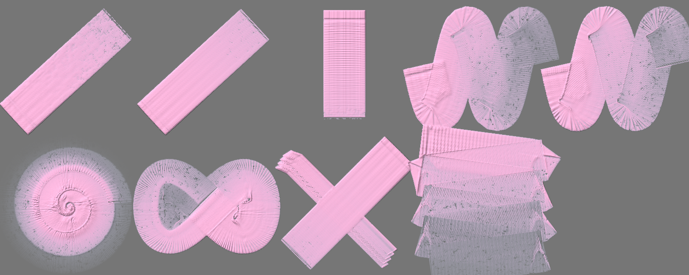
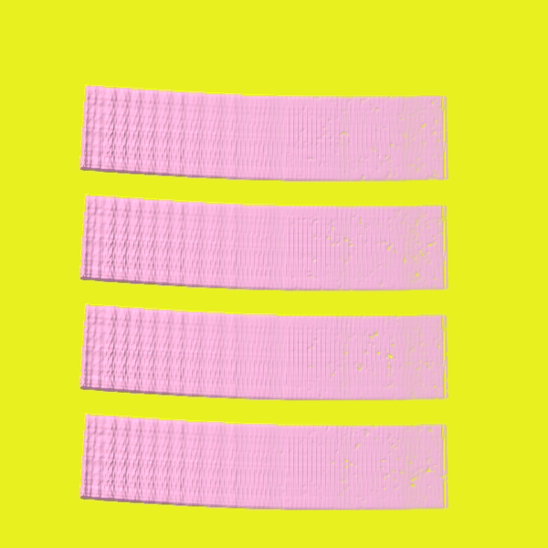

# Brush Lab — 2 brushes · Nov 3, 2026 at 11:44 PM

Every sheet: 1500 × 600, ten strokes in a 5 × 2 grid — 1. light line · 2. heavy line · 3. pressure swell · 4. fast wave · 5. slow wave · 6. spiral · 7. loop · 8. tilted · 9. over the wet one · 10. long, no reload (cell 8 holds «tilted» and «over the wet one» crossed). The CPU reference of Mamay's paint engine; the wet layer settles 20 s at the end.

Columns: **covered** = share of the cell with paint right after the stroke → after settling; **width** = painted area of the stroke ÷ its length (px); **dark** = mean darkness of the painted pixels above the paper's own grain (0 = paper, 1 = black); **spread** = how far wet paint went beyond the stroke (1.0 = stayed); **ms** = the stroke on the CPU; long stroke: paint in each quarter of its length (it should run out: wet → streaks → dry tail).

## Dev · Knife #47
Heavy acrylic · 90 px · 24.6 s

A light paint: laid on a grey sheet (on white it cannot be seen); **dark** = how far it is from the grey either way.

| stroke | covered | width | dark | spread | ms |
|---|---|---|---|---|---|
| light line | 32 % → 31 % | 91.8 px | 0.29 | 0.99 | 86 |
| heavy line | 32 % → 31 % | 91.8 px | 0.29 | 0.99 | 68 |
| pressure swell | 24 % → 25 % | 90.4 px | 0.28 | 1.04 | 23 |
| fast wave | 66 % → 57 % | 76.4 px | 0.26 | 0.86 | 145 |
| slow wave | 67 % → 59 % | 77.6 px | 0.26 | 0.87 | 262 |
| spiral | 67 % → 41 % | 44.4 px | 0.26 | 0.61 | 299 |
| loop | 60 % → 54 % | 77.8 px | 0.27 | 0.89 | 157 |
| tilted | 20 % → 20 % | 56.2 px | 0.28 | 1.00 | 52 |
| over the wet one | 48 % → 47 % | 77.0 px | 0.28 | 0.99 | 61 |
| long, no reload | 94 % → 61 % | 42.0 px | 0.25 | 0.65 | 342 | quarters: 0.00 → 0.00 → 0.00 → 0.00

Numbers say: light vs heavy: width 91.8 → 91.8 px, dark 0.29 → 0.29; pressure barely changes the width; the long stroke does not run out of paint.

## Dev · Knife #47 — own sheet
own sheet 600 × 600 · Heavy acrylic · 90 px · 5.2 s

| stroke | covered | width | dark | spread | ms |
|---|---|---|---|---|---|
| stroke 1 | 18 % → 36 % | 92.3 px | 0.11 | 1.98 | 65 |
| stroke 2 | 32 % → 48 % | 184.6 px | 0.11 | 1.49 | 53 |
| stroke 3 | 33 % → 48 % | 185.4 px | 0.11 | 1.48 | 45 |
| stroke 4 | 44 % → 43 % | 185.4 px | 0.11 | 0.99 | 50 |

Numbers say: wet paint spreads well beyond the stroke.

