# Brush Lab — 100 brushes · Nov 9, 2026 at 6:28 PM

Every sheet: 1500 × 600, ten strokes in a 5 × 2 grid — 1. light line · 2. heavy line · 3. pressure swell · 4. fast wave · 5. slow wave · 6. spiral · 7. loop · 8. tilted · 9. over the wet one · 10. long, no reload (cell 8 holds «tilted» and «over the wet one» crossed). The CPU reference of Mamay's paint engine; the wet layer settles 20 s at the end.

Columns: **covered** = share of the cell with paint right after the stroke → after settling; **width** = painted area of the stroke ÷ its length (px); **dark** = mean darkness of the painted pixels above the paper's own grain (0 = paper, 1 = black); **spread** = how far wet paint went beyond the stroke (1.0 = stayed); **ms** = the stroke on the CPU; long stroke: paint in each quarter of its length (it should run out: wet → streaks → dry tail).

## Refs v4 · #01 HW peach cloud
Gouache 1.00 + turpentine 30 % · 104 px · 149.9 s

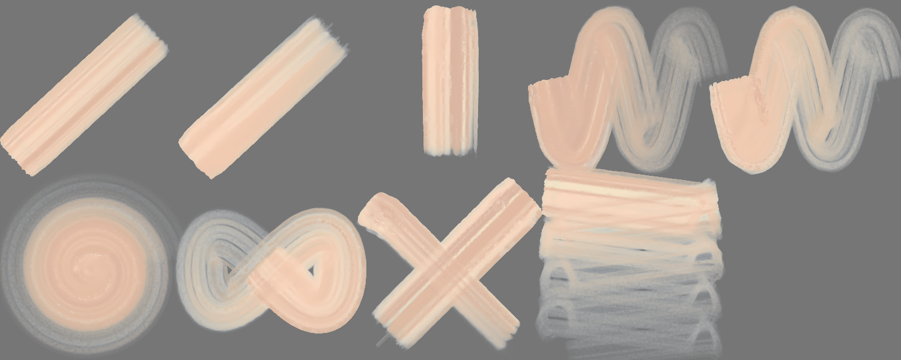

A light paint: laid on a grey sheet (on white it cannot be seen); **dark** = how far it is from the grey either way.

| stroke | covered | width | dark | spread | ms |
|---|---|---|---|---|---|
| light line | 31 % → 29 % | 90.4 px | 0.31 | 0.95 | 1122 |
| heavy line | 32 % → 29 % | 93.7 px | 0.32 | 0.91 | 1025 |
| pressure swell | 25 % → 24 % | 93.0 px | 0.29 | 0.99 | 867 |
| fast wave | 68 % → 35 % | 78.2 px | 0.25 | 0.51 | 3668 |
| slow wave | 67 % → 37 % | 76.9 px | 0.29 | 0.55 | 4096 |
| spiral | 79 % → 37 % | 52.4 px | 0.25 | 0.46 | 5555 |
| loop | 60 % → 40 % | 77.7 px | 0.30 | 0.67 | 1954 |
| tilted | 25 % → 25 % | 68.5 px | 0.28 | 1.00 | 1293 |
| over the wet one | 51 % → 48 % | 73.6 px | 0.28 | 0.94 | 997 |
| long, no reload | 96 % → 46 % | 43.2 px | 0.30 | 0.47 | 9582 | quarters: 0.00 → 0.00 → 0.00 → 0.00

Numbers say: light vs heavy: width 90.4 → 93.7 px, dark 0.31 → 0.32; pressure barely changes the width; the long stroke does not run out of paint.

## Refs v4 · #02 HW cream strokes
Gouache 1.00 + turpentine 30 % · 51 px · 92.8 s

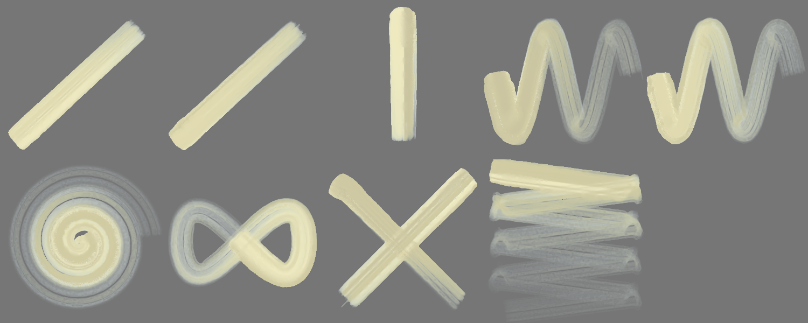

A light paint: laid on a grey sheet (on white it cannot be seen); **dark** = how far it is from the grey either way.

| stroke | covered | width | dark | spread | ms |
|---|---|---|---|---|---|
| light line | 16 % → 15 % | 46.3 px | 0.37 | 0.94 | 766 |
| heavy line | 17 % → 15 % | 48.1 px | 0.35 | 0.90 | 460 |
| pressure swell | 13 % → 12 % | 47.3 px | 0.35 | 0.95 | 352 |
| fast wave | 39 % → 17 % | 45.1 px | 0.29 | 0.43 | 1076 |
| slow wave | 40 % → 19 % | 46.2 px | 0.34 | 0.47 | 2576 |
| spiral | 59 % → 22 % | 39.0 px | 0.33 | 0.37 | 1808 |
| loop | 34 % → 20 % | 44.4 px | 0.35 | 0.57 | 770 |
| tilted | 14 % → 15 % | 40.2 px | 0.31 | 1.01 | 556 |
| over the wet one | 30 % → 26 % | 42.8 px | 0.31 | 0.88 | 518 |
| long, no reload | 74 % → 21 % | 33.2 px | 0.31 | 0.28 | 1827 | quarters: 0.00 → 0.00 → 0.01 → 0.01

Numbers say: light vs heavy: width 46.3 → 48.1 px, dark 0.37 → 0.35; pressure barely changes the width; the long stroke does not run out of paint.

## Refs v4 · #03 HW navy contours
Gouache 1.00 + turpentine 30 % · 80 px · 114.3 s

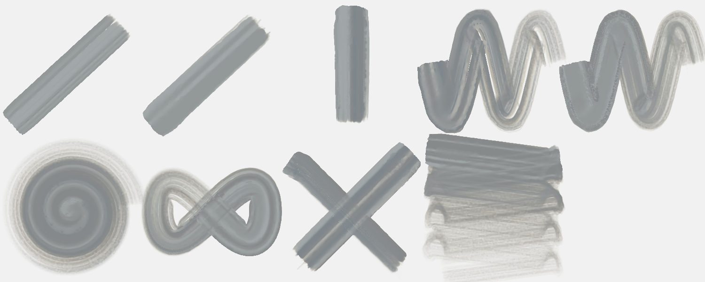

| stroke | covered | width | dark | spread | ms |
|---|---|---|---|---|---|
| light line | 24 % → 23 % | 69.5 px | 0.27 | 0.96 | 946 |
| heavy line | 26 % → 24 % | 74.2 px | 0.28 | 0.92 | 737 |
| pressure swell | 19 % → 19 % | 72.0 px | 0.31 | 0.97 | 598 |
| fast wave | 57 % → 28 % | 65.8 px | 0.32 | 0.48 | 1929 |
| slow wave | 56 % → 31 % | 65.1 px | 0.30 | 0.55 | 3189 |
| spiral | 71 % → 31 % | 46.5 px | 0.33 | 0.45 | 2654 |
| loop | 50 % → 31 % | 64.5 px | 0.30 | 0.63 | 1780 |
| tilted | 20 % → 20 % | 55.5 px | 0.32 | 1.01 | 901 |
| over the wet one | 42 % → 38 % | 61.2 px | 0.32 | 0.92 | 670 |
| long, no reload | 91 % → 32 % | 40.6 px | 0.32 | 0.36 | 3370 | quarters: 0.31 → 0.26 → 0.13 → 0.04

Numbers say: light vs heavy: width 69.5 → 74.2 px, dark 0.27 → 0.28; pressure barely changes the width.

## Refs v4 · #04 HW grey cloud
Gouache 1.00 + turpentine 30 % · 93 px · 140.4 s

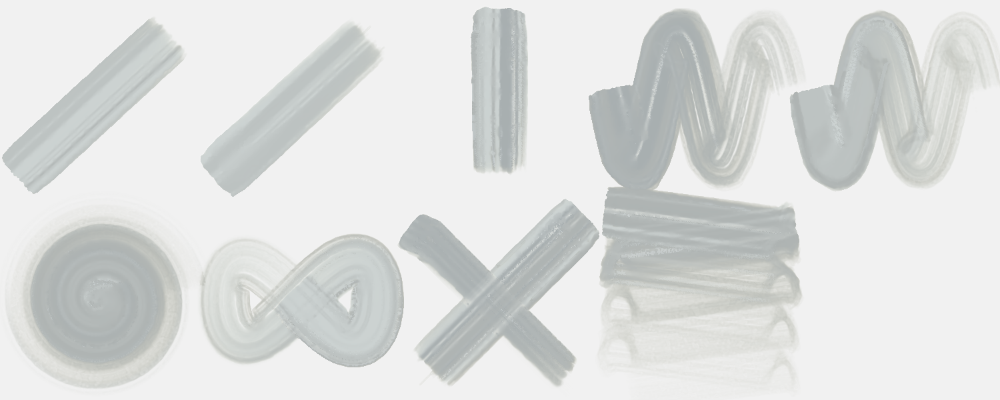

| stroke | covered | width | dark | spread | ms |
|---|---|---|---|---|---|
| light line | 28 % → 27 % | 81.6 px | 0.14 | 0.95 | 527 |
| heavy line | 29 % → 26 % | 84.5 px | 0.14 | 0.91 | 584 |
| pressure swell | 22 % → 22 % | 83.3 px | 0.17 | 0.97 | 704 |
| fast wave | 64 % → 35 % | 73.6 px | 0.22 | 0.55 | 1988 |
| slow wave | 62 % → 33 % | 72.0 px | 0.17 | 0.54 | 3284 |
| spiral | 72 % → 35 % | 47.4 px | 0.21 | 0.48 | 3936 |
| loop | 56 % → 37 % | 72.3 px | 0.12 | 0.66 | 3149 |
| tilted | 23 % → 23 % | 63.2 px | 0.19 | 1.00 | 1037 |
| over the wet one | 47 % → 44 % | 68.7 px | 0.19 | 0.92 | 1049 |
| long, no reload | 95 % → 36 % | 42.4 px | 0.19 | 0.39 | 5755 | quarters: 0.19 → 0.13 → 0.06 → 0.01

Numbers say: light vs heavy: width 81.6 → 84.5 px, dark 0.14 → 0.14; pressure barely changes the width.

## Refs v4 · #05 HW green in rust loops
Gouache 1.00 + turpentine 30 % · 104 px · 148.5 s

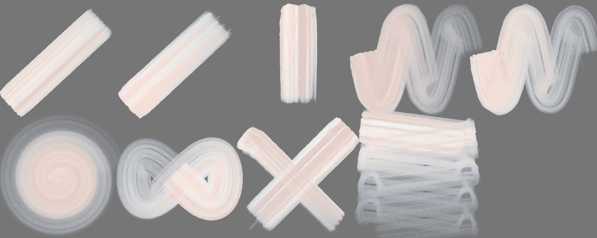

A light paint: laid on a grey sheet (on white it cannot be seen); **dark** = how far it is from the grey either way.

| stroke | covered | width | dark | spread | ms |
|---|---|---|---|---|---|
| light line | 31 % → 29 % | 90.4 px | 0.37 | 0.95 | 673 |
| heavy line | 32 % → 29 % | 93.7 px | 0.37 | 0.91 | 843 |
| pressure swell | 25 % → 24 % | 93.0 px | 0.35 | 0.99 | 1114 |
| fast wave | 68 % → 35 % | 78.2 px | 0.31 | 0.51 | 3277 |
| slow wave | 67 % → 37 % | 76.9 px | 0.34 | 0.55 | 4273 |
| spiral | 79 % → 37 % | 52.4 px | 0.31 | 0.46 | 4239 |
| loop | 60 % → 40 % | 77.7 px | 0.35 | 0.67 | 2612 |
| tilted | 25 % → 25 % | 68.5 px | 0.34 | 1.00 | 1336 |
| over the wet one | 51 % → 48 % | 73.6 px | 0.34 | 0.94 | 1036 |
| long, no reload | 96 % → 46 % | 43.2 px | 0.35 | 0.47 | 6232 | quarters: 0.00 → 0.00 → 0.00 → 0.00

Numbers say: light vs heavy: width 90.4 → 93.7 px, dark 0.37 → 0.37; pressure barely changes the width; the long stroke does not run out of paint.

## Refs v4 · #06 HW scrubbed grey
Gouache 1.00 + turpentine 30 % · 93 px · 136.4 s

| stroke | covered | width | dark | spread | ms |
|---|---|---|---|---|---|
| light line | 28 % → 27 % | 81.6 px | 0.14 | 0.95 | 635 |
| heavy line | 29 % → 26 % | 84.5 px | 0.14 | 0.91 | 698 |
| pressure swell | 22 % → 22 % | 83.3 px | 0.17 | 0.97 | 552 |
| fast wave | 64 % → 35 % | 73.6 px | 0.22 | 0.55 | 2484 |
| slow wave | 62 % → 33 % | 72.0 px | 0.17 | 0.54 | 3570 |
| spiral | 72 % → 35 % | 47.4 px | 0.21 | 0.48 | 3329 |
| loop | 56 % → 37 % | 72.3 px | 0.12 | 0.66 | 2374 |
| tilted | 23 % → 23 % | 63.2 px | 0.19 | 1.00 | 1066 |
| over the wet one | 47 % → 44 % | 68.7 px | 0.19 | 0.92 | 884 |
| long, no reload | 95 % → 36 % | 42.4 px | 0.19 | 0.39 | 8087 | quarters: 0.19 → 0.13 → 0.06 → 0.01

Numbers say: light vs heavy: width 81.6 → 84.5 px, dark 0.14 → 0.14; pressure barely changes the width.

## Refs v4 · #07 HW blue L and zigzag
Gouache 1.00 + turpentine 30 % · 104 px · 144.1 s

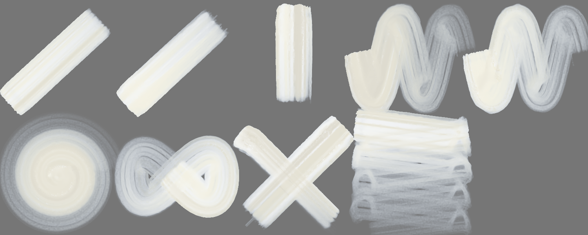

A light paint: laid on a grey sheet (on white it cannot be seen); **dark** = how far it is from the grey either way.

| stroke | covered | width | dark | spread | ms |
|---|---|---|---|---|---|
| light line | 31 % → 29 % | 90.4 px | 0.39 | 0.95 | 799 |
| heavy line | 32 % → 29 % | 93.7 px | 0.40 | 0.91 | 770 |
| pressure swell | 25 % → 24 % | 93.0 px | 0.38 | 0.99 | 704 |
| fast wave | 68 % → 35 % | 78.2 px | 0.34 | 0.51 | 2413 |
| slow wave | 67 % → 37 % | 76.9 px | 0.38 | 0.55 | 4692 |
| spiral | 79 % → 37 % | 52.4 px | 0.35 | 0.46 | 3911 |
| loop | 60 % → 40 % | 77.7 px | 0.38 | 0.67 | 3021 |
| tilted | 25 % → 25 % | 68.5 px | 0.37 | 1.00 | 1180 |
| over the wet one | 51 % → 48 % | 73.6 px | 0.37 | 0.94 | 1388 |
| long, no reload | 96 % → 46 % | 43.2 px | 0.37 | 0.47 | 5521 | quarters: 0.00 → 0.00 → 0.00 → 0.00

Numbers say: light vs heavy: width 90.4 → 93.7 px, dark 0.39 → 0.40; pressure barely changes the width; the long stroke does not run out of paint.

## Refs v4 · #08 HW lilac crown basket
Gouache 1.00 + turpentine 30 % · 36 px · 73.9 s

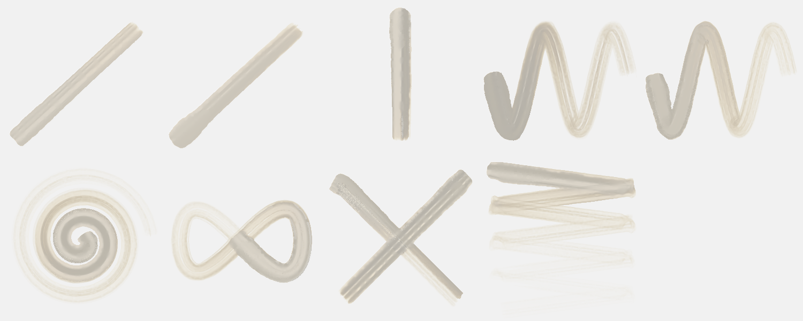

| stroke | covered | width | dark | spread | ms |
|---|---|---|---|---|---|
| light line | 11 % → 11 % | 32.8 px | 0.13 | 1.00 | 348 |
| heavy line | 12 % → 12 % | 34.6 px | 0.14 | 0.99 | 405 |
| pressure swell | 9 % → 9 % | 35.1 px | 0.16 | 0.99 | 178 |
| fast wave | 30 % → 11 % | 34.7 px | 0.22 | 0.38 | 625 |
| slow wave | 29 % → 15 % | 33.9 px | 0.16 | 0.50 | 1486 |
| spiral | 48 % → 16 % | 31.9 px | 0.15 | 0.32 | 1061 |
| loop | 26 % → 13 % | 33.5 px | 0.13 | 0.49 | 565 |
| tilted | 12 % → 12 % | 33.5 px | 0.18 | 1.01 | 328 |
| over the wet one | 24 % → 21 % | 32.3 px | 0.18 | 0.88 | 288 |
| long, no reload | 55 % → 14 % | 24.6 px | 0.14 | 0.26 | 1663 | quarters: 0.09 → 0.03 → 0.00 → 0.00

Numbers say: light vs heavy: width 32.8 → 34.6 px, dark 0.13 → 0.14; pressure barely changes the width.

## Refs v4 · #09 HW white loops
Gouache 1.00 + turpentine 30 % · 104 px · 139.7 s

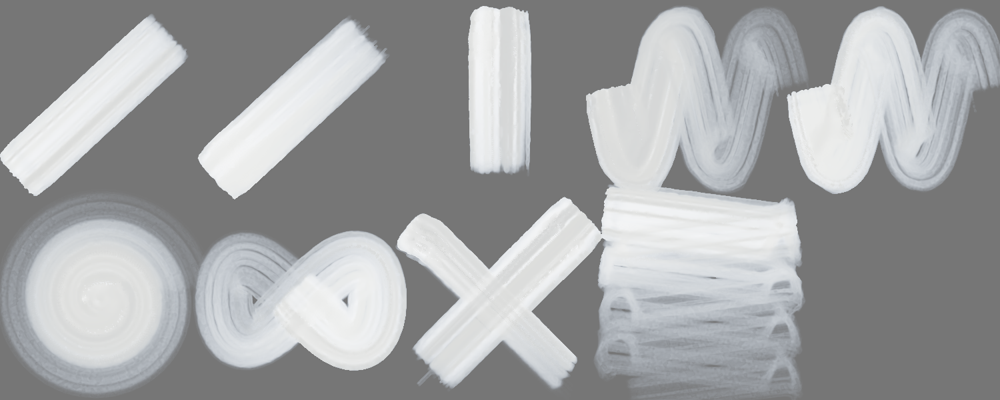

A light paint: laid on a grey sheet (on white it cannot be seen); **dark** = how far it is from the grey either way.

| stroke | covered | width | dark | spread | ms |
|---|---|---|---|---|---|
| light line | 31 % → 29 % | 90.4 px | 0.39 | 0.95 | 599 |
| heavy line | 32 % → 29 % | 93.7 px | 0.39 | 0.91 | 689 |
| pressure swell | 25 % → 24 % | 93.0 px | 0.37 | 0.99 | 654 |
| fast wave | 68 % → 35 % | 78.2 px | 0.33 | 0.51 | 3083 |
| slow wave | 67 % → 37 % | 76.9 px | 0.37 | 0.55 | 4265 |
| spiral | 79 % → 37 % | 52.4 px | 0.34 | 0.46 | 4790 |
| loop | 60 % → 40 % | 77.7 px | 0.37 | 0.67 | 2029 |
| tilted | 25 % → 25 % | 68.5 px | 0.36 | 1.00 | 1500 |
| over the wet one | 51 % → 48 % | 73.6 px | 0.36 | 0.94 | 955 |
| long, no reload | 96 % → 46 % | 43.2 px | 0.36 | 0.47 | 7724 | quarters: 0.00 → 0.00 → 0.00 → 0.00

Numbers say: light vs heavy: width 90.4 → 93.7 px, dark 0.39 → 0.39; pressure barely changes the width; the long stroke does not run out of paint.

## Refs v4 · #10 HW maroon loops
Gouache 1.00 + turpentine 30 % · 104 px · 133.8 s

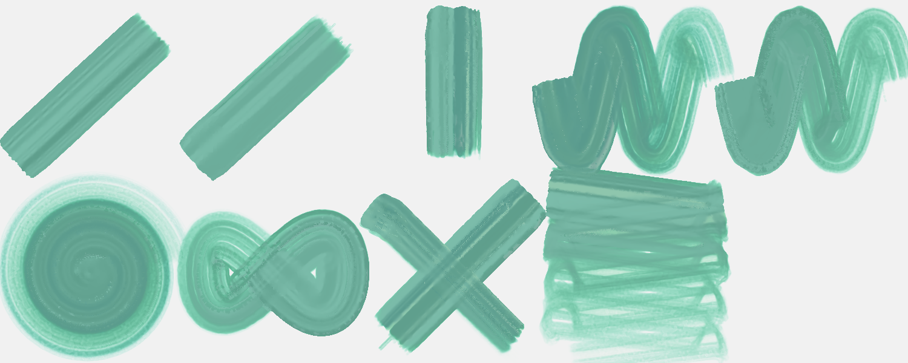

| stroke | covered | width | dark | spread | ms |
|---|---|---|---|---|---|
| light line | 31 % → 29 % | 90.4 px | 0.26 | 0.95 | 1019 |
| heavy line | 32 % → 29 % | 93.7 px | 0.25 | 0.91 | 766 |
| pressure swell | 25 % → 24 % | 93.0 px | 0.27 | 0.99 | 663 |
| fast wave | 68 % → 35 % | 78.2 px | 0.31 | 0.51 | 3101 |
| slow wave | 67 % → 37 % | 76.9 px | 0.27 | 0.55 | 4189 |
| spiral | 79 % → 37 % | 52.4 px | 0.31 | 0.46 | 4885 |
| loop | 60 % → 40 % | 77.7 px | 0.25 | 0.67 | 2034 |
| tilted | 25 % → 25 % | 68.5 px | 0.27 | 1.00 | 1739 |
| over the wet one | 51 % → 48 % | 73.6 px | 0.27 | 0.94 | 1043 |
| long, no reload | 96 % → 46 % | 43.2 px | 0.24 | 0.47 | 6120 | quarters: 0.23 → 0.22 → 0.13 → 0.05

Numbers say: light vs heavy: width 90.4 → 93.7 px, dark 0.26 → 0.25; pressure barely changes the width.

## Refs v4 · #11 HW purple balls
Gouache 1.00 + turpentine 30 % · 104 px · 137.5 s

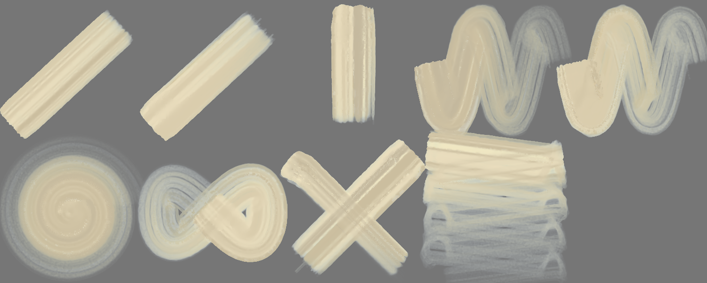

A light paint: laid on a grey sheet (on white it cannot be seen); **dark** = how far it is from the grey either way.

| stroke | covered | width | dark | spread | ms |
|---|---|---|---|---|---|
| light line | 31 % → 29 % | 90.4 px | 0.31 | 0.95 | 568 |
| heavy line | 32 % → 29 % | 93.7 px | 0.31 | 0.91 | 664 |
| pressure swell | 25 % → 24 % | 93.0 px | 0.29 | 0.99 | 620 |
| fast wave | 68 % → 35 % | 78.2 px | 0.24 | 0.51 | 2547 |
| slow wave | 67 % → 37 % | 76.9 px | 0.28 | 0.55 | 3693 |
| spiral | 79 % → 37 % | 52.4 px | 0.24 | 0.46 | 4194 |
| loop | 60 % → 40 % | 77.7 px | 0.30 | 0.67 | 2368 |
| tilted | 25 % → 25 % | 68.5 px | 0.28 | 1.00 | 1225 |
| over the wet one | 51 % → 48 % | 73.6 px | 0.28 | 0.94 | 869 |
| long, no reload | 96 % → 46 % | 43.2 px | 0.30 | 0.47 | 5904 | quarters: 0.00 → 0.00 → 0.00 → 0.00

Numbers say: light vs heavy: width 90.4 → 93.7 px, dark 0.31 → 0.31; pressure barely changes the width; the long stroke does not run out of paint.

## Refs v4 · #12 HW black-olive cage
Gouache 1.00 + turpentine 30 % · 36 px · 73.1 s

| stroke | covered | width | dark | spread | ms |
|---|---|---|---|---|---|
| light line | 11 % → 11 % | 32.8 px | 0.13 | 1.00 | 203 |
| heavy line | 12 % → 12 % | 34.6 px | 0.14 | 0.99 | 233 |
| pressure swell | 9 % → 9 % | 35.1 px | 0.16 | 0.99 | 168 |
| fast wave | 30 % → 11 % | 34.7 px | 0.22 | 0.38 | 647 |
| slow wave | 29 % → 15 % | 33.9 px | 0.16 | 0.50 | 1369 |
| spiral | 48 % → 16 % | 31.9 px | 0.15 | 0.32 | 1042 |
| loop | 26 % → 13 % | 33.5 px | 0.13 | 0.49 | 599 |
| tilted | 12 % → 12 % | 33.5 px | 0.18 | 1.01 | 339 |
| over the wet one | 24 % → 21 % | 32.3 px | 0.18 | 0.88 | 302 |
| long, no reload | 55 % → 14 % | 24.6 px | 0.14 | 0.26 | 1608 | quarters: 0.09 → 0.03 → 0.00 → 0.00

Numbers say: light vs heavy: width 32.8 → 34.6 px, dark 0.13 → 0.14; pressure barely changes the width.

## Refs v4 · #13 HW blue streaky form
Gouache 1.00 + turpentine 30 % · 104 px · 146.8 s

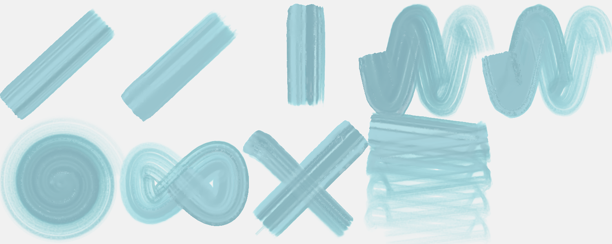

| stroke | covered | width | dark | spread | ms |
|---|---|---|---|---|---|
| light line | 31 % → 29 % | 90.4 px | 0.16 | 0.95 | 877 |
| heavy line | 32 % → 29 % | 93.7 px | 0.15 | 0.91 | 801 |
| pressure swell | 25 % → 24 % | 93.0 px | 0.18 | 0.99 | 1100 |
| fast wave | 68 % → 35 % | 78.2 px | 0.23 | 0.51 | 3946 |
| slow wave | 67 % → 37 % | 76.9 px | 0.18 | 0.55 | 4314 |
| spiral | 79 % → 37 % | 52.4 px | 0.22 | 0.46 | 4632 |
| loop | 60 % → 40 % | 77.7 px | 0.16 | 0.67 | 1966 |
| tilted | 25 % → 25 % | 68.5 px | 0.19 | 1.00 | 1253 |
| over the wet one | 51 % → 48 % | 73.6 px | 0.19 | 0.94 | 1071 |
| long, no reload | 96 % → 46 % | 43.2 px | 0.15 | 0.47 | 7381 | quarters: 0.15 → 0.12 → 0.06 → 0.01

Numbers say: light vs heavy: width 90.4 → 93.7 px, dark 0.16 → 0.15; pressure barely changes the width.

## Refs v4 · #14 HW olive totem
Gouache 1.00 + turpentine 30 % · 57 px · 97.3 s

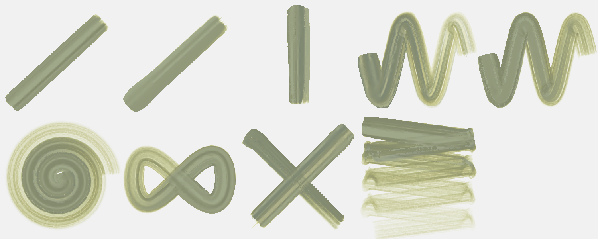

| stroke | covered | width | dark | spread | ms |
|---|---|---|---|---|---|
| light line | 18 % → 17 % | 51.3 px | 0.31 | 0.94 | 339 |
| heavy line | 18 % → 17 % | 53.5 px | 0.30 | 0.95 | 503 |
| pressure swell | 14 % → 14 % | 52.1 px | 0.32 | 0.99 | 296 |
| fast wave | 44 % → 18 % | 51.0 px | 0.34 | 0.40 | 1209 |
| slow wave | 43 % → 22 % | 50.0 px | 0.32 | 0.50 | 2278 |
| spiral | 63 % → 25 % | 41.5 px | 0.33 | 0.40 | 1985 |
| loop | 38 % → 22 % | 48.9 px | 0.31 | 0.59 | 984 |
| tilted | 15 % → 16 % | 43.0 px | 0.33 | 1.01 | 669 |
| over the wet one | 32 % → 28 % | 46.5 px | 0.33 | 0.88 | 514 |
| long, no reload | 79 % → 24 % | 35.6 px | 0.33 | 0.30 | 2664 | quarters: 0.28 → 0.19 → 0.07 → 0.02

Numbers say: light vs heavy: width 51.3 → 53.5 px, dark 0.31 → 0.30; pressure barely changes the width.

## Refs v4 · #15 Ultramarine script
Ink 0.98 · 39 px · 78.3 s

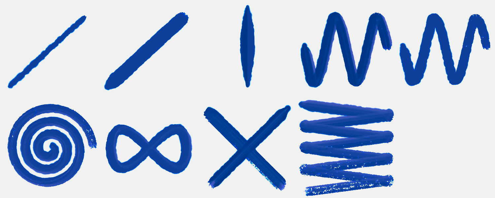

| stroke | covered | width | dark | spread | ms |
|---|---|---|---|---|---|
| light line | 4 % → 7 % | 10.5 px | 0.59 | 2.03 | 71 |
| heavy line | 14 % → 16 % | 40.2 px | 0.68 | 1.12 | 258 |
| pressure swell | 8 % → 9 % | 28.6 px | 0.68 | 1.23 | 166 |
| fast wave | 28 % → 31 % | 31.8 px | 0.69 | 1.14 | 497 |
| slow wave | 23 % → 28 % | 27.0 px | 0.67 | 1.21 | 939 |
| spiral | 39 % → 45 % | 25.8 px | 0.65 | 1.16 | 673 |
| loop | 21 % → 25 % | 27.0 px | 0.66 | 1.20 | 350 |
| tilted | 14 % → 14 % | 39.2 px | 0.70 | 1.00 | 245 |
| over the wet one | 24 % → 26 % | 27.2 px | 0.70 | 1.09 | 192 |
| long, no reload | 54 % → 60 % | 24.4 px | 0.66 | 1.10 | 1444 | quarters: 0.47 → 0.45 → 0.43 → 0.38

Numbers say: light vs heavy: width 10.5 → 40.2 px, dark 0.59 → 0.68; wet paint spreads well beyond the stroke.

## Refs v4 · #16 Shrigley strokes
Watercolour 1.00 + water 30 % · 64 px · 84.5 s

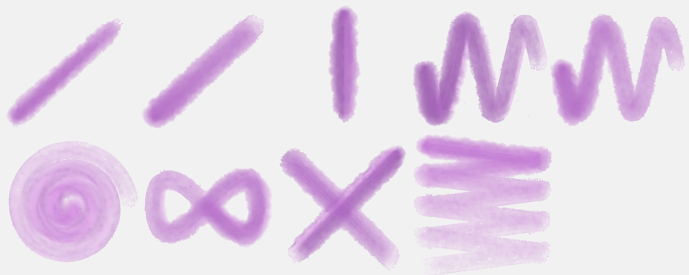

| stroke | covered | width | dark | spread | ms |
|---|---|---|---|---|---|
| light line | 8 % → 16 % | 24.6 px | 0.26 | 1.94 | 118 |
| heavy line | 17 % → 22 % | 49.0 px | 0.27 | 1.29 | 405 |
| pressure swell | 10 % → 15 % | 38.6 px | 0.32 | 1.44 | 256 |
| fast wave | 36 % → 43 % | 42.1 px | 0.30 | 1.18 | 820 |
| slow wave | 33 % → 40 % | 38.6 px | 0.25 | 1.20 | 894 |
| spiral | 57 % → 60 % | 37.9 px | 0.17 | 1.04 | 1317 |
| loop | 29 % → 35 % | 37.6 px | 0.25 | 1.20 | 562 |
| tilted | 19 % → 19 % | 52.1 px | 0.28 | 1.00 | 636 |
| over the wet one | 31 % → 36 % | 35.0 px | 0.28 | 1.16 | 355 |
| long, no reload | 71 % → 76 % | 32.1 px | 0.17 | 1.06 | 2103 | quarters: 0.23 → 0.14 → 0.10 → 0.07

Numbers say: light vs heavy: width 24.6 → 49.0 px, dark 0.26 → 0.27; wet paint spreads well beyond the stroke.

## Refs v4 · #17 Krovostok dry brush
Ink 0.93 · Gouache 0.07 · 53 px · 119.2 s

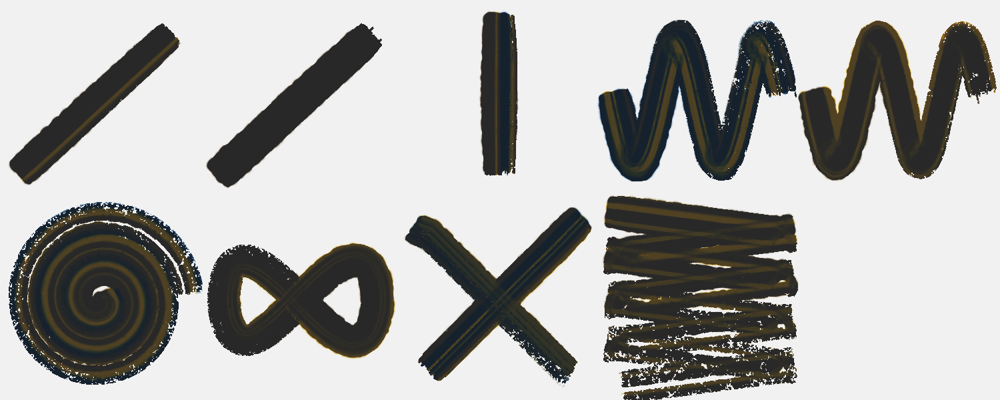

| stroke | covered | width | dark | spread | ms |
|---|---|---|---|---|---|
| light line | 16 % → 18 % | 47.0 px | 0.74 | 1.09 | 201 |
| heavy line | 18 % → 20 % | 52.5 px | 0.75 | 1.08 | 388 |
| pressure swell | 13 % → 14 % | 50.0 px | 0.75 | 1.09 | 251 |
| fast wave | 42 % → 43 % | 48.2 px | 0.77 | 1.04 | 1065 |
| slow wave | 41 % → 43 % | 46.9 px | 0.74 | 1.06 | 1247 |
| spiral | 60 % → 61 % | 39.9 px | 0.76 | 1.01 | 1751 |
| loop | 35 % → 38 % | 45.8 px | 0.75 | 1.07 | 855 |
| tilted | 15 % → 16 % | 43.2 px | 0.75 | 1.00 | 755 |
| over the wet one | 31 % → 33 % | 43.5 px | 0.75 | 1.07 | 1135 |
| long, no reload | 72 % → 77 % | 32.3 px | 0.74 | 1.07 | 2140 | quarters: 0.68 → 0.66 → 0.59 → 0.52

Numbers say: light vs heavy: width 47.0 → 52.5 px, dark 0.74 → 0.75.

## Refs v4 · #18 Twombly blue sticks
Wax 1.00 · 19 px · 21.4 s

| stroke | covered | width | dark | spread | ms |
|---|---|---|---|---|---|
| light line | 4 % → 4 % | 11.8 px | 0.24 | 1.00 | 69 |
| heavy line | 6 % → 6 % | 16.5 px | 0.25 | 1.00 | 242 |
| pressure swell | 4 % → 4 % | 15.4 px | 0.23 | 1.00 | 97 |
| fast wave | 14 % → 14 % | 16.1 px | 0.24 | 1.00 | 209 |
| slow wave | 13 % → 13 % | 15.3 px | 0.25 | 1.00 | 295 |
| spiral | 21 % → 21 % | 14.2 px | 0.24 | 1.00 | 223 |
| loop | 11 % → 11 % | 13.6 px | 0.24 | 1.00 | 107 |
| tilted | 4 % → 4 % | 12.4 px | 0.24 | 1.00 | 79 |
| over the wet one | 10 % → 10 % | 15.0 px | 0.24 | 1.00 | 69 |
| long, no reload | 27 % → 27 % | 12.2 px | 0.24 | 1.00 | 354 | quarters: 0.07 → 0.07 → 0.07 → 0.07

Numbers say: light vs heavy: width 11.8 → 16.5 px, dark 0.24 → 0.25; the long stroke does not run out of paint.

## Refs v4 · #19 Guston charcoal hand
Charcoal 1.00 · 39 px · 22.4 s

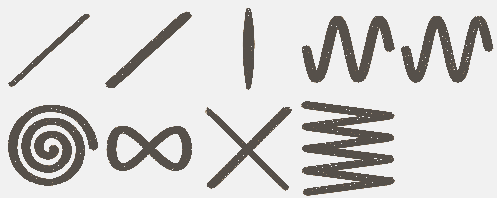

| stroke | covered | width | dark | spread | ms |
|---|---|---|---|---|---|
| light line | 6 % → 6 % | 18.2 px | 0.62 | 1.00 | 121 |
| heavy line | 11 % → 11 % | 32.3 px | 0.62 | 1.00 | 157 |
| pressure swell | 8 % → 8 % | 29.9 px | 0.62 | 1.00 | 89 |
| fast wave | 26 % → 26 % | 29.8 px | 0.62 | 1.00 | 358 |
| slow wave | 25 % → 25 % | 28.3 px | 0.62 | 1.00 | 639 |
| spiral | 39 % → 39 % | 25.8 px | 0.62 | 1.00 | 623 |
| loop | 20 % → 20 % | 25.3 px | 0.62 | 1.00 | 436 |
| tilted | 7 % → 7 % | 20.3 px | 0.61 | 1.00 | 313 |
| over the wet one | 17 % → 17 % | 27.3 px | 0.61 | 1.00 | 219 |
| long, no reload | 48 % → 48 % | 21.3 px | 0.62 | 1.00 | 945 | quarters: 0.32 → 0.32 → 0.32 → 0.32

Numbers say: light vs heavy: width 18.2 → 32.3 px, dark 0.62 → 0.62; the long stroke does not run out of paint.

## Refs v4 · #20 Orange crayon
Wax 1.00 · 48 px · 21.6 s

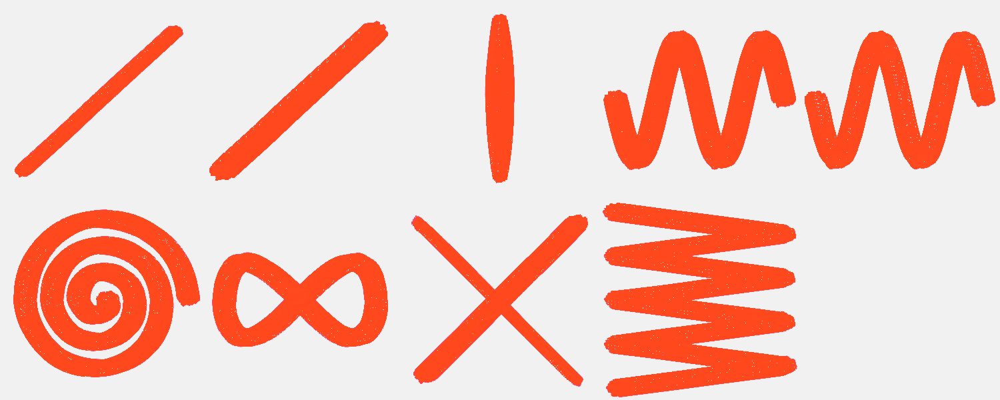

| stroke | covered | width | dark | spread | ms |
|---|---|---|---|---|---|
| light line | 9 % → 9 % | 25.1 px | 0.52 | 1.00 | 212 |
| heavy line | 14 % → 14 % | 41.0 px | 0.52 | 1.00 | 226 |
| pressure swell | 10 % → 10 % | 37.4 px | 0.52 | 1.00 | 165 |
| fast wave | 31 % → 31 % | 36.3 px | 0.52 | 1.00 | 576 |
| slow wave | 30 % → 30 % | 34.4 px | 0.52 | 1.00 | 1026 |
| spiral | 48 % → 48 % | 31.8 px | 0.52 | 1.00 | 912 |
| loop | 24 % → 24 % | 30.8 px | 0.52 | 1.00 | 474 |
| tilted | 7 % → 7 % | 20.5 px | 0.52 | 1.00 | 262 |
| over the wet one | 19 % → 19 % | 33.1 px | 0.52 | 1.00 | 223 |
| long, no reload | 55 % → 55 % | 24.8 px | 0.52 | 1.00 | 1950 | quarters: 0.32 → 0.31 → 0.32 → 0.32

Numbers say: light vs heavy: width 25.1 → 41.0 px, dark 0.52 → 0.52; the long stroke does not run out of paint.

## Refs v4 · #21 Gritty dog contours
Gouache 1.00 + water 15 % · 53 px · 100.1 s

| stroke | covered | width | dark | spread | ms |
|---|---|---|---|---|---|
| light line | 17 % → 16 % | 48.1 px | 0.38 | 0.98 | 243 |
| heavy line | 17 % → 17 % | 49.6 px | 0.38 | 0.99 | 299 |
| pressure swell | 13 % → 13 % | 50.0 px | 0.38 | 1.00 | 260 |
| fast wave | 37 % → 28 % | 43.2 px | 0.36 | 0.74 | 1156 |
| slow wave | 39 % → 31 % | 44.7 px | 0.36 | 0.80 | 1356 |
| spiral | 54 % → 34 % | 35.6 px | 0.35 | 0.64 | 2472 |
| loop | 33 % → 30 % | 42.7 px | 0.37 | 0.91 | 942 |
| tilted | 14 % → 15 % | 40.2 px | 0.39 | 1.01 | 352 |
| over the wet one | 30 % → 30 % | 44.5 px | 0.39 | 0.97 | 393 |
| long, no reload | 64 % → 39 % | 28.8 px | 0.34 | 0.61 | 1991 | quarters: 0.30 → 0.27 → 0.22 → 0.19

Numbers say: light vs heavy: width 48.1 → 49.6 px, dark 0.38 → 0.38; pressure barely changes the width.

## Refs v4 · #22 Wasilewski brush poster
Ink 0.98 · 64 px · 108.5 s

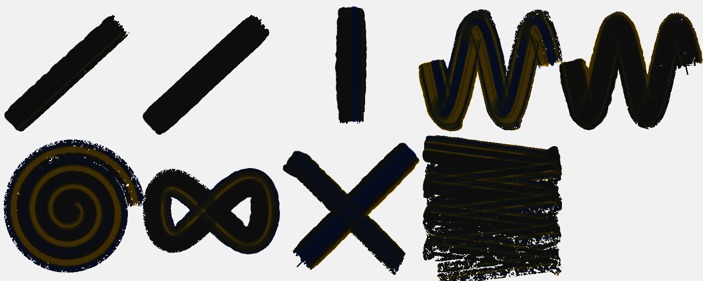

| stroke | covered | width | dark | spread | ms |
|---|---|---|---|---|---|
| light line | 19 % → 21 % | 55.5 px | 0.88 | 1.08 | 179 |
| heavy line | 22 % → 23 % | 64.9 px | 0.89 | 1.01 | 443 |
| pressure swell | 16 % → 17 % | 58.6 px | 0.88 | 1.10 | 313 |
| fast wave | 51 % → 53 % | 59.4 px | 0.84 | 1.04 | 1208 |
| slow wave | 48 % → 50 % | 55.4 px | 0.87 | 1.04 | 2342 |
| spiral | 68 % → 68 % | 44.6 px | 0.86 | 1.01 | 1969 |
| loop | 43 % → 44 % | 56.0 px | 0.87 | 1.03 | 835 |
| tilted | 18 % → 18 % | 50.4 px | 0.87 | 1.01 | 482 |
| over the wet one | 37 % → 39 % | 52.5 px | 0.87 | 1.05 | 413 |
| long, no reload | 82 % → 87 % | 36.8 px | 0.88 | 1.05 | 3231 | quarters: 0.84 → 0.84 → 0.82 → 0.73

Numbers say: light vs heavy: width 55.5 → 64.9 px, dark 0.88 → 0.89; the long stroke does not run out of paint.

## Refs v4 · #23 Report dry white mask
Ink 0.93 · Gouache 0.07 · 89 px · 161.3 s

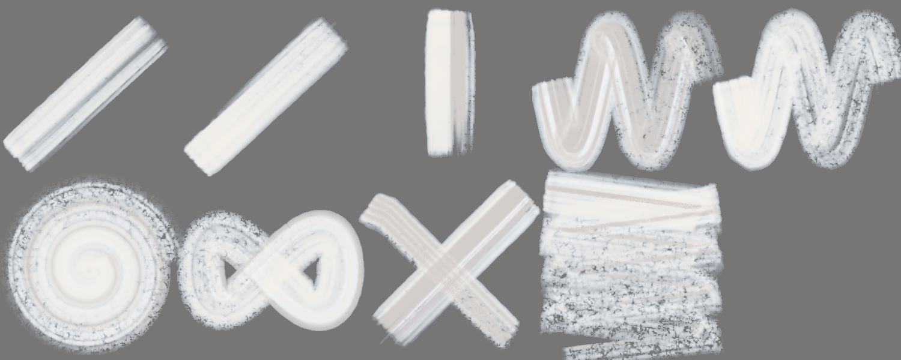

A light paint: laid on a grey sheet (on white it cannot be seen); **dark** = how far it is from the grey either way.

| stroke | covered | width | dark | spread | ms |
|---|---|---|---|---|---|
| light line | 26 % → 27 % | 76.3 px | 0.36 | 1.04 | 344 |
| heavy line | 27 % → 28 % | 78.7 px | 0.40 | 1.03 | 677 |
| pressure swell | 21 % → 23 % | 80.0 px | 0.36 | 1.08 | 565 |
| fast wave | 60 % → 63 % | 69.3 px | 0.34 | 1.05 | 1479 |
| slow wave | 60 % → 61 % | 69.6 px | 0.38 | 1.01 | 2332 |
| spiral | 75 % → 71 % | 49.3 px | 0.38 | 0.95 | 3307 |
| loop | 55 % → 56 % | 71.3 px | 0.40 | 1.03 | 1415 |
| tilted | 22 % → 22 % | 61.0 px | 0.35 | 1.01 | 757 |
| over the wet one | 46 % → 48 % | 68.1 px | 0.35 | 1.04 | 600 |
| long, no reload | 90 % → 91 % | 40.3 px | 0.36 | 1.01 | 4504 | quarters: 0.00 → 0.00 → 0.00 → 0.00

Numbers say: light vs heavy: width 76.3 → 78.7 px, dark 0.36 → 0.40; pressure barely changes the width; the long stroke does not run out of paint.

## Refs v4 · #24 Picasso flat oil
Gouache 1.00 + turpentine 20 % · 51 px · 92.9 s

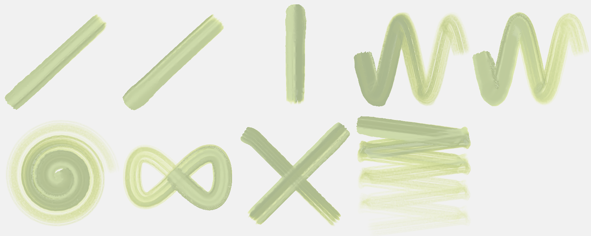

| stroke | covered | width | dark | spread | ms |
|---|---|---|---|---|---|
| light line | 16 % → 15 % | 47.0 px | 0.14 | 0.95 | 286 |
| heavy line | 17 % → 16 % | 50.4 px | 0.14 | 0.94 | 481 |
| pressure swell | 13 % → 13 % | 48.9 px | 0.16 | 0.98 | 268 |
| fast wave | 41 % → 16 % | 47.3 px | 0.22 | 0.39 | 1096 |
| slow wave | 42 % → 21 % | 48.5 px | 0.15 | 0.49 | 1786 |
| spiral | 60 % → 22 % | 39.9 px | 0.17 | 0.37 | 1878 |
| loop | 35 % → 19 % | 45.5 px | 0.13 | 0.54 | 1228 |
| tilted | 14 % → 14 % | 39.6 px | 0.19 | 1.01 | 457 |
| over the wet one | 30 % → 27 % | 43.8 px | 0.19 | 0.90 | 482 |
| long, no reload | 74 % → 21 % | 33.2 px | 0.16 | 0.28 | 2178 | quarters: 0.13 → 0.06 → 0.02 → 0.00

Numbers say: light vs heavy: width 47.0 → 50.4 px, dark 0.14 → 0.14; pressure barely changes the width.

## Refs v4 · #25 Yellow heavy stroke
Impasto 1.00 · 272 px · 156.6 s

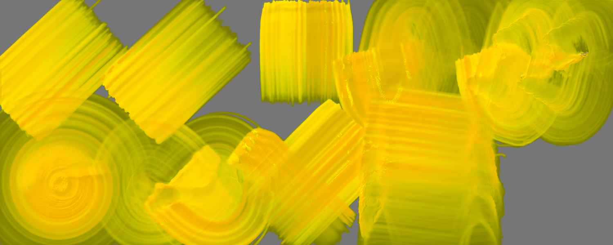

A light paint: laid on a grey sheet (on white it cannot be seen); **dark** = how far it is from the grey either way.

| stroke | covered | width | dark | spread | ms |
|---|---|---|---|---|---|
| light line | 71 % → 69 % | 205.2 px | 0.23 | 0.98 | 2643 |
| heavy line | 71 % → 49 % | 204.9 px | 0.23 | 0.69 | 3662 |
| pressure swell | 63 % → 68 % | 234.6 px | 0.21 | 1.08 | 2792 |
| fast wave | 99 % → 66 % | 114.6 px | 0.19 | 0.66 | 10818 |
| slow wave | 99 % → 57 % | 114.8 px | 0.21 | 0.57 | 23606 |
| spiral | 99 % → 67 % | 65.5 px | 0.18 | 0.68 | 17476 |
| loop | 100 % → 65 % | 129.5 px | 0.21 | 0.65 | 9467 |
| tilted | 54 % → 54 % | 149.5 px | 0.19 | 1.00 | 6005 |
| over the wet one | 89 % → 82 % | 98.3 px | 0.19 | 0.93 | 4515 |
| long, no reload | 100 % → 68 % | 44.8 px | 0.19 | 0.68 | 27874 | quarters: 0.00 → 0.00 → 0.00 → 0.00

Numbers say: light vs heavy: width 205.2 → 204.9 px, dark 0.23 → 0.23; pressure barely changes the width.

## Refs v4 · #26 Ink caricature
Ink 0.98 · 64 px · 91.0 s

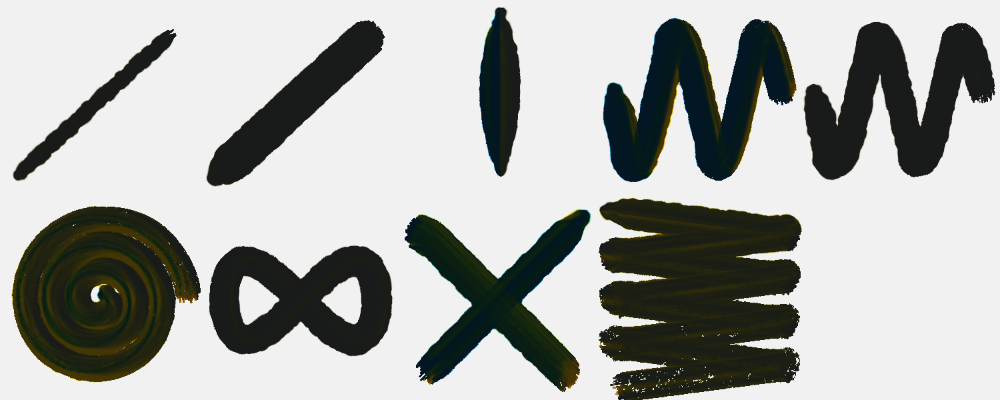

| stroke | covered | width | dark | spread | ms |
|---|---|---|---|---|---|
| light line | 6 % → 9 % | 17.6 px | 0.77 | 1.52 | 152 |
| heavy line | 20 % → 22 % | 58.8 px | 0.82 | 1.07 | 599 |
| pressure swell | 11 % → 13 % | 42.1 px | 0.82 | 1.13 | 309 |
| fast wave | 41 % → 43 % | 46.9 px | 0.84 | 1.06 | 979 |
| slow wave | 36 % → 40 % | 41.4 px | 0.82 | 1.12 | 1057 |
| spiral | 59 % → 61 % | 39.2 px | 0.80 | 1.02 | 1389 |
| loop | 31 % → 34 % | 40.0 px | 0.82 | 1.10 | 823 |
| tilted | 19 % → 19 % | 53.9 px | 0.83 | 1.00 | 497 |
| over the wet one | 33 % → 35 % | 38.9 px | 0.83 | 1.06 | 318 |
| long, no reload | 78 % → 81 % | 35.2 px | 0.82 | 1.03 | 1859 | quarters: 0.72 → 0.72 → 0.71 → 0.67

Numbers say: light vs heavy: width 17.6 → 58.8 px, dark 0.77 → 0.82; the long stroke does not run out of paint; wet paint spreads well beyond the stroke.

## Refs v4 · #27 Orange impasto swatch
Impasto 1.00 · 80 px · 41.1 s

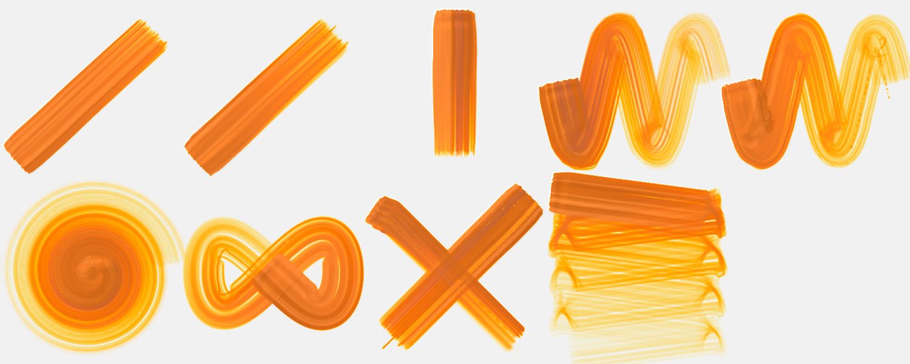

| stroke | covered | width | dark | spread | ms |
|---|---|---|---|---|---|
| light line | 24 % → 20 % | 69.4 px | 0.31 | 0.83 | 510 |
| heavy line | 25 % → 16 % | 72.2 px | 0.33 | 0.63 | 635 |
| pressure swell | 19 % → 16 % | 70.5 px | 0.35 | 0.84 | 393 |
| fast wave | 53 % → 17 % | 61.3 px | 0.38 | 0.31 | 1843 |
| slow wave | 54 % → 18 % | 62.5 px | 0.34 | 0.33 | 3181 |
| spiral | 60 % → 19 % | 39.6 px | 0.38 | 0.32 | 2702 |
| loop | 48 % → 21 % | 62.4 px | 0.33 | 0.43 | 1183 |
| tilted | 19 % → 19 % | 51.7 px | 0.37 | 1.00 | 834 |
| over the wet one | 40 % → 31 % | 60.3 px | 0.37 | 0.77 | 719 |
| long, no reload | 74 % → 20 % | 33.2 px | 0.36 | 0.27 | 3360 | quarters: 0.31 → 0.16 → 0.06 → 0.01

Numbers say: light vs heavy: width 69.4 → 72.2 px, dark 0.31 → 0.33; pressure barely changes the width.

## Refs v4 · #28 Miles Davis lines
Ink 0.98 · 18 px · 61.4 s

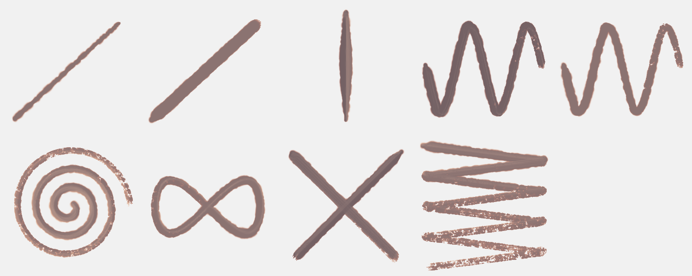

| stroke | covered | width | dark | spread | ms |
|---|---|---|---|---|---|
| light line | 2 % → 6 % | 4.8 px | 0.31 | 3.59 | 71 |
| heavy line | 8 % → 11 % | 24.6 px | 0.42 | 1.25 | 195 |
| pressure swell | 4 % → 7 % | 16.1 px | 0.40 | 1.58 | 111 |
| fast wave | 15 % → 21 % | 16.8 px | 0.46 | 1.42 | 447 |
| slow wave | 12 % → 19 % | 14.2 px | 0.39 | 1.55 | 328 |
| spiral | 20 % → 27 % | 13.0 px | 0.35 | 1.37 | 509 |
| loop | 12 % → 17 % | 15.4 px | 0.39 | 1.42 | 265 |
| tilted | 8 % → 8 % | 21.7 px | 0.44 | 1.04 | 142 |
| over the wet one | 14 % → 17 % | 17.0 px | 0.44 | 1.26 | 154 |
| long, no reload | 31 % → 38 % | 13.7 px | 0.40 | 1.23 | 807 | quarters: 0.21 → 0.18 → 0.15 → 0.12

Numbers say: light vs heavy: width 4.8 → 24.6 px, dark 0.31 → 0.42; wet paint spreads well beyond the stroke.

## Refs v4 · #29 Shrigley asterisk
Watercolour 1.00 + water 50 % · 64 px · 112.8 s

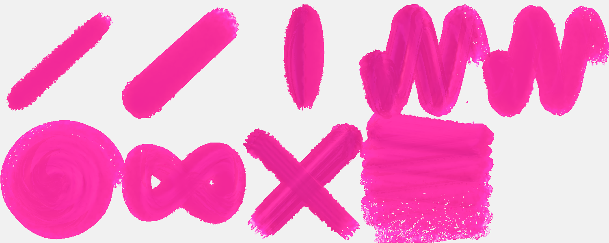

| stroke | covered | width | dark | spread | ms |
|---|---|---|---|---|---|
| light line | 18 % → 20 % | 51.8 px | 0.57 | 1.14 | 218 |
| heavy line | 35 % → 36 % | 103.0 px | 0.56 | 1.00 | 541 |
| pressure swell | 22 % → 24 % | 82.6 px | 0.59 | 1.07 | 581 |
| fast wave | 64 % → 68 % | 74.4 px | 0.58 | 1.05 | 1484 |
| slow wave | 61 % → 62 % | 70.9 px | 0.56 | 1.01 | 2276 |
| spiral | 74 % → 74 % | 49.1 px | 0.54 | 1.00 | 2360 |
| loop | 54 % → 55 % | 69.7 px | 0.56 | 1.01 | 1289 |
| tilted | 22 % → 22 % | 61.3 px | 0.58 | 1.00 | 589 |
| over the wet one | 48 % → 52 % | 72.8 px | 0.58 | 1.07 | 769 |
| long, no reload | 93 % → 94 % | 41.8 px | 0.54 | 1.01 | 3946 | quarters: 0.56 → 0.56 → 0.54 → 0.46

Numbers say: light vs heavy: width 51.8 → 103.0 px, dark 0.57 → 0.56.

## Refs v4 · #30 Red gouache face
Gouache 1.00 + water 15 % · 76 px · 117.3 s

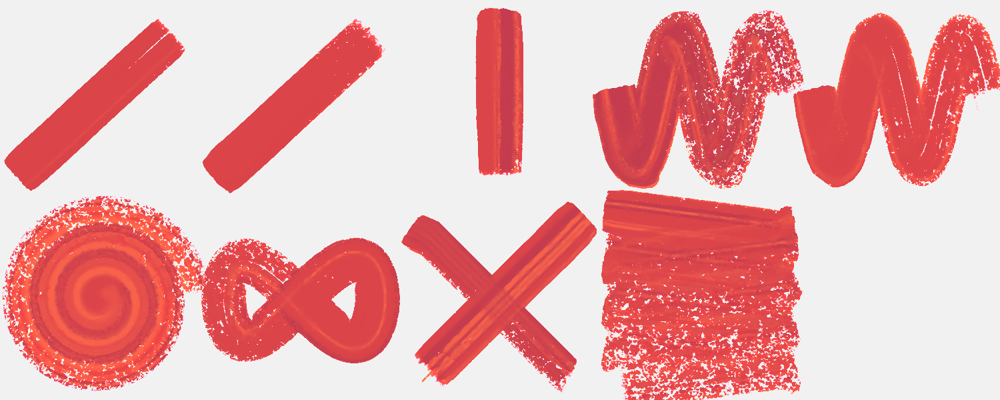

| stroke | covered | width | dark | spread | ms |
|---|---|---|---|---|---|
| light line | 23 % → 23 % | 66.6 px | 0.48 | 0.98 | 302 |
| heavy line | 24 % → 23 % | 70.3 px | 0.48 | 0.94 | 421 |
| pressure swell | 18 % → 18 % | 68.7 px | 0.48 | 1.00 | 367 |
| fast wave | 51 % → 39 % | 59.4 px | 0.49 | 0.76 | 1438 |
| slow wave | 52 % → 41 % | 60.1 px | 0.47 | 0.79 | 3381 |
| spiral | 64 % → 42 % | 42.5 px | 0.44 | 0.66 | 2464 |
| loop | 46 % → 40 % | 59.0 px | 0.48 | 0.89 | 1238 |
| tilted | 18 % → 18 % | 50.5 px | 0.47 | 1.01 | 634 |
| over the wet one | 40 % → 38 % | 60.0 px | 0.47 | 0.97 | 571 |
| long, no reload | 79 % → 54 % | 35.6 px | 0.47 | 0.68 | 3421 | quarters: 0.45 → 0.43 → 0.38 → 0.31

Numbers say: light vs heavy: width 66.6 → 70.3 px, dark 0.48 → 0.48; pressure barely changes the width.

## Refs v4 · #31 Warhol blotted line
Ink 0.98 · 25 px · 59.8 s

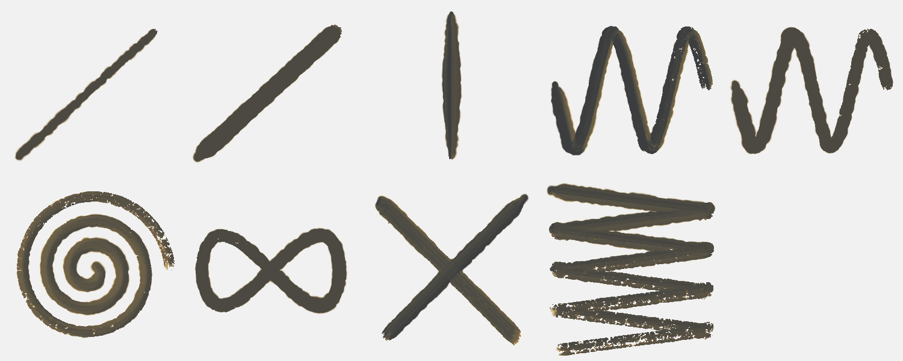

| stroke | covered | width | dark | spread | ms |
|---|---|---|---|---|---|
| light line | 3 % → 7 % | 9.5 px | 0.52 | 2.03 | 65 |
| heavy line | 9 % → 12 % | 27.6 px | 0.61 | 1.21 | 137 |
| pressure swell | 5 % → 7 % | 19.8 px | 0.59 | 1.38 | 95 |
| fast wave | 19 % → 23 % | 21.8 px | 0.62 | 1.22 | 337 |
| slow wave | 17 % → 22 % | 19.4 px | 0.59 | 1.33 | 635 |
| spiral | 26 % → 33 % | 17.4 px | 0.56 | 1.25 | 417 |
| loop | 14 % → 19 % | 18.7 px | 0.60 | 1.30 | 229 |
| tilted | 10 % → 10 % | 26.9 px | 0.60 | 1.02 | 154 |
| over the wet one | 17 % → 20 % | 19.9 px | 0.60 | 1.19 | 132 |
| long, no reload | 39 % → 46 % | 17.6 px | 0.61 | 1.16 | 819 | quarters: 0.35 → 0.33 → 0.29 → 0.26

Numbers say: light vs heavy: width 9.5 → 27.6 px, dark 0.52 → 0.61; wet paint spreads well beyond the stroke.

## Refs v4 · #32 Thick orange swipes
Impasto 1.00 · 76 px · 43.8 s

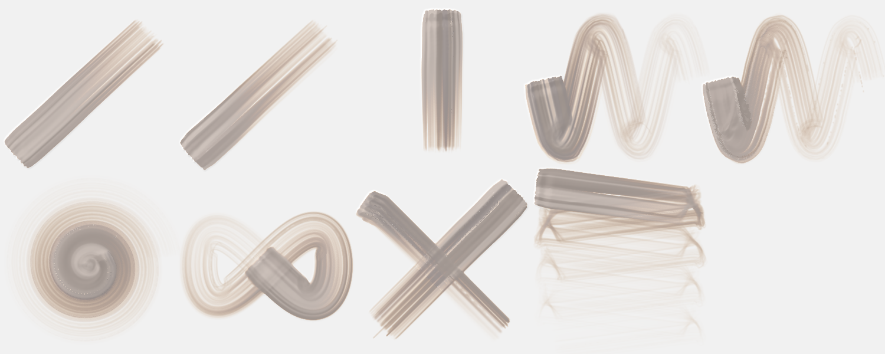

| stroke | covered | width | dark | spread | ms |
|---|---|---|---|---|---|
| light line | 23 % → 18 % | 67.2 px | 0.21 | 0.79 | 447 |
| heavy line | 24 % → 14 % | 68.8 px | 0.23 | 0.59 | 506 |
| pressure swell | 18 % → 15 % | 67.9 px | 0.25 | 0.83 | 467 |
| fast wave | 52 % → 16 % | 60.3 px | 0.28 | 0.30 | 2164 |
| slow wave | 52 % → 17 % | 59.6 px | 0.25 | 0.32 | 3164 |
| spiral | 59 % → 19 % | 39.2 px | 0.27 | 0.32 | 2591 |
| loop | 47 % → 19 % | 60.8 px | 0.23 | 0.41 | 1191 |
| tilted | 18 % → 18 % | 50.0 px | 0.27 | 1.00 | 870 |
| over the wet one | 39 % → 29 % | 59.0 px | 0.27 | 0.74 | 943 |
| long, no reload | 72 % → 20 % | 32.4 px | 0.25 | 0.27 | 3108 | quarters: 0.20 → 0.04 → 0.01 → 0.00

Numbers say: light vs heavy: width 67.2 → 68.8 px, dark 0.21 → 0.23; pressure barely changes the width.

## Refs v4 · #33 Red wet-in-wet flames
Watercolour 1.00 + water 60 % · 96 px · 159.4 s

| stroke | covered | width | dark | spread | ms |
|---|---|---|---|---|---|
| light line | 30 % → 53 % | 87.1 px | 0.48 | 1.77 | 342 |
| heavy line | 49 % → 58 % | 141.3 px | 0.55 | 1.20 | 733 |
| pressure swell | 30 % → 48 % | 110.7 px | 0.50 | 1.62 | 674 |
| fast wave | 75 % → 88 % | 87.2 px | 0.61 | 1.16 | 2422 |
| slow wave | 78 % → 87 % | 90.0 px | 0.59 | 1.12 | 3636 |
| spiral | 88 % → 97 % | 57.8 px | 0.58 | 1.10 | 3797 |
| loop | 68 % → 82 % | 88.0 px | 0.58 | 1.21 | 2078 |
| tilted | 39 % → 41 % | 109.9 px | 0.56 | 1.05 | 1026 |
| over the wet one | 71 % → 92 % | 88.2 px | 0.56 | 1.29 | 1450 |
| long, no reload | 97 % → 100 % | 43.4 px | 0.61 | 1.03 | 5269 | quarters: 0.65 → 0.65 → 0.62 → 0.54

Numbers say: light vs heavy: width 87.1 → 141.3 px, dark 0.48 → 0.55; wet paint spreads well beyond the stroke.

## Refs v4 · #34 Magenta oil patches
Gouache 1.00 + turpentine 20 % · 90 px · 126.0 s

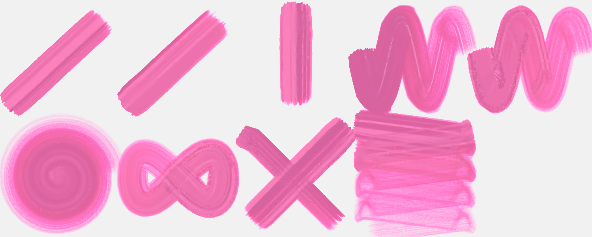

| stroke | covered | width | dark | spread | ms |
|---|---|---|---|---|---|
| light line | 29 % → 27 % | 82.9 px | 0.28 | 0.93 | 573 |
| heavy line | 30 % → 27 % | 87.9 px | 0.29 | 0.89 | 684 |
| pressure swell | 23 % → 22 % | 85.1 px | 0.29 | 0.97 | 812 |
| fast wave | 63 % → 32 % | 73.0 px | 0.35 | 0.50 | 2323 |
| slow wave | 63 % → 34 % | 72.6 px | 0.30 | 0.54 | 3834 |
| spiral | 75 % → 35 % | 49.7 px | 0.34 | 0.47 | 3528 |
| loop | 56 % → 37 % | 72.4 px | 0.29 | 0.66 | 1874 |
| tilted | 22 % → 22 % | 61.4 px | 0.32 | 1.00 | 1077 |
| over the wet one | 47 % → 43 % | 71.1 px | 0.32 | 0.90 | 877 |
| long, no reload | 95 % → 39 % | 42.8 px | 0.30 | 0.41 | 6849 | quarters: 0.30 → 0.28 → 0.22 → 0.12

Numbers say: light vs heavy: width 82.9 → 87.9 px, dark 0.28 → 0.29; pressure barely changes the width.

## Refs v4 · #35 Red band with runs
Watercolour 1.00 + water 70 % · 176 px · 227.9 s

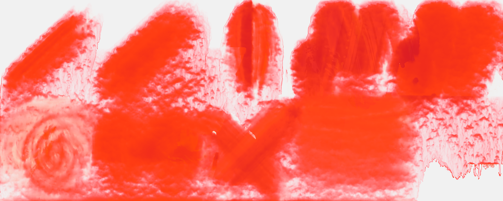

| stroke | covered | width | dark | spread | ms |
|---|---|---|---|---|---|
| light line | 51 % → 68 % | 149.1 px | 0.33 | 1.32 | 1165 |
| heavy line | 81 % → 79 % | 236.3 px | 0.46 | 0.97 | 2708 |
| pressure swell | 59 % → 76 % | 221.0 px | 0.34 | 1.29 | 1885 |
| fast wave | 92 % → 96 % | 106.3 px | 0.52 | 1.04 | 6314 |
| slow wave | 93 % → 96 % | 107.8 px | 0.51 | 1.03 | 12783 |
| spiral | 99 % → 100 % | 65.0 px | 0.31 | 1.01 | 12616 |
| loop | 100 % → 100 % | 129.5 px | 0.52 | 1.00 | 5933 |
| tilted | 89 % → 89 % | 247.1 px | 0.45 | 1.00 | 2816 |
| over the wet one | 95 % → 100 % | 17.5 px | 0.45 | 1.05 | 2931 |
| long, no reload | 99 % → 100 % | 44.5 px | 0.46 | 1.01 | 16588 | quarters: 0.53 → 0.52 → 0.49 → 0.35

Numbers say: light vs heavy: width 149.1 → 236.3 px, dark 0.33 → 0.46.

## Refs v4 · #36 Magenta letters flat
Gouache 1.00 + water 15 % · 64 px · 105.7 s

| stroke | covered | width | dark | spread | ms |
|---|---|---|---|---|---|
| light line | 18 % → 18 % | 52.1 px | 0.39 | 0.99 | 247 |
| heavy line | 21 % → 19 % | 60.9 px | 0.39 | 0.92 | 666 |
| pressure swell | 16 % → 16 % | 59.0 px | 0.39 | 1.00 | 356 |
| fast wave | 43 % → 34 % | 49.5 px | 0.39 | 0.78 | 1212 |
| slow wave | 46 % → 38 % | 53.6 px | 0.38 | 0.81 | 1943 |
| spiral | 56 % → 37 % | 37.0 px | 0.39 | 0.67 | 2443 |
| loop | 39 % → 34 % | 51.1 px | 0.39 | 0.87 | 885 |
| tilted | 16 % → 17 % | 45.4 px | 0.40 | 1.01 | 507 |
| over the wet one | 35 % → 34 % | 52.3 px | 0.40 | 0.96 | 529 |
| long, no reload | 70 % → 45 % | 31.3 px | 0.37 | 0.65 | 3001 | quarters: 0.34 → 0.31 → 0.26 → 0.21

Numbers say: light vs heavy: width 52.1 → 60.9 px, dark 0.39 → 0.39.

## Refs v4 · #37 Oil still life
Gouache 1.00 + turpentine 20 % · 28 px · 67.9 s

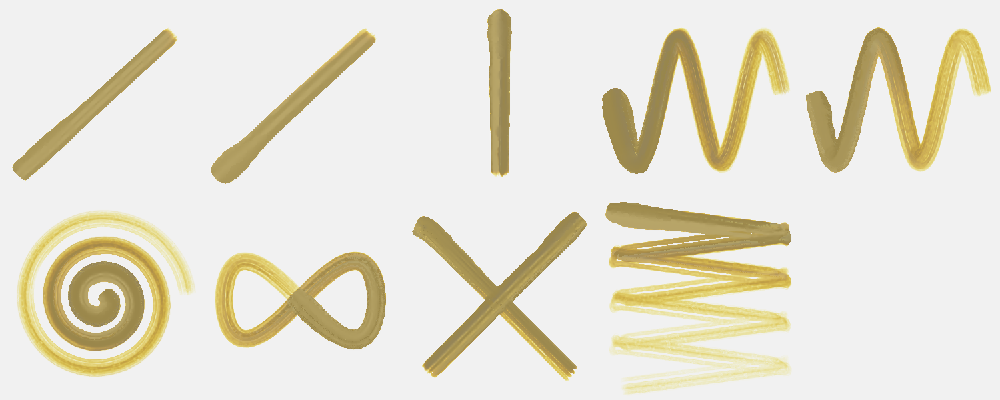

| stroke | covered | width | dark | spread | ms |
|---|---|---|---|---|---|
| light line | 9 % → 9 % | 26.9 px | 0.31 | 1.01 | 337 |
| heavy line | 10 % → 10 % | 29.2 px | 0.31 | 0.97 | 207 |
| pressure swell | 8 % → 8 % | 28.6 px | 0.34 | 1.03 | 167 |
| fast wave | 25 % → 11 % | 28.9 px | 0.39 | 0.42 | 496 |
| slow wave | 25 % → 11 % | 29.1 px | 0.34 | 0.44 | 875 |
| spiral | 39 % → 11 % | 25.8 px | 0.36 | 0.29 | 937 |
| loop | 21 % → 10 % | 26.7 px | 0.33 | 0.46 | 650 |
| tilted | 10 % → 10 % | 27.1 px | 0.35 | 1.02 | 280 |
| over the wet one | 20 % → 18 % | 27.8 px | 0.35 | 0.90 | 237 |
| long, no reload | 47 % → 13 % | 21.0 px | 0.33 | 0.27 | 1193 | quarters: 0.20 → 0.10 → 0.03 → 0.01

Numbers say: light vs heavy: width 26.9 → 29.2 px, dark 0.31 → 0.31; pressure barely changes the width.

## Refs v4 · #38 Sanguine drawing
Charcoal 0.50 · Pastel 0.50 · 12 px · 17.8 s

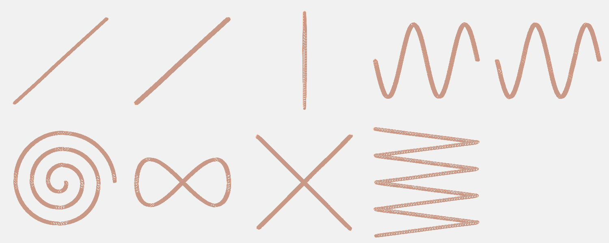

| stroke | covered | width | dark | spread | ms |
|---|---|---|---|---|---|
| light line | 3 % → 3 % | 9.0 px | 0.31 | 1.00 | 55 |
| heavy line | 4 % → 4 % | 12.2 px | 0.31 | 1.00 | 51 |
| pressure swell | 3 % → 3 % | 9.5 px | 0.27 | 1.00 | 28 |
| fast wave | 10 % → 10 % | 11.4 px | 0.31 | 1.00 | 106 |
| slow wave | 10 % → 10 % | 11.4 px | 0.31 | 1.00 | 107 |
| spiral | 15 % → 15 % | 10.2 px | 0.31 | 1.00 | 223 |
| loop | 8 % → 8 % | 10.0 px | 0.31 | 1.00 | 95 |
| tilted | 4 % → 4 % | 10.8 px | 0.31 | 1.00 | 70 |
| over the wet one | 8 % → 8 % | 10.8 px | 0.31 | 1.00 | 50 |
| long, no reload | 18 % → 18 % | 8.1 px | 0.30 | 1.00 | 452 | quarters: 0.06 → 0.06 → 0.06 → 0.06

Numbers say: light vs heavy: width 9.0 → 12.2 px, dark 0.31 → 0.31; the long stroke does not run out of paint.

## Refs v4 · #39 Thick impasto weave
Impasto 1.00 · 96 px · 55.2 s

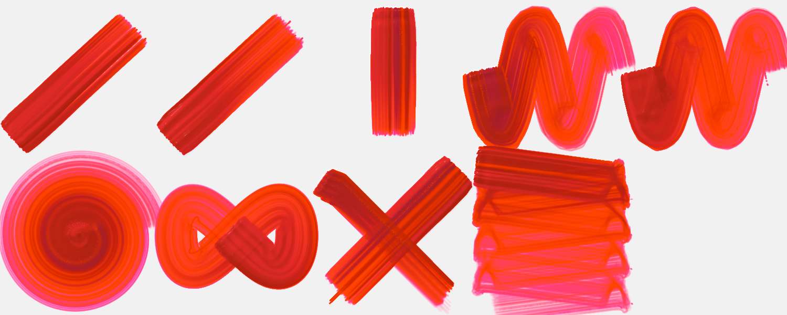

| stroke | covered | width | dark | spread | ms |
|---|---|---|---|---|---|
| light line | 28 % → 24 % | 82.0 px | 0.46 | 0.85 | 756 |
| heavy line | 30 % → 19 % | 85.8 px | 0.46 | 0.63 | 826 |
| pressure swell | 23 % → 20 % | 84.5 px | 0.46 | 0.87 | 623 |
| fast wave | 61 % → 22 % | 70.0 px | 0.49 | 0.36 | 1804 |
| slow wave | 61 % → 21 % | 70.8 px | 0.47 | 0.34 | 3452 |
| spiral | 65 % → 21 % | 42.6 px | 0.49 | 0.33 | 4109 |
| loop | 56 % → 25 % | 72.2 px | 0.45 | 0.45 | 1646 |
| tilted | 21 % → 21 % | 59.5 px | 0.47 | 1.00 | 1074 |
| over the wet one | 46 % → 36 % | 69.5 px | 0.47 | 0.77 | 1336 |
| long, no reload | 83 % → 26 % | 37.3 px | 0.47 | 0.32 | 6279 | quarters: 0.45 → 0.37 → 0.33 → 0.27

Numbers say: light vs heavy: width 82.0 → 85.8 px, dark 0.46 → 0.46; pressure barely changes the width.

## Refs v4 · #40 Watercolour blooms
Watercolour 1.00 + water 55 % · 112 px · 163.5 s

| stroke | covered | width | dark | spread | ms |
|---|---|---|---|---|---|
| light line | 26 % → 48 % | 76.1 px | 0.03 | 1.81 | 371 |
| heavy line | 47 % → 57 % | 136.8 px | 0.03 | 1.21 | 895 |
| pressure swell | 30 % → 47 % | 113.3 px | 0.04 | 1.55 | 1007 |
| fast wave | 78 % → 92 % | 90.4 px | 0.06 | 1.18 | 3138 |
| slow wave | 78 % → 88 % | 90.1 px | 0.04 | 1.13 | 4470 |
| spiral | 86 % → 92 % | 56.6 px | 0.03 | 1.07 | 5863 |
| loop | 67 % → 78 % | 86.3 px | 0.04 | 1.17 | 2567 |
| tilted | 35 % → 36 % | 97.3 px | 0.05 | 1.03 | 1187 |
| over the wet one | 69 % → 88 % | 94.1 px | 0.05 | 1.28 | 1101 |
| long, no reload | 98 % → 100 % | 43.9 px | 0.04 | 1.02 | 7564 | quarters: 0.06 → 0.04 → 0.03 → 0.02

Numbers say: light vs heavy: width 76.1 → 136.8 px, dark 0.03 → 0.03; wet paint spreads well beyond the stroke.

## Refs v4 · #41 Coloured pencil
Charcoal 0.50 · Pastel 0.50 · 12 px · 19.6 s

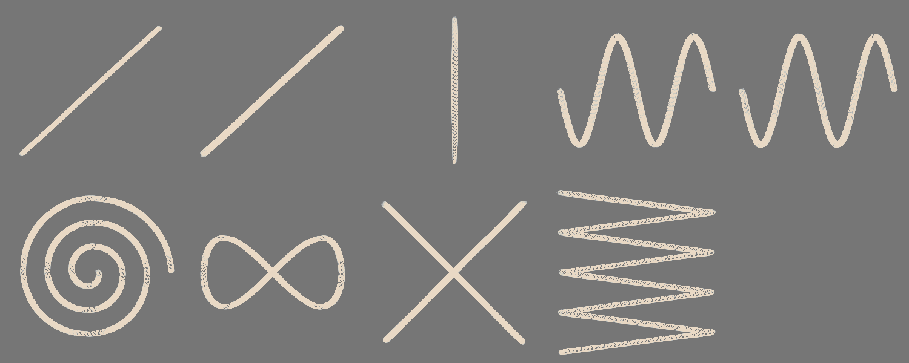

A light paint: laid on a grey sheet (on white it cannot be seen); **dark** = how far it is from the grey either way.

| stroke | covered | width | dark | spread | ms |
|---|---|---|---|---|---|
| light line | 3 % → 3 % | 9.0 px | 0.39 | 1.00 | 43 |
| heavy line | 4 % → 4 % | 12.2 px | 0.39 | 1.00 | 41 |
| pressure swell | 3 % → 3 % | 9.5 px | 0.34 | 1.00 | 30 |
| fast wave | 10 % → 10 % | 11.4 px | 0.38 | 1.00 | 94 |
| slow wave | 10 % → 10 % | 11.4 px | 0.38 | 1.00 | 87 |
| spiral | 15 % → 15 % | 10.2 px | 0.38 | 1.00 | 209 |
| loop | 8 % → 8 % | 10.0 px | 0.39 | 1.00 | 133 |
| tilted | 4 % → 4 % | 10.8 px | 0.39 | 1.00 | 52 |
| over the wet one | 8 % → 8 % | 10.8 px | 0.39 | 1.00 | 38 |
| long, no reload | 18 % → 18 % | 8.1 px | 0.37 | 1.00 | 326 | quarters: 0.00 → 0.00 → 0.00 → 0.00

Numbers say: light vs heavy: width 9.0 → 12.2 px, dark 0.39 → 0.39; the long stroke does not run out of paint.

## Refs v4 · #42 Pink shaggy pastel
Pastel 1.00 · 38 px · 22.3 s

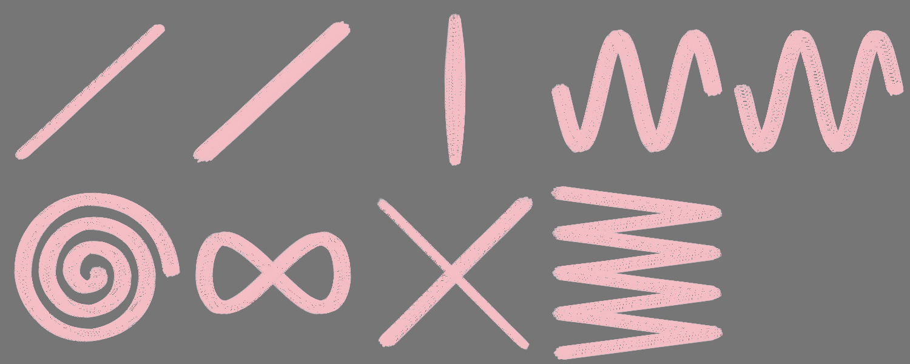

A light paint: laid on a grey sheet (on white it cannot be seen); **dark** = how far it is from the grey either way.

| stroke | covered | width | dark | spread | ms |
|---|---|---|---|---|---|
| light line | 7 % → 7 % | 20.5 px | 0.31 | 1.00 | 452 |
| heavy line | 11 % → 11 % | 33.0 px | 0.32 | 1.00 | 383 |
| pressure swell | 8 % → 8 % | 29.8 px | 0.32 | 1.00 | 114 |
| fast wave | 26 % → 26 % | 29.6 px | 0.32 | 1.00 | 392 |
| slow wave | 24 % → 24 % | 27.8 px | 0.32 | 1.00 | 716 |
| spiral | 39 % → 39 % | 25.6 px | 0.32 | 1.00 | 640 |
| loop | 20 % → 20 % | 25.3 px | 0.32 | 1.00 | 335 |
| tilted | 6 % → 6 % | 17.4 px | 0.31 | 1.00 | 235 |
| over the wet one | 16 % → 16 % | 26.8 px | 0.31 | 1.00 | 164 |
| long, no reload | 47 % → 47 % | 20.9 px | 0.32 | 1.00 | 1239 | quarters: 0.00 → 0.00 → 0.00 → 0.00

Numbers say: light vs heavy: width 20.5 → 33.0 px, dark 0.31 → 0.32; the long stroke does not run out of paint.

## Refs v4 · #43 Dragged black blocks
Ink 0.93 · Gouache 0.07 · 112 px · 180.7 s

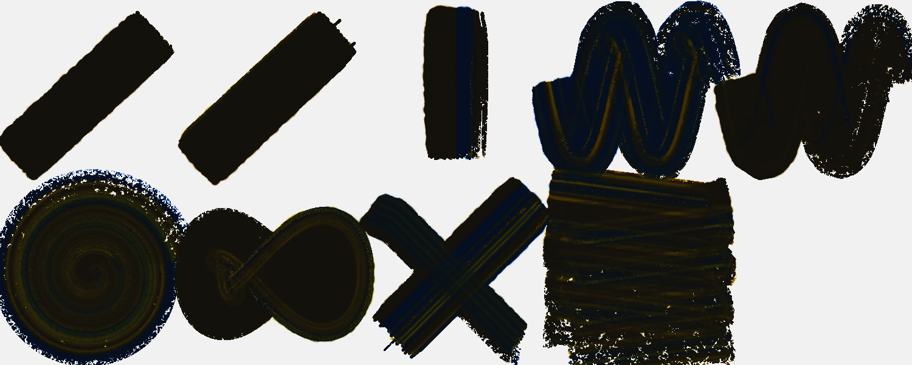

| stroke | covered | width | dark | spread | ms |
|---|---|---|---|---|---|
| light line | 33 % → 36 % | 96.1 px | 0.85 | 1.08 | 604 |
| heavy line | 36 % → 37 % | 105.9 px | 0.85 | 1.02 | 1210 |
| pressure swell | 27 % → 30 % | 101.1 px | 0.85 | 1.11 | 693 |
| fast wave | 73 % → 77 % | 84.1 px | 0.86 | 1.05 | 2419 |
| slow wave | 70 % → 70 % | 81.0 px | 0.86 | 1.00 | 3630 |
| spiral | 82 % → 82 % | 54.3 px | 0.84 | 0.99 | 3605 |
| loop | 64 % → 65 % | 82.6 px | 0.85 | 1.02 | 2267 |
| tilted | 27 % → 27 % | 76.2 px | 0.85 | 1.01 | 1007 |
| over the wet one | 56 % → 58 % | 80.4 px | 0.85 | 1.04 | 837 |
| long, no reload | 95 % → 97 % | 42.4 px | 0.85 | 1.02 | 7619 | quarters: 0.85 → 0.85 → 0.84 → 0.79

Numbers say: light vs heavy: width 96.1 → 105.9 px, dark 0.85 → 0.85; pressure barely changes the width; the long stroke does not run out of paint.

## Refs v4 · #44 Blue looping ribbon
Oil 0.52 · Gouache 0.48 + turpentine 10 % · 64 px · 96.7 s

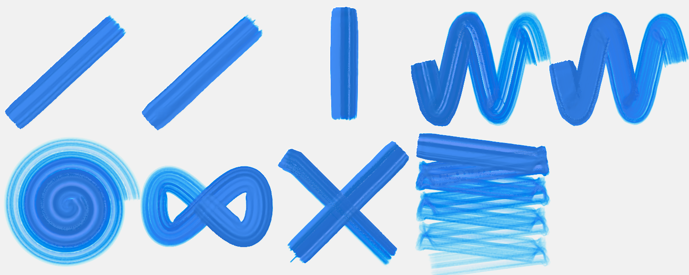

| stroke | covered | width | dark | spread | ms |
|---|---|---|---|---|---|
| light line | 20 % → 19 % | 56.9 px | 0.41 | 0.97 | 369 |
| heavy line | 20 % → 20 % | 59.5 px | 0.41 | 0.96 | 440 |
| pressure swell | 16 % → 16 % | 59.4 px | 0.44 | 0.98 | 342 |
| fast wave | 49 % → 26 % | 56.0 px | 0.47 | 0.54 | 1139 |
| slow wave | 48 % → 29 % | 55.2 px | 0.44 | 0.60 | 2427 |
| spiral | 66 % → 30 % | 43.5 px | 0.43 | 0.46 | 1976 |
| loop | 42 % → 28 % | 54.4 px | 0.43 | 0.67 | 987 |
| tilted | 17 % → 17 % | 47.9 px | 0.45 | 1.01 | 822 |
| over the wet one | 36 % → 33 % | 51.6 px | 0.45 | 0.92 | 529 |
| long, no reload | 83 % → 29 % | 37.3 px | 0.42 | 0.35 | 2607 | quarters: 0.39 → 0.32 → 0.18 → 0.09

Numbers say: light vs heavy: width 56.9 → 59.5 px, dark 0.41 → 0.41; pressure barely changes the width.

## Refs v4 · #45 Pastel pepper
Pastel 1.00 · 64 px · 29.7 s

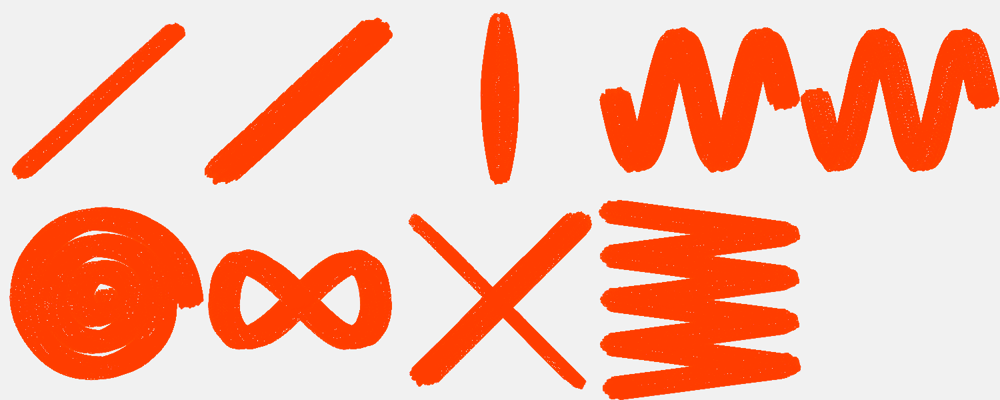

| stroke | covered | width | dark | spread | ms |
|---|---|---|---|---|---|
| light line | 11 % → 11 % | 33.1 px | 0.56 | 1.00 | 288 |
| heavy line | 19 % → 19 % | 55.0 px | 0.56 | 1.00 | 409 |
| pressure swell | 13 % → 13 % | 49.5 px | 0.56 | 1.00 | 280 |
| fast wave | 40 % → 40 % | 46.4 px | 0.56 | 1.00 | 913 |
| slow wave | 38 % → 38 % | 44.2 px | 0.56 | 1.00 | 1581 |
| spiral | 61 % → 61 % | 40.0 px | 0.56 | 1.00 | 1473 |
| loop | 31 % → 31 % | 40.0 px | 0.56 | 1.00 | 791 |
| tilted | 9 % → 9 % | 24.0 px | 0.56 | 1.00 | 640 |
| over the wet one | 24 % → 24 % | 43.7 px | 0.56 | 1.00 | 1056 |
| long, no reload | 69 % → 69 % | 31.0 px | 0.56 | 1.00 | 3731 | quarters: 0.42 → 0.42 → 0.42 → 0.42

Numbers say: light vs heavy: width 33.1 → 55.0 px, dark 0.56 → 0.56; the long stroke does not run out of paint.

## Refs v4 · #46 Ink lips on wet paper
Watercolour 1.00 + water 65 % · 56 px · 117.4 s

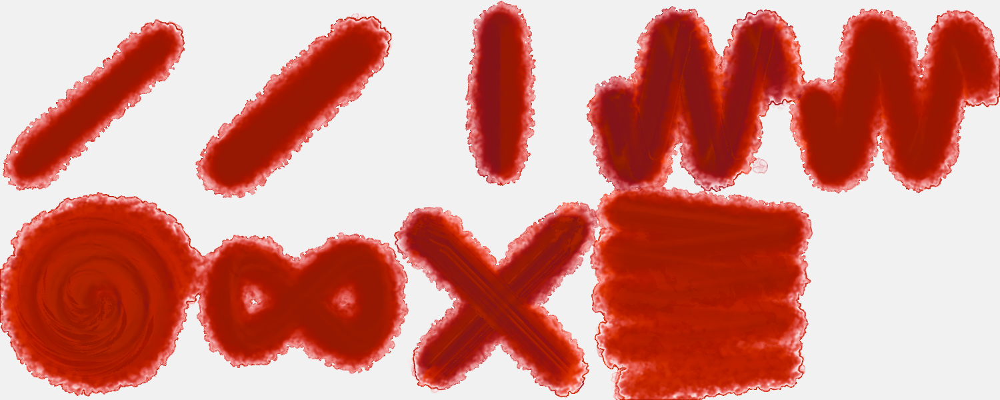

| stroke | covered | width | dark | spread | ms |
|---|---|---|---|---|---|
| light line | 12 % → 30 % | 34.6 px | 0.61 | 2.48 | 215 |
| heavy line | 24 % → 38 % | 69.7 px | 0.64 | 1.58 | 391 |
| pressure swell | 14 % → 27 % | 53.7 px | 0.63 | 1.90 | 262 |
| fast wave | 48 % → 72 % | 55.1 px | 0.66 | 1.50 | 1023 |
| slow wave | 45 % → 67 % | 52.1 px | 0.66 | 1.48 | 1714 |
| spiral | 67 % → 78 % | 44.3 px | 0.67 | 1.17 | 1601 |
| loop | 41 % → 58 % | 52.6 px | 0.66 | 1.44 | 760 |
| tilted | 19 % → 20 % | 54.2 px | 0.62 | 1.05 | 715 |
| over the wet one | 39 % → 62 % | 54.4 px | 0.62 | 1.60 | 541 |
| long, no reload | 83 % → 96 % | 37.2 px | 0.68 | 1.16 | 2248 | quarters: 0.72 → 0.71 → 0.68 → 0.61

Numbers say: light vs heavy: width 34.6 → 69.7 px, dark 0.61 → 0.64; wet paint spreads well beyond the stroke.

## Refs v4 · #47 Pink knife slabs
Gouache 1.00 + water 15 % · 240 px · 252.2 s

A light paint: laid on a grey sheet (on white it cannot be seen); **dark** = how far it is from the grey either way.

| stroke | covered | width | dark | spread | ms |
|---|---|---|---|---|---|
| light line | 65 % → 67 % | 189.9 px | 0.35 | 1.03 | 1578 |
| heavy line | 68 % → 64 % | 196.2 px | 0.35 | 0.95 | 3094 |
| pressure swell | 58 % → 67 % | 216.1 px | 0.33 | 1.16 | 1841 |
| fast wave | 95 % → 94 % | 109.8 px | 0.30 | 0.99 | 8219 |
| slow wave | 98 % → 90 % | 112.9 px | 0.35 | 0.92 | 13567 |
| spiral | 97 % → 85 % | 63.7 px | 0.34 | 0.88 | 12921 |
| loop | 98 % → 95 % | 127.2 px | 0.35 | 0.97 | 5698 |
| tilted | 50 % → 50 % | 139.1 px | 0.31 | 1.00 | 3393 |
| over the wet one | 85 % → 86 % | 99.5 px | 0.31 | 1.01 | 3468 |
| long, no reload | 99 % → 98 % | 44.6 px | 0.34 | 0.99 | 19843 | quarters: 0.00 → 0.00 → 0.00 → 0.00

Numbers say: light vs heavy: width 189.9 → 196.2 px, dark 0.35 → 0.35; pressure barely changes the width.

## Refs v4 · #48 Black bands with drips
Watercolour 1.00 + water 35 % · 112 px · 135.9 s

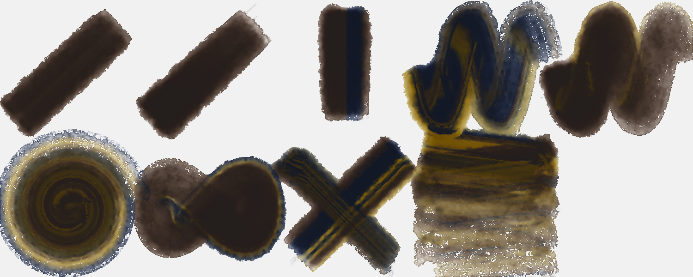

| stroke | covered | width | dark | spread | ms |
|---|---|---|---|---|---|
| light line | 32 % → 37 % | 93.4 px | 0.74 | 1.16 | 476 |
| heavy line | 34 % → 38 % | 97.8 px | 0.75 | 1.12 | 746 |
| pressure swell | 25 % → 32 % | 93.6 px | 0.74 | 1.28 | 503 |
| fast wave | 68 % → 78 % | 78.9 px | 0.70 | 1.14 | 2576 |
| slow wave | 68 % → 72 % | 78.7 px | 0.69 | 1.06 | 3863 |
| spiral | 75 % → 80 % | 49.8 px | 0.63 | 1.06 | 3307 |
| loop | 62 % → 65 % | 79.9 px | 0.75 | 1.06 | 1706 |
| tilted | 27 % → 28 % | 74.5 px | 0.73 | 1.03 | 1058 |
| over the wet one | 54 % → 60 % | 76.0 px | 0.73 | 1.11 | 1126 |
| long, no reload | 85 % → 94 % | 37.9 px | 0.60 | 1.11 | 6008 | quarters: 0.74 → 0.68 → 0.51 → 0.37

Numbers say: light vs heavy: width 93.4 → 97.8 px, dark 0.74 → 0.75; pressure barely changes the width.

## Refs v4 · #49 Magenta letters round
Ink 0.98 · 64 px · 89.5 s

| stroke | covered | width | dark | spread | ms |
|---|---|---|---|---|---|
| light line | 7 % → 10 % | 21.3 px | 0.45 | 1.37 | 91 |
| heavy line | 20 % → 21 % | 57.2 px | 0.49 | 1.08 | 374 |
| pressure swell | 11 % → 13 % | 42.1 px | 0.51 | 1.13 | 380 |
| fast wave | 40 % → 43 % | 46.7 px | 0.53 | 1.07 | 966 |
| slow wave | 36 % → 41 % | 41.7 px | 0.48 | 1.12 | 999 |
| spiral | 60 % → 61 % | 39.5 px | 0.46 | 1.02 | 1227 |
| loop | 31 % → 34 % | 40.1 px | 0.48 | 1.10 | 615 |
| tilted | 19 % → 19 % | 53.9 px | 0.51 | 1.01 | 757 |
| over the wet one | 33 % → 35 % | 39.0 px | 0.51 | 1.06 | 526 |
| long, no reload | 78 % → 80 % | 35.1 px | 0.47 | 1.03 | 2126 | quarters: 0.42 → 0.42 → 0.40 → 0.38

Numbers say: light vs heavy: width 21.3 → 57.2 px, dark 0.45 → 0.49; the long stroke does not run out of paint.

## Refs v4 · #50 Swipes on seaside
Gouache 1.00 + water 15 % · 80 px · 104.8 s

| stroke | covered | width | dark | spread | ms |
|---|---|---|---|---|---|
| light line | 24 % → 24 % | 69.8 px | 0.30 | 0.98 | 496 |
| heavy line | 25 % → 24 % | 73.0 px | 0.31 | 0.95 | 523 |
| pressure swell | 19 % → 19 % | 72.5 px | 0.32 | 1.00 | 379 |
| fast wave | 53 % → 43 % | 60.7 px | 0.31 | 0.82 | 1557 |
| slow wave | 54 % → 43 % | 62.5 px | 0.29 | 0.79 | 2557 |
| spiral | 63 % → 41 % | 41.8 px | 0.27 | 0.65 | 3197 |
| loop | 49 % → 43 % | 63.0 px | 0.28 | 0.89 | 1229 |
| tilted | 20 % → 20 % | 55.8 px | 0.33 | 1.01 | 800 |
| over the wet one | 42 % → 41 % | 61.8 px | 0.33 | 0.96 | 605 |
| long, no reload | 80 % → 55 % | 36.0 px | 0.27 | 0.68 | 3049 | quarters: 0.26 → 0.25 → 0.21 → 0.16

Numbers say: light vs heavy: width 69.8 → 73.0 px, dark 0.30 → 0.31; pressure barely changes the width.

## Refs v4 · #01 HW peach cloud — own sheet
own sheet 800 × 1095 · Gouache 1.00 + turpentine 30 % · 104 px · 680.1 s

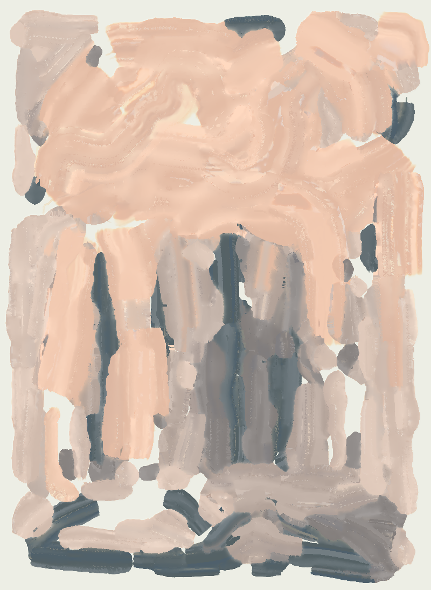

| stroke | covered | width | dark | spread | ms |
|---|---|---|---|---|---|
| stroke 1 | 9 % → 77 % | 103.7 px | 0.14 | 8.20 | 313 |
| stroke 2 | 14 % → 81 % | 175.9 px | 0.13 | 5.64 | 322 |
| stroke 3 | 20 % → 82 % | 300.7 px | 0.14 | 4.06 | 449 |
| stroke 4 | 22 % → 82 % | 363.0 px | 0.13 | 3.83 | 454 |
| stroke 5 | 12 % → 89 % | 123.8 px | 0.20 | 7.68 | 1056 |
| stroke 6 | 24 % → 87 % | 268.2 px | 0.14 | 3.62 | 1002 |
| stroke 7 | 42 % → 90 % | 807.5 px | 0.14 | 2.16 | 318 |
| stroke 8 | 27 % → 83 % | 189.7 px | 0.14 | 3.09 | 1287 |
| stroke 9 | 44 % → 83 % | 401.0 px | 0.17 | 1.88 | 486 |
| stroke 10 | 39 % → 81 % | 432.6 px | 0.12 | 2.06 | 714 |
| stroke 11 | 61 % → 85 % | 949.5 px | 0.12 | 1.40 | 275 |
| stroke 12 | 20 % → 85 % | 180.8 px | 0.15 | 4.27 | 490 |
| stroke 13 | 64 % → 88 % | 994.5 px | 0.14 | 1.36 | 337 |
| stroke 14 | 52 % → 90 % | 686.3 px | 0.13 | 1.74 | 805 |
| stroke 15 | 54 % → 94 % | 765.6 px | 0.15 | 1.74 | 564 |
| stroke 16 | 43 % → 81 % | 886.5 px | 0.13 | 1.87 | 270 |
| stroke 17 | 49 % → 89 % | 698.5 px | 0.15 | 1.81 | 718 |
| stroke 18 | 49 % → 78 % | 677.9 px | 0.12 | 1.59 | 421 |
| stroke 19 | 58 % → 94 % | 1313.5 px | 0.15 | 1.61 | 276 |
| stroke 20 | 60 % → 79 % | 520.6 px | 0.12 | 1.32 | 706 |
| stroke 21 | 58 % → 76 % | 812.1 px | 0.12 | 1.30 | 303 |
| stroke 22 | 46 % → 91 % | 894.8 px | 0.17 | 1.99 | 454 |
| stroke 23 | 62 % → 86 % | 926.5 px | 0.14 | 1.40 | 631 |
| stroke 24 | 74 % → 86 % | 1426.1 px | 0.12 | 1.17 | 442 |
| stroke 25 | 64 % → 89 % | 984.7 px | 0.15 | 1.39 | 373 |
| stroke 26 | 59 % → 93 % | 1363.0 px | 0.17 | 1.57 | 310 |
| stroke 27 | 60 % → 89 % | 1152.3 px | 0.17 | 1.47 | 407 |
| stroke 28 | 73 % → 91 % | 1657.5 px | 0.15 | 1.24 | 341 |
| stroke 29 | 82 % → 85 % | 1259.6 px | 0.12 | 1.05 | 520 |
| stroke 30 | 64 % → 95 % | 1299.3 px | 0.17 | 1.47 | 410 |
| stroke 31 | 78 % → 94 % | 1658.7 px | 0.14 | 1.20 | 397 |
| stroke 32 | 23 % → 91 % | 309.0 px | 0.22 | 4.01 | 494 |
| stroke 33 | 28 % → 91 % | 447.4 px | 0.23 | 3.32 | 614 |
| stroke 34 | 26 % → 78 % | 273.1 px | 0.21 | 3.02 | 171 |
| stroke 35 | 44 % → 71 % | 1082.8 px | 0.13 | 1.60 | 19 |
| stroke 36 | 61 % → 71 % | 467.3 px | 0.12 | 1.16 | 88 |
| stroke 37 | 69 % → 76 % | 836.4 px | 0.12 | 1.11 | 78 |
| stroke 38 | 66 % → 71 % | 558.0 px | 0.12 | 1.08 | 97 |
| stroke 39 | 69 % → 75 % | 1014.2 px | 0.12 | 1.08 | 71 |
| stroke 40 | 67 % → 72 % | 837.1 px | 0.12 | 1.08 | 61 |
| stroke 41 | 67 % → 75 % | 1943.1 px | 0.12 | 1.11 | 21 |
| stroke 42 | 69 % → 76 % | 2663.7 px | 0.12 | 1.09 | 21 |
| stroke 43 | 67 % → 73 % | 1921.0 px | 0.12 | 1.09 | 39 |
| stroke 44 | 65 % → 79 % | 1018.4 px | 0.14 | 1.21 | 59 |
| stroke 45 | 66 % → 79 % | 688.9 px | 0.14 | 1.19 | 117 |
| stroke 46 | 68 % → 79 % | 2797.5 px | 0.14 | 1.16 | 17 |
| stroke 47 | 63 % → 78 % | 2124.8 px | 0.14 | 1.23 | 56 |
| stroke 48 | 76 % → 82 % | 1477.8 px | 0.13 | 1.07 | 93 |
| stroke 49 | 76 % → 84 % | 1352.8 px | 0.14 | 1.10 | 102 |
| stroke 50 | 75 % → 82 % | 2133.9 px | 0.13 | 1.09 | 62 |
| stroke 51 | 83 % → 87 % | 2896.9 px | 0.13 | 1.05 | 51 |
| stroke 52 | 78 % → 87 % | 2691.8 px | 0.14 | 1.12 | 59 |
| stroke 53 | 78 % → 81 % | 1549.4 px | 0.13 | 1.04 | 109 |
| stroke 54 | 77 % → 83 % | 1435.9 px | 0.13 | 1.07 | 101 |
| stroke 55 | 82 % → 85 % | 1815.6 px | 0.13 | 1.04 | 77 |
| stroke 56 | 79 % → 83 % | 2131.4 px | 0.13 | 1.06 | 47 |
| stroke 57 | 77 % → 83 % | 2174.0 px | 0.14 | 1.08 | 42 |
| stroke 58 | 85 % → 86 % | 1418.7 px | 0.13 | 1.02 | 94 |
| stroke 59 | 79 % → 87 % | 1631.2 px | 0.14 | 1.10 | 147 |
| stroke 60 | 80 % → 82 % | 2085.3 px | 0.13 | 1.02 | 105 |
| stroke 61 | 87 % → 87 % | 2567.4 px | 0.12 | 1.00 | 97 |
| stroke 62 | 80 % → 83 % | 3937.2 px | 0.13 | 1.04 | 25 |
| stroke 63 | 80 % → 83 % | 3589.2 px | 0.13 | 1.04 | 34 |
| stroke 64 | 79 % → 84 % | 2517.8 px | 0.14 | 1.06 | 54 |
| stroke 65 | 86 % → 88 % | 5477.1 px | 0.13 | 1.01 | 22 |
| stroke 66 | 87 % → 87 % | 4204.6 px | 0.12 | 1.00 | 28 |
| stroke 67 | 79 % → 82 % | 2810.2 px | 0.13 | 1.04 | 75 |
| stroke 68 | 83 % → 89 % | 3363.0 px | 0.14 | 1.08 | 60 |
| stroke 69 | 79 % → 82 % | 3121.0 px | 0.14 | 1.04 | 37 |
| stroke 70 | 85 % → 86 % | 4005.3 px | 0.13 | 1.00 | 53 |
| stroke 71 | 81 % → 84 % | 5116.8 px | 0.13 | 1.05 | 78 |
| stroke 72 | 82 % → 84 % | 3769.6 px | 0.13 | 1.02 | 80 |
| stroke 73 | 88 % → 88 % | 4634.4 px | 0.12 | 1.00 | 35 |
| stroke 74 | 76 % → 77 % | 1639.1 px | 0.13 | 1.01 | 30 |
| stroke 75 | 75 % → 76 % | 2479.5 px | 0.14 | 1.02 | 22 |
| stroke 76 | 78 % → 78 % | 1336.1 px | 0.14 | 1.01 | 50 |
| stroke 77 | 77 % → 78 % | 2824.9 px | 0.14 | 1.01 | 19 |
| stroke 78 | 77 % → 78 % | 2357.6 px | 0.14 | 1.01 | 33 |
| stroke 79 | 63 % → 85 % | 3106.4 px | 0.14 | 1.36 | 33 |
| stroke 80 | 59 % → 87 % | 3653.6 px | 0.14 | 1.46 | 28 |
| stroke 81 | 60 % → 85 % | 3357.7 px | 0.14 | 1.41 | 40 |
| stroke 82 | 61 % → 86 % | 2712.6 px | 0.14 | 1.39 | 52 |
| stroke 83 | 71 % → 86 % | 3558.1 px | 0.15 | 1.22 | 23 |
| stroke 84 | 60 % → 87 % | 1314.0 px | 0.18 | 1.45 | 59 |
| stroke 85 | 67 % → 87 % | 3067.2 px | 0.16 | 1.30 | 23 |
| stroke 86 | 62 % → 88 % | 2460.6 px | 0.18 | 1.40 | 40 |
| stroke 87 | 34 % → 78 % | 342.7 px | 0.20 | 2.30 | 104 |
| stroke 88 | 58 % → 84 % | 685.5 px | 0.15 | 1.44 | 103 |
| stroke 89 | 45 % → 82 % | 547.0 px | 0.18 | 1.83 | 63 |
| stroke 90 | 60 % → 86 % | 2388.9 px | 0.14 | 1.43 | 32 |
| stroke 91 | 36 % → 77 % | 400.5 px | 0.20 | 2.15 | 114 |
| stroke 92 | 59 % → 82 % | 584.1 px | 0.16 | 1.39 | 113 |
| stroke 93 | 65 % → 82 % | 590.7 px | 0.15 | 1.26 | 161 |
| stroke 94 | 68 % → 84 % | 1565.1 px | 0.14 | 1.24 | 55 |
| stroke 95 | 68 % → 86 % | 1631.5 px | 0.14 | 1.27 | 41 |
| stroke 96 | 70 % → 83 % | 1299.6 px | 0.14 | 1.19 | 63 |
| stroke 97 | 63 % → 83 % | 1075.1 px | 0.16 | 1.33 | 83 |
| stroke 98 | 70 % → 85 % | 2662.3 px | 0.14 | 1.21 | 24 |
| stroke 99 | 59 % → 83 % | 867.6 px | 0.16 | 1.39 | 108 |
| stroke 100 | 70 % → 86 % | 2585.9 px | 0.15 | 1.23 | 54 |
| stroke 101 | 67 % → 81 % | 1565.7 px | 0.16 | 1.21 | 49 |
| stroke 102 | 71 % → 87 % | 2973.7 px | 0.15 | 1.22 | 28 |
| stroke 103 | 72 % → 84 % | 2676.0 px | 0.14 | 1.17 | 34 |
| stroke 104 | 70 % → 83 % | 1133.6 px | 0.15 | 1.19 | 127 |
| stroke 105 | 72 % → 84 % | 2061.0 px | 0.14 | 1.16 | 59 |
| stroke 106 | 69 % → 84 % | 1329.4 px | 0.15 | 1.23 | 79 |
| stroke 107 | 73 % → 84 % | 2828.9 px | 0.14 | 1.15 | 28 |
| stroke 108 | 70 % → 85 % | 3205.0 px | 0.14 | 1.21 | 34 |
| stroke 109 | 67 % → 95 % | 1607.0 px | 0.17 | 1.42 | 93 |
| stroke 110 | 68 % → 95 % | 3947.8 px | 0.17 | 1.38 | 21 |
| stroke 111 | 65 % → 95 % | 3716.2 px | 0.18 | 1.46 | 32 |
| stroke 112 | 70 % → 94 % | 4000.3 px | 0.16 | 1.36 | 35 |
| stroke 113 | 69 % → 94 % | 4474.0 px | 0.17 | 1.37 | 21 |
| stroke 114 | 43 % → 84 % | 462.8 px | 0.18 | 1.94 | 179 |
| stroke 115 | 34 % → 84 % | 340.1 px | 0.18 | 2.45 | 201 |
| stroke 116 | 25 % → 83 % | 519.9 px | 0.20 | 3.31 | 54 |
| stroke 117 | 9 % → 78 % | 101.8 px | 0.24 | 8.38 | 76 |
| stroke 118 | 10 % → 80 % | 244.3 px | 0.25 | 8.02 | 36 |
| stroke 119 | 31 % → 82 % | 312.6 px | 0.20 | 2.67 | 117 |
| stroke 120 | 22 % → 84 % | 352.9 px | 0.23 | 3.87 | 88 |
| stroke 121 | 54 % → 84 % | 869.8 px | 0.18 | 1.56 | 95 |
| stroke 122 | 53 % → 83 % | 752.4 px | 0.17 | 1.57 | 93 |
| stroke 123 | 34 % → 83 % | 686.5 px | 0.20 | 2.42 | 89 |
| stroke 124 | 24 % → 84 % | 864.1 px | 0.21 | 3.49 | 47 |
| stroke 125 | 12 % → 78 % | 478.3 px | 0.25 | 6.32 | 33 |
| stroke 126 | 54 % → 93 % | 1204.1 px | 0.20 | 1.74 | 110 |
| stroke 127 | 61 % → 91 % | 1206.9 px | 0.18 | 1.50 | 131 |
| stroke 128 | 54 % → 93 % | 3466.0 px | 0.21 | 1.74 | 21 |
| stroke 129 | 65 % → 94 % | 2428.6 px | 0.18 | 1.45 | 53 |
| stroke 130 | 9 % → 84 % | 514.9 px | 0.29 | 9.21 | 16 |
| stroke 131 | 10 % → 85 % | 554.7 px | 0.29 | 8.74 | 32 |
| stroke 132 | 10 % → 85 % | 583.8 px | 0.29 | 8.53 | 43 |
| stroke 133 | 26 % → 67 % | 366.9 px | 0.23 | 2.57 | 154 |
| stroke 134 | 27 % → 67 % | 810.7 px | 0.23 | 2.47 | 35 |
| stroke 135 | 29 % → 68 % | 849.6 px | 0.23 | 2.35 | 23 |
| stroke 136 | 26 % → 67 % | 813.1 px | 0.23 | 2.53 | 23 |
| stroke 137 | 13 % → 81 % | 292.2 px | 0.29 | 6.12 | 54 |
| stroke 138 | 18 % → 74 % | 371.1 px | 0.27 | 4.04 | 66 |
| stroke 139 | 22 % → 73 % | 221.7 px | 0.27 | 3.39 | 103 |
| stroke 140 | 18 % → 80 % | 480.0 px | 0.29 | 4.44 | 47 |
| stroke 141 | 19 % → 81 % | 757.0 px | 0.29 | 4.26 | 33 |
| stroke 142 | 24 % → 73 % | 1146.5 px | 0.27 | 3.01 | 47 |
| stroke 143 | 17 % → 81 % | 736.8 px | 0.29 | 4.86 | 32 |
| stroke 144 | 77 % → 82 % | 4327.8 px | 0.12 | 1.06 | 17 |
| stroke 145 | 73 % → 77 % | 831.3 px | 0.13 | 1.06 | 76 |
| stroke 146 | 85 % → 91 % | 2858.6 px | 0.13 | 1.07 | 58 |
| stroke 147 | 69 % → 95 % | 1774.9 px | 0.17 | 1.38 | 67 |
| stroke 148 | 59 % → 97 % | 2471.6 px | 0.20 | 1.63 | 25 |
| stroke 149 | 54 % → 87 % | 3183.1 px | 0.19 | 1.61 | 8 |
| stroke 150 | 37 % → 86 % | 633.7 px | 0.21 | 2.33 | 60 |
| stroke 151 | 26 % → 87 % | 1289.9 px | 0.26 | 3.30 | 19 |
| stroke 152 | 26 % → 96 % | 1466.8 px | 0.27 | 3.63 | 10 |
| stroke 153 | 20 % → 85 % | 266.6 px | 0.28 | 4.23 | 113 |
| stroke 154 | 24 % → 83 % | 267.9 px | 0.26 | 3.48 | 78 |
| stroke 155 | 46 % → 78 % | 732.3 px | 0.21 | 1.71 | 106 |
| stroke 156 | 37 % → 80 % | 2121.2 px | 0.25 | 2.19 | 29 |
| stroke 157 | 35 % → 76 % | 849.1 px | 0.25 | 2.13 | 41 |
| stroke 158 | 27 % → 84 % | 1167.3 px | 0.28 | 3.06 | 26 |
| stroke 159 | 16 % → 77 % | 388.4 px | 0.28 | 4.89 | 17 |
| stroke 160 | 73 % → 75 % | 1170.0 px | 0.13 | 1.04 | 82 |
| stroke 161 | 72 % → 75 % | 1008.3 px | 0.13 | 1.04 | 93 |
| stroke 162 | 73 % → 75 % | 861.6 px | 0.13 | 1.03 | 103 |
| stroke 163 | 75 % → 76 % | 2591.0 px | 0.13 | 1.02 | 30 |
| stroke 164 | 74 % → 76 % | 1647.0 px | 0.13 | 1.02 | 47 |
| stroke 165 | 72 % → 73 % | 588.8 px | 0.13 | 1.00 | 162 |
| stroke 166 | 58 % → 96 % | 1244.6 px | 0.20 | 1.64 | 150 |
| stroke 167 | 58 % → 97 % | 1497.8 px | 0.20 | 1.66 | 79 |
| stroke 168 | 66 % → 96 % | 3733.1 px | 0.19 | 1.47 | 25 |
| stroke 169 | 66 % → 96 % | 2669.5 px | 0.19 | 1.47 | 51 |
| stroke 170 | 61 % → 96 % | 1343.5 px | 0.20 | 1.57 | 116 |
| stroke 171 | 48 % → 96 % | 1564.7 px | 0.23 | 2.00 | 70 |
| stroke 172 | 75 % → 96 % | 4328.3 px | 0.16 | 1.27 | 42 |
| stroke 173 | 62 % → 97 % | 956.4 px | 0.21 | 1.56 | 163 |
| stroke 174 | 56 % → 96 % | 921.5 px | 0.23 | 1.71 | 195 |
| stroke 175 | 31 % → 91 % | 892.2 px | 0.29 | 2.97 | 80 |
| stroke 176 | 71 % → 96 % | 3503.5 px | 0.19 | 1.36 | 41 |
| stroke 177 | 42 % → 93 % | 914.1 px | 0.26 | 2.21 | 84 |
| stroke 178 | 54 % → 97 % | 1871.6 px | 0.24 | 1.79 | 46 |
| stroke 179 | 33 % → 86 % | 1263.9 px | 0.28 | 2.60 | 55 |
| stroke 180 | 34 % → 93 % | 816.2 px | 0.29 | 2.75 | 84 |
| stroke 181 | 57 % → 97 % | 1710.7 px | 0.24 | 1.72 | 58 |
| stroke 182 | 60 % → 95 % | 1620.2 px | 0.23 | 1.58 | 119 |
| stroke 183 | 50 % → 96 % | 2453.7 px | 0.26 | 1.94 | 33 |
| stroke 184 | 67 % → 97 % | 1958.0 px | 0.21 | 1.44 | 75 |
| stroke 185 | 79 % → 96 % | 3900.7 px | 0.18 | 1.21 | 31 |
| stroke 186 | 64 % → 97 % | 2068.3 px | 0.23 | 1.52 | 79 |
| stroke 187 | 51 % → 93 % | 1318.2 px | 0.25 | 1.84 | 153 |
| stroke 188 | 71 % → 96 % | 1815.2 px | 0.21 | 1.35 | 150 |
| stroke 189 | 38 % → 91 % | 1715.7 px | 0.28 | 2.39 | 66 |
| stroke 190 | 40 % → 93 % | 1990.8 px | 0.27 | 2.30 | 37 |
| stroke 191 | 59 % → 97 % | 2188.8 px | 0.24 | 1.64 | 73 |
| stroke 192 | 81 % → 95 % | 4495.4 px | 0.18 | 1.18 | 28 |
| stroke 193 | 79 % → 95 % | 3915.2 px | 0.18 | 1.21 | 42 |
| stroke 194 | 72 % → 97 % | 4079.9 px | 0.20 | 1.34 | 34 |
| stroke 195 | 56 % → 87 % | 1307.1 px | 0.22 | 1.56 | 60 |
| stroke 196 | 50 % → 87 % | 2181.8 px | 0.24 | 1.75 | 40 |
| stroke 197 | 55 % → 87 % | 1502.8 px | 0.22 | 1.58 | 72 |
| stroke 198 | 57 % → 88 % | 2078.6 px | 0.22 | 1.54 | 67 |
| stroke 199 | 43 % → 85 % | 460.2 px | 0.22 | 1.95 | 218 |
| stroke 200 | 48 % → 85 % | 526.0 px | 0.21 | 1.78 | 215 |
| stroke 201 | 64 % → 85 % | 1885.6 px | 0.19 | 1.34 | 36 |
| stroke 202 | 60 % → 84 % | 1711.0 px | 0.20 | 1.40 | 68 |
| stroke 203 | 31 % → 85 % | 619.2 px | 0.26 | 2.73 | 84 |
| stroke 204 | 64 % → 86 % | 1975.3 px | 0.20 | 1.35 | 44 |
| stroke 205 | 30 % → 84 % | 868.8 px | 0.26 | 2.79 | 61 |
| stroke 206 | 35 % → 85 % | 879.5 px | 0.24 | 2.43 | 61 |
| stroke 207 | 43 % → 84 % | 1660.0 px | 0.22 | 1.96 | 40 |
| stroke 208 | 72 % → 85 % | 1821.1 px | 0.17 | 1.18 | 79 |
| stroke 209 | 70 % → 84 % | 1601.1 px | 0.18 | 1.20 | 117 |
| stroke 210 | 76 % → 86 % | 1414.1 px | 0.16 | 1.12 | 103 |
| stroke 211 | 69 % → 84 % | 2260.0 px | 0.19 | 1.22 | 61 |
| stroke 212 | 80 % → 87 % | 3091.7 px | 0.16 | 1.09 | 47 |
| stroke 213 | 77 % → 88 % | 3364.2 px | 0.17 | 1.14 | 45 |
| stroke 214 | 35 % → 91 % | 582.6 px | 0.28 | 2.62 | 105 |
| stroke 215 | 34 % → 89 % | 957.3 px | 0.27 | 2.63 | 60 |
| stroke 216 | 33 % → 81 % | 442.9 px | 0.28 | 2.47 | 115 |
| stroke 217 | 32 % → 83 % | 622.7 px | 0.29 | 2.63 | 97 |
| stroke 218 | 35 % → 79 % | 1300.5 px | 0.27 | 2.24 | 30 |
| stroke 219 | 31 % → 82 % | 552.0 px | 0.29 | 2.66 | 72 |
| stroke 220 | 36 % → 88 % | 1277.5 px | 0.29 | 2.48 | 57 |
| stroke 221 | 32 % → 82 % | 904.2 px | 0.29 | 2.59 | 52 |
| stroke 222 | 35 % → 88 % | 1343.6 px | 0.29 | 2.50 | 55 |
| stroke 223 | 31 % → 83 % | 700.6 px | 0.29 | 2.64 | 95 |
| stroke 224 | 38 % → 85 % | 1436.7 px | 0.29 | 2.21 | 47 |
| stroke 225 | 42 % → 79 % | 1491.0 px | 0.26 | 1.86 | 31 |
| stroke 226 | 39 % → 85 % | 1047.5 px | 0.29 | 2.19 | 60 |
| stroke 227 | 42 % → 86 % | 890.0 px | 0.28 | 2.07 | 87 |
| stroke 228 | 41 % → 85 % | 1580.2 px | 0.29 | 2.10 | 73 |
| stroke 229 | 35 % → 82 % | 1219.8 px | 0.29 | 2.37 | 48 |
| stroke 230 | 47 % → 93 % | 947.3 px | 0.27 | 1.97 | 132 |
| stroke 231 | 36 % → 82 % | 859.2 px | 0.29 | 2.29 | 145 |
| stroke 232 | 40 % → 86 % | 1378.3 px | 0.29 | 2.13 | 116 |
| stroke 233 | 41 % → 85 % | 2235.8 px | 0.29 | 2.07 | 35 |
| stroke 234 | 38 % → 82 % | 1747.0 px | 0.28 | 2.16 | 44 |
| stroke 235 | 40 % → 92 % | 2007.4 px | 0.29 | 2.29 | 39 |
| stroke 236 | 43 % → 82 % | 548.3 px | 0.28 | 1.93 | 107 |
| stroke 237 | 42 % → 84 % | 1079.8 px | 0.30 | 2.02 | 44 |
| stroke 238 | 41 % → 85 % | 1546.8 px | 0.30 | 2.06 | 35 |
| stroke 239 | 43 % → 85 % | 1830.5 px | 0.30 | 1.98 | 30 |
| stroke 240 | 83 % → 86 % | 1124.9 px | 0.14 | 1.04 | 100 |
| stroke 241 | 77 % → 97 % | 4491.3 px | 0.19 | 1.26 | 24 |
| stroke 242 | 84 % → 88 % | 5333.2 px | 0.15 | 1.06 | 13 |
| stroke 243 | 79 % → 85 % | 1719.7 px | 0.15 | 1.07 | 70 |
| stroke 244 | 58 % → 89 % | 1174.4 px | 0.24 | 1.53 | 82 |
| stroke 245 | 59 % → 85 % | 3433.8 px | 0.23 | 1.44 | 7 |
| stroke 246 | 59 % → 76 % | 598.3 px | 0.20 | 1.28 | 118 |
| stroke 247 | 45 % → 78 % | 661.8 px | 0.27 | 1.74 | 29 |
| stroke 248 | 68 % → 94 % | 1591.2 px | 0.22 | 1.38 | 80 |
| stroke 249 | 69 % → 96 % | 1549.3 px | 0.23 | 1.39 | 71 |
| stroke 250 | 73 % → 95 % | 1571.5 px | 0.21 | 1.31 | 73 |
| stroke 251 | 58 % → 94 % | 1051.4 px | 0.27 | 1.62 | 71 |
| stroke 252 | 76 % → 96 % | 1880.3 px | 0.21 | 1.26 | 81 |
| stroke 253 | 60 % → 93 % | 1094.4 px | 0.27 | 1.55 | 92 |
| stroke 254 | 68 % → 95 % | 1864.1 px | 0.24 | 1.39 | 48 |
| stroke 255 | 79 % → 93 % | 5125.5 px | 0.19 | 1.18 | 21 |
| stroke 256 | 72 % → 92 % | 3534.1 px | 0.22 | 1.28 | 32 |
| stroke 257 | 73 % → 96 % | 2363.1 px | 0.23 | 1.32 | 36 |
| stroke 258 | 67 % → 96 % | 3338.0 px | 0.26 | 1.42 | 20 |
| stroke 259 | 52 % → 92 % | 2094.1 px | 0.30 | 1.78 | 42 |
| stroke 260 | 50 % → 90 % | 1893.2 px | 0.30 | 1.79 | 34 |
| stroke 261 | 62 % → 95 % | 3480.8 px | 0.27 | 1.52 | 22 |
| stroke 262 | 73 % → 95 % | 3652.7 px | 0.24 | 1.31 | 27 |
| stroke 263 | 67 % → 95 % | 4309.4 px | 0.26 | 1.42 | 15 |
| stroke 264 | 76 % → 96 % | 3138.6 px | 0.23 | 1.26 | 44 |
| stroke 265 | 83 % → 97 % | 5347.5 px | 0.20 | 1.16 | 24 |
| stroke 266 | 83 % → 95 % | 5412.7 px | 0.19 | 1.15 | 30 |
| stroke 267 | 59 % → 93 % | 1441.2 px | 0.29 | 1.56 | 81 |
| stroke 268 | 70 % → 96 % | 2003.5 px | 0.26 | 1.37 | 43 |
| stroke 269 | 59 % → 90 % | 1130.9 px | 0.29 | 1.53 | 79 |
| stroke 270 | 70 % → 95 % | 1578.6 px | 0.26 | 1.35 | 67 |
| stroke 271 | 57 % → 88 % | 2913.0 px | 0.29 | 1.56 | 31 |
| stroke 272 | 68 % → 95 % | 1273.3 px | 0.27 | 1.39 | 119 |
| stroke 273 | 67 % → 94 % | 1355.3 px | 0.28 | 1.41 | 107 |
| stroke 274 | 73 % → 97 % | 3288.2 px | 0.26 | 1.33 | 67 |
| stroke 275 | 59 % → 89 % | 3336.0 px | 0.29 | 1.52 | 43 |
| stroke 276 | 75 % → 97 % | 3040.8 px | 0.26 | 1.29 | 34 |
| stroke 277 | 62 % → 93 % | 3523.1 px | 0.29 | 1.49 | 49 |
| stroke 278 | 68 % → 94 % | 3798.1 px | 0.27 | 1.38 | 30 |
| stroke 279 | 52 % → 81 % | 518.3 px | 0.28 | 1.57 | 128 |
| stroke 280 | 53 % → 80 % | 1190.7 px | 0.28 | 1.51 | 32 |
| stroke 281 | 55 % → 82 % | 1262.3 px | 0.29 | 1.51 | 47 |
| stroke 282 | 56 % → 82 % | 720.7 px | 0.29 | 1.47 | 87 |
| stroke 283 | 57 % → 81 % | 738.4 px | 0.28 | 1.42 | 55 |
| stroke 284 | 60 % → 81 % | 1129.4 px | 0.27 | 1.34 | 37 |
| stroke 285 | 59 % → 81 % | 2350.8 px | 0.28 | 1.38 | 31 |
| stroke 286 | 58 % → 79 % | 2672.1 px | 0.27 | 1.36 | 17 |
| stroke 287 | 57 % → 78 % | 1282.4 px | 0.29 | 1.37 | 19 |
| stroke 288 | 60 % → 81 % | 918.2 px | 0.28 | 1.36 | 63 |
| stroke 289 | 59 % → 79 % | 2716.3 px | 0.27 | 1.34 | 23 |
| stroke 290 | 60 % → 80 % | 1211.6 px | 0.28 | 1.33 | 40 |
| stroke 291 | 58 % → 78 % | 2111.8 px | 0.28 | 1.34 | 15 |
| stroke 292 | 60 % → 82 % | 3312.2 px | 0.29 | 1.37 | 20 |
| stroke 293 | 61 % → 84 % | 2253.1 px | 0.29 | 1.38 | 46 |
| stroke 294 | 60 % → 80 % | 2399.3 px | 0.28 | 1.33 | 20 |
| stroke 295 | 78 % → 79 % | 1023.8 px | 0.13 | 1.01 | 74 |
| stroke 296 | 77 % → 76 % | 1412.6 px | 0.12 | 0.99 | 73 |
| stroke 297 | 77 % → 76 % | 1169.3 px | 0.13 | 0.99 | 90 |
| stroke 298 | 83 % → 86 % | 2865.7 px | 0.16 | 1.03 | 59 |
| stroke 299 | 87 % → 97 % | 3062.5 px | 0.19 | 1.12 | 36 |
| stroke 300 | 77 % → 88 % | 3632.0 px | 0.20 | 1.13 | 17 |
| stroke 301 | 76 % → 85 % | 1840.2 px | 0.16 | 1.12 | 59 |
| stroke 302 | 72 % → 86 % | 2448.4 px | 0.24 | 1.20 | 38 |
| stroke 303 | 73 % → 89 % | 1181.4 px | 0.25 | 1.21 | 116 |
| stroke 304 | 71 % → 91 % | 4532.2 px | 0.25 | 1.29 | 15 |
| stroke 305 | 66 % → 84 % | 1842.6 px | 0.27 | 1.26 | 39 |
| stroke 306 | 65 % → 86 % | 2085.3 px | 0.29 | 1.33 | 45 |
| stroke 307 | 60 % → 76 % | 2162.8 px | 0.21 | 1.28 | 19 |
| stroke 308 | 60 % → 78 % | 1333.6 px | 0.24 | 1.30 | 69 |
| stroke 309 | 63 % → 85 % | 3860.3 px | 0.27 | 1.34 | 16 |
| stroke 310 | 64 % → 88 % | 1537.4 px | 0.30 | 1.36 | 46 |
| stroke 311 | 63 % → 87 % | 2697.6 px | 0.30 | 1.38 | 27 |
| stroke 312 | 81 % → 79 % | 1130.1 px | 0.12 | 0.98 | 98 |
| stroke 313 | 83 % → 81 % | 1899.5 px | 0.12 | 0.98 | 64 |
| stroke 314 | 80 % → 81 % | 952.9 px | 0.14 | 1.01 | 152 |
| stroke 315 | 80 % → 80 % | 1488.6 px | 0.14 | 0.99 | 81 |
| stroke 316 | 80 % → 79 % | 1879.3 px | 0.14 | 0.99 | 63 |
| stroke 317 | 79 % → 95 % | 4416.8 px | 0.26 | 1.20 | 55 |
| stroke 318 | 80 % → 94 % | 1176.3 px | 0.25 | 1.17 | 285 |
| stroke 319 | 91 % → 97 % | 1313.0 px | 0.20 | 1.06 | 195 |
| stroke 320 | 89 % → 96 % | 2340.0 px | 0.23 | 1.08 | 99 |
| stroke 321 | 83 % → 94 % | 2033.0 px | 0.26 | 1.13 | 97 |
| stroke 322 | 74 % → 90 % | 1172.4 px | 0.28 | 1.22 | 199 |
| stroke 323 | 88 % → 96 % | 4967.2 px | 0.26 | 1.08 | 64 |
| stroke 324 | 72 % → 91 % | 2706.0 px | 0.29 | 1.26 | 63 |
| stroke 325 | 87 % → 94 % | 4346.1 px | 0.26 | 1.08 | 54 |
| stroke 326 | 90 % → 97 % | 4471.9 px | 0.23 | 1.08 | 46 |
| stroke 327 | 88 % → 96 % | 4343.4 px | 0.25 | 1.10 | 44 |
| stroke 328 | 94 % → 97 % | 2134.7 px | 0.19 | 1.03 | 139 |
| stroke 329 | 74 % → 93 % | 3315.6 px | 0.29 | 1.24 | 74 |
| stroke 330 | 92 % → 97 % | 2631.5 px | 0.20 | 1.05 | 89 |
| stroke 331 | 84 % → 95 % | 4152.9 px | 0.27 | 1.12 | 53 |
| stroke 332 | 86 % → 88 % | 1782.6 px | 0.15 | 1.03 | 106 |
| stroke 333 | 86 % → 89 % | 1250.6 px | 0.17 | 1.03 | 220 |
| stroke 334 | 80 % → 85 % | 1096.2 px | 0.19 | 1.06 | 225 |
| stroke 335 | 83 % → 85 % | 1113.5 px | 0.17 | 1.03 | 298 |
| stroke 336 | 76 % → 86 % | 1231.1 px | 0.22 | 1.13 | 150 |
| stroke 337 | 67 % → 80 % | 2049.9 px | 0.23 | 1.20 | 78 |
| stroke 338 | 74 % → 85 % | 1524.1 px | 0.21 | 1.14 | 119 |
| stroke 339 | 88 % → 94 % | 3002.3 px | 0.26 | 1.07 | 58 |
| stroke 340 | 90 % → 96 % | 2768.1 px | 0.25 | 1.06 | 96 |
| stroke 341 | 79 % → 94 % | 1453.1 px | 0.29 | 1.19 | 149 |
| stroke 342 | 91 % → 95 % | 3110.0 px | 0.26 | 1.05 | 55 |
| stroke 343 | 92 % → 95 % | 2499.4 px | 0.24 | 1.03 | 88 |
| stroke 344 | 78 % → 93 % | 3301.9 px | 0.29 | 1.19 | 52 |
| stroke 345 | 92 % → 96 % | 1634.3 px | 0.26 | 1.04 | 125 |
| stroke 346 | 85 % → 96 % | 3187.1 px | 0.29 | 1.12 | 48 |
| stroke 347 | 95 % → 96 % | 5266.1 px | 0.24 | 1.01 | 58 |
| stroke 348 | 88 % → 96 % | 2198.2 px | 0.28 | 1.09 | 116 |
| stroke 349 | 69 % → 84 % | 1115.6 px | 0.29 | 1.22 | 130 |
| stroke 350 | 63 % → 81 % | 1008.9 px | 0.30 | 1.28 | 101 |
| stroke 351 | 71 % → 81 % | 632.3 px | 0.30 | 1.13 | 239 |
| stroke 352 | 57 % → 70 % | 383.6 px | 0.28 | 1.23 | 361 |
| stroke 353 | 75 % → 87 % | 2682.0 px | 0.30 | 1.16 | 35 |
| stroke 354 | 67 % → 78 % | 806.5 px | 0.30 | 1.17 | 122 |
| stroke 355 | 77 % → 82 % | 916.5 px | 0.29 | 1.06 | 147 |
| stroke 356 | 78 % → 83 % | 1534.9 px | 0.29 | 1.07 | 76 |
| stroke 357 | 75 % → 80 % | 2127.7 px | 0.30 | 1.07 | 46 |
| stroke 358 | 70 % → 72 % | 763.0 px | 0.25 | 1.03 | 165 |
| stroke 359 | 79 % → 82 % | 1292.4 px | 0.29 | 1.04 | 145 |
| stroke 360 | 65 % → 67 % | 920.2 px | 0.25 | 1.04 | 72 |
| stroke 361 | 79 % → 83 % | 1913.8 px | 0.30 | 1.05 | 47 |
| stroke 362 | 75 % → 77 % | 1232.4 px | 0.29 | 1.02 | 141 |
| stroke 363 | 79 % → 81 % | 1753.6 px | 0.29 | 1.03 | 104 |
| stroke 364 | 79 % → 80 % | 755.5 px | 0.30 | 1.01 | 142 |
| stroke 365 | 83 % → 84 % | 1872.3 px | 0.29 | 1.01 | 97 |
| stroke 366 | 69 % → 70 % | 1277.2 px | 0.27 | 1.01 | 74 |
| stroke 367 | 81 % → 82 % | 3871.6 px | 0.29 | 1.01 | 36 |
| stroke 368 | 71 % → 71 % | 1404.2 px | 0.24 | 1.00 | 80 |
| stroke 369 | 66 % → 66 % | 1869.4 px | 0.24 | 1.00 | 51 |
| stroke 370 | 88 % → 89 % | 3898.4 px | 0.30 | 1.01 | 45 |
| stroke 371 | 83 % → 84 % | 3036.0 px | 0.29 | 1.01 | 56 |
| stroke 372 | 83 % → 83 % | 3188.9 px | 0.13 | 1.00 | 17 |
| stroke 373 | 86 % → 86 % | 1926.3 px | 0.18 | 0.99 | 62 |
| stroke 374 | 95 % → 95 % | 1334.1 px | 0.21 | 1.00 | 200 |
| stroke 375 | 96 % → 97 % | 4583.4 px | 0.21 | 1.00 | 47 |

Numbers say: wet paint spreads well beyond the stroke.

## Refs v4 · #02 HW cream strokes — own sheet
own sheet 800 × 650 · Gouache 1.00 + turpentine 30 % · 51 px · 198.4 s

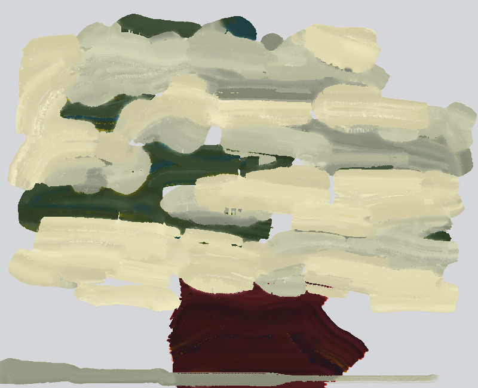

| stroke | covered | width | dark | spread | ms |
|---|---|---|---|---|---|
| stroke 1 | 6 % → 59 % | 50.5 px | 0.08 | 9.20 | 63 |
| stroke 2 | 10 % → 56 % | 60.2 px | 0.08 | 5.39 | 99 |
| stroke 3 | 17 % → 47 % | 172.7 px | 0.07 | 2.79 | 38 |
| stroke 4 | 4 % → 99 % | 53.5 px | 0.23 | 23.51 | 30 |
| stroke 5 | 13 % → 87 % | 67.7 px | 0.19 | 6.71 | 118 |
| stroke 6 | 23 % → 76 % | 119.5 px | 0.13 | 3.34 | 102 |
| stroke 7 | 28 % → 81 % | 208.6 px | 0.10 | 2.83 | 76 |
| stroke 8 | 29 % → 68 % | 167.0 px | 0.10 | 2.32 | 103 |
| stroke 9 | 33 % → 83 % | 202.7 px | 0.19 | 2.54 | 91 |
| stroke 10 | 23 % → 65 % | 134.7 px | 0.12 | 2.77 | 87 |
| stroke 11 | 34 % → 89 % | 219.9 px | 0.16 | 2.58 | 115 |
| stroke 12 | 6 % → 97 % | 66.3 px | 0.15 | 17.10 | 33 |
| stroke 13 | 16 % → 78 % | 72.2 px | 0.12 | 4.88 | 169 |
| stroke 14 | 25 % → 81 % | 187.0 px | 0.11 | 3.22 | 104 |
| stroke 15 | 28 % → 98 % | 147.3 px | 0.13 | 3.45 | 132 |
| stroke 16 | 20 % → 98 % | 108.1 px | 0.15 | 4.87 | 192 |
| stroke 17 | 34 % → 98 % | 296.7 px | 0.14 | 2.87 | 85 |
| stroke 18 | 8 % → 97 % | 49.2 px | 0.09 | 11.95 | 105 |
| stroke 19 | 15 % → 97 % | 76.9 px | 0.14 | 6.37 | 172 |
| stroke 20 | 26 % → 96 % | 152.3 px | 0.14 | 3.64 | 116 |
| stroke 21 | 17 % → 95 % | 150.8 px | 0.22 | 5.77 | 58 |
| stroke 22 | 30 % → 91 % | 163.7 px | 0.10 | 3.00 | 219 |
| stroke 23 | 32 % → 89 % | 136.7 px | 0.09 | 2.77 | 233 |
| stroke 24 | 35 % → 89 % | 171.4 px | 0.10 | 2.59 | 178 |
| stroke 25 | 40 % → 96 % | 327.0 px | 0.12 | 2.44 | 84 |
| stroke 26 | 33 % → 87 % | 300.7 px | 0.11 | 2.62 | 38 |
| stroke 27 | 8 % → 57 % | 50.1 px | 0.15 | 7.43 | 62 |
| stroke 28 | 15 % → 72 % | 65.7 px | 0.18 | 4.81 | 152 |
| stroke 29 | 24 % → 82 % | 92.7 px | 0.19 | 3.49 | 218 |
| stroke 30 | 16 % → 92 % | 109.7 px | 0.29 | 5.75 | 97 |
| stroke 31 | 29 % → 81 % | 199.5 px | 0.20 | 2.80 | 91 |
| stroke 32 | 33 % → 88 % | 198.8 px | 0.21 | 2.66 | 152 |
| stroke 33 | 30 % → 94 % | 203.9 px | 0.25 | 3.11 | 100 |
| stroke 34 | 40 % → 87 % | 159.0 px | 0.19 | 2.14 | 412 |
| stroke 35 | 44 % → 95 % | 323.1 px | 0.19 | 2.14 | 118 |
| stroke 36 | 44 % → 66 % | 401.8 px | 0.12 | 1.51 | 58 |
| stroke 37 | 39 % → 96 % | 491.5 px | 0.23 | 2.48 | 60 |
| stroke 38 | 48 % → 93 % | 600.6 px | 0.19 | 1.94 | 46 |
| stroke 39 | 25 % → 75 % | 112.8 px | 0.21 | 2.97 | 311 |
| stroke 40 | 38 % → 86 % | 247.8 px | 0.15 | 2.25 | 171 |
| stroke 41 | 27 % → 59 % | 122.0 px | 0.20 | 2.22 | 329 |
| stroke 42 | 34 % → 84 % | 317.6 px | 0.26 | 2.51 | 275 |
| stroke 43 | 20 % → 99 % | 371.4 px | 0.16 | 4.84 | 16 |
| stroke 44 | 42 % → 61 % | 218.3 px | 0.20 | 1.45 | 210 |
| stroke 45 | 33 % → 91 % | 250.3 px | 0.13 | 2.76 | 79 |
| stroke 46 | 38 % → 80 % | 176.9 px | 0.14 | 2.10 | 121 |
| stroke 47 | 34 % → 64 % | 207.6 px | 0.10 | 1.88 | 155 |
| stroke 48 | 39 % → 78 % | 211.6 px | 0.14 | 1.99 | 123 |
| stroke 49 | 52 % → 81 % | 510.5 px | 0.11 | 1.56 | 62 |
| stroke 50 | 43 % → 80 % | 239.2 px | 0.14 | 1.86 | 114 |
| stroke 51 | 51 % → 77 % | 634.1 px | 0.13 | 1.50 | 32 |
| stroke 52 | 45 % → 83 % | 465.0 px | 0.16 | 1.84 | 42 |
| stroke 53 | 52 % → 86 % | 347.5 px | 0.12 | 1.66 | 113 |
| stroke 54 | 49 % → 78 % | 297.4 px | 0.12 | 1.59 | 108 |
| stroke 55 | 56 % → 79 % | 409.3 px | 0.11 | 1.41 | 69 |
| stroke 56 | 52 % → 74 % | 520.3 px | 0.11 | 1.41 | 41 |
| stroke 57 | 57 % → 78 % | 827.9 px | 0.12 | 1.37 | 41 |
| stroke 58 | 46 % → 86 % | 476.2 px | 0.15 | 1.88 | 42 |
| stroke 59 | 51 % → 70 % | 735.8 px | 0.13 | 1.37 | 27 |
| stroke 60 | 57 % → 71 % | 656.4 px | 0.10 | 1.24 | 40 |
| stroke 61 | 53 % → 79 % | 810.9 px | 0.14 | 1.48 | 37 |
| stroke 62 | 67 % → 92 % | 933.4 px | 0.11 | 1.37 | 50 |
| stroke 63 | 57 % → 72 % | 490.7 px | 0.12 | 1.26 | 74 |
| stroke 64 | 57 % → 94 % | 525.5 px | 0.14 | 1.64 | 55 |
| stroke 65 | 57 % → 78 % | 481.3 px | 0.13 | 1.37 | 46 |
| stroke 66 | 56 % → 73 % | 654.0 px | 0.12 | 1.31 | 42 |
| stroke 67 | 61 % → 75 % | 772.3 px | 0.12 | 1.24 | 34 |
| stroke 68 | 51 % → 92 % | 806.3 px | 0.15 | 1.79 | 32 |
| stroke 69 | 51 % → 98 % | 406.2 px | 0.18 | 1.91 | 69 |
| stroke 70 | 53 % → 98 % | 554.6 px | 0.17 | 1.86 | 43 |
| stroke 71 | 40 % → 89 % | 230.9 px | 0.24 | 2.21 | 101 |
| stroke 72 | 50 % → 86 % | 404.9 px | 0.20 | 1.71 | 38 |
| stroke 73 | 47 % → 89 % | 405.8 px | 0.22 | 1.89 | 85 |
| stroke 74 | 54 % → 98 % | 673.7 px | 0.17 | 1.82 | 45 |
| stroke 75 | 49 % → 99 % | 562.6 px | 0.24 | 2.02 | 39 |
| stroke 76 | 64 % → 98 % | 523.8 px | 0.17 | 1.53 | 130 |
| stroke 77 | 50 % → 99 % | 589.5 px | 0.24 | 2.00 | 55 |
| stroke 78 | 59 % → 98 % | 534.9 px | 0.18 | 1.67 | 89 |
| stroke 79 | 51 % → 99 % | 542.5 px | 0.25 | 1.96 | 49 |
| stroke 80 | 53 % → 84 % | 691.8 px | 0.22 | 1.59 | 30 |
| stroke 81 | 63 % → 98 % | 684.7 px | 0.17 | 1.56 | 68 |
| stroke 82 | 56 % → 98 % | 794.9 px | 0.19 | 1.74 | 50 |
| stroke 83 | 40 % → 77 % | 398.1 px | 0.11 | 1.92 | 52 |
| stroke 84 | 46 % → 71 % | 264.0 px | 0.10 | 1.55 | 55 |
| stroke 85 | 34 % → 57 % | 313.5 px | 0.12 | 1.68 | 30 |
| stroke 86 | 46 % → 76 % | 622.7 px | 0.12 | 1.63 | 31 |
| stroke 87 | 45 % → 70 % | 550.3 px | 0.11 | 1.53 | 36 |
| stroke 88 | 64 % → 98 % | 973.6 px | 0.10 | 1.52 | 25 |
| stroke 89 | 65 % → 98 % | 350.1 px | 0.14 | 1.51 | 116 |
| stroke 90 | 66 % → 97 % | 427.7 px | 0.15 | 1.48 | 133 |
| stroke 91 | 68 % → 97 % | 713.1 px | 0.16 | 1.42 | 50 |
| stroke 92 | 74 % → 97 % | 1006.4 px | 0.13 | 1.31 | 35 |
| stroke 93 | 63 % → 80 % | 311.1 px | 0.06 | 1.26 | 149 |
| stroke 94 | 59 % → 91 % | 317.1 px | 0.16 | 1.54 | 153 |
| stroke 95 | 82 % → 98 % | 917.2 px | 0.05 | 1.20 | 49 |
| stroke 96 | 54 % → 66 % | 383.1 px | 0.08 | 1.23 | 95 |
| stroke 97 | 63 % → 73 % | 438.4 px | 0.06 | 1.17 | 83 |
| stroke 98 | 67 % → 86 % | 339.2 px | 0.08 | 1.30 | 172 |
| stroke 99 | 46 % → 92 % | 518.0 px | 0.28 | 1.99 | 55 |
| stroke 100 | 65 % → 88 % | 435.4 px | 0.09 | 1.35 | 149 |
| stroke 101 | 45 % → 89 % | 418.2 px | 0.32 | 1.97 | 81 |
| stroke 102 | 71 % → 86 % | 668.2 px | 0.07 | 1.21 | 88 |
| stroke 103 | 85 % → 93 % | 1031.7 px | 0.07 | 1.10 | 46 |
| stroke 104 | 79 % → 94 % | 481.9 px | 0.12 | 1.19 | 132 |
| stroke 105 | 73 % → 80 % | 989.6 px | 0.07 | 1.09 | 43 |
| stroke 106 | 59 % → 91 % | 796.0 px | 0.23 | 1.54 | 42 |
| stroke 107 | 64 % → 68 % | 632.7 px | 0.06 | 1.07 | 47 |
| stroke 108 | 58 % → 82 % | 543.6 px | 0.11 | 1.42 | 42 |
| stroke 109 | 68 % → 93 % | 843.1 px | 0.18 | 1.38 | 50 |
| stroke 110 | 76 % → 79 % | 884.6 px | 0.05 | 1.04 | 50 |
| stroke 111 | 91 % → 95 % | 1370.8 px | 0.06 | 1.05 | 38 |
| stroke 112 | 92 % → 99 % | 1398.2 px | 0.06 | 1.08 | 37 |
| stroke 113 | 61 % → 87 % | 521.8 px | 0.11 | 1.43 | 43 |
| stroke 114 | 69 % → 97 % | 347.2 px | 0.17 | 1.40 | 192 |
| stroke 115 | 48 % → 88 % | 353.8 px | 0.29 | 1.83 | 104 |
| stroke 116 | 49 % → 53 % | 839.3 px | 0.06 | 1.08 | 31 |
| stroke 117 | 77 % → 96 % | 377.4 px | 0.12 | 1.24 | 186 |
| stroke 118 | 74 % → 92 % | 705.6 px | 0.15 | 1.23 | 71 |
| stroke 119 | 65 % → 78 % | 436.9 px | 0.10 | 1.20 | 106 |
| stroke 120 | 69 % → 81 % | 387.4 px | 0.13 | 1.18 | 167 |
| stroke 121 | 71 % → 84 % | 638.0 px | 0.14 | 1.18 | 80 |
| stroke 122 | 73 % → 84 % | 423.4 px | 0.11 | 1.16 | 139 |
| stroke 123 | 68 % → 83 % | 907.3 px | 0.10 | 1.23 | 42 |
| stroke 124 | 61 % → 71 % | 941.0 px | 0.09 | 1.16 | 30 |
| stroke 125 | 81 % → 93 % | 738.3 px | 0.13 | 1.14 | 66 |
| stroke 126 | 68 % → 76 % | 464.2 px | 0.11 | 1.12 | 123 |
| stroke 127 | 68 % → 80 % | 900.0 px | 0.14 | 1.18 | 48 |
| stroke 128 | 76 % → 85 % | 686.2 px | 0.11 | 1.13 | 87 |
| stroke 129 | 66 % → 81 % | 312.7 px | 0.09 | 1.23 | 147 |
| stroke 130 | 81 % → 92 % | 418.6 px | 0.09 | 1.13 | 203 |
| stroke 131 | 83 % → 89 % | 440.5 px | 0.10 | 1.06 | 165 |
| stroke 132 | 91 % → 98 % | 792.0 px | 0.14 | 1.08 | 62 |
| stroke 133 | 85 % → 90 % | 529.5 px | 0.11 | 1.06 | 137 |
| stroke 134 | 85 % → 90 % | 511.7 px | 0.10 | 1.06 | 115 |
| stroke 135 | 92 % → 95 % | 807.3 px | 0.09 | 1.03 | 69 |
| stroke 136 | 86 % → 98 % | 806.2 px | 0.15 | 1.13 | 62 |
| stroke 137 | 84 % → 85 % | 570.3 px | 0.09 | 1.01 | 71 |
| stroke 138 | 89 % → 89 % | 1332.3 px | 0.10 | 1.01 | 35 |
| stroke 139 | 92 % → 93 % | 516.4 px | 0.09 | 1.02 | 195 |
| stroke 140 | 82 % → 82 % | 521.2 px | 0.09 | 1.01 | 150 |
| stroke 141 | 93 % → 99 % | 1405.3 px | 0.13 | 1.06 | 58 |
| stroke 142 | 77 % → 77 % | 537.4 px | 0.11 | 1.01 | 250 |
| stroke 143 | 85 % → 86 % | 1294.1 px | 0.11 | 1.01 | 41 |
| stroke 144 | 87 % → 89 % | 810.3 px | 0.10 | 1.02 | 46 |
| stroke 145 | 85 % → 98 % | 952.8 px | 0.16 | 1.15 | 62 |
| stroke 146 | 55 % → 89 % | 446.0 px | 0.23 | 1.62 | 90 |
| stroke 147 | 64 % → 96 % | 860.6 px | 0.22 | 1.51 | 33 |
| stroke 148 | 63 % → 97 % | 958.7 px | 0.23 | 1.54 | 39 |
| stroke 149 | 56 % → 89 % | 484.5 px | 0.24 | 1.58 | 103 |
| stroke 150 | 61 % → 77 % | 627.3 px | 0.18 | 1.26 | 18 |
| stroke 151 | 68 % → 74 % | 1130.5 px | 0.15 | 1.09 | 8 |
| stroke 152 | 66 % → 81 % | 659.6 px | 0.16 | 1.22 | 30 |
| stroke 153 | 71 % → 98 % | 650.3 px | 0.21 | 1.38 | 58 |
| stroke 154 | 63 % → 99 % | 1150.6 px | 0.24 | 1.56 | 13 |
| stroke 155 | 73 % → 97 % | 402.9 px | 0.18 | 1.32 | 117 |
| stroke 156 | 82 % → 84 % | 451.2 px | 0.07 | 1.02 | 85 |
| stroke 157 | 89 % → 96 % | 539.0 px | 0.08 | 1.07 | 118 |
| stroke 158 | 14 % → 45 % | 21.4 px | 0.57 | 3.10 | 507 |
| stroke 159 | 82 % → 90 % | 542.2 px | 0.12 | 1.09 | 142 |
| stroke 160 | 82 % → 88 % | 568.5 px | 0.12 | 1.08 | 137 |
| stroke 161 | 88 % → 98 % | 871.2 px | 0.14 | 1.12 | 75 |
| stroke 162 | 91 % → 99 % | 1088.0 px | 0.14 | 1.09 | 50 |
| stroke 163 | 68 % → 88 % | 305.5 px | 0.20 | 1.29 | 149 |
| stroke 164 | 83 % → 98 % | 460.9 px | 0.21 | 1.17 | 158 |
| stroke 165 | 76 % → 88 % | 389.3 px | 0.19 | 1.16 | 141 |
| stroke 166 | 83 % → 96 % | 488.2 px | 0.15 | 1.15 | 141 |
| stroke 167 | 87 % → 93 % | 453.5 px | 0.19 | 1.08 | 188 |
| stroke 168 | 92 % → 97 % | 495.2 px | 0.19 | 1.05 | 183 |
| stroke 169 | 95 % → 96 % | 818.0 px | 0.13 | 1.02 | 73 |
| stroke 170 | 95 % → 98 % | 770.9 px | 0.21 | 1.03 | 113 |
| stroke 171 | 87 % → 89 % | 419.9 px | 0.20 | 1.03 | 216 |
| stroke 172 | 96 % → 98 % | 1011.1 px | 0.20 | 1.02 | 45 |
| stroke 173 | 94 % → 95 % | 1148.5 px | 0.14 | 1.01 | 39 |
| stroke 174 | 89 % → 96 % | 603.8 px | 0.16 | 1.09 | 127 |
| stroke 175 | 97 % → 99 % | 1495.6 px | 0.21 | 1.02 | 29 |
| stroke 176 | 96 % → 98 % | 817.2 px | 0.24 | 1.02 | 73 |
| stroke 177 | 96 % → 97 % | 1463.6 px | 0.18 | 1.02 | 30 |
| stroke 178 | 70 % → 75 % | 283.3 px | 0.15 | 1.07 | 78 |
| stroke 179 | 71 % → 74 % | 538.9 px | 0.17 | 1.03 | 50 |
| stroke 180 | 97 % → 97 % | 686.9 px | 0.09 | 1.00 | 67 |
| stroke 181 | 80 % → 81 % | 602.9 px | 0.05 | 1.00 | 38 |
| stroke 182 | 59 % → 83 % | 262.0 px | 0.36 | 1.40 | 717 |
| stroke 183 | 66 % → 75 % | 337.4 px | 0.40 | 1.14 | 478 |
| stroke 184 | 73 % → 78 % | 276.5 px | 0.48 | 1.06 | 802 |
| stroke 185 | 68 % → 68 % | 182.5 px | 0.63 | 1.00 | 792 |
| stroke 186 | 88 % → 88 % | 468.8 px | 0.43 | 1.00 | 543 |
| stroke 187 | 86 % → 85 % | 392.8 px | 0.62 | 0.99 | 410 |

Numbers say: wet paint spreads well beyond the stroke.

## Refs v4 · #03 HW navy contours — own sheet
own sheet 800 × 600 · Gouache 1.00 + turpentine 30 % · 80 px · 151.1 s

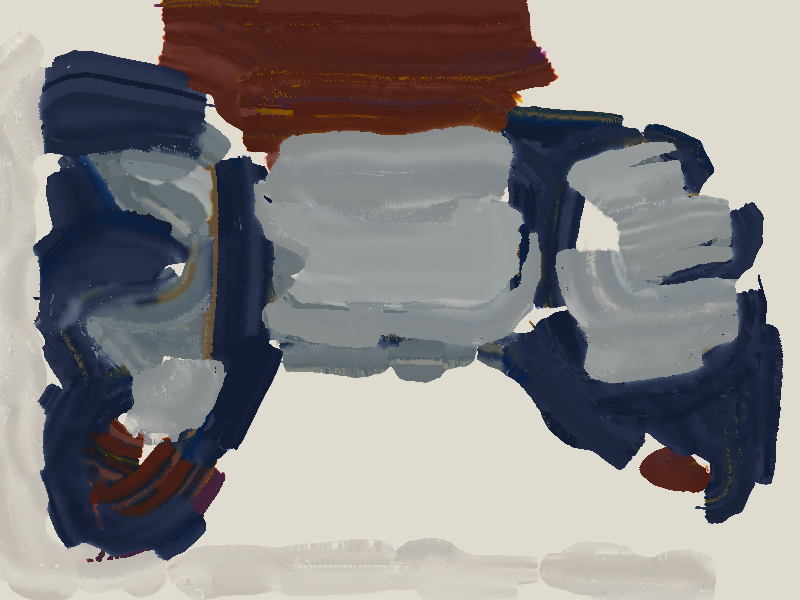

| stroke | covered | width | dark | spread | ms |
|---|---|---|---|---|---|
| stroke 1 | 6 % → 91 % | 76.9 px | 0.50 | 15.10 | 163 |
| stroke 2 | 13 % → 85 % | 109.4 px | 0.47 | 6.63 | 286 |
| stroke 3 | 23 % → 88 % | 187.2 px | 0.50 | 3.82 | 506 |
| stroke 4 | 24 % → 78 % | 225.1 px | 0.46 | 3.32 | 478 |
| stroke 5 | 28 % → 87 % | 280.5 px | 0.49 | 3.08 | 635 |
| stroke 6 | 36 % → 93 % | 441.7 px | 0.49 | 2.61 | 286 |
| stroke 7 | 31 % → 89 % | 325.2 px | 0.47 | 2.88 | 563 |
| stroke 8 | 41 % → 78 % | 670.1 px | 0.43 | 1.92 | 138 |
| stroke 9 | 22 % → 69 % | 188.7 px | 0.49 | 3.08 | 260 |
| stroke 10 | 30 % → 71 % | 358.8 px | 0.47 | 2.34 | 157 |
| stroke 11 | 36 % → 67 % | 554.9 px | 0.45 | 1.85 | 161 |
| stroke 12 | 36 % → 69 % | 446.6 px | 0.48 | 1.93 | 218 |
| stroke 13 | 19 % → 82 % | 327.4 px | 0.46 | 4.40 | 165 |
| stroke 14 | 10 % → 97 % | 90.3 px | 0.47 | 9.88 | 43 |
| stroke 15 | 3 % → 34 % | 28.4 px | 0.21 | 10.11 | 48 |
| stroke 16 | 16 % → 96 % | 120.2 px | 0.48 | 6.03 | 53 |
| stroke 17 | 9 % → 73 % | 82.7 px | 0.40 | 8.12 | 34 |
| stroke 18 | 11 % → 40 % | 72.9 px | 0.30 | 3.68 | 60 |
| stroke 19 | 15 % → 60 % | 104.8 px | 0.35 | 4.00 | 82 |
| stroke 20 | 17 % → 57 % | 186.0 px | 0.40 | 3.38 | 46 |
| stroke 21 | 15 % → 78 % | 199.5 px | 0.50 | 5.12 | 18 |
| stroke 22 | 19 % → 92 % | 151.0 px | 0.42 | 4.85 | 30 |
| stroke 23 | 20 % → 97 % | 462.7 px | 0.47 | 4.76 | 18 |
| stroke 24 | 9 % → 38 % | 54.3 px | 0.38 | 4.13 | 86 |
| stroke 25 | 11 % → 39 % | 83.3 px | 0.40 | 3.61 | 74 |
| stroke 26 | 27 % → 95 % | 168.9 px | 0.42 | 3.51 | 48 |
| stroke 27 | 17 % → 35 % | 132.1 px | 0.27 | 2.06 | 77 |
| stroke 28 | 26 % → 96 % | 276.9 px | 0.43 | 3.74 | 46 |
| stroke 29 | 22 % → 41 % | 195.4 px | 0.32 | 1.89 | 95 |
| stroke 30 | 17 % → 85 % | 154.4 px | 0.48 | 4.98 | 64 |
| stroke 31 | 15 % → 42 % | 195.2 px | 0.43 | 2.87 | 46 |
| stroke 32 | 33 % → 95 % | 396.8 px | 0.42 | 2.91 | 23 |
| stroke 33 | 33 % → 87 % | 603.8 px | 0.42 | 2.68 | 17 |
| stroke 34 | 32 % → 95 % | 298.5 px | 0.41 | 2.99 | 31 |
| stroke 35 | 20 % → 80 % | 221.8 px | 0.51 | 4.08 | 19 |
| stroke 36 | 29 % → 96 % | 237.2 px | 0.43 | 3.26 | 45 |
| stroke 37 | 20 % → 84 % | 214.4 px | 0.50 | 4.15 | 34 |
| stroke 38 | 36 % → 89 % | 457.2 px | 0.42 | 2.48 | 33 |
| stroke 39 | 22 % → 84 % | 179.3 px | 0.50 | 3.79 | 64 |
| stroke 40 | 28 % → 97 % | 450.7 px | 0.48 | 3.46 | 51 |
| stroke 41 | 23 % → 86 % | 398.4 px | 0.48 | 3.68 | 52 |
| stroke 42 | 21 % → 29 % | 326.7 px | 0.20 | 1.37 | 53 |
| stroke 43 | 31 % → 97 % | 363.0 px | 0.48 | 3.12 | 75 |
| stroke 44 | 18 % → 38 % | 112.2 px | 0.37 | 2.13 | 90 |
| stroke 45 | 31 % → 67 % | 814.6 px | 0.39 | 2.19 | 15 |
| stroke 46 | 15 % → 44 % | 170.4 px | 0.48 | 3.03 | 34 |
| stroke 47 | 36 % → 95 % | 774.4 px | 0.42 | 2.69 | 22 |
| stroke 48 | 32 % → 98 % | 699.9 px | 0.46 | 3.09 | 29 |
| stroke 49 | 34 % → 74 % | 672.0 px | 0.39 | 2.18 | 18 |
| stroke 50 | 35 % → 96 % | 829.9 px | 0.43 | 2.74 | 15 |
| stroke 51 | 40 % → 95 % | 825.5 px | 0.42 | 2.35 | 15 |
| stroke 52 | 32 % → 82 % | 1348.9 px | 0.43 | 2.54 | 14 |
| stroke 53 | 36 % → 76 % | 523.4 px | 0.46 | 2.14 | 105 |
| stroke 54 | 32 % → 80 % | 298.9 px | 0.54 | 2.54 | 208 |
| stroke 55 | 41 % → 89 % | 234.4 px | 0.52 | 2.15 | 221 |
| stroke 56 | 35 % → 81 % | 290.9 px | 0.55 | 2.36 | 254 |
| stroke 57 | 46 % → 89 % | 327.0 px | 0.52 | 1.92 | 164 |
| stroke 58 | 48 % → 88 % | 348.4 px | 0.53 | 1.81 | 149 |
| stroke 59 | 37 % → 77 % | 1134.8 px | 0.46 | 2.09 | 34 |
| stroke 60 | 48 % → 85 % | 684.8 px | 0.54 | 1.78 | 65 |
| stroke 61 | 34 % → 66 % | 312.8 px | 0.49 | 1.94 | 226 |
| stroke 62 | 39 % → 61 % | 545.1 px | 0.48 | 1.56 | 90 |
| stroke 63 | 42 % → 63 % | 316.2 px | 0.48 | 1.50 | 295 |
| stroke 64 | 54 % → 81 % | 1106.9 px | 0.44 | 1.49 | 101 |
| stroke 65 | 45 % → 57 % | 774.3 px | 0.45 | 1.25 | 93 |
| stroke 66 | 41 % → 62 % | 754.9 px | 0.47 | 1.50 | 53 |
| stroke 67 | 50 % → 65 % | 353.5 px | 0.48 | 1.30 | 166 |
| stroke 68 | 48 % → 60 % | 1255.9 px | 0.46 | 1.23 | 55 |
| stroke 69 | 53 % → 74 % | 1555.6 px | 0.45 | 1.39 | 47 |
| stroke 70 | 48 % → 66 % | 578.4 px | 0.46 | 1.38 | 138 |
| stroke 71 | 49 % → 65 % | 689.3 px | 0.52 | 1.32 | 109 |
| stroke 72 | 56 % → 68 % | 1212.4 px | 0.46 | 1.21 | 52 |
| stroke 73 | 54 % → 63 % | 755.5 px | 0.41 | 1.17 | 110 |
| stroke 74 | 54 % → 74 % | 619.1 px | 0.47 | 1.36 | 190 |
| stroke 75 | 61 % → 65 % | 368.9 px | 0.45 | 1.07 | 133 |
| stroke 76 | 55 % → 62 % | 1332.8 px | 0.50 | 1.12 | 52 |
| stroke 77 | 70 % → 74 % | 1628.4 px | 0.51 | 1.06 | 64 |
| stroke 78 | 55 % → 61 % | 737.0 px | 0.41 | 1.10 | 147 |
| stroke 79 | 74 % → 76 % | 1226.8 px | 0.51 | 1.04 | 73 |
| stroke 80 | 60 % → 66 % | 1918.0 px | 0.41 | 1.10 | 72 |
| stroke 81 | 60 % → 63 % | 1513.5 px | 0.48 | 1.05 | 70 |
| stroke 82 | 63 % → 66 % | 761.6 px | 0.46 | 1.04 | 116 |
| stroke 83 | 59 % → 64 % | 1882.0 px | 0.40 | 1.09 | 42 |
| stroke 84 | 51 % → 92 % | 304.6 px | 0.46 | 1.80 | 156 |
| stroke 85 | 59 % → 90 % | 472.6 px | 0.51 | 1.54 | 163 |
| stroke 86 | 58 % → 94 % | 1050.3 px | 0.50 | 1.64 | 55 |
| stroke 87 | 59 % → 88 % | 821.0 px | 0.51 | 1.50 | 90 |
| stroke 88 | 56 % → 74 % | 439.0 px | 0.41 | 1.32 | 107 |
| stroke 89 | 64 % → 94 % | 885.8 px | 0.45 | 1.46 | 70 |
| stroke 90 | 68 % → 93 % | 923.8 px | 0.49 | 1.36 | 77 |
| stroke 91 | 72 % → 96 % | 1275.4 px | 0.50 | 1.34 | 56 |
| stroke 92 | 66 % → 89 % | 1169.4 px | 0.46 | 1.34 | 154 |
| stroke 93 | 66 % → 87 % | 598.9 px | 0.50 | 1.33 | 259 |
| stroke 94 | 69 % → 89 % | 645.6 px | 0.49 | 1.28 | 506 |
| stroke 95 | 73 % → 88 % | 1133.1 px | 0.50 | 1.21 | 249 |
| stroke 96 | 69 % → 89 % | 754.2 px | 0.52 | 1.29 | 125 |
| stroke 97 | 73 % → 93 % | 2119.4 px | 0.49 | 1.27 | 39 |
| stroke 98 | 65 % → 83 % | 816.0 px | 0.55 | 1.29 | 161 |
| stroke 99 | 77 % → 93 % | 1573.4 px | 0.49 | 1.20 | 70 |
| stroke 100 | 75 % → 87 % | 1604.5 px | 0.49 | 1.16 | 63 |
| stroke 101 | 78 % → 90 % | 1981.2 px | 0.51 | 1.15 | 47 |
| stroke 102 | 67 % → 90 % | 1154.3 px | 0.51 | 1.35 | 87 |
| stroke 103 | 65 % → 90 % | 1878.3 px | 0.53 | 1.38 | 41 |
| stroke 104 | 75 % → 85 % | 1550.4 px | 0.48 | 1.14 | 61 |
| stroke 105 | 66 % → 88 % | 818.2 px | 0.53 | 1.33 | 137 |
| stroke 106 | 86 % → 93 % | 1471.2 px | 0.50 | 1.08 | 71 |
| stroke 107 | 77 % → 93 % | 1753.6 px | 0.51 | 1.21 | 50 |
| stroke 108 | 81 % → 90 % | 2509.7 px | 0.48 | 1.10 | 52 |
| stroke 109 | 89 % → 96 % | 2205.3 px | 0.49 | 1.07 | 36 |
| stroke 110 | 73 % → 88 % | 2072.4 px | 0.53 | 1.21 | 54 |
| stroke 111 | 52 % → 57 % | 1582.5 px | 0.41 | 1.10 | 20 |
| stroke 112 | 69 % → 76 % | 733.6 px | 0.45 | 1.11 | 204 |
| stroke 113 | 61 % → 65 % | 1739.2 px | 0.39 | 1.06 | 42 |
| stroke 114 | 62 % → 68 % | 888.0 px | 0.45 | 1.10 | 92 |
| stroke 115 | 71 % → 78 % | 2458.6 px | 0.46 | 1.10 | 37 |
| stroke 116 | 63 % → 64 % | 1065.0 px | 0.43 | 1.02 | 101 |
| stroke 117 | 60 % → 97 % | 1738.3 px | 0.50 | 1.62 | 26 |
| stroke 118 | 58 % → 86 % | 921.0 px | 0.46 | 1.49 | 61 |
| stroke 119 | 49 % → 55 % | 2098.5 px | 0.46 | 1.13 | 15 |
| stroke 120 | 55 % → 66 % | 2449.0 px | 0.45 | 1.19 | 24 |
| stroke 121 | 65 % → 65 % | 1646.9 px | 0.48 | 1.00 | 17 |
| stroke 122 | 78 % → 91 % | 2829.3 px | 0.47 | 1.16 | 17 |
| stroke 123 | 72 % → 73 % | 1510.8 px | 0.50 | 1.02 | 29 |
| stroke 124 | 68 % → 71 % | 1055.4 px | 0.52 | 1.03 | 42 |
| stroke 125 | 72 % → 74 % | 2985.6 px | 0.46 | 1.03 | 18 |
| stroke 126 | 69 % → 86 % | 467.3 px | 0.51 | 1.25 | 802 |
| stroke 127 | 78 % → 89 % | 684.5 px | 0.52 | 1.15 | 336 |
| stroke 128 | 75 % → 79 % | 351.6 px | 0.55 | 1.05 | 730 |
| stroke 129 | 84 % → 87 % | 622.8 px | 0.51 | 1.04 | 646 |
| stroke 130 | 80 % → 81 % | 358.0 px | 0.57 | 1.01 | 620 |
| stroke 131 | 93 % → 94 % | 901.8 px | 0.54 | 1.01 | 338 |
| stroke 132 | 86 % → 86 % | 758.6 px | 0.55 | 1.00 | 171 |
| stroke 133 | 86 % → 86 % | 988.2 px | 0.53 | 1.00 | 236 |
| stroke 134 | 74 % → 77 % | 661.4 px | 0.41 | 1.04 | 384 |
| stroke 135 | 82 % → 83 % | 949.9 px | 0.43 | 1.00 | 338 |
| stroke 136 | 57 % → 58 % | 966.2 px | 0.49 | 1.02 | 30 |

Numbers say: wet paint spreads well beyond the stroke.

## Refs v4 · #04 HW grey cloud — own sheet
own sheet 800 × 635 · Gouache 1.00 + turpentine 30 % · 93 px · 205.2 s

| stroke | covered | width | dark | spread | ms |
|---|---|---|---|---|---|
| stroke 1 | 14 % → 99 % | 84.9 px | 0.22 | 7.17 | 911 |
| stroke 2 | 12 % → 98 % | 81.6 px | 0.21 | 7.95 | 897 |
| stroke 3 | 25 % → 99 % | 248.3 px | 0.23 | 3.87 | 540 |
| stroke 4 | 37 % → 98 % | 200.0 px | 0.23 | 2.65 | 1130 |
| stroke 5 | 33 % → 98 % | 330.1 px | 0.22 | 2.98 | 511 |
| stroke 6 | 50 % → 98 % | 652.5 px | 0.22 | 1.96 | 219 |
| stroke 7 | 40 % → 97 % | 602.8 px | 0.20 | 2.45 | 380 |
| stroke 8 | 55 % → 99 % | 457.3 px | 0.24 | 1.79 | 353 |
| stroke 9 | 65 % → 99 % | 536.1 px | 0.23 | 1.53 | 522 |
| stroke 10 | 54 % → 97 % | 668.6 px | 0.21 | 1.82 | 381 |
| stroke 11 | 36 % → 99 % | 441.4 px | 0.22 | 2.78 | 296 |
| stroke 12 | 61 % → 98 % | 1016.4 px | 0.23 | 1.60 | 281 |
| stroke 13 | 62 % → 99 % | 775.6 px | 0.24 | 1.60 | 380 |
| stroke 14 | 68 % → 99 % | 716.2 px | 0.24 | 1.46 | 277 |
| stroke 15 | 54 % → 99 % | 1003.0 px | 0.22 | 1.83 | 279 |
| stroke 16 | 59 % → 99 % | 702.5 px | 0.23 | 1.68 | 649 |
| stroke 17 | 64 % → 99 % | 761.4 px | 0.24 | 1.54 | 655 |
| stroke 18 | 42 % → 98 % | 373.5 px | 0.20 | 2.34 | 334 |
| stroke 19 | 57 % → 98 % | 730.5 px | 0.21 | 1.74 | 225 |
| stroke 20 | 76 % → 98 % | 818.6 px | 0.24 | 1.30 | 359 |
| stroke 21 | 73 % → 99 % | 930.4 px | 0.24 | 1.35 | 394 |
| stroke 22 | 58 % → 99 % | 1014.1 px | 0.23 | 1.71 | 272 |
| stroke 23 | 40 % → 98 % | 827.6 px | 0.19 | 2.44 | 198 |
| stroke 24 | 68 % → 98 % | 1114.8 px | 0.23 | 1.44 | 234 |
| stroke 25 | 31 % → 100 % | 654.8 px | 0.19 | 3.25 | 162 |
| stroke 26 | 18 % → 97 % | 586.0 px | 0.18 | 5.42 | 19 |
| stroke 27 | 17 % → 95 % | 340.4 px | 0.16 | 5.51 | 22 |
| stroke 28 | 4 % → 95 % | 65.8 px | 0.15 | 21.11 | 19 |
| stroke 29 | 63 % → 99 % | 672.0 px | 0.22 | 1.57 | 485 |
| stroke 30 | 51 % → 99 % | 472.7 px | 0.20 | 1.94 | 595 |
| stroke 31 | 38 % → 98 % | 267.0 px | 0.17 | 2.59 | 597 |
| stroke 32 | 36 % → 97 % | 315.5 px | 0.16 | 2.69 | 591 |
| stroke 33 | 74 % → 99 % | 783.4 px | 0.22 | 1.34 | 543 |
| stroke 34 | 80 % → 99 % | 984.8 px | 0.23 | 1.23 | 335 |
| stroke 35 | 64 % → 99 % | 1555.9 px | 0.20 | 1.55 | 146 |
| stroke 36 | 77 % → 99 % | 1116.3 px | 0.22 | 1.29 | 312 |
| stroke 37 | 41 % → 95 % | 431.7 px | 0.15 | 2.29 | 114 |
| stroke 38 | 88 % → 99 % | 1981.1 px | 0.23 | 1.13 | 121 |
| stroke 39 | 67 % → 99 % | 872.8 px | 0.20 | 1.49 | 315 |
| stroke 40 | 55 % → 100 % | 961.8 px | 0.18 | 1.80 | 178 |
| stroke 41 | 68 % → 98 % | 1127.8 px | 0.19 | 1.45 | 233 |
| stroke 42 | 48 % → 97 % | 1144.4 px | 0.15 | 2.02 | 97 |
| stroke 43 | 88 % → 99 % | 1595.2 px | 0.23 | 1.12 | 163 |
| stroke 44 | 91 % → 99 % | 2429.8 px | 0.23 | 1.10 | 145 |
| stroke 45 | 55 % → 97 % | 478.4 px | 0.16 | 1.77 | 523 |
| stroke 46 | 50 % → 99 % | 1073.5 px | 0.15 | 1.99 | 143 |
| stroke 47 | 72 % → 99 % | 1936.1 px | 0.19 | 1.39 | 108 |
| stroke 48 | 59 % → 99 % | 1549.7 px | 0.17 | 1.70 | 111 |
| stroke 49 | 65 % → 97 % | 1020.0 px | 0.18 | 1.48 | 170 |
| stroke 50 | 80 % → 99 % | 1816.3 px | 0.21 | 1.24 | 132 |
| stroke 51 | 50 % → 100 % | 1207.4 px | 0.15 | 1.98 | 198 |
| stroke 52 | 77 % → 98 % | 1678.5 px | 0.21 | 1.27 | 221 |
| stroke 53 | 74 % → 98 % | 828.6 px | 0.22 | 1.32 | 676 |
| stroke 54 | 62 % → 96 % | 555.0 px | 0.20 | 1.56 | 327 |
| stroke 55 | 79 % → 98 % | 798.0 px | 0.23 | 1.24 | 720 |
| stroke 56 | 51 % → 96 % | 542.5 px | 0.18 | 1.87 | 186 |
| stroke 57 | 66 % → 97 % | 903.1 px | 0.21 | 1.46 | 297 |
| stroke 58 | 75 % → 97 % | 2201.8 px | 0.23 | 1.30 | 29 |
| stroke 59 | 58 % → 97 % | 1350.4 px | 0.19 | 1.66 | 62 |
| stroke 60 | 82 % → 97 % | 426.1 px | 0.22 | 1.19 | 259 |
| stroke 61 | 91 % → 99 % | 1478.4 px | 0.24 | 1.08 | 109 |
| stroke 62 | 93 % → 98 % | 446.9 px | 0.23 | 1.05 | 407 |
| stroke 63 | 92 % → 97 % | 926.7 px | 0.22 | 1.05 | 173 |
| stroke 64 | 96 % → 99 % | 926.3 px | 0.23 | 1.03 | 216 |
| stroke 65 | 93 % → 96 % | 1331.9 px | 0.21 | 1.04 | 87 |
| stroke 66 | 95 % → 97 % | 1497.5 px | 0.22 | 1.03 | 99 |
| stroke 67 | 95 % → 96 % | 772.9 px | 0.19 | 1.01 | 102 |
| stroke 68 | 96 % → 97 % | 925.7 px | 0.21 | 1.00 | 145 |
| stroke 69 | 96 % → 97 % | 1134.7 px | 0.20 | 1.01 | 107 |
| stroke 70 | 99 % → 99 % | 1594.7 px | 0.22 | 1.00 | 82 |
| stroke 71 | 75 % → 98 % | 809.6 px | 0.19 | 1.29 | 218 |
| stroke 72 | 83 % → 98 % | 495.6 px | 0.20 | 1.17 | 335 |
| stroke 73 | 86 % → 98 % | 912.2 px | 0.20 | 1.15 | 226 |
| stroke 74 | 90 % → 99 % | 925.6 px | 0.22 | 1.09 | 193 |
| stroke 75 | 93 % → 98 % | 583.8 px | 0.21 | 1.05 | 119 |
| stroke 76 | 84 % → 97 % | 576.8 px | 0.18 | 1.16 | 233 |
| stroke 77 | 98 % → 98 % | 783.6 px | 0.21 | 1.00 | 147 |
| stroke 78 | 98 % → 98 % | 534.4 px | 0.22 | 1.01 | 151 |
| stroke 79 | 81 % → 97 % | 1522.4 px | 0.19 | 1.20 | 114 |
| stroke 80 | 96 % → 98 % | 1111.4 px | 0.21 | 1.02 | 312 |
| stroke 81 | 97 % → 97 % | 1176.1 px | 0.19 | 1.00 | 136 |
| stroke 82 | 50 % → 96 % | 388.8 px | 0.15 | 1.94 | 357 |
| stroke 83 | 64 % → 97 % | 664.9 px | 0.17 | 1.53 | 421 |
| stroke 84 | 54 % → 96 % | 513.0 px | 0.15 | 1.76 | 341 |
| stroke 85 | 61 % → 95 % | 558.4 px | 0.17 | 1.55 | 199 |
| stroke 86 | 62 % → 98 % | 799.8 px | 0.16 | 1.57 | 353 |
| stroke 87 | 55 % → 95 % | 1358.2 px | 0.14 | 1.74 | 102 |
| stroke 88 | 71 % → 96 % | 1143.4 px | 0.17 | 1.35 | 122 |
| stroke 89 | 59 % → 93 % | 537.3 px | 0.13 | 1.57 | 130 |
| stroke 90 | 75 % → 94 % | 1326.9 px | 0.17 | 1.25 | 123 |
| stroke 91 | 75 % → 96 % | 1616.1 px | 0.17 | 1.28 | 147 |
| stroke 92 | 65 % → 98 % | 1976.5 px | 0.16 | 1.52 | 116 |
| stroke 93 | 68 % → 95 % | 1152.5 px | 0.16 | 1.41 | 169 |
| stroke 94 | 72 % → 95 % | 1132.0 px | 0.17 | 1.32 | 157 |
| stroke 95 | 63 % → 97 % | 788.0 px | 0.15 | 1.54 | 140 |
| stroke 96 | 65 % → 96 % | 870.6 px | 0.15 | 1.48 | 108 |
| stroke 97 | 77 % → 98 % | 335.9 px | 0.14 | 1.28 | 1230 |
| stroke 98 | 73 % → 96 % | 356.7 px | 0.11 | 1.31 | 823 |
| stroke 99 | 92 % → 98 % | 594.6 px | 0.15 | 1.06 | 1161 |
| stroke 100 | 87 % → 96 % | 518.2 px | 0.13 | 1.11 | 869 |
| stroke 101 | 97 % → 100 % | 1040.4 px | 0.12 | 1.03 | 270 |
| stroke 102 | 89 % → 94 % | 445.3 px | 0.09 | 1.06 | 641 |
| stroke 103 | 97 % → 97 % | 1030.4 px | 0.15 | 1.00 | 349 |
| stroke 104 | 95 % → 96 % | 772.0 px | 0.13 | 1.01 | 684 |
| stroke 105 | 96 % → 96 % | 775.6 px | 0.14 | 1.00 | 1060 |
| stroke 106 | 97 % → 97 % | 602.1 px | 0.13 | 1.00 | 566 |
| stroke 107 | 100 % → 100 % | 1054.5 px | 0.15 | 1.00 | 1539 |
| stroke 108 | 96 % → 96 % | 1231.7 px | 0.10 | 1.00 | 313 |
| stroke 109 | 96 % → 97 % | 1961.0 px | 0.20 | 1.00 | 39 |

Numbers say: wet paint spreads well beyond the stroke.

## Refs v4 · #05 HW green in rust loops — own sheet
own sheet 800 × 1045 · Gouache 1.00 + turpentine 30 % · 104 px · 367.1 s

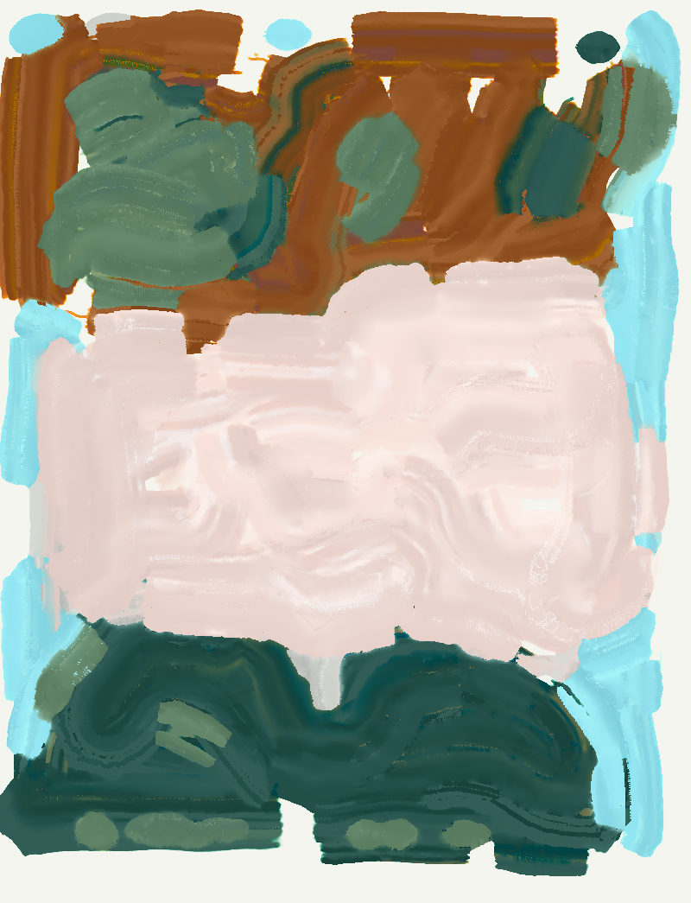

| stroke | covered | width | dark | spread | ms |
|---|---|---|---|---|---|
| stroke 1 | 11 % → 97 % | 81.3 px | 0.22 | 9.21 | 1329 |
| stroke 2 | 18 % → 94 % | 193.9 px | 0.22 | 5.12 | 800 |
| stroke 3 | 23 % → 94 % | 267.9 px | 0.27 | 4.12 | 472 |
| stroke 4 | 24 % → 97 % | 199.7 px | 0.29 | 3.99 | 926 |
| stroke 5 | 29 % → 94 % | 277.5 px | 0.19 | 3.25 | 890 |
| stroke 6 | 35 % → 90 % | 223.4 px | 0.21 | 2.54 | 1082 |
| stroke 7 | 50 % → 93 % | 685.7 px | 0.09 | 1.85 | 490 |
| stroke 8 | 40 % → 93 % | 472.0 px | 0.22 | 2.34 | 876 |
| stroke 9 | 44 % → 93 % | 399.2 px | 0.25 | 2.14 | 1356 |
| stroke 10 | 50 % → 99 % | 779.6 px | 0.29 | 1.96 | 443 |
| stroke 11 | 60 % → 99 % | 1073.5 px | 0.20 | 1.65 | 598 |
| stroke 12 | 75 % → 99 % | 1635.7 px | 0.12 | 1.32 | 260 |
| stroke 13 | 42 % → 95 % | 520.8 px | 0.24 | 2.27 | 402 |
| stroke 14 | 63 % → 92 % | 1017.4 px | 0.16 | 1.45 | 484 |
| stroke 15 | 76 % → 99 % | 1540.2 px | 0.14 | 1.29 | 320 |
| stroke 16 | 62 % → 99 % | 1330.0 px | 0.25 | 1.61 | 289 |
| stroke 17 | 54 % → 99 % | 1124.8 px | 0.27 | 1.82 | 323 |
| stroke 18 | 58 % → 96 % | 1115.0 px | 0.20 | 1.66 | 309 |
| stroke 19 | 71 % → 99 % | 1618.8 px | 0.20 | 1.39 | 309 |
| stroke 20 | 80 % → 93 % | 1648.7 px | 0.09 | 1.16 | 274 |
| stroke 21 | 66 % → 88 % | 978.5 px | 0.12 | 1.33 | 255 |
| stroke 22 | 60 % → 94 % | 1254.2 px | 0.20 | 1.56 | 269 |
| stroke 23 | 59 % → 98 % | 931.9 px | 0.24 | 1.66 | 546 |
| stroke 24 | 60 % → 96 % | 929.9 px | 0.19 | 1.59 | 506 |
| stroke 25 | 53 % → 97 % | 853.2 px | 0.27 | 1.83 | 320 |
| stroke 26 | 88 % → 99 % | 2074.4 px | 0.12 | 1.12 | 309 |
| stroke 27 | 51 % → 96 % | 997.8 px | 0.27 | 1.89 | 460 |
| stroke 28 | 68 % → 96 % | 1460.7 px | 0.17 | 1.40 | 554 |
| stroke 29 | 22 % → 83 % | 263.8 px | 0.39 | 3.77 | 222 |
| stroke 30 | 18 % → 81 % | 291.7 px | 0.42 | 4.46 | 163 |
| stroke 31 | 4 % → 90 % | 62.3 px | 0.53 | 22.60 | 103 |
| stroke 32 | 7 % → 90 % | 126.2 px | 0.52 | 13.65 | 133 |
| stroke 33 | 11 % → 90 % | 162.5 px | 0.50 | 8.30 | 211 |
| stroke 34 | 23 % → 92 % | 790.1 px | 0.46 | 4.04 | 91 |
| stroke 35 | 30 % → 91 % | 564.6 px | 0.43 | 3.08 | 168 |
| stroke 36 | 33 % → 92 % | 805.0 px | 0.42 | 2.75 | 137 |
| stroke 37 | 30 % → 93 % | 395.2 px | 0.44 | 3.07 | 208 |
| stroke 38 | 53 % → 97 % | 555.6 px | 0.36 | 1.82 | 257 |
| stroke 39 | 42 % → 95 % | 808.3 px | 0.42 | 2.28 | 173 |
| stroke 40 | 41 % → 92 % | 1108.4 px | 0.46 | 2.27 | 94 |
| stroke 41 | 48 % → 96 % | 1061.4 px | 0.40 | 2.01 | 121 |
| stroke 42 | 54 % → 97 % | 1029.8 px | 0.37 | 1.79 | 136 |
| stroke 43 | 48 % → 96 % | 587.1 px | 0.40 | 1.99 | 325 |
| stroke 44 | 39 % → 90 % | 712.0 px | 0.47 | 2.30 | 151 |
| stroke 45 | 45 % → 91 % | 851.7 px | 0.43 | 2.05 | 320 |
| stroke 46 | 62 % → 98 % | 1262.2 px | 0.35 | 1.58 | 126 |
| stroke 47 | 44 % → 92 % | 1612.0 px | 0.44 | 2.10 | 87 |
| stroke 48 | 37 % → 90 % | 1049.7 px | 0.50 | 2.42 | 101 |
| stroke 49 | 25 % → 83 % | 645.6 px | 0.42 | 3.30 | 87 |
| stroke 50 | 27 % → 84 % | 1002.1 px | 0.40 | 3.13 | 19 |
| stroke 51 | 7 % → 76 % | 174.7 px | 0.58 | 11.11 | 21 |
| stroke 52 | 7 % → 77 % | 82.3 px | 0.59 | 10.57 | 74 |
| stroke 53 | 1 % → 80 % | 42.1 px | 0.53 | 57.64 | 19 |
| stroke 54 | 7 % → 79 % | 273.0 px | 0.62 | 11.15 | 11 |
| stroke 55 | 4 % → 80 % | 179.8 px | 0.60 | 19.71 | 8 |
| stroke 56 | 21 % → 80 % | 176.0 px | 0.43 | 3.85 | 122 |
| stroke 57 | 67 % → 89 % | 1448.4 px | 0.14 | 1.33 | 74 |
| stroke 58 | 35 % → 84 % | 428.9 px | 0.35 | 2.39 | 141 |
| stroke 59 | 48 % → 83 % | 467.2 px | 0.29 | 1.72 | 198 |
| stroke 60 | 22 % → 78 % | 454.8 px | 0.51 | 3.55 | 47 |
| stroke 61 | 68 % → 88 % | 672.9 px | 0.18 | 1.29 | 162 |
| stroke 62 | 61 % → 90 % | 1834.7 px | 0.25 | 1.48 | 36 |
| stroke 63 | 54 % → 88 % | 1326.6 px | 0.31 | 1.65 | 54 |
| stroke 64 | 67 % → 90 % | 1183.8 px | 0.21 | 1.33 | 92 |
| stroke 65 | 60 % → 90 % | 1871.9 px | 0.27 | 1.49 | 52 |
| stroke 66 | 72 % → 94 % | 1691.2 px | 0.24 | 1.30 | 80 |
| stroke 67 | 70 % → 94 % | 606.9 px | 0.26 | 1.34 | 174 |
| stroke 68 | 77 % → 95 % | 1624.8 px | 0.29 | 1.24 | 67 |
| stroke 69 | 78 % → 95 % | 2511.1 px | 0.27 | 1.21 | 51 |
| stroke 70 | 78 % → 93 % | 2340.0 px | 0.19 | 1.19 | 56 |
| stroke 71 | 44 % → 85 % | 458.2 px | 0.35 | 1.91 | 182 |
| stroke 72 | 57 % → 95 % | 689.7 px | 0.32 | 1.66 | 102 |
| stroke 73 | 52 % → 86 % | 498.7 px | 0.33 | 1.66 | 129 |
| stroke 74 | 56 % → 95 % | 1560.8 px | 0.33 | 1.69 | 44 |
| stroke 75 | 53 % → 93 % | 1181.1 px | 0.35 | 1.76 | 84 |
| stroke 76 | 34 % → 76 % | 259.8 px | 0.31 | 2.22 | 138 |
| stroke 77 | 39 % → 79 % | 391.8 px | 0.33 | 2.01 | 153 |
| stroke 78 | 54 % → 88 % | 1147.9 px | 0.27 | 1.62 | 72 |
| stroke 79 | 45 % → 81 % | 1325.5 px | 0.32 | 1.81 | 60 |
| stroke 80 | 51 % → 81 % | 1187.2 px | 0.27 | 1.59 | 60 |
| stroke 81 | 33 % → 75 % | 552.5 px | 0.40 | 2.27 | 73 |
| stroke 82 | 42 % → 77 % | 1364.7 px | 0.33 | 1.81 | 40 |
| stroke 83 | 62 % → 88 % | 1247.0 px | 0.25 | 1.43 | 81 |
| stroke 84 | 41 % → 90 % | 620.9 px | 0.52 | 2.18 | 22 |
| stroke 85 | 32 % → 88 % | 932.9 px | 0.54 | 2.75 | 29 |
| stroke 86 | 75 % → 85 % | 2586.9 px | 0.13 | 1.13 | 16 |
| stroke 87 | 78 % → 94 % | 1128.9 px | 0.23 | 1.20 | 101 |
| stroke 88 | 66 % → 95 % | 3125.6 px | 0.27 | 1.43 | 19 |
| stroke 89 | 78 % → 94 % | 1116.3 px | 0.22 | 1.20 | 94 |
| stroke 90 | 75 % → 94 % | 1088.0 px | 0.23 | 1.26 | 54 |
| stroke 91 | 70 % → 95 % | 1287.8 px | 0.26 | 1.36 | 72 |
| stroke 92 | 81 % → 94 % | 2289.6 px | 0.19 | 1.16 | 68 |
| stroke 93 | 77 % → 94 % | 1453.4 px | 0.21 | 1.22 | 88 |
| stroke 94 | 72 % → 95 % | 1013.7 px | 0.24 | 1.31 | 180 |
| stroke 95 | 82 % → 93 % | 4028.7 px | 0.17 | 1.13 | 15 |
| stroke 96 | 67 % → 95 % | 2534.7 px | 0.28 | 1.42 | 44 |
| stroke 97 | 83 % → 93 % | 2738.2 px | 0.18 | 1.12 | 29 |
| stroke 98 | 80 % → 95 % | 4417.3 px | 0.19 | 1.19 | 29 |
| stroke 99 | 62 % → 97 % | 1070.9 px | 0.30 | 1.57 | 123 |
| stroke 100 | 59 % → 99 % | 4571.0 px | 0.31 | 1.69 | 14 |
| stroke 101 | 63 % → 96 % | 2060.2 px | 0.30 | 1.53 | 35 |
| stroke 102 | 51 % → 92 % | 1252.7 px | 0.35 | 1.80 | 62 |
| stroke 103 | 54 % → 97 % | 3491.7 px | 0.36 | 1.82 | 21 |
| stroke 104 | 62 % → 99 % | 4842.4 px | 0.31 | 1.60 | 16 |
| stroke 105 | 57 % → 99 % | 2388.4 px | 0.34 | 1.74 | 35 |
| stroke 106 | 54 % → 98 % | 3115.9 px | 0.36 | 1.80 | 18 |
| stroke 107 | 67 % → 96 % | 2739.8 px | 0.28 | 1.42 | 35 |
| stroke 108 | 56 % → 99 % | 4378.1 px | 0.34 | 1.76 | 30 |
| stroke 109 | 57 % → 99 % | 4443.2 px | 0.34 | 1.73 | 28 |
| stroke 110 | 56 % → 99 % | 4286.4 px | 0.34 | 1.77 | 14 |
| stroke 111 | 37 % → 87 % | 648.1 px | 0.52 | 2.37 | 17 |
| stroke 112 | 63 % → 90 % | 661.4 px | 0.26 | 1.44 | 190 |
| stroke 113 | 62 % → 96 % | 2677.9 px | 0.28 | 1.53 | 28 |
| stroke 114 | 51 % → 86 % | 870.0 px | 0.37 | 1.70 | 238 |
| stroke 115 | 42 % → 90 % | 585.6 px | 0.50 | 2.12 | 422 |
| stroke 116 | 59 % → 93 % | 1220.2 px | 0.40 | 1.57 | 393 |
| stroke 117 | 60 % → 86 % | 367.1 px | 0.36 | 1.44 | 1763 |
| stroke 118 | 51 % → 80 % | 301.0 px | 0.54 | 1.56 | 1007 |
| stroke 119 | 73 % → 88 % | 735.8 px | 0.34 | 1.21 | 1080 |
| stroke 120 | 70 % → 81 % | 531.9 px | 0.36 | 1.17 | 1160 |
| stroke 121 | 66 % → 78 % | 522.5 px | 0.43 | 1.18 | 905 |
| stroke 122 | 77 % → 82 % | 933.1 px | 0.34 | 1.07 | 1135 |
| stroke 123 | 73 % → 78 % | 674.5 px | 0.49 | 1.06 | 826 |
| stroke 124 | 77 % → 81 % | 1111.0 px | 0.36 | 1.04 | 519 |
| stroke 125 | 77 % → 81 % | 861.5 px | 0.56 | 1.04 | 534 |
| stroke 126 | 82 % → 83 % | 866.0 px | 0.39 | 1.02 | 488 |
| stroke 127 | 81 % → 82 % | 748.8 px | 0.48 | 1.01 | 655 |
| stroke 128 | 94 % → 94 % | 1767.6 px | 0.37 | 1.00 | 500 |
| stroke 129 | 76 % → 76 % | 982.2 px | 0.52 | 1.00 | 291 |
| stroke 130 | 85 % → 84 % | 1740.2 px | 0.49 | 0.99 | 236 |
| stroke 131 | 91 % → 90 % | 1880.6 px | 0.36 | 0.99 | 401 |
| stroke 132 | 99 % → 98 % | 1785.7 px | 0.33 | 0.99 | 459 |
| stroke 133 | 96 % → 95 % | 1833.4 px | 0.33 | 1.00 | 554 |
| stroke 134 | 33 % → 80 % | 884.0 px | 0.53 | 2.41 | 28 |
| stroke 135 | 57 % → 88 % | 648.8 px | 0.35 | 1.55 | 460 |
| stroke 136 | 71 % → 94 % | 732.0 px | 0.35 | 1.31 | 705 |
| stroke 137 | 75 % → 97 % | 1514.3 px | 0.36 | 1.30 | 324 |
| stroke 138 | 66 % → 91 % | 819.1 px | 0.40 | 1.37 | 435 |
| stroke 139 | 70 % → 90 % | 1219.7 px | 0.39 | 1.30 | 391 |
| stroke 140 | 81 % → 94 % | 786.4 px | 0.33 | 1.15 | 819 |
| stroke 141 | 76 % → 86 % | 611.0 px | 0.35 | 1.14 | 578 |
| stroke 142 | 78 % → 92 % | 412.9 px | 0.36 | 1.17 | 761 |
| stroke 143 | 68 % → 82 % | 462.4 px | 0.54 | 1.21 | 472 |
| stroke 144 | 82 % → 88 % | 1582.8 px | 0.38 | 1.08 | 398 |
| stroke 145 | 92 % → 94 % | 2231.9 px | 0.28 | 1.03 | 211 |
| stroke 146 | 88 % → 98 % | 2350.4 px | 0.36 | 1.11 | 216 |
| stroke 147 | 88 % → 92 % | 2101.8 px | 0.35 | 1.04 | 237 |
| stroke 148 | 91 % → 92 % | 1708.0 px | 0.29 | 1.01 | 215 |
| stroke 149 | 82 % → 85 % | 1534.7 px | 0.47 | 1.04 | 204 |
| stroke 150 | 94 % → 99 % | 2682.9 px | 0.29 | 1.05 | 369 |
| stroke 151 | 86 % → 93 % | 897.4 px | 0.41 | 1.08 | 603 |
| stroke 152 | 95 % → 97 % | 1123.1 px | 0.31 | 1.02 | 414 |
| stroke 153 | 99 % → 98 % | 2310.4 px | 0.27 | 1.00 | 204 |
| stroke 154 | 80 % → 88 % | 1413.0 px | 0.54 | 1.10 | 90 |
| stroke 155 | 83 % → 89 % | 745.7 px | 0.53 | 1.07 | 498 |
| stroke 156 | 96 % → 97 % | 2243.1 px | 0.29 | 1.01 | 224 |
| stroke 157 | 98 % → 99 % | 2666.5 px | 0.31 | 1.01 | 200 |
| stroke 158 | 82 % → 88 % | 1009.9 px | 0.53 | 1.07 | 187 |
| stroke 159 | 86 % → 87 % | 1159.1 px | 0.37 | 1.00 | 338 |
| stroke 160 | 93 % → 93 % | 489.0 px | 0.36 | 1.00 | 597 |
| stroke 161 | 91 % → 91 % | 1248.1 px | 0.52 | 1.00 | 537 |
| stroke 162 | 93 % → 93 % | 1870.8 px | 0.41 | 1.00 | 307 |
| stroke 163 | 85 % → 85 % | 1570.5 px | 0.54 | 1.00 | 159 |
| stroke 164 | 98 % → 98 % | 2888.6 px | 0.34 | 1.00 | 196 |
| stroke 165 | 90 % → 90 % | 1724.4 px | 0.55 | 1.00 | 355 |
| stroke 166 | 93 % → 93 % | 2536.3 px | 0.43 | 1.00 | 235 |

Numbers say: wet paint spreads well beyond the stroke.

## Refs v4 · #06 HW scrubbed grey — own sheet
own sheet 800 × 635 · Gouache 1.00 + turpentine 30 % · 93 px · 200.5 s

| stroke | covered | width | dark | spread | ms |
|---|---|---|---|---|---|
| stroke 1 | 14 % → 99 % | 85.0 px | 0.22 | 7.16 | 733 |
| stroke 2 | 12 % → 98 % | 81.5 px | 0.21 | 7.96 | 642 |
| stroke 3 | 25 % → 99 % | 248.2 px | 0.23 | 3.88 | 537 |
| stroke 4 | 37 % → 98 % | 199.6 px | 0.23 | 2.66 | 1183 |
| stroke 5 | 33 % → 98 % | 329.8 px | 0.22 | 2.98 | 513 |
| stroke 6 | 50 % → 98 % | 652.3 px | 0.22 | 1.96 | 274 |
| stroke 7 | 40 % → 97 % | 603.1 px | 0.20 | 2.45 | 457 |
| stroke 8 | 55 % → 99 % | 456.7 px | 0.24 | 1.79 | 430 |
| stroke 9 | 65 % → 99 % | 535.2 px | 0.23 | 1.53 | 486 |
| stroke 10 | 54 % → 97 % | 667.7 px | 0.21 | 1.82 | 300 |
| stroke 11 | 36 % → 99 % | 441.8 px | 0.22 | 2.78 | 286 |
| stroke 12 | 61 % → 98 % | 1015.0 px | 0.23 | 1.60 | 287 |
| stroke 13 | 62 % → 99 % | 774.3 px | 0.24 | 1.60 | 380 |
| stroke 14 | 68 % → 99 % | 715.8 px | 0.24 | 1.46 | 267 |
| stroke 15 | 54 % → 99 % | 1002.3 px | 0.22 | 1.83 | 217 |
| stroke 16 | 59 % → 99 % | 701.9 px | 0.23 | 1.68 | 497 |
| stroke 17 | 64 % → 99 % | 760.7 px | 0.24 | 1.54 | 582 |
| stroke 18 | 42 % → 98 % | 373.0 px | 0.20 | 2.35 | 292 |
| stroke 19 | 57 % → 98 % | 729.7 px | 0.21 | 1.74 | 230 |
| stroke 20 | 76 % → 98 % | 817.5 px | 0.24 | 1.30 | 440 |
| stroke 21 | 73 % → 99 % | 929.1 px | 0.24 | 1.35 | 508 |
| stroke 22 | 58 % → 99 % | 1013.6 px | 0.24 | 1.71 | 398 |
| stroke 23 | 40 % → 98 % | 828.1 px | 0.19 | 2.44 | 294 |
| stroke 24 | 68 % → 98 % | 1114.5 px | 0.23 | 1.44 | 326 |
| stroke 25 | 31 % → 100 % | 655.2 px | 0.19 | 3.24 | 192 |
| stroke 26 | 18 % → 97 % | 587.1 px | 0.18 | 5.41 | 22 |
| stroke 27 | 17 % → 95 % | 341.1 px | 0.16 | 5.49 | 17 |
| stroke 28 | 4 % → 94 % | 66.1 px | 0.15 | 20.99 | 13 |
| stroke 29 | 63 % → 99 % | 671.8 px | 0.22 | 1.58 | 509 |
| stroke 30 | 51 % → 99 % | 473.0 px | 0.20 | 1.94 | 530 |
| stroke 31 | 38 % → 98 % | 266.9 px | 0.17 | 2.59 | 595 |
| stroke 32 | 36 % → 97 % | 315.9 px | 0.16 | 2.68 | 356 |
| stroke 33 | 74 % → 99 % | 783.4 px | 0.22 | 1.34 | 383 |
| stroke 34 | 80 % → 99 % | 985.2 px | 0.23 | 1.23 | 339 |
| stroke 35 | 64 % → 99 % | 1558.4 px | 0.20 | 1.55 | 137 |
| stroke 36 | 77 % → 99 % | 1117.2 px | 0.22 | 1.29 | 326 |
| stroke 37 | 41 % → 95 % | 431.9 px | 0.15 | 2.28 | 145 |
| stroke 38 | 88 % → 99 % | 1979.9 px | 0.23 | 1.13 | 191 |
| stroke 39 | 67 % → 99 % | 873.5 px | 0.20 | 1.49 | 382 |
| stroke 40 | 55 % → 100 % | 962.1 px | 0.18 | 1.80 | 193 |
| stroke 41 | 68 % → 98 % | 1129.5 px | 0.19 | 1.44 | 266 |
| stroke 42 | 48 % → 97 % | 1145.9 px | 0.15 | 2.01 | 99 |
| stroke 43 | 88 % → 99 % | 1594.8 px | 0.23 | 1.12 | 149 |
| stroke 44 | 91 % → 99 % | 2429.8 px | 0.23 | 1.10 | 141 |
| stroke 45 | 55 % → 97 % | 478.7 px | 0.16 | 1.77 | 398 |
| stroke 46 | 50 % → 99 % | 1074.1 px | 0.15 | 1.99 | 136 |
| stroke 47 | 72 % → 99 % | 1936.0 px | 0.19 | 1.39 | 123 |
| stroke 48 | 59 % → 99 % | 1549.1 px | 0.17 | 1.70 | 109 |
| stroke 49 | 65 % → 97 % | 1020.1 px | 0.18 | 1.48 | 130 |
| stroke 50 | 80 % → 99 % | 1815.7 px | 0.22 | 1.24 | 166 |
| stroke 51 | 50 % → 100 % | 1206.0 px | 0.15 | 1.99 | 156 |
| stroke 52 | 77 % → 98 % | 1677.7 px | 0.21 | 1.27 | 134 |
| stroke 53 | 74 % → 98 % | 828.5 px | 0.23 | 1.32 | 425 |
| stroke 54 | 62 % → 96 % | 554.8 px | 0.20 | 1.56 | 347 |
| stroke 55 | 79 % → 98 % | 797.6 px | 0.23 | 1.24 | 448 |
| stroke 56 | 51 % → 96 % | 542.0 px | 0.18 | 1.88 | 114 |
| stroke 57 | 66 % → 97 % | 902.5 px | 0.21 | 1.46 | 274 |
| stroke 58 | 75 % → 97 % | 2199.3 px | 0.23 | 1.30 | 25 |
| stroke 59 | 58 % → 97 % | 1350.0 px | 0.19 | 1.66 | 114 |
| stroke 60 | 81 % → 97 % | 425.2 px | 0.22 | 1.19 | 418 |
| stroke 61 | 91 % → 99 % | 1477.3 px | 0.24 | 1.08 | 187 |
| stroke 62 | 93 % → 98 % | 446.4 px | 0.23 | 1.05 | 503 |
| stroke 63 | 92 % → 97 % | 925.6 px | 0.22 | 1.05 | 161 |
| stroke 64 | 96 % → 99 % | 925.6 px | 0.23 | 1.03 | 266 |
| stroke 65 | 92 % → 96 % | 1330.7 px | 0.21 | 1.04 | 93 |
| stroke 66 | 95 % → 97 % | 1496.2 px | 0.22 | 1.03 | 108 |
| stroke 67 | 95 % → 96 % | 771.9 px | 0.19 | 1.01 | 103 |
| stroke 68 | 96 % → 96 % | 924.9 px | 0.21 | 1.01 | 118 |
| stroke 69 | 96 % → 96 % | 1133.6 px | 0.20 | 1.01 | 75 |
| stroke 70 | 99 % → 99 % | 1594.4 px | 0.22 | 1.00 | 75 |
| stroke 71 | 75 % → 98 % | 810.2 px | 0.19 | 1.29 | 209 |
| stroke 72 | 83 % → 98 % | 495.8 px | 0.20 | 1.17 | 329 |
| stroke 73 | 86 % → 98 % | 912.9 px | 0.20 | 1.15 | 311 |
| stroke 74 | 90 % → 99 % | 926.0 px | 0.22 | 1.09 | 177 |
| stroke 75 | 94 % → 98 % | 584.0 px | 0.21 | 1.05 | 130 |
| stroke 76 | 84 % → 97 % | 577.2 px | 0.18 | 1.16 | 240 |
| stroke 77 | 98 % → 98 % | 783.6 px | 0.21 | 1.00 | 135 |
| stroke 78 | 98 % → 98 % | 534.3 px | 0.22 | 1.00 | 143 |
| stroke 79 | 81 % → 97 % | 1523.0 px | 0.19 | 1.20 | 107 |
| stroke 80 | 96 % → 98 % | 1111.3 px | 0.21 | 1.02 | 222 |
| stroke 81 | 97 % → 97 % | 1175.6 px | 0.19 | 1.00 | 76 |
| stroke 82 | 50 % → 96 % | 388.6 px | 0.15 | 1.94 | 529 |
| stroke 83 | 64 % → 97 % | 664.6 px | 0.17 | 1.53 | 677 |
| stroke 84 | 54 % → 96 % | 513.1 px | 0.15 | 1.76 | 381 |
| stroke 85 | 61 % → 95 % | 558.1 px | 0.17 | 1.55 | 215 |
| stroke 86 | 62 % → 98 % | 799.4 px | 0.16 | 1.57 | 413 |
| stroke 87 | 55 % → 95 % | 1357.1 px | 0.14 | 1.74 | 82 |
| stroke 88 | 71 % → 96 % | 1142.6 px | 0.17 | 1.35 | 127 |
| stroke 89 | 59 % → 92 % | 536.8 px | 0.13 | 1.57 | 122 |
| stroke 90 | 75 % → 94 % | 1326.4 px | 0.17 | 1.25 | 93 |
| stroke 91 | 75 % → 96 % | 1615.2 px | 0.17 | 1.28 | 84 |
| stroke 92 | 65 % → 98 % | 1975.8 px | 0.16 | 1.52 | 100 |
| stroke 93 | 68 % → 95 % | 1151.8 px | 0.16 | 1.41 | 231 |
| stroke 94 | 72 % → 95 % | 1131.7 px | 0.17 | 1.32 | 145 |
| stroke 95 | 63 % → 97 % | 787.8 px | 0.15 | 1.54 | 115 |
| stroke 96 | 65 % → 95 % | 870.3 px | 0.15 | 1.48 | 106 |
| stroke 97 | 77 % → 98 % | 335.9 px | 0.14 | 1.28 | 1239 |
| stroke 98 | 73 % → 96 % | 356.6 px | 0.11 | 1.31 | 926 |
| stroke 99 | 92 % → 98 % | 594.8 px | 0.15 | 1.06 | 943 |
| stroke 100 | 87 % → 96 % | 518.7 px | 0.13 | 1.11 | 1506 |
| stroke 101 | 97 % → 100 % | 1041.2 px | 0.12 | 1.03 | 350 |
| stroke 102 | 89 % → 94 % | 445.2 px | 0.09 | 1.06 | 627 |
| stroke 103 | 97 % → 96 % | 1029.8 px | 0.15 | 1.00 | 289 |
| stroke 104 | 95 % → 96 % | 771.8 px | 0.13 | 1.01 | 629 |
| stroke 105 | 96 % → 96 % | 775.4 px | 0.14 | 1.00 | 845 |
| stroke 106 | 97 % → 97 % | 601.8 px | 0.13 | 0.99 | 430 |
| stroke 107 | 100 % → 100 % | 1054.6 px | 0.15 | 1.00 | 669 |
| stroke 108 | 96 % → 96 % | 1231.0 px | 0.10 | 1.00 | 309 |
| stroke 109 | 96 % → 97 % | 1960.2 px | 0.20 | 1.00 | 42 |

Numbers say: wet paint spreads well beyond the stroke.

## Refs v4 · #07 HW blue L and zigzag — own sheet
own sheet 800 × 1065 · Gouache 1.00 + turpentine 30 % · 104 px · 242.6 s

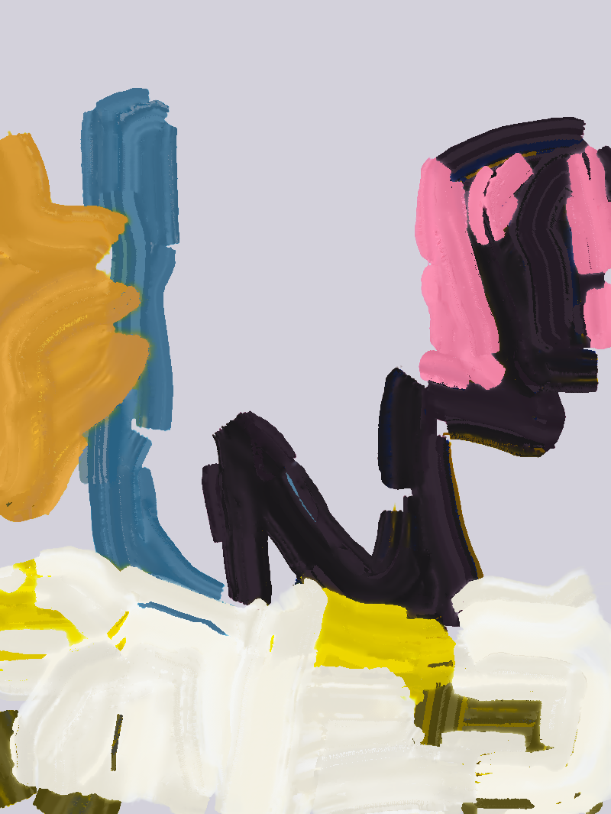

| stroke | covered | width | dark | spread | ms |
|---|---|---|---|---|---|
| stroke 1 | 13 % → 90 % | 93.0 px | 0.22 | 7.18 | 921 |
| stroke 2 | 31 % → 80 % | 123.0 px | 0.24 | 2.61 | 1430 |
| stroke 3 | 36 % → 85 % | 409.2 px | 0.23 | 2.32 | 405 |
| stroke 4 | 61 % → 99 % | 662.2 px | 0.14 | 1.63 | 291 |
| stroke 5 | 20 % → 86 % | 159.7 px | 0.29 | 4.40 | 881 |
| stroke 6 | 65 % → 99 % | 516.2 px | 0.13 | 1.53 | 545 |
| stroke 7 | 32 % → 88 % | 246.6 px | 0.22 | 2.72 | 749 |
| stroke 8 | 74 % → 99 % | 909.8 px | 0.14 | 1.34 | 352 |
| stroke 9 | 42 % → 88 % | 275.4 px | 0.19 | 2.10 | 619 |
| stroke 10 | 38 % → 85 % | 446.8 px | 0.26 | 2.21 | 659 |
| stroke 11 | 76 % → 98 % | 937.7 px | 0.12 | 1.29 | 239 |
| stroke 12 | 59 % → 90 % | 697.1 px | 0.19 | 1.54 | 413 |
| stroke 13 | 66 % → 94 % | 1104.0 px | 0.20 | 1.41 | 315 |
| stroke 14 | 73 % → 96 % | 1076.2 px | 0.18 | 1.32 | 390 |
| stroke 15 | 62 % → 91 % | 705.3 px | 0.22 | 1.48 | 525 |
| stroke 16 | 58 % → 88 % | 772.8 px | 0.17 | 1.52 | 262 |
| stroke 17 | 41 % → 72 % | 412.9 px | 0.28 | 1.76 | 429 |
| stroke 18 | 67 % → 92 % | 886.9 px | 0.16 | 1.38 | 240 |
| stroke 19 | 67 % → 90 % | 590.2 px | 0.17 | 1.34 | 470 |
| stroke 20 | 64 % → 86 % | 689.3 px | 0.21 | 1.34 | 404 |
| stroke 21 | 53 % → 85 % | 846.3 px | 0.24 | 1.62 | 425 |
| stroke 22 | 89 % → 100 % | 966.7 px | 0.13 | 1.13 | 490 |
| stroke 23 | 49 % → 85 % | 1638.3 px | 0.19 | 1.71 | 19 |
| stroke 24 | 23 % → 65 % | 161.4 px | 0.31 | 2.86 | 958 |
| stroke 25 | 24 % → 64 % | 270.2 px | 0.34 | 2.67 | 511 |
| stroke 26 | 25 % → 42 % | 217.2 px | 0.29 | 1.71 | 783 |
| stroke 27 | 35 % → 59 % | 393.7 px | 0.30 | 1.67 | 454 |
| stroke 28 | 37 % → 65 % | 613.7 px | 0.33 | 1.78 | 277 |
| stroke 29 | 35 % → 63 % | 548.9 px | 0.32 | 1.77 | 331 |
| stroke 30 | 48 % → 74 % | 685.8 px | 0.26 | 1.54 | 280 |
| stroke 31 | 67 % → 88 % | 687.6 px | 0.20 | 1.30 | 249 |
| stroke 32 | 66 % → 88 % | 677.1 px | 0.21 | 1.33 | 285 |
| stroke 33 | 65 % → 86 % | 818.0 px | 0.21 | 1.31 | 189 |
| stroke 34 | 68 % → 84 % | 1248.2 px | 0.18 | 1.24 | 116 |
| stroke 35 | 71 % → 88 % | 680.0 px | 0.20 | 1.25 | 328 |
| stroke 36 | 69 % → 85 % | 1149.3 px | 0.17 | 1.23 | 145 |
| stroke 37 | 64 % → 82 % | 1390.3 px | 0.19 | 1.27 | 107 |
| stroke 38 | 58 % → 84 % | 835.8 px | 0.26 | 1.46 | 338 |
| stroke 39 | 64 % → 86 % | 915.2 px | 0.23 | 1.34 | 387 |
| stroke 40 | 66 % → 89 % | 1329.5 px | 0.23 | 1.35 | 181 |
| stroke 41 | 55 % → 83 % | 1902.0 px | 0.28 | 1.51 | 62 |
| stroke 42 | 51 % → 82 % | 1534.9 px | 0.31 | 1.60 | 116 |
| stroke 43 | 55 % → 87 % | 2089.3 px | 0.30 | 1.56 | 120 |
| stroke 44 | 62 % → 88 % | 2310.3 px | 0.26 | 1.42 | 99 |
| stroke 45 | 59 % → 81 % | 2208.1 px | 0.26 | 1.38 | 85 |
| stroke 46 | 2 % → 43 % | 38.3 px | 0.47 | 24.29 | 57 |
| stroke 47 | 3 % → 42 % | 82.2 px | 0.46 | 13.21 | 57 |
| stroke 48 | 4 % → 46 % | 147.5 px | 0.46 | 13.09 | 45 |
| stroke 49 | 8 % → 65 % | 75.8 px | 0.50 | 8.05 | 93 |
| stroke 50 | 12 % → 79 % | 195.5 px | 0.52 | 6.52 | 41 |
| stroke 51 | 12 % → 75 % | 199.3 px | 0.50 | 6.10 | 82 |
| stroke 52 | 14 % → 83 % | 448.9 px | 0.50 | 5.88 | 20 |
| stroke 53 | 14 % → 67 % | 463.5 px | 0.46 | 4.80 | 37 |
| stroke 54 | 9 % → 44 % | 129.3 px | 0.53 | 4.78 | 151 |
| stroke 55 | 11 % → 47 % | 159.5 px | 0.53 | 4.25 | 132 |
| stroke 56 | 12 % → 49 % | 379.6 px | 0.55 | 4.24 | 38 |
| stroke 57 | 14 % → 50 % | 364.5 px | 0.53 | 3.55 | 72 |
| stroke 58 | 16 % → 39 % | 553.5 px | 0.47 | 2.40 | 75 |
| stroke 59 | 15 % → 37 % | 294.6 px | 0.49 | 2.44 | 141 |
| stroke 60 | 18 % → 49 % | 875.7 px | 0.52 | 2.77 | 25 |
| stroke 61 | 19 % → 52 % | 905.3 px | 0.52 | 2.75 | 42 |
| stroke 62 | 26 % → 52 % | 190.8 px | 0.52 | 2.03 | 412 |
| stroke 63 | 42 % → 70 % | 526.6 px | 0.36 | 1.66 | 336 |
| stroke 64 | 26 % → 50 % | 333.9 px | 0.58 | 1.90 | 183 |
| stroke 65 | 52 % → 67 % | 636.6 px | 0.36 | 1.28 | 620 |
| stroke 66 | 56 % → 75 % | 1604.6 px | 0.36 | 1.35 | 109 |
| stroke 67 | 32 % → 43 % | 339.3 px | 0.53 | 1.37 | 382 |
| stroke 68 | 39 % → 52 % | 466.3 px | 0.52 | 1.35 | 335 |
| stroke 69 | 59 % → 78 % | 1877.1 px | 0.34 | 1.34 | 131 |
| stroke 70 | 53 % → 65 % | 787.5 px | 0.54 | 1.22 | 143 |
| stroke 71 | 52 % → 63 % | 540.2 px | 0.51 | 1.21 | 284 |
| stroke 72 | 49 % → 67 % | 723.8 px | 0.34 | 1.35 | 416 |
| stroke 73 | 53 % → 62 % | 460.9 px | 0.51 | 1.18 | 347 |
| stroke 74 | 59 % → 71 % | 1470.8 px | 0.40 | 1.21 | 203 |
| stroke 75 | 58 % → 72 % | 890.3 px | 0.29 | 1.24 | 259 |
| stroke 76 | 52 % → 57 % | 1151.2 px | 0.52 | 1.10 | 143 |
| stroke 77 | 47 % → 51 % | 736.0 px | 0.58 | 1.07 | 224 |
| stroke 78 | 53 % → 55 % | 906.3 px | 0.54 | 1.05 | 207 |
| stroke 79 | 34 % → 35 % | 335.2 px | 0.46 | 1.03 | 464 |
| stroke 80 | 53 % → 56 % | 969.6 px | 0.52 | 1.04 | 253 |
| stroke 81 | 72 % → 78 % | 1433.8 px | 0.29 | 1.07 | 272 |
| stroke 82 | 44 % → 45 % | 540.4 px | 0.49 | 1.02 | 512 |
| stroke 83 | 37 % → 38 % | 1191.6 px | 0.46 | 1.02 | 255 |
| stroke 84 | 65 % → 69 % | 1081.8 px | 0.36 | 1.06 | 485 |
| stroke 85 | 44 % → 58 % | 1327.0 px | 0.45 | 1.32 | 179 |
| stroke 86 | 45 % → 45 % | 1099.8 px | 0.50 | 1.02 | 161 |
| stroke 87 | 72 % → 77 % | 2596.1 px | 0.35 | 1.08 | 106 |
| stroke 88 | 45 % → 59 % | 1534.6 px | 0.44 | 1.30 | 113 |
| stroke 89 | 55 % → 66 % | 1299.5 px | 0.32 | 1.22 | 146 |
| stroke 90 | 62 % → 64 % | 1793.4 px | 0.51 | 1.02 | 119 |
| stroke 91 | 65 % → 65 % | 1163.0 px | 0.53 | 1.01 | 117 |
| stroke 92 | 55 % → 56 % | 1471.5 px | 0.52 | 1.02 | 113 |
| stroke 93 | 61 % → 61 % | 1249.7 px | 0.47 | 1.01 | 71 |
| stroke 94 | 49 % → 49 % | 751.5 px | 0.57 | 1.01 | 280 |
| stroke 95 | 74 % → 78 % | 2863.3 px | 0.34 | 1.05 | 83 |
| stroke 96 | 33 % → 49 % | 352.0 px | 0.34 | 1.46 | 332 |
| stroke 97 | 42 % → 56 % | 479.7 px | 0.35 | 1.33 | 320 |
| stroke 98 | 35 % → 42 % | 473.0 px | 0.30 | 1.20 | 159 |
| stroke 99 | 63 % → 72 % | 1049.8 px | 0.29 | 1.14 | 209 |
| stroke 100 | 73 % → 78 % | 1029.1 px | 0.25 | 1.07 | 230 |
| stroke 101 | 30 % → 33 % | 418.5 px | 0.30 | 1.11 | 219 |
| stroke 102 | 80 % → 85 % | 1570.1 px | 0.25 | 1.06 | 163 |
| stroke 103 | 62 % → 67 % | 1093.0 px | 0.32 | 1.08 | 170 |
| stroke 104 | 36 % → 37 % | 507.7 px | 0.29 | 1.05 | 229 |
| stroke 105 | 35 % → 36 % | 523.5 px | 0.29 | 1.02 | 227 |
| stroke 106 | 70 % → 72 % | 1046.5 px | 0.28 | 1.04 | 229 |
| stroke 107 | 75 % → 76 % | 1179.2 px | 0.26 | 1.01 | 350 |
| stroke 108 | 81 % → 82 % | 3091.5 px | 0.26 | 1.01 | 85 |
| stroke 109 | 29 % → 29 % | 723.3 px | 0.32 | 0.99 | 82 |
| stroke 110 | 61 % → 61 % | 1079.4 px | 0.35 | 1.01 | 160 |
| stroke 111 | 72 % → 72 % | 2263.0 px | 0.29 | 1.00 | 76 |
| stroke 112 | 38 % → 38 % | 931.5 px | 0.31 | 1.00 | 94 |
| stroke 113 | 80 % → 80 % | 3085.4 px | 0.27 | 1.01 | 74 |
| stroke 114 | 62 % → 62 % | 1589.2 px | 0.42 | 1.00 | 90 |
| stroke 115 | 72 % → 75 % | 4084.9 px | 0.39 | 1.04 | 33 |
| stroke 116 | 85 % → 87 % | 1192.1 px | 0.22 | 1.03 | 284 |
| stroke 117 | 86 % → 89 % | 970.3 px | 0.22 | 1.03 | 413 |
| stroke 118 | 88 % → 91 % | 1111.9 px | 0.20 | 1.03 | 161 |
| stroke 119 | 96 % → 96 % | 1089.8 px | 0.17 | 1.00 | 257 |
| stroke 120 | 99 % → 99 % | 1232.4 px | 0.14 | 1.00 | 229 |
| stroke 121 | 93 % → 93 % | 1099.5 px | 0.20 | 1.00 | 312 |
| stroke 122 | 89 % → 92 % | 721.8 px | 0.17 | 1.03 | 269 |
| stroke 123 | 95 % → 97 % | 1253.7 px | 0.14 | 1.02 | 114 |
| stroke 124 | 95 % → 97 % | 1071.8 px | 0.13 | 1.01 | 120 |
| stroke 125 | 96 % → 96 % | 1046.5 px | 0.13 | 1.00 | 98 |
| stroke 126 | 78 % → 78 % | 1632.6 px | 0.23 | 1.01 | 57 |
| stroke 127 | 99 % → 99 % | 536.4 px | 0.13 | 1.00 | 159 |

Numbers say: wet paint spreads well beyond the stroke.

## Refs v4 · #08 HW lilac crown basket — own sheet
own sheet 800 × 1150 · Gouache 1.00 + turpentine 30 % · 36 px · 645.6 s

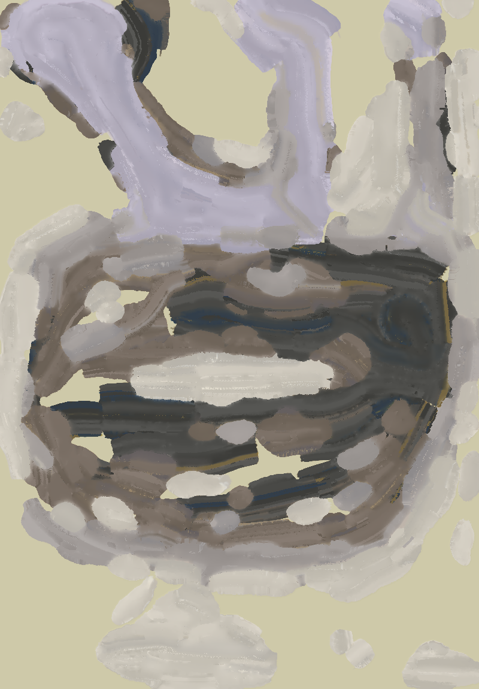

| stroke | covered | width | dark | spread | ms |
|---|---|---|---|---|---|
| stroke 1 | 17 % → 90 % | 35.1 px | 0.12 | 5.28 | 612 |
| stroke 2 | 28 % → 80 % | 92.4 px | 0.12 | 2.87 | 40 |
| stroke 3 | 26 % → 97 % | 70.3 px | 0.13 | 3.79 | 63 |
| stroke 4 | 22 % → 97 % | 51.3 px | 0.22 | 4.37 | 81 |
| stroke 5 | 38 % → 97 % | 100.8 px | 0.11 | 2.53 | 63 |
| stroke 6 | 30 % → 87 % | 84.6 px | 0.13 | 2.90 | 71 |
| stroke 7 | 40 % → 98 % | 189.2 px | 0.13 | 2.46 | 29 |
| stroke 8 | 53 % → 97 % | 292.5 px | 0.12 | 1.84 | 20 |
| stroke 9 | 35 % → 80 % | 109.8 px | 0.12 | 2.28 | 66 |
| stroke 10 | 11 % → 76 % | 34.4 px | 0.08 | 7.19 | 93 |
| stroke 11 | 18 % → 90 % | 131.7 px | 0.06 | 5.09 | 29 |
| stroke 12 | 21 % → 84 % | 108.7 px | 0.06 | 3.93 | 47 |
| stroke 13 | 27 % → 80 % | 97.6 px | 0.10 | 2.94 | 82 |
| stroke 14 | 25 % → 96 % | 143.7 px | 0.08 | 3.80 | 58 |
| stroke 15 | 38 % → 92 % | 179.3 px | 0.07 | 2.45 | 53 |
| stroke 16 | 42 % → 79 % | 343.9 px | 0.09 | 1.89 | 24 |
| stroke 17 | 31 % → 94 % | 171.7 px | 0.08 | 3.03 | 64 |
| stroke 18 | 47 % → 81 % | 361.4 px | 0.06 | 1.73 | 29 |
| stroke 19 | 32 % → 97 % | 242.2 px | 0.08 | 2.99 | 30 |
| stroke 20 | 26 % → 98 % | 190.0 px | 0.14 | 3.75 | 33 |
| stroke 21 | 36 % → 98 % | 319.3 px | 0.10 | 2.73 | 26 |
| stroke 22 | 43 % → 94 % | 270.9 px | 0.07 | 2.18 | 28 |
| stroke 23 | 51 % → 82 % | 449.4 px | 0.06 | 1.59 | 37 |
| stroke 24 | 38 % → 66 % | 330.4 px | 0.09 | 1.76 | 23 |
| stroke 25 | 52 % → 98 % | 486.2 px | 0.08 | 1.88 | 21 |
| stroke 26 | 7 % → 35 % | 37.0 px | 0.13 | 4.71 | 22 |
| stroke 27 | 9 % → 37 % | 51.2 px | 0.15 | 4.09 | 34 |
| stroke 28 | 13 % → 31 % | 80.6 px | 0.14 | 2.44 | 25 |
| stroke 29 | 13 % → 92 % | 34.9 px | 0.17 | 7.03 | 70 |
| stroke 30 | 12 % → 60 % | 46.7 px | 0.15 | 4.82 | 84 |
| stroke 31 | 30 % → 88 % | 64.3 px | 0.16 | 2.93 | 103 |
| stroke 32 | 12 % → 79 % | 32.0 px | 0.20 | 6.39 | 70 |
| stroke 33 | 38 % → 96 % | 101.1 px | 0.17 | 2.50 | 56 |
| stroke 34 | 39 % → 94 % | 94.5 px | 0.19 | 2.40 | 99 |
| stroke 35 | 41 % → 94 % | 182.7 px | 0.16 | 2.30 | 46 |
| stroke 36 | 34 % → 71 % | 227.1 px | 0.12 | 2.12 | 31 |
| stroke 37 | 9 % → 96 % | 35.1 px | 0.29 | 10.45 | 79 |
| stroke 38 | 17 % → 100 % | 58.1 px | 0.24 | 5.89 | 181 |
| stroke 39 | 24 % → 99 % | 73.5 px | 0.27 | 4.09 | 193 |
| stroke 40 | 23 % → 100 % | 107.2 px | 0.30 | 4.41 | 75 |
| stroke 41 | 29 % → 100 % | 101.1 px | 0.29 | 3.48 | 187 |
| stroke 42 | 32 % → 100 % | 107.1 px | 0.25 | 3.09 | 111 |
| stroke 43 | 41 % → 100 % | 274.4 px | 0.21 | 2.44 | 31 |
| stroke 44 | 20 % → 95 % | 114.1 px | 0.30 | 4.78 | 35 |
| stroke 45 | 35 % → 99 % | 162.8 px | 0.26 | 2.86 | 67 |
| stroke 46 | 41 % → 100 % | 306.7 px | 0.24 | 2.41 | 27 |
| stroke 47 | 8 % → 79 % | 35.6 px | 0.15 | 9.70 | 68 |
| stroke 48 | 8 % → 56 % | 36.4 px | 0.13 | 7.23 | 60 |
| stroke 49 | 17 % → 64 % | 125.0 px | 0.13 | 3.85 | 36 |
| stroke 50 | 17 % → 67 % | 72.7 px | 0.12 | 3.94 | 71 |
| stroke 51 | 19 % → 73 % | 92.1 px | 0.15 | 3.83 | 81 |
| stroke 52 | 19 % → 49 % | 89.0 px | 0.13 | 2.54 | 135 |
| stroke 53 | 32 % → 70 % | 204.1 px | 0.13 | 2.22 | 36 |
| stroke 54 | 20 % → 83 % | 175.3 px | 0.17 | 4.20 | 21 |
| stroke 55 | 35 % → 69 % | 349.2 px | 0.13 | 1.97 | 19 |
| stroke 56 | 10 % → 68 % | 35.2 px | 0.02 | 7.11 | 116 |
| stroke 57 | 24 % → 96 % | 65.0 px | 0.02 | 3.96 | 46 |
| stroke 58 | 8 % → 58 % | 58.7 px | 0.02 | 7.39 | 27 |
| stroke 59 | 22 % → 59 % | 76.6 px | 0.02 | 2.75 | 43 |
| stroke 60 | 34 % → 74 % | 96.3 px | 0.02 | 2.21 | 138 |
| stroke 61 | 49 % → 83 % | 117.9 px | 0.02 | 1.68 | 136 |
| stroke 62 | 35 % → 77 % | 172.2 px | 0.02 | 2.20 | 54 |
| stroke 63 | 36 % → 53 % | 177.4 px | 0.02 | 1.47 | 50 |
| stroke 64 | 39 % → 60 % | 160.7 px | 0.02 | 1.54 | 94 |
| stroke 65 | 34 % → 52 % | 229.9 px | 0.02 | 1.51 | 36 |
| stroke 66 | 59 % → 70 % | 184.6 px | 0.02 | 1.18 | 61 |
| stroke 67 | 30 % → 87 % | 171.3 px | 0.05 | 2.89 | 39 |
| stroke 68 | 50 % → 78 % | 461.5 px | 0.02 | 1.58 | 18 |
| stroke 69 | 60 % → 78 % | 253.9 px | 0.02 | 1.30 | 74 |
| stroke 70 | 43 % → 50 % | 200.2 px | 0.02 | 1.16 | 54 |
| stroke 71 | 54 % → 86 % | 314.8 px | 0.02 | 1.57 | 49 |
| stroke 72 | 87 % → 96 % | 258.5 px | 0.02 | 1.10 | 109 |
| stroke 73 | 55 % → 67 % | 222.1 px | 0.02 | 1.21 | 147 |
| stroke 74 | 78 % → 91 % | 274.2 px | 0.02 | 1.16 | 98 |
| stroke 75 | 59 % → 80 % | 324.1 px | 0.02 | 1.35 | 62 |
| stroke 76 | 56 % → 86 % | 320.8 px | 0.03 | 1.55 | 38 |
| stroke 77 | 51 % → 87 % | 340.6 px | 0.03 | 1.71 | 37 |
| stroke 78 | 76 % → 80 % | 438.9 px | 0.02 | 1.06 | 33 |
| stroke 79 | 34 % → 87 % | 293.7 px | 0.07 | 2.55 | 21 |
| stroke 80 | 67 % → 75 % | 475.7 px | 0.02 | 1.12 | 38 |
| stroke 81 | 74 % → 80 % | 498.6 px | 0.02 | 1.08 | 51 |
| stroke 82 | 49 % → 88 % | 420.5 px | 0.04 | 1.78 | 30 |
| stroke 83 | 5 % → 12 % | 38.5 px | 0.03 | 2.51 | 18 |
| stroke 84 | 11 % → 13 % | 93.3 px | 0.03 | 1.19 | 27 |
| stroke 85 | 18 % → 39 % | 36.8 px | 0.03 | 2.11 | 97 |
| stroke 86 | 23 % → 36 % | 52.2 px | 0.03 | 1.60 | 93 |
| stroke 87 | 34 % → 43 % | 75.7 px | 0.03 | 1.28 | 64 |
| stroke 88 | 31 % → 35 % | 188.7 px | 0.03 | 1.14 | 24 |
| stroke 89 | 5 % → 50 % | 15.8 px | 0.18 | 9.13 | 47 |
| stroke 90 | 7 % → 60 % | 20.1 px | 0.09 | 8.81 | 14 |
| stroke 91 | 7 % → 50 % | 38.1 px | 0.12 | 6.82 | 24 |
| stroke 92 | 10 % → 73 % | 57.9 px | 0.11 | 7.41 | 9 |
| stroke 93 | 4 % → 73 % | 20.4 px | 0.15 | 16.87 | 39 |
| stroke 94 | 4 % → 95 % | 24.0 px | 0.25 | 25.87 | 23 |
| stroke 95 | 7 % → 95 % | 66.4 px | 0.26 | 12.75 | 13 |
| stroke 96 | 4 % → 94 % | 18.3 px | 0.26 | 21.64 | 13 |
| stroke 97 | 21 % → 93 % | 87.7 px | 0.20 | 4.40 | 33 |
| stroke 98 | 39 % → 72 % | 112.6 px | 0.09 | 1.87 | 40 |
| stroke 99 | 7 % → 90 % | 29.9 px | 0.36 | 12.24 | 69 |
| stroke 100 | 6 % → 91 % | 33.3 px | 0.32 | 15.09 | 43 |
| stroke 101 | 6 % → 98 % | 34.9 px | 0.24 | 15.92 | 30 |
| stroke 102 | 10 % → 77 % | 78.2 px | 0.20 | 7.41 | 26 |
| stroke 103 | 35 % → 39 % | 122.4 px | 0.04 | 1.13 | 46 |
| stroke 104 | 15 % → 72 % | 84.3 px | 0.12 | 4.91 | 47 |
| stroke 105 | 25 % → 86 % | 137.6 px | 0.12 | 3.39 | 42 |
| stroke 106 | 43 % → 71 % | 224.0 px | 0.08 | 1.64 | 57 |
| stroke 107 | 29 % → 76 % | 98.6 px | 0.12 | 2.62 | 71 |
| stroke 108 | 51 % → 91 % | 551.6 px | 0.13 | 1.79 | 22 |
| stroke 109 | 32 % → 98 % | 129.0 px | 0.17 | 3.12 | 155 |
| stroke 110 | 50 % → 85 % | 214.5 px | 0.11 | 1.71 | 79 |
| stroke 111 | 24 % → 99 % | 93.2 px | 0.23 | 4.13 | 76 |
| stroke 112 | 52 % → 83 % | 253.5 px | 0.12 | 1.60 | 47 |
| stroke 113 | 65 % → 95 % | 250.0 px | 0.12 | 1.46 | 78 |
| stroke 114 | 58 % → 99 % | 325.0 px | 0.10 | 1.71 | 55 |
| stroke 115 | 60 % → 98 % | 571.4 px | 0.10 | 1.62 | 17 |
| stroke 116 | 52 % → 97 % | 356.5 px | 0.11 | 1.86 | 21 |
| stroke 117 | 77 % → 97 % | 320.1 px | 0.11 | 1.27 | 82 |
| stroke 118 | 31 % → 98 % | 288.2 px | 0.26 | 3.16 | 44 |
| stroke 119 | 70 % → 98 % | 658.6 px | 0.10 | 1.41 | 23 |
| stroke 120 | 72 % → 99 % | 822.4 px | 0.09 | 1.37 | 25 |
| stroke 121 | 51 % → 98 % | 440.8 px | 0.16 | 1.92 | 28 |
| stroke 122 | 80 % → 98 % | 658.6 px | 0.10 | 1.22 | 30 |
| stroke 123 | 58 % → 100 % | 569.4 px | 0.16 | 1.72 | 21 |
| stroke 124 | 44 % → 78 % | 293.2 px | 0.11 | 1.79 | 27 |
| stroke 125 | 40 % → 98 % | 398.9 px | 0.19 | 2.45 | 82 |
| stroke 126 | 81 % → 98 % | 659.3 px | 0.09 | 1.21 | 40 |
| stroke 127 | 11 % → 85 % | 66.2 px | 0.12 | 7.65 | 51 |
| stroke 128 | 15 % → 77 % | 110.4 px | 0.12 | 5.15 | 59 |
| stroke 129 | 18 % → 90 % | 192.8 px | 0.12 | 5.16 | 21 |
| stroke 130 | 18 % → 81 % | 184.5 px | 0.12 | 4.41 | 17 |
| stroke 131 | 19 % → 84 % | 225.8 px | 0.12 | 4.32 | 21 |
| stroke 132 | 41 % → 83 % | 150.1 px | 0.14 | 2.01 | 69 |
| stroke 133 | 24 % → 71 % | 111.8 px | 0.16 | 2.95 | 57 |
| stroke 134 | 30 % → 65 % | 137.9 px | 0.15 | 2.15 | 73 |
| stroke 135 | 17 % → 81 % | 190.7 px | 0.16 | 4.86 | 15 |
| stroke 136 | 44 % → 79 % | 287.2 px | 0.15 | 1.81 | 44 |
| stroke 137 | 49 % → 77 % | 363.0 px | 0.14 | 1.57 | 32 |
| stroke 138 | 52 % → 90 % | 224.1 px | 0.16 | 1.73 | 84 |
| stroke 139 | 28 % → 71 % | 314.7 px | 0.15 | 2.59 | 28 |
| stroke 140 | 48 % → 66 % | 491.6 px | 0.13 | 1.38 | 12 |
| stroke 141 | 36 % → 98 % | 155.6 px | 0.20 | 2.69 | 39 |
| stroke 142 | 36 % → 98 % | 188.8 px | 0.23 | 2.68 | 32 |
| stroke 143 | 48 % → 97 % | 331.9 px | 0.17 | 2.01 | 16 |
| stroke 144 | 18 % → 95 % | 79.1 px | 0.23 | 5.27 | 61 |
| stroke 145 | 37 % → 96 % | 401.5 px | 0.21 | 2.60 | 14 |
| stroke 146 | 25 % → 96 % | 209.5 px | 0.23 | 3.78 | 30 |
| stroke 147 | 24 % → 95 % | 262.7 px | 0.20 | 3.95 | 12 |
| stroke 148 | 16 % → 99 % | 149.7 px | 0.21 | 6.11 | 23 |
| stroke 149 | 41 % → 95 % | 445.9 px | 0.22 | 2.33 | 10 |
| stroke 150 | 20 % → 59 % | 85.8 px | 0.21 | 2.92 | 64 |
| stroke 151 | 33 % → 80 % | 139.4 px | 0.14 | 2.40 | 64 |
| stroke 152 | 25 % → 64 % | 108.7 px | 0.20 | 2.54 | 84 |
| stroke 153 | 36 % → 73 % | 146.4 px | 0.15 | 2.03 | 129 |
| stroke 154 | 39 % → 66 % | 216.6 px | 0.14 | 1.69 | 56 |
| stroke 155 | 36 % → 86 % | 135.6 px | 0.22 | 2.39 | 112 |
| stroke 156 | 36 % → 88 % | 161.9 px | 0.23 | 2.43 | 84 |
| stroke 157 | 42 % → 82 % | 177.1 px | 0.15 | 1.93 | 65 |
| stroke 158 | 45 % → 93 % | 488.6 px | 0.17 | 2.07 | 15 |
| stroke 159 | 37 % → 85 % | 128.8 px | 0.17 | 2.28 | 71 |
| stroke 160 | 30 % → 95 % | 75.7 px | 0.30 | 3.19 | 88 |
| stroke 161 | 32 % → 98 % | 100.4 px | 0.32 | 3.11 | 49 |
| stroke 162 | 27 % → 51 % | 193.6 px | 0.21 | 1.88 | 18 |
| stroke 163 | 44 % → 79 % | 388.1 px | 0.17 | 1.79 | 23 |
| stroke 164 | 45 % → 97 % | 136.5 px | 0.27 | 2.18 | 53 |
| stroke 165 | 49 % → 87 % | 539.5 px | 0.15 | 1.76 | 15 |
| stroke 166 | 47 % → 76 % | 324.5 px | 0.15 | 1.62 | 41 |
| stroke 167 | 45 % → 86 % | 177.2 px | 0.20 | 1.92 | 121 |
| stroke 168 | 49 % → 86 % | 312.3 px | 0.18 | 1.74 | 41 |
| stroke 169 | 49 % → 88 % | 351.4 px | 0.19 | 1.78 | 26 |
| stroke 170 | 42 % → 87 % | 232.5 px | 0.18 | 2.09 | 47 |
| stroke 171 | 44 % → 97 % | 190.0 px | 0.28 | 2.21 | 43 |
| stroke 172 | 47 % → 79 % | 307.3 px | 0.16 | 1.69 | 54 |
| stroke 173 | 51 % → 93 % | 353.9 px | 0.20 | 1.83 | 31 |
| stroke 174 | 40 % → 95 % | 192.0 px | 0.29 | 2.35 | 32 |
| stroke 175 | 46 % → 75 % | 495.8 px | 0.14 | 1.64 | 20 |
| stroke 176 | 43 % → 79 % | 244.8 px | 0.17 | 1.83 | 42 |
| stroke 177 | 54 % → 87 % | 514.8 px | 0.15 | 1.60 | 27 |
| stroke 178 | 47 % → 92 % | 216.6 px | 0.18 | 1.96 | 52 |
| stroke 179 | 47 % → 94 % | 370.7 px | 0.26 | 1.98 | 23 |
| stroke 180 | 52 % → 91 % | 359.5 px | 0.18 | 1.74 | 49 |
| stroke 181 | 52 % → 88 % | 353.5 px | 0.17 | 1.70 | 36 |
| stroke 182 | 43 % → 98 % | 184.0 px | 0.31 | 2.30 | 40 |
| stroke 183 | 46 % → 99 % | 200.5 px | 0.30 | 2.16 | 34 |
| stroke 184 | 48 % → 72 % | 250.5 px | 0.15 | 1.50 | 57 |
| stroke 185 | 50 % → 74 % | 409.2 px | 0.15 | 1.48 | 29 |
| stroke 186 | 44 % → 52 % | 319.6 px | 0.13 | 1.18 | 34 |
| stroke 187 | 51 % → 82 % | 320.4 px | 0.16 | 1.61 | 36 |
| stroke 188 | 43 % → 62 % | 339.8 px | 0.18 | 1.45 | 23 |
| stroke 189 | 56 % → 82 % | 549.5 px | 0.16 | 1.47 | 22 |
| stroke 190 | 21 % → 91 % | 212.6 px | 0.26 | 4.25 | 10 |
| stroke 191 | 24 % → 92 % | 124.9 px | 0.26 | 3.89 | 36 |
| stroke 192 | 29 % → 88 % | 141.4 px | 0.26 | 3.03 | 55 |
| stroke 193 | 34 % → 62 % | 321.5 px | 0.12 | 1.81 | 20 |
| stroke 194 | 18 % → 75 % | 112.7 px | 0.10 | 4.08 | 51 |
| stroke 195 | 32 % → 77 % | 342.1 px | 0.08 | 2.41 | 7 |
| stroke 196 | 14 % → 69 % | 96.1 px | 0.16 | 4.98 | 18 |
| stroke 197 | 11 % → 98 % | 59.8 px | 0.21 | 8.84 | 36 |
| stroke 198 | 12 % → 99 % | 52.5 px | 0.33 | 8.28 | 64 |
| stroke 199 | 40 % → 94 % | 159.5 px | 0.21 | 2.37 | 46 |
| stroke 200 | 26 % → 80 % | 104.1 px | 0.27 | 3.10 | 61 |
| stroke 201 | 24 % → 88 % | 136.4 px | 0.32 | 3.70 | 19 |
| stroke 202 | 8 % → 97 % | 44.9 px | 0.38 | 12.68 | 18 |
| stroke 203 | 25 % → 97 % | 162.6 px | 0.30 | 3.82 | 35 |
| stroke 204 | 36 % → 96 % | 302.6 px | 0.29 | 2.67 | 14 |
| stroke 205 | 27 % → 69 % | 107.4 px | 0.17 | 2.58 | 454 |
| stroke 206 | 36 % → 88 % | 70.1 px | 0.18 | 2.47 | 355 |
| stroke 207 | 37 % → 68 % | 115.3 px | 0.10 | 1.83 | 730 |
| stroke 208 | 41 % → 54 % | 115.6 px | 0.08 | 1.34 | 417 |
| stroke 209 | 50 % → 54 % | 179.0 px | 0.08 | 1.09 | 308 |
| stroke 210 | 55 % → 84 % | 296.4 px | 0.16 | 1.52 | 146 |
| stroke 211 | 37 % → 81 % | 143.4 px | 0.20 | 2.19 | 239 |
| stroke 212 | 64 % → 75 % | 197.4 px | 0.10 | 1.18 | 312 |
| stroke 213 | 58 % → 85 % | 197.6 px | 0.15 | 1.47 | 403 |
| stroke 214 | 54 % → 97 % | 212.9 px | 0.17 | 1.80 | 142 |
| stroke 215 | 64 % → 88 % | 208.0 px | 0.13 | 1.37 | 321 |
| stroke 216 | 65 % → 99 % | 207.4 px | 0.14 | 1.53 | 342 |
| stroke 217 | 62 % → 100 % | 319.0 px | 0.19 | 1.61 | 91 |
| stroke 218 | 70 % → 97 % | 295.5 px | 0.14 | 1.38 | 181 |
| stroke 219 | 62 % → 84 % | 264.3 px | 0.14 | 1.36 | 251 |
| stroke 220 | 73 % → 100 % | 281.2 px | 0.16 | 1.38 | 189 |
| stroke 221 | 59 % → 60 % | 188.2 px | 0.09 | 1.02 | 157 |
| stroke 222 | 78 % → 93 % | 370.3 px | 0.12 | 1.19 | 179 |
| stroke 223 | 77 % → 97 % | 386.9 px | 0.16 | 1.25 | 153 |
| stroke 224 | 72 % → 94 % | 264.2 px | 0.16 | 1.30 | 284 |
| stroke 225 | 70 % → 87 % | 276.0 px | 0.12 | 1.25 | 186 |
| stroke 226 | 54 % → 74 % | 230.6 px | 0.16 | 1.37 | 299 |
| stroke 227 | 71 % → 99 % | 285.4 px | 0.19 | 1.40 | 169 |
| stroke 228 | 73 % → 76 % | 280.7 px | 0.09 | 1.03 | 254 |
| stroke 229 | 61 % → 76 % | 291.0 px | 0.15 | 1.26 | 153 |
| stroke 230 | 57 % → 74 % | 342.8 px | 0.16 | 1.28 | 99 |
| stroke 231 | 84 % → 91 % | 447.0 px | 0.10 | 1.09 | 126 |
| stroke 232 | 44 % → 58 % | 173.7 px | 0.10 | 1.31 | 68 |
| stroke 233 | 53 % → 62 % | 198.5 px | 0.12 | 1.17 | 171 |
| stroke 234 | 70 % → 77 % | 301.3 px | 0.11 | 1.09 | 106 |
| stroke 235 | 78 % → 97 % | 276.5 px | 0.15 | 1.25 | 266 |
| stroke 236 | 73 % → 99 % | 406.7 px | 0.18 | 1.36 | 115 |
| stroke 237 | 86 % → 98 % | 473.5 px | 0.15 | 1.14 | 126 |
| stroke 238 | 71 % → 80 % | 373.4 px | 0.11 | 1.13 | 70 |
| stroke 239 | 67 % → 76 % | 596.6 px | 0.12 | 1.13 | 24 |
| stroke 240 | 78 % → 86 % | 790.8 px | 0.12 | 1.10 | 31 |
| stroke 241 | 74 % → 82 % | 641.6 px | 0.12 | 1.12 | 28 |
| stroke 242 | 87 % → 98 % | 597.1 px | 0.13 | 1.12 | 68 |
| stroke 243 | 74 % → 81 % | 276.3 px | 0.14 | 1.09 | 152 |
| stroke 244 | 83 % → 88 % | 318.7 px | 0.14 | 1.05 | 173 |
| stroke 245 | 82 % → 86 % | 411.9 px | 0.14 | 1.05 | 126 |
| stroke 246 | 53 % → 64 % | 239.1 px | 0.19 | 1.19 | 148 |
| stroke 247 | 59 % → 71 % | 328.2 px | 0.19 | 1.21 | 85 |
| stroke 248 | 48 % → 92 % | 146.6 px | 0.25 | 1.92 | 122 |
| stroke 249 | 50 % → 96 % | 216.1 px | 0.28 | 1.92 | 173 |
| stroke 250 | 67 % → 92 % | 238.5 px | 0.20 | 1.37 | 167 |
| stroke 251 | 49 % → 98 % | 318.9 px | 0.27 | 1.99 | 33 |
| stroke 252 | 47 % → 88 % | 206.3 px | 0.27 | 1.89 | 79 |
| stroke 253 | 21 % → 100 % | 73.0 px | 0.40 | 4.84 | 100 |
| stroke 254 | 61 % → 96 % | 223.0 px | 0.26 | 1.56 | 117 |
| stroke 255 | 65 % → 100 % | 339.2 px | 0.27 | 1.54 | 55 |
| stroke 256 | 28 % → 100 % | 131.9 px | 0.41 | 3.57 | 118 |
| stroke 257 | 51 % → 99 % | 326.7 px | 0.34 | 1.95 | 168 |
| stroke 258 | 68 % → 88 % | 301.5 px | 0.17 | 1.31 | 94 |
| stroke 259 | 46 % → 87 % | 211.2 px | 0.29 | 1.89 | 110 |
| stroke 260 | 53 % → 90 % | 258.8 px | 0.24 | 1.68 | 86 |
| stroke 261 | 74 % → 93 % | 331.7 px | 0.22 | 1.26 | 94 |
| stroke 262 | 81 % → 100 % | 323.1 px | 0.22 | 1.23 | 69 |
| stroke 263 | 55 % → 89 % | 316.2 px | 0.26 | 1.61 | 75 |
| stroke 264 | 84 % → 96 % | 449.4 px | 0.20 | 1.14 | 85 |
| stroke 265 | 68 % → 100 % | 505.4 px | 0.30 | 1.48 | 114 |
| stroke 266 | 58 % → 91 % | 185.7 px | 0.30 | 1.57 | 168 |
| stroke 267 | 69 % → 94 % | 413.9 px | 0.29 | 1.37 | 57 |
| stroke 268 | 81 % → 93 % | 790.5 px | 0.27 | 1.14 | 23 |
| stroke 269 | 80 % → 99 % | 371.2 px | 0.25 | 1.25 | 100 |
| stroke 270 | 78 % → 97 % | 327.2 px | 0.25 | 1.24 | 98 |
| stroke 271 | 79 % → 89 % | 280.5 px | 0.17 | 1.13 | 128 |
| stroke 272 | 72 % → 93 % | 520.5 px | 0.27 | 1.28 | 48 |
| stroke 273 | 86 % → 91 % | 578.2 px | 0.18 | 1.06 | 54 |
| stroke 274 | 62 % → 98 % | 417.9 px | 0.25 | 1.58 | 41 |
| stroke 275 | 74 % → 96 % | 344.1 px | 0.25 | 1.29 | 63 |
| stroke 276 | 57 % → 99 % | 254.9 px | 0.25 | 1.74 | 68 |
| stroke 277 | 56 % → 100 % | 475.6 px | 0.36 | 1.80 | 43 |
| stroke 278 | 91 % → 96 % | 596.1 px | 0.19 | 1.05 | 53 |
| stroke 279 | 76 % → 91 % | 717.7 px | 0.25 | 1.20 | 27 |
| stroke 280 | 89 % → 94 % | 461.5 px | 0.19 | 1.05 | 82 |
| stroke 281 | 90 % → 100 % | 355.7 px | 0.20 | 1.11 | 158 |
| stroke 282 | 90 % → 94 % | 367.6 px | 0.18 | 1.04 | 105 |
| stroke 283 | 94 % → 94 % | 754.5 px | 0.18 | 1.01 | 48 |
| stroke 284 | 94 % → 94 % | 932.9 px | 0.17 | 1.00 | 26 |
| stroke 285 | 48 % → 100 % | 464.7 px | 0.37 | 2.09 | 27 |
| stroke 286 | 60 % → 100 % | 369.1 px | 0.26 | 1.68 | 39 |
| stroke 287 | 49 % → 100 % | 461.1 px | 0.39 | 2.02 | 28 |
| stroke 288 | 52 % → 100 % | 371.9 px | 0.38 | 1.92 | 46 |
| stroke 289 | 76 % → 92 % | 720.0 px | 0.26 | 1.21 | 42 |
| stroke 290 | 45 % → 100 % | 201.7 px | 0.40 | 2.22 | 65 |
| stroke 291 | 94 % → 95 % | 600.2 px | 0.20 | 1.01 | 50 |
| stroke 292 | 92 % → 95 % | 857.7 px | 0.18 | 1.03 | 28 |
| stroke 293 | 72 % → 86 % | 706.2 px | 0.23 | 1.19 | 24 |
| stroke 294 | 80 % → 100 % | 658.0 px | 0.28 | 1.24 | 33 |
| stroke 295 | 30 % → 100 % | 253.8 px | 0.43 | 3.28 | 33 |
| stroke 296 | 86 % → 86 % | 854.0 px | 0.17 | 1.00 | 30 |
| stroke 297 | 90 % → 95 % | 837.1 px | 0.23 | 1.05 | 38 |
| stroke 298 | 95 % → 98 % | 901.6 px | 0.20 | 1.03 | 25 |
| stroke 299 | 86 % → 86 % | 636.1 px | 0.17 | 1.00 | 28 |
| stroke 300 | 76 % → 95 % | 732.3 px | 0.27 | 1.25 | 35 |
| stroke 301 | 51 % → 100 % | 490.8 px | 0.40 | 1.94 | 29 |
| stroke 302 | 70 % → 100 % | 703.0 px | 0.32 | 1.43 | 21 |
| stroke 303 | 18 % → 100 % | 138.4 px | 0.38 | 5.71 | 31 |
| stroke 304 | 17 % → 100 % | 106.8 px | 0.43 | 5.87 | 33 |
| stroke 305 | 21 % → 100 % | 133.5 px | 0.41 | 4.69 | 83 |
| stroke 306 | 24 % → 100 % | 178.4 px | 0.43 | 4.20 | 31 |
| stroke 307 | 31 % → 100 % | 161.6 px | 0.38 | 3.24 | 67 |
| stroke 308 | 41 % → 80 % | 237.2 px | 0.23 | 1.96 | 40 |
| stroke 309 | 45 % → 80 % | 195.5 px | 0.27 | 1.76 | 73 |
| stroke 310 | 51 % → 80 % | 269.0 px | 0.27 | 1.56 | 52 |
| stroke 311 | 59 % → 80 % | 392.9 px | 0.23 | 1.37 | 35 |
| stroke 312 | 71 % → 86 % | 572.3 px | 0.23 | 1.21 | 21 |
| stroke 313 | 40 % → 92 % | 399.9 px | 0.35 | 2.27 | 18 |
| stroke 314 | 60 % → 87 % | 369.3 px | 0.25 | 1.45 | 125 |
| stroke 315 | 63 % → 91 % | 396.1 px | 0.23 | 1.45 | 53 |
| stroke 316 | 70 % → 76 % | 511.4 px | 0.22 | 1.09 | 41 |
| stroke 317 | 64 % → 87 % | 407.2 px | 0.22 | 1.34 | 93 |
| stroke 318 | 73 % → 79 % | 508.7 px | 0.22 | 1.09 | 55 |
| stroke 319 | 64 % → 90 % | 629.4 px | 0.26 | 1.41 | 26 |
| stroke 320 | 55 % → 90 % | 540.5 px | 0.33 | 1.64 | 18 |
| stroke 321 | 57 % → 81 % | 505.8 px | 0.30 | 1.42 | 36 |
| stroke 322 | 20 % → 86 % | 93.9 px | 0.40 | 4.33 | 95 |
| stroke 323 | 34 % → 90 % | 126.9 px | 0.36 | 2.68 | 79 |
| stroke 324 | 31 % → 84 % | 254.3 px | 0.39 | 2.74 | 36 |
| stroke 325 | 50 % → 91 % | 465.5 px | 0.31 | 1.84 | 24 |
| stroke 326 | 31 % → 95 % | 179.2 px | 0.32 | 3.03 | 42 |
| stroke 327 | 57 % → 86 % | 245.5 px | 0.21 | 1.50 | 131 |
| stroke 328 | 30 % → 94 % | 159.5 px | 0.37 | 3.17 | 46 |
| stroke 329 | 65 % → 98 % | 209.2 px | 0.23 | 1.50 | 173 |
| stroke 330 | 36 % → 94 % | 161.1 px | 0.35 | 2.60 | 66 |
| stroke 331 | 63 % → 88 % | 255.2 px | 0.20 | 1.40 | 104 |
| stroke 332 | 68 % → 93 % | 277.5 px | 0.20 | 1.37 | 107 |
| stroke 333 | 75 % → 98 % | 267.5 px | 0.21 | 1.31 | 113 |
| stroke 334 | 38 % → 98 % | 195.4 px | 0.35 | 2.54 | 61 |
| stroke 335 | 61 % → 81 % | 263.9 px | 0.20 | 1.33 | 145 |
| stroke 336 | 54 % → 99 % | 406.2 px | 0.30 | 1.83 | 39 |
| stroke 337 | 70 % → 98 % | 698.1 px | 0.22 | 1.41 | 16 |
| stroke 338 | 70 % → 99 % | 578.5 px | 0.22 | 1.41 | 25 |
| stroke 339 | 72 % → 96 % | 341.2 px | 0.28 | 1.33 | 78 |
| stroke 340 | 47 % → 98 % | 380.3 px | 0.33 | 2.09 | 37 |
| stroke 341 | 76 % → 99 % | 437.3 px | 0.24 | 1.29 | 53 |
| stroke 342 | 70 % → 97 % | 586.1 px | 0.25 | 1.39 | 35 |
| stroke 343 | 64 % → 96 % | 338.1 px | 0.28 | 1.49 | 74 |
| stroke 344 | 78 % → 98 % | 775.8 px | 0.25 | 1.26 | 33 |
| stroke 345 | 68 % → 98 % | 244.7 px | 0.25 | 1.44 | 201 |
| stroke 346 | 84 % → 96 % | 443.4 px | 0.27 | 1.14 | 77 |
| stroke 347 | 83 % → 94 % | 342.2 px | 0.18 | 1.13 | 90 |
| stroke 348 | 84 % → 95 % | 517.7 px | 0.19 | 1.14 | 59 |
| stroke 349 | 41 % → 100 % | 367.6 px | 0.37 | 2.42 | 39 |
| stroke 350 | 73 % → 97 % | 672.6 px | 0.26 | 1.32 | 40 |
| stroke 351 | 78 % → 96 % | 443.5 px | 0.23 | 1.23 | 67 |
| stroke 352 | 82 % → 98 % | 556.7 px | 0.26 | 1.20 | 49 |
| stroke 353 | 80 % → 97 % | 385.0 px | 0.23 | 1.21 | 91 |
| stroke 354 | 78 % → 98 % | 602.7 px | 0.26 | 1.26 | 36 |
| stroke 355 | 80 % → 83 % | 648.4 px | 0.16 | 1.05 | 42 |
| stroke 356 | 77 % → 97 % | 685.9 px | 0.29 | 1.26 | 26 |
| stroke 357 | 81 % → 91 % | 466.8 px | 0.22 | 1.12 | 102 |
| stroke 358 | 74 % → 93 % | 705.5 px | 0.30 | 1.26 | 20 |
| stroke 359 | 83 % → 90 % | 697.5 px | 0.20 | 1.09 | 33 |
| stroke 360 | 89 % → 95 % | 667.9 px | 0.20 | 1.07 | 36 |
| stroke 361 | 59 % → 94 % | 453.7 px | 0.33 | 1.59 | 45 |
| stroke 362 | 75 % → 98 % | 753.3 px | 0.30 | 1.31 | 25 |
| stroke 363 | 88 % → 95 % | 242.4 px | 0.09 | 1.08 | 35 |
| stroke 364 | 35 % → 69 % | 134.2 px | 0.30 | 1.94 | 22 |
| stroke 365 | 57 % → 81 % | 540.9 px | 0.24 | 1.42 | 29 |
| stroke 366 | 72 % → 76 % | 320.1 px | 0.13 | 1.06 | 59 |
| stroke 367 | 80 % → 83 % | 657.0 px | 0.13 | 1.04 | 14 |
| stroke 368 | 61 % → 67 % | 496.0 px | 0.16 | 1.11 | 20 |
| stroke 369 | 91 % → 92 % | 577.5 px | 0.08 | 1.01 | 31 |
| stroke 370 | 69 % → 74 % | 713.4 px | 0.14 | 1.07 | 19 |
| stroke 371 | 94 % → 97 % | 674.6 px | 0.12 | 1.04 | 20 |
| stroke 372 | 62 % → 100 % | 415.7 px | 0.32 | 1.60 | 24 |
| stroke 373 | 37 % → 100 % | 225.3 px | 0.39 | 2.73 | 31 |
| stroke 374 | 33 % → 95 % | 304.3 px | 0.35 | 2.88 | 16 |
| stroke 375 | 70 % → 93 % | 395.8 px | 0.25 | 1.34 | 44 |
| stroke 376 | 42 % → 86 % | 437.6 px | 0.35 | 2.04 | 17 |
| stroke 377 | 75 % → 79 % | 206.2 px | 0.21 | 1.05 | 314 |
| stroke 378 | 63 % → 63 % | 221.7 px | 0.28 | 1.00 | 167 |
| stroke 379 | 70 % → 98 % | 208.2 px | 0.28 | 1.39 | 348 |
| stroke 380 | 65 % → 98 % | 189.8 px | 0.32 | 1.51 | 539 |
| stroke 381 | 77 % → 98 % | 210.3 px | 0.38 | 1.27 | 519 |
| stroke 382 | 66 % → 100 % | 192.9 px | 0.37 | 1.50 | 440 |
| stroke 383 | 74 % → 98 % | 178.7 px | 0.31 | 1.31 | 322 |
| stroke 384 | 78 % → 99 % | 220.5 px | 0.41 | 1.28 | 336 |
| stroke 385 | 60 % → 91 % | 202.8 px | 0.39 | 1.52 | 266 |
| stroke 386 | 89 % → 97 % | 372.3 px | 0.34 | 1.09 | 220 |
| stroke 387 | 95 % → 98 % | 273.9 px | 0.34 | 1.03 | 1083 |
| stroke 388 | 92 % → 98 % | 288.1 px | 0.30 | 1.07 | 488 |
| stroke 389 | 86 % → 100 % | 259.0 px | 0.35 | 1.16 | 448 |
| stroke 390 | 84 % → 99 % | 271.8 px | 0.26 | 1.17 | 320 |
| stroke 391 | 66 % → 90 % | 210.2 px | 0.33 | 1.36 | 256 |
| stroke 392 | 75 % → 91 % | 230.5 px | 0.40 | 1.21 | 246 |
| stroke 393 | 89 % → 97 % | 399.4 px | 0.31 | 1.10 | 205 |
| stroke 394 | 85 % → 92 % | 354.7 px | 0.27 | 1.08 | 353 |
| stroke 395 | 96 % → 100 % | 332.5 px | 0.45 | 1.04 | 260 |
| stroke 396 | 97 % → 98 % | 469.0 px | 0.38 | 1.01 | 124 |
| stroke 397 | 97 % → 100 % | 533.4 px | 0.33 | 1.03 | 125 |
| stroke 398 | 97 % → 100 % | 473.3 px | 0.36 | 1.03 | 205 |
| stroke 399 | 82 % → 90 % | 254.4 px | 0.37 | 1.11 | 263 |
| stroke 400 | 97 % → 99 % | 328.3 px | 0.29 | 1.02 | 367 |
| stroke 401 | 99 % → 99 % | 559.1 px | 0.27 | 1.00 | 112 |
| stroke 402 | 98 % → 99 % | 383.5 px | 0.36 | 1.01 | 437 |
| stroke 403 | 100 % → 100 % | 439.6 px | 0.34 | 1.00 | 118 |
| stroke 404 | 100 % → 100 % | 454.8 px | 0.44 | 1.00 | 135 |
| stroke 405 | 99 % → 100 % | 540.2 px | 0.45 | 1.01 | 98 |
| stroke 406 | 82 % → 84 % | 370.3 px | 0.35 | 1.03 | 98 |
| stroke 407 | 92 % → 93 % | 463.4 px | 0.31 | 1.01 | 109 |
| stroke 408 | 97 % → 98 % | 475.4 px | 0.38 | 1.00 | 94 |
| stroke 409 | 96 % → 96 % | 516.9 px | 0.34 | 1.01 | 131 |
| stroke 410 | 100 % → 100 % | 479.6 px | 0.38 | 1.00 | 182 |
| stroke 411 | 91 % → 100 % | 469.2 px | 0.40 | 1.09 | 152 |
| stroke 412 | 82 % → 93 % | 324.1 px | 0.37 | 1.13 | 288 |
| stroke 413 | 88 % → 91 % | 337.7 px | 0.37 | 1.03 | 237 |
| stroke 414 | 100 % → 100 % | 439.9 px | 0.42 | 1.00 | 136 |
| stroke 415 | 86 % → 87 % | 381.6 px | 0.38 | 1.01 | 173 |
| stroke 416 | 94 % → 98 % | 522.1 px | 0.38 | 1.04 | 146 |
| stroke 417 | 100 % → 100 % | 556.4 px | 0.38 | 1.00 | 147 |
| stroke 418 | 100 % → 100 % | 621.8 px | 0.45 | 1.00 | 181 |
| stroke 419 | 100 % → 100 % | 496.4 px | 0.36 | 1.00 | 492 |
| stroke 420 | 99 % → 99 % | 544.1 px | 0.43 | 1.00 | 138 |
| stroke 421 | 86 % → 92 % | 268.5 px | 0.32 | 1.07 | 462 |
| stroke 422 | 88 % → 95 % | 538.6 px | 0.33 | 1.08 | 106 |
| stroke 423 | 89 % → 91 % | 390.6 px | 0.36 | 1.03 | 201 |
| stroke 424 | 96 % → 96 % | 608.3 px | 0.22 | 1.00 | 106 |
| stroke 425 | 86 % → 85 % | 454.5 px | 0.36 | 1.00 | 174 |
| stroke 426 | 79 % → 81 % | 314.2 px | 0.11 | 1.03 | 70 |
| stroke 427 | 96 % → 96 % | 277.6 px | 0.12 | 1.00 | 93 |
| stroke 428 | 66 % → 69 % | 682.2 px | 0.15 | 1.05 | 18 |
| stroke 429 | 74 % → 75 % | 462.0 px | 0.16 | 1.02 | 51 |
| stroke 430 | 63 % → 64 % | 426.5 px | 0.15 | 1.02 | 42 |
| stroke 431 | 89 % → 89 % | 260.1 px | 0.22 | 1.01 | 145 |

Numbers say: wet paint spreads well beyond the stroke.

## Refs v4 · #09 HW white loops — own sheet
own sheet 800 × 640 · Gouache 1.00 + turpentine 30 % · 104 px · 159.4 s

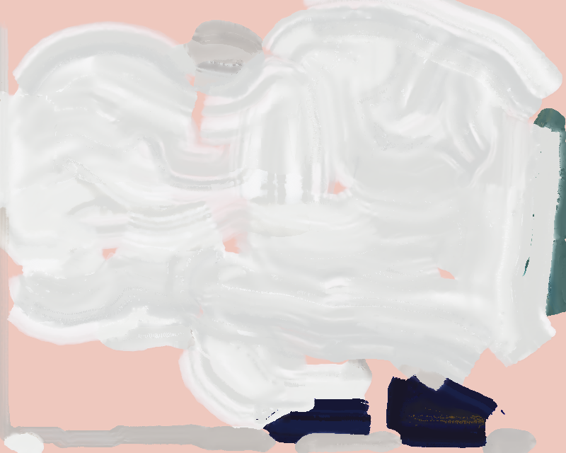

| stroke | covered | width | dark | spread | ms |
|---|---|---|---|---|---|
| stroke 1 | 14 % → 93 % | 91.1 px | 0.08 | 6.87 | 1404 |
| stroke 2 | 29 % → 87 % | 247.9 px | 0.09 | 2.98 | 283 |
| stroke 3 | 24 % → 91 % | 132.2 px | 0.09 | 3.78 | 959 |
| stroke 4 | 22 % → 86 % | 170.7 px | 0.12 | 3.88 | 1142 |
| stroke 5 | 40 % → 95 % | 361.8 px | 0.08 | 2.36 | 753 |
| stroke 6 | 49 % → 94 % | 353.6 px | 0.09 | 1.92 | 1224 |
| stroke 7 | 41 % → 89 % | 686.7 px | 0.09 | 2.19 | 569 |
| stroke 8 | 45 % → 81 % | 404.9 px | 0.10 | 1.83 | 828 |
| stroke 9 | 57 % → 90 % | 397.2 px | 0.09 | 1.58 | 1121 |
| stroke 10 | 47 % → 88 % | 401.8 px | 0.14 | 1.85 | 689 |
| stroke 11 | 49 % → 87 % | 658.3 px | 0.13 | 1.78 | 531 |
| stroke 12 | 58 % → 89 % | 717.3 px | 0.09 | 1.54 | 569 |
| stroke 13 | 63 % → 90 % | 511.6 px | 0.10 | 1.42 | 1521 |
| stroke 14 | 62 % → 89 % | 756.2 px | 0.13 | 1.43 | 914 |
| stroke 15 | 72 % → 82 % | 1068.8 px | 0.09 | 1.14 | 359 |
| stroke 16 | 77 % → 94 % | 742.7 px | 0.08 | 1.22 | 1247 |
| stroke 17 | 79 % → 87 % | 542.8 px | 0.09 | 1.10 | 706 |
| stroke 18 | 81 % → 94 % | 1232.9 px | 0.08 | 1.17 | 430 |
| stroke 19 | 68 % → 88 % | 1139.7 px | 0.13 | 1.29 | 547 |
| stroke 20 | 65 % → 81 % | 1111.6 px | 0.11 | 1.24 | 442 |
| stroke 21 | 64 % → 89 % | 745.1 px | 0.14 | 1.39 | 870 |
| stroke 22 | 81 % → 93 % | 580.1 px | 0.09 | 1.15 | 1105 |
| stroke 23 | 85 % → 97 % | 1446.9 px | 0.09 | 1.14 | 671 |
| stroke 24 | 80 % → 87 % | 948.3 px | 0.09 | 1.08 | 1188 |
| stroke 25 | 75 % → 92 % | 1523.3 px | 0.12 | 1.22 | 572 |
| stroke 26 | 70 % → 85 % | 398.6 px | 0.14 | 1.20 | 1454 |
| stroke 27 | 86 % → 92 % | 1300.2 px | 0.08 | 1.07 | 300 |
| stroke 28 | 86 % → 91 % | 1288.6 px | 0.09 | 1.05 | 349 |
| stroke 29 | 93 % → 96 % | 1462.5 px | 0.08 | 1.04 | 491 |
| stroke 30 | 91 % → 94 % | 1625.5 px | 0.08 | 1.03 | 307 |
| stroke 31 | 70 % → 84 % | 941.1 px | 0.12 | 1.19 | 601 |
| stroke 32 | 90 % → 94 % | 1317.7 px | 0.09 | 1.03 | 393 |
| stroke 33 | 73 % → 77 % | 1183.4 px | 0.09 | 1.04 | 308 |
| stroke 34 | 83 % → 85 % | 1557.9 px | 0.10 | 1.03 | 401 |
| stroke 35 | 69 % → 87 % | 1112.2 px | 0.16 | 1.25 | 191 |
| stroke 36 | 91 % → 94 % | 1188.0 px | 0.09 | 1.04 | 393 |
| stroke 37 | 81 % → 85 % | 1131.9 px | 0.09 | 1.06 | 325 |
| stroke 38 | 93 % → 94 % | 1422.8 px | 0.08 | 1.01 | 362 |
| stroke 39 | 31 % → 42 % | 425.3 px | 0.08 | 1.39 | 18 |
| stroke 40 | 87 % → 89 % | 1470.9 px | 0.08 | 1.03 | 48 |
| stroke 41 | 88 % → 89 % | 1239.3 px | 0.09 | 1.01 | 70 |
| stroke 42 | 90 % → 90 % | 1604.7 px | 0.09 | 1.00 | 86 |
| stroke 43 | 89 % → 89 % | 2733.0 px | 0.08 | 1.00 | 38 |
| stroke 44 | 91 % → 91 % | 6666.6 px | 0.09 | 1.00 | 9 |
| stroke 45 | 87 % → 87 % | 5342.8 px | 0.08 | 1.00 | 16 |
| stroke 46 | 90 % → 90 % | 2386.2 px | 0.09 | 0.99 | 48 |
| stroke 47 | 89 % → 88 % | 5363.0 px | 0.08 | 0.99 | 15 |
| stroke 48 | 88 % → 87 % | 4849.0 px | 0.09 | 0.99 | 18 |
| stroke 49 | 90 % → 90 % | 3216.3 px | 0.08 | 0.99 | 25 |
| stroke 50 | 68 % → 85 % | 2513.6 px | 0.17 | 1.26 | 17 |
| stroke 51 | 67 % → 85 % | 3177.0 px | 0.18 | 1.26 | 15 |
| stroke 52 | 70 % → 86 % | 2416.1 px | 0.17 | 1.24 | 24 |
| stroke 53 | 81 % → 83 % | 317.1 px | 0.10 | 1.02 | 439 |
| stroke 54 | 76 % → 75 % | 1962.4 px | 0.09 | 0.99 | 46 |
| stroke 55 | 78 % → 80 % | 3158.6 px | 0.11 | 1.03 | 54 |
| stroke 56 | 79 % → 92 % | 2850.6 px | 0.16 | 1.17 | 25 |
| stroke 57 | 80 % → 92 % | 5122.9 px | 0.15 | 1.16 | 10 |
| stroke 58 | 65 % → 80 % | 584.8 px | 0.18 | 1.24 | 43 |
| stroke 59 | 49 % → 71 % | 559.0 px | 0.24 | 1.45 | 21 |
| stroke 60 | 88 % → 92 % | 917.9 px | 0.09 | 1.04 | 95 |
| stroke 61 | 72 % → 85 % | 896.8 px | 0.16 | 1.17 | 88 |
| stroke 62 | 87 % → 89 % | 1080.0 px | 0.10 | 1.03 | 88 |
| stroke 63 | 81 % → 88 % | 1155.2 px | 0.13 | 1.09 | 90 |
| stroke 64 | 74 % → 85 % | 1164.3 px | 0.15 | 1.14 | 79 |
| stroke 65 | 74 % → 86 % | 2397.0 px | 0.16 | 1.15 | 39 |
| stroke 66 | 91 % → 92 % | 2294.7 px | 0.10 | 1.01 | 36 |
| stroke 67 | 94 % → 95 % | 3043.5 px | 0.09 | 1.01 | 45 |
| stroke 68 | 92 % → 92 % | 2356.4 px | 0.09 | 1.00 | 48 |
| stroke 69 | 81 % → 88 % | 2743.1 px | 0.13 | 1.08 | 36 |
| stroke 70 | 70 % → 80 % | 639.0 px | 0.21 | 1.14 | 109 |
| stroke 71 | 75 % → 82 % | 895.1 px | 0.20 | 1.09 | 107 |
| stroke 72 | 82 % → 86 % | 1762.8 px | 0.17 | 1.05 | 66 |
| stroke 73 | 81 % → 84 % | 922.9 px | 0.18 | 1.03 | 149 |
| stroke 74 | 81 % → 83 % | 2090.6 px | 0.18 | 1.03 | 64 |
| stroke 75 | 82 % → 83 % | 848.8 px | 0.17 | 1.01 | 132 |
| stroke 76 | 83 % → 83 % | 849.5 px | 0.16 | 1.01 | 137 |

Numbers say: wet paint spreads well beyond the stroke.

## Refs v4 · #10 HW maroon loops — own sheet
own sheet 800 × 1070 · Gouache 1.00 + turpentine 30 % · 104 px · 205.5 s

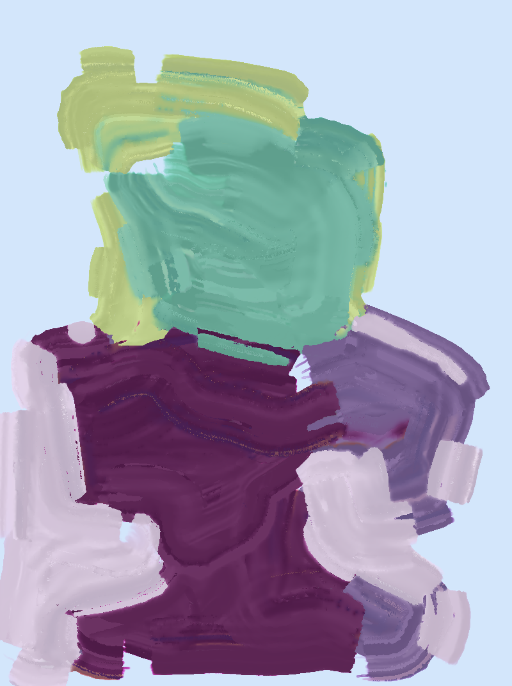

| stroke | covered | width | dark | spread | ms |
|---|---|---|---|---|---|
| stroke 1 | 8 % → 76 % | 94.7 px | 0.38 | 9.49 | 768 |
| stroke 2 | 15 % → 67 % | 151.7 px | 0.35 | 4.53 | 1205 |
| stroke 3 | 28 % → 77 % | 555.3 px | 0.24 | 2.76 | 399 |
| stroke 4 | 27 % → 48 % | 651.6 px | 0.24 | 1.73 | 281 |
| stroke 5 | 25 % → 89 % | 439.4 px | 0.42 | 3.59 | 389 |
| stroke 6 | 26 % → 56 % | 354.3 px | 0.22 | 2.13 | 765 |
| stroke 7 | 38 % → 80 % | 550.8 px | 0.34 | 2.13 | 587 |
| stroke 8 | 34 % → 68 % | 470.0 px | 0.29 | 2.00 | 805 |
| stroke 9 | 35 % → 76 % | 743.9 px | 0.32 | 2.18 | 348 |
| stroke 10 | 46 % → 78 % | 800.6 px | 0.28 | 1.70 | 728 |
| stroke 11 | 48 % → 86 % | 1131.2 px | 0.37 | 1.80 | 353 |
| stroke 12 | 39 % → 60 % | 627.9 px | 0.30 | 1.53 | 429 |
| stroke 13 | 46 % → 87 % | 1059.4 px | 0.39 | 1.87 | 253 |
| stroke 14 | 9 % → 88 % | 69.4 px | 0.31 | 9.89 | 250 |
| stroke 15 | 19 % → 94 % | 105.4 px | 0.46 | 4.93 | 543 |
| stroke 16 | 25 % → 95 % | 185.1 px | 0.46 | 3.85 | 447 |
| stroke 17 | 44 % → 93 % | 597.7 px | 0.33 | 2.11 | 136 |
| stroke 18 | 28 % → 94 % | 387.4 px | 0.46 | 3.31 | 234 |
| stroke 19 | 32 % → 96 % | 344.3 px | 0.44 | 3.02 | 318 |
| stroke 20 | 40 % → 90 % | 432.9 px | 0.39 | 2.24 | 641 |
| stroke 21 | 60 % → 90 % | 613.8 px | 0.30 | 1.51 | 239 |
| stroke 22 | 50 % → 94 % | 759.0 px | 0.38 | 1.89 | 370 |
| stroke 23 | 34 % → 77 % | 568.4 px | 0.38 | 2.25 | 627 |
| stroke 24 | 8 % → 71 % | 145.1 px | 0.34 | 9.06 | 164 |
| stroke 25 | 9 % → 81 % | 119.0 px | 0.49 | 9.17 | 397 |
| stroke 26 | 22 % → 68 % | 270.5 px | 0.33 | 3.04 | 227 |
| stroke 27 | 16 % → 82 % | 390.5 px | 0.47 | 5.24 | 164 |
| stroke 28 | 21 % → 76 % | 318.5 px | 0.44 | 3.64 | 245 |
| stroke 29 | 23 % → 83 % | 531.5 px | 0.46 | 3.67 | 187 |
| stroke 30 | 19 % → 82 % | 486.3 px | 0.49 | 4.22 | 161 |
| stroke 31 | 23 % → 91 % | 522.1 px | 0.49 | 3.90 | 173 |
| stroke 32 | 35 % → 71 % | 433.3 px | 0.38 | 2.02 | 86 |
| stroke 33 | 35 % → 78 % | 1802.0 px | 0.41 | 2.22 | 13 |
| stroke 34 | 36 % → 50 % | 411.9 px | 0.22 | 1.39 | 555 |
| stroke 35 | 44 % → 54 % | 390.1 px | 0.22 | 1.24 | 818 |
| stroke 36 | 43 % → 52 % | 670.4 px | 0.21 | 1.21 | 560 |
| stroke 37 | 47 % → 55 % | 907.5 px | 0.22 | 1.18 | 270 |
| stroke 38 | 47 % → 73 % | 548.1 px | 0.35 | 1.55 | 457 |
| stroke 39 | 53 % → 78 % | 871.5 px | 0.37 | 1.47 | 336 |
| stroke 40 | 49 % → 52 % | 623.7 px | 0.21 | 1.05 | 361 |
| stroke 41 | 59 % → 64 % | 1659.6 px | 0.22 | 1.08 | 184 |
| stroke 42 | 47 % → 48 % | 506.0 px | 0.22 | 1.02 | 525 |
| stroke 43 | 49 % → 46 % | 916.1 px | 0.20 | 0.94 | 137 |
| stroke 44 | 51 % → 72 % | 1400.2 px | 0.37 | 1.42 | 143 |
| stroke 45 | 54 % → 76 % | 1467.4 px | 0.37 | 1.41 | 202 |
| stroke 46 | 42 % → 66 % | 557.4 px | 0.36 | 1.59 | 743 |
| stroke 47 | 43 % → 45 % | 820.9 px | 0.26 | 1.06 | 257 |
| stroke 48 | 44 % → 66 % | 934.1 px | 0.35 | 1.50 | 242 |
| stroke 49 | 54 % → 86 % | 442.3 px | 0.40 | 1.57 | 1191 |
| stroke 50 | 55 % → 93 % | 542.6 px | 0.44 | 1.69 | 1109 |
| stroke 51 | 52 % → 89 % | 505.6 px | 0.50 | 1.70 | 641 |
| stroke 52 | 66 % → 86 % | 439.0 px | 0.41 | 1.30 | 905 |
| stroke 53 | 77 % → 91 % | 1168.5 px | 0.45 | 1.17 | 635 |
| stroke 54 | 67 % → 90 % | 1210.9 px | 0.49 | 1.33 | 349 |
| stroke 55 | 82 % → 94 % | 962.1 px | 0.47 | 1.16 | 507 |
| stroke 56 | 69 % → 85 % | 841.4 px | 0.41 | 1.23 | 776 |
| stroke 57 | 83 % → 93 % | 1238.5 px | 0.45 | 1.12 | 355 |
| stroke 58 | 82 % → 99 % | 1965.3 px | 0.52 | 1.20 | 257 |
| stroke 59 | 81 % → 96 % | 1314.5 px | 0.44 | 1.19 | 503 |
| stroke 60 | 75 % → 95 % | 1111.7 px | 0.54 | 1.27 | 482 |
| stroke 61 | 79 % → 93 % | 1517.6 px | 0.45 | 1.18 | 544 |
| stroke 62 | 87 % → 94 % | 1229.7 px | 0.52 | 1.08 | 468 |
| stroke 63 | 76 % → 94 % | 1390.8 px | 0.46 | 1.23 | 460 |
| stroke 64 | 89 % → 97 % | 878.0 px | 0.45 | 1.08 | 1027 |
| stroke 65 | 93 % → 93 % | 960.2 px | 0.42 | 1.00 | 546 |
| stroke 66 | 87 % → 90 % | 1612.9 px | 0.45 | 1.02 | 410 |
| stroke 67 | 95 % → 97 % | 1459.1 px | 0.48 | 1.03 | 718 |
| stroke 68 | 83 % → 83 % | 1287.5 px | 0.43 | 1.00 | 451 |
| stroke 69 | 93 % → 93 % | 1336.5 px | 0.40 | 1.00 | 407 |
| stroke 70 | 83 % → 94 % | 1678.0 px | 0.56 | 1.13 | 431 |
| stroke 71 | 72 % → 91 % | 1281.3 px | 0.52 | 1.27 | 460 |
| stroke 72 | 61 % → 73 % | 719.8 px | 0.39 | 1.20 | 452 |
| stroke 73 | 70 % → 80 % | 1637.5 px | 0.42 | 1.15 | 289 |
| stroke 74 | 67 % → 76 % | 663.4 px | 0.41 | 1.12 | 1027 |
| stroke 75 | 67 % → 72 % | 1280.0 px | 0.39 | 1.09 | 304 |
| stroke 76 | 78 % → 80 % | 1033.2 px | 0.44 | 1.03 | 505 |
| stroke 77 | 78 % → 79 % | 1273.1 px | 0.43 | 1.01 | 408 |
| stroke 78 | 79 % → 79 % | 1435.1 px | 0.44 | 1.00 | 382 |
| stroke 79 | 76 % → 81 % | 1267.3 px | 0.44 | 1.06 | 326 |
| stroke 80 | 75 % → 76 % | 595.3 px | 0.44 | 1.01 | 645 |
| stroke 81 | 77 % → 77 % | 1235.8 px | 0.46 | 1.00 | 456 |
| stroke 82 | 78 % → 78 % | 981.4 px | 0.48 | 1.00 | 680 |
| stroke 83 | 83 % → 83 % | 1052.6 px | 0.43 | 1.00 | 162 |
| stroke 84 | 95 % → 95 % | 2273.6 px | 0.51 | 1.00 | 139 |
| stroke 85 | 92 % → 91 % | 2184.2 px | 0.34 | 0.99 | 27 |

Numbers say: wet paint spreads well beyond the stroke.

## Refs v4 · #11 HW purple balls — own sheet
own sheet 800 × 985 · Gouache 1.00 + turpentine 30 % · 104 px · 222.4 s

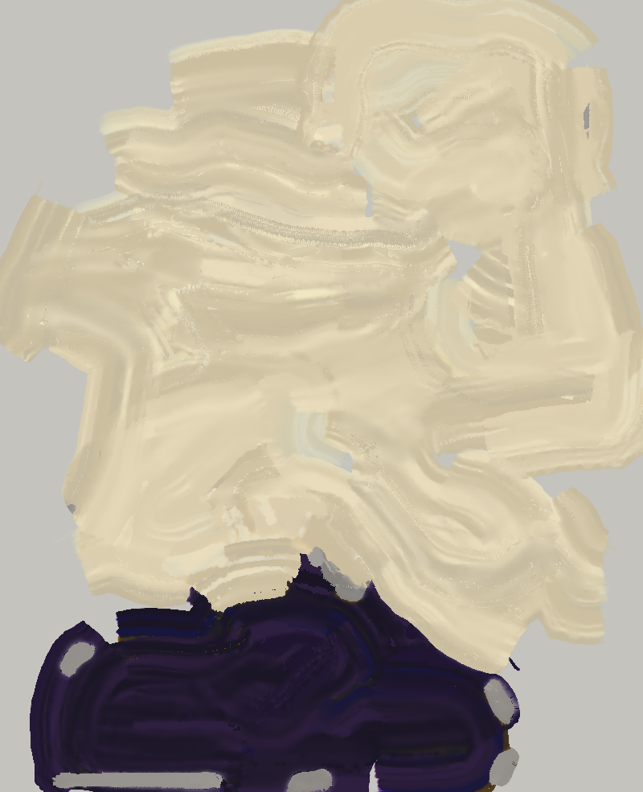

| stroke | covered | width | dark | spread | ms |
|---|---|---|---|---|---|
| stroke 1 | 7 % → 87 % | 95.4 px | 0.28 | 12.03 | 483 |
| stroke 2 | 17 % → 88 % | 140.4 px | 0.14 | 5.23 | 854 |
| stroke 3 | 23 % → 87 % | 258.3 px | 0.18 | 3.77 | 675 |
| stroke 4 | 20 % → 67 % | 194.4 px | 0.03 | 3.31 | 392 |
| stroke 5 | 16 % → 86 % | 84.5 px | 0.04 | 5.38 | 1048 |
| stroke 6 | 24 % → 71 % | 251.0 px | 0.04 | 2.91 | 530 |
| stroke 7 | 23 % → 90 % | 187.4 px | 0.05 | 3.89 | 805 |
| stroke 8 | 32 % → 77 % | 265.6 px | 0.04 | 2.44 | 1402 |
| stroke 9 | 38 % → 86 % | 293.0 px | 0.04 | 2.28 | 1310 |
| stroke 10 | 52 % → 86 % | 481.6 px | 0.04 | 1.66 | 1142 |
| stroke 11 | 49 % → 91 % | 293.4 px | 0.04 | 1.87 | 1279 |
| stroke 12 | 65 % → 88 % | 355.1 px | 0.04 | 1.35 | 1335 |
| stroke 13 | 58 % → 92 % | 554.7 px | 0.07 | 1.57 | 891 |
| stroke 14 | 68 % → 98 % | 1572.0 px | 0.06 | 1.44 | 402 |
| stroke 15 | 46 % → 85 % | 460.0 px | 0.19 | 1.83 | 797 |
| stroke 16 | 53 % → 89 % | 785.0 px | 0.15 | 1.69 | 652 |
| stroke 17 | 71 % → 83 % | 850.0 px | 0.04 | 1.17 | 492 |
| stroke 18 | 70 % → 89 % | 519.0 px | 0.04 | 1.27 | 766 |
| stroke 19 | 73 % → 89 % | 884.9 px | 0.04 | 1.21 | 422 |
| stroke 20 | 84 % → 98 % | 1968.7 px | 0.04 | 1.16 | 314 |
| stroke 21 | 72 % → 81 % | 865.4 px | 0.04 | 1.13 | 789 |
| stroke 22 | 48 % → 85 % | 608.7 px | 0.23 | 1.78 | 1071 |
| stroke 23 | 71 % → 75 % | 863.3 px | 0.04 | 1.06 | 550 |
| stroke 24 | 85 % → 95 % | 1118.5 px | 0.04 | 1.12 | 747 |
| stroke 25 | 85 % → 91 % | 1281.1 px | 0.04 | 1.06 | 492 |
| stroke 26 | 81 % → 85 % | 711.6 px | 0.04 | 1.05 | 452 |
| stroke 27 | 79 % → 81 % | 1806.0 px | 0.04 | 1.03 | 294 |
| stroke 28 | 88 % → 91 % | 1494.8 px | 0.04 | 1.03 | 388 |
| stroke 29 | 89 % → 96 % | 1809.8 px | 0.04 | 1.08 | 357 |
| stroke 30 | 67 % → 87 % | 1194.3 px | 0.13 | 1.30 | 592 |
| stroke 31 | 71 % → 97 % | 1620.2 px | 0.16 | 1.35 | 286 |
| stroke 32 | 64 % → 78 % | 1050.3 px | 0.12 | 1.22 | 274 |
| stroke 33 | 79 % → 81 % | 1033.3 px | 0.04 | 1.02 | 510 |
| stroke 34 | 86 % → 87 % | 1493.8 px | 0.04 | 1.00 | 336 |
| stroke 35 | 95 % → 97 % | 2300.2 px | 0.04 | 1.02 | 345 |
| stroke 36 | 79 % → 80 % | 802.2 px | 0.04 | 1.01 | 965 |
| stroke 37 | 52 % → 77 % | 513.6 px | 0.24 | 1.49 | 778 |
| stroke 38 | 88 % → 90 % | 1517.4 px | 0.04 | 1.03 | 575 |
| stroke 39 | 42 % → 78 % | 611.1 px | 0.30 | 1.86 | 292 |
| stroke 40 | 76 % → 89 % | 1736.0 px | 0.10 | 1.17 | 445 |
| stroke 41 | 96 % → 98 % | 2265.9 px | 0.04 | 1.02 | 359 |
| stroke 42 | 94 % → 93 % | 2029.9 px | 0.04 | 0.99 | 218 |
| stroke 43 | 66 % → 79 % | 535.0 px | 0.14 | 1.21 | 775 |
| stroke 44 | 88 % → 88 % | 2075.0 px | 0.04 | 0.99 | 361 |
| stroke 45 | 54 % → 91 % | 1145.1 px | 0.30 | 1.71 | 424 |
| stroke 46 | 69 % → 95 % | 1099.8 px | 0.22 | 1.38 | 548 |
| stroke 47 | 93 % → 91 % | 1813.1 px | 0.04 | 0.99 | 257 |
| stroke 48 | 80 % → 79 % | 1388.2 px | 0.03 | 0.99 | 296 |
| stroke 49 | 89 % → 88 % | 1706.4 px | 0.04 | 0.99 | 301 |
| stroke 50 | 90 % → 89 % | 1456.1 px | 0.04 | 0.99 | 245 |
| stroke 51 | 70 % → 97 % | 1928.6 px | 0.22 | 1.39 | 52 |
| stroke 52 | 71 % → 98 % | 2945.4 px | 0.22 | 1.38 | 28 |
| stroke 53 | 61 % → 97 % | 3436.4 px | 0.27 | 1.57 | 20 |
| stroke 54 | 65 % → 98 % | 6205.3 px | 0.26 | 1.52 | 21 |
| stroke 55 | 68 % → 96 % | 6485.6 px | 0.23 | 1.41 | 17 |
| stroke 56 | 59 % → 97 % | 4503.9 px | 0.29 | 1.66 | 18 |
| stroke 57 | 68 % → 97 % | 2048.8 px | 0.24 | 1.43 | 75 |
| stroke 58 | 75 % → 98 % | 2699.1 px | 0.20 | 1.31 | 62 |
| stroke 59 | 64 % → 98 % | 6176.4 px | 0.26 | 1.52 | 14 |
| stroke 60 | 82 % → 80 % | 2520.2 px | 0.04 | 0.98 | 21 |
| stroke 61 | 65 % → 76 % | 1258.8 px | 0.13 | 1.18 | 75 |
| stroke 62 | 29 % → 76 % | 983.3 px | 0.40 | 2.66 | 9 |
| stroke 63 | 37 % → 70 % | 1039.9 px | 0.32 | 1.89 | 16 |
| stroke 64 | 21 % → 65 % | 548.2 px | 0.46 | 3.15 | 14 |
| stroke 65 | 4 % → 87 % | 19.2 px | 0.62 | 23.71 | 110 |
| stroke 66 | 11 % → 99 % | 229.9 px | 0.59 | 9.40 | 24 |
| stroke 67 | 54 % → 85 % | 258.4 px | 0.40 | 1.57 | 1550 |
| stroke 68 | 70 % → 92 % | 648.3 px | 0.35 | 1.33 | 887 |
| stroke 69 | 69 % → 81 % | 326.6 px | 0.44 | 1.16 | 1496 |
| stroke 70 | 83 % → 89 % | 945.6 px | 0.32 | 1.08 | 962 |
| stroke 71 | 76 % → 79 % | 894.0 px | 0.36 | 1.04 | 704 |
| stroke 72 | 72 % → 83 % | 1025.0 px | 0.49 | 1.15 | 315 |
| stroke 73 | 76 % → 78 % | 1206.9 px | 0.33 | 1.03 | 401 |
| stroke 74 | 78 % → 83 % | 1088.9 px | 0.39 | 1.07 | 457 |
| stroke 75 | 91 % → 95 % | 796.1 px | 0.57 | 1.04 | 390 |
| stroke 76 | 96 % → 96 % | 2151.1 px | 0.36 | 1.00 | 274 |
| stroke 77 | 76 % → 76 % | 571.6 px | 0.41 | 1.00 | 759 |
| stroke 78 | 80 % → 80 % | 1161.5 px | 0.46 | 1.00 | 288 |
| stroke 79 | 97 % → 97 % | 1508.7 px | 0.38 | 1.00 | 427 |
| stroke 80 | 85 % → 85 % | 818.2 px | 0.55 | 1.00 | 454 |

Numbers say: wet paint spreads well beyond the stroke.

## Refs v4 · #12 HW black-olive cage — own sheet
own sheet 800 × 1150 · Gouache 1.00 + turpentine 30 % · 36 px · 650.2 s

| stroke | covered | width | dark | spread | ms |
|---|---|---|---|---|---|
| stroke 1 | 17 % → 90 % | 35.0 px | 0.12 | 5.30 | 372 |
| stroke 2 | 28 % → 80 % | 92.5 px | 0.12 | 2.87 | 41 |
| stroke 3 | 26 % → 97 % | 70.0 px | 0.13 | 3.80 | 89 |
| stroke 4 | 22 % → 97 % | 51.3 px | 0.22 | 4.37 | 103 |
| stroke 5 | 38 % → 97 % | 100.3 px | 0.12 | 2.54 | 88 |
| stroke 6 | 30 % → 87 % | 84.5 px | 0.13 | 2.91 | 116 |
| stroke 7 | 40 % → 98 % | 189.5 px | 0.13 | 2.46 | 42 |
| stroke 8 | 53 % → 97 % | 293.3 px | 0.12 | 1.83 | 37 |
| stroke 9 | 35 % → 80 % | 110.1 px | 0.12 | 2.28 | 70 |
| stroke 10 | 10 % → 76 % | 34.0 px | 0.08 | 7.29 | 92 |
| stroke 11 | 18 % → 90 % | 130.7 px | 0.07 | 5.13 | 38 |
| stroke 12 | 21 % → 84 % | 108.2 px | 0.06 | 3.95 | 60 |
| stroke 13 | 27 % → 80 % | 97.7 px | 0.10 | 2.94 | 120 |
| stroke 14 | 25 % → 96 % | 144.1 px | 0.08 | 3.78 | 63 |
| stroke 15 | 38 % → 92 % | 179.4 px | 0.07 | 2.45 | 65 |
| stroke 16 | 42 % → 79 % | 343.6 px | 0.09 | 1.89 | 28 |
| stroke 17 | 31 % → 95 % | 171.8 px | 0.08 | 3.03 | 72 |
| stroke 18 | 47 % → 81 % | 360.8 px | 0.07 | 1.74 | 26 |
| stroke 19 | 32 % → 97 % | 242.4 px | 0.08 | 2.99 | 36 |
| stroke 20 | 26 % → 98 % | 189.6 px | 0.14 | 3.75 | 32 |
| stroke 21 | 36 % → 98 % | 318.7 px | 0.10 | 2.73 | 25 |
| stroke 22 | 43 % → 94 % | 270.7 px | 0.07 | 2.19 | 38 |
| stroke 23 | 51 % → 82 % | 449.5 px | 0.06 | 1.59 | 39 |
| stroke 24 | 38 % → 67 % | 330.7 px | 0.09 | 1.76 | 20 |
| stroke 25 | 52 % → 98 % | 486.4 px | 0.08 | 1.88 | 25 |
| stroke 26 | 7 % → 35 % | 36.7 px | 0.14 | 4.70 | 33 |
| stroke 27 | 9 % → 36 % | 51.4 px | 0.16 | 4.05 | 33 |
| stroke 28 | 13 % → 31 % | 80.7 px | 0.15 | 2.43 | 21 |
| stroke 29 | 13 % → 92 % | 34.9 px | 0.17 | 7.02 | 81 |
| stroke 30 | 12 % → 60 % | 46.7 px | 0.15 | 4.82 | 85 |
| stroke 31 | 30 % → 88 % | 64.4 px | 0.16 | 2.92 | 118 |
| stroke 32 | 13 % → 79 % | 32.5 px | 0.20 | 6.33 | 88 |
| stroke 33 | 38 % → 96 % | 101.5 px | 0.17 | 2.49 | 66 |
| stroke 34 | 39 % → 94 % | 94.8 px | 0.19 | 2.40 | 147 |
| stroke 35 | 41 % → 94 % | 183.1 px | 0.16 | 2.30 | 46 |
| stroke 36 | 34 % → 72 % | 227.1 px | 0.12 | 2.12 | 25 |
| stroke 37 | 9 % → 97 % | 35.0 px | 0.29 | 10.50 | 111 |
| stroke 38 | 17 % → 100 % | 58.5 px | 0.24 | 5.85 | 141 |
| stroke 39 | 25 % → 99 % | 74.3 px | 0.27 | 4.05 | 150 |
| stroke 40 | 23 % → 100 % | 108.3 px | 0.30 | 4.36 | 66 |
| stroke 41 | 29 % → 100 % | 101.9 px | 0.29 | 3.45 | 92 |
| stroke 42 | 33 % → 100 % | 107.9 px | 0.25 | 3.06 | 107 |
| stroke 43 | 41 % → 100 % | 275.6 px | 0.21 | 2.43 | 30 |
| stroke 44 | 20 % → 95 % | 113.7 px | 0.30 | 4.80 | 35 |
| stroke 45 | 35 % → 99 % | 163.0 px | 0.25 | 2.85 | 62 |
| stroke 46 | 42 % → 100 % | 308.7 px | 0.24 | 2.40 | 28 |
| stroke 47 | 8 % → 78 % | 35.6 px | 0.15 | 9.68 | 44 |
| stroke 48 | 8 % → 56 % | 36.1 px | 0.13 | 7.28 | 61 |
| stroke 49 | 17 % → 64 % | 124.8 px | 0.13 | 3.86 | 24 |
| stroke 50 | 17 % → 66 % | 72.5 px | 0.12 | 3.94 | 80 |
| stroke 51 | 19 % → 73 % | 92.2 px | 0.15 | 3.81 | 65 |
| stroke 52 | 19 % → 49 % | 88.8 px | 0.13 | 2.54 | 110 |
| stroke 53 | 32 % → 70 % | 204.1 px | 0.13 | 2.22 | 51 |
| stroke 54 | 20 % → 83 % | 175.5 px | 0.17 | 4.19 | 21 |
| stroke 55 | 35 % → 69 % | 349.5 px | 0.13 | 1.97 | 20 |
| stroke 56 | 10 % → 68 % | 35.1 px | 0.02 | 7.14 | 89 |
| stroke 57 | 24 % → 96 % | 65.1 px | 0.02 | 3.95 | 68 |
| stroke 58 | 8 % → 58 % | 59.2 px | 0.02 | 7.32 | 24 |
| stroke 59 | 22 % → 59 % | 77.4 px | 0.02 | 2.73 | 47 |
| stroke 60 | 34 % → 74 % | 96.6 px | 0.02 | 2.20 | 237 |
| stroke 61 | 49 % → 83 % | 118.0 px | 0.02 | 1.68 | 310 |
| stroke 62 | 35 % → 77 % | 172.2 px | 0.02 | 2.20 | 195 |
| stroke 63 | 36 % → 53 % | 177.3 px | 0.03 | 1.47 | 55 |
| stroke 64 | 39 % → 60 % | 160.5 px | 0.02 | 1.54 | 134 |
| stroke 65 | 34 % → 52 % | 230.6 px | 0.02 | 1.50 | 40 |
| stroke 66 | 59 % → 70 % | 184.6 px | 0.02 | 1.18 | 70 |
| stroke 67 | 30 % → 87 % | 171.6 px | 0.05 | 2.89 | 43 |
| stroke 68 | 50 % → 78 % | 462.2 px | 0.02 | 1.58 | 21 |
| stroke 69 | 60 % → 78 % | 254.0 px | 0.02 | 1.30 | 84 |
| stroke 70 | 43 % → 50 % | 199.9 px | 0.02 | 1.16 | 51 |
| stroke 71 | 55 % → 86 % | 315.7 px | 0.02 | 1.57 | 47 |
| stroke 72 | 87 % → 96 % | 258.6 px | 0.02 | 1.10 | 81 |
| stroke 73 | 55 % → 67 % | 222.0 px | 0.02 | 1.21 | 121 |
| stroke 74 | 79 % → 91 % | 274.4 px | 0.02 | 1.16 | 112 |
| stroke 75 | 59 % → 80 % | 324.6 px | 0.02 | 1.35 | 64 |
| stroke 76 | 56 % → 86 % | 320.7 px | 0.03 | 1.55 | 42 |
| stroke 77 | 51 % → 87 % | 340.7 px | 0.03 | 1.71 | 43 |
| stroke 78 | 76 % → 80 % | 438.7 px | 0.02 | 1.06 | 79 |
| stroke 79 | 34 % → 88 % | 293.6 px | 0.07 | 2.56 | 45 |
| stroke 80 | 67 % → 75 % | 475.6 px | 0.02 | 1.12 | 35 |
| stroke 81 | 74 % → 79 % | 497.9 px | 0.02 | 1.08 | 35 |
| stroke 82 | 49 % → 88 % | 419.9 px | 0.04 | 1.78 | 24 |
| stroke 83 | 5 % → 12 % | 39.3 px | 0.03 | 2.48 | 14 |
| stroke 84 | 11 % → 13 % | 93.5 px | 0.03 | 1.19 | 13 |
| stroke 85 | 18 % → 38 % | 36.7 px | 0.03 | 2.10 | 63 |
| stroke 86 | 23 % → 36 % | 52.3 px | 0.03 | 1.59 | 93 |
| stroke 87 | 34 % → 43 % | 75.7 px | 0.03 | 1.27 | 52 |
| stroke 88 | 31 % → 35 % | 188.9 px | 0.03 | 1.13 | 27 |
| stroke 89 | 6 % → 50 % | 15.9 px | 0.18 | 9.06 | 40 |
| stroke 90 | 7 % → 60 % | 20.1 px | 0.09 | 8.82 | 9 |
| stroke 91 | 7 % → 50 % | 38.4 px | 0.12 | 6.77 | 19 |
| stroke 92 | 10 % → 73 % | 56.9 px | 0.11 | 7.50 | 7 |
| stroke 93 | 4 % → 73 % | 20.3 px | 0.15 | 16.95 | 33 |
| stroke 94 | 4 % → 95 % | 23.7 px | 0.25 | 26.16 | 31 |
| stroke 95 | 7 % → 94 % | 65.4 px | 0.26 | 12.92 | 14 |
| stroke 96 | 4 % → 94 % | 17.1 px | 0.26 | 23.06 | 11 |
| stroke 97 | 21 % → 93 % | 86.4 px | 0.20 | 4.46 | 28 |
| stroke 98 | 38 % → 72 % | 112.0 px | 0.09 | 1.87 | 39 |
| stroke 99 | 7 % → 90 % | 29.9 px | 0.36 | 12.23 | 48 |
| stroke 100 | 6 % → 91 % | 33.5 px | 0.32 | 15.00 | 44 |
| stroke 101 | 6 % → 98 % | 35.4 px | 0.24 | 15.71 | 36 |
| stroke 102 | 11 % → 78 % | 79.0 px | 0.20 | 7.34 | 25 |
| stroke 103 | 34 % → 39 % | 121.4 px | 0.04 | 1.13 | 63 |
| stroke 104 | 15 % → 72 % | 84.4 px | 0.12 | 4.90 | 35 |
| stroke 105 | 25 % → 86 % | 137.8 px | 0.12 | 3.38 | 73 |
| stroke 106 | 43 % → 71 % | 223.8 px | 0.08 | 1.65 | 43 |
| stroke 107 | 29 % → 75 % | 98.5 px | 0.12 | 2.62 | 72 |
| stroke 108 | 51 % → 91 % | 552.2 px | 0.13 | 1.79 | 11 |
| stroke 109 | 31 % → 98 % | 128.9 px | 0.17 | 3.12 | 99 |
| stroke 110 | 50 % → 85 % | 214.3 px | 0.11 | 1.71 | 49 |
| stroke 111 | 24 % → 99 % | 93.2 px | 0.23 | 4.13 | 72 |
| stroke 112 | 52 % → 83 % | 253.5 px | 0.12 | 1.60 | 57 |
| stroke 113 | 65 % → 95 % | 249.8 px | 0.12 | 1.47 | 77 |
| stroke 114 | 58 % → 99 % | 324.7 px | 0.10 | 1.71 | 58 |
| stroke 115 | 60 % → 98 % | 570.8 px | 0.10 | 1.63 | 14 |
| stroke 116 | 52 % → 97 % | 356.1 px | 0.11 | 1.86 | 26 |
| stroke 117 | 77 % → 97 % | 320.3 px | 0.11 | 1.27 | 67 |
| stroke 118 | 31 % → 98 % | 288.7 px | 0.25 | 3.15 | 17 |
| stroke 119 | 70 % → 98 % | 658.6 px | 0.10 | 1.41 | 22 |
| stroke 120 | 72 % → 99 % | 821.9 px | 0.09 | 1.38 | 36 |
| stroke 121 | 51 % → 98 % | 440.6 px | 0.16 | 1.92 | 46 |
| stroke 122 | 80 % → 98 % | 658.9 px | 0.10 | 1.22 | 31 |
| stroke 123 | 58 % → 100 % | 569.5 px | 0.16 | 1.72 | 15 |
| stroke 124 | 44 % → 78 % | 293.1 px | 0.11 | 1.79 | 14 |
| stroke 125 | 40 % → 98 % | 398.8 px | 0.19 | 2.45 | 18 |
| stroke 126 | 81 % → 98 % | 659.7 px | 0.09 | 1.21 | 28 |
| stroke 127 | 11 % → 85 % | 66.5 px | 0.11 | 7.62 | 26 |
| stroke 128 | 15 % → 77 % | 110.5 px | 0.12 | 5.15 | 23 |
| stroke 129 | 18 % → 90 % | 193.2 px | 0.11 | 5.15 | 10 |
| stroke 130 | 19 % → 81 % | 184.9 px | 0.12 | 4.40 | 17 |
| stroke 131 | 20 % → 84 % | 226.5 px | 0.12 | 4.31 | 12 |
| stroke 132 | 41 % → 83 % | 150.3 px | 0.14 | 2.01 | 58 |
| stroke 133 | 24 % → 71 % | 112.2 px | 0.16 | 2.94 | 50 |
| stroke 134 | 30 % → 65 % | 138.2 px | 0.15 | 2.14 | 57 |
| stroke 135 | 17 % → 81 % | 191.4 px | 0.16 | 4.84 | 8 |
| stroke 136 | 44 % → 80 % | 287.0 px | 0.15 | 1.81 | 32 |
| stroke 137 | 49 % → 77 % | 362.7 px | 0.14 | 1.57 | 32 |
| stroke 138 | 52 % → 90 % | 224.0 px | 0.16 | 1.73 | 45 |
| stroke 139 | 27 % → 71 % | 313.9 px | 0.15 | 2.60 | 13 |
| stroke 140 | 48 % → 67 % | 491.5 px | 0.13 | 1.39 | 20 |
| stroke 141 | 36 % → 98 % | 155.7 px | 0.20 | 2.69 | 65 |
| stroke 142 | 36 % → 98 % | 188.6 px | 0.23 | 2.69 | 39 |
| stroke 143 | 48 % → 97 % | 332.6 px | 0.17 | 2.01 | 23 |
| stroke 144 | 18 % → 95 % | 78.8 px | 0.23 | 5.29 | 57 |
| stroke 145 | 37 % → 96 % | 399.4 px | 0.21 | 2.61 | 14 |
| stroke 146 | 25 % → 96 % | 208.5 px | 0.23 | 3.79 | 26 |
| stroke 147 | 24 % → 95 % | 261.4 px | 0.20 | 3.97 | 14 |
| stroke 148 | 16 % → 99 % | 149.4 px | 0.21 | 6.12 | 26 |
| stroke 149 | 41 % → 95 % | 444.0 px | 0.22 | 2.34 | 17 |
| stroke 150 | 20 % → 59 % | 86.1 px | 0.21 | 2.91 | 69 |
| stroke 151 | 33 % → 80 % | 139.6 px | 0.14 | 2.40 | 54 |
| stroke 152 | 25 % → 64 % | 109.1 px | 0.20 | 2.53 | 76 |
| stroke 153 | 36 % → 73 % | 146.3 px | 0.16 | 2.03 | 114 |
| stroke 154 | 39 % → 66 % | 216.9 px | 0.14 | 1.68 | 69 |
| stroke 155 | 36 % → 86 % | 134.8 px | 0.22 | 2.40 | 95 |
| stroke 156 | 36 % → 88 % | 161.0 px | 0.23 | 2.44 | 83 |
| stroke 157 | 42 % → 82 % | 177.3 px | 0.15 | 1.93 | 81 |
| stroke 158 | 45 % → 93 % | 487.8 px | 0.17 | 2.07 | 11 |
| stroke 159 | 37 % → 85 % | 128.8 px | 0.17 | 2.28 | 108 |
| stroke 160 | 30 % → 95 % | 75.4 px | 0.29 | 3.20 | 116 |
| stroke 161 | 31 % → 98 % | 99.8 px | 0.32 | 3.13 | 68 |
| stroke 162 | 27 % → 51 % | 194.4 px | 0.21 | 1.88 | 43 |
| stroke 163 | 44 % → 79 % | 389.7 px | 0.17 | 1.79 | 43 |
| stroke 164 | 44 % → 97 % | 136.3 px | 0.27 | 2.18 | 265 |
| stroke 165 | 49 % → 87 % | 541.1 px | 0.15 | 1.76 | 21 |
| stroke 166 | 46 % → 75 % | 323.5 px | 0.15 | 1.62 | 29 |
| stroke 167 | 45 % → 86 % | 176.4 px | 0.20 | 1.92 | 82 |
| stroke 168 | 50 % → 86 % | 313.1 px | 0.17 | 1.74 | 30 |
| stroke 169 | 50 % → 88 % | 352.4 px | 0.19 | 1.77 | 22 |
| stroke 170 | 42 % → 87 % | 232.6 px | 0.18 | 2.09 | 36 |
| stroke 171 | 44 % → 97 % | 190.2 px | 0.28 | 2.21 | 38 |
| stroke 172 | 46 % → 79 % | 306.5 px | 0.16 | 1.70 | 44 |
| stroke 173 | 51 % → 93 % | 355.6 px | 0.20 | 1.82 | 23 |
| stroke 174 | 40 % → 95 % | 191.2 px | 0.29 | 2.36 | 40 |
| stroke 175 | 46 % → 75 % | 495.2 px | 0.14 | 1.64 | 19 |
| stroke 176 | 43 % → 79 % | 244.8 px | 0.17 | 1.82 | 43 |
| stroke 177 | 54 % → 87 % | 515.7 px | 0.15 | 1.60 | 36 |
| stroke 178 | 47 % → 91 % | 217.3 px | 0.18 | 1.95 | 55 |
| stroke 179 | 47 % → 93 % | 368.7 px | 0.26 | 1.99 | 22 |
| stroke 180 | 52 % → 91 % | 360.0 px | 0.17 | 1.74 | 32 |
| stroke 181 | 52 % → 88 % | 353.0 px | 0.17 | 1.70 | 31 |
| stroke 182 | 42 % → 98 % | 183.1 px | 0.31 | 2.31 | 37 |
| stroke 183 | 45 % → 99 % | 199.5 px | 0.30 | 2.17 | 34 |
| stroke 184 | 48 % → 72 % | 250.0 px | 0.15 | 1.50 | 49 |
| stroke 185 | 50 % → 74 % | 408.5 px | 0.15 | 1.48 | 21 |
| stroke 186 | 44 % → 52 % | 320.0 px | 0.13 | 1.18 | 27 |
| stroke 187 | 51 % → 82 % | 321.0 px | 0.16 | 1.60 | 43 |
| stroke 188 | 43 % → 62 % | 340.7 px | 0.18 | 1.45 | 30 |
| stroke 189 | 55 % → 82 % | 546.0 px | 0.16 | 1.48 | 25 |
| stroke 190 | 21 % → 91 % | 210.9 px | 0.26 | 4.28 | 15 |
| stroke 191 | 23 % → 92 % | 124.0 px | 0.26 | 3.92 | 80 |
| stroke 192 | 29 % → 88 % | 140.8 px | 0.26 | 3.04 | 71 |
| stroke 193 | 34 % → 62 % | 320.4 px | 0.12 | 1.82 | 14 |
| stroke 194 | 18 % → 75 % | 112.4 px | 0.10 | 4.09 | 25 |
| stroke 195 | 32 % → 77 % | 344.2 px | 0.09 | 2.40 | 12 |
| stroke 196 | 14 % → 69 % | 97.1 px | 0.16 | 4.92 | 26 |
| stroke 197 | 11 % → 98 % | 60.6 px | 0.21 | 8.72 | 27 |
| stroke 198 | 12 % → 100 % | 52.9 px | 0.33 | 8.21 | 54 |
| stroke 199 | 40 % → 94 % | 159.9 px | 0.21 | 2.37 | 43 |
| stroke 200 | 26 % → 80 % | 104.4 px | 0.27 | 3.10 | 68 |
| stroke 201 | 24 % → 88 % | 136.9 px | 0.32 | 3.69 | 19 |
| stroke 202 | 8 % → 97 % | 44.4 px | 0.38 | 12.83 | 24 |
| stroke 203 | 25 % → 97 % | 162.3 px | 0.30 | 3.83 | 23 |
| stroke 204 | 36 % → 96 % | 303.3 px | 0.29 | 2.66 | 15 |
| stroke 205 | 27 % → 69 % | 107.6 px | 0.17 | 2.58 | 353 |
| stroke 206 | 35 % → 88 % | 69.8 px | 0.18 | 2.48 | 354 |
| stroke 207 | 38 % → 68 % | 116.1 px | 0.10 | 1.82 | 682 |
| stroke 208 | 41 % → 54 % | 115.9 px | 0.08 | 1.34 | 201 |
| stroke 209 | 50 % → 55 % | 179.2 px | 0.08 | 1.09 | 143 |
| stroke 210 | 55 % → 83 % | 297.1 px | 0.16 | 1.51 | 119 |
| stroke 211 | 37 % → 81 % | 142.8 px | 0.20 | 2.19 | 250 |
| stroke 212 | 64 % → 75 % | 197.2 px | 0.10 | 1.18 | 283 |
| stroke 213 | 58 % → 85 % | 197.4 px | 0.15 | 1.47 | 351 |
| stroke 214 | 54 % → 97 % | 211.4 px | 0.18 | 1.81 | 152 |
| stroke 215 | 64 % → 88 % | 207.5 px | 0.13 | 1.37 | 222 |
| stroke 216 | 65 % → 99 % | 208.1 px | 0.14 | 1.52 | 306 |
| stroke 217 | 62 % → 100 % | 319.7 px | 0.19 | 1.61 | 106 |
| stroke 218 | 70 % → 97 % | 294.9 px | 0.14 | 1.38 | 138 |
| stroke 219 | 62 % → 84 % | 264.6 px | 0.14 | 1.36 | 216 |
| stroke 220 | 73 % → 100 % | 282.2 px | 0.16 | 1.37 | 207 |
| stroke 221 | 59 % → 60 % | 188.4 px | 0.09 | 1.02 | 163 |
| stroke 222 | 78 % → 93 % | 370.8 px | 0.12 | 1.19 | 202 |
| stroke 223 | 77 % → 96 % | 387.5 px | 0.15 | 1.25 | 148 |
| stroke 224 | 72 % → 94 % | 264.5 px | 0.16 | 1.30 | 188 |
| stroke 225 | 70 % → 87 % | 275.6 px | 0.12 | 1.25 | 259 |
| stroke 226 | 54 % → 74 % | 230.1 px | 0.17 | 1.37 | 372 |
| stroke 227 | 71 % → 99 % | 285.8 px | 0.19 | 1.39 | 179 |
| stroke 228 | 73 % → 76 % | 281.0 px | 0.10 | 1.03 | 259 |
| stroke 229 | 60 % → 76 % | 290.7 px | 0.15 | 1.25 | 341 |
| stroke 230 | 57 % → 73 % | 342.4 px | 0.16 | 1.28 | 181 |
| stroke 231 | 84 % → 91 % | 446.8 px | 0.10 | 1.09 | 114 |
| stroke 232 | 44 % → 58 % | 173.3 px | 0.10 | 1.31 | 108 |
| stroke 233 | 53 % → 62 % | 198.1 px | 0.12 | 1.17 | 129 |
| stroke 234 | 70 % → 77 % | 301.5 px | 0.11 | 1.09 | 105 |
| stroke 235 | 78 % → 98 % | 276.4 px | 0.15 | 1.25 | 301 |
| stroke 236 | 73 % → 99 % | 407.3 px | 0.19 | 1.36 | 123 |
| stroke 237 | 86 % → 98 % | 473.7 px | 0.15 | 1.14 | 119 |
| stroke 238 | 71 % → 80 % | 372.7 px | 0.12 | 1.13 | 70 |
| stroke 239 | 67 % → 76 % | 594.8 px | 0.13 | 1.13 | 54 |
| stroke 240 | 78 % → 86 % | 789.8 px | 0.12 | 1.10 | 51 |
| stroke 241 | 73 % → 82 % | 640.9 px | 0.12 | 1.12 | 35 |
| stroke 242 | 87 % → 98 % | 597.6 px | 0.13 | 1.12 | 43 |
| stroke 243 | 74 % → 81 % | 276.1 px | 0.14 | 1.09 | 213 |
| stroke 244 | 83 % → 88 % | 318.6 px | 0.14 | 1.05 | 161 |
| stroke 245 | 82 % → 86 % | 411.5 px | 0.14 | 1.05 | 108 |
| stroke 246 | 53 % → 63 % | 238.8 px | 0.19 | 1.19 | 138 |
| stroke 247 | 59 % → 71 % | 327.5 px | 0.19 | 1.21 | 109 |
| stroke 248 | 48 % → 92 % | 146.8 px | 0.25 | 1.92 | 130 |
| stroke 249 | 50 % → 96 % | 216.0 px | 0.28 | 1.92 | 248 |
| stroke 250 | 67 % → 92 % | 238.4 px | 0.20 | 1.37 | 125 |
| stroke 251 | 49 % → 98 % | 318.8 px | 0.27 | 1.99 | 29 |
| stroke 252 | 46 % → 88 % | 205.9 px | 0.27 | 1.89 | 116 |
| stroke 253 | 21 % → 100 % | 73.1 px | 0.40 | 4.83 | 88 |
| stroke 254 | 61 % → 96 % | 222.6 px | 0.26 | 1.56 | 135 |
| stroke 255 | 65 % → 100 % | 339.8 px | 0.27 | 1.53 | 62 |
| stroke 256 | 28 % → 100 % | 132.3 px | 0.41 | 3.56 | 59 |
| stroke 257 | 51 % → 99 % | 327.0 px | 0.34 | 1.95 | 65 |
| stroke 258 | 67 % → 88 % | 301.1 px | 0.16 | 1.31 | 92 |
| stroke 259 | 46 % → 87 % | 211.2 px | 0.29 | 1.88 | 74 |
| stroke 260 | 53 % → 90 % | 258.5 px | 0.24 | 1.68 | 76 |
| stroke 261 | 74 % → 93 % | 331.4 px | 0.22 | 1.26 | 117 |
| stroke 262 | 81 % → 100 % | 323.3 px | 0.22 | 1.23 | 71 |
| stroke 263 | 55 % → 89 % | 316.3 px | 0.26 | 1.61 | 62 |
| stroke 264 | 84 % → 96 % | 449.4 px | 0.20 | 1.14 | 90 |
| stroke 265 | 68 % → 100 % | 505.6 px | 0.30 | 1.48 | 50 |
| stroke 266 | 58 % → 91 % | 186.1 px | 0.30 | 1.57 | 180 |
| stroke 267 | 68 % → 94 % | 413.0 px | 0.29 | 1.38 | 49 |
| stroke 268 | 81 % → 92 % | 789.0 px | 0.27 | 1.14 | 22 |
| stroke 269 | 80 % → 99 % | 371.1 px | 0.25 | 1.24 | 77 |
| stroke 270 | 78 % → 97 % | 326.8 px | 0.25 | 1.24 | 92 |
| stroke 271 | 79 % → 90 % | 280.7 px | 0.17 | 1.13 | 115 |
| stroke 272 | 72 % → 92 % | 519.7 px | 0.27 | 1.28 | 45 |
| stroke 273 | 86 % → 91 % | 578.2 px | 0.18 | 1.06 | 58 |
| stroke 274 | 62 % → 98 % | 417.9 px | 0.25 | 1.58 | 47 |
| stroke 275 | 74 % → 96 % | 344.1 px | 0.25 | 1.29 | 133 |
| stroke 276 | 57 % → 99 % | 255.6 px | 0.25 | 1.73 | 120 |
| stroke 277 | 55 % → 100 % | 475.3 px | 0.36 | 1.80 | 39 |
| stroke 278 | 91 % → 95 % | 595.8 px | 0.19 | 1.05 | 53 |
| stroke 279 | 76 % → 91 % | 716.6 px | 0.25 | 1.20 | 23 |
| stroke 280 | 89 % → 94 % | 461.6 px | 0.19 | 1.05 | 112 |
| stroke 281 | 90 % → 100 % | 355.6 px | 0.20 | 1.11 | 119 |
| stroke 282 | 90 % → 94 % | 367.9 px | 0.18 | 1.04 | 105 |
| stroke 283 | 93 % → 94 % | 754.2 px | 0.17 | 1.01 | 48 |
| stroke 284 | 94 % → 94 % | 932.6 px | 0.17 | 1.00 | 28 |
| stroke 285 | 48 % → 100 % | 465.4 px | 0.37 | 2.09 | 34 |
| stroke 286 | 60 % → 100 % | 369.2 px | 0.26 | 1.68 | 40 |
| stroke 287 | 49 % → 100 % | 461.1 px | 0.39 | 2.02 | 29 |
| stroke 288 | 52 % → 100 % | 371.8 px | 0.38 | 1.92 | 108 |
| stroke 289 | 76 % → 92 % | 719.3 px | 0.26 | 1.21 | 36 |
| stroke 290 | 45 % → 100 % | 201.2 px | 0.40 | 2.22 | 74 |
| stroke 291 | 94 % → 95 % | 600.1 px | 0.20 | 1.01 | 55 |
| stroke 292 | 92 % → 95 % | 858.5 px | 0.18 | 1.03 | 36 |
| stroke 293 | 72 % → 86 % | 706.8 px | 0.23 | 1.19 | 28 |
| stroke 294 | 80 % → 100 % | 657.8 px | 0.27 | 1.24 | 45 |
| stroke 295 | 30 % → 100 % | 253.4 px | 0.43 | 3.29 | 42 |
| stroke 296 | 86 % → 86 % | 854.3 px | 0.17 | 1.00 | 27 |
| stroke 297 | 90 % → 95 % | 836.0 px | 0.23 | 1.05 | 41 |
| stroke 298 | 95 % → 98 % | 902.2 px | 0.19 | 1.03 | 31 |
| stroke 299 | 86 % → 86 % | 636.3 px | 0.17 | 1.00 | 56 |
| stroke 300 | 76 % → 95 % | 731.2 px | 0.27 | 1.25 | 39 |
| stroke 301 | 51 % → 100 % | 490.2 px | 0.40 | 1.95 | 22 |
| stroke 302 | 70 % → 100 % | 702.2 px | 0.32 | 1.43 | 27 |
| stroke 303 | 18 % → 100 % | 138.5 px | 0.38 | 5.70 | 36 |
| stroke 304 | 17 % → 100 % | 107.2 px | 0.43 | 5.84 | 34 |
| stroke 305 | 21 % → 100 % | 133.6 px | 0.41 | 4.68 | 63 |
| stroke 306 | 24 % → 100 % | 178.1 px | 0.43 | 4.21 | 59 |
| stroke 307 | 31 % → 100 % | 161.3 px | 0.38 | 3.25 | 110 |
| stroke 308 | 41 % → 80 % | 237.2 px | 0.23 | 1.97 | 67 |
| stroke 309 | 45 % → 80 % | 195.8 px | 0.27 | 1.76 | 79 |
| stroke 310 | 51 % → 80 % | 269.3 px | 0.27 | 1.57 | 98 |
| stroke 311 | 59 % → 81 % | 393.5 px | 0.23 | 1.37 | 43 |
| stroke 312 | 71 % → 86 % | 572.5 px | 0.23 | 1.21 | 36 |
| stroke 313 | 40 % → 92 % | 400.4 px | 0.35 | 2.27 | 20 |
| stroke 314 | 60 % → 87 % | 369.8 px | 0.25 | 1.45 | 72 |
| stroke 315 | 63 % → 91 % | 396.7 px | 0.23 | 1.45 | 49 |
| stroke 316 | 70 % → 76 % | 511.7 px | 0.21 | 1.09 | 33 |
| stroke 317 | 65 % → 87 % | 407.7 px | 0.22 | 1.34 | 163 |
| stroke 318 | 73 % → 79 % | 508.4 px | 0.22 | 1.09 | 56 |
| stroke 319 | 64 % → 91 % | 629.9 px | 0.26 | 1.41 | 25 |
| stroke 320 | 55 % → 90 % | 540.7 px | 0.32 | 1.64 | 25 |
| stroke 321 | 57 % → 81 % | 506.4 px | 0.30 | 1.42 | 27 |
| stroke 322 | 20 % → 86 % | 94.4 px | 0.40 | 4.31 | 62 |
| stroke 323 | 34 % → 90 % | 126.8 px | 0.36 | 2.68 | 75 |
| stroke 324 | 31 % → 84 % | 255.2 px | 0.39 | 2.73 | 49 |
| stroke 325 | 50 % → 91 % | 466.1 px | 0.31 | 1.84 | 17 |
| stroke 326 | 31 % → 95 % | 179.9 px | 0.32 | 3.02 | 39 |
| stroke 327 | 57 % → 86 % | 245.3 px | 0.21 | 1.50 | 117 |
| stroke 328 | 30 % → 94 % | 159.6 px | 0.37 | 3.17 | 40 |
| stroke 329 | 65 % → 98 % | 209.4 px | 0.23 | 1.50 | 115 |
| stroke 330 | 36 % → 94 % | 161.0 px | 0.35 | 2.60 | 61 |
| stroke 331 | 63 % → 88 % | 255.4 px | 0.20 | 1.40 | 134 |
| stroke 332 | 68 % → 93 % | 277.5 px | 0.20 | 1.37 | 104 |
| stroke 333 | 75 % → 98 % | 267.5 px | 0.20 | 1.31 | 115 |
| stroke 334 | 38 % → 98 % | 195.2 px | 0.35 | 2.54 | 69 |
| stroke 335 | 61 % → 81 % | 263.7 px | 0.20 | 1.33 | 174 |
| stroke 336 | 54 % → 99 % | 405.2 px | 0.30 | 1.84 | 47 |
| stroke 337 | 70 % → 98 % | 698.2 px | 0.21 | 1.41 | 19 |
| stroke 338 | 70 % → 99 % | 578.2 px | 0.22 | 1.41 | 32 |
| stroke 339 | 72 % → 96 % | 340.7 px | 0.28 | 1.33 | 124 |
| stroke 340 | 47 % → 98 % | 380.1 px | 0.33 | 2.09 | 44 |
| stroke 341 | 76 % → 99 % | 437.1 px | 0.24 | 1.29 | 56 |
| stroke 342 | 70 % → 97 % | 586.1 px | 0.25 | 1.39 | 18 |
| stroke 343 | 64 % → 96 % | 338.1 px | 0.28 | 1.49 | 99 |
| stroke 344 | 78 % → 98 % | 776.1 px | 0.25 | 1.26 | 17 |
| stroke 345 | 68 % → 98 % | 244.7 px | 0.25 | 1.44 | 162 |
| stroke 346 | 84 % → 96 % | 442.8 px | 0.27 | 1.14 | 56 |
| stroke 347 | 83 % → 94 % | 341.6 px | 0.18 | 1.13 | 98 |
| stroke 348 | 84 % → 95 % | 517.3 px | 0.19 | 1.14 | 60 |
| stroke 349 | 41 % → 100 % | 366.6 px | 0.37 | 2.43 | 40 |
| stroke 350 | 73 % → 97 % | 673.7 px | 0.26 | 1.32 | 30 |
| stroke 351 | 78 % → 96 % | 443.4 px | 0.23 | 1.23 | 89 |
| stroke 352 | 82 % → 98 % | 556.7 px | 0.26 | 1.20 | 76 |
| stroke 353 | 80 % → 97 % | 385.2 px | 0.23 | 1.21 | 73 |
| stroke 354 | 78 % → 98 % | 603.1 px | 0.26 | 1.26 | 34 |
| stroke 355 | 80 % → 83 % | 648.8 px | 0.16 | 1.04 | 36 |
| stroke 356 | 77 % → 97 % | 686.2 px | 0.29 | 1.26 | 25 |
| stroke 357 | 81 % → 91 % | 467.1 px | 0.22 | 1.12 | 50 |
| stroke 358 | 74 % → 93 % | 704.4 px | 0.30 | 1.27 | 29 |
| stroke 359 | 83 % → 90 % | 697.1 px | 0.19 | 1.09 | 47 |
| stroke 360 | 89 % → 95 % | 668.8 px | 0.20 | 1.07 | 45 |
| stroke 361 | 59 % → 94 % | 453.4 px | 0.33 | 1.59 | 30 |
| stroke 362 | 75 % → 98 % | 752.7 px | 0.30 | 1.31 | 21 |
| stroke 363 | 88 % → 95 % | 241.6 px | 0.09 | 1.08 | 23 |
| stroke 364 | 36 % → 69 % | 134.5 px | 0.30 | 1.93 | 14 |
| stroke 365 | 56 % → 81 % | 539.6 px | 0.24 | 1.43 | 14 |
| stroke 366 | 72 % → 76 % | 320.3 px | 0.13 | 1.06 | 47 |
| stroke 367 | 80 % → 83 % | 659.5 px | 0.13 | 1.04 | 14 |
| stroke 368 | 61 % → 67 % | 495.7 px | 0.16 | 1.11 | 19 |
| stroke 369 | 91 % → 92 % | 577.9 px | 0.08 | 1.01 | 32 |
| stroke 370 | 69 % → 74 % | 713.1 px | 0.13 | 1.07 | 14 |
| stroke 371 | 94 % → 98 % | 674.9 px | 0.12 | 1.04 | 15 |
| stroke 372 | 63 % → 100 % | 416.7 px | 0.32 | 1.60 | 19 |
| stroke 373 | 36 % → 100 % | 223.9 px | 0.39 | 2.74 | 21 |
| stroke 374 | 33 % → 95 % | 304.7 px | 0.35 | 2.87 | 8 |
| stroke 375 | 70 % → 93 % | 394.1 px | 0.25 | 1.34 | 33 |
| stroke 376 | 43 % → 86 % | 439.2 px | 0.35 | 2.03 | 15 |
| stroke 377 | 75 % → 79 % | 206.2 px | 0.22 | 1.05 | 321 |
| stroke 378 | 63 % → 63 % | 221.2 px | 0.28 | 1.00 | 168 |
| stroke 379 | 71 % → 98 % | 208.4 px | 0.28 | 1.39 | 377 |
| stroke 380 | 65 % → 98 % | 189.8 px | 0.32 | 1.51 | 578 |
| stroke 381 | 77 % → 98 % | 210.6 px | 0.37 | 1.27 | 548 |
| stroke 382 | 66 % → 100 % | 192.6 px | 0.37 | 1.50 | 571 |
| stroke 383 | 74 % → 98 % | 178.1 px | 0.31 | 1.32 | 391 |
| stroke 384 | 77 % → 99 % | 219.9 px | 0.41 | 1.28 | 661 |
| stroke 385 | 59 % → 91 % | 202.6 px | 0.39 | 1.52 | 332 |
| stroke 386 | 89 % → 97 % | 372.4 px | 0.34 | 1.08 | 263 |
| stroke 387 | 95 % → 98 % | 274.1 px | 0.34 | 1.03 | 433 |
| stroke 388 | 92 % → 98 % | 287.8 px | 0.30 | 1.07 | 481 |
| stroke 389 | 86 % → 100 % | 258.9 px | 0.35 | 1.16 | 669 |
| stroke 390 | 85 % → 99 % | 272.1 px | 0.26 | 1.17 | 397 |
| stroke 391 | 66 % → 90 % | 210.3 px | 0.33 | 1.36 | 314 |
| stroke 392 | 75 % → 91 % | 230.8 px | 0.39 | 1.21 | 319 |
| stroke 393 | 89 % → 97 % | 398.6 px | 0.31 | 1.10 | 232 |
| stroke 394 | 85 % → 92 % | 353.7 px | 0.27 | 1.08 | 660 |
| stroke 395 | 96 % → 100 % | 332.5 px | 0.45 | 1.04 | 258 |
| stroke 396 | 97 % → 98 % | 469.2 px | 0.38 | 1.01 | 198 |
| stroke 397 | 97 % → 100 % | 533.9 px | 0.33 | 1.03 | 137 |
| stroke 398 | 97 % → 100 % | 473.0 px | 0.36 | 1.03 | 244 |
| stroke 399 | 81 % → 90 % | 254.2 px | 0.37 | 1.11 | 221 |
| stroke 400 | 97 % → 99 % | 328.5 px | 0.29 | 1.02 | 295 |
| stroke 401 | 99 % → 99 % | 558.8 px | 0.26 | 1.00 | 126 |
| stroke 402 | 98 % → 99 % | 383.6 px | 0.36 | 1.01 | 345 |
| stroke 403 | 100 % → 100 % | 439.4 px | 0.34 | 1.00 | 129 |
| stroke 404 | 100 % → 100 % | 454.7 px | 0.44 | 1.00 | 268 |
| stroke 405 | 99 % → 100 % | 540.2 px | 0.45 | 1.01 | 123 |
| stroke 406 | 82 % → 84 % | 370.1 px | 0.35 | 1.03 | 124 |
| stroke 407 | 92 % → 93 % | 463.4 px | 0.31 | 1.01 | 131 |
| stroke 408 | 97 % → 98 % | 475.0 px | 0.38 | 1.00 | 98 |
| stroke 409 | 95 % → 96 % | 515.9 px | 0.34 | 1.01 | 96 |
| stroke 410 | 100 % → 100 % | 479.6 px | 0.38 | 1.00 | 181 |
| stroke 411 | 91 % → 100 % | 468.8 px | 0.40 | 1.09 | 94 |
| stroke 412 | 82 % → 93 % | 324.2 px | 0.37 | 1.13 | 238 |
| stroke 413 | 88 % → 91 % | 337.6 px | 0.37 | 1.03 | 154 |
| stroke 414 | 100 % → 100 % | 439.9 px | 0.42 | 1.00 | 144 |
| stroke 415 | 86 % → 87 % | 381.3 px | 0.38 | 1.01 | 102 |
| stroke 416 | 94 % → 98 % | 522.0 px | 0.38 | 1.04 | 120 |
| stroke 417 | 100 % → 100 % | 556.4 px | 0.38 | 1.00 | 166 |
| stroke 418 | 100 % → 100 % | 621.8 px | 0.45 | 1.00 | 86 |
| stroke 419 | 100 % → 100 % | 496.4 px | 0.36 | 1.00 | 121 |
| stroke 420 | 99 % → 99 % | 544.4 px | 0.43 | 1.00 | 116 |
| stroke 421 | 86 % → 92 % | 268.1 px | 0.32 | 1.07 | 384 |
| stroke 422 | 88 % → 95 % | 537.9 px | 0.33 | 1.08 | 105 |
| stroke 423 | 88 % → 91 % | 390.1 px | 0.36 | 1.03 | 167 |
| stroke 424 | 96 % → 96 % | 608.9 px | 0.22 | 1.00 | 119 |
| stroke 425 | 86 % → 85 % | 454.2 px | 0.36 | 1.00 | 135 |
| stroke 426 | 78 % → 81 % | 313.2 px | 0.12 | 1.03 | 70 |
| stroke 427 | 96 % → 96 % | 277.9 px | 0.12 | 1.00 | 110 |
| stroke 428 | 66 % → 69 % | 681.5 px | 0.15 | 1.05 | 24 |
| stroke 429 | 74 % → 75 % | 461.6 px | 0.16 | 1.01 | 56 |
| stroke 430 | 62 % → 64 % | 424.8 px | 0.15 | 1.02 | 30 |
| stroke 431 | 89 % → 89 % | 260.2 px | 0.22 | 1.01 | 255 |

Numbers say: wet paint spreads well beyond the stroke.

## Refs v4 · #13 HW blue streaky form — own sheet
own sheet 800 × 1020 · Gouache 1.00 + turpentine 30 % · 104 px · 576.1 s

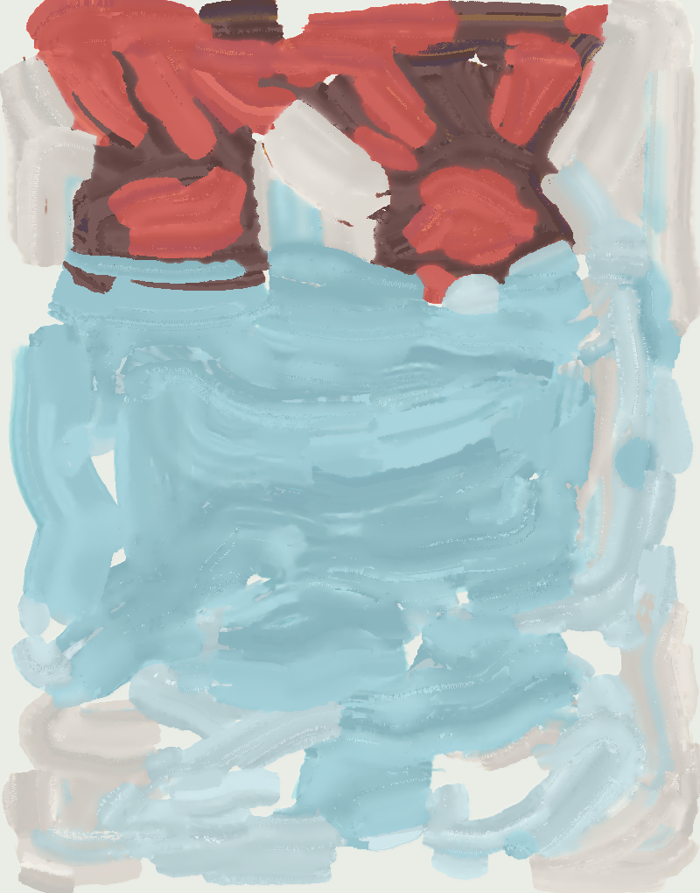

| stroke | covered | width | dark | spread | ms |
|---|---|---|---|---|---|
| stroke 1 | 9 % → 96 % | 94.9 px | 0.19 | 11.30 | 732 |
| stroke 2 | 13 % → 88 % | 93.8 px | 0.20 | 6.65 | 681 |
| stroke 3 | 18 % → 97 % | 192.5 px | 0.21 | 5.24 | 930 |
| stroke 4 | 29 % → 92 % | 265.6 px | 0.15 | 3.16 | 1361 |
| stroke 5 | 31 % → 94 % | 312.0 px | 0.25 | 3.07 | 615 |
| stroke 6 | 49 % → 94 % | 466.2 px | 0.22 | 1.90 | 1097 |
| stroke 7 | 56 % → 96 % | 816.7 px | 0.21 | 1.71 | 593 |
| stroke 8 | 43 % → 95 % | 472.5 px | 0.15 | 2.20 | 875 |
| stroke 9 | 47 % → 93 % | 1045.8 px | 0.15 | 1.95 | 354 |
| stroke 10 | 52 % → 98 % | 913.6 px | 0.19 | 1.90 | 489 |
| stroke 11 | 37 % → 94 % | 484.8 px | 0.14 | 2.57 | 506 |
| stroke 12 | 35 % → 97 % | 713.9 px | 0.20 | 2.80 | 218 |
| stroke 13 | 46 % → 99 % | 706.0 px | 0.25 | 2.17 | 509 |
| stroke 14 | 43 % → 93 % | 876.1 px | 0.14 | 2.14 | 382 |
| stroke 15 | 79 % → 98 % | 1479.1 px | 0.19 | 1.23 | 481 |
| stroke 16 | 48 % → 94 % | 709.3 px | 0.15 | 1.96 | 784 |
| stroke 17 | 69 % → 98 % | 969.0 px | 0.17 | 1.41 | 653 |
| stroke 18 | 50 % → 94 % | 1039.5 px | 0.17 | 1.88 | 206 |
| stroke 19 | 66 % → 90 % | 863.9 px | 0.18 | 1.36 | 450 |
| stroke 20 | 39 % → 88 % | 435.1 px | 0.13 | 2.27 | 603 |
| stroke 21 | 60 % → 99 % | 974.7 px | 0.25 | 1.64 | 390 |
| stroke 22 | 71 % → 92 % | 932.0 px | 0.20 | 1.29 | 574 |
| stroke 23 | 48 % → 91 % | 965.3 px | 0.14 | 1.88 | 240 |
| stroke 24 | 75 % → 95 % | 1628.8 px | 0.16 | 1.26 | 260 |
| stroke 25 | 57 % → 91 % | 840.7 px | 0.14 | 1.58 | 301 |
| stroke 26 | 72 % → 94 % | 1162.5 px | 0.15 | 1.32 | 478 |
| stroke 27 | 68 % → 88 % | 1074.9 px | 0.22 | 1.29 | 246 |
| stroke 28 | 66 % → 94 % | 1542.2 px | 0.16 | 1.43 | 390 |
| stroke 29 | 62 % → 92 % | 1203.2 px | 0.22 | 1.49 | 485 |
| stroke 30 | 42 % → 87 % | 602.2 px | 0.12 | 2.06 | 402 |
| stroke 31 | 42 % → 86 % | 748.4 px | 0.12 | 2.06 | 307 |
| stroke 32 | 32 % → 95 % | 475.5 px | 0.19 | 2.98 | 86 |
| stroke 33 | 49 % → 91 % | 1409.3 px | 0.14 | 1.86 | 26 |
| stroke 34 | 34 % → 83 % | 1477.4 px | 0.11 | 2.46 | 19 |
| stroke 35 | 44 % → 89 % | 736.8 px | 0.12 | 2.05 | 92 |
| stroke 36 | 59 % → 92 % | 761.3 px | 0.13 | 1.55 | 146 |
| stroke 37 | 67 % → 92 % | 1346.7 px | 0.14 | 1.38 | 115 |
| stroke 38 | 46 % → 94 % | 564.2 px | 0.18 | 2.03 | 106 |
| stroke 39 | 56 % → 92 % | 869.9 px | 0.15 | 1.65 | 109 |
| stroke 40 | 67 % → 92 % | 1404.1 px | 0.14 | 1.38 | 152 |
| stroke 41 | 55 % → 92 % | 735.9 px | 0.15 | 1.69 | 98 |
| stroke 42 | 38 % → 97 % | 952.9 px | 0.23 | 2.53 | 49 |
| stroke 43 | 66 % → 91 % | 1121.4 px | 0.13 | 1.38 | 91 |
| stroke 44 | 68 % → 91 % | 1282.9 px | 0.14 | 1.34 | 138 |
| stroke 45 | 35 % → 97 % | 1129.6 px | 0.24 | 2.79 | 44 |
| stroke 46 | 77 % → 96 % | 1767.5 px | 0.15 | 1.24 | 123 |
| stroke 47 | 76 % → 95 % | 2068.6 px | 0.15 | 1.24 | 128 |
| stroke 48 | 70 % → 94 % | 3194.1 px | 0.14 | 1.34 | 67 |
| stroke 49 | 42 % → 97 % | 1122.9 px | 0.24 | 2.33 | 153 |
| stroke 50 | 55 % → 94 % | 1572.7 px | 0.17 | 1.70 | 76 |
| stroke 51 | 58 % → 91 % | 2071.0 px | 0.13 | 1.56 | 53 |
| stroke 52 | 44 % → 96 % | 1524.8 px | 0.21 | 2.16 | 52 |
| stroke 53 | 67 % → 91 % | 1088.5 px | 0.13 | 1.36 | 103 |
| stroke 54 | 73 % → 93 % | 3001.3 px | 0.14 | 1.27 | 48 |
| stroke 55 | 78 % → 94 % | 3162.9 px | 0.15 | 1.21 | 47 |
| stroke 56 | 63 % → 91 % | 2879.3 px | 0.13 | 1.44 | 48 |
| stroke 57 | 56 % → 88 % | 2141.8 px | 0.13 | 1.57 | 19 |
| stroke 58 | 61 % → 89 % | 2124.6 px | 0.13 | 1.46 | 36 |
| stroke 59 | 56 % → 99 % | 2301.4 px | 0.21 | 1.77 | 39 |
| stroke 60 | 61 % → 98 % | 2445.7 px | 0.19 | 1.62 | 50 |
| stroke 61 | 74 % → 97 % | 2658.3 px | 0.22 | 1.31 | 83 |
| stroke 62 | 69 % → 97 % | 2667.2 px | 0.22 | 1.41 | 71 |
| stroke 63 | 67 % → 97 % | 3835.7 px | 0.23 | 1.46 | 34 |
| stroke 64 | 37 % → 87 % | 1047.4 px | 0.12 | 2.34 | 29 |
| stroke 65 | 49 % → 85 % | 592.9 px | 0.12 | 1.74 | 108 |
| stroke 66 | 55 % → 85 % | 1664.4 px | 0.12 | 1.56 | 41 |
| stroke 67 | 23 % → 85 % | 466.0 px | 0.10 | 3.71 | 53 |
| stroke 68 | 58 % → 88 % | 808.8 px | 0.13 | 1.52 | 158 |
| stroke 69 | 66 % → 90 % | 1704.1 px | 0.14 | 1.36 | 109 |
| stroke 70 | 67 % → 90 % | 2135.9 px | 0.14 | 1.34 | 61 |
| stroke 71 | 47 % → 84 % | 534.6 px | 0.11 | 1.81 | 135 |
| stroke 72 | 42 % → 83 % | 410.9 px | 0.11 | 1.99 | 157 |
| stroke 73 | 53 % → 86 % | 1518.5 px | 0.11 | 1.62 | 56 |
| stroke 74 | 65 % → 91 % | 1668.2 px | 0.14 | 1.39 | 86 |
| stroke 75 | 51 % → 86 % | 771.6 px | 0.12 | 1.67 | 95 |
| stroke 76 | 39 % → 86 % | 596.5 px | 0.10 | 2.20 | 68 |
| stroke 77 | 49 % → 85 % | 559.1 px | 0.11 | 1.74 | 93 |
| stroke 78 | 69 % → 89 % | 1201.6 px | 0.13 | 1.29 | 141 |
| stroke 79 | 70 % → 90 % | 1316.1 px | 0.14 | 1.29 | 130 |
| stroke 80 | 66 % → 87 % | 1205.4 px | 0.13 | 1.32 | 94 |
| stroke 81 | 60 % → 85 % | 591.3 px | 0.12 | 1.41 | 155 |
| stroke 82 | 57 % → 84 % | 606.2 px | 0.11 | 1.49 | 114 |
| stroke 83 | 72 % → 84 % | 1511.6 px | 0.12 | 1.17 | 99 |
| stroke 84 | 68 % → 87 % | 2054.6 px | 0.13 | 1.28 | 55 |
| stroke 85 | 79 % → 89 % | 3564.4 px | 0.14 | 1.13 | 33 |
| stroke 86 | 76 % → 92 % | 2053.8 px | 0.14 | 1.20 | 62 |
| stroke 87 | 77 % → 87 % | 1264.7 px | 0.13 | 1.13 | 118 |
| stroke 88 | 85 % → 92 % | 2681.6 px | 0.15 | 1.07 | 59 |
| stroke 89 | 76 % → 87 % | 3477.4 px | 0.13 | 1.14 | 28 |
| stroke 90 | 59 % → 84 % | 1314.5 px | 0.11 | 1.43 | 47 |
| stroke 91 | 74 % → 85 % | 1415.6 px | 0.12 | 1.14 | 116 |
| stroke 92 | 60 % → 85 % | 747.1 px | 0.11 | 1.41 | 163 |
| stroke 93 | 80 % → 88 % | 1713.8 px | 0.14 | 1.10 | 122 |
| stroke 94 | 72 % → 85 % | 1330.1 px | 0.12 | 1.18 | 107 |
| stroke 95 | 63 % → 88 % | 2307.8 px | 0.12 | 1.41 | 33 |
| stroke 96 | 85 % → 95 % | 2220.1 px | 0.15 | 1.12 | 92 |
| stroke 97 | 94 % → 97 % | 4351.0 px | 0.16 | 1.03 | 43 |
| stroke 98 | 67 % → 84 % | 898.0 px | 0.11 | 1.25 | 80 |
| stroke 99 | 82 % → 86 % | 3217.0 px | 0.13 | 1.05 | 49 |
| stroke 100 | 54 % → 86 % | 1381.4 px | 0.11 | 1.59 | 41 |
| stroke 101 | 61 % → 85 % | 926.0 px | 0.11 | 1.39 | 116 |
| stroke 102 | 61 % → 85 % | 2369.3 px | 0.12 | 1.40 | 50 |
| stroke 103 | 72 % → 89 % | 3348.4 px | 0.13 | 1.25 | 55 |
| stroke 104 | 67 % → 88 % | 3097.4 px | 0.12 | 1.32 | 49 |
| stroke 105 | 65 % → 87 % | 2573.1 px | 0.12 | 1.34 | 31 |
| stroke 106 | 68 % → 88 % | 1294.2 px | 0.13 | 1.30 | 60 |
| stroke 107 | 71 % → 88 % | 1214.6 px | 0.13 | 1.25 | 122 |
| stroke 108 | 78 % → 89 % | 1539.5 px | 0.14 | 1.13 | 211 |
| stroke 109 | 69 % → 89 % | 1733.8 px | 0.13 | 1.28 | 114 |
| stroke 110 | 55 % → 96 % | 1529.4 px | 0.21 | 1.74 | 65 |
| stroke 111 | 64 % → 89 % | 2158.2 px | 0.22 | 1.40 | 31 |
| stroke 112 | 79 % → 98 % | 2905.2 px | 0.22 | 1.25 | 71 |
| stroke 113 | 76 % → 88 % | 3265.7 px | 0.20 | 1.16 | 40 |
| stroke 114 | 85 % → 87 % | 1617.0 px | 0.18 | 1.03 | 48 |
| stroke 115 | 83 % → 93 % | 5407.7 px | 0.14 | 1.11 | 13 |
| stroke 116 | 85 % → 88 % | 2271.1 px | 0.15 | 1.04 | 42 |
| stroke 117 | 71 % → 86 % | 2271.3 px | 0.13 | 1.21 | 12 |
| stroke 118 | 74 % → 88 % | 3548.1 px | 0.13 | 1.19 | 13 |
| stroke 119 | 49 % → 95 % | 244.0 px | 0.20 | 1.93 | 441 |
| stroke 120 | 44 % → 96 % | 777.0 px | 0.27 | 2.17 | 200 |
| stroke 121 | 46 % → 97 % | 292.1 px | 0.29 | 2.09 | 332 |
| stroke 122 | 42 % → 96 % | 527.6 px | 0.29 | 2.30 | 116 |
| stroke 123 | 48 % → 97 % | 420.9 px | 0.30 | 2.02 | 436 |
| stroke 124 | 59 % → 96 % | 692.2 px | 0.25 | 1.62 | 267 |
| stroke 125 | 57 % → 96 % | 1630.9 px | 0.26 | 1.69 | 104 |
| stroke 126 | 60 % → 96 % | 714.3 px | 0.24 | 1.60 | 230 |
| stroke 127 | 63 % → 95 % | 432.6 px | 0.23 | 1.52 | 342 |
| stroke 128 | 72 % → 95 % | 1627.1 px | 0.18 | 1.31 | 100 |
| stroke 129 | 43 % → 91 % | 422.4 px | 0.31 | 2.13 | 284 |
| stroke 130 | 42 % → 90 % | 740.0 px | 0.32 | 2.17 | 123 |
| stroke 131 | 33 % → 91 % | 405.4 px | 0.36 | 2.80 | 238 |
| stroke 132 | 51 % → 89 % | 393.2 px | 0.30 | 1.76 | 302 |
| stroke 133 | 36 % → 98 % | 551.7 px | 0.36 | 2.74 | 186 |
| stroke 134 | 48 % → 98 % | 965.7 px | 0.32 | 2.05 | 179 |
| stroke 135 | 50 % → 99 % | 1372.8 px | 0.31 | 1.98 | 123 |
| stroke 136 | 52 % → 99 % | 1503.8 px | 0.31 | 1.91 | 156 |
| stroke 137 | 49 % → 98 % | 867.9 px | 0.32 | 1.98 | 234 |
| stroke 138 | 38 % → 98 % | 766.7 px | 0.37 | 2.57 | 231 |
| stroke 139 | 50 % → 98 % | 1154.3 px | 0.32 | 1.95 | 208 |
| stroke 140 | 39 % → 98 % | 1291.8 px | 0.36 | 2.51 | 104 |
| stroke 141 | 71 % → 96 % | 1501.4 px | 0.21 | 1.36 | 152 |
| stroke 142 | 78 % → 94 % | 877.7 px | 0.17 | 1.20 | 367 |
| stroke 143 | 78 % → 94 % | 1094.6 px | 0.18 | 1.21 | 256 |
| stroke 144 | 81 % → 93 % | 839.2 px | 0.15 | 1.15 | 371 |
| stroke 145 | 85 % → 93 % | 1259.8 px | 0.14 | 1.09 | 235 |
| stroke 146 | 81 % → 94 % | 1337.0 px | 0.18 | 1.16 | 344 |
| stroke 147 | 74 % → 96 % | 2179.7 px | 0.21 | 1.29 | 109 |
| stroke 148 | 86 % → 92 % | 2340.5 px | 0.14 | 1.07 | 119 |
| stroke 149 | 82 % → 94 % | 2145.1 px | 0.18 | 1.15 | 115 |
| stroke 150 | 63 % → 84 % | 566.4 px | 0.11 | 1.34 | 230 |
| stroke 151 | 76 % → 87 % | 559.7 px | 0.11 | 1.15 | 311 |
| stroke 152 | 72 % → 85 % | 926.3 px | 0.10 | 1.19 | 178 |
| stroke 153 | 72 % → 83 % | 567.5 px | 0.10 | 1.16 | 334 |
| stroke 154 | 80 % → 87 % | 1252.2 px | 0.11 | 1.09 | 143 |
| stroke 155 | 77 % → 85 % | 757.6 px | 0.10 | 1.10 | 328 |
| stroke 156 | 80 % → 87 % | 1361.6 px | 0.10 | 1.09 | 162 |
| stroke 157 | 81 % → 86 % | 1756.8 px | 0.11 | 1.06 | 121 |
| stroke 158 | 79 % → 83 % | 534.5 px | 0.10 | 1.06 | 223 |
| stroke 159 | 85 % → 86 % | 2677.0 px | 0.12 | 1.02 | 134 |
| stroke 160 | 85 % → 85 % | 2205.7 px | 0.12 | 1.01 | 110 |
| stroke 161 | 86 % → 87 % | 1750.1 px | 0.13 | 1.00 | 241 |
| stroke 162 | 85 % → 85 % | 2293.7 px | 0.12 | 1.00 | 114 |
| stroke 163 | 56 % → 85 % | 902.0 px | 0.11 | 1.51 | 78 |
| stroke 164 | 68 % → 86 % | 574.3 px | 0.10 | 1.27 | 156 |
| stroke 165 | 83 % → 88 % | 826.6 px | 0.12 | 1.06 | 311 |
| stroke 166 | 82 % → 87 % | 896.2 px | 0.11 | 1.06 | 347 |
| stroke 167 | 85 % → 87 % | 1219.5 px | 0.12 | 1.03 | 181 |
| stroke 168 | 83 % → 87 % | 1170.2 px | 0.11 | 1.04 | 151 |
| stroke 169 | 86 % → 87 % | 1646.1 px | 0.12 | 1.02 | 132 |
| stroke 170 | 84 % → 86 % | 1058.3 px | 0.11 | 1.03 | 165 |
| stroke 171 | 84 % → 85 % | 1148.3 px | 0.09 | 1.02 | 112 |
| stroke 172 | 87 % → 87 % | 1825.4 px | 0.11 | 1.00 | 132 |
| stroke 173 | 86 % → 87 % | 1854.5 px | 0.11 | 1.00 | 173 |
| stroke 174 | 41 % → 92 % | 628.7 px | 0.35 | 2.25 | 83 |
| stroke 175 | 31 % → 95 % | 516.8 px | 0.38 | 3.11 | 85 |
| stroke 176 | 43 % → 92 % | 507.1 px | 0.36 | 2.13 | 130 |
| stroke 177 | 39 % → 94 % | 384.1 px | 0.38 | 2.40 | 119 |
| stroke 178 | 53 % → 92 % | 723.7 px | 0.33 | 1.74 | 77 |
| stroke 179 | 51 % → 93 % | 857.0 px | 0.35 | 1.82 | 74 |
| stroke 180 | 47 % → 94 % | 548.1 px | 0.37 | 1.99 | 94 |
| stroke 181 | 46 % → 95 % | 675.1 px | 0.38 | 2.07 | 98 |
| stroke 182 | 47 % → 97 % | 1657.8 px | 0.38 | 2.06 | 60 |
| stroke 183 | 59 % → 91 % | 670.9 px | 0.35 | 1.54 | 132 |
| stroke 184 | 51 % → 94 % | 718.1 px | 0.37 | 1.84 | 107 |
| stroke 185 | 55 % → 93 % | 671.7 px | 0.35 | 1.70 | 204 |
| stroke 186 | 60 % → 94 % | 1013.7 px | 0.38 | 1.56 | 51 |
| stroke 187 | 59 % → 94 % | 1031.0 px | 0.38 | 1.61 | 53 |
| stroke 188 | 58 % → 93 % | 1146.8 px | 0.38 | 1.61 | 59 |
| stroke 189 | 56 % → 93 % | 620.0 px | 0.37 | 1.66 | 99 |
| stroke 190 | 59 % → 94 % | 1561.8 px | 0.37 | 1.58 | 31 |
| stroke 191 | 61 % → 94 % | 924.8 px | 0.39 | 1.54 | 58 |
| stroke 192 | 62 % → 92 % | 2114.1 px | 0.36 | 1.47 | 125 |
| stroke 193 | 50 % → 97 % | 2334.5 px | 0.38 | 1.95 | 52 |
| stroke 194 | 61 % → 93 % | 2247.1 px | 0.35 | 1.52 | 34 |
| stroke 195 | 61 % → 94 % | 1723.7 px | 0.38 | 1.55 | 31 |
| stroke 196 | 33 % → 97 % | 507.1 px | 0.44 | 2.92 | 69 |
| stroke 197 | 42 % → 97 % | 377.3 px | 0.41 | 2.28 | 117 |
| stroke 198 | 48 % → 97 % | 859.2 px | 0.37 | 2.00 | 91 |
| stroke 199 | 41 % → 97 % | 549.4 px | 0.44 | 2.37 | 90 |
| stroke 200 | 47 % → 97 % | 967.6 px | 0.38 | 2.06 | 89 |
| stroke 201 | 47 % → 97 % | 1703.4 px | 0.43 | 2.08 | 25 |
| stroke 202 | 47 % → 97 % | 1781.0 px | 0.43 | 2.09 | 33 |
| stroke 203 | 44 % → 96 % | 1297.8 px | 0.40 | 2.18 | 32 |
| stroke 204 | 46 % → 97 % | 1987.7 px | 0.40 | 2.12 | 30 |
| stroke 205 | 51 % → 96 % | 1105.6 px | 0.34 | 1.90 | 67 |
| stroke 206 | 57 % → 97 % | 1542.2 px | 0.31 | 1.69 | 44 |
| stroke 207 | 59 % → 97 % | 1122.0 px | 0.31 | 1.63 | 75 |
| stroke 208 | 55 % → 97 % | 2070.1 px | 0.33 | 1.76 | 35 |
| stroke 209 | 56 % → 97 % | 1376.3 px | 0.32 | 1.72 | 79 |
| stroke 210 | 56 % → 96 % | 1430.3 px | 0.34 | 1.73 | 38 |
| stroke 211 | 75 % → 98 % | 3405.9 px | 0.24 | 1.30 | 51 |
| stroke 212 | 75 % → 97 % | 1540.3 px | 0.27 | 1.29 | 112 |
| stroke 213 | 74 % → 96 % | 1736.6 px | 0.27 | 1.30 | 82 |
| stroke 214 | 75 % → 99 % | 3472.3 px | 0.29 | 1.32 | 37 |
| stroke 215 | 80 % → 99 % | 3970.0 px | 0.25 | 1.24 | 38 |
| stroke 216 | 80 % → 99 % | 2617.1 px | 0.25 | 1.23 | 77 |
| stroke 217 | 79 % → 99 % | 3549.3 px | 0.27 | 1.26 | 80 |
| stroke 218 | 75 % → 98 % | 3724.0 px | 0.28 | 1.30 | 32 |
| stroke 219 | 79 % → 99 % | 3972.5 px | 0.27 | 1.26 | 30 |
| stroke 220 | 76 % → 93 % | 1267.4 px | 0.30 | 1.22 | 117 |
| stroke 221 | 79 % → 94 % | 1611.7 px | 0.28 | 1.19 | 98 |
| stroke 222 | 78 % → 92 % | 1969.3 px | 0.30 | 1.18 | 71 |
| stroke 223 | 79 % → 94 % | 1953.0 px | 0.29 | 1.19 | 101 |
| stroke 224 | 78 % → 93 % | 3949.9 px | 0.30 | 1.19 | 45 |
| stroke 225 | 81 % → 94 % | 1778.8 px | 0.27 | 1.16 | 91 |
| stroke 226 | 80 % → 93 % | 2662.8 px | 0.29 | 1.16 | 52 |
| stroke 227 | 64 % → 96 % | 961.0 px | 0.34 | 1.51 | 35 |
| stroke 228 | 67 % → 97 % | 1194.0 px | 0.32 | 1.44 | 48 |
| stroke 229 | 69 % → 97 % | 1884.9 px | 0.36 | 1.40 | 46 |
| stroke 230 | 85 % → 99 % | 4050.7 px | 0.23 | 1.16 | 36 |
| stroke 231 | 80 % → 99 % | 2062.1 px | 0.30 | 1.24 | 193 |
| stroke 232 | 72 % → 95 % | 606.1 px | 0.33 | 1.32 | 228 |
| stroke 233 | 81 % → 99 % | 2176.3 px | 0.30 | 1.22 | 144 |
| stroke 234 | 82 % → 97 % | 914.7 px | 0.30 | 1.18 | 273 |
| stroke 235 | 80 % → 97 % | 1092.4 px | 0.35 | 1.21 | 226 |
| stroke 236 | 88 % → 96 % | 1112.0 px | 0.27 | 1.09 | 165 |
| stroke 237 | 83 % → 97 % | 1169.2 px | 0.34 | 1.16 | 168 |
| stroke 238 | 81 % → 97 % | 1212.2 px | 0.41 | 1.19 | 94 |
| stroke 239 | 92 % → 98 % | 1801.9 px | 0.23 | 1.06 | 155 |
| stroke 240 | 89 % → 97 % | 1095.3 px | 0.32 | 1.09 | 138 |
| stroke 241 | 91 % → 96 % | 1943.2 px | 0.27 | 1.06 | 158 |
| stroke 242 | 83 % → 98 % | 1356.3 px | 0.39 | 1.17 | 188 |
| stroke 243 | 83 % → 97 % | 1537.0 px | 0.41 | 1.17 | 87 |
| stroke 244 | 89 % → 97 % | 1169.5 px | 0.36 | 1.09 | 189 |
| stroke 245 | 93 % → 98 % | 1335.1 px | 0.25 | 1.05 | 317 |
| stroke 246 | 91 % → 96 % | 1099.2 px | 0.33 | 1.06 | 167 |
| stroke 247 | 93 % → 97 % | 2050.6 px | 0.30 | 1.04 | 129 |
| stroke 248 | 93 % → 97 % | 3087.9 px | 0.30 | 1.04 | 81 |
| stroke 249 | 96 % → 97 % | 1487.9 px | 0.30 | 1.02 | 211 |
| stroke 250 | 92 % → 97 % | 2060.2 px | 0.38 | 1.05 | 128 |
| stroke 251 | 90 % → 97 % | 1919.5 px | 0.39 | 1.08 | 126 |
| stroke 252 | 94 % → 97 % | 1536.7 px | 0.32 | 1.03 | 231 |
| stroke 253 | 95 % → 98 % | 4382.6 px | 0.32 | 1.03 | 70 |
| stroke 254 | 92 % → 97 % | 2046.7 px | 0.38 | 1.06 | 217 |
| stroke 255 | 97 % → 99 % | 2749.3 px | 0.25 | 1.03 | 169 |
| stroke 256 | 86 % → 97 % | 2271.8 px | 0.41 | 1.13 | 102 |
| stroke 257 | 95 % → 97 % | 1833.9 px | 0.32 | 1.02 | 197 |
| stroke 258 | 96 % → 96 % | 3999.1 px | 0.28 | 1.00 | 83 |
| stroke 259 | 97 % → 98 % | 2258.8 px | 0.32 | 1.01 | 145 |
| stroke 260 | 96 % → 96 % | 2158.6 px | 0.33 | 1.00 | 86 |
| stroke 261 | 97 % → 97 % | 2347.5 px | 0.32 | 1.00 | 112 |
| stroke 262 | 97 % → 97 % | 2567.5 px | 0.32 | 1.00 | 159 |
| stroke 263 | 95 % → 97 % | 4324.2 px | 0.31 | 1.02 | 98 |
| stroke 264 | 88 % → 92 % | 911.3 px | 0.28 | 1.05 | 473 |
| stroke 265 | 86 % → 92 % | 876.3 px | 0.32 | 1.06 | 267 |
| stroke 266 | 92 % → 94 % | 975.9 px | 0.29 | 1.02 | 341 |
| stroke 267 | 90 % → 93 % | 1351.2 px | 0.33 | 1.02 | 163 |
| stroke 268 | 90 % → 91 % | 683.1 px | 0.32 | 1.01 | 298 |
| stroke 269 | 91 % → 92 % | 2063.7 px | 0.33 | 1.01 | 218 |
| stroke 270 | 97 % → 98 % | 1760.9 px | 0.33 | 1.00 | 148 |
| stroke 271 | 95 % → 95 % | 1510.0 px | 0.26 | 1.00 | 217 |
| stroke 272 | 91 % → 91 % | 2183.9 px | 0.33 | 1.00 | 66 |
| stroke 273 | 91 % → 91 % | 1896.4 px | 0.32 | 1.00 | 90 |
| stroke 274 | 93 % → 93 % | 2072.8 px | 0.35 | 1.00 | 72 |
| stroke 275 | 94 % → 94 % | 1755.8 px | 0.38 | 1.00 | 78 |
| stroke 276 | 97 % → 97 % | 3202.3 px | 0.32 | 1.00 | 68 |
| stroke 277 | 91 % → 91 % | 2877.2 px | 0.33 | 1.00 | 72 |
| stroke 278 | 91 % → 91 % | 2865.0 px | 0.34 | 1.00 | 69 |
| stroke 279 | 95 % → 95 % | 2220.5 px | 0.35 | 1.00 | 135 |
| stroke 280 | 98 % → 98 % | 4553.8 px | 0.30 | 1.00 | 58 |
| stroke 281 | 93 % → 92 % | 3289.7 px | 0.29 | 0.99 | 50 |

Numbers say: wet paint spreads well beyond the stroke.

## Refs v4 · #14 HW olive totem — own sheet
own sheet 800 × 1040 · Gouache 1.00 + turpentine 30 % · 57 px · 362.9 s

| stroke | covered | width | dark | spread | ms |
|---|---|---|---|---|---|
| stroke 1 | 7 % → 88 % | 57.4 px | 0.22 | 13.39 | 101 |
| stroke 2 | 10 % → 88 % | 125.9 px | 0.21 | 8.42 | 51 |
| stroke 3 | 6 % → 76 % | 56.0 px | 0.23 | 11.83 | 110 |
| stroke 4 | 10 % → 72 % | 85.9 px | 0.23 | 7.24 | 108 |
| stroke 5 | 16 % → 63 % | 99.5 px | 0.24 | 3.86 | 135 |
| stroke 6 | 21 % → 79 % | 167.0 px | 0.24 | 3.83 | 104 |
| stroke 7 | 8 % → 96 % | 55.6 px | 0.19 | 12.73 | 99 |
| stroke 8 | 12 % → 98 % | 87.8 px | 0.20 | 8.45 | 68 |
| stroke 9 | 24 % → 97 % | 112.1 px | 0.20 | 4.09 | 133 |
| stroke 10 | 20 % → 96 % | 183.8 px | 0.20 | 4.80 | 91 |
| stroke 11 | 28 % → 96 % | 157.2 px | 0.20 | 3.46 | 185 |
| stroke 12 | 30 % → 98 % | 331.8 px | 0.20 | 3.27 | 67 |
| stroke 13 | 47 % → 98 % | 306.6 px | 0.21 | 2.06 | 104 |
| stroke 14 | 51 % → 98 % | 511.6 px | 0.22 | 1.93 | 56 |
| stroke 15 | 42 % → 97 % | 240.5 px | 0.19 | 2.30 | 143 |
| stroke 16 | 44 % → 99 % | 322.6 px | 0.21 | 2.26 | 136 |
| stroke 17 | 32 % → 90 % | 319.2 px | 0.18 | 2.83 | 98 |
| stroke 18 | 53 % → 98 % | 561.6 px | 0.21 | 1.83 | 70 |
| stroke 19 | 29 % → 85 % | 304.9 px | 0.18 | 2.97 | 72 |
| stroke 20 | 23 % → 71 % | 158.4 px | 0.24 | 3.06 | 147 |
| stroke 21 | 29 % → 64 % | 307.5 px | 0.25 | 2.23 | 83 |
| stroke 22 | 43 % → 63 % | 403.8 px | 0.26 | 1.48 | 60 |
| stroke 23 | 17 % → 98 % | 86.7 px | 0.22 | 5.71 | 427 |
| stroke 24 | 10 % → 97 % | 114.8 px | 0.23 | 10.16 | 143 |
| stroke 25 | 22 % → 97 % | 235.8 px | 0.22 | 4.42 | 93 |
| stroke 26 | 17 % → 99 % | 198.1 px | 0.25 | 5.69 | 91 |
| stroke 27 | 27 % → 99 % | 346.5 px | 0.26 | 3.64 | 72 |
| stroke 28 | 23 % → 98 % | 294.0 px | 0.23 | 4.21 | 96 |
| stroke 29 | 39 % → 97 % | 288.5 px | 0.23 | 2.52 | 172 |
| stroke 30 | 32 % → 91 % | 271.8 px | 0.23 | 2.88 | 171 |
| stroke 31 | 22 % → 99 % | 203.3 px | 0.24 | 4.47 | 148 |
| stroke 32 | 37 % → 97 % | 332.8 px | 0.25 | 2.60 | 110 |
| stroke 33 | 55 % → 98 % | 573.6 px | 0.26 | 1.78 | 130 |
| stroke 34 | 54 % → 98 % | 402.2 px | 0.24 | 1.79 | 225 |
| stroke 35 | 47 % → 97 % | 594.3 px | 0.23 | 2.07 | 105 |
| stroke 36 | 37 % → 99 % | 500.6 px | 0.24 | 2.68 | 67 |
| stroke 37 | 64 % → 98 % | 860.5 px | 0.25 | 1.54 | 89 |
| stroke 38 | 68 % → 97 % | 993.1 px | 0.23 | 1.43 | 57 |
| stroke 39 | 11 % → 97 % | 53.4 px | 0.26 | 8.43 | 311 |
| stroke 40 | 13 % → 83 % | 92.1 px | 0.26 | 6.57 | 220 |
| stroke 41 | 20 % → 99 % | 135.8 px | 0.25 | 5.05 | 175 |
| stroke 42 | 32 % → 99 % | 362.9 px | 0.25 | 3.08 | 87 |
| stroke 43 | 18 % → 81 % | 121.2 px | 0.27 | 4.36 | 321 |
| stroke 44 | 31 % → 98 % | 254.1 px | 0.26 | 3.10 | 211 |
| stroke 45 | 31 % → 89 % | 195.0 px | 0.27 | 2.86 | 180 |
| stroke 46 | 24 % → 100 % | 182.8 px | 0.25 | 4.18 | 173 |
| stroke 47 | 34 % → 99 % | 225.1 px | 0.22 | 2.92 | 174 |
| stroke 48 | 28 % → 79 % | 203.1 px | 0.26 | 2.88 | 192 |
| stroke 49 | 34 % → 67 % | 189.7 px | 0.27 | 2.00 | 149 |
| stroke 50 | 48 % → 99 % | 277.0 px | 0.25 | 2.05 | 341 |
| stroke 51 | 53 % → 99 % | 562.2 px | 0.25 | 1.88 | 128 |
| stroke 52 | 34 % → 90 % | 244.6 px | 0.25 | 2.69 | 206 |
| stroke 53 | 37 % → 95 % | 218.6 px | 0.25 | 2.54 | 341 |
| stroke 54 | 39 % → 65 % | 303.9 px | 0.27 | 1.66 | 86 |
| stroke 55 | 47 % → 91 % | 346.7 px | 0.26 | 1.94 | 168 |
| stroke 56 | 58 % → 100 % | 396.1 px | 0.26 | 1.72 | 138 |
| stroke 57 | 58 % → 94 % | 485.8 px | 0.27 | 1.62 | 134 |
| stroke 58 | 51 % → 81 % | 432.0 px | 0.25 | 1.58 | 106 |
| stroke 59 | 63 % → 89 % | 685.6 px | 0.26 | 1.42 | 105 |
| stroke 60 | 41 % → 64 % | 398.0 px | 0.26 | 1.55 | 150 |
| stroke 61 | 54 % → 83 % | 346.7 px | 0.26 | 1.52 | 318 |
| stroke 62 | 77 % → 99 % | 653.7 px | 0.27 | 1.28 | 165 |
| stroke 63 | 66 % → 99 % | 455.9 px | 0.26 | 1.51 | 284 |
| stroke 64 | 71 % → 89 % | 670.8 px | 0.26 | 1.25 | 182 |
| stroke 65 | 50 % → 68 % | 684.1 px | 0.26 | 1.38 | 102 |
| stroke 66 | 39 % → 53 % | 425.0 px | 0.28 | 1.37 | 68 |
| stroke 67 | 47 % → 61 % | 477.4 px | 0.27 | 1.30 | 112 |
| stroke 68 | 63 % → 100 % | 763.1 px | 0.26 | 1.60 | 98 |
| stroke 69 | 60 % → 95 % | 526.3 px | 0.26 | 1.59 | 189 |
| stroke 70 | 67 % → 86 % | 830.6 px | 0.26 | 1.28 | 166 |
| stroke 71 | 45 % → 99 % | 567.8 px | 0.25 | 2.19 | 77 |
| stroke 72 | 61 % → 82 % | 722.4 px | 0.27 | 1.34 | 114 |
| stroke 73 | 54 % → 69 % | 457.0 px | 0.26 | 1.28 | 112 |
| stroke 74 | 79 % → 98 % | 893.0 px | 0.27 | 1.25 | 133 |
| stroke 75 | 58 % → 100 % | 550.2 px | 0.26 | 1.71 | 130 |
| stroke 76 | 38 % → 53 % | 549.1 px | 0.26 | 1.41 | 46 |
| stroke 77 | 45 % → 100 % | 628.8 px | 0.25 | 2.20 | 81 |
| stroke 78 | 55 % → 77 % | 790.5 px | 0.27 | 1.39 | 67 |
| stroke 79 | 53 % → 63 % | 478.8 px | 0.27 | 1.18 | 149 |
| stroke 80 | 49 % → 93 % | 503.7 px | 0.24 | 1.90 | 103 |
| stroke 81 | 75 % → 99 % | 739.0 px | 0.26 | 1.33 | 99 |
| stroke 82 | 58 % → 100 % | 792.2 px | 0.26 | 1.73 | 165 |
| stroke 83 | 76 % → 100 % | 989.4 px | 0.26 | 1.32 | 121 |
| stroke 84 | 53 % → 64 % | 459.2 px | 0.26 | 1.21 | 127 |
| stroke 85 | 13 % → 82 % | 65.7 px | 0.22 | 6.21 | 79 |
| stroke 86 | 11 % → 75 % | 180.6 px | 0.21 | 6.53 | 16 |
| stroke 87 | 14 % → 95 % | 164.0 px | 0.21 | 6.82 | 29 |
| stroke 88 | 22 % → 92 % | 450.9 px | 0.21 | 4.25 | 17 |
| stroke 89 | 47 % → 97 % | 555.6 px | 0.22 | 2.06 | 45 |
| stroke 90 | 18 % → 64 % | 303.8 px | 0.23 | 3.63 | 19 |
| stroke 91 | 20 % → 82 % | 175.4 px | 0.21 | 4.02 | 61 |
| stroke 92 | 53 % → 91 % | 953.1 px | 0.26 | 1.72 | 19 |
| stroke 93 | 17 % → 98 % | 191.2 px | 0.20 | 5.63 | 28 |
| stroke 94 | 28 % → 90 % | 433.9 px | 0.22 | 3.19 | 15 |
| stroke 95 | 28 % → 67 % | 200.1 px | 0.21 | 2.42 | 203 |
| stroke 96 | 52 % → 97 % | 302.5 px | 0.21 | 1.87 | 583 |
| stroke 97 | 59 % → 98 % | 346.5 px | 0.19 | 1.67 | 493 |
| stroke 98 | 44 % → 84 % | 212.1 px | 0.21 | 1.93 | 518 |
| stroke 99 | 72 % → 97 % | 397.6 px | 0.22 | 1.35 | 455 |
| stroke 100 | 46 % → 84 % | 238.7 px | 0.22 | 1.83 | 570 |
| stroke 101 | 41 % → 77 % | 163.0 px | 0.22 | 1.87 | 291 |
| stroke 102 | 51 % → 85 % | 323.2 px | 0.20 | 1.65 | 422 |
| stroke 103 | 63 % → 94 % | 288.6 px | 0.21 | 1.49 | 626 |
| stroke 104 | 64 % → 93 % | 533.9 px | 0.21 | 1.45 | 201 |
| stroke 105 | 70 % → 97 % | 647.7 px | 0.21 | 1.40 | 243 |
| stroke 106 | 75 % → 98 % | 749.4 px | 0.21 | 1.29 | 173 |
| stroke 107 | 84 % → 98 % | 508.9 px | 0.21 | 1.16 | 347 |
| stroke 108 | 62 % → 86 % | 446.1 px | 0.27 | 1.39 | 316 |
| stroke 109 | 67 % → 85 % | 317.6 px | 0.21 | 1.27 | 447 |
| stroke 110 | 71 % → 95 % | 469.4 px | 0.23 | 1.34 | 474 |
| stroke 111 | 65 % → 81 % | 377.4 px | 0.22 | 1.25 | 531 |
| stroke 112 | 69 % → 84 % | 414.5 px | 0.21 | 1.21 | 444 |
| stroke 113 | 58 % → 71 % | 343.4 px | 0.23 | 1.23 | 829 |
| stroke 114 | 77 % → 86 % | 445.6 px | 0.22 | 1.11 | 242 |
| stroke 115 | 76 % → 82 % | 546.5 px | 0.23 | 1.09 | 245 |
| stroke 116 | 72 % → 86 % | 482.1 px | 0.24 | 1.20 | 409 |
| stroke 117 | 90 % → 94 % | 578.4 px | 0.21 | 1.04 | 421 |
| stroke 118 | 75 % → 81 % | 634.9 px | 0.23 | 1.08 | 271 |
| stroke 119 | 65 % → 74 % | 433.7 px | 0.25 | 1.14 | 308 |
| stroke 120 | 89 % → 97 % | 839.1 px | 0.22 | 1.09 | 275 |
| stroke 121 | 69 % → 70 % | 487.3 px | 0.22 | 1.02 | 285 |
| stroke 122 | 80 % → 92 % | 778.0 px | 0.21 | 1.15 | 148 |
| stroke 123 | 57 % → 78 % | 525.7 px | 0.19 | 1.37 | 206 |
| stroke 124 | 95 % → 96 % | 812.3 px | 0.21 | 1.01 | 292 |
| stroke 125 | 96 % → 97 % | 1039.3 px | 0.22 | 1.01 | 202 |
| stroke 126 | 79 % → 86 % | 547.5 px | 0.22 | 1.09 | 362 |
| stroke 127 | 97 % → 98 % | 1003.6 px | 0.22 | 1.00 | 190 |
| stroke 128 | 93 % → 97 % | 957.3 px | 0.21 | 1.05 | 315 |
| stroke 129 | 74 % → 85 % | 567.7 px | 0.25 | 1.15 | 307 |
| stroke 130 | 72 % → 79 % | 805.5 px | 0.22 | 1.10 | 115 |
| stroke 131 | 54 % → 60 % | 316.5 px | 0.27 | 1.12 | 368 |
| stroke 132 | 85 % → 100 % | 813.5 px | 0.26 | 1.18 | 157 |
| stroke 133 | 79 % → 99 % | 430.7 px | 0.27 | 1.26 | 568 |
| stroke 134 | 86 % → 100 % | 634.2 px | 0.26 | 1.15 | 219 |
| stroke 135 | 59 % → 68 % | 421.9 px | 0.25 | 1.14 | 90 |
| stroke 136 | 57 % → 97 % | 509.7 px | 0.16 | 1.70 | 52 |
| stroke 137 | 31 % → 99 % | 294.1 px | 0.20 | 3.23 | 83 |
| stroke 138 | 66 % → 67 % | 314.2 px | 0.17 | 1.02 | 352 |
| stroke 139 | 80 % → 81 % | 413.2 px | 0.19 | 1.02 | 379 |
| stroke 140 | 63 % → 98 % | 233.7 px | 0.15 | 1.57 | 577 |
| stroke 141 | 76 % → 99 % | 403.3 px | 0.11 | 1.30 | 264 |
| stroke 142 | 83 % → 99 % | 522.4 px | 0.17 | 1.19 | 434 |
| stroke 143 | 76 % → 99 % | 381.5 px | 0.20 | 1.31 | 403 |
| stroke 144 | 80 % → 99 % | 484.8 px | 0.15 | 1.24 | 202 |
| stroke 145 | 85 % → 98 % | 440.8 px | 0.09 | 1.15 | 330 |
| stroke 146 | 95 % → 97 % | 455.8 px | 0.14 | 1.02 | 341 |
| stroke 147 | 98 % → 97 % | 462.3 px | 0.15 | 1.00 | 348 |
| stroke 148 | 56 % → 96 % | 140.2 px | 0.18 | 1.73 | 817 |
| stroke 149 | 65 % → 98 % | 266.9 px | 0.18 | 1.51 | 458 |
| stroke 150 | 83 % → 97 % | 341.5 px | 0.10 | 1.16 | 288 |
| stroke 151 | 72 % → 98 % | 431.4 px | 0.19 | 1.37 | 487 |
| stroke 152 | 84 % → 96 % | 189.1 px | 0.10 | 1.15 | 456 |
| stroke 153 | 40 % → 69 % | 216.7 px | 0.24 | 1.72 | 243 |
| stroke 154 | 65 % → 79 % | 944.6 px | 0.24 | 1.22 | 22 |
| stroke 155 | 73 % → 75 % | 547.5 px | 0.22 | 1.03 | 182 |
| stroke 156 | 71 % → 73 % | 747.7 px | 0.23 | 1.03 | 87 |
| stroke 157 | 69 % → 70 % | 904.8 px | 0.22 | 1.01 | 69 |
| stroke 158 | 56 % → 60 % | 347.5 px | 0.25 | 1.08 | 237 |
| stroke 159 | 53 % → 53 % | 474.6 px | 0.25 | 1.01 | 83 |
| stroke 160 | 75 % → 92 % | 406.0 px | 0.23 | 1.22 | 404 |
| stroke 161 | 69 % → 74 % | 456.2 px | 0.26 | 1.07 | 298 |
| stroke 162 | 92 % → 98 % | 680.3 px | 0.24 | 1.07 | 313 |
| stroke 163 | 90 % → 100 % | 807.4 px | 0.20 | 1.11 | 173 |
| stroke 164 | 79 % → 95 % | 473.9 px | 0.23 | 1.21 | 259 |
| stroke 165 | 83 % → 94 % | 510.9 px | 0.22 | 1.14 | 116 |
| stroke 166 | 83 % → 100 % | 487.3 px | 0.23 | 1.20 | 252 |
| stroke 167 | 81 % → 99 % | 427.0 px | 0.21 | 1.22 | 262 |
| stroke 168 | 81 % → 94 % | 550.3 px | 0.23 | 1.16 | 140 |
| stroke 169 | 85 % → 90 % | 912.3 px | 0.24 | 1.06 | 65 |
| stroke 170 | 90 % → 99 % | 671.6 px | 0.22 | 1.10 | 266 |
| stroke 171 | 90 % → 100 % | 617.4 px | 0.24 | 1.11 | 225 |
| stroke 172 | 88 % → 100 % | 525.1 px | 0.20 | 1.13 | 132 |
| stroke 173 | 88 % → 100 % | 679.7 px | 0.21 | 1.14 | 162 |
| stroke 174 | 94 % → 96 % | 1433.3 px | 0.25 | 1.02 | 90 |
| stroke 175 | 92 % → 99 % | 686.8 px | 0.24 | 1.08 | 229 |
| stroke 176 | 91 % → 100 % | 1294.1 px | 0.24 | 1.09 | 46 |
| stroke 177 | 95 % → 99 % | 839.9 px | 0.22 | 1.04 | 153 |
| stroke 178 | 94 % → 100 % | 717.6 px | 0.24 | 1.06 | 107 |
| stroke 179 | 98 % → 100 % | 517.8 px | 0.23 | 1.02 | 139 |
| stroke 180 | 96 % → 97 % | 780.2 px | 0.23 | 1.02 | 162 |
| stroke 181 | 95 % → 99 % | 841.0 px | 0.26 | 1.05 | 115 |
| stroke 182 | 100 % → 100 % | 880.2 px | 0.24 | 1.00 | 214 |
| stroke 183 | 84 % → 87 % | 650.6 px | 0.27 | 1.04 | 171 |
| stroke 184 | 99 % → 99 % | 592.3 px | 0.22 | 1.00 | 252 |
| stroke 185 | 86 % → 89 % | 756.4 px | 0.27 | 1.03 | 155 |
| stroke 186 | 97 % → 97 % | 942.3 px | 0.23 | 1.00 | 68 |
| stroke 187 | 93 % → 94 % | 1192.3 px | 0.27 | 1.02 | 70 |
| stroke 188 | 99 % → 99 % | 510.7 px | 0.21 | 1.00 | 128 |
| stroke 189 | 99 % → 99 % | 660.5 px | 0.20 | 1.00 | 122 |
| stroke 190 | 99 % → 99 % | 1077.2 px | 0.22 | 1.00 | 106 |
| stroke 191 | 100 % → 100 % | 1068.4 px | 0.19 | 1.00 | 170 |
| stroke 192 | 100 % → 100 % | 1586.3 px | 0.21 | 1.00 | 62 |
| stroke 193 | 100 % → 100 % | 1367.4 px | 0.26 | 1.00 | 57 |
| stroke 194 | 97 % → 98 % | 1525.8 px | 0.24 | 1.00 | 77 |
| stroke 195 | 97 % → 99 % | 1543.8 px | 0.27 | 1.02 | 47 |
| stroke 196 | 99 % → 99 % | 1430.5 px | 0.24 | 1.00 | 61 |
| stroke 197 | 97 % → 98 % | 1357.6 px | 0.27 | 1.01 | 72 |
| stroke 198 | 95 % → 95 % | 1187.5 px | 0.27 | 1.00 | 67 |
| stroke 199 | 70 % → 72 % | 391.4 px | 0.25 | 1.02 | 202 |
| stroke 200 | 77 % → 77 % | 633.0 px | 0.25 | 1.00 | 98 |
| stroke 201 | 68 % → 68 % | 692.1 px | 0.26 | 1.00 | 81 |
| stroke 202 | 97 % → 97 % | 986.8 px | 0.17 | 1.00 | 42 |
| stroke 203 | 97 % → 97 % | 1441.0 px | 0.27 | 1.00 | 33 |

Numbers say: wet paint spreads well beyond the stroke.

## Refs v4 · #15 Ultramarine script — own sheet
own sheet 800 × 1422 · Ink 0.98 · 39 px · 329.7 s

| stroke | covered | width | dark | spread | ms |
|---|---|---|---|---|---|
| stroke 1 | 3 % → 43 % | 15.6 px | 0.65 | 16.60 | 171 |
| stroke 2 | 4 % → 45 % | 22.3 px | 0.66 | 11.15 | 13 |
| stroke 3 | 11 % → 48 % | 24.8 px | 0.66 | 4.17 | 29 |
| stroke 4 | 15 % → 45 % | 82.4 px | 0.65 | 2.97 | 19 |
| stroke 5 | 18 % → 41 % | 225.2 px | 0.64 | 2.27 | 10 |
| stroke 6 | 19 % → 40 % | 248.6 px | 0.66 | 2.07 | 11 |
| stroke 7 | 19 % → 39 % | 104.2 px | 0.64 | 2.05 | 30 |
| stroke 8 | 30 % → 46 % | 265.9 px | 0.67 | 1.54 | 13 |
| stroke 9 | 3 % → 35 % | 16.0 px | 0.65 | 12.72 | 20 |
| stroke 10 | 5 % → 45 % | 29.4 px | 0.64 | 8.33 | 25 |
| stroke 11 | 5 % → 34 % | 60.8 px | 0.65 | 7.52 | 7 |
| stroke 12 | 9 % → 36 % | 32.3 px | 0.65 | 3.77 | 86 |
| stroke 13 | 14 % → 37 % | 98.7 px | 0.64 | 2.61 | 41 |
| stroke 14 | 19 % → 37 % | 121.7 px | 0.63 | 1.95 | 28 |
| stroke 15 | 21 % → 40 % | 105.3 px | 0.64 | 1.91 | 55 |
| stroke 16 | 12 % → 45 % | 101.0 px | 0.64 | 3.88 | 23 |
| stroke 17 | 5 % → 51 % | 23.8 px | 0.66 | 10.66 | 8 |
| stroke 18 | 12 % → 50 % | 54.0 px | 0.66 | 4.10 | 13 |
| stroke 19 | 17 % → 42 % | 100.1 px | 0.64 | 2.49 | 24 |
| stroke 20 | 19 % → 47 % | 247.5 px | 0.65 | 2.50 | 13 |
| stroke 21 | 21 % → 45 % | 257.4 px | 0.64 | 2.18 | 5 |
| stroke 22 | 24 % → 49 % | 67.9 px | 0.64 | 2.02 | 41 |
| stroke 23 | 38 % → 51 % | 402.5 px | 0.65 | 1.32 | 10 |
| stroke 24 | 2 % → 36 % | 18.5 px | 0.64 | 19.51 | 8 |
| stroke 25 | 2 % → 52 % | 39.5 px | 0.65 | 21.82 | 7 |
| stroke 26 | 4 % → 65 % | 19.5 px | 0.66 | 15.57 | 19 |
| stroke 27 | 3 % → 48 % | 37.9 px | 0.65 | 14.74 | 10 |
| stroke 28 | 29 % → 62 % | 77.5 px | 0.66 | 2.17 | 22 |
| stroke 29 | 4 % → 54 % | 31.9 px | 0.65 | 13.45 | 13 |
| stroke 30 | 8 % → 44 % | 41.7 px | 0.64 | 5.67 | 22 |
| stroke 31 | 11 % → 50 % | 103.0 px | 0.64 | 4.39 | 13 |
| stroke 32 | 17 % → 43 % | 142.7 px | 0.64 | 2.60 | 9 |
| stroke 33 | 11 % → 38 % | 88.2 px | 0.65 | 3.37 | 8 |
| stroke 34 | 9 % → 40 % | 59.5 px | 0.65 | 4.64 | 18 |
| stroke 35 | 15 % → 45 % | 148.9 px | 0.64 | 2.96 | 8 |
| stroke 36 | 10 % → 40 % | 52.0 px | 0.65 | 3.86 | 22 |
| stroke 37 | 19 % → 62 % | 103.6 px | 0.66 | 3.34 | 12 |
| stroke 38 | 17 % → 39 % | 82.8 px | 0.64 | 2.26 | 28 |
| stroke 39 | 27 % → 54 % | 150.8 px | 0.65 | 1.97 | 16 |
| stroke 40 | 30 % → 56 % | 217.5 px | 0.65 | 1.82 | 14 |
| stroke 41 | 33 % → 56 % | 531.9 px | 0.65 | 1.69 | 15 |
| stroke 42 | 30 % → 50 % | 567.0 px | 0.65 | 1.67 | 5 |
| stroke 43 | 25 % → 50 % | 145.9 px | 0.65 | 1.96 | 14 |
| stroke 44 | 27 % → 52 % | 151.7 px | 0.65 | 1.97 | 23 |
| stroke 45 | 21 % → 42 % | 261.8 px | 0.66 | 1.98 | 4 |
| stroke 46 | 28 % → 60 % | 258.9 px | 0.66 | 2.13 | 18 |
| stroke 47 | 37 % → 56 % | 122.0 px | 0.66 | 1.50 | 37 |
| stroke 48 | 29 % → 46 % | 380.0 px | 0.65 | 1.55 | 6 |
| stroke 49 | 31 % → 46 % | 338.8 px | 0.66 | 1.49 | 10 |
| stroke 50 | 32 % → 43 % | 378.7 px | 0.65 | 1.35 | 8 |
| stroke 51 | 37 % → 50 % | 201.2 px | 0.66 | 1.35 | 17 |
| stroke 52 | 20 % → 55 % | 258.4 px | 0.66 | 2.75 | 11 |
| stroke 53 | 11 % → 50 % | 203.7 px | 0.63 | 4.75 | 10 |
| stroke 54 | 5 % → 56 % | 29.9 px | 0.65 | 10.98 | 32 |
| stroke 55 | 5 % → 56 % | 35.3 px | 0.67 | 11.82 | 17 |
| stroke 56 | 10 % → 49 % | 47.0 px | 0.64 | 5.01 | 20 |
| stroke 57 | 15 % → 45 % | 112.2 px | 0.66 | 3.12 | 18 |
| stroke 58 | 11 % → 62 % | 84.2 px | 0.66 | 5.64 | 17 |
| stroke 59 | 29 % → 60 % | 262.7 px | 0.67 | 2.09 | 8 |
| stroke 60 | 11 % → 47 % | 85.9 px | 0.67 | 4.16 | 8 |
| stroke 61 | 10 % → 40 % | 66.3 px | 0.67 | 3.93 | 15 |
| stroke 62 | 34 % → 60 % | 398.6 px | 0.66 | 1.76 | 8 |
| stroke 63 | 15 % → 53 % | 165.6 px | 0.66 | 3.66 | 5 |
| stroke 64 | 15 % → 57 % | 111.1 px | 0.66 | 3.74 | 11 |
| stroke 65 | 28 % → 57 % | 118.2 px | 0.66 | 2.03 | 31 |
| stroke 66 | 12 % → 55 % | 152.8 px | 0.66 | 4.72 | 16 |
| stroke 67 | 20 % → 53 % | 120.3 px | 0.66 | 2.66 | 18 |
| stroke 68 | 32 % → 54 % | 264.8 px | 0.66 | 1.68 | 25 |
| stroke 69 | 39 % → 50 % | 306.9 px | 0.66 | 1.30 | 36 |
| stroke 70 | 18 % → 54 % | 280.3 px | 0.64 | 2.97 | 7 |
| stroke 71 | 32 % → 52 % | 413.1 px | 0.65 | 1.63 | 6 |
| stroke 72 | 21 % → 56 % | 118.8 px | 0.65 | 2.74 | 29 |
| stroke 73 | 29 % → 50 % | 450.1 px | 0.65 | 1.73 | 13 |
| stroke 74 | 25 % → 58 % | 124.7 px | 0.65 | 2.33 | 23 |
| stroke 75 | 25 % → 60 % | 224.4 px | 0.66 | 2.36 | 20 |
| stroke 76 | 40 % → 55 % | 142.8 px | 0.64 | 1.37 | 42 |
| stroke 77 | 38 % → 49 % | 203.4 px | 0.66 | 1.30 | 34 |
| stroke 78 | 29 % → 44 % | 131.3 px | 0.66 | 1.52 | 27 |
| stroke 79 | 36 % → 53 % | 198.9 px | 0.65 | 1.48 | 15 |
| stroke 80 | 31 % → 52 % | 284.0 px | 0.66 | 1.71 | 7 |
| stroke 81 | 33 % → 49 % | 183.3 px | 0.67 | 1.46 | 13 |
| stroke 82 | 28 % → 58 % | 102.3 px | 0.67 | 2.09 | 49 |
| stroke 83 | 42 % → 51 % | 402.3 px | 0.66 | 1.22 | 10 |
| stroke 84 | 42 % → 51 % | 760.0 px | 0.64 | 1.22 | 5 |
| stroke 85 | 34 % → 67 % | 252.7 px | 0.67 | 1.99 | 14 |
| stroke 86 | 38 % → 61 % | 272.4 px | 0.66 | 1.60 | 19 |
| stroke 87 | 21 % → 56 % | 115.1 px | 0.65 | 2.63 | 22 |
| stroke 88 | 21 % → 55 % | 311.3 px | 0.65 | 2.63 | 14 |
| stroke 89 | 27 % → 54 % | 100.4 px | 0.66 | 2.02 | 46 |
| stroke 90 | 29 % → 55 % | 232.4 px | 0.66 | 1.88 | 9 |
| stroke 91 | 42 % → 56 % | 378.0 px | 0.65 | 1.34 | 16 |
| stroke 92 | 33 % → 68 % | 271.6 px | 0.66 | 2.08 | 5 |
| stroke 93 | 7 % → 65 % | 42.7 px | 0.66 | 8.78 | 12 |
| stroke 94 | 26 % → 65 % | 158.3 px | 0.67 | 2.53 | 20 |
| stroke 95 | 36 % → 68 % | 257.1 px | 0.67 | 1.91 | 6 |
| stroke 96 | 28 % → 61 % | 436.6 px | 0.67 | 2.16 | 5 |
| stroke 97 | 18 % → 54 % | 124.1 px | 0.65 | 2.96 | 9 |
| stroke 98 | 30 % → 59 % | 330.8 px | 0.67 | 1.94 | 7 |
| stroke 99 | 29 % → 56 % | 156.4 px | 0.66 | 1.94 | 21 |
| stroke 100 | 48 % → 65 % | 261.2 px | 0.66 | 1.35 | 14 |
| stroke 101 | 15 % → 49 % | 130.6 px | 0.67 | 3.24 | 11 |
| stroke 102 | 13 % → 49 % | 99.9 px | 0.66 | 3.71 | 14 |
| stroke 103 | 17 % → 46 % | 203.8 px | 0.65 | 2.76 | 5 |
| stroke 104 | 34 % → 57 % | 243.4 px | 0.67 | 1.67 | 19 |
| stroke 105 | 25 % → 57 % | 263.4 px | 0.68 | 2.31 | 6 |
| stroke 106 | 17 % → 61 % | 186.2 px | 0.68 | 3.57 | 8 |
| stroke 107 | 20 % → 46 % | 107.8 px | 0.66 | 2.34 | 24 |
| stroke 108 | 34 % → 55 % | 294.5 px | 0.68 | 1.59 | 14 |
| stroke 109 | 29 % → 51 % | 134.0 px | 0.66 | 1.77 | 25 |
| stroke 110 | 29 % → 58 % | 412.7 px | 0.67 | 1.99 | 29 |
| stroke 111 | 34 % → 51 % | 532.8 px | 0.67 | 1.48 | 9 |
| stroke 112 | 39 % → 53 % | 673.7 px | 0.66 | 1.36 | 7 |
| stroke 113 | 34 % → 51 % | 451.5 px | 0.67 | 1.49 | 25 |
| stroke 114 | 41 % → 49 % | 642.8 px | 0.66 | 1.18 | 22 |
| stroke 115 | 36 % → 47 % | 326.6 px | 0.67 | 1.31 | 25 |
| stroke 116 | 4 % → 61 % | 22.0 px | 0.65 | 17.10 | 28 |
| stroke 117 | 31 % → 64 % | 185.5 px | 0.66 | 2.03 | 16 |
| stroke 118 | 33 % → 61 % | 570.4 px | 0.66 | 1.85 | 3 |
| stroke 119 | 29 % → 68 % | 398.2 px | 0.68 | 2.35 | 6 |
| stroke 120 | 6 % → 50 % | 105.3 px | 0.66 | 7.82 | 11 |
| stroke 121 | 7 % → 62 % | 35.6 px | 0.66 | 8.64 | 51 |
| stroke 122 | 14 % → 39 % | 47.0 px | 0.65 | 2.87 | 41 |
| stroke 123 | 18 % → 63 % | 117.7 px | 0.66 | 3.51 | 15 |
| stroke 124 | 16 % → 61 % | 116.8 px | 0.65 | 3.78 | 19 |
| stroke 125 | 4 % → 57 % | 33.0 px | 0.64 | 13.84 | 14 |
| stroke 126 | 11 % → 57 % | 71.6 px | 0.65 | 5.16 | 34 |
| stroke 127 | 18 % → 66 % | 78.3 px | 0.65 | 3.61 | 37 |
| stroke 128 | 12 % → 62 % | 87.6 px | 0.64 | 4.99 | 18 |
| stroke 129 | 31 % → 66 % | 341.6 px | 0.66 | 2.11 | 10 |
| stroke 130 | 20 % → 56 % | 129.6 px | 0.66 | 2.77 | 19 |
| stroke 131 | 26 % → 64 % | 148.2 px | 0.65 | 2.49 | 28 |
| stroke 132 | 34 % → 60 % | 257.9 px | 0.65 | 1.79 | 18 |
| stroke 133 | 25 % → 59 % | 102.2 px | 0.64 | 2.38 | 51 |
| stroke 134 | 24 % → 54 % | 145.7 px | 0.66 | 2.20 | 14 |
| stroke 135 | 20 % → 59 % | 326.0 px | 0.65 | 2.94 | 4 |
| stroke 136 | 35 % → 61 % | 180.0 px | 0.66 | 1.76 | 28 |
| stroke 137 | 45 % → 63 % | 805.9 px | 0.66 | 1.42 | 6 |
| stroke 138 | 33 % → 61 % | 277.2 px | 0.64 | 1.88 | 10 |
| stroke 139 | 39 % → 61 % | 288.3 px | 0.66 | 1.57 | 14 |
| stroke 140 | 38 % → 63 % | 498.3 px | 0.66 | 1.68 | 9 |
| stroke 141 | 38 % → 66 % | 422.5 px | 0.65 | 1.73 | 11 |
| stroke 142 | 36 % → 53 % | 191.8 px | 0.66 | 1.49 | 21 |
| stroke 143 | 41 % → 63 % | 558.5 px | 0.67 | 1.53 | 11 |
| stroke 144 | 46 % → 62 % | 319.1 px | 0.67 | 1.37 | 22 |
| stroke 145 | 49 % → 62 % | 356.0 px | 0.67 | 1.26 | 40 |
| stroke 146 | 49 % → 61 % | 374.5 px | 0.66 | 1.26 | 24 |
| stroke 147 | 53 % → 58 % | 222.3 px | 0.67 | 1.10 | 33 |
| stroke 148 | 39 % → 49 % | 747.0 px | 0.66 | 1.26 | 3 |
| stroke 149 | 7 % → 46 % | 73.5 px | 0.65 | 6.63 | 11 |
| stroke 150 | 16 % → 51 % | 113.8 px | 0.66 | 3.18 | 16 |
| stroke 151 | 7 % → 55 % | 40.3 px | 0.66 | 7.51 | 12 |
| stroke 152 | 23 % → 53 % | 144.0 px | 0.65 | 2.33 | 12 |
| stroke 153 | 48 % → 62 % | 279.8 px | 0.66 | 1.30 | 21 |
| stroke 154 | 34 % → 57 % | 84.5 px | 0.67 | 1.66 | 31 |
| stroke 155 | 50 % → 65 % | 597.9 px | 0.67 | 1.30 | 10 |
| stroke 156 | 23 % → 49 % | 203.9 px | 0.66 | 2.13 | 17 |
| stroke 157 | 21 % → 51 % | 132.2 px | 0.66 | 2.38 | 17 |
| stroke 158 | 22 % → 50 % | 177.6 px | 0.66 | 2.26 | 39 |
| stroke 159 | 39 % → 52 % | 173.5 px | 0.66 | 1.34 | 19 |
| stroke 160 | 30 % → 49 % | 161.6 px | 0.66 | 1.63 | 19 |
| stroke 161 | 35 % → 51 % | 161.1 px | 0.65 | 1.45 | 28 |
| stroke 162 | 10 % → 54 % | 83.1 px | 0.64 | 5.55 | 10 |
| stroke 163 | 1 % → 59 % | 15.2 px | 0.65 | 42.10 | 7 |
| stroke 164 | 19 % → 58 % | 164.5 px | 0.65 | 3.01 | 16 |
| stroke 165 | 20 % → 58 % | 170.9 px | 0.65 | 2.86 | 18 |
| stroke 166 | 53 % → 66 % | 328.0 px | 0.66 | 1.25 | 22 |
| stroke 167 | 25 % → 62 % | 336.2 px | 0.65 | 2.47 | 5 |
| stroke 168 | 3 % → 68 % | 44.4 px | 0.66 | 23.13 | 7 |
| stroke 169 | 3 % → 75 % | 14.4 px | 0.67 | 27.22 | 29 |
| stroke 170 | 3 % → 62 % | 32.2 px | 0.65 | 17.98 | 16 |
| stroke 171 | 8 % → 61 % | 62.0 px | 0.65 | 7.36 | 55 |
| stroke 172 | 51 % → 63 % | 482.4 px | 0.65 | 1.24 | 10 |
| stroke 173 | 8 % → 64 % | 37.4 px | 0.66 | 8.03 | 48 |
| stroke 174 | 17 % → 70 % | 83.2 px | 0.66 | 4.21 | 13 |
| stroke 175 | 6 % → 57 % | 54.8 px | 0.65 | 9.86 | 14 |
| stroke 176 | 8 % → 57 % | 63.0 px | 0.65 | 7.13 | 20 |
| stroke 177 | 13 % → 60 % | 92.0 px | 0.65 | 4.65 | 18 |
| stroke 178 | 32 % → 61 % | 107.1 px | 0.65 | 1.89 | 28 |
| stroke 179 | 17 % → 60 % | 129.6 px | 0.65 | 3.50 | 16 |
| stroke 180 | 20 % → 56 % | 183.1 px | 0.65 | 2.85 | 13 |
| stroke 181 | 31 % → 53 % | 315.0 px | 0.64 | 1.68 | 13 |
| stroke 182 | 28 % → 55 % | 226.2 px | 0.65 | 1.99 | 8 |
| stroke 183 | 16 % → 69 % | 234.4 px | 0.66 | 4.27 | 3 |
| stroke 184 | 21 % → 62 % | 179.1 px | 0.66 | 3.00 | 8 |
| stroke 185 | 29 % → 53 % | 348.4 px | 0.65 | 1.85 | 5 |
| stroke 186 | 34 % → 71 % | 91.3 px | 0.66 | 2.09 | 14 |
| stroke 187 | 20 % → 54 % | 229.2 px | 0.65 | 2.70 | 7 |
| stroke 188 | 42 % → 58 % | 181.3 px | 0.65 | 1.38 | 35 |
| stroke 189 | 28 % → 68 % | 55.1 px | 0.67 | 2.48 | 48 |
| stroke 190 | 42 % → 58 % | 307.1 px | 0.65 | 1.39 | 20 |
| stroke 191 | 29 % → 57 % | 219.5 px | 0.64 | 1.95 | 13 |
| stroke 192 | 36 % → 61 % | 268.7 px | 0.65 | 1.73 | 25 |
| stroke 193 | 48 % → 59 % | 455.4 px | 0.65 | 1.23 | 10 |
| stroke 194 | 34 % → 63 % | 211.7 px | 0.65 | 1.87 | 20 |
| stroke 195 | 42 % → 61 % | 311.5 px | 0.65 | 1.45 | 27 |
| stroke 196 | 44 % → 61 % | 189.4 px | 0.64 | 1.39 | 28 |
| stroke 197 | 37 % → 51 % | 72.0 px | 0.64 | 1.37 | 86 |
| stroke 198 | 25 % → 56 % | 118.9 px | 0.65 | 2.23 | 20 |
| stroke 199 | 30 % → 50 % | 382.8 px | 0.65 | 1.69 | 12 |
| stroke 200 | 40 % → 53 % | 196.8 px | 0.64 | 1.34 | 21 |
| stroke 201 | 36 % → 50 % | 264.7 px | 0.64 | 1.39 | 15 |
| stroke 202 | 39 % → 53 % | 286.8 px | 0.65 | 1.35 | 5 |
| stroke 203 | 39 % → 50 % | 447.4 px | 0.65 | 1.30 | 4 |
| stroke 204 | 46 % → 54 % | 232.9 px | 0.65 | 1.18 | 9 |
| stroke 205 | 2 % → 49 % | 25.5 px | 0.64 | 25.27 | 6 |
| stroke 206 | 28 % → 62 % | 132.2 px | 0.64 | 2.22 | 28 |
| stroke 207 | 20 % → 59 % | 149.7 px | 0.65 | 3.01 | 12 |
| stroke 208 | 2 % → 67 % | 14.1 px | 0.65 | 34.03 | 8 |
| stroke 209 | 13 % → 48 % | 53.8 px | 0.65 | 3.75 | 12 |
| stroke 210 | 11 % → 59 % | 66.0 px | 0.63 | 5.58 | 17 |
| stroke 211 | 8 % → 60 % | 81.0 px | 0.65 | 7.35 | 11 |
| stroke 212 | 16 % → 64 % | 41.4 px | 0.65 | 4.07 | 38 |
| stroke 213 | 25 % → 66 % | 98.9 px | 0.65 | 2.67 | 28 |
| stroke 214 | 23 % → 59 % | 365.8 px | 0.63 | 2.61 | 4 |
| stroke 215 | 29 % → 62 % | 414.7 px | 0.64 | 2.16 | 5 |
| stroke 216 | 23 % → 60 % | 144.4 px | 0.65 | 2.63 | 18 |
| stroke 217 | 34 % → 65 % | 302.9 px | 0.65 | 1.89 | 9 |
| stroke 218 | 42 % → 62 % | 190.2 px | 0.65 | 1.47 | 31 |
| stroke 219 | 36 % → 61 % | 306.0 px | 0.64 | 1.70 | 25 |
| stroke 220 | 42 % → 59 % | 658.7 px | 0.65 | 1.41 | 9 |
| stroke 221 | 39 % → 61 % | 268.7 px | 0.64 | 1.58 | 23 |
| stroke 222 | 48 % → 58 % | 378.6 px | 0.65 | 1.21 | 9 |
| stroke 223 | 47 % → 67 % | 376.1 px | 0.65 | 1.41 | 14 |
| stroke 224 | 17 % → 47 % | 124.3 px | 0.65 | 2.75 | 13 |
| stroke 225 | 20 % → 52 % | 163.9 px | 0.66 | 2.56 | 18 |
| stroke 226 | 36 % → 55 % | 160.1 px | 0.65 | 1.54 | 37 |
| stroke 227 | 30 % → 54 % | 257.2 px | 0.65 | 1.83 | 11 |
| stroke 228 | 13 % → 47 % | 167.3 px | 0.65 | 3.57 | 5 |
| stroke 229 | 29 % → 48 % | 164.7 px | 0.65 | 1.64 | 24 |
| stroke 230 | 31 % → 57 % | 111.9 px | 0.66 | 1.85 | 33 |
| stroke 231 | 25 % → 54 % | 206.3 px | 0.64 | 2.19 | 9 |
| stroke 232 | 33 % → 58 % | 395.3 px | 0.65 | 1.75 | 6 |
| stroke 233 | 37 % → 58 % | 167.6 px | 0.65 | 1.54 | 37 |
| stroke 234 | 26 % → 63 % | 299.3 px | 0.67 | 2.39 | 8 |
| stroke 235 | 12 % → 44 % | 81.1 px | 0.66 | 3.63 | 31 |
| stroke 236 | 30 % → 59 % | 233.5 px | 0.67 | 1.97 | 13 |
| stroke 237 | 32 % → 56 % | 139.7 px | 0.66 | 1.75 | 35 |
| stroke 238 | 26 % → 48 % | 96.2 px | 0.65 | 1.85 | 39 |
| stroke 239 | 30 % → 51 % | 279.3 px | 0.66 | 1.73 | 12 |
| stroke 240 | 23 % → 47 % | 191.9 px | 0.66 | 2.04 | 9 |
| stroke 241 | 35 % → 52 % | 135.9 px | 0.66 | 1.47 | 25 |
| stroke 242 | 2 % → 51 % | 15.6 px | 0.64 | 27.31 | 16 |
| stroke 243 | 8 % → 58 % | 30.7 px | 0.66 | 7.54 | 41 |
| stroke 244 | 23 % → 64 % | 279.3 px | 0.66 | 2.78 | 10 |
| stroke 245 | 1 % → 35 % | 16.1 px | 0.64 | 28.55 | 4 |
| stroke 246 | 4 % → 44 % | 25.3 px | 0.65 | 10.52 | 13 |
| stroke 247 | 11 % → 42 % | 58.3 px | 0.64 | 3.77 | 21 |
| stroke 248 | 10 % → 33 % | 94.3 px | 0.63 | 3.18 | 7 |
| stroke 249 | 8 % → 38 % | 67.5 px | 0.62 | 4.72 | 15 |
| stroke 250 | 18 % → 64 % | 174.6 px | 0.65 | 3.50 | 9 |
| stroke 251 | 9 % → 49 % | 83.7 px | 0.63 | 5.35 | 13 |
| stroke 252 | 12 % → 63 % | 149.9 px | 0.65 | 5.11 | 11 |
| stroke 253 | 9 % → 66 % | 140.4 px | 0.65 | 7.37 | 3 |
| stroke 254 | 12 % → 56 % | 85.4 px | 0.65 | 4.52 | 15 |
| stroke 255 | 30 % → 58 % | 360.1 px | 0.65 | 1.93 | 9 |
| stroke 256 | 23 % → 54 % | 238.8 px | 0.66 | 2.37 | 15 |
| stroke 257 | 27 % → 55 % | 395.9 px | 0.66 | 2.06 | 9 |
| stroke 258 | 46 % → 65 % | 307.5 px | 0.67 | 1.39 | 20 |
| stroke 259 | 17 % → 65 % | 226.5 px | 0.65 | 3.77 | 4 |
| stroke 260 | 37 % → 62 % | 150.8 px | 0.66 | 1.70 | 27 |
| stroke 261 | 20 % → 57 % | 96.8 px | 0.65 | 2.82 | 33 |
| stroke 262 | 20 % → 54 % | 311.8 px | 0.65 | 2.73 | 10 |
| stroke 263 | 20 % → 52 % | 172.8 px | 0.65 | 2.61 | 24 |
| stroke 264 | 28 % → 56 % | 356.3 px | 0.66 | 2.01 | 5 |
| stroke 265 | 24 % → 48 % | 368.0 px | 0.63 | 2.05 | 4 |
| stroke 266 | 17 % → 31 % | 235.8 px | 0.64 | 1.77 | 5 |
| stroke 267 | 16 % → 34 % | 100.0 px | 0.63 | 2.05 | 21 |
| stroke 268 | 22 % → 51 % | 204.1 px | 0.65 | 2.33 | 8 |
| stroke 269 | 33 % → 61 % | 166.4 px | 0.65 | 1.86 | 31 |
| stroke 270 | 21 % → 33 % | 315.8 px | 0.63 | 1.57 | 4 |
| stroke 271 | 33 % → 54 % | 246.8 px | 0.64 | 1.62 | 11 |
| stroke 272 | 45 % → 64 % | 455.9 px | 0.66 | 1.41 | 9 |
| stroke 273 | 27 % → 48 % | 157.3 px | 0.64 | 1.80 | 20 |
| stroke 274 | 33 % → 39 % | 283.1 px | 0.63 | 1.18 | 19 |
| stroke 275 | 44 % → 59 % | 249.6 px | 0.66 | 1.35 | 21 |
| stroke 276 | 40 % → 55 % | 650.7 px | 0.64 | 1.38 | 5 |
| stroke 277 | 33 % → 48 % | 283.4 px | 0.64 | 1.43 | 11 |
| stroke 278 | 49 % → 61 % | 337.7 px | 0.65 | 1.24 | 13 |
| stroke 279 | 32 % → 51 % | 364.1 px | 0.64 | 1.60 | 7 |
| stroke 280 | 38 % → 53 % | 613.1 px | 0.64 | 1.40 | 10 |
| stroke 281 | 46 % → 54 % | 410.6 px | 0.64 | 1.18 | 11 |
| stroke 282 | 51 % → 55 % | 195.4 px | 0.65 | 1.08 | 33 |
| stroke 283 | 34 % → 56 % | 101.0 px | 0.64 | 1.63 | 39 |
| stroke 284 | 12 % → 43 % | 59.7 px | 0.62 | 3.57 | 10 |
| stroke 285 | 11 % → 38 % | 62.4 px | 0.62 | 3.55 | 14 |
| stroke 286 | 17 % → 36 % | 117.6 px | 0.61 | 2.07 | 10 |
| stroke 287 | 38 % → 51 % | 174.4 px | 0.63 | 1.33 | 20 |
| stroke 288 | 39 % → 51 % | 264.5 px | 0.62 | 1.31 | 7 |
| stroke 289 | 32 % → 55 % | 281.5 px | 0.65 | 1.72 | 11 |
| stroke 290 | 20 % → 58 % | 115.9 px | 0.66 | 2.85 | 12 |
| stroke 291 | 45 % → 67 % | 210.3 px | 0.67 | 1.49 | 32 |
| stroke 292 | 29 % → 62 % | 214.0 px | 0.68 | 2.14 | 12 |
| stroke 293 | 44 % → 65 % | 119.2 px | 0.67 | 1.46 | 38 |
| stroke 294 | 35 % → 56 % | 236.9 px | 0.67 | 1.60 | 29 |
| stroke 295 | 10 % → 35 % | 95.1 px | 0.64 | 3.43 | 13 |
| stroke 296 | 31 % → 39 % | 86.2 px | 0.65 | 1.28 | 80 |
| stroke 297 | 28 % → 73 % | 106.5 px | 0.68 | 2.57 | 16 |
| stroke 298 | 4 % → 41 % | 34.8 px | 0.64 | 9.26 | 19 |
| stroke 299 | 2 % → 30 % | 13.3 px | 0.63 | 13.67 | 6 |
| stroke 300 | 7 % → 33 % | 72.2 px | 0.63 | 4.74 | 6 |
| stroke 301 | 9 % → 30 % | 48.5 px | 0.63 | 3.47 | 7 |
| stroke 302 | 18 % → 47 % | 56.6 px | 0.65 | 2.54 | 50 |
| stroke 303 | 19 % → 42 % | 147.0 px | 0.64 | 2.24 | 15 |
| stroke 304 | 14 % → 36 % | 122.9 px | 0.63 | 2.61 | 10 |
| stroke 305 | 22 % → 47 % | 217.2 px | 0.64 | 2.19 | 12 |
| stroke 306 | 22 % → 45 % | 183.3 px | 0.64 | 2.06 | 9 |
| stroke 307 | 12 % → 31 % | 96.7 px | 0.63 | 2.53 | 12 |
| stroke 308 | 19 % → 39 % | 181.7 px | 0.63 | 2.01 | 9 |
| stroke 309 | 20 % → 38 % | 166.2 px | 0.63 | 1.90 | 10 |
| stroke 310 | 20 % → 29 % | 108.1 px | 0.62 | 1.46 | 39 |
| stroke 311 | 16 % → 44 % | 86.9 px | 0.64 | 2.81 | 26 |
| stroke 312 | 2 % → 34 % | 19.2 px | 0.64 | 20.05 | 8 |
| stroke 313 | 18 % → 45 % | 143.3 px | 0.64 | 2.52 | 10 |
| stroke 314 | 28 % → 46 % | 342.4 px | 0.64 | 1.61 | 7 |
| stroke 315 | 14 % → 44 % | 175.7 px | 0.64 | 3.10 | 5 |
| stroke 316 | 28 % → 44 % | 194.8 px | 0.64 | 1.60 | 12 |
| stroke 317 | 30 % → 46 % | 518.6 px | 0.65 | 1.53 | 4 |
| stroke 318 | 22 % → 41 % | 175.9 px | 0.64 | 1.85 | 9 |
| stroke 319 | 30 % → 42 % | 572.0 px | 0.64 | 1.39 | 4 |
| stroke 320 | 22 % → 40 % | 192.3 px | 0.64 | 1.83 | 8 |
| stroke 321 | 8 % → 42 % | 64.9 px | 0.64 | 5.20 | 12 |
| stroke 322 | 21 % → 61 % | 188.1 px | 0.65 | 2.95 | 9 |
| stroke 323 | 7 % → 56 % | 48.6 px | 0.65 | 7.64 | 14 |
| stroke 324 | 29 % → 59 % | 58.4 px | 0.66 | 2.06 | 50 |
| stroke 325 | 34 % → 61 % | 226.8 px | 0.66 | 1.79 | 13 |
| stroke 326 | 32 % → 55 % | 249.7 px | 0.66 | 1.69 | 13 |
| stroke 327 | 21 % → 51 % | 82.9 px | 0.65 | 2.48 | 21 |
| stroke 328 | 26 % → 48 % | 99.0 px | 0.64 | 1.82 | 37 |
| stroke 329 | 32 % → 53 % | 187.9 px | 0.66 | 1.66 | 20 |
| stroke 330 | 20 % → 52 % | 58.6 px | 0.64 | 2.60 | 52 |
| stroke 331 | 42 % → 56 % | 447.4 px | 0.66 | 1.34 | 7 |
| stroke 332 | 40 % → 53 % | 258.2 px | 0.65 | 1.33 | 19 |
| stroke 333 | 7 % → 55 % | 49.5 px | 0.65 | 8.06 | 18 |
| stroke 334 | 7 % → 56 % | 57.3 px | 0.65 | 8.45 | 10 |
| stroke 335 | 9 % → 63 % | 69.2 px | 0.66 | 7.17 | 15 |
| stroke 336 | 3 % → 48 % | 17.2 px | 0.65 | 18.29 | 10 |
| stroke 337 | 7 % → 55 % | 42.8 px | 0.66 | 8.45 | 13 |
| stroke 338 | 12 % → 53 % | 151.9 px | 0.66 | 4.51 | 5 |
| stroke 339 | 28 % → 57 % | 236.4 px | 0.66 | 2.04 | 12 |
| stroke 340 | 13 % → 71 % | 104.6 px | 0.67 | 5.34 | 15 |
| stroke 341 | 32 % → 56 % | 188.3 px | 0.66 | 1.75 | 28 |
| stroke 342 | 9 % → 66 % | 99.4 px | 0.65 | 7.19 | 8 |
| stroke 343 | 20 % → 63 % | 167.5 px | 0.66 | 3.10 | 12 |
| stroke 344 | 25 % → 66 % | 400.0 px | 0.66 | 2.69 | 8 |
| stroke 345 | 21 % → 65 % | 186.1 px | 0.65 | 3.05 | 16 |
| stroke 346 | 30 % → 64 % | 427.7 px | 0.67 | 2.11 | 13 |
| stroke 347 | 34 % → 59 % | 113.2 px | 0.64 | 1.72 | 41 |
| stroke 348 | 41 % → 57 % | 259.7 px | 0.66 | 1.37 | 18 |
| stroke 349 | 43 % → 56 % | 268.1 px | 0.66 | 1.30 | 22 |
| stroke 350 | 40 % → 59 % | 354.0 px | 0.66 | 1.50 | 11 |
| stroke 351 | 37 % → 57 % | 319.3 px | 0.65 | 1.54 | 15 |
| stroke 352 | 39 % → 64 % | 666.6 px | 0.65 | 1.64 | 7 |
| stroke 353 | 32 % → 49 % | 284.5 px | 0.65 | 1.53 | 16 |
| stroke 354 | 13 % → 49 % | 81.3 px | 0.65 | 3.83 | 16 |
| stroke 355 | 27 % → 53 % | 230.5 px | 0.65 | 1.95 | 15 |
| stroke 356 | 6 % → 34 % | 29.1 px | 0.65 | 5.53 | 12 |
| stroke 357 | 22 % → 52 % | 89.2 px | 0.65 | 2.39 | 41 |
| stroke 358 | 9 % → 42 % | 43.1 px | 0.65 | 4.93 | 21 |
| stroke 359 | 15 % → 39 % | 111.1 px | 0.65 | 2.59 | 11 |
| stroke 360 | 19 % → 50 % | 224.7 px | 0.65 | 2.66 | 10 |
| stroke 361 | 22 % → 49 % | 398.0 px | 0.65 | 2.24 | 4 |
| stroke 362 | 22 % → 47 % | 151.8 px | 0.64 | 2.18 | 13 |
| stroke 363 | 21 % → 44 % | 321.8 px | 0.65 | 2.13 | 15 |
| stroke 364 | 28 % → 52 % | 212.8 px | 0.65 | 1.88 | 16 |
| stroke 365 | 27 % → 38 % | 313.2 px | 0.66 | 1.43 | 6 |
| stroke 366 | 35 % → 45 % | 251.3 px | 0.65 | 1.31 | 13 |
| stroke 367 | 19 % → 63 % | 56.9 px | 0.67 | 3.35 | 13 |
| stroke 368 | 5 % → 73 % | 18.4 px | 0.68 | 15.48 | 16 |
| stroke 369 | 20 % → 55 % | 109.0 px | 0.65 | 2.73 | 18 |
| stroke 370 | 10 % → 56 % | 89.7 px | 0.65 | 5.67 | 6 |
| stroke 371 | 13 % → 51 % | 229.6 px | 0.64 | 3.85 | 4 |
| stroke 372 | 14 % → 56 % | 132.0 px | 0.65 | 4.11 | 9 |
| stroke 373 | 22 % → 52 % | 89.2 px | 0.65 | 2.36 | 55 |
| stroke 374 | 27 % → 57 % | 153.6 px | 0.65 | 2.10 | 15 |
| stroke 375 | 22 % → 51 % | 190.9 px | 0.63 | 2.33 | 15 |
| stroke 376 | 36 % → 58 % | 328.3 px | 0.65 | 1.60 | 7 |
| stroke 377 | 31 % → 52 % | 105.5 px | 0.63 | 1.66 | 42 |
| stroke 378 | 9 % → 50 % | 50.5 px | 0.64 | 5.56 | 11 |
| stroke 379 | 28 % → 56 % | 116.6 px | 0.65 | 1.98 | 75 |
| stroke 380 | 13 % → 55 % | 80.1 px | 0.64 | 4.19 | 31 |
| stroke 381 | 13 % → 50 % | 53.9 px | 0.64 | 3.70 | 33 |
| stroke 382 | 31 % → 52 % | 107.6 px | 0.64 | 1.68 | 91 |
| stroke 383 | 26 % → 52 % | 166.1 px | 0.64 | 2.03 | 19 |
| stroke 384 | 32 % → 53 % | 203.6 px | 0.64 | 1.68 | 30 |
| stroke 385 | 7 % → 67 % | 30.8 px | 0.67 | 9.50 | 11 |
| stroke 386 | 17 % → 50 % | 71.2 px | 0.65 | 2.94 | 59 |
| stroke 387 | 4 % → 55 % | 31.5 px | 0.66 | 13.37 | 8 |
| stroke 388 | 39 % → 67 % | 76.2 px | 0.66 | 1.74 | 36 |
| stroke 389 | 22 % → 57 % | 92.1 px | 0.66 | 2.59 | 18 |
| stroke 390 | 10 % → 62 % | 165.4 px | 0.66 | 6.09 | 4 |
| stroke 391 | 32 % → 61 % | 108.9 px | 0.66 | 1.95 | 45 |
| stroke 392 | 26 % → 58 % | 83.3 px | 0.65 | 2.25 | 28 |
| stroke 393 | 30 % → 56 % | 160.1 px | 0.66 | 1.85 | 31 |
| stroke 394 | 36 % → 63 % | 200.2 px | 0.66 | 1.75 | 22 |
| stroke 395 | 23 % → 51 % | 73.4 px | 0.65 | 2.23 | 36 |
| stroke 396 | 39 % → 61 % | 320.5 px | 0.66 | 1.58 | 16 |
| stroke 397 | 45 % → 58 % | 822.7 px | 0.67 | 1.28 | 3 |
| stroke 398 | 26 % → 49 % | 487.3 px | 0.65 | 1.91 | 3 |
| stroke 399 | 32 % → 58 % | 278.1 px | 0.67 | 1.78 | 16 |
| stroke 400 | 52 % → 64 % | 216.1 px | 0.66 | 1.24 | 49 |
| stroke 401 | 45 % → 59 % | 133.2 px | 0.66 | 1.30 | 30 |
| stroke 402 | 43 % → 57 % | 375.5 px | 0.67 | 1.34 | 22 |
| stroke 403 | 48 % → 56 % | 290.6 px | 0.67 | 1.17 | 20 |
| stroke 404 | 66 % → 73 % | 1263.7 px | 0.66 | 1.11 | 3 |
| stroke 405 | 14 % → 46 % | 118.7 px | 0.63 | 3.24 | 11 |
| stroke 406 | 32 % → 48 % | 98.1 px | 0.64 | 1.53 | 69 |
| stroke 407 | 36 % → 53 % | 175.6 px | 0.64 | 1.46 | 21 |
| stroke 408 | 36 % → 53 % | 92.2 px | 0.64 | 1.48 | 26 |
| stroke 409 | 40 % → 52 % | 113.7 px | 0.66 | 1.30 | 14 |
| stroke 410 | 52 % → 64 % | 339.5 px | 0.67 | 1.23 | 3 |
| stroke 411 | 26 % → 50 % | 166.9 px | 0.63 | 1.93 | 5 |
| stroke 412 | 31 % → 52 % | 217.8 px | 0.64 | 1.68 | 5 |
| stroke 413 | 35 % → 50 % | 243.9 px | 0.64 | 1.42 | 25 |
| stroke 414 | 34 % → 47 % | 236.9 px | 0.64 | 1.40 | 9 |
| stroke 415 | 37 % → 47 % | 374.1 px | 0.65 | 1.27 | 7 |
| stroke 416 | 37 % → 46 % | 265.2 px | 0.65 | 1.23 | 17 |
| stroke 417 | 40 % → 51 % | 245.1 px | 0.64 | 1.26 | 7 |
| stroke 418 | 42 % → 47 % | 230.2 px | 0.65 | 1.13 | 14 |
| stroke 419 | 50 % → 58 % | 390.1 px | 0.65 | 1.16 | 5 |
| stroke 420 | 38 % → 44 % | 126.2 px | 0.65 | 1.17 | 9 |

Numbers say: wet paint spreads well beyond the stroke.

## Refs v4 · #16 Shrigley strokes — own sheet
own sheet 800 × 1000 · Watercolour 1.00 + water 30 % · 64 px · 97.0 s

| stroke | covered | width | dark | spread | ms |
|---|---|---|---|---|---|
| stroke 1 | 6 % → 75 % | 33.2 px | 0.27 | 12.88 | 74 |
| stroke 2 | 4 % → 61 % | 45.7 px | 0.23 | 16.95 | 16 |
| stroke 3 | 7 % → 68 % | 80.7 px | 0.24 | 10.27 | 39 |
| stroke 4 | 10 % → 85 % | 44.9 px | 0.27 | 8.31 | 201 |
| stroke 5 | 3 % → 66 % | 28.0 px | 0.21 | 25.92 | 22 |
| stroke 6 | 7 % → 81 % | 121.9 px | 0.25 | 10.91 | 26 |
| stroke 7 | 8 % → 73 % | 54.6 px | 0.23 | 9.34 | 240 |
| stroke 8 | 14 % → 78 % | 113.9 px | 0.24 | 5.40 | 103 |
| stroke 9 | 18 % → 71 % | 324.7 px | 0.23 | 3.89 | 47 |
| stroke 10 | 14 % → 74 % | 73.6 px | 0.25 | 5.40 | 253 |
| stroke 11 | 10 % → 74 % | 83.1 px | 0.25 | 7.45 | 100 |
| stroke 12 | 15 % → 67 % | 75.2 px | 0.23 | 4.54 | 165 |
| stroke 13 | 8 % → 73 % | 39.9 px | 0.25 | 9.26 | 270 |
| stroke 14 | 8 % → 73 % | 78.7 px | 0.26 | 9.14 | 164 |
| stroke 15 | 24 % → 68 % | 121.1 px | 0.24 | 2.84 | 159 |
| stroke 16 | 12 % → 62 % | 87.3 px | 0.26 | 5.15 | 163 |
| stroke 17 | 27 % → 64 % | 246.4 px | 0.27 | 2.34 | 113 |
| stroke 18 | 11 % → 63 % | 133.0 px | 0.26 | 5.74 | 47 |
| stroke 19 | 10 % → 63 % | 45.0 px | 0.28 | 6.27 | 316 |
| stroke 20 | 15 % → 63 % | 155.3 px | 0.28 | 4.29 | 93 |
| stroke 21 | 16 % → 65 % | 193.2 px | 0.29 | 4.06 | 33 |
| stroke 22 | 14 % → 68 % | 71.4 px | 0.26 | 5.02 | 222 |
| stroke 23 | 22 % → 64 % | 118.8 px | 0.28 | 2.93 | 246 |
| stroke 24 | 17 % → 69 % | 104.1 px | 0.26 | 4.10 | 75 |
| stroke 25 | 26 % → 84 % | 105.0 px | 0.26 | 3.24 | 183 |
| stroke 26 | 30 % → 85 % | 171.4 px | 0.27 | 2.80 | 110 |
| stroke 27 | 25 % → 67 % | 133.8 px | 0.24 | 2.69 | 363 |
| stroke 28 | 25 % → 76 % | 191.1 px | 0.22 | 3.05 | 54 |
| stroke 29 | 29 % → 76 % | 263.1 px | 0.22 | 2.60 | 43 |
| stroke 30 | 20 % → 72 % | 630.9 px | 0.27 | 3.61 | 9 |
| stroke 31 | 29 % → 85 % | 327.3 px | 0.24 | 2.93 | 47 |
| stroke 32 | 30 % → 84 % | 727.9 px | 0.24 | 2.84 | 16 |
| stroke 33 | 35 % → 81 % | 270.9 px | 0.23 | 2.31 | 108 |
| stroke 34 | 29 % → 71 % | 224.3 px | 0.22 | 2.47 | 51 |
| stroke 35 | 42 % → 75 % | 277.8 px | 0.22 | 1.80 | 65 |
| stroke 36 | 38 % → 69 % | 421.4 px | 0.23 | 1.81 | 83 |
| stroke 37 | 43 % → 75 % | 299.4 px | 0.23 | 1.77 | 121 |
| stroke 38 | 40 % → 71 % | 218.0 px | 0.23 | 1.80 | 103 |
| stroke 39 | 45 % → 68 % | 415.7 px | 0.24 | 1.51 | 50 |
| stroke 40 | 33 % → 70 % | 374.4 px | 0.23 | 2.13 | 44 |
| stroke 41 | 29 % → 69 % | 257.7 px | 0.25 | 2.43 | 97 |
| stroke 42 | 35 % → 72 % | 519.2 px | 0.26 | 2.02 | 33 |
| stroke 43 | 25 % → 71 % | 139.4 px | 0.25 | 2.89 | 157 |
| stroke 44 | 27 % → 62 % | 214.6 px | 0.26 | 2.27 | 71 |
| stroke 45 | 38 % → 71 % | 512.3 px | 0.25 | 1.85 | 36 |
| stroke 46 | 29 % → 73 % | 297.4 px | 0.25 | 2.54 | 41 |
| stroke 47 | 33 % → 62 % | 796.8 px | 0.25 | 1.89 | 10 |
| stroke 48 | 26 % → 59 % | 315.9 px | 0.25 | 2.24 | 46 |
| stroke 49 | 34 % → 63 % | 366.5 px | 0.24 | 1.87 | 56 |
| stroke 50 | 38 % → 66 % | 314.3 px | 0.25 | 1.74 | 226 |
| stroke 51 | 33 % → 78 % | 442.8 px | 0.26 | 2.38 | 23 |
| stroke 52 | 34 % → 79 % | 455.9 px | 0.24 | 2.30 | 65 |
| stroke 53 | 37 % → 76 % | 1115.1 px | 0.24 | 2.05 | 21 |
| stroke 54 | 28 % → 59 % | 291.5 px | 0.27 | 2.12 | 58 |
| stroke 55 | 22 % → 57 % | 629.5 px | 0.28 | 2.52 | 10 |
| stroke 56 | 35 % → 75 % | 191.0 px | 0.26 | 2.14 | 179 |
| stroke 57 | 28 % → 64 % | 161.5 px | 0.25 | 2.27 | 65 |
| stroke 58 | 29 % → 64 % | 512.8 px | 0.26 | 2.20 | 17 |
| stroke 59 | 21 % → 66 % | 362.8 px | 0.28 | 3.19 | 17 |
| stroke 60 | 40 % → 65 % | 134.9 px | 0.27 | 1.64 | 128 |
| stroke 61 | 35 % → 67 % | 1223.3 px | 0.23 | 1.94 | 13 |
| stroke 62 | 50 % → 73 % | 277.8 px | 0.25 | 1.46 | 642 |
| stroke 63 | 60 % → 71 % | 224.7 px | 0.23 | 1.19 | 217 |
| stroke 64 | 51 % → 69 % | 457.7 px | 0.26 | 1.35 | 60 |
| stroke 65 | 70 % → 84 % | 296.8 px | 0.25 | 1.20 | 273 |
| stroke 66 | 41 % → 64 % | 1377.5 px | 0.21 | 1.54 | 14 |
| stroke 67 | 53 % → 68 % | 377.0 px | 0.23 | 1.29 | 155 |
| stroke 68 | 56 % → 66 % | 1266.2 px | 0.21 | 1.18 | 29 |
| stroke 69 | 54 % → 72 % | 336.9 px | 0.25 | 1.34 | 83 |
| stroke 70 | 50 % → 72 % | 269.4 px | 0.25 | 1.45 | 163 |
| stroke 71 | 44 % → 64 % | 195.5 px | 0.24 | 1.47 | 448 |
| stroke 72 | 40 % → 62 % | 877.4 px | 0.25 | 1.53 | 32 |
| stroke 73 | 38 % → 62 % | 556.3 px | 0.25 | 1.65 | 31 |
| stroke 74 | 54 % → 70 % | 435.0 px | 0.25 | 1.29 | 144 |
| stroke 75 | 38 % → 70 % | 338.0 px | 0.29 | 1.86 | 106 |
| stroke 76 | 38 % → 64 % | 249.4 px | 0.30 | 1.67 | 71 |
| stroke 77 | 34 % → 62 % | 225.9 px | 0.28 | 1.83 | 114 |
| stroke 78 | 72 % → 82 % | 295.3 px | 0.26 | 1.14 | 274 |
| stroke 79 | 53 % → 68 % | 726.0 px | 0.25 | 1.28 | 38 |
| stroke 80 | 65 % → 77 % | 724.1 px | 0.25 | 1.17 | 74 |
| stroke 81 | 67 % → 77 % | 820.1 px | 0.22 | 1.14 | 34 |
| stroke 82 | 75 % → 84 % | 1008.8 px | 0.24 | 1.12 | 88 |
| stroke 83 | 66 % → 74 % | 617.3 px | 0.22 | 1.12 | 68 |
| stroke 84 | 69 % → 76 % | 1338.6 px | 0.21 | 1.10 | 19 |
| stroke 85 | 52 % → 65 % | 423.6 px | 0.26 | 1.25 | 137 |
| stroke 86 | 50 % → 64 % | 1500.5 px | 0.25 | 1.28 | 13 |
| stroke 87 | 58 % → 69 % | 1186.3 px | 0.27 | 1.20 | 26 |
| stroke 88 | 58 % → 64 % | 597.7 px | 0.26 | 1.11 | 91 |
| stroke 89 | 58 % → 69 % | 388.9 px | 0.26 | 1.18 | 229 |
| stroke 90 | 40 % → 54 % | 1276.2 px | 0.27 | 1.37 | 14 |
| stroke 91 | 38 % → 52 % | 1100.7 px | 0.27 | 1.37 | 11 |
| stroke 92 | 56 % → 64 % | 288.7 px | 0.26 | 1.14 | 472 |
| stroke 93 | 53 % → 61 % | 238.0 px | 0.29 | 1.15 | 110 |
| stroke 94 | 59 % → 66 % | 226.3 px | 0.26 | 1.12 | 123 |

Numbers say: wet paint spreads well beyond the stroke.

## Refs v4 · #17 Krovostok dry brush — own sheet
own sheet 800 × 720 · Ink 0.93 · Gouache 0.07 · 53 px · 87.3 s

| stroke | covered | width | dark | spread | ms |
|---|---|---|---|---|---|
| stroke 1 | 9 % → 80 % | 53.1 px | 0.79 | 9.20 | 150 |
| stroke 2 | 10 % → 65 % | 51.3 px | 0.80 | 6.66 | 210 |
| stroke 3 | 19 % → 79 % | 133.7 px | 0.80 | 4.21 | 110 |
| stroke 4 | 23 % → 73 % | 122.2 px | 0.80 | 3.22 | 196 |
| stroke 5 | 25 % → 79 % | 141.7 px | 0.80 | 3.12 | 208 |
| stroke 6 | 10 % → 46 % | 53.2 px | 0.80 | 4.68 | 146 |
| stroke 7 | 28 % → 82 % | 150.3 px | 0.80 | 2.89 | 226 |
| stroke 8 | 34 % → 67 % | 159.4 px | 0.80 | 1.97 | 328 |
| stroke 9 | 37 % → 54 % | 215.9 px | 0.80 | 1.47 | 216 |
| stroke 10 | 58 % → 90 % | 431.5 px | 0.80 | 1.56 | 217 |
| stroke 11 | 25 % → 49 % | 131.9 px | 0.80 | 1.93 | 218 |
| stroke 12 | 53 % → 84 % | 364.5 px | 0.79 | 1.58 | 181 |
| stroke 13 | 18 % → 69 % | 86.4 px | 0.80 | 3.74 | 222 |
| stroke 14 | 38 % → 59 % | 203.9 px | 0.80 | 1.55 | 246 |
| stroke 15 | 26 % → 55 % | 150.2 px | 0.80 | 2.12 | 138 |
| stroke 16 | 34 % → 54 % | 157.5 px | 0.79 | 1.62 | 252 |
| stroke 17 | 38 % → 75 % | 304.8 px | 0.80 | 1.97 | 109 |
| stroke 18 | 39 % → 59 % | 315.6 px | 0.80 | 1.52 | 111 |
| stroke 19 | 43 % → 75 % | 407.2 px | 0.79 | 1.74 | 67 |
| stroke 20 | 31 % → 56 % | 184.4 px | 0.80 | 1.83 | 135 |
| stroke 21 | 50 % → 73 % | 310.8 px | 0.79 | 1.47 | 250 |
| stroke 22 | 45 % → 71 % | 245.5 px | 0.80 | 1.60 | 294 |
| stroke 23 | 52 % → 80 % | 276.6 px | 0.80 | 1.55 | 310 |
| stroke 24 | 49 % → 64 % | 304.2 px | 0.80 | 1.31 | 213 |
| stroke 25 | 60 % → 71 % | 373.8 px | 0.80 | 1.18 | 178 |
| stroke 26 | 59 % → 78 % | 244.7 px | 0.80 | 1.32 | 435 |
| stroke 27 | 77 % → 95 % | 889.6 px | 0.80 | 1.24 | 116 |
| stroke 28 | 68 % → 73 % | 590.9 px | 0.80 | 1.07 | 292 |
| stroke 29 | 70 % → 88 % | 646.3 px | 0.79 | 1.25 | 159 |
| stroke 30 | 62 % → 75 % | 463.0 px | 0.79 | 1.21 | 163 |
| stroke 31 | 47 % → 53 % | 323.4 px | 0.80 | 1.13 | 118 |
| stroke 32 | 53 % → 61 % | 561.8 px | 0.80 | 1.14 | 87 |
| stroke 33 | 67 % → 79 % | 523.3 px | 0.80 | 1.18 | 145 |
| stroke 34 | 57 % → 63 % | 541.0 px | 0.80 | 1.09 | 81 |
| stroke 35 | 58 % → 70 % | 579.2 px | 0.80 | 1.19 | 88 |
| stroke 36 | 77 % → 84 % | 851.3 px | 0.80 | 1.09 | 68 |
| stroke 37 | 49 % → 57 % | 518.8 px | 0.80 | 1.17 | 71 |
| stroke 38 | 61 % → 62 % | 434.0 px | 0.80 | 1.02 | 149 |
| stroke 39 | 79 % → 85 % | 731.1 px | 0.80 | 1.07 | 84 |
| stroke 40 | 56 % → 59 % | 353.0 px | 0.79 | 1.07 | 213 |
| stroke 41 | 60 % → 62 % | 705.2 px | 0.79 | 1.03 | 62 |
| stroke 42 | 79 % → 89 % | 589.1 px | 0.80 | 1.13 | 162 |
| stroke 43 | 82 % → 97 % | 730.1 px | 0.80 | 1.19 | 131 |
| stroke 44 | 42 % → 51 % | 491.1 px | 0.79 | 1.23 | 115 |
| stroke 45 | 68 % → 75 % | 633.9 px | 0.79 | 1.10 | 102 |
| stroke 46 | 66 % → 73 % | 610.1 px | 0.79 | 1.10 | 145 |
| stroke 47 | 62 % → 67 % | 313.3 px | 0.79 | 1.07 | 286 |
| stroke 48 | 66 % → 69 % | 506.3 px | 0.80 | 1.04 | 119 |
| stroke 49 | 75 % → 80 % | 871.2 px | 0.80 | 1.07 | 56 |
| stroke 50 | 78 % → 84 % | 1063.1 px | 0.80 | 1.08 | 66 |
| stroke 51 | 59 % → 62 % | 701.7 px | 0.79 | 1.05 | 67 |
| stroke 52 | 56 % → 56 % | 368.9 px | 0.80 | 1.01 | 225 |
| stroke 53 | 73 % → 77 % | 703.2 px | 0.80 | 1.06 | 97 |
| stroke 54 | 44 % → 46 % | 522.9 px | 0.80 | 1.03 | 56 |
| stroke 55 | 68 % → 69 % | 833.0 px | 0.80 | 1.01 | 71 |
| stroke 56 | 64 % → 66 % | 779.0 px | 0.79 | 1.02 | 87 |
| stroke 57 | 89 % → 91 % | 1096.5 px | 0.80 | 1.02 | 69 |
| stroke 58 | 75 % → 78 % | 976.5 px | 0.79 | 1.04 | 58 |
| stroke 59 | 79 % → 81 % | 918.0 px | 0.80 | 1.03 | 69 |
| stroke 60 | 74 % → 75 % | 927.0 px | 0.80 | 1.01 | 54 |
| stroke 61 | 84 % → 84 % | 1091.5 px | 0.80 | 1.01 | 65 |
| stroke 62 | 49 % → 50 % | 611.1 px | 0.80 | 1.01 | 69 |
| stroke 63 | 47 % → 48 % | 372.2 px | 0.78 | 1.02 | 113 |
| stroke 64 | 91 % → 92 % | 1218.7 px | 0.80 | 1.01 | 60 |
| stroke 65 | 70 % → 70 % | 839.6 px | 0.80 | 1.01 | 67 |
| stroke 66 | 46 % → 46 % | 501.8 px | 0.80 | 1.02 | 67 |
| stroke 67 | 80 % → 81 % | 1100.8 px | 0.79 | 1.01 | 53 |

Numbers say: wet paint spreads well beyond the stroke.

## Refs v4 · #18 Twombly blue sticks — own sheet
own sheet 800 × 789 · Wax 1.00 · 19 px · 31.7 s

| stroke | covered | width | dark | spread | ms |
|---|---|---|---|---|---|
| stroke 1 | 6 % → 38 % | 16.6 px | 0.22 | 6.45 | 23 |
| stroke 2 | 6 % → 63 % | 13.8 px | 0.22 | 10.38 | 7 |
| stroke 3 | 10 % → 60 % | 15.5 px | 0.19 | 5.77 | 21 |
| stroke 4 | 14 % → 73 % | 20.5 px | 0.19 | 5.17 | 26 |
| stroke 5 | 8 % → 50 % | 14.0 px | 0.23 | 6.45 | 14 |
| stroke 6 | 19 % → 74 % | 29.0 px | 0.21 | 3.82 | 26 |
| stroke 7 | 28 % → 70 % | 40.9 px | 0.19 | 2.55 | 17 |
| stroke 8 | 29 % → 69 % | 42.6 px | 0.19 | 2.35 | 14 |
| stroke 9 | 11 % → 74 % | 31.9 px | 0.29 | 6.50 | 6 |
| stroke 10 | 21 % → 57 % | 35.5 px | 0.22 | 2.68 | 26 |
| stroke 11 | 19 % → 40 % | 30.0 px | 0.20 | 2.03 | 19 |
| stroke 12 | 12 % → 67 % | 22.0 px | 0.30 | 5.69 | 13 |
| stroke 13 | 7 % → 74 % | 16.9 px | 0.27 | 11.22 | 5 |
| stroke 14 | 11 % → 53 % | 20.1 px | 0.20 | 4.61 | 16 |
| stroke 15 | 29 % → 60 % | 48.4 px | 0.19 | 2.05 | 17 |
| stroke 16 | 14 % → 73 % | 29.5 px | 0.31 | 5.41 | 10 |
| stroke 17 | 7 % → 82 % | 21.3 px | 0.35 | 11.33 | 8 |
| stroke 18 | 21 % → 56 % | 35.2 px | 0.23 | 2.60 | 20 |
| stroke 19 | 31 % → 48 % | 44.2 px | 0.19 | 1.55 | 23 |
| stroke 20 | 22 % → 60 % | 44.6 px | 0.24 | 2.69 | 8 |
| stroke 21 | 13 % → 75 % | 28.6 px | 0.24 | 5.68 | 16 |
| stroke 22 | 20 % → 61 % | 62.5 px | 0.26 | 3.10 | 6 |
| stroke 23 | 32 % → 66 % | 64.3 px | 0.22 | 2.08 | 11 |
| stroke 24 | 16 % → 61 % | 34.7 px | 0.31 | 3.93 | 23 |
| stroke 25 | 42 % → 70 % | 103.5 px | 0.20 | 1.69 | 11 |
| stroke 26 | 44 % → 82 % | 95.7 px | 0.19 | 1.84 | 7 |
| stroke 27 | 25 % → 56 % | 76.9 px | 0.24 | 2.24 | 5 |
| stroke 28 | 27 % → 39 % | 45.5 px | 0.19 | 1.41 | 10 |
| stroke 29 | 29 % → 58 % | 61.8 px | 0.19 | 1.96 | 20 |
| stroke 30 | 14 % → 74 % | 32.7 px | 0.30 | 5.26 | 14 |
| stroke 31 | 10 % → 45 % | 36.9 px | 0.19 | 4.51 | 7 |
| stroke 32 | 27 % → 59 % | 69.8 px | 0.28 | 2.20 | 13 |
| stroke 33 | 42 % → 59 % | 60.8 px | 0.19 | 1.41 | 18 |
| stroke 34 | 20 % → 58 % | 62.7 px | 0.32 | 2.94 | 5 |
| stroke 35 | 18 % → 66 % | 40.6 px | 0.22 | 3.77 | 8 |
| stroke 36 | 33 % → 62 % | 52.6 px | 0.25 | 1.86 | 18 |
| stroke 37 | 31 % → 44 % | 50.2 px | 0.21 | 1.42 | 19 |
| stroke 38 | 29 % → 72 % | 72.1 px | 0.22 | 2.44 | 7 |
| stroke 39 | 27 % → 73 % | 62.6 px | 0.28 | 2.66 | 14 |
| stroke 40 | 37 % → 52 % | 78.3 px | 0.19 | 1.42 | 9 |
| stroke 41 | 31 % → 46 % | 117.9 px | 0.27 | 1.45 | 3 |
| stroke 42 | 44 % → 62 % | 88.0 px | 0.20 | 1.40 | 8 |
| stroke 43 | 8 % → 70 % | 24.4 px | 0.36 | 8.61 | 6 |
| stroke 44 | 30 % → 45 % | 63.4 px | 0.23 | 1.50 | 9 |
| stroke 45 | 32 % → 70 % | 85.1 px | 0.27 | 2.17 | 6 |
| stroke 46 | 11 % → 49 % | 31.1 px | 0.28 | 4.40 | 6 |
| stroke 47 | 22 % → 74 % | 71.7 px | 0.34 | 3.38 | 10 |
| stroke 48 | 44 % → 63 % | 96.4 px | 0.19 | 1.42 | 6 |
| stroke 49 | 45 % → 63 % | 134.9 px | 0.21 | 1.41 | 4 |
| stroke 50 | 44 % → 57 % | 136.3 px | 0.19 | 1.29 | 4 |
| stroke 51 | 28 % → 50 % | 96.3 px | 0.19 | 1.81 | 3 |
| stroke 52 | 13 % → 46 % | 20.9 px | 0.32 | 3.45 | 19 |
| stroke 53 | 39 % → 54 % | 134.8 px | 0.19 | 1.37 | 9 |
| stroke 54 | 9 % → 58 % | 26.3 px | 0.31 | 6.61 | 6 |
| stroke 55 | 12 % → 61 % | 49.1 px | 0.31 | 4.89 | 6 |
| stroke 56 | 48 % → 56 % | 108.7 px | 0.19 | 1.16 | 10 |
| stroke 57 | 34 % → 75 % | 100.1 px | 0.25 | 2.18 | 8 |
| stroke 58 | 15 % → 70 % | 46.3 px | 0.37 | 4.78 | 5 |
| stroke 59 | 57 % → 70 % | 143.2 px | 0.22 | 1.23 | 13 |
| stroke 60 | 34 % → 56 % | 48.8 px | 0.23 | 1.64 | 31 |
| stroke 61 | 42 % → 55 % | 73.8 px | 0.23 | 1.30 | 12 |
| stroke 62 | 40 % → 73 % | 154.4 px | 0.27 | 1.81 | 3 |
| stroke 63 | 41 % → 59 % | 119.0 px | 0.21 | 1.45 | 9 |
| stroke 64 | 31 % → 78 % | 102.1 px | 0.32 | 2.50 | 6 |
| stroke 65 | 28 % → 66 % | 111.4 px | 0.29 | 2.40 | 4 |
| stroke 66 | 11 % → 53 % | 38.2 px | 0.28 | 4.84 | 3 |
| stroke 67 | 62 % → 81 % | 130.5 px | 0.21 | 1.30 | 11 |
| stroke 68 | 15 % → 46 % | 46.7 px | 0.27 | 3.00 | 14 |
| stroke 69 | 30 % → 49 % | 95.3 px | 0.28 | 1.60 | 6 |
| stroke 70 | 46 % → 67 % | 152.4 px | 0.24 | 1.45 | 4 |
| stroke 71 | 25 % → 54 % | 80.0 px | 0.20 | 2.19 | 4 |
| stroke 72 | 43 % → 58 % | 75.6 px | 0.19 | 1.36 | 18 |
| stroke 73 | 52 % → 73 % | 192.0 px | 0.22 | 1.40 | 3 |
| stroke 74 | 55 % → 61 % | 123.5 px | 0.22 | 1.12 | 15 |
| stroke 75 | 70 % → 76 % | 227.8 px | 0.23 | 1.09 | 4 |
| stroke 76 | 46 % → 59 % | 101.3 px | 0.19 | 1.28 | 6 |
| stroke 77 | 47 % → 52 % | 174.1 px | 0.19 | 1.10 | 4 |
| stroke 78 | 43 % → 64 % | 155.9 px | 0.25 | 1.48 | 4 |
| stroke 79 | 31 % → 45 % | 99.1 px | 0.19 | 1.43 | 5 |
| stroke 80 | 59 % → 59 % | 127.2 px | 0.19 | 1.00 | 7 |
| stroke 81 | 36 % → 64 % | 142.2 px | 0.23 | 1.77 | 3 |
| stroke 82 | 65 % → 75 % | 235.6 px | 0.22 | 1.16 | 5 |
| stroke 83 | 32 % → 36 % | 96.9 px | 0.19 | 1.14 | 4 |
| stroke 84 | 34 % → 46 % | 129.2 px | 0.23 | 1.33 | 9 |
| stroke 85 | 49 % → 57 % | 104.4 px | 0.22 | 1.16 | 16 |
| stroke 86 | 32 % → 70 % | 122.7 px | 0.28 | 2.17 | 3 |
| stroke 87 | 51 % → 70 % | 208.3 px | 0.26 | 1.36 | 7 |
| stroke 88 | 39 % → 73 % | 125.6 px | 0.33 | 1.88 | 8 |
| stroke 89 | 29 % → 29 % | 109.9 px | 0.19 | 1.00 | 4 |
| stroke 90 | 28 % → 56 % | 102.7 px | 0.28 | 2.03 | 4 |
| stroke 91 | 56 % → 56 % | 186.8 px | 0.19 | 1.00 | 7 |
| stroke 92 | 50 % → 65 % | 202.7 px | 0.26 | 1.32 | 4 |
| stroke 93 | 56 % → 80 % | 204.0 px | 0.29 | 1.43 | 3 |
| stroke 94 | 34 % → 48 % | 138.4 px | 0.30 | 1.40 | 3 |
| stroke 95 | 25 % → 53 % | 75.4 px | 0.27 | 2.10 | 5 |
| stroke 96 | 36 % → 44 % | 148.1 px | 0.25 | 1.22 | 3 |
| stroke 97 | 36 % → 39 % | 130.4 px | 0.22 | 1.07 | 4 |
| stroke 98 | 32 % → 51 % | 128.7 px | 0.28 | 1.59 | 3 |
| stroke 99 | 17 % → 37 % | 16.4 px | 0.19 | 2.13 | 17 |
| stroke 100 | 23 % → 40 % | 22.0 px | 0.19 | 1.75 | 22 |
| stroke 101 | 32 % → 41 % | 31.8 px | 0.19 | 1.27 | 12 |
| stroke 102 | 16 % → 23 % | 13.7 px | 0.19 | 1.41 | 8 |
| stroke 103 | 31 % → 46 % | 35.8 px | 0.19 | 1.48 | 12 |
| stroke 104 | 25 % → 31 % | 23.5 px | 0.18 | 1.25 | 14 |
| stroke 105 | 33 % → 36 % | 28.7 px | 0.19 | 1.09 | 15 |
| stroke 106 | 18 % → 24 % | 18.8 px | 0.19 | 1.31 | 9 |
| stroke 107 | 35 % → 39 % | 34.8 px | 0.19 | 1.10 | 10 |
| stroke 108 | 29 % → 29 % | 33.1 px | 0.19 | 1.00 | 9 |
| stroke 109 | 43 % → 43 % | 44.8 px | 0.19 | 1.00 | 12 |
| stroke 110 | 39 % → 39 % | 46.7 px | 0.19 | 1.00 | 4 |
| stroke 111 | 11 % → 11 % | 20.7 px | 0.19 | 1.00 | 14 |
| stroke 112 | 7 % → 30 % | 24.1 px | 0.28 | 4.24 | 6 |
| stroke 113 | 13 % → 79 % | 62.3 px | 0.33 | 5.86 | 4 |
| stroke 114 | 7 % → 71 % | 29.8 px | 0.35 | 10.70 | 4 |
| stroke 115 | 27 % → 76 % | 75.7 px | 0.33 | 2.83 | 19 |
| stroke 116 | 27 % → 66 % | 127.1 px | 0.26 | 2.42 | 3 |
| stroke 117 | 8 % → 80 % | 32.8 px | 0.32 | 10.55 | 6 |
| stroke 118 | 7 % → 76 % | 26.8 px | 0.30 | 10.21 | 6 |
| stroke 119 | 9 % → 48 % | 25.2 px | 0.23 | 5.42 | 23 |
| stroke 120 | 18 % → 53 % | 84.3 px | 0.32 | 2.94 | 4 |
| stroke 121 | 37 % → 69 % | 114.0 px | 0.32 | 1.87 | 11 |
| stroke 122 | 24 % → 70 % | 63.4 px | 0.34 | 2.88 | 13 |
| stroke 123 | 6 % → 46 % | 20.9 px | 0.33 | 7.97 | 5 |
| stroke 124 | 9 % → 71 % | 42.5 px | 0.31 | 7.91 | 5 |
| stroke 125 | 25 % → 51 % | 106.8 px | 0.22 | 2.07 | 7 |
| stroke 126 | 9 % → 88 % | 28.6 px | 0.33 | 10.08 | 6 |
| stroke 127 | 17 % → 77 % | 78.4 px | 0.33 | 4.48 | 5 |
| stroke 128 | 13 % → 67 % | 34.9 px | 0.31 | 5.34 | 14 |
| stroke 129 | 32 % → 68 % | 125.3 px | 0.26 | 2.12 | 7 |
| stroke 130 | 38 % → 72 % | 146.5 px | 0.34 | 1.90 | 9 |
| stroke 131 | 18 % → 62 % | 78.3 px | 0.31 | 3.52 | 8 |
| stroke 132 | 20 % → 86 % | 63.0 px | 0.32 | 4.38 | 9 |
| stroke 133 | 17 % → 54 % | 57.4 px | 0.33 | 3.14 | 9 |
| stroke 134 | 23 % → 86 % | 109.2 px | 0.32 | 3.72 | 3 |
| stroke 135 | 26 % → 69 % | 74.7 px | 0.27 | 2.64 | 11 |
| stroke 136 | 26 % → 61 % | 58.9 px | 0.32 | 2.38 | 16 |
| stroke 137 | 24 % → 37 % | 92.4 px | 0.19 | 1.57 | 5 |
| stroke 138 | 21 % → 59 % | 57.7 px | 0.30 | 2.87 | 17 |
| stroke 139 | 16 % → 63 % | 54.4 px | 0.26 | 3.97 | 8 |
| stroke 140 | 26 % → 78 % | 109.1 px | 0.34 | 2.98 | 8 |
| stroke 141 | 21 % → 56 % | 97.2 px | 0.24 | 2.63 | 6 |
| stroke 142 | 25 % → 63 % | 72.1 px | 0.28 | 2.56 | 7 |
| stroke 143 | 14 % → 75 % | 63.2 px | 0.29 | 5.55 | 4 |
| stroke 144 | 41 % → 63 % | 191.4 px | 0.30 | 1.56 | 3 |
| stroke 145 | 37 % → 80 % | 158.3 px | 0.30 | 2.17 | 4 |
| stroke 146 | 39 % → 73 % | 145.5 px | 0.32 | 1.88 | 8 |
| stroke 147 | 29 % → 73 % | 98.6 px | 0.28 | 2.53 | 10 |
| stroke 148 | 41 % → 80 % | 106.8 px | 0.31 | 1.97 | 10 |
| stroke 149 | 38 % → 85 % | 141.9 px | 0.33 | 2.27 | 8 |
| stroke 150 | 39 % → 76 % | 147.2 px | 0.31 | 1.98 | 10 |
| stroke 151 | 17 % → 38 % | 74.5 px | 0.26 | 2.27 | 7 |
| stroke 152 | 31 % → 75 % | 139.4 px | 0.29 | 2.40 | 6 |
| stroke 153 | 37 % → 89 % | 161.2 px | 0.31 | 2.40 | 5 |
| stroke 154 | 43 % → 73 % | 129.0 px | 0.30 | 1.69 | 7 |
| stroke 155 | 31 % → 56 % | 108.2 px | 0.26 | 1.84 | 21 |
| stroke 156 | 13 % → 61 % | 46.6 px | 0.33 | 4.59 | 10 |
| stroke 157 | 37 % → 47 % | 164.5 px | 0.21 | 1.28 | 4 |
| stroke 158 | 35 % → 42 % | 88.1 px | 0.23 | 1.18 | 9 |
| stroke 159 | 39 % → 76 % | 180.3 px | 0.29 | 1.97 | 6 |
| stroke 160 | 49 % → 89 % | 226.9 px | 0.33 | 1.81 | 3 |
| stroke 161 | 55 % → 84 % | 193.3 px | 0.33 | 1.53 | 21 |
| stroke 162 | 46 % → 66 % | 198.8 px | 0.28 | 1.43 | 8 |
| stroke 163 | 30 % → 50 % | 118.4 px | 0.32 | 1.66 | 5 |
| stroke 164 | 31 % → 57 % | 97.7 px | 0.31 | 1.84 | 9 |
| stroke 165 | 55 % → 91 % | 221.3 px | 0.33 | 1.66 | 6 |
| stroke 166 | 12 % → 40 % | 20.1 px | 0.32 | 3.39 | 20 |
| stroke 167 | 7 % → 57 % | 25.8 px | 0.30 | 8.07 | 5 |
| stroke 168 | 18 % → 52 % | 58.7 px | 0.30 | 2.89 | 8 |
| stroke 169 | 17 % → 64 % | 47.4 px | 0.32 | 3.71 | 17 |
| stroke 170 | 9 % → 77 % | 28.0 px | 0.35 | 8.79 | 5 |
| stroke 171 | 29 % → 63 % | 104.6 px | 0.29 | 2.15 | 15 |
| stroke 172 | 12 % → 30 % | 23.1 px | 0.32 | 2.58 | 20 |
| stroke 173 | 12 % → 48 % | 15.6 px | 0.38 | 4.09 | 36 |
| stroke 174 | 21 % → 45 % | 54.6 px | 0.36 | 2.12 | 6 |
| stroke 175 | 18 % → 71 % | 64.8 px | 0.36 | 3.87 | 8 |
| stroke 176 | 21 % → 68 % | 88.8 px | 0.38 | 3.23 | 7 |
| stroke 177 | 15 % → 79 % | 72.5 px | 0.37 | 5.15 | 5 |
| stroke 178 | 29 % → 90 % | 122.6 px | 0.38 | 3.13 | 9 |
| stroke 179 | 28 % → 60 % | 63.4 px | 0.30 | 2.10 | 12 |
| stroke 180 | 31 % → 80 % | 134.1 px | 0.34 | 2.58 | 5 |
| stroke 181 | 36 % → 67 % | 159.7 px | 0.31 | 1.85 | 9 |
| stroke 182 | 30 % → 58 % | 103.3 px | 0.32 | 1.91 | 10 |
| stroke 183 | 27 % → 52 % | 127.1 px | 0.33 | 1.91 | 12 |
| stroke 184 | 41 % → 57 % | 108.6 px | 0.31 | 1.38 | 13 |
| stroke 185 | 31 % → 85 % | 126.0 px | 0.33 | 2.74 | 4 |
| stroke 186 | 28 % → 68 % | 126.8 px | 0.37 | 2.46 | 5 |
| stroke 187 | 39 % → 77 % | 151.7 px | 0.37 | 1.98 | 4 |
| stroke 188 | 36 % → 79 % | 91.3 px | 0.33 | 2.22 | 9 |
| stroke 189 | 34 % → 82 % | 103.3 px | 0.35 | 2.40 | 6 |
| stroke 190 | 37 % → 84 % | 140.3 px | 0.33 | 2.26 | 7 |
| stroke 191 | 27 % → 59 % | 115.1 px | 0.29 | 2.22 | 6 |
| stroke 192 | 46 % → 64 % | 121.1 px | 0.28 | 1.41 | 16 |
| stroke 193 | 58 % → 80 % | 269.2 px | 0.29 | 1.38 | 3 |
| stroke 194 | 63 % → 79 % | 217.6 px | 0.29 | 1.26 | 6 |
| stroke 195 | 29 % → 78 % | 84.6 px | 0.36 | 2.67 | 8 |
| stroke 196 | 24 % → 56 % | 52.5 px | 0.32 | 2.31 | 14 |
| stroke 197 | 14 % → 72 % | 33.8 px | 0.37 | 5.33 | 14 |
| stroke 198 | 20 % → 72 % | 72.2 px | 0.34 | 3.70 | 5 |
| stroke 199 | 37 % → 78 % | 141.4 px | 0.33 | 2.09 | 7 |
| stroke 200 | 48 % → 79 % | 120.9 px | 0.32 | 1.66 | 7 |
| stroke 201 | 22 % → 49 % | 58.8 px | 0.33 | 2.25 | 9 |
| stroke 202 | 13 % → 78 % | 50.9 px | 0.39 | 5.97 | 17 |
| stroke 203 | 27 % → 78 % | 108.0 px | 0.36 | 2.87 | 6 |
| stroke 204 | 35 % → 35 % | 104.3 px | 0.21 | 1.01 | 13 |
| stroke 205 | 36 % → 58 % | 66.7 px | 0.31 | 1.61 | 16 |
| stroke 206 | 34 % → 54 % | 72.0 px | 0.32 | 1.62 | 9 |
| stroke 207 | 51 % → 81 % | 226.7 px | 0.32 | 1.60 | 2 |
| stroke 208 | 39 % → 65 % | 92.5 px | 0.33 | 1.66 | 13 |
| stroke 209 | 35 % → 65 % | 74.9 px | 0.35 | 1.89 | 15 |
| stroke 210 | 63 % → 78 % | 162.8 px | 0.28 | 1.24 | 6 |
| stroke 211 | 59 % → 73 % | 186.6 px | 0.30 | 1.23 | 4 |
| stroke 212 | 38 % → 68 % | 129.8 px | 0.33 | 1.80 | 3 |
| stroke 213 | 37 % → 80 % | 151.5 px | 0.35 | 2.13 | 3 |
| stroke 214 | 42 % → 72 % | 157.0 px | 0.32 | 1.70 | 3 |
| stroke 215 | 33 % → 74 % | 94.8 px | 0.36 | 2.22 | 8 |
| stroke 216 | 58 % → 79 % | 158.8 px | 0.31 | 1.36 | 9 |
| stroke 217 | 51 % → 73 % | 148.0 px | 0.29 | 1.42 | 9 |
| stroke 218 | 40 % → 66 % | 88.9 px | 0.35 | 1.63 | 14 |
| stroke 219 | 33 % → 72 % | 92.3 px | 0.36 | 2.23 | 4 |
| stroke 220 | 51 % → 77 % | 126.8 px | 0.31 | 1.50 | 8 |
| stroke 221 | 38 % → 75 % | 89.5 px | 0.36 | 1.98 | 11 |
| stroke 222 | 55 % → 76 % | 203.3 px | 0.31 | 1.37 | 4 |
| stroke 223 | 41 % → 61 % | 110.6 px | 0.33 | 1.47 | 8 |
| stroke 224 | 44 % → 64 % | 212.0 px | 0.35 | 1.46 | 1 |
| stroke 225 | 59 % → 81 % | 302.8 px | 0.33 | 1.37 | 2 |
| stroke 226 | 65 % → 88 % | 173.0 px | 0.32 | 1.36 | 9 |
| stroke 227 | 47 % → 76 % | 116.5 px | 0.34 | 1.64 | 7 |
| stroke 228 | 64 % → 73 % | 204.3 px | 0.29 | 1.15 | 5 |
| stroke 229 | 45 % → 77 % | 89.0 px | 0.36 | 1.71 | 12 |
| stroke 230 | 57 % → 79 % | 136.1 px | 0.34 | 1.39 | 9 |
| stroke 231 | 56 % → 81 % | 166.8 px | 0.35 | 1.46 | 4 |
| stroke 232 | 37 % → 75 % | 187.6 px | 0.37 | 2.02 | 2 |
| stroke 233 | 63 % → 82 % | 208.2 px | 0.34 | 1.30 | 4 |
| stroke 234 | 62 % → 70 % | 169.8 px | 0.32 | 1.13 | 7 |
| stroke 235 | 43 % → 73 % | 107.6 px | 0.37 | 1.71 | 9 |
| stroke 236 | 52 % → 65 % | 205.1 px | 0.35 | 1.26 | 2 |
| stroke 237 | 46 % → 60 % | 177.5 px | 0.32 | 1.32 | 4 |
| stroke 238 | 44 % → 52 % | 224.5 px | 0.30 | 1.17 | 2 |
| stroke 239 | 60 % → 79 % | 219.9 px | 0.35 | 1.32 | 3 |
| stroke 240 | 60 % → 67 % | 164.7 px | 0.33 | 1.11 | 4 |
| stroke 241 | 47 % → 73 % | 94.5 px | 0.36 | 1.56 | 14 |
| stroke 242 | 53 % → 72 % | 163.5 px | 0.32 | 1.35 | 5 |
| stroke 243 | 60 % → 74 % | 308.4 px | 0.34 | 1.25 | 6 |
| stroke 244 | 52 % → 70 % | 232.4 px | 0.37 | 1.36 | 3 |
| stroke 245 | 52 % → 72 % | 122.1 px | 0.36 | 1.39 | 20 |
| stroke 246 | 49 % → 82 % | 237.7 px | 0.36 | 1.67 | 3 |
| stroke 247 | 68 % → 70 % | 134.2 px | 0.29 | 1.03 | 21 |
| stroke 248 | 57 % → 76 % | 163.4 px | 0.37 | 1.33 | 18 |
| stroke 249 | 55 % → 73 % | 253.2 px | 0.35 | 1.32 | 5 |
| stroke 250 | 65 % → 81 % | 336.9 px | 0.35 | 1.23 | 3 |
| stroke 251 | 73 % → 82 % | 275.8 px | 0.36 | 1.13 | 4 |
| stroke 252 | 70 % → 85 % | 356.9 px | 0.33 | 1.23 | 2 |
| stroke 253 | 57 % → 79 % | 207.4 px | 0.35 | 1.38 | 5 |
| stroke 254 | 63 % → 74 % | 181.1 px | 0.35 | 1.18 | 11 |
| stroke 255 | 55 % → 72 % | 222.0 px | 0.33 | 1.30 | 12 |
| stroke 256 | 59 % → 71 % | 206.8 px | 0.36 | 1.19 | 7 |
| stroke 257 | 75 % → 82 % | 299.5 px | 0.35 | 1.09 | 5 |
| stroke 258 | 55 % → 62 % | 271.2 px | 0.33 | 1.13 | 4 |
| stroke 259 | 62 % → 78 % | 317.5 px | 0.34 | 1.25 | 9 |
| stroke 260 | 75 % → 86 % | 209.5 px | 0.32 | 1.16 | 12 |
| stroke 261 | 61 % → 75 % | 172.9 px | 0.30 | 1.22 | 11 |
| stroke 262 | 74 % → 76 % | 313.6 px | 0.31 | 1.03 | 5 |
| stroke 263 | 61 % → 78 % | 153.5 px | 0.37 | 1.27 | 20 |
| stroke 264 | 61 % → 71 % | 174.0 px | 0.33 | 1.17 | 6 |
| stroke 265 | 70 % → 71 % | 190.0 px | 0.32 | 1.03 | 8 |
| stroke 266 | 43 % → 56 % | 175.4 px | 0.33 | 1.29 | 5 |
| stroke 267 | 64 % → 73 % | 329.8 px | 0.35 | 1.14 | 2 |
| stroke 268 | 63 % → 68 % | 177.4 px | 0.35 | 1.08 | 8 |
| stroke 269 | 70 % → 77 % | 285.4 px | 0.36 | 1.11 | 3 |
| stroke 270 | 64 % → 76 % | 282.9 px | 0.28 | 1.19 | 5 |
| stroke 271 | 67 % → 72 % | 342.1 px | 0.35 | 1.07 | 2 |
| stroke 272 | 62 % → 73 % | 272.3 px | 0.33 | 1.18 | 4 |
| stroke 273 | 81 % → 83 % | 414.5 px | 0.35 | 1.02 | 2 |
| stroke 274 | 69 % → 76 % | 189.9 px | 0.35 | 1.11 | 6 |
| stroke 275 | 70 % → 82 % | 358.7 px | 0.31 | 1.18 | 2 |
| stroke 276 | 76 % → 84 % | 309.3 px | 0.34 | 1.10 | 3 |
| stroke 277 | 71 % → 74 % | 294.7 px | 0.33 | 1.04 | 3 |
| stroke 278 | 55 % → 67 % | 174.6 px | 0.32 | 1.22 | 4 |
| stroke 279 | 68 % → 76 % | 220.1 px | 0.34 | 1.11 | 5 |
| stroke 280 | 75 % → 82 % | 305.7 px | 0.33 | 1.09 | 6 |
| stroke 281 | 73 % → 81 % | 373.0 px | 0.31 | 1.11 | 2 |
| stroke 282 | 73 % → 73 % | 349.2 px | 0.30 | 1.00 | 3 |
| stroke 283 | 74 % → 77 % | 367.9 px | 0.33 | 1.05 | 2 |
| stroke 284 | 65 % → 65 % | 292.5 px | 0.32 | 1.00 | 5 |
| stroke 285 | 36 % → 36 % | 149.8 px | 0.34 | 1.00 | 6 |
| stroke 286 | 72 % → 74 % | 292.5 px | 0.33 | 1.03 | 2 |
| stroke 287 | 84 % → 86 % | 428.7 px | 0.34 | 1.02 | 4 |
| stroke 288 | 63 % → 69 % | 321.0 px | 0.39 | 1.10 | 2 |
| stroke 289 | 75 % → 75 % | 390.5 px | 0.32 | 1.00 | 7 |
| stroke 290 | 81 % → 85 % | 361.1 px | 0.32 | 1.06 | 8 |
| stroke 291 | 71 % → 76 % | 260.4 px | 0.29 | 1.07 | 7 |
| stroke 292 | 71 % → 71 % | 323.8 px | 0.33 | 1.00 | 4 |
| stroke 293 | 67 % → 70 % | 340.6 px | 0.36 | 1.05 | 1 |
| stroke 294 | 83 % → 91 % | 339.1 px | 0.31 | 1.10 | 7 |
| stroke 295 | 77 % → 77 % | 394.0 px | 0.35 | 1.00 | 1 |
| stroke 296 | 80 % → 82 % | 358.8 px | 0.34 | 1.03 | 2 |
| stroke 297 | 66 % → 67 % | 335.3 px | 0.38 | 1.03 | 2 |
| stroke 298 | 70 % → 70 % | 360.8 px | 0.37 | 1.00 | 6 |
| stroke 299 | 80 % → 80 % | 356.1 px | 0.35 | 1.00 | 3 |
| stroke 300 | 42 % → 62 % | 133.0 px | 0.33 | 1.46 | 22 |
| stroke 301 | 60 % → 65 % | 231.9 px | 0.32 | 1.08 | 17 |
| stroke 302 | 69 % → 80 % | 261.1 px | 0.33 | 1.15 | 15 |
| stroke 303 | 67 % → 76 % | 216.4 px | 0.31 | 1.13 | 18 |
| stroke 304 | 82 % → 85 % | 221.6 px | 0.33 | 1.03 | 31 |
| stroke 305 | 82 % → 82 % | 328.1 px | 0.32 | 1.00 | 16 |
| stroke 306 | 40 % → 72 % | 130.1 px | 0.37 | 1.79 | 18 |
| stroke 307 | 45 % → 55 % | 128.9 px | 0.30 | 1.20 | 20 |
| stroke 308 | 52 % → 55 % | 133.0 px | 0.32 | 1.05 | 20 |
| stroke 309 | 44 % → 83 % | 170.4 px | 0.38 | 1.89 | 16 |
| stroke 310 | 53 % → 67 % | 143.1 px | 0.35 | 1.27 | 28 |
| stroke 311 | 55 % → 69 % | 177.6 px | 0.35 | 1.25 | 24 |
| stroke 312 | 38 % → 55 % | 158.4 px | 0.36 | 1.42 | 12 |
| stroke 313 | 40 % → 65 % | 104.3 px | 0.38 | 1.64 | 21 |
| stroke 314 | 45 % → 57 % | 115.7 px | 0.36 | 1.27 | 30 |
| stroke 315 | 49 % → 50 % | 167.8 px | 0.35 | 1.01 | 19 |
| stroke 316 | 63 % → 71 % | 265.6 px | 0.38 | 1.13 | 11 |
| stroke 317 | 42 % → 68 % | 169.2 px | 0.37 | 1.61 | 17 |
| stroke 318 | 58 % → 64 % | 200.3 px | 0.38 | 1.10 | 21 |
| stroke 319 | 42 % → 58 % | 163.8 px | 0.38 | 1.36 | 12 |
| stroke 320 | 67 % → 88 % | 288.3 px | 0.36 | 1.31 | 10 |
| stroke 321 | 60 % → 73 % | 240.8 px | 0.39 | 1.21 | 13 |
| stroke 322 | 75 % → 77 % | 260.1 px | 0.36 | 1.02 | 11 |
| stroke 323 | 67 % → 79 % | 236.2 px | 0.38 | 1.17 | 19 |
| stroke 324 | 65 % → 71 % | 286.0 px | 0.36 | 1.10 | 14 |
| stroke 325 | 84 % → 91 % | 368.6 px | 0.40 | 1.09 | 8 |
| stroke 326 | 86 % → 88 % | 285.0 px | 0.36 | 1.02 | 23 |
| stroke 327 | 63 % → 63 % | 249.7 px | 0.39 | 1.01 | 19 |
| stroke 328 | 73 % → 73 % | 219.7 px | 0.37 | 1.00 | 33 |
| stroke 329 | 36 % → 36 % | 77.3 px | 0.32 | 1.00 | 39 |
| stroke 330 | 65 % → 69 % | 305.8 px | 0.31 | 1.06 | 14 |
| stroke 331 | 66 % → 66 % | 263.6 px | 0.29 | 1.00 | 17 |
| stroke 332 | 53 % → 67 % | 174.7 px | 0.31 | 1.26 | 23 |
| stroke 333 | 67 % → 80 % | 256.5 px | 0.33 | 1.18 | 20 |
| stroke 334 | 58 % → 62 % | 219.3 px | 0.32 | 1.07 | 20 |
| stroke 335 | 76 % → 79 % | 264.3 px | 0.31 | 1.04 | 21 |
| stroke 336 | 72 % → 74 % | 254.6 px | 0.32 | 1.02 | 21 |
| stroke 337 | 47 % → 67 % | 217.4 px | 0.31 | 1.41 | 11 |
| stroke 338 | 53 % → 62 % | 166.0 px | 0.29 | 1.18 | 26 |
| stroke 339 | 51 % → 56 % | 200.4 px | 0.30 | 1.09 | 13 |
| stroke 340 | 48 % → 71 % | 150.8 px | 0.35 | 1.46 | 22 |
| stroke 341 | 70 % → 86 % | 187.3 px | 0.32 | 1.23 | 22 |
| stroke 342 | 40 % → 54 % | 168.4 px | 0.30 | 1.35 | 9 |
| stroke 343 | 44 % → 48 % | 194.4 px | 0.29 | 1.09 | 8 |
| stroke 344 | 70 % → 83 % | 277.3 px | 0.31 | 1.18 | 12 |
| stroke 345 | 71 % → 80 % | 295.5 px | 0.35 | 1.13 | 11 |
| stroke 346 | 72 % → 72 % | 239.7 px | 0.35 | 1.01 | 19 |
| stroke 347 | 62 % → 62 % | 216.9 px | 0.31 | 1.00 | 28 |
| stroke 348 | 78 % → 78 % | 311.6 px | 0.29 | 1.00 | 10 |
| stroke 349 | 75 % → 75 % | 185.1 px | 0.22 | 1.00 | 23 |
| stroke 350 | 68 % → 68 % | 176.4 px | 0.22 | 1.00 | 21 |

Numbers say: wet paint spreads well beyond the stroke.

## Refs v4 · #19 Guston charcoal hand — own sheet
own sheet 800 × 800 · Charcoal 1.00 · 39 px · 13.5 s

| stroke | covered | width | dark | spread | ms |
|---|---|---|---|---|---|
| stroke 1 | 5 % → 22 % | 21.6 px | 0.59 | 4.73 | 37 |
| stroke 2 | 9 % → 23 % | 46.5 px | 0.59 | 2.62 | 19 |
| stroke 3 | 8 % → 22 % | 105.3 px | 0.59 | 2.62 | 15 |
| stroke 4 | 12 % → 22 % | 67.9 px | 0.59 | 1.76 | 22 |
| stroke 5 | 7 % → 20 % | 42.9 px | 0.59 | 2.94 | 31 |
| stroke 6 | 18 % → 24 % | 240.6 px | 0.59 | 1.37 | 12 |
| stroke 7 | 19 % → 23 % | 273.8 px | 0.59 | 1.20 | 9 |
| stroke 8 | 18 % → 22 % | 132.8 px | 0.59 | 1.23 | 24 |
| stroke 9 | 3 % → 40 % | 21.2 px | 0.59 | 14.04 | 17 |
| stroke 10 | 6 % → 44 % | 47.1 px | 0.59 | 7.85 | 14 |
| stroke 11 | 4 % → 27 % | 25.7 px | 0.59 | 6.56 | 10 |
| stroke 12 | 4 % → 38 % | 25.2 px | 0.60 | 10.18 | 22 |
| stroke 13 | 3 % → 36 % | 29.1 px | 0.59 | 11.46 | 9 |
| stroke 14 | 2 % → 41 % | 29.9 px | 0.60 | 22.55 | 11 |
| stroke 15 | 8 % → 43 % | 52.9 px | 0.59 | 5.11 | 37 |
| stroke 16 | 7 % → 52 % | 64.0 px | 0.60 | 7.07 | 20 |
| stroke 17 | 7 % → 28 % | 93.7 px | 0.59 | 3.84 | 18 |
| stroke 18 | 2 % → 39 % | 30.4 px | 0.60 | 20.52 | 15 |
| stroke 19 | 2 % → 52 % | 22.6 px | 0.59 | 21.99 | 21 |
| stroke 20 | 2 % → 35 % | 30.5 px | 0.60 | 16.43 | 20 |
| stroke 21 | 11 % → 44 % | 89.9 px | 0.60 | 4.10 | 48 |
| stroke 22 | 6 % → 42 % | 73.7 px | 0.59 | 7.55 | 15 |
| stroke 23 | 15 % → 28 % | 63.1 px | 0.59 | 1.87 | 120 |
| stroke 24 | 11 % → 20 % | 42.3 px | 0.59 | 1.83 | 51 |
| stroke 25 | 4 % → 45 % | 31.3 px | 0.60 | 12.81 | 23 |
| stroke 26 | 10 % → 60 % | 103.1 px | 0.60 | 5.95 | 18 |
| stroke 27 | 14 % → 61 % | 142.2 px | 0.60 | 4.51 | 24 |
| stroke 28 | 15 % → 58 % | 74.7 px | 0.60 | 3.88 | 53 |
| stroke 29 | 10 % → 48 % | 96.6 px | 0.60 | 4.98 | 16 |
| stroke 30 | 17 % → 42 % | 74.6 px | 0.59 | 2.47 | 63 |
| stroke 31 | 5 % → 38 % | 71.0 px | 0.60 | 7.21 | 14 |
| stroke 32 | 7 % → 41 % | 108.2 px | 0.60 | 5.51 | 15 |
| stroke 33 | 7 % → 34 % | 84.0 px | 0.60 | 4.84 | 10 |
| stroke 34 | 22 % → 61 % | 159.9 px | 0.60 | 2.84 | 24 |
| stroke 35 | 17 % → 56 % | 206.1 px | 0.60 | 3.22 | 15 |
| stroke 36 | 16 % → 25 % | 52.9 px | 0.59 | 1.61 | 34 |
| stroke 37 | 20 % → 42 % | 189.2 px | 0.60 | 2.04 | 26 |
| stroke 38 | 10 % → 32 % | 62.0 px | 0.59 | 3.32 | 25 |
| stroke 39 | 16 % → 51 % | 191.7 px | 0.60 | 3.23 | 11 |
| stroke 40 | 19 % → 46 % | 139.7 px | 0.59 | 2.45 | 16 |
| stroke 41 | 17 % → 33 % | 143.8 px | 0.59 | 1.91 | 20 |
| stroke 42 | 13 % → 46 % | 115.1 px | 0.59 | 3.43 | 14 |
| stroke 43 | 11 % → 35 % | 97.8 px | 0.60 | 3.10 | 13 |
| stroke 44 | 18 % → 39 % | 72.6 px | 0.60 | 2.16 | 42 |
| stroke 45 | 16 % → 28 % | 60.0 px | 0.60 | 1.78 | 47 |
| stroke 46 | 20 % → 54 % | 218.3 px | 0.60 | 2.74 | 9 |
| stroke 47 | 19 % → 53 % | 266.4 px | 0.59 | 2.77 | 5 |
| stroke 48 | 21 % → 49 % | 179.8 px | 0.59 | 2.35 | 10 |
| stroke 49 | 5 % → 23 % | 32.7 px | 0.60 | 4.65 | 21 |
| stroke 50 | 31 % → 56 % | 300.2 px | 0.60 | 1.81 | 17 |
| stroke 51 | 30 % → 53 % | 218.3 px | 0.60 | 1.76 | 15 |
| stroke 52 | 13 % → 33 % | 114.2 px | 0.60 | 2.48 | 16 |
| stroke 53 | 14 % → 38 % | 116.2 px | 0.60 | 2.83 | 15 |
| stroke 54 | 14 % → 34 % | 177.1 px | 0.60 | 2.39 | 7 |
| stroke 55 | 30 % → 49 % | 266.0 px | 0.59 | 1.62 | 11 |
| stroke 56 | 25 % → 52 % | 350.9 px | 0.60 | 2.08 | 7 |
| stroke 57 | 20 % → 48 % | 249.0 px | 0.60 | 2.44 | 8 |
| stroke 58 | 10 % → 29 % | 96.6 px | 0.60 | 2.76 | 11 |
| stroke 59 | 35 % → 56 % | 351.6 px | 0.60 | 1.63 | 8 |
| stroke 60 | 30 % → 55 % | 223.0 px | 0.60 | 1.81 | 12 |
| stroke 61 | 20 % → 33 % | 293.0 px | 0.59 | 1.62 | 7 |
| stroke 62 | 24 % → 30 % | 190.7 px | 0.59 | 1.24 | 22 |
| stroke 63 | 41 % → 58 % | 330.8 px | 0.60 | 1.43 | 13 |
| stroke 64 | 23 % → 39 % | 71.7 px | 0.59 | 1.67 | 87 |
| stroke 65 | 25 % → 43 % | 111.9 px | 0.60 | 1.71 | 51 |
| stroke 66 | 20 % → 31 % | 173.8 px | 0.60 | 1.53 | 17 |
| stroke 67 | 29 % → 45 % | 128.4 px | 0.60 | 1.56 | 39 |
| stroke 68 | 40 % → 57 % | 226.3 px | 0.60 | 1.41 | 30 |
| stroke 69 | 30 % → 53 % | 329.2 px | 0.59 | 1.76 | 7 |
| stroke 70 | 28 % → 33 % | 340.3 px | 0.59 | 1.15 | 11 |
| stroke 71 | 14 % → 27 % | 196.4 px | 0.60 | 1.94 | 7 |
| stroke 72 | 38 % → 57 % | 223.5 px | 0.60 | 1.49 | 24 |
| stroke 73 | 31 % → 48 % | 405.5 px | 0.60 | 1.54 | 12 |
| stroke 74 | 30 % → 34 % | 72.7 px | 0.59 | 1.11 | 70 |
| stroke 75 | 29 % → 42 % | 298.3 px | 0.60 | 1.44 | 12 |
| stroke 76 | 49 % → 59 % | 473.4 px | 0.60 | 1.21 | 11 |
| stroke 77 | 38 % → 46 % | 251.6 px | 0.59 | 1.22 | 15 |
| stroke 78 | 37 % → 52 % | 414.7 px | 0.60 | 1.40 | 8 |
| stroke 79 | 34 % → 49 % | 570.7 px | 0.60 | 1.45 | 6 |
| stroke 80 | 38 % → 51 % | 455.9 px | 0.60 | 1.34 | 17 |
| stroke 81 | 30 % → 34 % | 139.7 px | 0.60 | 1.16 | 47 |
| stroke 82 | 35 % → 50 % | 299.8 px | 0.60 | 1.42 | 15 |
| stroke 83 | 33 % → 42 % | 476.7 px | 0.59 | 1.28 | 6 |
| stroke 84 | 35 % → 42 % | 262.3 px | 0.60 | 1.19 | 19 |
| stroke 85 | 31 % → 34 % | 192.3 px | 0.59 | 1.11 | 22 |
| stroke 86 | 18 % → 26 % | 149.4 px | 0.60 | 1.41 | 37 |
| stroke 87 | 33 % → 39 % | 205.6 px | 0.60 | 1.17 | 19 |
| stroke 88 | 43 % → 52 % | 267.0 px | 0.60 | 1.20 | 17 |
| stroke 89 | 35 % → 48 % | 446.7 px | 0.59 | 1.38 | 6 |
| stroke 90 | 18 % → 23 % | 195.1 px | 0.60 | 1.26 | 8 |
| stroke 91 | 31 % → 33 % | 264.8 px | 0.60 | 1.07 | 11 |
| stroke 92 | 46 % → 53 % | 379.0 px | 0.59 | 1.14 | 19 |
| stroke 93 | 46 % → 53 % | 603.9 px | 0.60 | 1.17 | 10 |
| stroke 94 | 31 % → 39 % | 186.0 px | 0.60 | 1.25 | 30 |
| stroke 95 | 50 % → 56 % | 428.5 px | 0.60 | 1.14 | 14 |
| stroke 96 | 19 % → 23 % | 281.1 px | 0.60 | 1.17 | 5 |
| stroke 97 | 31 % → 33 % | 121.4 px | 0.60 | 1.08 | 52 |
| stroke 98 | 45 % → 48 % | 722.9 px | 0.59 | 1.08 | 5 |
| stroke 99 | 46 % → 52 % | 753.7 px | 0.59 | 1.12 | 6 |
| stroke 100 | 37 % → 38 % | 307.9 px | 0.60 | 1.01 | 10 |
| stroke 101 | 42 % → 47 % | 351.5 px | 0.60 | 1.11 | 22 |
| stroke 102 | 55 % → 58 % | 502.3 px | 0.60 | 1.06 | 10 |
| stroke 103 | 20 % → 23 % | 358.2 px | 0.60 | 1.13 | 4 |
| stroke 104 | 42 % → 47 % | 706.1 px | 0.60 | 1.13 | 10 |
| stroke 105 | 49 % → 50 % | 539.8 px | 0.60 | 1.03 | 11 |
| stroke 106 | 30 % → 37 % | 287.9 px | 0.60 | 1.23 | 16 |
| stroke 107 | 57 % → 59 % | 580.7 px | 0.60 | 1.02 | 17 |
| stroke 108 | 49 % → 49 % | 256.8 px | 0.60 | 1.00 | 39 |
| stroke 109 | 60 % → 61 % | 911.8 px | 0.60 | 1.01 | 9 |
| stroke 110 | 34 % → 34 % | 282.4 px | 0.60 | 1.00 | 16 |
| stroke 111 | 42 % → 44 % | 332.3 px | 0.59 | 1.05 | 20 |
| stroke 112 | 40 % → 40 % | 255.1 px | 0.59 | 1.00 | 26 |
| stroke 113 | 56 % → 56 % | 558.3 px | 0.60 | 1.00 | 9 |
| stroke 114 | 32 % → 32 % | 268.1 px | 0.60 | 1.00 | 20 |
| stroke 115 | 24 % → 24 % | 221.2 px | 0.59 | 1.00 | 14 |

Numbers say: wet paint spreads well beyond the stroke.

## Refs v4 · #20 Orange crayon — own sheet
own sheet 800 × 1245 · Wax 1.00 · 48 px · 89.4 s

| stroke | covered | width | dark | spread | ms |
|---|---|---|---|---|---|
| stroke 1 | 7 % → 99 % | 30.5 px | 0.55 | 13.52 | 509 |
| stroke 2 | 9 % → 99 % | 31.3 px | 0.55 | 11.10 | 123 |
| stroke 3 | 9 % → 94 % | 40.8 px | 0.55 | 10.81 | 149 |
| stroke 4 | 13 % → 99 % | 63.6 px | 0.55 | 7.67 | 160 |
| stroke 5 | 16 % → 96 % | 71.1 px | 0.55 | 5.93 | 200 |
| stroke 6 | 12 % → 54 % | 56.8 px | 0.55 | 4.37 | 283 |
| stroke 7 | 15 % → 97 % | 66.1 px | 0.55 | 6.42 | 208 |
| stroke 8 | 21 % → 97 % | 66.9 px | 0.55 | 4.70 | 96 |
| stroke 9 | 30 % → 98 % | 167.5 px | 0.55 | 3.31 | 110 |
| stroke 10 | 9 % → 86 % | 37.6 px | 0.55 | 9.47 | 162 |
| stroke 11 | 17 % → 99 % | 73.3 px | 0.55 | 5.84 | 176 |
| stroke 12 | 19 % → 78 % | 76.5 px | 0.55 | 4.12 | 110 |
| stroke 13 | 24 % → 99 % | 128.5 px | 0.55 | 4.08 | 150 |
| stroke 14 | 10 % → 87 % | 54.0 px | 0.55 | 8.45 | 140 |
| stroke 15 | 12 % → 97 % | 51.6 px | 0.55 | 8.37 | 121 |
| stroke 16 | 24 % → 97 % | 83.8 px | 0.55 | 3.98 | 88 |
| stroke 17 | 31 % → 99 % | 108.5 px | 0.55 | 3.19 | 104 |
| stroke 18 | 27 % → 63 % | 148.2 px | 0.55 | 2.32 | 103 |
| stroke 19 | 13 % → 62 % | 59.6 px | 0.55 | 4.80 | 118 |
| stroke 20 | 45 % → 98 % | 150.2 px | 0.55 | 2.18 | 124 |
| stroke 21 | 26 % → 81 % | 155.6 px | 0.55 | 3.12 | 77 |
| stroke 22 | 23 % → 99 % | 125.2 px | 0.55 | 4.34 | 80 |
| stroke 23 | 19 % → 97 % | 104.9 px | 0.55 | 5.24 | 98 |
| stroke 24 | 19 % → 98 % | 68.1 px | 0.55 | 5.02 | 115 |
| stroke 25 | 22 % → 97 % | 125.8 px | 0.55 | 4.40 | 83 |
| stroke 26 | 24 % → 99 % | 120.0 px | 0.55 | 4.08 | 134 |
| stroke 27 | 21 % → 88 % | 135.0 px | 0.55 | 4.29 | 66 |
| stroke 28 | 39 % → 100 % | 211.2 px | 0.55 | 2.55 | 123 |
| stroke 29 | 43 % → 100 % | 271.1 px | 0.55 | 2.29 | 71 |
| stroke 30 | 47 % → 99 % | 282.9 px | 0.55 | 2.12 | 91 |
| stroke 31 | 7 % → 20 % | 39.8 px | 0.55 | 2.91 | 71 |
| stroke 32 | 23 % → 94 % | 146.5 px | 0.55 | 4.01 | 34 |
| stroke 33 | 19 % → 56 % | 104.5 px | 0.55 | 2.97 | 78 |
| stroke 34 | 34 % → 65 % | 173.4 px | 0.55 | 1.89 | 132 |
| stroke 35 | 45 % → 98 % | 223.1 px | 0.55 | 2.17 | 67 |
| stroke 36 | 49 % → 95 % | 132.1 px | 0.55 | 1.96 | 168 |
| stroke 37 | 22 % → 83 % | 113.1 px | 0.55 | 3.70 | 139 |
| stroke 38 | 50 % → 93 % | 165.2 px | 0.55 | 1.88 | 74 |
| stroke 39 | 27 % → 99 % | 146.0 px | 0.55 | 3.71 | 138 |
| stroke 40 | 27 % → 55 % | 128.7 px | 0.55 | 2.02 | 150 |
| stroke 41 | 19 % → 94 % | 73.1 px | 0.55 | 4.88 | 134 |
| stroke 42 | 41 % → 97 % | 216.4 px | 0.55 | 2.33 | 92 |
| stroke 43 | 32 % → 94 % | 118.1 px | 0.55 | 2.98 | 125 |
| stroke 44 | 46 % → 84 % | 254.2 px | 0.55 | 1.82 | 101 |
| stroke 45 | 21 % → 99 % | 91.0 px | 0.55 | 4.62 | 164 |
| stroke 46 | 29 % → 97 % | 125.8 px | 0.55 | 3.37 | 155 |
| stroke 47 | 45 % → 99 % | 247.0 px | 0.55 | 2.20 | 71 |
| stroke 48 | 47 % → 94 % | 269.3 px | 0.55 | 1.98 | 100 |
| stroke 49 | 60 % → 98 % | 210.7 px | 0.55 | 1.63 | 171 |
| stroke 50 | 36 % → 97 % | 177.9 px | 0.55 | 2.69 | 102 |
| stroke 51 | 20 % → 95 % | 97.9 px | 0.55 | 4.80 | 147 |
| stroke 52 | 30 % → 94 % | 218.1 px | 0.55 | 3.09 | 30 |
| stroke 53 | 52 % → 99 % | 241.8 px | 0.55 | 1.91 | 172 |
| stroke 54 | 27 % → 99 % | 175.5 px | 0.55 | 3.63 | 166 |
| stroke 55 | 30 % → 82 % | 151.1 px | 0.55 | 2.75 | 221 |
| stroke 56 | 65 % → 99 % | 432.8 px | 0.55 | 1.52 | 108 |
| stroke 57 | 43 % → 88 % | 256.0 px | 0.55 | 2.07 | 140 |
| stroke 58 | 52 % → 99 % | 294.3 px | 0.55 | 1.91 | 135 |
| stroke 59 | 48 % → 99 % | 209.5 px | 0.55 | 2.09 | 172 |
| stroke 60 | 45 % → 99 % | 300.9 px | 0.55 | 2.20 | 95 |
| stroke 61 | 35 % → 99 % | 222.1 px | 0.55 | 2.82 | 85 |
| stroke 62 | 35 % → 99 % | 162.7 px | 0.55 | 2.81 | 175 |
| stroke 63 | 36 % → 97 % | 187.3 px | 0.55 | 2.68 | 159 |
| stroke 64 | 39 % → 94 % | 220.0 px | 0.55 | 2.43 | 103 |
| stroke 65 | 58 % → 96 % | 237.9 px | 0.55 | 1.64 | 188 |
| stroke 66 | 55 % → 93 % | 141.9 px | 0.55 | 1.68 | 116 |
| stroke 67 | 40 % → 97 % | 210.5 px | 0.55 | 2.41 | 116 |
| stroke 68 | 63 % → 95 % | 349.9 px | 0.55 | 1.50 | 72 |
| stroke 69 | 42 % → 97 % | 208.3 px | 0.55 | 2.30 | 122 |
| stroke 70 | 69 % → 99 % | 476.7 px | 0.55 | 1.43 | 32 |
| stroke 71 | 44 % → 90 % | 131.9 px | 0.55 | 2.06 | 131 |
| stroke 72 | 52 % → 91 % | 346.7 px | 0.55 | 1.74 | 69 |
| stroke 73 | 72 % → 99 % | 286.5 px | 0.55 | 1.37 | 88 |
| stroke 74 | 60 % → 100 % | 363.5 px | 0.55 | 1.66 | 101 |
| stroke 75 | 62 % → 98 % | 254.7 px | 0.55 | 1.58 | 141 |
| stroke 76 | 48 % → 95 % | 273.2 px | 0.55 | 1.97 | 128 |
| stroke 77 | 45 % → 96 % | 185.2 px | 0.55 | 2.16 | 50 |
| stroke 78 | 58 % → 94 % | 223.4 px | 0.55 | 1.63 | 92 |
| stroke 79 | 62 % → 99 % | 334.2 px | 0.55 | 1.60 | 77 |
| stroke 80 | 44 % → 75 % | 212.1 px | 0.55 | 1.68 | 125 |
| stroke 81 | 77 % → 99 % | 628.2 px | 0.55 | 1.29 | 50 |
| stroke 82 | 61 % → 96 % | 563.9 px | 0.55 | 1.57 | 49 |
| stroke 83 | 66 % → 95 % | 276.0 px | 0.55 | 1.43 | 115 |
| stroke 84 | 45 % → 96 % | 235.3 px | 0.55 | 2.12 | 59 |
| stroke 85 | 57 % → 99 % | 241.9 px | 0.55 | 1.74 | 152 |
| stroke 86 | 51 % → 99 % | 258.1 px | 0.55 | 1.94 | 162 |
| stroke 87 | 55 % → 99 % | 374.0 px | 0.55 | 1.79 | 83 |
| stroke 88 | 56 % → 97 % | 219.0 px | 0.55 | 1.73 | 92 |
| stroke 89 | 76 % → 99 % | 897.4 px | 0.55 | 1.30 | 46 |
| stroke 90 | 66 % → 98 % | 422.8 px | 0.55 | 1.49 | 55 |
| stroke 91 | 64 % → 87 % | 382.4 px | 0.55 | 1.36 | 96 |
| stroke 92 | 62 % → 97 % | 240.0 px | 0.55 | 1.56 | 175 |
| stroke 93 | 78 % → 99 % | 593.6 px | 0.55 | 1.28 | 54 |
| stroke 94 | 54 % → 84 % | 243.2 px | 0.55 | 1.56 | 85 |
| stroke 95 | 66 % → 97 % | 395.0 px | 0.55 | 1.48 | 68 |
| stroke 96 | 45 % → 61 % | 234.8 px | 0.55 | 1.37 | 129 |
| stroke 97 | 69 % → 97 % | 313.0 px | 0.55 | 1.40 | 69 |
| stroke 98 | 72 % → 98 % | 488.3 px | 0.55 | 1.36 | 43 |
| stroke 99 | 49 % → 98 % | 436.3 px | 0.55 | 1.99 | 45 |
| stroke 100 | 22 % → 50 % | 99.2 px | 0.55 | 2.31 | 79 |
| stroke 101 | 58 % → 93 % | 284.8 px | 0.55 | 1.60 | 125 |
| stroke 102 | 57 % → 100 % | 347.8 px | 0.55 | 1.74 | 69 |
| stroke 103 | 76 % → 97 % | 516.3 px | 0.55 | 1.27 | 28 |
| stroke 104 | 74 % → 93 % | 285.3 px | 0.55 | 1.25 | 141 |
| stroke 105 | 55 % → 97 % | 446.5 px | 0.55 | 1.76 | 103 |
| stroke 106 | 15 % → 19 % | 91.5 px | 0.55 | 1.25 | 122 |
| stroke 107 | 65 % → 98 % | 679.6 px | 0.55 | 1.51 | 48 |
| stroke 108 | 68 % → 91 % | 513.8 px | 0.55 | 1.34 | 89 |
| stroke 109 | 68 % → 92 % | 571.2 px | 0.55 | 1.35 | 75 |
| stroke 110 | 53 % → 96 % | 330.6 px | 0.55 | 1.83 | 115 |
| stroke 111 | 76 % → 99 % | 405.4 px | 0.55 | 1.29 | 62 |
| stroke 112 | 63 % → 93 % | 281.0 px | 0.55 | 1.48 | 79 |
| stroke 113 | 65 % → 98 % | 337.5 px | 0.55 | 1.50 | 121 |
| stroke 114 | 46 % → 92 % | 344.4 px | 0.55 | 1.99 | 72 |
| stroke 115 | 69 % → 99 % | 400.0 px | 0.55 | 1.43 | 77 |
| stroke 116 | 71 % → 99 % | 450.6 px | 0.55 | 1.39 | 89 |
| stroke 117 | 75 % → 96 % | 383.6 px | 0.55 | 1.27 | 90 |
| stroke 118 | 70 % → 95 % | 297.1 px | 0.55 | 1.36 | 87 |
| stroke 119 | 78 % → 99 % | 381.3 px | 0.55 | 1.26 | 156 |
| stroke 120 | 62 % → 99 % | 370.2 px | 0.55 | 1.59 | 76 |
| stroke 121 | 61 % → 89 % | 656.5 px | 0.55 | 1.45 | 36 |
| stroke 122 | 65 % → 98 % | 384.5 px | 0.55 | 1.51 | 90 |
| stroke 123 | 72 % → 100 % | 705.2 px | 0.55 | 1.38 | 48 |
| stroke 124 | 70 % → 97 % | 345.1 px | 0.55 | 1.39 | 125 |
| stroke 125 | 81 % → 94 % | 433.9 px | 0.55 | 1.16 | 59 |
| stroke 126 | 73 % → 97 % | 411.4 px | 0.55 | 1.33 | 99 |
| stroke 127 | 73 % → 98 % | 519.7 px | 0.55 | 1.34 | 53 |
| stroke 128 | 82 % → 99 % | 466.0 px | 0.55 | 1.21 | 89 |
| stroke 129 | 80 % → 99 % | 416.5 px | 0.55 | 1.23 | 116 |
| stroke 130 | 84 % → 98 % | 864.5 px | 0.55 | 1.18 | 38 |
| stroke 131 | 83 % → 99 % | 455.4 px | 0.55 | 1.19 | 112 |
| stroke 132 | 43 % → 52 % | 210.9 px | 0.55 | 1.19 | 121 |
| stroke 133 | 65 % → 98 % | 708.4 px | 0.55 | 1.50 | 35 |
| stroke 134 | 61 % → 92 % | 256.5 px | 0.55 | 1.52 | 167 |
| stroke 135 | 67 % → 83 % | 531.9 px | 0.55 | 1.24 | 61 |
| stroke 136 | 85 % → 96 % | 674.5 px | 0.55 | 1.12 | 23 |
| stroke 137 | 82 % → 100 % | 971.5 px | 0.55 | 1.21 | 27 |
| stroke 138 | 60 % → 93 % | 715.5 px | 0.55 | 1.56 | 38 |
| stroke 139 | 50 % → 77 % | 162.2 px | 0.55 | 1.52 | 164 |
| stroke 140 | 79 % → 90 % | 559.1 px | 0.55 | 1.13 | 116 |
| stroke 141 | 75 % → 100 % | 579.6 px | 0.55 | 1.34 | 62 |
| stroke 142 | 70 % → 94 % | 695.4 px | 0.55 | 1.35 | 56 |
| stroke 143 | 72 % → 99 % | 359.4 px | 0.55 | 1.38 | 116 |
| stroke 144 | 83 % → 99 % | 688.5 px | 0.55 | 1.20 | 52 |
| stroke 145 | 81 % → 99 % | 533.5 px | 0.55 | 1.23 | 91 |
| stroke 146 | 88 % → 99 % | 517.6 px | 0.55 | 1.12 | 89 |
| stroke 147 | 76 % → 99 % | 909.5 px | 0.55 | 1.30 | 34 |
| stroke 148 | 79 % → 98 % | 591.4 px | 0.55 | 1.23 | 45 |
| stroke 149 | 82 % → 99 % | 531.1 px | 0.55 | 1.22 | 94 |
| stroke 150 | 72 % → 94 % | 417.7 px | 0.55 | 1.32 | 73 |
| stroke 151 | 72 % → 95 % | 307.1 px | 0.55 | 1.32 | 109 |
| stroke 152 | 80 % → 100 % | 528.6 px | 0.55 | 1.25 | 91 |
| stroke 153 | 82 % → 99 % | 689.0 px | 0.55 | 1.21 | 62 |
| stroke 154 | 75 % → 99 % | 736.0 px | 0.55 | 1.31 | 44 |
| stroke 155 | 80 % → 99 % | 652.6 px | 0.55 | 1.24 | 72 |
| stroke 156 | 79 % → 96 % | 459.6 px | 0.55 | 1.22 | 152 |
| stroke 157 | 88 % → 98 % | 837.9 px | 0.55 | 1.12 | 51 |
| stroke 158 | 86 % → 97 % | 799.7 px | 0.55 | 1.13 | 71 |
| stroke 159 | 84 % → 99 % | 438.2 px | 0.55 | 1.17 | 223 |
| stroke 160 | 74 % → 98 % | 411.0 px | 0.55 | 1.32 | 137 |
| stroke 161 | 84 % → 98 % | 753.0 px | 0.55 | 1.16 | 47 |
| stroke 162 | 84 % → 95 % | 1024.6 px | 0.55 | 1.13 | 42 |
| stroke 163 | 55 % → 75 % | 332.1 px | 0.55 | 1.35 | 123 |
| stroke 164 | 94 % → 99 % | 452.5 px | 0.55 | 1.05 | 50 |
| stroke 165 | 84 % → 100 % | 552.6 px | 0.55 | 1.19 | 80 |
| stroke 166 | 76 % → 93 % | 560.6 px | 0.55 | 1.21 | 53 |
| stroke 167 | 71 % → 94 % | 434.7 px | 0.55 | 1.32 | 65 |
| stroke 168 | 85 % → 99 % | 600.7 px | 0.55 | 1.16 | 80 |
| stroke 169 | 39 % → 58 % | 330.3 px | 0.55 | 1.46 | 44 |
| stroke 170 | 72 % → 93 % | 340.7 px | 0.55 | 1.28 | 84 |
| stroke 171 | 94 % → 99 % | 857.9 px | 0.55 | 1.06 | 58 |
| stroke 172 | 79 % → 98 % | 581.0 px | 0.55 | 1.23 | 71 |
| stroke 173 | 79 % → 98 % | 309.2 px | 0.55 | 1.24 | 170 |
| stroke 174 | 87 % → 99 % | 645.4 px | 0.55 | 1.13 | 60 |
| stroke 175 | 82 % → 98 % | 454.9 px | 0.55 | 1.20 | 107 |
| stroke 176 | 82 % → 98 % | 856.6 px | 0.55 | 1.19 | 39 |
| stroke 177 | 86 % → 97 % | 346.0 px | 0.55 | 1.12 | 54 |
| stroke 178 | 88 % → 99 % | 815.0 px | 0.55 | 1.13 | 56 |
| stroke 179 | 63 % → 83 % | 342.6 px | 0.55 | 1.32 | 163 |
| stroke 180 | 85 % → 97 % | 500.6 px | 0.55 | 1.14 | 118 |
| stroke 181 | 84 % → 90 % | 279.4 px | 0.55 | 1.07 | 78 |
| stroke 182 | 84 % → 93 % | 501.9 px | 0.55 | 1.11 | 165 |
| stroke 183 | 86 % → 100 % | 791.7 px | 0.55 | 1.16 | 58 |
| stroke 184 | 81 % → 100 % | 773.7 px | 0.55 | 1.24 | 45 |
| stroke 185 | 71 % → 85 % | 431.8 px | 0.55 | 1.20 | 102 |
| stroke 186 | 87 % → 99 % | 537.6 px | 0.55 | 1.13 | 105 |
| stroke 187 | 95 % → 99 % | 834.9 px | 0.55 | 1.04 | 76 |
| stroke 188 | 84 % → 99 % | 822.8 px | 0.55 | 1.18 | 40 |
| stroke 189 | 89 % → 100 % | 921.4 px | 0.55 | 1.12 | 59 |
| stroke 190 | 92 % → 97 % | 852.6 px | 0.55 | 1.05 | 42 |
| stroke 191 | 85 % → 96 % | 597.7 px | 0.55 | 1.13 | 42 |
| stroke 192 | 71 % → 84 % | 432.6 px | 0.55 | 1.18 | 94 |
| stroke 193 | 58 % → 63 % | 494.4 px | 0.55 | 1.08 | 67 |
| stroke 194 | 83 % → 99 % | 586.0 px | 0.55 | 1.19 | 68 |
| stroke 195 | 50 % → 58 % | 319.0 px | 0.55 | 1.16 | 80 |
| stroke 196 | 88 % → 99 % | 1073.8 px | 0.55 | 1.13 | 36 |
| stroke 197 | 85 % → 99 % | 934.3 px | 0.55 | 1.17 | 50 |
| stroke 198 | 89 % → 96 % | 411.0 px | 0.55 | 1.09 | 148 |
| stroke 199 | 74 % → 90 % | 811.1 px | 0.55 | 1.21 | 40 |
| stroke 200 | 88 % → 98 % | 533.7 px | 0.55 | 1.11 | 50 |
| stroke 201 | 82 % → 91 % | 475.9 px | 0.55 | 1.11 | 38 |
| stroke 202 | 82 % → 92 % | 659.2 px | 0.55 | 1.12 | 50 |
| stroke 203 | 71 % → 92 % | 388.7 px | 0.55 | 1.29 | 47 |
| stroke 204 | 87 % → 97 % | 811.6 px | 0.55 | 1.12 | 33 |
| stroke 205 | 88 % → 97 % | 538.8 px | 0.55 | 1.10 | 96 |
| stroke 206 | 81 % → 88 % | 789.0 px | 0.55 | 1.09 | 36 |
| stroke 207 | 63 % → 73 % | 408.9 px | 0.55 | 1.17 | 101 |
| stroke 208 | 90 % → 98 % | 789.6 px | 0.55 | 1.08 | 48 |
| stroke 209 | 95 % → 99 % | 1108.9 px | 0.55 | 1.04 | 36 |
| stroke 210 | 88 % → 98 % | 1092.4 px | 0.55 | 1.11 | 34 |
| stroke 211 | 52 % → 62 % | 307.7 px | 0.55 | 1.19 | 128 |
| stroke 212 | 94 % → 99 % | 495.4 px | 0.55 | 1.05 | 153 |
| stroke 213 | 94 % → 99 % | 556.4 px | 0.55 | 1.05 | 137 |
| stroke 214 | 89 % → 98 % | 461.0 px | 0.55 | 1.09 | 129 |
| stroke 215 | 92 % → 100 % | 946.4 px | 0.55 | 1.09 | 50 |
| stroke 216 | 94 % → 99 % | 1018.6 px | 0.55 | 1.05 | 62 |
| stroke 217 | 94 % → 100 % | 709.9 px | 0.55 | 1.06 | 81 |
| stroke 218 | 55 % → 64 % | 648.8 px | 0.55 | 1.15 | 35 |
| stroke 219 | 89 % → 95 % | 819.7 px | 0.55 | 1.07 | 45 |
| stroke 220 | 93 % → 96 % | 545.2 px | 0.55 | 1.03 | 102 |
| stroke 221 | 87 % → 95 % | 613.6 px | 0.55 | 1.09 | 83 |
| stroke 222 | 95 % → 99 % | 508.8 px | 0.55 | 1.04 | 121 |
| stroke 223 | 89 % → 96 % | 331.8 px | 0.55 | 1.08 | 131 |
| stroke 224 | 88 % → 93 % | 559.6 px | 0.55 | 1.05 | 77 |
| stroke 225 | 93 % → 98 % | 571.1 px | 0.55 | 1.05 | 99 |
| stroke 226 | 60 % → 69 % | 772.8 px | 0.55 | 1.15 | 34 |
| stroke 227 | 95 % → 99 % | 657.1 px | 0.55 | 1.04 | 70 |
| stroke 228 | 93 % → 99 % | 767.6 px | 0.55 | 1.06 | 53 |
| stroke 229 | 94 % → 99 % | 765.2 px | 0.55 | 1.05 | 56 |
| stroke 230 | 97 % → 100 % | 1068.1 px | 0.55 | 1.03 | 40 |
| stroke 231 | 88 % → 95 % | 389.7 px | 0.55 | 1.08 | 82 |
| stroke 232 | 91 % → 95 % | 547.8 px | 0.55 | 1.05 | 80 |
| stroke 233 | 42 % → 45 % | 278.3 px | 0.55 | 1.06 | 156 |
| stroke 234 | 98 % → 100 % | 1266.6 px | 0.55 | 1.02 | 49 |
| stroke 235 | 92 % → 97 % | 614.3 px | 0.55 | 1.05 | 127 |
| stroke 236 | 92 % → 97 % | 520.3 px | 0.55 | 1.06 | 117 |
| stroke 237 | 37 % → 40 % | 200.2 px | 0.55 | 1.08 | 168 |
| stroke 238 | 94 % → 99 % | 1127.4 px | 0.55 | 1.06 | 73 |
| stroke 239 | 96 % → 99 % | 684.6 px | 0.55 | 1.04 | 102 |
| stroke 240 | 95 % → 99 % | 640.6 px | 0.55 | 1.05 | 168 |
| stroke 241 | 95 % → 97 % | 801.4 px | 0.55 | 1.02 | 80 |
| stroke 242 | 94 % → 99 % | 1008.7 px | 0.55 | 1.05 | 71 |
| stroke 243 | 97 % → 100 % | 1005.3 px | 0.55 | 1.03 | 88 |
| stroke 244 | 65 % → 68 % | 627.8 px | 0.55 | 1.03 | 78 |
| stroke 245 | 83 % → 92 % | 660.6 px | 0.55 | 1.10 | 130 |
| stroke 246 | 91 % → 96 % | 1098.9 px | 0.55 | 1.06 | 63 |
| stroke 247 | 96 % → 99 % | 724.0 px | 0.55 | 1.03 | 130 |
| stroke 248 | 98 % → 99 % | 1268.8 px | 0.55 | 1.01 | 57 |
| stroke 249 | 92 % → 94 % | 582.5 px | 0.55 | 1.02 | 83 |
| stroke 250 | 92 % → 95 % | 953.1 px | 0.55 | 1.03 | 46 |
| stroke 251 | 45 % → 52 % | 327.3 px | 0.55 | 1.15 | 34 |
| stroke 252 | 94 % → 96 % | 1106.4 px | 0.55 | 1.02 | 33 |
| stroke 253 | 85 % → 91 % | 944.3 px | 0.55 | 1.07 | 49 |
| stroke 254 | 95 % → 99 % | 1077.5 px | 0.55 | 1.05 | 34 |
| stroke 255 | 97 % → 99 % | 1129.4 px | 0.55 | 1.02 | 26 |
| stroke 256 | 93 % → 97 % | 516.6 px | 0.55 | 1.03 | 45 |
| stroke 257 | 87 % → 93 % | 464.8 px | 0.55 | 1.07 | 87 |
| stroke 258 | 96 % → 98 % | 987.1 px | 0.55 | 1.03 | 43 |
| stroke 259 | 93 % → 98 % | 824.7 px | 0.55 | 1.05 | 49 |
| stroke 260 | 96 % → 100 % | 1002.7 px | 0.55 | 1.03 | 53 |
| stroke 261 | 96 % → 99 % | 934.9 px | 0.55 | 1.03 | 62 |
| stroke 262 | 98 % → 99 % | 1196.4 px | 0.55 | 1.02 | 42 |
| stroke 263 | 97 % → 99 % | 1102.8 px | 0.55 | 1.03 | 42 |
| stroke 264 | 93 % → 96 % | 962.6 px | 0.55 | 1.03 | 37 |
| stroke 265 | 98 % → 99 % | 613.7 px | 0.55 | 1.01 | 131 |
| stroke 266 | 87 % → 93 % | 593.3 px | 0.55 | 1.07 | 39 |
| stroke 267 | 98 % → 98 % | 703.0 px | 0.55 | 1.00 | 53 |
| stroke 268 | 97 % → 99 % | 1129.2 px | 0.55 | 1.02 | 28 |
| stroke 269 | 83 % → 84 % | 998.5 px | 0.55 | 1.01 | 33 |
| stroke 270 | 81 % → 86 % | 397.8 px | 0.55 | 1.06 | 87 |
| stroke 271 | 89 % → 92 % | 1108.2 px | 0.55 | 1.04 | 25 |
| stroke 272 | 98 % → 99 % | 680.7 px | 0.55 | 1.01 | 34 |
| stroke 273 | 98 % → 99 % | 1261.0 px | 0.55 | 1.01 | 33 |
| stroke 274 | 99 % → 99 % | 1001.0 px | 0.55 | 1.01 | 45 |
| stroke 275 | 100 % → 100 % | 1130.2 px | 0.55 | 1.00 | 39 |
| stroke 276 | 92 % → 97 % | 682.6 px | 0.55 | 1.06 | 81 |
| stroke 277 | 96 % → 100 % | 857.7 px | 0.55 | 1.03 | 48 |
| stroke 278 | 99 % → 99 % | 1080.7 px | 0.55 | 1.00 | 27 |
| stroke 279 | 95 % → 96 % | 1023.4 px | 0.55 | 1.01 | 40 |
| stroke 280 | 99 % → 99 % | 1252.4 px | 0.55 | 1.01 | 24 |
| stroke 281 | 96 % → 98 % | 1245.7 px | 0.55 | 1.03 | 38 |
| stroke 282 | 97 % → 99 % | 1106.4 px | 0.55 | 1.02 | 37 |
| stroke 283 | 96 % → 98 % | 1201.5 px | 0.55 | 1.02 | 30 |
| stroke 284 | 95 % → 95 % | 787.4 px | 0.55 | 1.00 | 41 |
| stroke 285 | 64 % → 66 % | 401.3 px | 0.55 | 1.03 | 80 |
| stroke 286 | 81 % → 85 % | 483.0 px | 0.55 | 1.06 | 84 |
| stroke 287 | 89 % → 93 % | 723.4 px | 0.55 | 1.04 | 32 |
| stroke 288 | 99 % → 100 % | 1170.4 px | 0.55 | 1.01 | 36 |
| stroke 289 | 98 % → 98 % | 983.1 px | 0.55 | 1.00 | 62 |
| stroke 290 | 99 % → 99 % | 1282.1 px | 0.55 | 1.00 | 39 |
| stroke 291 | 95 % → 95 % | 665.8 px | 0.55 | 1.00 | 77 |
| stroke 292 | 98 % → 99 % | 952.3 px | 0.55 | 1.01 | 42 |
| stroke 293 | 74 % → 77 % | 790.9 px | 0.55 | 1.04 | 43 |
| stroke 294 | 52 % → 53 % | 608.5 px | 0.55 | 1.02 | 32 |
| stroke 295 | 97 % → 99 % | 1139.7 px | 0.55 | 1.01 | 50 |
| stroke 296 | 92 % → 93 % | 833.7 px | 0.55 | 1.01 | 47 |
| stroke 297 | 96 % → 97 % | 674.6 px | 0.55 | 1.01 | 84 |
| stroke 298 | 88 % → 88 % | 997.5 px | 0.55 | 1.01 | 34 |
| stroke 299 | 59 % → 62 % | 363.9 px | 0.55 | 1.05 | 54 |
| stroke 300 | 92 % → 94 % | 653.6 px | 0.55 | 1.01 | 34 |
| stroke 301 | 65 % → 67 % | 592.4 px | 0.55 | 1.04 | 45 |
| stroke 302 | 67 % → 68 % | 861.9 px | 0.55 | 1.02 | 33 |
| stroke 303 | 57 % → 58 % | 675.2 px | 0.55 | 1.02 | 34 |
| stroke 304 | 99 % → 99 % | 1094.5 px | 0.55 | 1.00 | 42 |
| stroke 305 | 94 % → 96 % | 1064.5 px | 0.55 | 1.01 | 43 |
| stroke 306 | 98 % → 98 % | 985.4 px | 0.55 | 1.00 | 50 |
| stroke 307 | 82 % → 83 % | 766.0 px | 0.55 | 1.00 | 29 |
| stroke 308 | 99 % → 99 % | 1271.3 px | 0.55 | 1.00 | 30 |
| stroke 309 | 97 % → 98 % | 821.3 px | 0.55 | 1.01 | 46 |
| stroke 310 | 96 % → 97 % | 813.2 px | 0.55 | 1.02 | 56 |
| stroke 311 | 99 % → 99 % | 766.1 px | 0.55 | 1.00 | 58 |
| stroke 312 | 75 % → 75 % | 352.6 px | 0.55 | 1.00 | 78 |
| stroke 313 | 98 % → 98 % | 1019.9 px | 0.55 | 1.00 | 51 |
| stroke 314 | 90 % → 90 % | 899.3 px | 0.55 | 1.00 | 49 |
| stroke 315 | 98 % → 99 % | 827.6 px | 0.55 | 1.01 | 48 |
| stroke 316 | 99 % → 99 % | 1279.6 px | 0.55 | 1.00 | 31 |
| stroke 317 | 72 % → 75 % | 876.9 px | 0.55 | 1.04 | 24 |
| stroke 318 | 98 % → 99 % | 1209.7 px | 0.55 | 1.00 | 35 |
| stroke 319 | 97 % → 97 % | 1247.4 px | 0.55 | 1.00 | 36 |
| stroke 320 | 69 % → 69 % | 517.1 px | 0.55 | 1.00 | 76 |
| stroke 321 | 95 % → 95 % | 844.0 px | 0.55 | 1.00 | 76 |
| stroke 322 | 89 % → 93 % | 708.3 px | 0.55 | 1.04 | 50 |
| stroke 323 | 99 % → 99 % | 1285.7 px | 0.55 | 1.00 | 43 |
| stroke 324 | 91 % → 91 % | 1034.5 px | 0.55 | 1.00 | 51 |
| stroke 325 | 99 % → 99 % | 806.9 px | 0.55 | 1.00 | 83 |
| stroke 326 | 74 % → 74 % | 753.8 px | 0.55 | 1.00 | 52 |
| stroke 327 | 96 % → 98 % | 1241.9 px | 0.55 | 1.01 | 48 |
| stroke 328 | 98 % → 98 % | 1098.2 px | 0.55 | 1.00 | 31 |
| stroke 329 | 92 % → 92 % | 905.3 px | 0.55 | 1.00 | 37 |
| stroke 330 | 96 % → 96 % | 667.5 px | 0.55 | 1.00 | 23 |
| stroke 331 | 98 % → 98 % | 1091.4 px | 0.55 | 1.00 | 33 |
| stroke 332 | 43 % → 43 % | 546.9 px | 0.55 | 1.00 | 31 |
| stroke 333 | 100 % → 100 % | 1295.4 px | 0.55 | 1.00 | 30 |
| stroke 334 | 96 % → 98 % | 911.3 px | 0.55 | 1.02 | 28 |
| stroke 335 | 96 % → 96 % | 658.8 px | 0.55 | 1.00 | 23 |
| stroke 336 | 89 % → 89 % | 383.6 px | 0.55 | 1.00 | 31 |
| stroke 337 | 99 % → 99 % | 1246.0 px | 0.55 | 1.00 | 35 |

Numbers say: wet paint spreads well beyond the stroke.

## Refs v4 · #21 Gritty dog contours — own sheet
own sheet 800 × 1130 · Gouache 1.00 + water 15 % · 53 px · 298.7 s

| stroke | covered | width | dark | spread | ms |
|---|---|---|---|---|---|
| stroke 1 | 10 % → 53 % | 51.4 px | 0.04 | 5.29 | 324 |
| stroke 2 | 19 % → 75 % | 138.0 px | 0.04 | 3.85 | 168 |
| stroke 3 | 24 % → 86 % | 131.9 px | 0.04 | 3.56 | 272 |
| stroke 4 | 14 % → 98 % | 76.0 px | 0.09 | 6.91 | 308 |
| stroke 5 | 35 % → 100 % | 342.7 px | 0.04 | 2.86 | 60 |
| stroke 6 | 30 % → 100 % | 217.2 px | 0.07 | 3.30 | 132 |
| stroke 7 | 8 % → 55 % | 52.6 px | 0.05 | 7.26 | 142 |
| stroke 8 | 17 % → 63 % | 97.6 px | 0.08 | 3.64 | 171 |
| stroke 9 | 19 % → 77 % | 110.7 px | 0.08 | 3.96 | 235 |
| stroke 10 | 20 % → 56 % | 132.3 px | 0.05 | 2.82 | 201 |
| stroke 11 | 28 % → 77 % | 182.7 px | 0.07 | 2.76 | 138 |
| stroke 12 | 9 % → 61 % | 49.6 px | 0.07 | 6.38 | 219 |
| stroke 13 | 33 % → 99 % | 221.5 px | 0.07 | 2.97 | 136 |
| stroke 14 | 24 % → 94 % | 172.7 px | 0.05 | 3.85 | 120 |
| stroke 15 | 25 % → 84 % | 190.7 px | 0.04 | 3.30 | 76 |
| stroke 16 | 35 % → 62 % | 315.7 px | 0.05 | 1.76 | 77 |
| stroke 17 | 40 % → 81 % | 400.3 px | 0.04 | 2.03 | 85 |
| stroke 18 | 25 % → 82 % | 181.6 px | 0.07 | 3.26 | 120 |
| stroke 19 | 47 % → 100 % | 310.0 px | 0.06 | 2.13 | 183 |
| stroke 20 | 39 % → 94 % | 310.2 px | 0.10 | 2.39 | 115 |
| stroke 21 | 17 % → 34 % | 165.0 px | 0.09 | 1.97 | 53 |
| stroke 22 | 37 % → 60 % | 223.7 px | 0.04 | 1.61 | 190 |
| stroke 23 | 24 % → 41 % | 182.0 px | 0.07 | 1.74 | 129 |
| stroke 24 | 12 % → 72 % | 64.9 px | 0.09 | 6.18 | 178 |
| stroke 25 | 43 % → 90 % | 244.3 px | 0.08 | 2.10 | 536 |
| stroke 26 | 45 % → 99 % | 290.6 px | 0.10 | 2.18 | 206 |
| stroke 27 | 41 % → 76 % | 427.2 px | 0.05 | 1.86 | 100 |
| stroke 28 | 35 % → 88 % | 267.3 px | 0.07 | 2.53 | 163 |
| stroke 29 | 50 % → 99 % | 527.2 px | 0.12 | 1.96 | 75 |
| stroke 30 | 57 % → 100 % | 417.5 px | 0.05 | 1.74 | 182 |
| stroke 31 | 50 % → 74 % | 290.5 px | 0.05 | 1.49 | 228 |
| stroke 32 | 37 % → 92 % | 217.1 px | 0.09 | 2.50 | 161 |
| stroke 33 | 24 % → 62 % | 161.7 px | 0.08 | 2.57 | 148 |
| stroke 34 | 27 % → 88 % | 235.1 px | 0.11 | 3.30 | 72 |
| stroke 35 | 61 % → 99 % | 432.7 px | 0.08 | 1.64 | 91 |
| stroke 36 | 74 % → 100 % | 470.0 px | 0.04 | 1.36 | 189 |
| stroke 37 | 56 % → 91 % | 419.9 px | 0.09 | 1.64 | 163 |
| stroke 38 | 44 % → 65 % | 235.9 px | 0.05 | 1.47 | 183 |
| stroke 39 | 47 % → 80 % | 288.3 px | 0.08 | 1.69 | 238 |
| stroke 40 | 61 % → 89 % | 348.2 px | 0.08 | 1.45 | 221 |
| stroke 41 | 56 % → 75 % | 526.2 px | 0.05 | 1.34 | 74 |
| stroke 42 | 64 % → 99 % | 408.2 px | 0.06 | 1.54 | 332 |
| stroke 43 | 31 % → 40 % | 268.7 px | 0.05 | 1.29 | 124 |
| stroke 44 | 57 % → 88 % | 352.6 px | 0.06 | 1.53 | 281 |
| stroke 45 | 27 % → 50 % | 257.9 px | 0.09 | 1.89 | 81 |
| stroke 46 | 54 % → 68 % | 593.6 px | 0.06 | 1.27 | 91 |
| stroke 47 | 41 % → 80 % | 452.8 px | 0.11 | 1.94 | 63 |
| stroke 48 | 84 % → 99 % | 866.5 px | 0.04 | 1.19 | 62 |
| stroke 49 | 46 % → 54 % | 419.2 px | 0.05 | 1.18 | 87 |
| stroke 50 | 56 % → 85 % | 414.8 px | 0.09 | 1.51 | 159 |
| stroke 51 | 43 % → 68 % | 294.9 px | 0.07 | 1.59 | 138 |
| stroke 52 | 80 % → 100 % | 667.8 px | 0.05 | 1.26 | 113 |
| stroke 53 | 89 % → 100 % | 1076.1 px | 0.04 | 1.12 | 65 |
| stroke 54 | 72 % → 98 % | 605.4 px | 0.08 | 1.36 | 120 |
| stroke 55 | 87 % → 99 % | 705.3 px | 0.05 | 1.14 | 161 |
| stroke 56 | 67 % → 80 % | 764.6 px | 0.04 | 1.20 | 87 |
| stroke 57 | 19 % → 36 % | 200.5 px | 0.11 | 1.88 | 58 |
| stroke 58 | 75 % → 92 % | 620.1 px | 0.04 | 1.22 | 109 |
| stroke 59 | 54 % → 67 % | 447.9 px | 0.06 | 1.25 | 112 |
| stroke 60 | 44 % → 62 % | 361.6 px | 0.08 | 1.41 | 92 |
| stroke 61 | 53 % → 77 % | 336.2 px | 0.10 | 1.46 | 193 |
| stroke 62 | 67 % → 88 % | 864.8 px | 0.09 | 1.30 | 54 |
| stroke 63 | 52 % → 68 % | 303.8 px | 0.08 | 1.30 | 156 |
| stroke 64 | 67 % → 99 % | 697.6 px | 0.12 | 1.49 | 67 |
| stroke 65 | 48 % → 61 % | 287.7 px | 0.08 | 1.29 | 188 |
| stroke 66 | 57 % → 66 % | 528.5 px | 0.05 | 1.15 | 107 |
| stroke 67 | 40 % → 54 % | 301.4 px | 0.09 | 1.36 | 116 |
| stroke 68 | 89 % → 99 % | 1042.2 px | 0.05 | 1.11 | 65 |
| stroke 69 | 74 % → 89 % | 834.3 px | 0.06 | 1.19 | 112 |
| stroke 70 | 88 % → 95 % | 890.9 px | 0.04 | 1.07 | 118 |
| stroke 71 | 86 % → 99 % | 865.3 px | 0.07 | 1.16 | 91 |
| stroke 72 | 90 % → 99 % | 638.2 px | 0.05 | 1.10 | 197 |
| stroke 73 | 58 % → 70 % | 703.0 px | 0.06 | 1.20 | 68 |
| stroke 74 | 32 % → 40 % | 240.4 px | 0.10 | 1.27 | 123 |
| stroke 75 | 68 % → 75 % | 768.7 px | 0.05 | 1.10 | 147 |
| stroke 76 | 41 % → 55 % | 368.7 px | 0.09 | 1.33 | 156 |
| stroke 77 | 92 % → 99 % | 871.9 px | 0.05 | 1.09 | 236 |
| stroke 78 | 74 % → 86 % | 563.3 px | 0.06 | 1.16 | 182 |
| stroke 79 | 61 % → 65 % | 406.2 px | 0.04 | 1.06 | 139 |
| stroke 80 | 79 % → 84 % | 750.0 px | 0.04 | 1.06 | 113 |
| stroke 81 | 71 % → 91 % | 697.9 px | 0.08 | 1.27 | 141 |
| stroke 82 | 94 % → 98 % | 935.4 px | 0.05 | 1.05 | 88 |
| stroke 83 | 93 % → 100 % | 1103.3 px | 0.05 | 1.08 | 71 |
| stroke 84 | 70 % → 72 % | 559.0 px | 0.04 | 1.04 | 145 |
| stroke 85 | 71 % → 98 % | 709.3 px | 0.10 | 1.38 | 66 |
| stroke 86 | 91 % → 95 % | 748.8 px | 0.05 | 1.04 | 108 |
| stroke 87 | 68 % → 79 % | 451.8 px | 0.07 | 1.15 | 173 |
| stroke 88 | 61 % → 85 % | 830.0 px | 0.11 | 1.39 | 59 |
| stroke 89 | 92 % → 100 % | 749.7 px | 0.06 | 1.09 | 173 |
| stroke 90 | 74 % → 76 % | 755.1 px | 0.04 | 1.03 | 95 |
| stroke 91 | 79 % → 99 % | 1029.0 px | 0.10 | 1.26 | 55 |
| stroke 92 | 63 % → 72 % | 453.4 px | 0.07 | 1.14 | 142 |
| stroke 93 | 63 % → 74 % | 515.7 px | 0.07 | 1.17 | 135 |
| stroke 94 | 96 % → 99 % | 1196.8 px | 0.05 | 1.04 | 89 |
| stroke 95 | 71 % → 74 % | 487.6 px | 0.04 | 1.04 | 150 |
| stroke 96 | 79 % → 85 % | 683.3 px | 0.05 | 1.08 | 87 |
| stroke 97 | 46 % → 50 % | 460.8 px | 0.05 | 1.10 | 87 |
| stroke 98 | 73 % → 99 % | 779.6 px | 0.11 | 1.36 | 90 |
| stroke 99 | 88 % → 99 % | 750.1 px | 0.08 | 1.13 | 103 |
| stroke 100 | 62 % → 84 % | 809.6 px | 0.11 | 1.35 | 61 |
| stroke 101 | 57 % → 58 % | 556.8 px | 0.04 | 1.01 | 93 |
| stroke 102 | 65 % → 71 % | 778.3 px | 0.05 | 1.09 | 77 |
| stroke 103 | 50 % → 57 % | 388.2 px | 0.08 | 1.15 | 124 |
| stroke 104 | 81 % → 88 % | 713.9 px | 0.05 | 1.08 | 91 |
| stroke 105 | 100 % → 100 % | 962.2 px | 0.04 | 1.00 | 103 |
| stroke 106 | 97 % → 99 % | 1260.5 px | 0.05 | 1.03 | 161 |
| stroke 107 | 82 % → 88 % | 969.5 px | 0.04 | 1.07 | 66 |
| stroke 108 | 70 % → 77 % | 640.1 px | 0.07 | 1.10 | 99 |
| stroke 109 | 52 % → 61 % | 668.6 px | 0.08 | 1.18 | 72 |
| stroke 110 | 56 % → 68 % | 461.7 px | 0.09 | 1.23 | 134 |
| stroke 111 | 71 % → 86 % | 913.7 px | 0.08 | 1.21 | 51 |
| stroke 112 | 91 % → 99 % | 1179.0 px | 0.06 | 1.08 | 56 |
| stroke 113 | 94 % → 99 % | 1288.3 px | 0.06 | 1.06 | 60 |
| stroke 114 | 63 % → 65 % | 505.7 px | 0.05 | 1.04 | 120 |
| stroke 115 | 65 % → 74 % | 786.8 px | 0.07 | 1.13 | 70 |
| stroke 116 | 48 % → 54 % | 408.6 px | 0.08 | 1.11 | 66 |
| stroke 117 | 99 % → 100 % | 1326.3 px | 0.04 | 1.01 | 89 |
| stroke 118 | 85 % → 99 % | 1126.0 px | 0.08 | 1.17 | 88 |
| stroke 119 | 60 % → 74 % | 781.2 px | 0.08 | 1.23 | 82 |
| stroke 120 | 78 % → 99 % | 914.8 px | 0.11 | 1.26 | 80 |
| stroke 121 | 61 % → 79 % | 722.7 px | 0.10 | 1.28 | 85 |
| stroke 122 | 93 % → 100 % | 1140.8 px | 0.06 | 1.08 | 70 |
| stroke 123 | 76 % → 99 % | 935.0 px | 0.11 | 1.31 | 70 |
| stroke 124 | 99 % → 99 % | 1137.8 px | 0.04 | 1.00 | 83 |
| stroke 125 | 82 % → 99 % | 1025.4 px | 0.10 | 1.21 | 50 |
| stroke 126 | 74 % → 99 % | 1585.7 px | 0.11 | 1.34 | 15 |
| stroke 127 | 69 % → 78 % | 610.5 px | 0.08 | 1.14 | 35 |
| stroke 128 | 36 % → 42 % | 270.8 px | 0.07 | 1.19 | 30 |
| stroke 129 | 58 % → 64 % | 503.5 px | 0.06 | 1.11 | 29 |
| stroke 130 | 63 % → 68 % | 576.2 px | 0.05 | 1.08 | 29 |
| stroke 131 | 50 % → 56 % | 741.9 px | 0.07 | 1.13 | 13 |
| stroke 132 | 47 % → 54 % | 1126.8 px | 0.07 | 1.14 | 4 |
| stroke 133 | 47 % → 51 % | 546.3 px | 0.06 | 1.10 | 19 |
| stroke 134 | 69 % → 75 % | 1095.5 px | 0.06 | 1.08 | 14 |
| stroke 135 | 63 % → 68 % | 882.4 px | 0.06 | 1.09 | 15 |
| stroke 136 | 70 % → 75 % | 543.0 px | 0.05 | 1.06 | 31 |
| stroke 137 | 49 % → 55 % | 873.4 px | 0.07 | 1.12 | 10 |
| stroke 138 | 78 % → 82 % | 1315.8 px | 0.05 | 1.06 | 21 |
| stroke 139 | 80 % → 85 % | 1118.8 px | 0.05 | 1.06 | 21 |
| stroke 140 | 69 % → 77 % | 719.0 px | 0.06 | 1.11 | 25 |
| stroke 141 | 52 % → 57 % | 751.7 px | 0.07 | 1.11 | 12 |
| stroke 142 | 86 % → 97 % | 1899.8 px | 0.07 | 1.13 | 7 |
| stroke 143 | 67 % → 82 % | 658.0 px | 0.09 | 1.22 | 24 |
| stroke 144 | 47 % → 56 % | 517.2 px | 0.10 | 1.20 | 19 |
| stroke 145 | 77 % → 99 % | 1053.1 px | 0.10 | 1.28 | 14 |
| stroke 146 | 62 % → 79 % | 1851.8 px | 0.11 | 1.27 | 4 |
| stroke 147 | 75 % → 96 % | 552.2 px | 0.11 | 1.28 | 41 |
| stroke 148 | 73 % → 99 % | 1758.8 px | 0.13 | 1.35 | 4 |
| stroke 149 | 75 % → 99 % | 1999.4 px | 0.12 | 1.32 | 4 |
| stroke 150 | 78 % → 100 % | 1494.9 px | 0.13 | 1.28 | 25 |
| stroke 151 | 77 % → 100 % | 1175.6 px | 0.12 | 1.29 | 13 |
| stroke 152 | 64 % → 77 % | 861.6 px | 0.11 | 1.21 | 38 |
| stroke 153 | 82 % → 99 % | 1171.5 px | 0.11 | 1.20 | 25 |
| stroke 154 | 63 % → 75 % | 1235.3 px | 0.10 | 1.20 | 13 |
| stroke 155 | 84 % → 99 % | 1057.9 px | 0.10 | 1.17 | 20 |
| stroke 156 | 89 % → 99 % | 1272.8 px | 0.09 | 1.12 | 13 |
| stroke 157 | 98 % → 100 % | 846.1 px | 0.05 | 1.02 | 47 |
| stroke 158 | 88 % → 95 % | 1547.7 px | 0.07 | 1.08 | 9 |
| stroke 159 | 80 % → 86 % | 651.5 px | 0.07 | 1.08 | 37 |
| stroke 160 | 55 % → 59 % | 558.7 px | 0.07 | 1.09 | 11 |
| stroke 161 | 99 % → 99 % | 1538.9 px | 0.04 | 1.00 | 11 |
| stroke 162 | 82 % → 82 % | 629.7 px | 0.04 | 1.00 | 44 |
| stroke 163 | 99 % → 99 % | 1096.8 px | 0.04 | 1.00 | 34 |
| stroke 164 | 98 % → 98 % | 865.6 px | 0.04 | 1.00 | 41 |
| stroke 165 | 73 % → 77 % | 1451.0 px | 0.05 | 1.05 | 15 |
| stroke 166 | 37 % → 40 % | 1074.8 px | 0.05 | 1.08 | 9 |
| stroke 167 | 34 % → 38 % | 909.5 px | 0.06 | 1.10 | 7 |
| stroke 168 | 29 % → 30 % | 401.2 px | 0.05 | 1.03 | 14 |
| stroke 169 | 48 % → 50 % | 1240.5 px | 0.06 | 1.06 | 3 |
| stroke 170 | 24 % → 31 % | 524.0 px | 0.10 | 1.27 | 8 |
| stroke 171 | 35 % → 39 % | 446.2 px | 0.06 | 1.11 | 8 |
| stroke 172 | 86 % → 99 % | 1029.1 px | 0.09 | 1.15 | 35 |
| stroke 173 | 87 % → 99 % | 1482.7 px | 0.09 | 1.13 | 21 |
| stroke 174 | 89 % → 99 % | 792.7 px | 0.09 | 1.11 | 49 |
| stroke 175 | 92 % → 99 % | 1981.3 px | 0.08 | 1.07 | 14 |
| stroke 176 | 83 % → 98 % | 1757.7 px | 0.10 | 1.18 | 18 |
| stroke 177 | 88 % → 98 % | 1382.1 px | 0.09 | 1.12 | 27 |
| stroke 178 | 89 % → 99 % | 999.4 px | 0.10 | 1.11 | 41 |
| stroke 179 | 87 % → 98 % | 1397.7 px | 0.09 | 1.13 | 40 |
| stroke 180 | 91 % → 99 % | 868.9 px | 0.09 | 1.09 | 45 |
| stroke 181 | 86 % → 98 % | 1613.4 px | 0.10 | 1.14 | 24 |
| stroke 182 | 90 % → 99 % | 1884.9 px | 0.10 | 1.10 | 23 |
| stroke 183 | 95 % → 99 % | 2271.2 px | 0.07 | 1.04 | 23 |
| stroke 184 | 78 % → 83 % | 544.2 px | 0.08 | 1.07 | 65 |
| stroke 185 | 75 % → 81 % | 597.0 px | 0.09 | 1.08 | 69 |
| stroke 186 | 75 % → 78 % | 496.5 px | 0.08 | 1.04 | 95 |
| stroke 187 | 71 % → 76 % | 785.6 px | 0.09 | 1.06 | 44 |
| stroke 188 | 83 % → 86 % | 576.6 px | 0.08 | 1.04 | 88 |
| stroke 189 | 87 % → 88 % | 991.8 px | 0.08 | 1.01 | 44 |
| stroke 190 | 67 % → 71 % | 659.0 px | 0.09 | 1.06 | 103 |
| stroke 191 | 78 % → 81 % | 652.6 px | 0.09 | 1.03 | 69 |
| stroke 192 | 80 % → 85 % | 1876.7 px | 0.10 | 1.06 | 10 |
| stroke 193 | 78 % → 83 % | 1218.0 px | 0.09 | 1.06 | 24 |
| stroke 194 | 88 % → 91 % | 1293.2 px | 0.10 | 1.04 | 26 |
| stroke 195 | 79 % → 82 % | 974.4 px | 0.10 | 1.04 | 43 |
| stroke 196 | 83 % → 87 % | 1016.8 px | 0.10 | 1.04 | 45 |
| stroke 197 | 88 % → 91 % | 1173.4 px | 0.10 | 1.03 | 32 |
| stroke 198 | 84 % → 85 % | 1586.8 px | 0.07 | 1.01 | 23 |
| stroke 199 | 85 % → 88 % | 2013.8 px | 0.10 | 1.03 | 19 |
| stroke 200 | 89 % → 99 % | 896.5 px | 0.11 | 1.11 | 59 |
| stroke 201 | 90 % → 99 % | 712.8 px | 0.10 | 1.09 | 158 |
| stroke 202 | 91 % → 99 % | 913.0 px | 0.12 | 1.09 | 64 |
| stroke 203 | 92 % → 99 % | 1008.6 px | 0.12 | 1.08 | 29 |
| stroke 204 | 93 % → 99 % | 882.9 px | 0.09 | 1.06 | 72 |
| stroke 205 | 85 % → 93 % | 897.8 px | 0.12 | 1.09 | 101 |
| stroke 206 | 92 % → 99 % | 1345.6 px | 0.13 | 1.08 | 42 |
| stroke 207 | 95 % → 99 % | 1637.8 px | 0.11 | 1.04 | 30 |
| stroke 208 | 86 % → 92 % | 887.8 px | 0.12 | 1.08 | 64 |
| stroke 209 | 96 % → 99 % | 870.9 px | 0.11 | 1.03 | 79 |
| stroke 210 | 95 % → 99 % | 1762.9 px | 0.11 | 1.04 | 26 |
| stroke 211 | 90 % → 95 % | 1176.6 px | 0.11 | 1.06 | 62 |
| stroke 212 | 77 % → 82 % | 1470.7 px | 0.10 | 1.06 | 39 |
| stroke 213 | 96 % → 99 % | 1972.8 px | 0.11 | 1.03 | 16 |
| stroke 214 | 93 % → 97 % | 1157.2 px | 0.11 | 1.05 | 53 |
| stroke 215 | 97 % → 99 % | 2272.7 px | 0.12 | 1.02 | 22 |
| stroke 216 | 97 % → 99 % | 1425.5 px | 0.12 | 1.02 | 22 |
| stroke 217 | 97 % → 100 % | 2020.5 px | 0.12 | 1.02 | 17 |
| stroke 218 | 96 % → 100 % | 2029.7 px | 0.13 | 1.04 | 23 |
| stroke 219 | 98 % → 99 % | 2335.4 px | 0.13 | 1.01 | 28 |
| stroke 220 | 97 % → 100 % | 1871.2 px | 0.11 | 1.03 | 35 |
| stroke 221 | 98 % → 100 % | 2333.2 px | 0.11 | 1.02 | 43 |
| stroke 222 | 97 % → 99 % | 2048.5 px | 0.13 | 1.02 | 21 |
| stroke 223 | 97 % → 99 % | 2323.1 px | 0.10 | 1.02 | 17 |
| stroke 224 | 97 % → 99 % | 2039.0 px | 0.12 | 1.02 | 27 |
| stroke 225 | 96 % → 100 % | 1822.5 px | 0.13 | 1.04 | 25 |
| stroke 226 | 34 % → 36 % | 580.7 px | 0.08 | 1.07 | 6 |
| stroke 227 | 45 % → 46 % | 594.5 px | 0.07 | 1.03 | 31 |
| stroke 228 | 64 % → 66 % | 722.3 px | 0.11 | 1.03 | 20 |
| stroke 229 | 55 % → 56 % | 292.1 px | 0.08 | 1.03 | 85 |
| stroke 230 | 91 % → 93 % | 768.9 px | 0.10 | 1.02 | 58 |
| stroke 231 | 60 % → 62 % | 397.5 px | 0.10 | 1.02 | 93 |
| stroke 232 | 56 % → 57 % | 1470.2 px | 0.11 | 1.02 | 10 |
| stroke 233 | 57 % → 58 % | 1224.9 px | 0.08 | 1.02 | 7 |
| stroke 234 | 95 % → 97 % | 580.0 px | 0.08 | 1.02 | 82 |
| stroke 235 | 54 % → 56 % | 788.3 px | 0.07 | 1.06 | 21 |
| stroke 236 | 64 % → 66 % | 1134.3 px | 0.07 | 1.05 | 30 |
| stroke 237 | 54 % → 57 % | 635.8 px | 0.07 | 1.04 | 21 |
| stroke 238 | 53 % → 56 % | 669.7 px | 0.08 | 1.05 | 12 |
| stroke 239 | 98 % → 98 % | 2892.3 px | 0.04 | 1.00 | 6 |
| stroke 240 | 84 % → 87 % | 790.8 px | 0.06 | 1.03 | 56 |
| stroke 241 | 89 % → 91 % | 1751.0 px | 0.07 | 1.02 | 15 |
| stroke 242 | 48 % → 51 % | 283.7 px | 0.08 | 1.06 | 41 |
| stroke 243 | 79 % → 82 % | 1126.9 px | 0.07 | 1.04 | 12 |
| stroke 244 | 92 % → 92 % | 1898.2 px | 0.04 | 1.00 | 8 |
| stroke 245 | 29 % → 31 % | 279.3 px | 0.10 | 1.10 | 20 |
| stroke 246 | 53 % → 54 % | 1331.7 px | 0.07 | 1.02 | 4 |
| stroke 247 | 38 % → 38 % | 754.1 px | 0.05 | 1.01 | 8 |
| stroke 248 | 32 % → 33 % | 783.3 px | 0.05 | 1.03 | 4 |

Numbers say: wet paint spreads well beyond the stroke.

## Refs v4 · #22 Wasilewski brush poster — own sheet
own sheet 800 × 1633 · Ink 0.98 · 64 px · 101.5 s

| stroke | covered | width | dark | spread | ms |
|---|---|---|---|---|---|
| stroke 1 | 2 % → 41 % | 90.3 px | 0.91 | 16.75 | 338 |
| stroke 2 | 4 % → 72 % | 94.9 px | 0.92 | 19.48 | 8 |
| stroke 3 | 10 % → 81 % | 41.6 px | 0.92 | 7.78 | 120 |
| stroke 4 | 2 % → 49 % | 92.2 px | 0.92 | 22.66 | 7 |
| stroke 5 | 4 % → 56 % | 61.1 px | 0.91 | 13.94 | 46 |
| stroke 6 | 3 % → 36 % | 84.7 px | 0.91 | 11.64 | 22 |
| stroke 7 | 2 % → 40 % | 67.6 px | 0.90 | 19.34 | 11 |
| stroke 8 | 6 % → 62 % | 227.1 px | 0.91 | 10.16 | 13 |
| stroke 9 | 6 % → 29 % | 209.1 px | 0.90 | 4.55 | 16 |
| stroke 10 | 6 % → 40 % | 165.6 px | 0.91 | 7.08 | 14 |
| stroke 11 | 9 % → 31 % | 125.4 px | 0.91 | 3.39 | 43 |
| stroke 12 | 7 % → 58 % | 166.6 px | 0.91 | 8.57 | 34 |
| stroke 13 | 8 % → 46 % | 307.8 px | 0.91 | 5.95 | 17 |
| stroke 14 | 10 % → 37 % | 308.7 px | 0.91 | 3.72 | 21 |
| stroke 15 | 3 % → 15 % | 88.1 px | 0.90 | 5.23 | 18 |
| stroke 16 | 6 % → 36 % | 286.8 px | 0.91 | 5.63 | 10 |
| stroke 17 | 14 % → 50 % | 127.3 px | 0.91 | 3.46 | 51 |
| stroke 18 | 3 % → 45 % | 80.4 px | 0.92 | 14.94 | 30 |
| stroke 19 | 1 % → 41 % | 59.9 px | 0.92 | 30.29 | 6 |
| stroke 20 | 9 % → 36 % | 109.7 px | 0.90 | 3.99 | 88 |
| stroke 21 | 16 % → 54 % | 323.0 px | 0.91 | 3.36 | 41 |
| stroke 22 | 5 % → 37 % | 140.7 px | 0.92 | 8.11 | 23 |
| stroke 23 | 17 % → 31 % | 95.1 px | 0.90 | 1.89 | 208 |
| stroke 24 | 19 % → 72 % | 747.3 px | 0.92 | 3.76 | 13 |
| stroke 25 | 6 % → 27 % | 203.2 px | 0.91 | 4.33 | 12 |
| stroke 26 | 4 % → 14 % | 144.6 px | 0.90 | 3.75 | 9 |
| stroke 27 | 2 % → 25 % | 69.0 px | 0.91 | 13.60 | 8 |
| stroke 28 | 9 % → 42 % | 235.2 px | 0.92 | 4.60 | 15 |
| stroke 29 | 12 % → 47 % | 445.9 px | 0.91 | 3.93 | 10 |
| stroke 30 | 6 % → 27 % | 71.8 px | 0.91 | 4.57 | 96 |
| stroke 31 | 7 % → 25 % | 179.7 px | 0.91 | 3.43 | 21 |
| stroke 32 | 13 % → 44 % | 238.1 px | 0.91 | 3.32 | 42 |
| stroke 33 | 28 % → 85 % | 441.4 px | 0.92 | 3.07 | 18 |
| stroke 34 | 9 % → 27 % | 161.4 px | 0.91 | 2.95 | 35 |
| stroke 35 | 10 % → 23 % | 224.8 px | 0.91 | 2.34 | 22 |
| stroke 36 | 7 % → 32 % | 112.2 px | 0.91 | 4.38 | 41 |
| stroke 37 | 10 % → 28 % | 113.4 px | 0.91 | 2.86 | 90 |
| stroke 38 | 16 % → 24 % | 106.5 px | 0.91 | 1.49 | 238 |
| stroke 39 | 18 % → 45 % | 194.7 px | 0.91 | 2.48 | 70 |
| stroke 40 | 12 % → 27 % | 479.2 px | 0.91 | 2.18 | 14 |
| stroke 41 | 23 % → 41 % | 254.0 px | 0.91 | 1.73 | 107 |
| stroke 42 | 13 % → 26 % | 227.9 px | 0.91 | 1.98 | 70 |
| stroke 43 | 20 % → 41 % | 288.2 px | 0.91 | 2.02 | 84 |
| stroke 44 | 17 % → 17 % | 180.4 px | 0.90 | 1.04 | 77 |
| stroke 45 | 22 % → 44 % | 240.2 px | 0.91 | 1.97 | 193 |
| stroke 46 | 30 % → 75 % | 776.3 px | 0.91 | 2.51 | 28 |
| stroke 47 | 25 % → 48 % | 1127.7 px | 0.91 | 1.88 | 13 |
| stroke 48 | 15 % → 26 % | 424.2 px | 0.91 | 1.69 | 25 |
| stroke 49 | 19 % → 50 % | 308.9 px | 0.91 | 2.64 | 39 |
| stroke 50 | 26 % → 54 % | 1085.1 px | 0.91 | 2.08 | 17 |
| stroke 51 | 41 % → 80 % | 903.3 px | 0.91 | 1.93 | 36 |
| stroke 52 | 12 % → 30 % | 159.4 px | 0.92 | 2.48 | 57 |
| stroke 53 | 39 % → 75 % | 702.3 px | 0.91 | 1.94 | 42 |
| stroke 54 | 42 % → 75 % | 676.2 px | 0.92 | 1.80 | 19 |
| stroke 55 | 31 % → 48 % | 272.3 px | 0.90 | 1.56 | 115 |
| stroke 56 | 26 % → 55 % | 580.7 px | 0.92 | 2.08 | 35 |
| stroke 57 | 33 % → 58 % | 557.3 px | 0.91 | 1.77 | 46 |
| stroke 58 | 20 % → 25 % | 329.7 px | 0.91 | 1.27 | 48 |
| stroke 59 | 13 % → 55 % | 158.5 px | 0.92 | 4.24 | 37 |
| stroke 60 | 19 % → 25 % | 287.0 px | 0.91 | 1.32 | 60 |
| stroke 61 | 30 % → 43 % | 385.5 px | 0.91 | 1.44 | 72 |
| stroke 62 | 20 % → 32 % | 257.1 px | 0.90 | 1.63 | 73 |
| stroke 63 | 47 % → 81 % | 727.0 px | 0.92 | 1.74 | 34 |
| stroke 64 | 32 % → 48 % | 197.1 px | 0.92 | 1.51 | 277 |
| stroke 65 | 21 % → 28 % | 670.7 px | 0.91 | 1.37 | 21 |
| stroke 66 | 28 % → 39 % | 483.6 px | 0.91 | 1.41 | 74 |
| stroke 67 | 19 % → 25 % | 624.1 px | 0.92 | 1.29 | 15 |
| stroke 68 | 24 % → 30 % | 472.4 px | 0.91 | 1.27 | 34 |
| stroke 69 | 6 % → 17 % | 242.1 px | 0.91 | 2.79 | 13 |
| stroke 70 | 37 % → 39 % | 437.4 px | 0.92 | 1.05 | 81 |
| stroke 71 | 26 % → 39 % | 1135.1 px | 0.92 | 1.53 | 14 |
| stroke 72 | 55 % → 75 % | 1069.2 px | 0.92 | 1.37 | 36 |
| stroke 73 | 47 % → 58 % | 541.4 px | 0.92 | 1.24 | 103 |
| stroke 74 | 61 % → 74 % | 1576.1 px | 0.92 | 1.20 | 49 |
| stroke 75 | 68 % → 84 % | 803.0 px | 0.92 | 1.24 | 52 |
| stroke 76 | 48 % → 61 % | 637.2 px | 0.91 | 1.27 | 139 |
| stroke 77 | 18 % → 25 % | 582.5 px | 0.91 | 1.39 | 31 |
| stroke 78 | 31 % → 47 % | 334.3 px | 0.91 | 1.52 | 103 |
| stroke 79 | 53 % → 68 % | 835.9 px | 0.92 | 1.27 | 26 |
| stroke 80 | 77 % → 88 % | 733.6 px | 0.92 | 1.14 | 63 |
| stroke 81 | 68 % → 75 % | 401.7 px | 0.92 | 1.11 | 126 |
| stroke 82 | 39 % → 59 % | 1109.9 px | 0.91 | 1.53 | 24 |
| stroke 83 | 38 % → 49 % | 670.5 px | 0.91 | 1.28 | 41 |
| stroke 84 | 33 % → 36 % | 465.3 px | 0.91 | 1.09 | 56 |
| stroke 85 | 6 % → 16 % | 147.3 px | 0.91 | 2.85 | 17 |
| stroke 86 | 40 % → 42 % | 335.5 px | 0.91 | 1.05 | 146 |
| stroke 87 | 50 % → 64 % | 1018.0 px | 0.91 | 1.26 | 48 |
| stroke 88 | 25 % → 29 % | 431.9 px | 0.91 | 1.15 | 61 |
| stroke 89 | 37 % → 38 % | 600.7 px | 0.91 | 1.04 | 87 |
| stroke 90 | 19 % → 24 % | 508.7 px | 0.91 | 1.27 | 36 |
| stroke 91 | 31 % → 37 % | 444.6 px | 0.91 | 1.20 | 72 |
| stroke 92 | 21 % → 25 % | 595.3 px | 0.91 | 1.19 | 23 |
| stroke 93 | 20 % → 23 % | 709.7 px | 0.91 | 1.15 | 44 |
| stroke 94 | 45 % → 49 % | 343.6 px | 0.91 | 1.08 | 217 |
| stroke 95 | 39 % → 40 % | 912.0 px | 0.91 | 1.01 | 28 |
| stroke 96 | 68 % → 72 % | 858.2 px | 0.91 | 1.06 | 57 |
| stroke 97 | 25 % → 28 % | 930.5 px | 0.91 | 1.12 | 28 |
| stroke 98 | 23 % → 25 % | 560.4 px | 0.91 | 1.06 | 50 |
| stroke 99 | 51 % → 52 % | 884.6 px | 0.91 | 1.02 | 52 |
| stroke 100 | 17 % → 20 % | 256.3 px | 0.91 | 1.20 | 160 |
| stroke 101 | 39 % → 41 % | 486.8 px | 0.92 | 1.06 | 86 |
| stroke 102 | 17 % → 18 % | 279.9 px | 0.91 | 1.06 | 102 |
| stroke 103 | 23 % → 24 % | 771.1 px | 0.91 | 1.02 | 20 |
| stroke 104 | 35 % → 36 % | 300.8 px | 0.91 | 1.01 | 248 |
| stroke 105 | 42 % → 43 % | 1882.5 px | 0.92 | 1.01 | 12 |
| stroke 106 | 49 % → 50 % | 1750.0 px | 0.91 | 1.01 | 21 |
| stroke 107 | 25 % → 25 % | 845.6 px | 0.91 | 1.02 | 21 |
| stroke 108 | 34 % → 34 % | 251.7 px | 0.91 | 1.02 | 189 |
| stroke 109 | 8 % → 28 % | 49.9 px | 0.92 | 3.52 | 71 |
| stroke 110 | 6 % → 30 % | 38.2 px | 0.90 | 4.87 | 39 |
| stroke 111 | 12 % → 36 % | 277.2 px | 0.92 | 3.05 | 10 |
| stroke 112 | 16 % → 28 % | 131.2 px | 0.91 | 1.81 | 98 |
| stroke 113 | 21 % → 22 % | 86.6 px | 0.91 | 1.08 | 405 |

Numbers say: wet paint spreads well beyond the stroke.

## Refs v4 · #23 Report dry white mask — own sheet
own sheet 800 × 804 · Ink 0.93 · Gouache 0.07 · 89 px · 155.0 s

| stroke | covered | width | dark | spread | ms |
|---|---|---|---|---|---|
| stroke 1 | 9 % → 70 % | 82.3 px | 0.43 | 7.56 | 727 |
| stroke 2 | 17 % → 72 % | 143.4 px | 0.43 | 4.20 | 733 |
| stroke 3 | 27 % → 85 % | 253.6 px | 0.42 | 3.19 | 446 |
| stroke 4 | 36 % → 76 % | 326.2 px | 0.43 | 2.12 | 779 |
| stroke 5 | 33 % → 61 % | 210.3 px | 0.42 | 1.88 | 782 |
| stroke 6 | 26 % → 70 % | 210.2 px | 0.44 | 2.68 | 550 |
| stroke 7 | 30 % → 73 % | 260.9 px | 0.44 | 2.44 | 507 |
| stroke 8 | 38 % → 69 % | 550.1 px | 0.42 | 1.80 | 411 |
| stroke 9 | 39 % → 66 % | 379.7 px | 0.42 | 1.68 | 1108 |
| stroke 10 | 36 % → 66 % | 328.1 px | 0.45 | 1.84 | 1094 |
| stroke 11 | 55 % → 84 % | 699.4 px | 0.44 | 1.54 | 578 |
| stroke 12 | 64 % → 93 % | 1402.4 px | 0.43 | 1.46 | 293 |
| stroke 13 | 54 % → 73 % | 415.7 px | 0.45 | 1.35 | 394 |
| stroke 14 | 49 % → 63 % | 543.8 px | 0.42 | 1.28 | 309 |
| stroke 15 | 62 % → 92 % | 977.3 px | 0.43 | 1.50 | 299 |
| stroke 16 | 48 % → 69 % | 458.6 px | 0.44 | 1.43 | 632 |
| stroke 17 | 58 % → 76 % | 704.6 px | 0.45 | 1.31 | 303 |
| stroke 18 | 55 % → 76 % | 584.6 px | 0.43 | 1.38 | 563 |
| stroke 19 | 54 % → 72 % | 625.4 px | 0.42 | 1.32 | 559 |
| stroke 20 | 55 % → 68 % | 799.8 px | 0.42 | 1.25 | 260 |
| stroke 21 | 42 % → 70 % | 781.4 px | 0.41 | 1.65 | 195 |
| stroke 22 | 42 % → 65 % | 602.4 px | 0.41 | 1.54 | 391 |
| stroke 23 | 48 % → 68 % | 681.2 px | 0.42 | 1.44 | 403 |
| stroke 24 | 66 % → 91 % | 1315.9 px | 0.42 | 1.37 | 187 |
| stroke 25 | 67 % → 78 % | 1074.8 px | 0.45 | 1.16 | 255 |
| stroke 26 | 49 % → 65 % | 461.1 px | 0.42 | 1.32 | 447 |
| stroke 27 | 50 % → 72 % | 667.9 px | 0.41 | 1.44 | 393 |
| stroke 28 | 57 % → 69 % | 720.8 px | 0.44 | 1.21 | 180 |
| stroke 29 | 78 % → 90 % | 1656.4 px | 0.43 | 1.16 | 173 |
| stroke 30 | 84 % → 92 % | 1299.1 px | 0.44 | 1.09 | 334 |
| stroke 31 | 89 % → 97 % | 1978.9 px | 0.44 | 1.08 | 167 |
| stroke 32 | 57 % → 68 % | 1047.3 px | 0.42 | 1.20 | 225 |
| stroke 33 | 69 % → 76 % | 1109.9 px | 0.45 | 1.11 | 278 |
| stroke 34 | 64 % → 72 % | 794.5 px | 0.44 | 1.13 | 389 |
| stroke 35 | 65 % → 72 % | 1027.6 px | 0.45 | 1.10 | 405 |
| stroke 36 | 79 % → 86 % | 1381.5 px | 0.43 | 1.08 | 126 |
| stroke 37 | 84 % → 94 % | 1293.5 px | 0.43 | 1.12 | 95 |
| stroke 38 | 77 % → 83 % | 1245.3 px | 0.43 | 1.08 | 119 |
| stroke 39 | 89 % → 95 % | 1896.3 px | 0.44 | 1.06 | 53 |
| stroke 40 | 88 % → 96 % | 2208.9 px | 0.43 | 1.09 | 49 |
| stroke 41 | 87 % → 90 % | 1619.0 px | 0.43 | 1.03 | 66 |
| stroke 42 | 84 % → 91 % | 2398.6 px | 0.42 | 1.08 | 46 |
| stroke 43 | 94 % → 97 % | 2482.3 px | 0.44 | 1.02 | 63 |
| stroke 44 | 96 % → 98 % | 2642.9 px | 0.43 | 1.02 | 50 |
| stroke 45 | 79 % → 82 % | 2272.1 px | 0.43 | 1.04 | 48 |
| stroke 46 | 91 % → 97 % | 2831.6 px | 0.43 | 1.07 | 48 |
| stroke 47 | 93 % → 96 % | 2500.5 px | 0.43 | 1.03 | 58 |
| stroke 48 | 92 % → 97 % | 3292.9 px | 0.43 | 1.06 | 34 |
| stroke 49 | 84 % → 86 % | 1941.9 px | 0.43 | 1.03 | 64 |
| stroke 50 | 97 % → 98 % | 5158.2 px | 0.43 | 1.00 | 36 |
| stroke 51 | 92 % → 96 % | 4873.7 px | 0.43 | 1.05 | 36 |
| stroke 52 | 95 % → 97 % | 5016.1 px | 0.43 | 1.02 | 18 |
| stroke 53 | 74 % → 82 % | 1943.4 px | 0.42 | 1.10 | 60 |
| stroke 54 | 44 % → 54 % | 488.9 px | 0.42 | 1.23 | 89 |
| stroke 55 | 71 % → 77 % | 1411.4 px | 0.42 | 1.08 | 102 |
| stroke 56 | 58 % → 64 % | 1202.6 px | 0.41 | 1.10 | 66 |
| stroke 57 | 51 % → 59 % | 832.6 px | 0.41 | 1.15 | 55 |
| stroke 58 | 73 % → 77 % | 2771.8 px | 0.41 | 1.06 | 30 |
| stroke 59 | 62 % → 65 % | 934.8 px | 0.41 | 1.03 | 91 |
| stroke 60 | 76 % → 78 % | 2704.6 px | 0.42 | 1.03 | 50 |
| stroke 61 | 59 % → 61 % | 1197.7 px | 0.41 | 1.04 | 55 |
| stroke 62 | 84 % → 85 % | 3891.4 px | 0.42 | 1.02 | 30 |
| stroke 63 | 49 % → 54 % | 1151.9 px | 0.41 | 1.09 | 32 |
| stroke 64 | 54 % → 56 % | 2264.8 px | 0.41 | 1.03 | 24 |
| stroke 65 | 57 % → 58 % | 2658.1 px | 0.41 | 1.02 | 20 |
| stroke 66 | 33 % → 42 % | 326.1 px | 0.39 | 1.28 | 118 |
| stroke 67 | 55 % → 61 % | 784.6 px | 0.42 | 1.10 | 66 |
| stroke 68 | 35 % → 44 % | 386.4 px | 0.38 | 1.25 | 69 |
| stroke 69 | 51 % → 54 % | 786.2 px | 0.41 | 1.06 | 63 |
| stroke 70 | 48 % → 51 % | 1250.4 px | 0.40 | 1.06 | 26 |
| stroke 71 | 60 % → 61 % | 1625.0 px | 0.41 | 1.03 | 42 |
| stroke 72 | 25 % → 35 % | 737.9 px | 0.33 | 1.38 | 11 |
| stroke 73 | 46 % → 50 % | 905.9 px | 0.44 | 1.08 | 33 |
| stroke 74 | 55 % → 57 % | 1003.5 px | 0.43 | 1.04 | 96 |
| stroke 75 | 76 % → 78 % | 1099.8 px | 0.44 | 1.03 | 135 |
| stroke 76 | 60 % → 62 % | 1142.3 px | 0.45 | 1.03 | 86 |
| stroke 77 | 51 % → 52 % | 1477.3 px | 0.44 | 1.03 | 36 |
| stroke 78 | 80 % → 81 % | 1648.9 px | 0.44 | 1.02 | 74 |
| stroke 79 | 89 % → 90 % | 4590.6 px | 0.44 | 1.01 | 53 |
| stroke 80 | 92 % → 93 % | 3891.3 px | 0.45 | 1.01 | 46 |
| stroke 81 | 71 % → 72 % | 2940.6 px | 0.43 | 1.02 | 28 |
| stroke 82 | 57 % → 58 % | 2204.0 px | 0.44 | 1.02 | 28 |
| stroke 83 | 65 % → 66 % | 2046.0 px | 0.45 | 1.02 | 38 |
| stroke 84 | 57 % → 57 % | 1148.2 px | 0.43 | 1.01 | 125 |
| stroke 85 | 89 % → 90 % | 2327.3 px | 0.45 | 1.01 | 100 |
| stroke 86 | 82 % → 82 % | 2815.0 px | 0.44 | 1.01 | 73 |
| stroke 87 | 84 % → 85 % | 4472.3 px | 0.45 | 1.01 | 38 |
| stroke 88 | 51 % → 52 % | 2587.3 px | 0.44 | 1.01 | 29 |
| stroke 89 | 63 % → 63 % | 3348.0 px | 0.43 | 1.01 | 19 |
| stroke 90 | 45 % → 52 % | 543.3 px | 0.42 | 1.17 | 110 |
| stroke 91 | 18 % → 28 % | 126.7 px | 0.34 | 1.56 | 108 |
| stroke 92 | 24 % → 30 % | 265.1 px | 0.36 | 1.23 | 52 |
| stroke 93 | 31 % → 35 % | 585.8 px | 0.38 | 1.13 | 53 |
| stroke 94 | 55 % → 57 % | 809.7 px | 0.43 | 1.04 | 104 |
| stroke 95 | 23 % → 26 % | 227.2 px | 0.32 | 1.15 | 59 |
| stroke 96 | 45 % → 46 % | 1776.3 px | 0.40 | 1.04 | 14 |
| stroke 97 | 26 % → 28 % | 791.3 px | 0.34 | 1.08 | 14 |
| stroke 98 | 59 % → 60 % | 2992.7 px | 0.44 | 1.02 | 20 |
| stroke 99 | 35 % → 36 % | 1413.3 px | 0.38 | 1.04 | 12 |

Numbers say: wet paint spreads well beyond the stroke.

## Refs v4 · #24 Picasso flat oil — own sheet
own sheet 800 × 1156 · Gouache 1.00 + turpentine 20 % · 51 px · 870.2 s

| stroke | covered | width | dark | spread | ms |
|---|---|---|---|---|---|
| stroke 1 | 8 % → 80 % | 51.0 px | 0.24 | 10.16 | 69 |
| stroke 2 | 8 % → 98 % | 52.9 px | 0.47 | 11.74 | 148 |
| stroke 3 | 16 % → 95 % | 90.7 px | 0.46 | 5.79 | 201 |
| stroke 4 | 19 % → 99 % | 121.7 px | 0.49 | 5.30 | 219 |
| stroke 5 | 19 % → 98 % | 221.9 px | 0.34 | 5.28 | 60 |
| stroke 6 | 23 % → 98 % | 169.3 px | 0.54 | 4.23 | 184 |
| stroke 7 | 37 % → 98 % | 430.0 px | 0.54 | 2.67 | 48 |
| stroke 8 | 43 % → 96 % | 514.2 px | 0.48 | 2.26 | 51 |
| stroke 9 | 20 % → 92 % | 100.5 px | 0.52 | 4.48 | 219 |
| stroke 10 | 40 % → 99 % | 504.4 px | 0.55 | 2.47 | 69 |
| stroke 11 | 28 % → 96 % | 131.0 px | 0.52 | 3.41 | 503 |
| stroke 12 | 38 % → 95 % | 286.4 px | 0.43 | 2.47 | 231 |
| stroke 13 | 41 % → 100 % | 256.5 px | 0.55 | 2.42 | 343 |
| stroke 14 | 43 % → 95 % | 368.3 px | 0.50 | 2.19 | 210 |
| stroke 15 | 36 % → 100 % | 213.7 px | 0.53 | 2.76 | 533 |
| stroke 16 | 39 % → 99 % | 243.1 px | 0.53 | 2.51 | 368 |
| stroke 17 | 48 % → 95 % | 624.4 px | 0.52 | 1.99 | 67 |
| stroke 18 | 56 % → 97 % | 565.2 px | 0.53 | 1.71 | 108 |
| stroke 19 | 55 % → 99 % | 480.2 px | 0.52 | 1.81 | 124 |
| stroke 20 | 30 % → 90 % | 232.1 px | 0.33 | 2.98 | 124 |
| stroke 21 | 39 % → 100 % | 275.9 px | 0.52 | 2.55 | 148 |
| stroke 22 | 62 % → 100 % | 722.3 px | 0.56 | 1.62 | 79 |
| stroke 23 | 57 % → 98 % | 595.5 px | 0.46 | 1.71 | 100 |
| stroke 24 | 55 % → 96 % | 483.8 px | 0.51 | 1.75 | 127 |
| stroke 25 | 43 % → 98 % | 361.4 px | 0.53 | 2.28 | 137 |
| stroke 26 | 60 % → 97 % | 752.3 px | 0.55 | 1.61 | 58 |
| stroke 27 | 48 % → 98 % | 254.1 px | 0.50 | 2.06 | 234 |
| stroke 28 | 40 % → 100 % | 203.4 px | 0.48 | 2.53 | 257 |
| stroke 29 | 48 % → 99 % | 451.1 px | 0.49 | 2.05 | 105 |
| stroke 30 | 67 % → 100 % | 582.7 px | 0.53 | 1.49 | 124 |
| stroke 31 | 42 % → 97 % | 390.6 px | 0.45 | 2.30 | 111 |
| stroke 32 | 41 % → 97 % | 428.2 px | 0.44 | 2.38 | 91 |
| stroke 33 | 58 % → 100 % | 516.0 px | 0.49 | 1.72 | 114 |
| stroke 34 | 14 % → 83 % | 50.9 px | 0.55 | 5.96 | 441 |
| stroke 35 | 26 % → 85 % | 122.8 px | 0.56 | 3.27 | 300 |
| stroke 36 | 32 % → 98 % | 102.9 px | 0.49 | 3.02 | 370 |
| stroke 37 | 37 % → 81 % | 184.5 px | 0.58 | 2.16 | 172 |
| stroke 38 | 57 % → 96 % | 198.1 px | 0.57 | 1.68 | 180 |
| stroke 39 | 68 % → 98 % | 465.0 px | 0.56 | 1.46 | 80 |
| stroke 40 | 63 % → 95 % | 426.9 px | 0.58 | 1.51 | 112 |
| stroke 41 | 39 % → 76 % | 145.7 px | 0.54 | 1.96 | 285 |
| stroke 42 | 60 % → 73 % | 315.4 px | 0.59 | 1.21 | 106 |
| stroke 43 | 63 % → 81 % | 432.0 px | 0.58 | 1.30 | 147 |
| stroke 44 | 22 % → 97 % | 159.6 px | 0.43 | 4.48 | 53 |
| stroke 45 | 87 % → 98 % | 403.8 px | 0.59 | 1.12 | 69 |
| stroke 46 | 51 % → 85 % | 416.7 px | 0.54 | 1.67 | 132 |
| stroke 47 | 83 % → 98 % | 288.9 px | 0.59 | 1.19 | 134 |
| stroke 48 | 83 % → 95 % | 376.6 px | 0.58 | 1.14 | 161 |
| stroke 49 | 97 % → 98 % | 270.1 px | 0.59 | 1.01 | 114 |
| stroke 50 | 50 % → 89 % | 298.2 px | 0.52 | 1.80 | 171 |
| stroke 51 | 68 % → 99 % | 463.2 px | 0.54 | 1.46 | 75 |
| stroke 52 | 78 % → 85 % | 746.9 px | 0.58 | 1.09 | 162 |
| stroke 53 | 66 % → 89 % | 490.3 px | 0.56 | 1.34 | 171 |
| stroke 54 | 80 % → 99 % | 795.9 px | 0.57 | 1.23 | 82 |
| stroke 55 | 96 % → 98 % | 818.2 px | 0.59 | 1.03 | 58 |
| stroke 56 | 97 % → 98 % | 335.5 px | 0.59 | 1.01 | 129 |
| stroke 57 | 97 % → 98 % | 605.2 px | 0.59 | 1.01 | 68 |
| stroke 58 | 80 % → 81 % | 658.1 px | 0.59 | 1.01 | 90 |
| stroke 59 | 34 % → 97 % | 280.7 px | 0.46 | 2.82 | 65 |
| stroke 60 | 14 % → 60 % | 47.4 px | 0.52 | 4.27 | 113 |
| stroke 61 | 15 % → 88 % | 70.9 px | 0.44 | 5.86 | 152 |
| stroke 62 | 30 % → 73 % | 87.7 px | 0.48 | 2.41 | 308 |
| stroke 63 | 35 % → 75 % | 253.1 px | 0.47 | 2.13 | 106 |
| stroke 64 | 46 % → 79 % | 246.5 px | 0.49 | 1.74 | 110 |
| stroke 65 | 38 % → 47 % | 190.9 px | 0.59 | 1.23 | 53 |
| stroke 66 | 41 % → 53 % | 287.8 px | 0.54 | 1.30 | 60 |
| stroke 67 | 39 % → 77 % | 225.2 px | 0.47 | 1.94 | 168 |
| stroke 68 | 9 % → 81 % | 52.6 px | 0.25 | 9.15 | 53 |
| stroke 69 | 11 % → 81 % | 68.7 px | 0.24 | 7.46 | 37 |
| stroke 70 | 11 % → 80 % | 186.0 px | 0.24 | 7.13 | 26 |
| stroke 71 | 15 % → 80 % | 233.0 px | 0.27 | 5.20 | 20 |
| stroke 72 | 13 % → 80 % | 95.3 px | 0.23 | 6.18 | 39 |
| stroke 73 | 15 % → 96 % | 83.4 px | 0.28 | 6.52 | 33 |
| stroke 74 | 13 % → 94 % | 70.3 px | 0.29 | 7.49 | 25 |
| stroke 75 | 21 % → 95 % | 242.2 px | 0.29 | 4.50 | 10 |
| stroke 76 | 24 % → 96 % | 153.4 px | 0.28 | 3.94 | 39 |
| stroke 77 | 20 % → 94 % | 144.3 px | 0.29 | 4.63 | 17 |
| stroke 78 | 23 % → 95 % | 153.7 px | 0.29 | 4.18 | 26 |
| stroke 79 | 24 % → 96 % | 377.5 px | 0.28 | 4.01 | 12 |
| stroke 80 | 25 % → 96 % | 430.5 px | 0.27 | 3.89 | 17 |
| stroke 81 | 28 % → 94 % | 294.8 px | 0.29 | 3.32 | 15 |
| stroke 82 | 34 % → 95 % | 305.3 px | 0.29 | 2.79 | 11 |
| stroke 83 | 33 % → 95 % | 424.8 px | 0.29 | 2.88 | 13 |
| stroke 84 | 20 % → 96 % | 96.8 px | 0.25 | 4.67 | 65 |
| stroke 85 | 21 % → 97 % | 142.8 px | 0.25 | 4.68 | 33 |
| stroke 86 | 27 % → 95 % | 115.2 px | 0.26 | 3.46 | 88 |
| stroke 87 | 17 % → 97 % | 115.0 px | 0.23 | 5.71 | 33 |
| stroke 88 | 30 % → 97 % | 200.9 px | 0.25 | 3.27 | 93 |
| stroke 89 | 43 % → 95 % | 544.7 px | 0.28 | 2.22 | 22 |
| stroke 90 | 40 % → 97 % | 460.9 px | 0.27 | 2.43 | 19 |
| stroke 91 | 24 % → 97 % | 205.6 px | 0.24 | 4.07 | 31 |
| stroke 92 | 28 % → 97 % | 501.0 px | 0.25 | 3.44 | 14 |
| stroke 93 | 39 % → 97 % | 574.5 px | 0.26 | 2.51 | 23 |
| stroke 94 | 50 % → 94 % | 638.8 px | 0.28 | 1.88 | 10 |
| stroke 95 | 38 % → 98 % | 362.1 px | 0.36 | 2.56 | 55 |
| stroke 96 | 41 % → 97 % | 328.6 px | 0.37 | 2.38 | 71 |
| stroke 97 | 44 % → 98 % | 508.8 px | 0.38 | 2.22 | 44 |
| stroke 98 | 45 % → 99 % | 844.2 px | 0.39 | 2.19 | 12 |
| stroke 99 | 57 % → 97 % | 1201.6 px | 0.44 | 1.69 | 16 |
| stroke 100 | 39 % → 90 % | 731.2 px | 0.37 | 2.31 | 12 |
| stroke 101 | 40 % → 91 % | 726.3 px | 0.37 | 2.28 | 11 |
| stroke 102 | 61 % → 99 % | 834.4 px | 0.48 | 1.64 | 30 |
| stroke 103 | 65 % → 99 % | 1228.6 px | 0.50 | 1.53 | 20 |
| stroke 104 | 52 % → 98 % | 1333.8 px | 0.47 | 1.87 | 12 |
| stroke 105 | 52 % → 97 % | 782.3 px | 0.49 | 1.87 | 42 |
| stroke 106 | 57 % → 99 % | 842.2 px | 0.51 | 1.73 | 45 |
| stroke 107 | 63 % → 99 % | 725.6 px | 0.49 | 1.57 | 40 |
| stroke 108 | 4 % → 92 % | 26.5 px | 0.33 | 24.22 | 65 |
| stroke 109 | 7 % → 87 % | 45.3 px | 0.30 | 12.83 | 49 |
| stroke 110 | 8 % → 91 % | 54.3 px | 0.30 | 11.13 | 102 |
| stroke 111 | 10 % → 96 % | 108.8 px | 0.28 | 9.47 | 48 |
| stroke 112 | 14 % → 90 % | 213.1 px | 0.33 | 6.23 | 33 |
| stroke 113 | 9 % → 96 % | 228.0 px | 0.27 | 10.78 | 23 |
| stroke 114 | 16 % → 93 % | 146.7 px | 0.32 | 5.86 | 66 |
| stroke 115 | 11 % → 97 % | 190.6 px | 0.33 | 8.49 | 25 |
| stroke 116 | 16 % → 85 % | 403.6 px | 0.29 | 5.18 | 20 |
| stroke 117 | 17 % → 85 % | 319.1 px | 0.33 | 5.01 | 41 |
| stroke 118 | 18 % → 92 % | 447.9 px | 0.31 | 5.10 | 18 |
| stroke 119 | 19 % → 88 % | 229.6 px | 0.32 | 4.73 | 35 |
| stroke 120 | 10 % → 94 % | 202.2 px | 0.33 | 9.86 | 18 |
| stroke 121 | 13 % → 91 % | 327.6 px | 0.33 | 6.90 | 13 |
| stroke 122 | 8 % → 94 % | 122.6 px | 0.34 | 11.37 | 15 |
| stroke 123 | 13 % → 96 % | 326.9 px | 0.28 | 7.50 | 10 |
| stroke 124 | 18 % → 95 % | 436.0 px | 0.33 | 5.34 | 11 |
| stroke 125 | 15 % → 91 % | 321.6 px | 0.28 | 6.14 | 18 |
| stroke 126 | 18 % → 93 % | 372.3 px | 0.30 | 5.23 | 18 |
| stroke 127 | 80 % → 96 % | 1520.3 px | 0.53 | 1.20 | 27 |
| stroke 128 | 81 % → 96 % | 1025.3 px | 0.53 | 1.19 | 41 |
| stroke 129 | 33 % → 98 % | 317.1 px | 0.36 | 2.96 | 31 |
| stroke 130 | 48 % → 100 % | 346.2 px | 0.47 | 2.08 | 93 |
| stroke 131 | 37 % → 97 % | 493.7 px | 0.38 | 2.59 | 39 |
| stroke 132 | 55 % → 100 % | 1055.6 px | 0.47 | 1.81 | 15 |
| stroke 133 | 40 % → 100 % | 279.5 px | 0.45 | 2.49 | 115 |
| stroke 134 | 60 % → 100 % | 669.8 px | 0.48 | 1.68 | 54 |
| stroke 135 | 53 % → 100 % | 415.5 px | 0.47 | 1.88 | 77 |
| stroke 136 | 43 % → 98 % | 912.4 px | 0.42 | 2.27 | 15 |
| stroke 137 | 27 % → 100 % | 577.4 px | 0.42 | 3.73 | 18 |
| stroke 138 | 61 % → 100 % | 1512.3 px | 0.47 | 1.64 | 17 |
| stroke 139 | 56 % → 100 % | 783.2 px | 0.47 | 1.80 | 29 |
| stroke 140 | 51 % → 100 % | 1292.7 px | 0.45 | 1.98 | 10 |
| stroke 141 | 41 % → 97 % | 552.5 px | 0.37 | 2.34 | 39 |
| stroke 142 | 53 % → 97 % | 1320.2 px | 0.45 | 1.84 | 12 |
| stroke 143 | 69 % → 100 % | 1280.2 px | 0.49 | 1.45 | 32 |
| stroke 144 | 64 % → 100 % | 1569.7 px | 0.48 | 1.57 | 17 |
| stroke 145 | 50 % → 97 % | 1075.3 px | 0.44 | 1.95 | 18 |
| stroke 146 | 59 % → 100 % | 1480.6 px | 0.47 | 1.71 | 27 |
| stroke 147 | 70 % → 100 % | 1755.1 px | 0.49 | 1.43 | 20 |
| stroke 148 | 77 % → 97 % | 1108.7 px | 0.52 | 1.25 | 67 |
| stroke 149 | 74 % → 97 % | 1073.2 px | 0.51 | 1.30 | 46 |
| stroke 150 | 44 % → 100 % | 285.6 px | 0.41 | 2.29 | 65 |
| stroke 151 | 51 % → 100 % | 351.7 px | 0.40 | 1.97 | 63 |
| stroke 152 | 32 % → 100 % | 427.7 px | 0.39 | 3.15 | 28 |
| stroke 153 | 42 % → 100 % | 526.3 px | 0.38 | 2.40 | 29 |
| stroke 154 | 36 % → 100 % | 336.2 px | 0.46 | 2.76 | 33 |
| stroke 155 | 30 % → 100 % | 275.8 px | 0.45 | 3.35 | 49 |
| stroke 156 | 61 % → 100 % | 1006.5 px | 0.48 | 1.65 | 24 |
| stroke 157 | 33 % → 100 % | 338.9 px | 0.46 | 3.01 | 38 |
| stroke 158 | 60 % → 100 % | 624.4 px | 0.50 | 1.66 | 39 |
| stroke 159 | 94 % → 100 % | 1442.9 px | 0.55 | 1.07 | 32 |
| stroke 160 | 89 % → 100 % | 1671.8 px | 0.56 | 1.12 | 22 |
| stroke 161 | 47 % → 100 % | 522.1 px | 0.47 | 2.12 | 47 |
| stroke 162 | 85 % → 100 % | 738.3 px | 0.54 | 1.18 | 106 |
| stroke 163 | 33 % → 100 % | 703.2 px | 0.45 | 2.99 | 25 |
| stroke 164 | 66 % → 100 % | 1080.1 px | 0.48 | 1.52 | 29 |
| stroke 165 | 25 % → 100 % | 629.2 px | 0.44 | 4.00 | 14 |
| stroke 166 | 47 % → 100 % | 1164.7 px | 0.46 | 2.14 | 17 |
| stroke 167 | 63 % → 100 % | 1340.5 px | 0.50 | 1.59 | 20 |
| stroke 168 | 55 % → 100 % | 1364.0 px | 0.47 | 1.83 | 10 |
| stroke 169 | 87 % → 100 % | 1277.4 px | 0.53 | 1.15 | 30 |
| stroke 170 | 9 % → 73 % | 65.4 px | 0.34 | 7.92 | 62 |
| stroke 171 | 21 % → 68 % | 145.7 px | 0.32 | 3.19 | 50 |
| stroke 172 | 26 % → 79 % | 231.4 px | 0.41 | 2.98 | 46 |
| stroke 173 | 13 % → 73 % | 324.4 px | 0.34 | 5.61 | 12 |
| stroke 174 | 22 % → 66 % | 211.6 px | 0.31 | 2.94 | 33 |
| stroke 175 | 15 % → 64 % | 112.6 px | 0.33 | 4.22 | 81 |
| stroke 176 | 20 % → 76 % | 202.3 px | 0.37 | 3.79 | 77 |
| stroke 177 | 31 % → 83 % | 431.4 px | 0.40 | 2.71 | 27 |
| stroke 178 | 30 % → 66 % | 544.7 px | 0.31 | 2.22 | 12 |
| stroke 179 | 25 % → 67 % | 290.0 px | 0.32 | 2.67 | 39 |
| stroke 180 | 24 % → 78 % | 508.1 px | 0.34 | 3.28 | 13 |
| stroke 181 | 28 % → 75 % | 685.1 px | 0.33 | 2.72 | 10 |
| stroke 182 | 19 % → 77 % | 348.0 px | 0.34 | 4.07 | 13 |
| stroke 183 | 24 % → 69 % | 363.4 px | 0.33 | 2.86 | 20 |
| stroke 184 | 35 % → 78 % | 496.6 px | 0.42 | 2.25 | 38 |
| stroke 185 | 29 % → 74 % | 305.5 px | 0.33 | 2.57 | 40 |
| stroke 186 | 24 % → 79 % | 341.1 px | 0.34 | 3.23 | 32 |
| stroke 187 | 22 % → 70 % | 335.1 px | 0.33 | 3.14 | 25 |
| stroke 188 | 33 % → 72 % | 818.4 px | 0.31 | 2.17 | 11 |
| stroke 189 | 19 % → 97 % | 343.5 px | 0.44 | 5.16 | 23 |
| stroke 190 | 20 % → 97 % | 302.3 px | 0.44 | 4.84 | 35 |
| stroke 191 | 20 % → 98 % | 142.4 px | 0.43 | 4.87 | 99 |
| stroke 192 | 33 % → 97 % | 447.2 px | 0.43 | 2.95 | 27 |
| stroke 193 | 31 % → 97 % | 320.1 px | 0.43 | 3.19 | 27 |
| stroke 194 | 47 % → 98 % | 270.8 px | 0.43 | 2.08 | 48 |
| stroke 195 | 48 % → 97 % | 582.2 px | 0.43 | 2.01 | 15 |
| stroke 196 | 38 % → 100 % | 444.2 px | 0.43 | 2.65 | 16 |
| stroke 197 | 43 % → 98 % | 488.3 px | 0.43 | 2.27 | 37 |
| stroke 198 | 36 % → 100 % | 639.3 px | 0.43 | 2.75 | 12 |
| stroke 199 | 43 % → 98 % | 381.0 px | 0.43 | 2.26 | 61 |
| stroke 200 | 36 % → 100 % | 445.9 px | 0.43 | 2.76 | 28 |
| stroke 201 | 44 % → 92 % | 1014.8 px | 0.37 | 2.11 | 15 |
| stroke 202 | 69 % → 95 % | 1447.3 px | 0.48 | 1.36 | 13 |
| stroke 203 | 59 % → 96 % | 1031.6 px | 0.44 | 1.64 | 19 |
| stroke 204 | 87 % → 99 % | 1854.1 px | 0.56 | 1.13 | 18 |
| stroke 205 | 17 % → 100 % | 323.0 px | 0.40 | 5.91 | 17 |
| stroke 206 | 25 % → 80 % | 214.0 px | 0.47 | 3.15 | 61 |
| stroke 207 | 34 % → 91 % | 202.5 px | 0.36 | 2.67 | 95 |
| stroke 208 | 27 % → 85 % | 443.2 px | 0.48 | 3.12 | 12 |
| stroke 209 | 49 % → 86 % | 617.5 px | 0.53 | 1.76 | 32 |
| stroke 210 | 50 % → 97 % | 1105.3 px | 0.41 | 1.92 | 11 |
| stroke 211 | 59 % → 95 % | 382.4 px | 0.51 | 1.60 | 71 |
| stroke 212 | 49 % → 62 % | 328.0 px | 0.49 | 1.27 | 42 |
| stroke 213 | 43 % → 47 % | 508.5 px | 0.57 | 1.08 | 12 |
| stroke 214 | 55 % → 100 % | 278.1 px | 0.36 | 1.82 | 262 |
| stroke 215 | 50 % → 96 % | 295.2 px | 0.35 | 1.91 | 245 |
| stroke 216 | 49 % → 96 % | 266.1 px | 0.40 | 1.96 | 491 |
| stroke 217 | 59 % → 100 % | 262.8 px | 0.38 | 1.69 | 342 |
| stroke 218 | 58 % → 98 % | 283.4 px | 0.31 | 1.68 | 330 |
| stroke 219 | 65 % → 96 % | 543.7 px | 0.40 | 1.48 | 157 |
| stroke 220 | 62 % → 97 % | 737.8 px | 0.37 | 1.56 | 104 |
| stroke 221 | 40 % → 100 % | 411.1 px | 0.40 | 2.49 | 92 |
| stroke 222 | 66 % → 98 % | 298.9 px | 0.35 | 1.49 | 483 |
| stroke 223 | 64 % → 99 % | 404.5 px | 0.36 | 1.56 | 235 |
| stroke 224 | 67 % → 98 % | 559.1 px | 0.35 | 1.46 | 212 |
| stroke 225 | 51 % → 100 % | 380.2 px | 0.40 | 1.98 | 295 |
| stroke 226 | 53 % → 94 % | 457.1 px | 0.30 | 1.78 | 255 |
| stroke 227 | 63 % → 99 % | 352.2 px | 0.38 | 1.57 | 268 |
| stroke 228 | 78 % → 100 % | 400.1 px | 0.37 | 1.27 | 320 |
| stroke 229 | 69 % → 99 % | 489.3 px | 0.32 | 1.43 | 195 |
| stroke 230 | 86 % → 100 % | 560.2 px | 0.39 | 1.17 | 187 |
| stroke 231 | 69 % → 99 % | 432.0 px | 0.34 | 1.43 | 210 |
| stroke 232 | 79 % → 100 % | 938.4 px | 0.34 | 1.27 | 65 |
| stroke 233 | 66 % → 97 % | 851.7 px | 0.36 | 1.48 | 68 |
| stroke 234 | 51 % → 94 % | 424.6 px | 0.32 | 1.84 | 152 |
| stroke 235 | 59 % → 100 % | 608.1 px | 0.42 | 1.68 | 78 |
| stroke 236 | 82 % → 98 % | 888.1 px | 0.34 | 1.20 | 120 |
| stroke 237 | 67 % → 100 % | 689.0 px | 0.39 | 1.49 | 107 |
| stroke 238 | 77 % → 100 % | 968.8 px | 0.36 | 1.29 | 84 |
| stroke 239 | 78 % → 99 % | 948.2 px | 0.34 | 1.27 | 75 |
| stroke 240 | 59 % → 100 % | 742.3 px | 0.39 | 1.68 | 55 |
| stroke 241 | 75 % → 100 % | 392.2 px | 0.50 | 1.34 | 289 |
| stroke 242 | 90 % → 100 % | 1073.8 px | 0.53 | 1.11 | 86 |
| stroke 243 | 86 % → 100 % | 704.0 px | 0.44 | 1.16 | 105 |
| stroke 244 | 81 % → 100 % | 433.0 px | 0.42 | 1.24 | 184 |
| stroke 245 | 88 % → 100 % | 569.5 px | 0.42 | 1.13 | 164 |
| stroke 246 | 82 % → 100 % | 899.6 px | 0.43 | 1.22 | 110 |
| stroke 247 | 41 % → 98 % | 357.5 px | 0.42 | 2.35 | 75 |
| stroke 248 | 64 % → 100 % | 397.1 px | 0.40 | 1.55 | 137 |
| stroke 249 | 61 % → 100 % | 433.7 px | 0.40 | 1.63 | 132 |
| stroke 250 | 71 % → 99 % | 348.0 px | 0.42 | 1.40 | 163 |
| stroke 251 | 71 % → 98 % | 563.8 px | 0.43 | 1.38 | 88 |
| stroke 252 | 47 % → 89 % | 272.2 px | 0.48 | 1.88 | 303 |
| stroke 253 | 60 % → 91 % | 635.0 px | 0.52 | 1.52 | 173 |
| stroke 254 | 56 % → 98 % | 279.5 px | 0.46 | 1.75 | 271 |
| stroke 255 | 45 % → 99 % | 603.8 px | 0.40 | 2.22 | 18 |
| stroke 256 | 22 % → 55 % | 416.5 px | 0.53 | 2.54 | 15 |
| stroke 257 | 57 % → 100 % | 297.1 px | 0.46 | 1.74 | 87 |
| stroke 258 | 33 % → 67 % | 821.0 px | 0.49 | 2.02 | 26 |
| stroke 259 | 48 % → 78 % | 212.7 px | 0.48 | 1.64 | 242 |
| stroke 260 | 47 % → 73 % | 253.2 px | 0.48 | 1.54 | 196 |
| stroke 261 | 45 % → 62 % | 223.2 px | 0.50 | 1.37 | 336 |
| stroke 262 | 63 % → 94 % | 387.0 px | 0.45 | 1.48 | 187 |
| stroke 263 | 73 % → 85 % | 450.4 px | 0.51 | 1.16 | 188 |
| stroke 264 | 63 % → 79 % | 345.2 px | 0.50 | 1.25 | 220 |
| stroke 265 | 70 % → 78 % | 871.0 px | 0.53 | 1.11 | 83 |
| stroke 266 | 56 % → 90 % | 454.4 px | 0.41 | 1.61 | 123 |
| stroke 267 | 58 % → 71 % | 457.9 px | 0.51 | 1.21 | 122 |
| stroke 268 | 57 % → 77 % | 551.0 px | 0.44 | 1.36 | 104 |
| stroke 269 | 71 % → 96 % | 632.9 px | 0.45 | 1.36 | 125 |
| stroke 270 | 71 % → 78 % | 883.3 px | 0.51 | 1.10 | 69 |
| stroke 271 | 71 % → 90 % | 332.5 px | 0.47 | 1.27 | 318 |
| stroke 272 | 83 % → 91 % | 351.1 px | 0.48 | 1.09 | 326 |
| stroke 273 | 81 % → 96 % | 661.6 px | 0.46 | 1.19 | 163 |
| stroke 274 | 83 % → 99 % | 450.6 px | 0.47 | 1.19 | 219 |
| stroke 275 | 87 % → 95 % | 463.2 px | 0.46 | 1.10 | 262 |
| stroke 276 | 79 % → 98 % | 426.1 px | 0.45 | 1.24 | 261 |
| stroke 277 | 88 % → 94 % | 932.2 px | 0.48 | 1.07 | 88 |
| stroke 278 | 81 % → 84 % | 843.5 px | 0.48 | 1.03 | 94 |
| stroke 279 | 78 % → 99 % | 317.3 px | 0.41 | 1.26 | 355 |
| stroke 280 | 80 % → 100 % | 778.8 px | 0.41 | 1.24 | 48 |
| stroke 281 | 89 % → 99 % | 391.4 px | 0.42 | 1.12 | 459 |
| stroke 282 | 90 % → 98 % | 457.4 px | 0.42 | 1.09 | 274 |
| stroke 283 | 93 % → 100 % | 680.9 px | 0.44 | 1.07 | 146 |
| stroke 284 | 96 % → 100 % | 999.5 px | 0.41 | 1.05 | 78 |
| stroke 285 | 94 % → 100 % | 745.8 px | 0.42 | 1.06 | 153 |
| stroke 286 | 89 % → 98 % | 565.8 px | 0.42 | 1.11 | 138 |
| stroke 287 | 91 % → 99 % | 555.8 px | 0.41 | 1.09 | 222 |
| stroke 288 | 91 % → 99 % | 926.7 px | 0.42 | 1.09 | 62 |
| stroke 289 | 89 % → 98 % | 877.4 px | 0.42 | 1.10 | 87 |
| stroke 290 | 96 % → 100 % | 705.2 px | 0.41 | 1.03 | 193 |
| stroke 291 | 96 % → 100 % | 888.1 px | 0.40 | 1.04 | 117 |
| stroke 292 | 13 % → 100 % | 51.9 px | 0.20 | 7.73 | 128 |
| stroke 293 | 16 % → 79 % | 75.6 px | 0.22 | 4.87 | 284 |
| stroke 294 | 37 % → 81 % | 153.2 px | 0.20 | 2.21 | 136 |
| stroke 295 | 32 % → 84 % | 183.0 px | 0.26 | 2.59 | 262 |
| stroke 296 | 22 % → 100 % | 60.5 px | 0.20 | 4.50 | 262 |
| stroke 297 | 28 % → 82 % | 143.2 px | 0.22 | 2.88 | 225 |
| stroke 298 | 25 % → 100 % | 107.1 px | 0.22 | 3.95 | 274 |
| stroke 299 | 34 % → 77 % | 212.0 px | 0.21 | 2.28 | 159 |
| stroke 300 | 36 % → 94 % | 141.9 px | 0.20 | 2.60 | 209 |
| stroke 301 | 39 % → 99 % | 186.1 px | 0.27 | 2.52 | 444 |
| stroke 302 | 50 % → 87 % | 189.4 px | 0.28 | 1.75 | 502 |
| stroke 303 | 42 % → 77 % | 190.4 px | 0.22 | 1.86 | 143 |
| stroke 304 | 62 % → 100 % | 206.6 px | 0.20 | 1.61 | 124 |
| stroke 305 | 49 % → 99 % | 267.9 px | 0.27 | 2.03 | 229 |
| stroke 306 | 63 % → 99 % | 244.9 px | 0.22 | 1.59 | 229 |
| stroke 307 | 74 % → 99 % | 338.5 px | 0.22 | 1.35 | 193 |
| stroke 308 | 39 % → 93 % | 168.4 px | 0.20 | 2.38 | 301 |
| stroke 309 | 54 % → 97 % | 292.6 px | 0.20 | 1.79 | 216 |
| stroke 310 | 44 % → 77 % | 215.2 px | 0.20 | 1.73 | 198 |
| stroke 311 | 59 % → 97 % | 310.0 px | 0.20 | 1.64 | 201 |
| stroke 312 | 75 % → 94 % | 327.5 px | 0.20 | 1.26 | 172 |
| stroke 313 | 75 % → 91 % | 320.4 px | 0.27 | 1.22 | 319 |
| stroke 314 | 62 % → 84 % | 261.2 px | 0.24 | 1.35 | 184 |
| stroke 315 | 75 % → 100 % | 682.8 px | 0.20 | 1.34 | 64 |
| stroke 316 | 60 % → 80 % | 327.5 px | 0.21 | 1.33 | 98 |
| stroke 317 | 75 % → 100 % | 475.1 px | 0.25 | 1.32 | 242 |
| stroke 318 | 80 % → 99 % | 367.4 px | 0.21 | 1.24 | 191 |
| stroke 319 | 62 % → 95 % | 455.0 px | 0.20 | 1.54 | 162 |
| stroke 320 | 83 % → 99 % | 764.9 px | 0.21 | 1.20 | 65 |
| stroke 321 | 86 % → 100 % | 294.4 px | 0.20 | 1.17 | 199 |
| stroke 322 | 72 % → 100 % | 705.4 px | 0.20 | 1.38 | 49 |
| stroke 323 | 80 % → 99 % | 320.5 px | 0.21 | 1.24 | 130 |
| stroke 324 | 74 % → 82 % | 364.8 px | 0.29 | 1.12 | 122 |
| stroke 325 | 64 % → 82 % | 521.5 px | 0.24 | 1.28 | 135 |
| stroke 326 | 77 % → 100 % | 472.3 px | 0.20 | 1.30 | 102 |
| stroke 327 | 54 % → 85 % | 289.0 px | 0.25 | 1.57 | 302 |
| stroke 328 | 78 % → 100 % | 398.8 px | 0.20 | 1.28 | 137 |
| stroke 329 | 58 % → 81 % | 281.5 px | 0.21 | 1.40 | 181 |
| stroke 330 | 55 % → 83 % | 215.5 px | 0.21 | 1.50 | 208 |
| stroke 331 | 55 % → 86 % | 344.4 px | 0.19 | 1.56 | 196 |
| stroke 332 | 79 % → 99 % | 532.3 px | 0.21 | 1.26 | 80 |
| stroke 333 | 76 % → 100 % | 506.6 px | 0.20 | 1.31 | 177 |
| stroke 334 | 92 % → 99 % | 501.9 px | 0.21 | 1.08 | 140 |
| stroke 335 | 95 % → 100 % | 555.9 px | 0.21 | 1.05 | 113 |
| stroke 336 | 55 % → 81 % | 341.5 px | 0.20 | 1.47 | 185 |
| stroke 337 | 71 % → 81 % | 535.4 px | 0.24 | 1.15 | 209 |
| stroke 338 | 73 % → 76 % | 482.9 px | 0.34 | 1.05 | 138 |
| stroke 339 | 59 % → 80 % | 250.5 px | 0.20 | 1.34 | 435 |
| stroke 340 | 85 % → 93 % | 373.4 px | 0.20 | 1.09 | 158 |
| stroke 341 | 92 % → 99 % | 1141.2 px | 0.29 | 1.07 | 82 |
| stroke 342 | 91 % → 99 % | 852.3 px | 0.21 | 1.10 | 80 |
| stroke 343 | 86 % → 100 % | 795.0 px | 0.20 | 1.17 | 93 |
| stroke 344 | 98 % → 100 % | 818.6 px | 0.20 | 1.02 | 60 |
| stroke 345 | 87 % → 95 % | 443.2 px | 0.20 | 1.09 | 127 |
| stroke 346 | 85 % → 88 % | 401.7 px | 0.20 | 1.04 | 74 |
| stroke 347 | 92 % → 100 % | 466.5 px | 0.20 | 1.08 | 94 |
| stroke 348 | 64 % → 91 % | 502.1 px | 0.19 | 1.43 | 134 |
| stroke 349 | 51 % → 76 % | 354.2 px | 0.21 | 1.49 | 177 |
| stroke 350 | 70 % → 83 % | 371.8 px | 0.22 | 1.18 | 115 |
| stroke 351 | 87 % → 95 % | 649.0 px | 0.20 | 1.09 | 70 |
| stroke 352 | 98 % → 99 % | 475.0 px | 0.21 | 1.01 | 64 |
| stroke 353 | 69 % → 84 % | 441.8 px | 0.23 | 1.21 | 174 |
| stroke 354 | 70 % → 87 % | 767.0 px | 0.30 | 1.23 | 59 |
| stroke 355 | 97 % → 100 % | 333.3 px | 0.20 | 1.03 | 293 |
| stroke 356 | 74 % → 90 % | 677.6 px | 0.19 | 1.20 | 94 |
| stroke 357 | 98 % → 100 % | 562.6 px | 0.20 | 1.02 | 131 |
| stroke 358 | 97 % → 99 % | 882.1 px | 0.21 | 1.02 | 71 |
| stroke 359 | 99 % → 100 % | 831.6 px | 0.21 | 1.01 | 93 |
| stroke 360 | 78 % → 83 % | 624.3 px | 0.20 | 1.07 | 63 |
| stroke 361 | 99 % → 100 % | 742.8 px | 0.20 | 1.01 | 140 |
| stroke 362 | 60 % → 79 % | 307.1 px | 0.20 | 1.32 | 105 |
| stroke 363 | 90 % → 99 % | 1144.8 px | 0.25 | 1.11 | 57 |
| stroke 364 | 87 % → 90 % | 888.3 px | 0.27 | 1.03 | 100 |
| stroke 365 | 71 % → 79 % | 462.0 px | 0.22 | 1.11 | 104 |
| stroke 366 | 99 % → 100 % | 617.5 px | 0.20 | 1.01 | 106 |
| stroke 367 | 67 % → 77 % | 671.9 px | 0.20 | 1.16 | 76 |
| stroke 368 | 62 % → 78 % | 559.0 px | 0.20 | 1.26 | 75 |
| stroke 369 | 93 % → 100 % | 1085.4 px | 0.20 | 1.08 | 61 |
| stroke 370 | 84 % → 88 % | 726.1 px | 0.25 | 1.05 | 142 |
| stroke 371 | 91 % → 94 % | 594.2 px | 0.20 | 1.03 | 114 |
| stroke 372 | 60 % → 81 % | 514.2 px | 0.20 | 1.35 | 117 |
| stroke 373 | 88 % → 90 % | 969.4 px | 0.34 | 1.03 | 122 |
| stroke 374 | 81 % → 100 % | 964.3 px | 0.20 | 1.23 | 134 |
| stroke 375 | 76 % → 76 % | 428.5 px | 0.29 | 1.00 | 264 |
| stroke 376 | 95 % → 98 % | 752.9 px | 0.20 | 1.03 | 93 |
| stroke 377 | 100 % → 100 % | 426.2 px | 0.20 | 1.00 | 144 |
| stroke 378 | 88 % → 99 % | 822.2 px | 0.32 | 1.13 | 127 |
| stroke 379 | 92 % → 100 % | 1072.9 px | 0.22 | 1.09 | 95 |
| stroke 380 | 91 % → 91 % | 675.2 px | 0.25 | 1.00 | 130 |
| stroke 381 | 52 % → 73 % | 545.9 px | 0.21 | 1.42 | 157 |
| stroke 382 | 87 % → 100 % | 741.0 px | 0.24 | 1.14 | 141 |
| stroke 383 | 64 % → 82 % | 664.4 px | 0.24 | 1.27 | 95 |
| stroke 384 | 91 % → 94 % | 847.7 px | 0.20 | 1.03 | 107 |
| stroke 385 | 92 % → 93 % | 1224.5 px | 0.31 | 1.01 | 108 |
| stroke 386 | 58 % → 77 % | 511.3 px | 0.22 | 1.33 | 141 |
| stroke 387 | 69 % → 77 % | 771.6 px | 0.24 | 1.12 | 115 |
| stroke 388 | 80 % → 88 % | 915.9 px | 0.30 | 1.11 | 86 |
| stroke 389 | 100 % → 100 % | 965.8 px | 0.22 | 1.00 | 77 |
| stroke 390 | 65 % → 76 % | 839.6 px | 0.20 | 1.17 | 80 |
| stroke 391 | 97 % → 100 % | 706.0 px | 0.20 | 1.02 | 60 |
| stroke 392 | 92 % → 100 % | 1005.9 px | 0.20 | 1.09 | 135 |
| stroke 393 | 73 % → 78 % | 706.1 px | 0.20 | 1.07 | 79 |
| stroke 394 | 100 % → 100 % | 1147.7 px | 0.20 | 1.00 | 59 |
| stroke 395 | 79 % → 85 % | 833.4 px | 0.23 | 1.07 | 79 |
| stroke 396 | 97 % → 99 % | 1126.6 px | 0.21 | 1.03 | 79 |
| stroke 397 | 99 % → 99 % | 851.1 px | 0.22 | 1.00 | 116 |
| stroke 398 | 79 % → 84 % | 717.5 px | 0.22 | 1.05 | 165 |
| stroke 399 | 100 % → 100 % | 910.5 px | 0.20 | 1.00 | 68 |
| stroke 400 | 97 % → 99 % | 603.5 px | 0.20 | 1.02 | 61 |
| stroke 401 | 76 % → 85 % | 950.9 px | 0.22 | 1.12 | 46 |
| stroke 402 | 62 % → 80 % | 590.2 px | 0.21 | 1.31 | 78 |
| stroke 403 | 95 % → 99 % | 1194.0 px | 0.20 | 1.03 | 47 |
| stroke 404 | 93 % → 99 % | 1230.4 px | 0.23 | 1.07 | 181 |
| stroke 405 | 92 % → 95 % | 915.8 px | 0.20 | 1.04 | 93 |
| stroke 406 | 87 % → 90 % | 1034.9 px | 0.20 | 1.04 | 49 |
| stroke 407 | 69 % → 81 % | 905.8 px | 0.21 | 1.18 | 52 |
| stroke 408 | 60 % → 68 % | 453.2 px | 0.21 | 1.14 | 50 |
| stroke 409 | 100 % → 100 % | 781.3 px | 0.20 | 1.00 | 56 |
| stroke 410 | 84 % → 88 % | 1062.1 px | 0.24 | 1.05 | 48 |
| stroke 411 | 90 % → 92 % | 924.5 px | 0.20 | 1.02 | 51 |
| stroke 412 | 75 % → 76 % | 566.3 px | 0.21 | 1.02 | 53 |
| stroke 413 | 93 % → 93 % | 1129.6 px | 0.27 | 1.00 | 75 |
| stroke 414 | 82 % → 99 % | 1057.4 px | 0.28 | 1.21 | 62 |
| stroke 415 | 100 % → 100 % | 764.3 px | 0.20 | 1.00 | 91 |
| stroke 416 | 95 % → 99 % | 1165.8 px | 0.26 | 1.05 | 61 |
| stroke 417 | 85 % → 89 % | 1002.3 px | 0.20 | 1.05 | 109 |
| stroke 418 | 79 % → 100 % | 910.2 px | 0.24 | 1.26 | 84 |
| stroke 419 | 26 % → 84 % | 174.9 px | 0.22 | 3.29 | 58 |
| stroke 420 | 50 % → 77 % | 277.1 px | 0.20 | 1.54 | 114 |
| stroke 421 | 49 % → 75 % | 360.4 px | 0.21 | 1.55 | 59 |
| stroke 422 | 59 % → 79 % | 270.9 px | 0.22 | 1.34 | 273 |
| stroke 423 | 60 % → 79 % | 399.7 px | 0.22 | 1.32 | 207 |
| stroke 424 | 64 % → 85 % | 404.7 px | 0.25 | 1.32 | 94 |
| stroke 425 | 63 % → 78 % | 645.7 px | 0.21 | 1.24 | 88 |
| stroke 426 | 65 % → 78 % | 307.4 px | 0.21 | 1.20 | 147 |
| stroke 427 | 74 % → 83 % | 441.6 px | 0.22 | 1.13 | 141 |
| stroke 428 | 84 % → 94 % | 490.1 px | 0.22 | 1.11 | 132 |
| stroke 429 | 74 % → 79 % | 760.2 px | 0.20 | 1.06 | 88 |
| stroke 430 | 70 % → 74 % | 555.2 px | 0.21 | 1.06 | 96 |
| stroke 431 | 80 % → 90 % | 501.5 px | 0.28 | 1.12 | 77 |
| stroke 432 | 75 % → 77 % | 411.0 px | 0.21 | 1.03 | 95 |
| stroke 433 | 75 % → 79 % | 365.8 px | 0.23 | 1.06 | 217 |
| stroke 434 | 75 % → 79 % | 578.6 px | 0.21 | 1.06 | 95 |
| stroke 435 | 78 % → 85 % | 794.2 px | 0.23 | 1.09 | 118 |
| stroke 436 | 75 % → 82 % | 682.4 px | 0.25 | 1.09 | 110 |
| stroke 437 | 89 % → 96 % | 450.9 px | 0.27 | 1.07 | 112 |
| stroke 438 | 86 % → 95 % | 698.4 px | 0.28 | 1.10 | 31 |
| stroke 439 | 94 % → 96 % | 609.5 px | 0.25 | 1.03 | 137 |
| stroke 440 | 94 % → 98 % | 1345.7 px | 0.25 | 1.03 | 39 |
| stroke 441 | 91 % → 95 % | 512.2 px | 0.28 | 1.05 | 48 |
| stroke 442 | 91 % → 95 % | 639.0 px | 0.27 | 1.04 | 70 |
| stroke 443 | 94 % → 97 % | 1456.5 px | 0.24 | 1.04 | 21 |
| stroke 444 | 96 % → 98 % | 886.1 px | 0.25 | 1.02 | 55 |
| stroke 445 | 94 % → 96 % | 975.2 px | 0.27 | 1.02 | 44 |
| stroke 446 | 93 % → 94 % | 868.8 px | 0.27 | 1.02 | 59 |
| stroke 447 | 93 % → 95 % | 890.7 px | 0.28 | 1.02 | 16 |
| stroke 448 | 94 % → 95 % | 890.6 px | 0.28 | 1.01 | 30 |
| stroke 449 | 81 % → 82 % | 803.7 px | 0.26 | 1.01 | 45 |
| stroke 450 | 81 % → 81 % | 1027.4 px | 0.26 | 1.01 | 28 |
| stroke 451 | 80 % → 81 % | 1084.1 px | 0.26 | 1.01 | 24 |
| stroke 452 | 68 % → 92 % | 386.4 px | 0.27 | 1.35 | 77 |
| stroke 453 | 70 % → 88 % | 513.7 px | 0.26 | 1.25 | 80 |
| stroke 454 | 77 % → 88 % | 479.2 px | 0.24 | 1.15 | 91 |
| stroke 455 | 77 % → 91 % | 509.1 px | 0.30 | 1.18 | 82 |
| stroke 456 | 84 % → 95 % | 713.8 px | 0.27 | 1.13 | 54 |
| stroke 457 | 71 % → 82 % | 1234.3 px | 0.22 | 1.16 | 17 |
| stroke 458 | 78 % → 86 % | 677.5 px | 0.19 | 1.11 | 55 |
| stroke 459 | 84 % → 91 % | 1118.0 px | 0.19 | 1.09 | 38 |
| stroke 460 | 97 % → 99 % | 1077.9 px | 0.31 | 1.02 | 84 |
| stroke 461 | 92 % → 98 % | 967.3 px | 0.30 | 1.08 | 44 |
| stroke 462 | 82 % → 90 % | 561.7 px | 0.25 | 1.10 | 98 |
| stroke 463 | 79 % → 87 % | 638.9 px | 0.27 | 1.09 | 68 |
| stroke 464 | 96 % → 98 % | 1637.0 px | 0.22 | 1.02 | 22 |
| stroke 465 | 79 % → 86 % | 1353.7 px | 0.26 | 1.09 | 19 |
| stroke 466 | 83 % → 91 % | 737.9 px | 0.29 | 1.09 | 51 |
| stroke 467 | 80 % → 86 % | 806.4 px | 0.28 | 1.08 | 38 |
| stroke 468 | 78 % → 82 % | 1326.9 px | 0.25 | 1.05 | 24 |
| stroke 469 | 86 % → 90 % | 826.2 px | 0.27 | 1.05 | 48 |
| stroke 470 | 85 % → 88 % | 731.1 px | 0.23 | 1.04 | 57 |
| stroke 471 | 99 % → 99 % | 1086.5 px | 0.34 | 1.01 | 47 |
| stroke 472 | 80 % → 84 % | 1232.5 px | 0.28 | 1.06 | 28 |
| stroke 473 | 99 % → 99 % | 1524.6 px | 0.33 | 1.00 | 35 |
| stroke 474 | 93 % → 98 % | 1547.8 px | 0.31 | 1.04 | 28 |
| stroke 475 | 84 % → 90 % | 1441.7 px | 0.28 | 1.06 | 25 |
| stroke 476 | 89 % → 91 % | 1087.0 px | 0.21 | 1.02 | 39 |
| stroke 477 | 80 % → 85 % | 1363.7 px | 0.28 | 1.06 | 50 |
| stroke 478 | 86 % → 94 % | 1606.8 px | 0.31 | 1.09 | 19 |
| stroke 479 | 79 % → 83 % | 1234.4 px | 0.25 | 1.04 | 51 |
| stroke 480 | 81 % → 88 % | 1485.9 px | 0.32 | 1.09 | 30 |
| stroke 481 | 81 % → 87 % | 1553.0 px | 0.28 | 1.08 | 20 |
| stroke 482 | 80 % → 83 % | 1467.9 px | 0.19 | 1.04 | 22 |
| stroke 483 | 81 % → 86 % | 1164.8 px | 0.27 | 1.07 | 29 |
| stroke 484 | 90 % → 93 % | 836.5 px | 0.41 | 1.04 | 42 |
| stroke 485 | 87 % → 91 % | 1488.2 px | 0.41 | 1.05 | 22 |
| stroke 486 | 90 % → 93 % | 781.3 px | 0.40 | 1.04 | 64 |
| stroke 487 | 86 % → 89 % | 1480.8 px | 0.32 | 1.04 | 28 |
| stroke 488 | 82 % → 89 % | 545.9 px | 0.28 | 1.08 | 124 |
| stroke 489 | 87 % → 90 % | 724.3 px | 0.30 | 1.04 | 67 |
| stroke 490 | 66 % → 75 % | 442.5 px | 0.31 | 1.15 | 70 |
| stroke 491 | 88 % → 93 % | 491.8 px | 0.42 | 1.06 | 110 |
| stroke 492 | 70 % → 75 % | 782.6 px | 0.43 | 1.08 | 39 |
| stroke 493 | 74 % → 83 % | 427.9 px | 0.32 | 1.12 | 120 |
| stroke 494 | 71 % → 81 % | 669.4 px | 0.33 | 1.15 | 60 |
| stroke 495 | 72 % → 80 % | 460.7 px | 0.36 | 1.11 | 103 |
| stroke 496 | 77 % → 86 % | 535.4 px | 0.34 | 1.11 | 98 |
| stroke 497 | 83 % → 90 % | 732.8 px | 0.39 | 1.08 | 63 |
| stroke 498 | 56 % → 61 % | 506.5 px | 0.36 | 1.10 | 51 |
| stroke 499 | 55 % → 61 % | 610.6 px | 0.32 | 1.10 | 37 |
| stroke 500 | 64 % → 69 % | 454.3 px | 0.29 | 1.07 | 77 |
| stroke 501 | 53 % → 59 % | 411.5 px | 0.30 | 1.10 | 108 |
| stroke 502 | 79 % → 83 % | 643.8 px | 0.33 | 1.06 | 70 |
| stroke 503 | 81 % → 83 % | 1085.9 px | 0.29 | 1.03 | 31 |
| stroke 504 | 73 % → 76 % | 733.1 px | 0.32 | 1.04 | 52 |
| stroke 505 | 58 % → 62 % | 423.9 px | 0.31 | 1.07 | 66 |
| stroke 506 | 67 % → 69 % | 479.0 px | 0.30 | 1.04 | 71 |
| stroke 507 | 87 % → 89 % | 1101.0 px | 0.42 | 1.02 | 33 |
| stroke 508 | 95 % → 97 % | 742.3 px | 0.44 | 1.02 | 42 |
| stroke 509 | 93 % → 95 % | 794.4 px | 0.42 | 1.02 | 50 |
| stroke 510 | 87 % → 91 % | 766.7 px | 0.34 | 1.04 | 55 |
| stroke 511 | 76 % → 80 % | 1141.2 px | 0.34 | 1.05 | 28 |
| stroke 512 | 64 % → 67 % | 1039.7 px | 0.31 | 1.04 | 25 |
| stroke 513 | 55 % → 57 % | 454.6 px | 0.31 | 1.04 | 59 |
| stroke 514 | 61 % → 63 % | 706.2 px | 0.31 | 1.04 | 36 |
| stroke 515 | 68 % → 70 % | 970.7 px | 0.39 | 1.02 | 32 |
| stroke 516 | 84 % → 87 % | 1142.5 px | 0.34 | 1.03 | 39 |
| stroke 517 | 58 % → 60 % | 808.6 px | 0.33 | 1.04 | 31 |
| stroke 518 | 76 % → 78 % | 1131.9 px | 0.33 | 1.03 | 29 |
| stroke 519 | 83 % → 85 % | 1370.8 px | 0.34 | 1.02 | 27 |
| stroke 520 | 99 % → 100 % | 549.8 px | 0.41 | 1.01 | 119 |
| stroke 521 | 100 % → 100 % | 1454.9 px | 0.41 | 1.00 | 37 |
| stroke 522 | 99 % → 100 % | 730.3 px | 0.42 | 1.01 | 64 |
| stroke 523 | 99 % → 100 % | 810.2 px | 0.43 | 1.01 | 81 |
| stroke 524 | 100 % → 100 % | 1673.0 px | 0.46 | 1.00 | 24 |
| stroke 525 | 100 % → 100 % | 1126.5 px | 0.43 | 1.00 | 50 |
| stroke 526 | 100 % → 100 % | 873.1 px | 0.45 | 1.00 | 72 |
| stroke 527 | 100 % → 100 % | 1858.9 px | 0.47 | 1.00 | 21 |
| stroke 528 | 100 % → 100 % | 1295.0 px | 0.44 | 1.00 | 35 |
| stroke 529 | 97 % → 100 % | 1354.7 px | 0.41 | 1.03 | 29 |
| stroke 530 | 100 % → 100 % | 867.2 px | 0.41 | 1.00 | 87 |
| stroke 531 | 100 % → 100 % | 734.5 px | 0.42 | 1.00 | 102 |
| stroke 532 | 98 % → 100 % | 1367.4 px | 0.41 | 1.02 | 46 |
| stroke 533 | 96 % → 98 % | 482.4 px | 0.44 | 1.02 | 254 |
| stroke 534 | 97 % → 97 % | 680.2 px | 0.49 | 1.00 | 65 |
| stroke 535 | 99 % → 100 % | 562.0 px | 0.45 | 1.00 | 153 |
| stroke 536 | 98 % → 99 % | 641.9 px | 0.42 | 1.00 | 139 |
| stroke 537 | 100 % → 100 % | 861.3 px | 0.43 | 1.00 | 64 |
| stroke 538 | 98 % → 99 % | 1609.4 px | 0.42 | 1.00 | 31 |
| stroke 539 | 100 % → 100 % | 1355.7 px | 0.46 | 1.00 | 31 |
| stroke 540 | 97 % → 97 % | 1709.6 px | 0.44 | 1.00 | 18 |
| stroke 541 | 100 % → 100 % | 1820.4 px | 0.43 | 1.00 | 21 |
| stroke 542 | 75 % → 76 % | 986.1 px | 0.20 | 1.01 | 14 |
| stroke 543 | 99 % → 99 % | 682.1 px | 0.46 | 1.00 | 76 |
| stroke 544 | 92 % → 94 % | 1929.8 px | 0.40 | 1.02 | 7 |
| stroke 545 | 94 % → 95 % | 879.5 px | 0.46 | 1.01 | 39 |
| stroke 546 | 100 % → 100 % | 2459.2 px | 0.42 | 1.00 | 9 |
| stroke 547 | 100 % → 100 % | 709.4 px | 0.40 | 1.00 | 86 |
| stroke 548 | 100 % → 100 % | 1299.2 px | 0.43 | 1.00 | 26 |

Numbers say: wet paint spreads well beyond the stroke.

## Refs v4 · #25 Yellow heavy stroke — own sheet
own sheet 800 × 1198 · Impasto 1.00 · 272 px · 68.6 s

| stroke | covered | width | dark | spread | ms |
|---|---|---|---|---|---|
| stroke 1 | 21 % → 20 % | 224.4 px | 0.13 | 0.95 | 12616 |
| stroke 2 | 27 % → 25 % | 63.5 px | 0.13 | 0.92 | 16585 |
| stroke 3 | 28 % → 16 % | 10.4 px | 0.13 | 0.58 | 24093 |

## Refs v4 · #26 Ink caricature — own sheet
own sheet 800 × 1065 · Ink 0.98 · 64 px · 47.7 s

| stroke | covered | width | dark | spread | ms |
|---|---|---|---|---|---|
| stroke 1 | 8 % → 23 % | 21.6 px | 0.73 | 2.95 | 73 |
| stroke 2 | 3 % → 47 % | 65.7 px | 0.76 | 14.41 | 28 |
| stroke 3 | 9 % → 34 % | 52.6 px | 0.76 | 3.81 | 239 |
| stroke 4 | 5 % → 54 % | 161.3 px | 0.76 | 11.57 | 7 |
| stroke 5 | 6 % → 38 % | 32.1 px | 0.75 | 5.80 | 229 |
| stroke 6 | 10 % → 41 % | 326.1 px | 0.76 | 3.95 | 14 |
| stroke 7 | 8 % → 45 % | 79.8 px | 0.76 | 5.36 | 48 |
| stroke 8 | 17 % → 38 % | 118.5 px | 0.75 | 2.30 | 230 |
| stroke 9 | 15 % → 32 % | 102.6 px | 0.77 | 2.16 | 184 |
| stroke 10 | 1 % → 28 % | 29.9 px | 0.74 | 21.86 | 15 |
| stroke 11 | 19 % → 48 % | 135.8 px | 0.76 | 2.53 | 89 |
| stroke 12 | 16 % → 52 % | 289.1 px | 0.76 | 3.20 | 25 |
| stroke 13 | 19 % → 46 % | 131.0 px | 0.76 | 2.34 | 134 |
| stroke 14 | 28 % → 51 % | 363.3 px | 0.76 | 1.86 | 42 |
| stroke 15 | 34 % → 48 % | 548.4 px | 0.76 | 1.41 | 58 |
| stroke 16 | 25 % → 46 % | 505.9 px | 0.76 | 1.81 | 55 |
| stroke 17 | 36 % → 48 % | 302.2 px | 0.76 | 1.36 | 245 |
| stroke 18 | 45 % → 50 % | 804.6 px | 0.76 | 1.12 | 32 |
| stroke 19 | 22 % → 31 % | 129.6 px | 0.75 | 1.41 | 486 |
| stroke 20 | 38 % → 42 % | 659.9 px | 0.76 | 1.12 | 66 |
| stroke 21 | 22 % → 40 % | 593.6 px | 0.74 | 1.79 | 14 |
| stroke 22 | 37 % → 43 % | 320.7 px | 0.75 | 1.16 | 137 |
| stroke 23 | 20 % → 26 % | 241.6 px | 0.72 | 1.27 | 13 |
| stroke 24 | 34 % → 38 % | 161.1 px | 0.76 | 1.11 | 487 |
| stroke 25 | 39 % → 42 % | 413.4 px | 0.75 | 1.10 | 63 |
| stroke 26 | 56 % → 60 % | 993.8 px | 0.76 | 1.07 | 35 |
| stroke 27 | 10 % → 28 % | 79.4 px | 0.74 | 2.91 | 96 |
| stroke 28 | 9 % → 23 % | 77.4 px | 0.73 | 2.74 | 61 |
| stroke 29 | 19 % → 34 % | 171.6 px | 0.73 | 1.83 | 63 |
| stroke 30 | 26 % → 34 % | 818.4 px | 0.73 | 1.29 | 7 |
| stroke 31 | 14 % → 27 % | 117.5 px | 0.74 | 2.00 | 65 |
| stroke 32 | 13 % → 21 % | 96.6 px | 0.73 | 1.65 | 116 |
| stroke 33 | 19 % → 31 % | 351.2 px | 0.73 | 1.63 | 27 |
| stroke 34 | 7 % → 16 % | 61.5 px | 0.72 | 2.24 | 59 |
| stroke 35 | 19 % → 33 % | 244.2 px | 0.73 | 1.80 | 42 |
| stroke 36 | 15 % → 26 % | 122.3 px | 0.73 | 1.79 | 91 |
| stroke 37 | 13 % → 25 % | 141.2 px | 0.72 | 1.89 | 28 |
| stroke 38 | 13 % → 25 % | 125.5 px | 0.72 | 1.87 | 34 |
| stroke 39 | 15 % → 23 % | 136.5 px | 0.72 | 1.50 | 33 |
| stroke 40 | 19 % → 25 % | 202.4 px | 0.72 | 1.29 | 42 |
| stroke 41 | 14 % → 17 % | 76.5 px | 0.73 | 1.23 | 58 |
| stroke 42 | 4 % → 6 % | 11.9 px | 0.74 | 1.64 | 37 |

Numbers say: wet paint spreads well beyond the stroke.

## Refs v4 · #27 Orange impasto swatch — own sheet
own sheet 800 × 1000 · Impasto 1.00 · 80 px · 25.8 s

| stroke | covered | width | dark | spread | ms |
|---|---|---|---|---|---|
| stroke 1 | 10 % → 35 % | 73.3 px | 0.34 | 3.58 | 468 |
| stroke 2 | 15 % → 54 % | 110.1 px | 0.35 | 3.59 | 533 |
| stroke 3 | 22 % → 51 % | 159.1 px | 0.35 | 2.31 | 623 |
| stroke 4 | 28 % → 49 % | 225.6 px | 0.35 | 1.75 | 565 |
| stroke 5 | 22 % → 44 % | 427.2 px | 0.34 | 1.96 | 116 |
| stroke 6 | 36 % → 47 % | 352.4 px | 0.34 | 1.28 | 507 |
| stroke 7 | 37 % → 44 % | 373.0 px | 0.35 | 1.17 | 496 |
| stroke 8 | 47 % → 54 % | 741.1 px | 0.34 | 1.15 | 265 |
| stroke 9 | 28 % → 48 % | 292.8 px | 0.35 | 1.72 | 422 |
| stroke 10 | 41 % → 47 % | 448.6 px | 0.35 | 1.16 | 480 |
| stroke 11 | 37 % → 45 % | 357.4 px | 0.35 | 1.20 | 829 |
| stroke 12 | 31 % → 46 % | 587.3 px | 0.34 | 1.51 | 181 |
| stroke 13 | 31 % → 45 % | 520.3 px | 0.34 | 1.45 | 208 |
| stroke 14 | 29 % → 30 % | 263.9 px | 0.34 | 1.03 | 480 |
| stroke 15 | 55 % → 57 % | 635.5 px | 0.35 | 1.04 | 468 |
| stroke 16 | 67 % → 67 % | 871.1 px | 0.35 | 1.01 | 260 |
| stroke 17 | 53 % → 52 % | 865.4 px | 0.34 | 0.98 | 234 |
| stroke 18 | 48 % → 48 % | 735.7 px | 0.35 | 1.00 | 424 |
| stroke 19 | 65 % → 65 % | 1091.7 px | 0.35 | 1.00 | 240 |
| stroke 20 | 66 % → 66 % | 956.1 px | 0.35 | 0.99 | 424 |
| stroke 21 | 59 % → 59 % | 935.7 px | 0.35 | 0.99 | 505 |
| stroke 22 | 61 % → 60 % | 1233.5 px | 0.35 | 0.97 | 171 |
| stroke 23 | 56 % → 53 % | 1355.0 px | 0.34 | 0.95 | 85 |
| stroke 24 | 24 % → 31 % | 322.3 px | 0.34 | 1.29 | 203 |
| stroke 25 | 25 % → 26 % | 284.1 px | 0.34 | 1.06 | 308 |
| stroke 26 | 19 % → 20 % | 309.2 px | 0.33 | 1.08 | 202 |
| stroke 27 | 25 % → 25 % | 460.5 px | 0.33 | 1.00 | 224 |
| stroke 28 | 32 % → 31 % | 603.0 px | 0.34 | 0.97 | 191 |
| stroke 29 | 35 % → 33 % | 827.3 px | 0.34 | 0.96 | 125 |
| stroke 30 | 40 % → 39 % | 744.8 px | 0.36 | 0.97 | 84 |
| stroke 31 | 17 % → 17 % | 298.3 px | 0.31 | 0.96 | 27 |

Numbers say: wet paint spreads well beyond the stroke.

## Refs v4 · #28 Miles Davis lines — own sheet
own sheet 800 × 753 · Ink 0.98 · 18 px · 69.4 s

| stroke | covered | width | dark | spread | ms |
|---|---|---|---|---|---|
| stroke 1 | 6 % → 11 % | 8.1 px | 0.33 | 2.04 | 24 |
| stroke 2 | 3 % → 17 % | 8.7 px | 0.36 | 5.03 | 6 |
| stroke 3 | 9 % → 21 % | 20.4 px | 0.39 | 2.25 | 4 |
| stroke 4 | 15 % → 23 % | 19.4 px | 0.43 | 1.48 | 10 |
| stroke 5 | 8 % → 15 % | 11.9 px | 0.37 | 1.81 | 10 |
| stroke 6 | 8 % → 16 % | 9.8 px | 0.31 | 2.07 | 11 |
| stroke 7 | 7 % → 11 % | 14.3 px | 0.38 | 1.61 | 5 |
| stroke 8 | 5 % → 42 % | 11.2 px | 0.71 | 7.64 | 4 |
| stroke 9 | 3 % → 70 % | 7.1 px | 0.81 | 23.72 | 6 |
| stroke 10 | 4 % → 88 % | 8.8 px | 0.84 | 24.32 | 6 |
| stroke 11 | 2 % → 82 % | 6.4 px | 0.86 | 45.64 | 5 |
| stroke 12 | 4 % → 41 % | 11.0 px | 0.72 | 10.43 | 8 |
| stroke 13 | 5 % → 92 % | 9.1 px | 0.81 | 19.30 | 20 |
| stroke 14 | 12 % → 92 % | 20.8 px | 0.78 | 7.46 | 9 |
| stroke 15 | 8 % → 70 % | 20.7 px | 0.85 | 8.67 | 11 |
| stroke 16 | 4 % → 80 % | 13.0 px | 0.88 | 19.16 | 10 |
| stroke 17 | 23 % → 37 % | 31.6 px | 0.89 | 1.59 | 68 |
| stroke 18 | 9 % → 28 % | 19.1 px | 0.87 | 3.13 | 35 |
| stroke 19 | 14 % → 49 % | 26.1 px | 0.79 | 3.49 | 28 |
| stroke 20 | 8 % → 56 % | 15.5 px | 0.87 | 6.78 | 27 |
| stroke 21 | 31 % → 84 % | 44.2 px | 0.83 | 2.76 | 48 |
| stroke 22 | 17 % → 52 % | 53.8 px | 0.84 | 3.03 | 8 |
| stroke 23 | 8 % → 74 % | 15.0 px | 0.87 | 9.49 | 19 |
| stroke 24 | 16 % → 68 % | 28.2 px | 0.86 | 4.26 | 23 |
| stroke 25 | 25 % → 51 % | 29.5 px | 0.83 | 2.01 | 83 |
| stroke 26 | 10 % → 17 % | 21.8 px | 0.88 | 1.65 | 114 |
| stroke 27 | 20 % → 46 % | 28.8 px | 0.89 | 2.32 | 177 |
| stroke 28 | 11 % → 77 % | 50.3 px | 0.89 | 6.79 | 4 |
| stroke 29 | 33 % → 56 % | 54.3 px | 0.85 | 1.69 | 29 |
| stroke 30 | 18 % → 65 % | 23.3 px | 0.85 | 3.73 | 34 |
| stroke 31 | 31 % → 85 % | 40.8 px | 0.80 | 2.71 | 33 |
| stroke 32 | 61 % → 89 % | 75.9 px | 0.81 | 1.46 | 39 |
| stroke 33 | 25 % → 42 % | 31.0 px | 0.88 | 1.66 | 110 |
| stroke 34 | 21 % → 33 % | 41.5 px | 0.88 | 1.54 | 320 |
| stroke 35 | 14 % → 19 % | 30.8 px | 0.89 | 1.34 | 194 |
| stroke 36 | 17 % → 55 % | 71.4 px | 0.86 | 3.23 | 4 |
| stroke 37 | 21 % → 91 % | 57.8 px | 0.90 | 4.32 | 12 |
| stroke 38 | 26 % → 67 % | 55.8 px | 0.89 | 2.53 | 30 |
| stroke 39 | 18 % → 77 % | 60.6 px | 0.84 | 4.34 | 7 |
| stroke 40 | 5 % → 81 % | 21.6 px | 0.89 | 17.48 | 5 |
| stroke 41 | 11 % → 68 % | 21.6 px | 0.87 | 5.94 | 19 |
| stroke 42 | 28 % → 64 % | 50.8 px | 0.88 | 2.30 | 29 |
| stroke 43 | 9 % → 69 % | 28.0 px | 0.87 | 7.76 | 6 |
| stroke 44 | 11 % → 74 % | 42.7 px | 0.87 | 6.75 | 5 |
| stroke 45 | 13 % → 73 % | 29.4 px | 0.89 | 5.74 | 12 |
| stroke 46 | 22 % → 72 % | 50.1 px | 0.88 | 3.30 | 22 |
| stroke 47 | 17 % → 81 % | 45.1 px | 0.84 | 4.76 | 19 |
| stroke 48 | 29 % → 74 % | 73.6 px | 0.88 | 2.56 | 18 |
| stroke 49 | 26 % → 74 % | 90.6 px | 0.89 | 2.87 | 6 |
| stroke 50 | 33 % → 74 % | 82.6 px | 0.89 | 2.27 | 8 |
| stroke 51 | 29 % → 79 % | 48.5 px | 0.86 | 2.73 | 35 |
| stroke 52 | 23 % → 65 % | 40.6 px | 0.85 | 2.86 | 76 |
| stroke 53 | 23 % → 73 % | 73.4 px | 0.90 | 3.14 | 15 |
| stroke 54 | 27 % → 70 % | 41.1 px | 0.83 | 2.63 | 28 |
| stroke 55 | 41 % → 83 % | 90.6 px | 0.89 | 2.00 | 21 |
| stroke 56 | 49 % → 89 % | 167.0 px | 0.90 | 1.82 | 14 |
| stroke 57 | 33 % → 67 % | 68.1 px | 0.83 | 2.03 | 14 |
| stroke 58 | 50 % → 84 % | 147.4 px | 0.90 | 1.67 | 15 |
| stroke 59 | 55 % → 75 % | 160.2 px | 0.89 | 1.37 | 16 |
| stroke 60 | 21 % → 68 % | 57.7 px | 0.88 | 3.22 | 13 |
| stroke 61 | 32 % → 77 % | 81.7 px | 0.87 | 2.43 | 26 |
| stroke 62 | 30 % → 71 % | 88.3 px | 0.89 | 2.35 | 33 |
| stroke 63 | 23 % → 66 % | 105.0 px | 0.87 | 2.85 | 5 |
| stroke 64 | 22 % → 66 % | 47.1 px | 0.87 | 2.97 | 24 |
| stroke 65 | 22 % → 58 % | 48.2 px | 0.88 | 2.70 | 20 |
| stroke 66 | 39 % → 59 % | 116.1 px | 0.88 | 1.52 | 25 |
| stroke 67 | 43 % → 84 % | 167.6 px | 0.88 | 1.98 | 11 |
| stroke 68 | 12 % → 49 % | 36.8 px | 0.86 | 4.23 | 8 |
| stroke 69 | 16 % → 58 % | 44.4 px | 0.86 | 3.68 | 10 |
| stroke 70 | 41 % → 76 % | 101.1 px | 0.83 | 1.86 | 32 |
| stroke 71 | 68 % → 89 % | 273.9 px | 0.83 | 1.29 | 9 |
| stroke 72 | 59 % → 75 % | 156.0 px | 0.88 | 1.27 | 12 |
| stroke 73 | 51 % → 89 % | 83.6 px | 0.88 | 1.73 | 19 |
| stroke 74 | 38 % → 73 % | 89.2 px | 0.87 | 1.91 | 21 |
| stroke 75 | 61 % → 74 % | 160.8 px | 0.85 | 1.21 | 12 |
| stroke 76 | 68 % → 76 % | 139.3 px | 0.89 | 1.11 | 21 |
| stroke 77 | 35 % → 69 % | 126.5 px | 0.87 | 1.99 | 7 |
| stroke 78 | 22 % → 49 % | 32.7 px | 0.87 | 2.23 | 108 |
| stroke 79 | 48 % → 66 % | 79.8 px | 0.87 | 1.36 | 45 |
| stroke 80 | 61 % → 78 % | 96.7 px | 0.84 | 1.27 | 39 |
| stroke 81 | 48 % → 79 % | 129.1 px | 0.85 | 1.66 | 10 |
| stroke 82 | 57 % → 72 % | 118.8 px | 0.87 | 1.28 | 19 |
| stroke 83 | 22 % → 55 % | 93.3 px | 0.88 | 2.52 | 11 |
| stroke 84 | 39 % → 54 % | 66.1 px | 0.87 | 1.39 | 58 |
| stroke 85 | 60 % → 75 % | 130.5 px | 0.86 | 1.25 | 14 |
| stroke 86 | 59 % → 85 % | 173.3 px | 0.89 | 1.44 | 13 |
| stroke 87 | 73 % → 80 % | 230.3 px | 0.90 | 1.10 | 18 |
| stroke 88 | 62 % → 75 % | 147.4 px | 0.87 | 1.20 | 15 |
| stroke 89 | 23 % → 40 % | 64.4 px | 0.89 | 1.70 | 16 |
| stroke 90 | 21 % → 46 % | 56.1 px | 0.88 | 2.13 | 18 |
| stroke 91 | 7 % → 56 % | 26.0 px | 0.89 | 8.29 | 17 |
| stroke 92 | 44 % → 64 % | 89.9 px | 0.90 | 1.46 | 85 |
| stroke 93 | 54 % → 69 % | 138.0 px | 0.85 | 1.30 | 18 |
| stroke 94 | 60 % → 67 % | 157.5 px | 0.88 | 1.12 | 19 |
| stroke 95 | 29 % → 58 % | 53.8 px | 0.87 | 2.01 | 27 |
| stroke 96 | 26 % → 63 % | 62.2 px | 0.88 | 2.43 | 20 |
| stroke 97 | 43 % → 69 % | 113.1 px | 0.88 | 1.59 | 33 |
| stroke 98 | 77 % → 90 % | 201.4 px | 0.90 | 1.17 | 40 |
| stroke 99 | 37 % → 59 % | 69.1 px | 0.88 | 1.60 | 32 |
| stroke 100 | 64 % → 77 % | 248.5 px | 0.87 | 1.20 | 6 |
| stroke 101 | 68 % → 80 % | 310.1 px | 0.90 | 1.18 | 13 |
| stroke 102 | 21 % → 54 % | 34.7 px | 0.89 | 2.53 | 43 |
| stroke 103 | 31 % → 38 % | 78.0 px | 0.89 | 1.24 | 15 |
| stroke 104 | 27 % → 42 % | 44.4 px | 0.89 | 1.55 | 39 |
| stroke 105 | 74 % → 82 % | 234.6 px | 0.89 | 1.12 | 9 |
| stroke 106 | 78 % → 80 % | 218.5 px | 0.84 | 1.02 | 9 |
| stroke 107 | 39 % → 53 % | 122.5 px | 0.88 | 1.37 | 6 |
| stroke 108 | 47 % → 66 % | 100.6 px | 0.89 | 1.40 | 26 |
| stroke 109 | 69 % → 77 % | 161.2 px | 0.89 | 1.12 | 20 |
| stroke 110 | 51 % → 59 % | 220.5 px | 0.88 | 1.17 | 4 |
| stroke 111 | 28 % → 53 % | 59.2 px | 0.89 | 1.89 | 27 |
| stroke 112 | 52 % → 60 % | 83.8 px | 0.89 | 1.15 | 47 |
| stroke 113 | 62 % → 68 % | 186.7 px | 0.83 | 1.10 | 10 |
| stroke 114 | 54 % → 65 % | 68.6 px | 0.87 | 1.20 | 73 |
| stroke 115 | 66 % → 76 % | 174.8 px | 0.87 | 1.16 | 14 |
| stroke 116 | 72 % → 74 % | 230.6 px | 0.87 | 1.02 | 13 |
| stroke 117 | 78 % → 82 % | 227.2 px | 0.89 | 1.05 | 14 |
| stroke 118 | 31 % → 62 % | 78.1 px | 0.87 | 2.01 | 7 |
| stroke 119 | 82 % → 85 % | 259.1 px | 0.88 | 1.04 | 8 |
| stroke 120 | 50 % → 53 % | 90.6 px | 0.89 | 1.05 | 51 |
| stroke 121 | 79 % → 81 % | 368.0 px | 0.84 | 1.03 | 11 |
| stroke 122 | 48 % → 55 % | 126.9 px | 0.87 | 1.16 | 27 |
| stroke 123 | 40 % → 47 % | 139.2 px | 0.87 | 1.16 | 15 |
| stroke 124 | 91 % → 91 % | 237.0 px | 0.90 | 1.01 | 15 |
| stroke 125 | 64 % → 67 % | 256.2 px | 0.87 | 1.05 | 11 |
| stroke 126 | 83 % → 85 % | 307.1 px | 0.89 | 1.03 | 8 |
| stroke 127 | 46 % → 48 % | 179.2 px | 0.88 | 1.06 | 11 |
| stroke 128 | 71 % → 76 % | 301.7 px | 0.83 | 1.07 | 6 |
| stroke 129 | 39 % → 62 % | 50.9 px | 0.87 | 1.59 | 45 |
| stroke 130 | 41 % → 67 % | 52.1 px | 0.84 | 1.63 | 33 |
| stroke 131 | 44 % → 63 % | 58.8 px | 0.87 | 1.45 | 46 |
| stroke 132 | 62 % → 72 % | 157.5 px | 0.88 | 1.17 | 27 |

Numbers say: wet paint spreads well beyond the stroke.

## Refs v4 · #29 Shrigley asterisk — own sheet
own sheet 800 × 1028 · Watercolour 1.00 + water 50 % · 64 px · 37.5 s

| stroke | covered | width | dark | spread | ms |
|---|---|---|---|---|---|
| stroke 1 | 15 % → 47 % | 70.4 px | 0.57 | 3.16 | 387 |
| stroke 2 | 24 % → 55 % | 104.1 px | 0.57 | 2.34 | 323 |
| stroke 3 | 8 % → 29 % | 78.2 px | 0.57 | 3.62 | 56 |
| stroke 4 | 22 % → 39 % | 111.1 px | 0.57 | 1.72 | 933 |
| stroke 5 | 30 % → 48 % | 148.7 px | 0.56 | 1.59 | 392 |
| stroke 6 | 30 % → 38 % | 138.4 px | 0.56 | 1.28 | 612 |
| stroke 7 | 33 % → 38 % | 183.6 px | 0.57 | 1.15 | 622 |
| stroke 8 | 31 % → 33 % | 175.8 px | 0.57 | 1.08 | 833 |
| stroke 9 | 62 % → 69 % | 814.0 px | 0.57 | 1.12 | 135 |
| stroke 10 | 72 % → 83 % | 1329.3 px | 0.57 | 1.15 | 88 |
| stroke 11 | 58 % → 71 % | 797.0 px | 0.57 | 1.22 | 119 |
| stroke 12 | 66 % → 72 % | 968.6 px | 0.57 | 1.10 | 125 |
| stroke 13 | 41 % → 42 % | 272.9 px | 0.57 | 1.02 | 462 |

Numbers say: wet paint spreads well beyond the stroke.

## Refs v4 · #30 Red gouache face — own sheet
own sheet 800 × 1084 · Gouache 1.00 + water 15 % · 76 px · 260.4 s

| stroke | covered | width | dark | spread | ms |
|---|---|---|---|---|---|
| stroke 1 | 10 % → 79 % | 70.3 px | 0.50 | 8.15 | 454 |
| stroke 2 | 15 % → 94 % | 107.4 px | 0.49 | 6.08 | 432 |
| stroke 3 | 20 % → 99 % | 147.4 px | 0.49 | 4.97 | 573 |
| stroke 4 | 13 % → 68 % | 126.7 px | 0.51 | 5.12 | 315 |
| stroke 5 | 24 % → 81 % | 175.4 px | 0.49 | 3.30 | 463 |
| stroke 6 | 21 % → 63 % | 159.4 px | 0.48 | 3.01 | 363 |
| stroke 7 | 38 % → 96 % | 334.0 px | 0.49 | 2.50 | 296 |
| stroke 8 | 18 % → 74 % | 144.0 px | 0.50 | 3.99 | 503 |
| stroke 9 | 43 % → 82 % | 279.4 px | 0.50 | 1.93 | 447 |
| stroke 10 | 22 % → 81 % | 210.9 px | 0.49 | 3.59 | 324 |
| stroke 11 | 52 % → 80 % | 480.0 px | 0.49 | 1.56 | 407 |
| stroke 12 | 48 % → 97 % | 383.0 px | 0.49 | 2.01 | 524 |
| stroke 13 | 50 % → 91 % | 573.7 px | 0.50 | 1.81 | 253 |
| stroke 14 | 43 % → 82 % | 381.0 px | 0.49 | 1.89 | 269 |
| stroke 15 | 50 % → 88 % | 522.3 px | 0.50 | 1.76 | 248 |
| stroke 16 | 46 % → 78 % | 337.9 px | 0.49 | 1.69 | 511 |
| stroke 17 | 62 % → 84 % | 1173.8 px | 0.49 | 1.35 | 131 |
| stroke 18 | 71 % → 98 % | 838.7 px | 0.48 | 1.37 | 199 |
| stroke 19 | 55 % → 95 % | 431.6 px | 0.50 | 1.73 | 376 |
| stroke 20 | 33 % → 83 % | 439.9 px | 0.50 | 2.55 | 184 |
| stroke 21 | 49 % → 80 % | 369.7 px | 0.50 | 1.62 | 434 |
| stroke 22 | 70 % → 97 % | 750.5 px | 0.49 | 1.38 | 404 |
| stroke 23 | 64 % → 89 % | 788.3 px | 0.49 | 1.38 | 213 |
| stroke 24 | 35 % → 76 % | 312.1 px | 0.50 | 2.15 | 551 |
| stroke 25 | 34 % → 77 % | 448.0 px | 0.50 | 2.28 | 244 |
| stroke 26 | 76 % → 99 % | 1384.5 px | 0.49 | 1.30 | 121 |
| stroke 27 | 40 % → 77 % | 409.8 px | 0.50 | 1.92 | 359 |
| stroke 28 | 46 % → 89 % | 822.3 px | 0.49 | 1.94 | 156 |
| stroke 29 | 48 % → 81 % | 465.8 px | 0.50 | 1.69 | 320 |
| stroke 30 | 51 % → 82 % | 774.3 px | 0.49 | 1.60 | 201 |
| stroke 31 | 34 % → 65 % | 369.4 px | 0.51 | 1.92 | 194 |
| stroke 32 | 78 % → 98 % | 1080.2 px | 0.49 | 1.26 | 191 |
| stroke 33 | 59 % → 95 % | 1051.8 px | 0.49 | 1.59 | 124 |
| stroke 34 | 53 % → 82 % | 872.6 px | 0.50 | 1.54 | 156 |
| stroke 35 | 56 % → 86 % | 1039.7 px | 0.50 | 1.54 | 149 |
| stroke 36 | 59 % → 85 % | 709.0 px | 0.49 | 1.44 | 279 |
| stroke 37 | 84 % → 97 % | 1542.4 px | 0.48 | 1.16 | 184 |
| stroke 38 | 66 % → 76 % | 891.0 px | 0.49 | 1.15 | 170 |
| stroke 39 | 66 % → 92 % | 691.9 px | 0.49 | 1.40 | 213 |
| stroke 40 | 70 % → 91 % | 824.7 px | 0.50 | 1.29 | 226 |
| stroke 41 | 50 % → 82 % | 589.0 px | 0.50 | 1.65 | 250 |
| stroke 42 | 67 % → 75 % | 1222.7 px | 0.48 | 1.12 | 110 |
| stroke 43 | 45 % → 73 % | 695.2 px | 0.49 | 1.62 | 162 |
| stroke 44 | 78 % → 99 % | 901.1 px | 0.49 | 1.28 | 183 |
| stroke 45 | 83 % → 99 % | 1299.0 px | 0.49 | 1.19 | 126 |
| stroke 46 | 38 % → 68 % | 616.7 px | 0.51 | 1.78 | 132 |
| stroke 47 | 84 % → 99 % | 1197.6 px | 0.49 | 1.18 | 171 |
| stroke 48 | 93 % → 99 % | 1669.3 px | 0.48 | 1.07 | 144 |
| stroke 49 | 86 % → 99 % | 1442.1 px | 0.49 | 1.15 | 189 |
| stroke 50 | 77 % → 94 % | 1348.0 px | 0.49 | 1.22 | 132 |
| stroke 51 | 85 % → 98 % | 1493.3 px | 0.49 | 1.16 | 150 |
| stroke 52 | 47 % → 64 % | 446.0 px | 0.49 | 1.35 | 299 |
| stroke 53 | 52 % → 62 % | 682.1 px | 0.48 | 1.19 | 144 |
| stroke 54 | 74 % → 93 % | 979.0 px | 0.49 | 1.26 | 81 |
| stroke 55 | 51 % → 73 % | 1208.7 px | 0.50 | 1.42 | 13 |
| stroke 56 | 84 % → 96 % | 3711.4 px | 0.49 | 1.15 | 11 |
| stroke 57 | 34 % → 70 % | 1125.0 px | 0.51 | 2.04 | 35 |
| stroke 58 | 34 % → 56 % | 867.6 px | 0.48 | 1.66 | 18 |
| stroke 59 | 31 % → 54 % | 395.4 px | 0.48 | 1.73 | 17 |
| stroke 60 | 36 % → 59 % | 526.8 px | 0.48 | 1.64 | 19 |
| stroke 61 | 39 % → 58 % | 1265.1 px | 0.48 | 1.51 | 12 |
| stroke 62 | 42 % → 61 % | 604.6 px | 0.50 | 1.45 | 32 |
| stroke 63 | 46 % → 70 % | 1828.2 px | 0.51 | 1.54 | 5 |
| stroke 64 | 46 % → 85 % | 857.2 px | 0.51 | 1.87 | 7 |
| stroke 65 | 56 % → 87 % | 1240.9 px | 0.50 | 1.54 | 8 |
| stroke 66 | 49 % → 72 % | 1174.5 px | 0.50 | 1.47 | 20 |
| stroke 67 | 59 % → 72 % | 1688.0 px | 0.49 | 1.23 | 6 |
| stroke 68 | 55 % → 78 % | 1198.8 px | 0.49 | 1.43 | 8 |
| stroke 69 | 35 % → 74 % | 1004.7 px | 0.51 | 2.12 | 16 |
| stroke 70 | 32 % → 69 % | 839.8 px | 0.50 | 2.12 | 20 |
| stroke 71 | 27 % → 59 % | 451.8 px | 0.51 | 2.15 | 27 |
| stroke 72 | 34 % → 64 % | 1097.3 px | 0.52 | 1.87 | 6 |
| stroke 73 | 30 % → 63 % | 627.5 px | 0.51 | 2.13 | 21 |
| stroke 74 | 47 % → 66 % | 307.1 px | 0.51 | 1.39 | 269 |
| stroke 75 | 87 % → 99 % | 734.9 px | 0.49 | 1.14 | 289 |
| stroke 76 | 44 % → 51 % | 344.5 px | 0.50 | 1.15 | 146 |
| stroke 77 | 39 % → 67 % | 402.6 px | 0.51 | 1.72 | 282 |
| stroke 78 | 45 % → 61 % | 559.5 px | 0.51 | 1.34 | 158 |
| stroke 79 | 54 % → 77 % | 404.6 px | 0.50 | 1.43 | 277 |
| stroke 80 | 54 % → 70 % | 522.4 px | 0.50 | 1.29 | 312 |
| stroke 81 | 39 % → 56 % | 271.9 px | 0.51 | 1.42 | 221 |
| stroke 82 | 49 % → 69 % | 669.6 px | 0.50 | 1.42 | 71 |
| stroke 83 | 79 % → 85 % | 644.3 px | 0.49 | 1.08 | 328 |
| stroke 84 | 97 % → 100 % | 1210.8 px | 0.49 | 1.03 | 162 |
| stroke 85 | 47 % → 59 % | 536.9 px | 0.49 | 1.27 | 128 |
| stroke 86 | 52 % → 63 % | 422.8 px | 0.48 | 1.19 | 218 |
| stroke 87 | 50 % → 54 % | 486.5 px | 0.50 | 1.07 | 236 |
| stroke 88 | 81 % → 87 % | 920.8 px | 0.49 | 1.08 | 181 |
| stroke 89 | 60 % → 69 % | 766.2 px | 0.49 | 1.15 | 156 |
| stroke 90 | 66 % → 73 % | 635.2 px | 0.50 | 1.10 | 200 |
| stroke 91 | 94 % → 97 % | 1455.1 px | 0.49 | 1.04 | 130 |
| stroke 92 | 96 % → 99 % | 1121.3 px | 0.49 | 1.04 | 172 |
| stroke 93 | 48 % → 54 % | 1135.9 px | 0.49 | 1.13 | 78 |
| stroke 94 | 86 % → 90 % | 1233.6 px | 0.49 | 1.05 | 173 |
| stroke 95 | 83 % → 87 % | 1358.7 px | 0.49 | 1.05 | 105 |
| stroke 96 | 46 % → 58 % | 1060.5 px | 0.51 | 1.26 | 95 |
| stroke 97 | 87 % → 89 % | 1091.3 px | 0.49 | 1.02 | 206 |
| stroke 98 | 66 % → 69 % | 1084.4 px | 0.49 | 1.04 | 138 |
| stroke 99 | 76 % → 80 % | 1944.6 px | 0.50 | 1.06 | 71 |
| stroke 100 | 72 % → 72 % | 525.3 px | 0.50 | 1.00 | 217 |
| stroke 101 | 51 % → 67 % | 704.2 px | 0.51 | 1.32 | 70 |
| stroke 102 | 97 % → 99 % | 1054.7 px | 0.49 | 1.02 | 213 |
| stroke 103 | 58 % → 61 % | 1095.9 px | 0.51 | 1.05 | 92 |
| stroke 104 | 94 % → 95 % | 1561.4 px | 0.49 | 1.01 | 114 |
| stroke 105 | 58 % → 79 % | 430.9 px | 0.50 | 1.37 | 116 |
| stroke 106 | 64 % → 73 % | 786.6 px | 0.50 | 1.14 | 183 |
| stroke 107 | 53 % → 82 % | 719.4 px | 0.52 | 1.56 | 51 |
| stroke 108 | 45 % → 50 % | 853.6 px | 0.49 | 1.12 | 81 |
| stroke 109 | 67 % → 74 % | 1018.0 px | 0.51 | 1.11 | 125 |
| stroke 110 | 63 % → 66 % | 1007.0 px | 0.49 | 1.06 | 97 |
| stroke 111 | 75 % → 76 % | 852.7 px | 0.50 | 1.00 | 159 |
| stroke 112 | 53 % → 56 % | 586.9 px | 0.50 | 1.05 | 169 |
| stroke 113 | 75 % → 74 % | 1458.3 px | 0.51 | 0.99 | 87 |
| stroke 114 | 70 % → 76 % | 833.6 px | 0.50 | 1.09 | 85 |
| stroke 115 | 47 % → 50 % | 507.4 px | 0.53 | 1.05 | 86 |
| stroke 116 | 49 % → 51 % | 838.1 px | 0.49 | 1.03 | 75 |
| stroke 117 | 77 % → 78 % | 1895.2 px | 0.50 | 1.00 | 65 |
| stroke 118 | 45 % → 46 % | 1206.0 px | 0.52 | 1.03 | 39 |
| stroke 119 | 54 % → 55 % | 617.2 px | 0.50 | 1.01 | 80 |
| stroke 120 | 74 % → 74 % | 1056.3 px | 0.50 | 1.00 | 158 |
| stroke 121 | 99 % → 100 % | 2664.4 px | 0.49 | 1.01 | 91 |
| stroke 122 | 50 % → 50 % | 398.8 px | 0.51 | 1.00 | 122 |
| stroke 123 | 94 % → 95 % | 2104.8 px | 0.50 | 1.01 | 60 |
| stroke 124 | 70 % → 77 % | 1531.1 px | 0.50 | 1.10 | 48 |
| stroke 125 | 69 % → 83 % | 1123.3 px | 0.50 | 1.19 | 95 |
| stroke 126 | 95 % → 96 % | 1995.2 px | 0.49 | 1.01 | 67 |
| stroke 127 | 95 % → 95 % | 2331.1 px | 0.49 | 1.01 | 50 |
| stroke 128 | 98 % → 98 % | 2048.6 px | 0.49 | 1.00 | 74 |
| stroke 129 | 69 % → 70 % | 1024.9 px | 0.50 | 1.02 | 88 |
| stroke 130 | 77 % → 78 % | 2074.4 px | 0.50 | 1.02 | 48 |
| stroke 131 | 63 % → 64 % | 1353.3 px | 0.50 | 1.02 | 45 |
| stroke 132 | 71 % → 72 % | 1607.7 px | 0.50 | 1.00 | 42 |
| stroke 133 | 49 % → 67 % | 360.0 px | 0.49 | 1.38 | 147 |
| stroke 134 | 61 % → 75 % | 408.4 px | 0.50 | 1.22 | 151 |
| stroke 135 | 80 % → 89 % | 754.1 px | 0.50 | 1.12 | 245 |
| stroke 136 | 59 % → 63 % | 391.8 px | 0.49 | 1.07 | 169 |
| stroke 137 | 84 % → 88 % | 878.2 px | 0.50 | 1.05 | 86 |
| stroke 138 | 65 % → 71 % | 599.6 px | 0.50 | 1.09 | 157 |
| stroke 139 | 85 % → 89 % | 1314.7 px | 0.50 | 1.04 | 71 |
| stroke 140 | 85 % → 89 % | 1147.1 px | 0.50 | 1.05 | 106 |
| stroke 141 | 65 % → 67 % | 1517.1 px | 0.49 | 1.03 | 53 |
| stroke 142 | 58 % → 60 % | 834.8 px | 0.49 | 1.04 | 60 |
| stroke 143 | 61 % → 61 % | 729.0 px | 0.49 | 1.00 | 52 |
| stroke 144 | 84 % → 87 % | 1377.2 px | 0.51 | 1.03 | 119 |
| stroke 145 | 96 % → 98 % | 930.0 px | 0.49 | 1.02 | 201 |
| stroke 146 | 97 % → 99 % | 1108.3 px | 0.49 | 1.02 | 187 |
| stroke 147 | 98 % → 99 % | 1528.6 px | 0.49 | 1.01 | 94 |
| stroke 148 | 99 % → 99 % | 1712.3 px | 0.49 | 1.01 | 98 |
| stroke 149 | 97 % → 98 % | 999.3 px | 0.49 | 1.00 | 226 |
| stroke 150 | 99 % → 99 % | 2018.3 px | 0.48 | 1.00 | 61 |
| stroke 151 | 97 % → 97 % | 2246.2 px | 0.49 | 1.00 | 50 |
| stroke 152 | 99 % → 99 % | 2175.8 px | 0.48 | 1.00 | 93 |
| stroke 153 | 63 % → 63 % | 366.4 px | 0.49 | 1.00 | 559 |
| stroke 154 | 88 % → 88 % | 916.0 px | 0.49 | 1.00 | 206 |

Numbers say: wet paint spreads well beyond the stroke.

## Refs v4 · #31 Warhol blotted line — own sheet
own sheet 800 × 708 · Ink 0.98 · 25 px · 41.7 s

| stroke | covered | width | dark | spread | ms |
|---|---|---|---|---|---|
| stroke 1 | 1 % → 23 % | 8.5 px | 0.51 | 21.06 | 4 |
| stroke 2 | 2 % → 60 % | 12.0 px | 0.51 | 28.17 | 4 |
| stroke 3 | 2 % → 49 % | 12.8 px | 0.52 | 23.19 | 5 |
| stroke 4 | 1 % → 66 % | 11.5 px | 0.51 | 44.53 | 3 |
| stroke 5 | 1 % → 70 % | 8.8 px | 0.51 | 49.50 | 8 |
| stroke 6 | 6 % → 69 % | 35.5 px | 0.50 | 12.07 | 4 |
| stroke 7 | 4 % → 73 % | 23.8 px | 0.52 | 18.33 | 7 |
| stroke 8 | 2 % → 53 % | 11.5 px | 0.52 | 23.80 | 7 |
| stroke 9 | 5 % → 31 % | 14.5 px | 0.52 | 6.09 | 34 |
| stroke 10 | 3 % → 43 % | 17.1 px | 0.50 | 13.39 | 9 |
| stroke 11 | 4 % → 51 % | 27.2 px | 0.53 | 11.67 | 4 |
| stroke 12 | 6 % → 60 % | 33.6 px | 0.51 | 9.54 | 7 |
| stroke 13 | 9 % → 51 % | 44.9 px | 0.54 | 5.86 | 9 |
| stroke 14 | 7 % → 41 % | 20.2 px | 0.51 | 5.91 | 45 |
| stroke 15 | 7 % → 17 % | 20.6 px | 0.50 | 2.34 | 19 |
| stroke 16 | 2 % → 29 % | 13.5 px | 0.49 | 12.18 | 14 |
| stroke 17 | 8 % → 73 % | 65.2 px | 0.53 | 9.37 | 3 |
| stroke 18 | 20 % → 57 % | 63.6 px | 0.52 | 2.88 | 18 |
| stroke 19 | 11 % → 42 % | 50.3 px | 0.49 | 3.79 | 8 |
| stroke 20 | 12 % → 55 % | 88.2 px | 0.51 | 4.51 | 8 |
| stroke 21 | 1 % → 49 % | 9.7 px | 0.51 | 43.53 | 4 |
| stroke 22 | 5 % → 29 % | 12.6 px | 0.51 | 6.18 | 47 |
| stroke 23 | 3 % → 37 % | 10.7 px | 0.50 | 12.03 | 16 |
| stroke 24 | 4 % → 43 % | 12.4 px | 0.52 | 11.02 | 15 |
| stroke 25 | 15 % → 42 % | 66.3 px | 0.53 | 2.84 | 11 |
| stroke 26 | 15 % → 38 % | 64.0 px | 0.48 | 2.55 | 13 |
| stroke 27 | 12 % → 74 % | 56.3 px | 0.51 | 5.91 | 5 |
| stroke 28 | 10 % → 57 % | 80.5 px | 0.50 | 5.92 | 2 |
| stroke 29 | 14 % → 75 % | 72.8 px | 0.53 | 5.31 | 5 |
| stroke 30 | 3 % → 45 % | 13.2 px | 0.50 | 13.05 | 13 |
| stroke 31 | 14 % → 64 % | 47.8 px | 0.53 | 4.59 | 8 |
| stroke 32 | 4 % → 44 % | 16.0 px | 0.51 | 12.44 | 9 |
| stroke 33 | 12 % → 40 % | 55.8 px | 0.51 | 3.31 | 7 |
| stroke 34 | 12 % → 45 % | 92.2 px | 0.52 | 3.79 | 7 |
| stroke 35 | 15 % → 31 % | 40.6 px | 0.51 | 2.07 | 48 |
| stroke 36 | 10 % → 60 % | 30.9 px | 0.51 | 6.30 | 14 |
| stroke 37 | 18 % → 64 % | 79.5 px | 0.50 | 3.49 | 6 |
| stroke 38 | 17 % → 60 % | 119.8 px | 0.52 | 3.48 | 3 |
| stroke 39 | 7 % → 45 % | 27.3 px | 0.51 | 6.22 | 7 |
| stroke 40 | 16 % → 56 % | 90.1 px | 0.51 | 3.56 | 4 |
| stroke 41 | 5 % → 48 % | 19.2 px | 0.52 | 9.06 | 7 |
| stroke 42 | 8 % → 50 % | 34.6 px | 0.52 | 6.09 | 6 |
| stroke 43 | 22 % → 63 % | 77.2 px | 0.51 | 2.84 | 11 |
| stroke 44 | 19 % → 53 % | 60.3 px | 0.51 | 2.75 | 16 |
| stroke 45 | 29 % → 76 % | 160.5 px | 0.52 | 2.60 | 5 |
| stroke 46 | 9 % → 48 % | 71.3 px | 0.51 | 5.16 | 2 |
| stroke 47 | 19 % → 47 % | 78.8 px | 0.49 | 2.51 | 8 |
| stroke 48 | 24 % → 42 % | 94.4 px | 0.50 | 1.73 | 15 |
| stroke 49 | 34 % → 58 % | 193.6 px | 0.52 | 1.70 | 4 |
| stroke 50 | 35 % → 74 % | 236.0 px | 0.53 | 2.11 | 7 |
| stroke 51 | 26 % → 59 % | 89.4 px | 0.53 | 2.25 | 13 |
| stroke 52 | 18 % → 44 % | 60.3 px | 0.50 | 2.48 | 13 |
| stroke 53 | 11 % → 21 % | 31.2 px | 0.51 | 1.84 | 25 |
| stroke 54 | 25 % → 67 % | 103.6 px | 0.53 | 2.63 | 7 |
| stroke 55 | 4 % → 46 % | 27.4 px | 0.52 | 11.72 | 3 |
| stroke 56 | 42 % → 59 % | 154.1 px | 0.52 | 1.42 | 9 |
| stroke 57 | 18 % → 31 % | 40.4 px | 0.51 | 1.74 | 64 |
| stroke 58 | 29 % → 70 % | 202.8 px | 0.52 | 2.40 | 3 |
| stroke 59 | 41 % → 57 % | 158.0 px | 0.53 | 1.42 | 11 |
| stroke 60 | 43 % → 61 % | 162.5 px | 0.50 | 1.42 | 7 |
| stroke 61 | 14 % → 49 % | 59.8 px | 0.52 | 3.42 | 8 |
| stroke 62 | 31 % → 62 % | 142.1 px | 0.51 | 1.97 | 5 |
| stroke 63 | 36 % → 62 % | 228.8 px | 0.52 | 1.73 | 3 |
| stroke 64 | 27 % → 62 % | 114.7 px | 0.53 | 2.26 | 5 |
| stroke 65 | 26 % → 45 % | 97.7 px | 0.52 | 1.73 | 16 |
| stroke 66 | 27 % → 47 % | 145.7 px | 0.50 | 1.76 | 8 |
| stroke 67 | 25 % → 46 % | 115.0 px | 0.52 | 1.81 | 6 |
| stroke 68 | 13 % → 44 % | 47.4 px | 0.52 | 3.30 | 12 |
| stroke 69 | 22 % → 46 % | 87.2 px | 0.52 | 2.13 | 13 |
| stroke 70 | 38 % → 58 % | 219.2 px | 0.52 | 1.51 | 6 |
| stroke 71 | 30 % → 63 % | 229.3 px | 0.51 | 2.07 | 3 |
| stroke 72 | 35 % → 54 % | 283.9 px | 0.51 | 1.54 | 2 |
| stroke 73 | 37 % → 55 % | 292.1 px | 0.51 | 1.48 | 3 |
| stroke 74 | 42 % → 70 % | 148.0 px | 0.51 | 1.67 | 16 |
| stroke 75 | 18 % → 38 % | 75.8 px | 0.51 | 2.15 | 5 |
| stroke 76 | 46 % → 70 % | 211.7 px | 0.53 | 1.54 | 6 |
| stroke 77 | 21 % → 28 % | 58.3 px | 0.52 | 1.32 | 28 |
| stroke 78 | 31 % → 48 % | 220.2 px | 0.52 | 1.57 | 4 |
| stroke 79 | 23 % → 46 % | 49.9 px | 0.51 | 1.99 | 24 |
| stroke 80 | 37 % → 54 % | 252.7 px | 0.51 | 1.48 | 3 |
| stroke 81 | 41 % → 66 % | 338.0 px | 0.50 | 1.62 | 3 |
| stroke 82 | 20 % → 45 % | 84.4 px | 0.51 | 2.27 | 10 |
| stroke 83 | 32 % → 47 % | 102.5 px | 0.50 | 1.47 | 14 |
| stroke 84 | 42 % → 57 % | 344.4 px | 0.50 | 1.38 | 3 |
| stroke 85 | 45 % → 62 % | 168.1 px | 0.52 | 1.37 | 8 |
| stroke 86 | 48 % → 62 % | 303.8 px | 0.51 | 1.29 | 3 |
| stroke 87 | 25 % → 50 % | 213.2 px | 0.51 | 2.01 | 2 |
| stroke 88 | 42 % → 53 % | 220.4 px | 0.52 | 1.25 | 6 |
| stroke 89 | 51 % → 65 % | 228.5 px | 0.50 | 1.27 | 7 |
| stroke 90 | 57 % → 72 % | 320.5 px | 0.50 | 1.27 | 4 |
| stroke 91 | 31 % → 49 % | 129.6 px | 0.51 | 1.58 | 7 |
| stroke 92 | 28 % → 45 % | 97.2 px | 0.51 | 1.62 | 13 |
| stroke 93 | 31 % → 40 % | 92.3 px | 0.52 | 1.29 | 26 |
| stroke 94 | 39 % → 51 % | 317.6 px | 0.51 | 1.32 | 4 |
| stroke 95 | 33 % → 40 % | 106.5 px | 0.51 | 1.23 | 15 |
| stroke 96 | 31 % → 49 % | 234.0 px | 0.51 | 1.55 | 3 |
| stroke 97 | 51 % → 63 % | 231.8 px | 0.53 | 1.23 | 7 |
| stroke 98 | 59 % → 63 % | 195.8 px | 0.52 | 1.07 | 24 |
| stroke 99 | 18 % → 21 % | 68.2 px | 0.52 | 1.16 | 120 |
| stroke 100 | 34 % → 37 % | 253.2 px | 0.50 | 1.08 | 3 |
| stroke 101 | 11 % → 33 % | 45.3 px | 0.51 | 2.88 | 11 |
| stroke 102 | 50 % → 59 % | 184.0 px | 0.52 | 1.18 | 15 |
| stroke 103 | 31 % → 50 % | 120.0 px | 0.51 | 1.61 | 11 |
| stroke 104 | 49 % → 51 % | 375.0 px | 0.52 | 1.05 | 4 |
| stroke 105 | 48 % → 51 % | 166.8 px | 0.52 | 1.04 | 19 |
| stroke 106 | 42 % → 55 % | 174.7 px | 0.52 | 1.32 | 12 |
| stroke 107 | 28 % → 48 % | 218.4 px | 0.52 | 1.70 | 4 |
| stroke 108 | 44 % → 49 % | 144.8 px | 0.51 | 1.09 | 17 |
| stroke 109 | 43 % → 48 % | 281.2 px | 0.51 | 1.12 | 6 |
| stroke 110 | 34 % → 41 % | 130.3 px | 0.51 | 1.19 | 8 |
| stroke 111 | 27 % → 36 % | 69.7 px | 0.51 | 1.37 | 26 |
| stroke 112 | 62 % → 65 % | 313.5 px | 0.51 | 1.06 | 5 |
| stroke 113 | 80 % → 82 % | 539.2 px | 0.52 | 1.03 | 5 |
| stroke 114 | 46 % → 50 % | 286.7 px | 0.50 | 1.10 | 4 |
| stroke 115 | 23 % → 33 % | 85.1 px | 0.51 | 1.44 | 12 |
| stroke 116 | 54 % → 66 % | 201.5 px | 0.51 | 1.22 | 7 |
| stroke 117 | 43 % → 53 % | 180.6 px | 0.50 | 1.24 | 6 |
| stroke 118 | 41 % → 44 % | 235.2 px | 0.51 | 1.08 | 10 |
| stroke 119 | 49 % → 51 % | 195.0 px | 0.51 | 1.04 | 17 |
| stroke 120 | 40 % → 44 % | 168.7 px | 0.51 | 1.11 | 19 |
| stroke 121 | 38 % → 52 % | 188.8 px | 0.51 | 1.39 | 9 |
| stroke 122 | 47 % → 58 % | 211.5 px | 0.52 | 1.23 | 6 |
| stroke 123 | 40 % → 49 % | 196.1 px | 0.51 | 1.21 | 4 |
| stroke 124 | 57 % → 62 % | 301.3 px | 0.50 | 1.09 | 5 |

Numbers say: wet paint spreads well beyond the stroke.

## Refs v4 · #32 Thick orange swipes — own sheet
own sheet 800 × 800 · Impasto 1.00 · 76 px · 39.8 s

| stroke | covered | width | dark | spread | ms |
|---|---|---|---|---|---|
| stroke 1 | 11 % → 52 % | 69.1 px | 0.28 | 4.58 | 464 |
| stroke 2 | 14 % → 59 % | 103.4 px | 0.30 | 4.34 | 516 |
| stroke 3 | 18 % → 70 % | 132.4 px | 0.31 | 4.00 | 553 |
| stroke 4 | 21 % → 49 % | 123.5 px | 0.29 | 2.27 | 666 |
| stroke 5 | 22 % → 66 % | 185.2 px | 0.31 | 2.94 | 381 |
| stroke 6 | 30 % → 59 % | 346.6 px | 0.31 | 1.96 | 274 |
| stroke 7 | 15 % → 60 % | 127.7 px | 0.29 | 4.07 | 472 |
| stroke 8 | 21 % → 67 % | 165.4 px | 0.30 | 3.24 | 369 |
| stroke 9 | 23 % → 82 % | 230.7 px | 0.32 | 3.48 | 237 |
| stroke 10 | 22 % → 48 % | 209.9 px | 0.29 | 2.15 | 193 |
| stroke 11 | 27 % → 47 % | 298.2 px | 0.30 | 1.75 | 279 |
| stroke 12 | 20 % → 49 % | 163.4 px | 0.30 | 2.38 | 335 |
| stroke 13 | 28 % → 56 % | 253.1 px | 0.30 | 2.03 | 377 |
| stroke 14 | 35 % → 59 % | 337.7 px | 0.30 | 1.69 | 511 |
| stroke 15 | 38 % → 58 % | 269.3 px | 0.29 | 1.54 | 657 |
| stroke 16 | 35 % → 73 % | 452.2 px | 0.31 | 2.06 | 323 |
| stroke 17 | 30 % → 55 % | 343.2 px | 0.30 | 1.86 | 258 |
| stroke 18 | 31 % → 45 % | 326.2 px | 0.29 | 1.45 | 228 |
| stroke 19 | 32 % → 45 % | 551.8 px | 0.28 | 1.43 | 155 |
| stroke 20 | 47 % → 54 % | 295.1 px | 0.28 | 1.16 | 480 |
| stroke 21 | 33 % → 84 % | 512.2 px | 0.32 | 2.57 | 156 |
| stroke 22 | 35 % → 56 % | 566.5 px | 0.30 | 1.59 | 192 |
| stroke 23 | 45 % → 75 % | 806.7 px | 0.31 | 1.68 | 149 |
| stroke 24 | 44 % → 58 % | 386.5 px | 0.30 | 1.33 | 453 |
| stroke 25 | 37 % → 64 % | 506.5 px | 0.30 | 1.75 | 240 |
| stroke 26 | 40 % → 62 % | 654.3 px | 0.30 | 1.55 | 148 |
| stroke 27 | 43 % → 65 % | 586.8 px | 0.30 | 1.50 | 163 |
| stroke 28 | 42 % → 86 % | 728.3 px | 0.32 | 2.06 | 141 |
| stroke 29 | 46 % → 65 % | 805.0 px | 0.29 | 1.41 | 124 |
| stroke 30 | 61 % → 78 % | 501.3 px | 0.30 | 1.28 | 1268 |
| stroke 31 | 64 % → 71 % | 373.4 px | 0.29 | 1.12 | 1782 |
| stroke 32 | 68 % → 73 % | 474.5 px | 0.30 | 1.06 | 1180 |
| stroke 33 | 79 % → 80 % | 909.7 px | 0.30 | 1.02 | 491 |
| stroke 34 | 81 % → 82 % | 631.4 px | 0.31 | 1.01 | 1480 |
| stroke 35 | 80 % → 85 % | 652.3 px | 0.30 | 1.06 | 1296 |
| stroke 36 | 72 % → 71 % | 532.7 px | 0.29 | 0.99 | 1172 |
| stroke 37 | 63 % → 62 % | 585.3 px | 0.30 | 0.99 | 726 |
| stroke 38 | 90 % → 89 % | 1202.5 px | 0.31 | 0.99 | 465 |
| stroke 39 | 73 % → 72 % | 970.2 px | 0.29 | 0.99 | 487 |
| stroke 40 | 92 % → 91 % | 931.6 px | 0.32 | 0.99 | 694 |
| stroke 41 | 82 % → 81 % | 1047.5 px | 0.30 | 0.99 | 486 |
| stroke 42 | 81 % → 80 % | 1026.1 px | 0.32 | 0.99 | 508 |
| stroke 43 | 80 % → 79 % | 969.6 px | 0.31 | 0.98 | 619 |

Numbers say: wet paint spreads well beyond the stroke.

## Refs v4 · #33 Red wet-in-wet flames — own sheet
own sheet 800 × 1083 · Watercolour 1.00 + water 60 % · 96 px · 60.0 s

| stroke | covered | width | dark | spread | ms |
|---|---|---|---|---|---|
| stroke 1 | 25 % → 59 % | 102.9 px | 0.37 | 2.32 | 1693 |
| stroke 2 | 29 % → 56 % | 141.8 px | 0.28 | 1.95 | 611 |
| stroke 3 | 31 % → 57 % | 260.1 px | 0.27 | 1.82 | 578 |
| stroke 4 | 37 % → 60 % | 256.6 px | 0.27 | 1.62 | 1146 |
| stroke 5 | 38 % → 58 % | 361.3 px | 0.27 | 1.52 | 647 |
| stroke 6 | 37 % → 57 % | 324.0 px | 0.25 | 1.53 | 414 |
| stroke 7 | 35 % → 54 % | 205.2 px | 0.25 | 1.55 | 761 |
| stroke 8 | 41 % → 52 % | 205.9 px | 0.26 | 1.25 | 615 |

Numbers say: wet paint spreads well beyond the stroke.

## Refs v4 · #34 Magenta oil patches — own sheet
own sheet 800 × 1420 · Gouache 1.00 + turpentine 20 % · 90 px · 417.3 s

| stroke | covered | width | dark | spread | ms |
|---|---|---|---|---|---|
| stroke 1 | 15 % → 97 % | 84.3 px | 0.28 | 6.53 | 1530 |
| stroke 2 | 30 % → 96 % | 188.4 px | 0.26 | 3.16 | 227 |
| stroke 3 | 21 % → 99 % | 232.5 px | 0.29 | 4.79 | 359 |
| stroke 4 | 49 % → 96 % | 206.9 px | 0.32 | 1.96 | 533 |
| stroke 5 | 55 % → 98 % | 301.4 px | 0.29 | 1.79 | 524 |
| stroke 6 | 37 % → 99 % | 385.2 px | 0.29 | 2.69 | 613 |
| stroke 7 | 44 % → 100 % | 721.7 px | 0.28 | 2.24 | 237 |
| stroke 8 | 53 % → 97 % | 425.6 px | 0.31 | 1.81 | 424 |
| stroke 9 | 62 % → 99 % | 629.0 px | 0.29 | 1.59 | 286 |
| stroke 10 | 45 % → 96 % | 383.8 px | 0.25 | 2.14 | 433 |
| stroke 11 | 75 % → 99 % | 940.7 px | 0.33 | 1.32 | 146 |
| stroke 12 | 58 % → 98 % | 389.2 px | 0.28 | 1.67 | 253 |
| stroke 13 | 75 % → 99 % | 572.6 px | 0.30 | 1.32 | 263 |
| stroke 14 | 75 % → 99 % | 652.8 px | 0.30 | 1.31 | 386 |
| stroke 15 | 63 % → 97 % | 798.0 px | 0.27 | 1.55 | 244 |
| stroke 16 | 53 % → 95 % | 449.2 px | 0.25 | 1.78 | 315 |
| stroke 17 | 61 % → 99 % | 741.2 px | 0.28 | 1.62 | 388 |
| stroke 18 | 67 % → 99 % | 699.7 px | 0.32 | 1.48 | 378 |
| stroke 19 | 7 % → 99 % | 92.1 px | 0.26 | 14.18 | 362 |
| stroke 20 | 13 % → 99 % | 160.8 px | 0.34 | 7.69 | 494 |
| stroke 21 | 18 % → 100 % | 376.2 px | 0.26 | 5.64 | 357 |
| stroke 22 | 21 % → 99 % | 480.6 px | 0.30 | 4.68 | 184 |
| stroke 23 | 6 % → 92 % | 99.7 px | 0.25 | 15.94 | 218 |
| stroke 24 | 9 % → 86 % | 174.1 px | 0.22 | 9.56 | 359 |
| stroke 25 | 12 % → 97 % | 108.6 px | 0.25 | 8.04 | 1527 |
| stroke 26 | 22 % → 99 % | 156.7 px | 0.30 | 4.59 | 1399 |
| stroke 27 | 31 % → 95 % | 211.6 px | 0.32 | 3.08 | 1011 |
| stroke 28 | 30 % → 95 % | 393.5 px | 0.28 | 3.20 | 797 |
| stroke 29 | 41 % → 98 % | 616.1 px | 0.27 | 2.40 | 516 |
| stroke 30 | 28 % → 94 % | 479.0 px | 0.30 | 3.33 | 371 |
| stroke 31 | 47 % → 93 % | 629.9 px | 0.35 | 1.99 | 391 |
| stroke 32 | 28 % → 100 % | 578.1 px | 0.25 | 3.55 | 292 |
| stroke 33 | 31 % → 94 % | 395.6 px | 0.30 | 2.99 | 481 |
| stroke 34 | 37 % → 99 % | 651.4 px | 0.28 | 2.66 | 384 |
| stroke 35 | 32 % → 95 % | 640.9 px | 0.29 | 2.96 | 276 |
| stroke 36 | 41 % → 93 % | 542.1 px | 0.21 | 2.27 | 37 |
| stroke 37 | 63 % → 95 % | 291.5 px | 0.31 | 1.52 | 799 |
| stroke 38 | 50 % → 93 % | 510.0 px | 0.23 | 1.87 | 354 |
| stroke 39 | 20 % → 99 % | 212.5 px | 0.30 | 4.85 | 781 |
| stroke 40 | 52 % → 94 % | 390.8 px | 0.30 | 1.83 | 1587 |
| stroke 41 | 57 % → 95 % | 515.0 px | 0.28 | 1.68 | 1239 |
| stroke 42 | 48 % → 93 % | 318.4 px | 0.32 | 1.95 | 1262 |
| stroke 43 | 73 % → 99 % | 1107.4 px | 0.32 | 1.36 | 759 |
| stroke 44 | 43 % → 99 % | 492.7 px | 0.32 | 2.32 | 907 |
| stroke 45 | 66 % → 94 % | 929.0 px | 0.32 | 1.42 | 620 |
| stroke 46 | 26 % → 96 % | 330.1 px | 0.31 | 3.72 | 450 |
| stroke 47 | 70 % → 93 % | 1052.0 px | 0.32 | 1.31 | 320 |
| stroke 48 | 78 % → 99 % | 1121.6 px | 0.33 | 1.27 | 546 |
| stroke 49 | 65 % → 94 % | 673.4 px | 0.33 | 1.45 | 776 |
| stroke 50 | 76 % → 99 % | 1557.6 px | 0.32 | 1.30 | 272 |
| stroke 51 | 82 % → 95 % | 747.8 px | 0.32 | 1.16 | 594 |
| stroke 52 | 66 % → 99 % | 1124.1 px | 0.35 | 1.49 | 362 |
| stroke 53 | 77 % → 99 % | 1122.5 px | 0.30 | 1.29 | 476 |
| stroke 54 | 45 % → 95 % | 935.3 px | 0.31 | 2.09 | 245 |
| stroke 55 | 47 % → 99 % | 418.8 px | 0.30 | 2.10 | 605 |
| stroke 56 | 33 % → 70 % | 178.6 px | 0.26 | 2.13 | 749 |
| stroke 57 | 65 % → 95 % | 333.0 px | 0.35 | 1.47 | 976 |
| stroke 58 | 65 % → 94 % | 695.4 px | 0.35 | 1.45 | 600 |
| stroke 59 | 79 % → 95 % | 385.9 px | 0.39 | 1.20 | 599 |
| stroke 60 | 66 % → 93 % | 427.3 px | 0.31 | 1.41 | 501 |
| stroke 61 | 77 % → 98 % | 1037.3 px | 0.33 | 1.27 | 451 |
| stroke 62 | 88 % → 98 % | 942.2 px | 0.36 | 1.10 | 301 |
| stroke 63 | 59 % → 96 % | 464.8 px | 0.23 | 1.63 | 613 |
| stroke 64 | 71 % → 100 % | 1001.9 px | 0.26 | 1.41 | 446 |
| stroke 65 | 69 % → 98 % | 1199.3 px | 0.24 | 1.42 | 731 |
| stroke 66 | 74 % → 91 % | 647.4 px | 0.31 | 1.24 | 387 |
| stroke 67 | 41 % → 98 % | 314.2 px | 0.36 | 2.42 | 418 |
| stroke 68 | 30 % → 94 % | 324.7 px | 0.25 | 3.11 | 632 |
| stroke 69 | 43 % → 98 % | 410.4 px | 0.30 | 2.29 | 1022 |
| stroke 70 | 54 % → 97 % | 354.7 px | 0.31 | 1.77 | 671 |
| stroke 71 | 56 % → 96 % | 491.6 px | 0.30 | 1.72 | 565 |
| stroke 72 | 45 % → 84 % | 413.4 px | 0.22 | 1.86 | 263 |
| stroke 73 | 66 % → 94 % | 514.2 px | 0.28 | 1.42 | 480 |
| stroke 74 | 48 % → 90 % | 729.6 px | 0.22 | 1.88 | 330 |
| stroke 75 | 58 % → 99 % | 453.3 px | 0.33 | 1.72 | 423 |
| stroke 76 | 59 % → 100 % | 932.6 px | 0.33 | 1.69 | 289 |
| stroke 77 | 63 % → 87 % | 703.9 px | 0.24 | 1.37 | 267 |
| stroke 78 | 67 % → 97 % | 1182.7 px | 0.28 | 1.44 | 295 |
| stroke 79 | 54 % → 78 % | 399.8 px | 0.20 | 1.44 | 893 |
| stroke 80 | 88 % → 96 % | 800.3 px | 0.28 | 1.09 | 419 |
| stroke 81 | 69 % → 95 % | 1262.0 px | 0.26 | 1.38 | 347 |
| stroke 82 | 82 % → 95 % | 900.0 px | 0.30 | 1.16 | 422 |
| stroke 83 | 74 % → 95 % | 954.7 px | 0.29 | 1.29 | 646 |
| stroke 84 | 78 % → 98 % | 977.2 px | 0.32 | 1.26 | 222 |
| stroke 85 | 63 % → 98 % | 755.8 px | 0.35 | 1.56 | 244 |
| stroke 86 | 89 % → 96 % | 866.0 px | 0.29 | 1.08 | 453 |
| stroke 87 | 66 % → 81 % | 549.4 px | 0.21 | 1.22 | 621 |
| stroke 88 | 60 % → 89 % | 734.0 px | 0.21 | 1.47 | 581 |
| stroke 89 | 27 % → 63 % | 301.4 px | 0.19 | 2.31 | 350 |
| stroke 90 | 72 % → 93 % | 938.3 px | 0.32 | 1.29 | 307 |
| stroke 91 | 63 % → 91 % | 1020.7 px | 0.32 | 1.44 | 83 |
| stroke 92 | 43 % → 99 % | 381.8 px | 0.24 | 2.28 | 948 |
| stroke 93 | 44 % → 99 % | 248.0 px | 0.24 | 2.25 | 1136 |
| stroke 94 | 47 % → 99 % | 322.7 px | 0.14 | 2.11 | 817 |
| stroke 95 | 60 % → 100 % | 1028.7 px | 0.21 | 1.66 | 406 |
| stroke 96 | 48 % → 99 % | 595.8 px | 0.24 | 2.06 | 409 |
| stroke 97 | 55 % → 98 % | 454.9 px | 0.20 | 1.76 | 1080 |
| stroke 98 | 67 % → 99 % | 617.5 px | 0.29 | 1.48 | 1082 |
| stroke 99 | 60 % → 98 % | 471.6 px | 0.09 | 1.65 | 595 |
| stroke 100 | 70 % → 97 % | 437.7 px | 0.14 | 1.39 | 1780 |
| stroke 101 | 68 % → 99 % | 1019.0 px | 0.17 | 1.44 | 319 |
| stroke 102 | 82 % → 99 % | 1616.1 px | 0.30 | 1.21 | 297 |
| stroke 103 | 55 % → 99 % | 706.2 px | 0.26 | 1.79 | 180 |
| stroke 104 | 76 % → 99 % | 864.4 px | 0.24 | 1.30 | 543 |
| stroke 105 | 79 % → 97 % | 660.3 px | 0.28 | 1.23 | 887 |
| stroke 106 | 64 % → 93 % | 718.3 px | 0.23 | 1.46 | 626 |
| stroke 107 | 80 % → 98 % | 1036.5 px | 0.23 | 1.23 | 411 |
| stroke 108 | 80 % → 100 % | 1093.6 px | 0.24 | 1.25 | 417 |
| stroke 109 | 75 % → 92 % | 1392.8 px | 0.32 | 1.23 | 51 |
| stroke 110 | 71 % → 99 % | 560.0 px | 0.30 | 1.40 | 884 |
| stroke 111 | 84 % → 99 % | 646.7 px | 0.30 | 1.18 | 1271 |
| stroke 112 | 85 % → 100 % | 1128.4 px | 0.30 | 1.17 | 410 |
| stroke 113 | 81 % → 99 % | 724.3 px | 0.36 | 1.22 | 356 |
| stroke 114 | 91 % → 100 % | 1267.0 px | 0.31 | 1.10 | 343 |
| stroke 115 | 96 % → 99 % | 721.1 px | 0.31 | 1.03 | 586 |
| stroke 116 | 96 % → 99 % | 1110.4 px | 0.33 | 1.04 | 254 |
| stroke 117 | 97 % → 99 % | 1110.6 px | 0.29 | 1.02 | 362 |
| stroke 118 | 97 % → 99 % | 1803.9 px | 0.35 | 1.02 | 285 |
| stroke 119 | 97 % → 99 % | 1596.9 px | 0.31 | 1.02 | 290 |
| stroke 120 | 99 % → 99 % | 1925.5 px | 0.33 | 1.00 | 250 |
| stroke 121 | 100 % → 100 % | 1137.7 px | 0.29 | 1.00 | 591 |
| stroke 122 | 100 % → 99 % | 1548.9 px | 0.33 | 1.00 | 341 |
| stroke 123 | 99 % → 99 % | 1139.5 px | 0.35 | 1.00 | 405 |
| stroke 124 | 98 % → 99 % | 898.9 px | 0.36 | 1.01 | 520 |
| stroke 125 | 99 % → 99 % | 1714.6 px | 0.30 | 1.00 | 253 |
| stroke 126 | 99 % → 100 % | 1804.3 px | 0.34 | 1.01 | 248 |
| stroke 127 | 99 % → 99 % | 1264.8 px | 0.27 | 1.00 | 220 |
| stroke 128 | 91 % → 95 % | 2001.9 px | 0.31 | 1.05 | 11 |
| stroke 129 | 67 % → 94 % | 211.4 px | 0.15 | 1.42 | 269 |
| stroke 130 | 94 % → 94 % | 421.6 px | 0.40 | 0.99 | 136 |
| stroke 131 | 80 % → 93 % | 483.7 px | 0.31 | 1.16 | 967 |
| stroke 132 | 83 % → 90 % | 413.5 px | 0.31 | 1.09 | 634 |
| stroke 133 | 85 % → 91 % | 585.9 px | 0.30 | 1.07 | 644 |
| stroke 134 | 89 % → 91 % | 836.7 px | 0.32 | 1.02 | 698 |
| stroke 135 | 88 % → 90 % | 1180.4 px | 0.30 | 1.02 | 228 |
| stroke 136 | 90 % → 89 % | 1183.2 px | 0.30 | 0.99 | 189 |
| stroke 137 | 80 % → 97 % | 547.9 px | 0.17 | 1.22 | 900 |
| stroke 138 | 92 % → 98 % | 823.3 px | 0.21 | 1.07 | 839 |
| stroke 139 | 91 % → 98 % | 1045.3 px | 0.23 | 1.07 | 799 |
| stroke 140 | 92 % → 97 % | 702.7 px | 0.17 | 1.05 | 753 |
| stroke 141 | 95 % → 96 % | 668.2 px | 0.19 | 1.01 | 725 |
| stroke 142 | 97 % → 99 % | 1891.4 px | 0.21 | 1.02 | 244 |
| stroke 143 | 97 % → 97 % | 1014.6 px | 0.19 | 1.00 | 532 |
| stroke 144 | 96 % → 97 % | 805.8 px | 0.09 | 1.01 | 752 |
| stroke 145 | 100 % → 100 % | 2016.5 px | 0.26 | 1.00 | 205 |
| stroke 146 | 96 % → 96 % | 1141.9 px | 0.12 | 1.00 | 319 |
| stroke 147 | 95 % → 95 % | 1378.1 px | 0.21 | 1.00 | 277 |
| stroke 148 | 77 % → 98 % | 1176.5 px | 0.22 | 1.27 | 333 |
| stroke 149 | 57 % → 72 % | 604.8 px | 0.19 | 1.28 | 682 |
| stroke 150 | 61 % → 73 % | 513.6 px | 0.20 | 1.20 | 674 |
| stroke 151 | 80 % → 84 % | 843.9 px | 0.20 | 1.05 | 482 |
| stroke 152 | 76 % → 77 % | 837.8 px | 0.18 | 1.01 | 467 |
| stroke 153 | 87 % → 88 % | 901.7 px | 0.21 | 1.01 | 608 |
| stroke 154 | 93 % → 93 % | 1613.7 px | 0.18 | 1.00 | 388 |
| stroke 155 | 83 % → 83 % | 1510.9 px | 0.17 | 1.00 | 243 |
| stroke 156 | 69 % → 69 % | 1431.0 px | 0.14 | 1.00 | 237 |
| stroke 157 | 77 % → 77 % | 1234.3 px | 0.18 | 0.99 | 297 |

Numbers say: wet paint spreads well beyond the stroke.

## Refs v4 · #35 Red band with runs — own sheet
own sheet 800 × 1191 · Watercolour 1.00 + water 70 % · 176 px · 62.3 s

| stroke | covered | width | dark | spread | ms |
|---|---|---|---|---|---|
| stroke 1 | 40 % → 54 % | 297.2 px | 0.47 | 1.33 | 6639 |
| stroke 2 | 50 % → 56 % | 370.4 px | 0.46 | 1.11 | 6031 |
| stroke 3 | 51 % → 55 % | 374.5 px | 0.46 | 1.09 | 7754 |

## Refs v4 · #36 Magenta letters flat — own sheet
own sheet 800 × 1000 · Gouache 1.00 + water 15 % · 64 px · 59.4 s

| stroke | covered | width | dark | spread | ms |
|---|---|---|---|---|---|
| stroke 1 | 3 % → 37 % | 75.3 px | 0.40 | 10.93 | 78 |
| stroke 2 | 6 % → 35 % | 201.1 px | 0.41 | 5.76 | 26 |
| stroke 3 | 7 % → 26 % | 98.4 px | 0.40 | 3.84 | 36 |
| stroke 4 | 12 % → 31 % | 149.8 px | 0.40 | 2.58 | 41 |
| stroke 5 | 21 % → 35 % | 126.7 px | 0.41 | 1.68 | 148 |
| stroke 6 | 9 % → 31 % | 62.9 px | 0.40 | 3.39 | 162 |
| stroke 7 | 26 % → 39 % | 184.0 px | 0.40 | 1.51 | 136 |
| stroke 8 | 5 % → 43 % | 77.5 px | 0.40 | 7.92 | 103 |
| stroke 9 | 9 % → 43 % | 143.5 px | 0.40 | 4.61 | 109 |
| stroke 10 | 14 % → 33 % | 176.6 px | 0.40 | 2.33 | 151 |
| stroke 11 | 19 % → 37 % | 227.9 px | 0.40 | 1.95 | 142 |
| stroke 12 | 22 % → 38 % | 327.1 px | 0.40 | 1.69 | 91 |
| stroke 13 | 39 % → 42 % | 200.6 px | 0.40 | 1.09 | 236 |
| stroke 14 | 26 % → 33 % | 76.9 px | 0.41 | 1.27 | 616 |
| stroke 15 | 11 % → 41 % | 242.4 px | 0.41 | 3.59 | 40 |
| stroke 16 | 18 % → 42 % | 135.7 px | 0.40 | 2.29 | 176 |
| stroke 17 | 29 % → 42 % | 285.0 px | 0.40 | 1.45 | 195 |
| stroke 18 | 29 % → 43 % | 457.2 px | 0.40 | 1.50 | 77 |
| stroke 19 | 30 % → 43 % | 310.6 px | 0.41 | 1.43 | 132 |
| stroke 20 | 16 % → 41 % | 594.8 px | 0.41 | 2.56 | 17 |
| stroke 21 | 27 % → 45 % | 126.6 px | 0.41 | 1.66 | 420 |
| stroke 22 | 24 % → 46 % | 183.6 px | 0.41 | 1.93 | 209 |
| stroke 23 | 17 % → 48 % | 200.6 px | 0.41 | 2.79 | 117 |
| stroke 24 | 11 % → 50 % | 107.6 px | 0.40 | 4.59 | 154 |
| stroke 25 | 27 % → 37 % | 330.4 px | 0.40 | 1.38 | 111 |
| stroke 26 | 37 % → 40 % | 451.4 px | 0.41 | 1.10 | 113 |
| stroke 27 | 36 % → 40 % | 445.7 px | 0.40 | 1.11 | 86 |
| stroke 28 | 6 % → 53 % | 65.5 px | 0.41 | 8.28 | 124 |
| stroke 29 | 31 % → 41 % | 157.9 px | 0.40 | 1.33 | 666 |
| stroke 30 | 41 % → 47 % | 258.3 px | 0.41 | 1.15 | 347 |
| stroke 31 | 31 % → 43 % | 94.7 px | 0.41 | 1.37 | 1711 |
| stroke 32 | 31 % → 45 % | 115.9 px | 0.41 | 1.43 | 563 |
| stroke 33 | 21 % → 45 % | 341.7 px | 0.41 | 2.14 | 86 |
| stroke 34 | 12 % → 46 % | 151.9 px | 0.41 | 3.72 | 112 |
| stroke 35 | 36 % → 43 % | 245.3 px | 0.41 | 1.20 | 171 |
| stroke 36 | 33 % → 40 % | 378.2 px | 0.41 | 1.19 | 138 |
| stroke 37 | 13 % → 35 % | 108.0 px | 0.42 | 2.74 | 113 |
| stroke 38 | 28 % → 44 % | 322.1 px | 0.41 | 1.56 | 78 |
| stroke 39 | 26 % → 37 % | 221.1 px | 0.41 | 1.43 | 109 |
| stroke 40 | 11 % → 28 % | 198.1 px | 0.42 | 2.53 | 41 |
| stroke 41 | 23 % → 35 % | 301.6 px | 0.42 | 1.53 | 53 |
| stroke 42 | 35 % → 36 % | 256.5 px | 0.42 | 1.05 | 202 |
| stroke 43 | 31 % → 31 % | 709.8 px | 0.42 | 1.00 | 32 |
| stroke 44 | 40 % → 40 % | 321.1 px | 0.41 | 1.01 | 96 |

Numbers say: wet paint spreads well beyond the stroke.

## Refs v4 · #37 Oil still life — own sheet
own sheet 800 × 810 · Gouache 1.00 + turpentine 20 % · 28 px · 223.3 s

| stroke | covered | width | dark | spread | ms |
|---|---|---|---|---|---|
| stroke 1 | 8 % → 91 % | 31.1 px | 0.27 | 12.14 | 37 |
| stroke 2 | 16 % → 98 % | 63.4 px | 0.34 | 6.05 | 26 |
| stroke 3 | 17 % → 99 % | 123.6 px | 0.35 | 5.91 | 9 |
| stroke 4 | 24 % → 99 % | 63.3 px | 0.37 | 4.19 | 66 |
| stroke 5 | 32 % → 100 % | 116.2 px | 0.35 | 3.13 | 36 |
| stroke 6 | 32 % → 90 % | 193.2 px | 0.26 | 2.82 | 16 |
| stroke 7 | 36 % → 100 % | 268.3 px | 0.36 | 2.74 | 13 |
| stroke 8 | 29 % → 99 % | 149.3 px | 0.27 | 3.46 | 24 |
| stroke 9 | 31 % → 99 % | 156.3 px | 0.29 | 3.16 | 17 |
| stroke 10 | 28 % → 97 % | 96.5 px | 0.23 | 3.42 | 30 |
| stroke 11 | 58 % → 95 % | 274.8 px | 0.33 | 1.65 | 31 |
| stroke 12 | 50 % → 99 % | 323.2 px | 0.36 | 1.98 | 25 |
| stroke 13 | 10 % → 89 % | 77.6 px | 0.28 | 8.96 | 13 |
| stroke 14 | 65 % → 99 % | 261.1 px | 0.38 | 1.52 | 43 |
| stroke 15 | 36 % → 79 % | 281.1 px | 0.28 | 2.22 | 12 |
| stroke 16 | 24 % → 91 % | 95.0 px | 0.32 | 3.80 | 43 |
| stroke 17 | 63 % → 99 % | 462.4 px | 0.33 | 1.58 | 22 |
| stroke 18 | 69 % → 98 % | 533.8 px | 0.36 | 1.41 | 22 |
| stroke 19 | 37 % → 81 % | 195.8 px | 0.27 | 2.17 | 30 |
| stroke 20 | 46 % → 99 % | 315.3 px | 0.27 | 2.15 | 22 |
| stroke 21 | 17 % → 94 % | 58.4 px | 0.29 | 5.44 | 36 |
| stroke 22 | 17 % → 99 % | 55.4 px | 0.31 | 5.81 | 34 |
| stroke 23 | 32 % → 97 % | 87.3 px | 0.32 | 3.08 | 74 |
| stroke 24 | 21 % → 99 % | 99.7 px | 0.28 | 4.66 | 25 |
| stroke 25 | 33 % → 92 % | 132.0 px | 0.32 | 2.80 | 28 |
| stroke 26 | 6 % → 80 % | 32.9 px | 0.21 | 13.69 | 13 |
| stroke 27 | 11 % → 72 % | 71.6 px | 0.21 | 6.31 | 12 |
| stroke 28 | 17 % → 85 % | 106.2 px | 0.23 | 5.10 | 12 |
| stroke 29 | 16 % → 76 % | 59.7 px | 0.21 | 4.83 | 40 |
| stroke 30 | 14 % → 86 % | 74.4 px | 0.25 | 6.34 | 13 |
| stroke 31 | 66 % → 99 % | 254.2 px | 0.35 | 1.50 | 63 |
| stroke 32 | 72 % → 93 % | 167.4 px | 0.37 | 1.30 | 165 |
| stroke 33 | 70 % → 95 % | 162.9 px | 0.36 | 1.35 | 177 |
| stroke 34 | 81 % → 99 % | 212.5 px | 0.37 | 1.22 | 129 |
| stroke 35 | 10 % → 91 % | 54.9 px | 0.31 | 8.83 | 23 |
| stroke 36 | 19 % → 95 % | 79.4 px | 0.34 | 4.92 | 51 |
| stroke 37 | 26 % → 98 % | 116.3 px | 0.35 | 3.79 | 47 |
| stroke 38 | 34 % → 92 % | 193.7 px | 0.38 | 2.67 | 32 |
| stroke 39 | 22 % → 99 % | 91.0 px | 0.31 | 4.39 | 55 |
| stroke 40 | 28 % → 93 % | 136.0 px | 0.28 | 3.32 | 37 |
| stroke 41 | 31 % → 93 % | 113.7 px | 0.30 | 2.98 | 100 |
| stroke 42 | 13 % → 78 % | 52.4 px | 0.24 | 6.14 | 43 |
| stroke 43 | 19 % → 76 % | 88.8 px | 0.23 | 4.05 | 45 |
| stroke 44 | 24 % → 87 % | 106.6 px | 0.21 | 3.59 | 58 |
| stroke 45 | 19 % → 85 % | 57.9 px | 0.24 | 4.38 | 102 |
| stroke 46 | 29 % → 83 % | 160.1 px | 0.26 | 2.88 | 38 |
| stroke 47 | 39 % → 97 % | 197.7 px | 0.30 | 2.48 | 33 |
| stroke 48 | 34 % → 88 % | 165.3 px | 0.25 | 2.61 | 34 |
| stroke 49 | 44 % → 100 % | 149.7 px | 0.40 | 2.28 | 66 |
| stroke 50 | 22 % → 89 % | 54.8 px | 0.24 | 4.03 | 88 |
| stroke 51 | 34 % → 96 % | 95.5 px | 0.25 | 2.79 | 106 |
| stroke 52 | 34 % → 98 % | 207.4 px | 0.30 | 2.88 | 18 |
| stroke 53 | 67 % → 100 % | 303.7 px | 0.41 | 1.50 | 48 |
| stroke 54 | 67 % → 100 % | 263.6 px | 0.39 | 1.49 | 56 |
| stroke 55 | 59 % → 98 % | 194.7 px | 0.32 | 1.67 | 100 |
| stroke 56 | 46 % → 92 % | 157.8 px | 0.27 | 2.00 | 63 |
| stroke 57 | 49 % → 97 % | 303.2 px | 0.27 | 1.98 | 19 |
| stroke 58 | 64 % → 96 % | 167.4 px | 0.29 | 1.48 | 109 |
| stroke 59 | 68 % → 98 % | 298.8 px | 0.32 | 1.43 | 78 |
| stroke 60 | 55 % → 97 % | 289.2 px | 0.28 | 1.75 | 38 |
| stroke 61 | 66 % → 92 % | 353.2 px | 0.30 | 1.39 | 45 |
| stroke 62 | 93 % → 100 % | 566.2 px | 0.43 | 1.07 | 51 |
| stroke 63 | 46 % → 97 % | 249.4 px | 0.21 | 2.13 | 26 |
| stroke 64 | 93 % → 100 % | 499.3 px | 0.41 | 1.07 | 43 |
| stroke 65 | 68 % → 98 % | 357.7 px | 0.32 | 1.44 | 43 |
| stroke 66 | 50 % → 86 % | 301.7 px | 0.25 | 1.70 | 28 |
| stroke 67 | 67 % → 90 % | 368.5 px | 0.29 | 1.35 | 26 |
| stroke 68 | 17 % → 78 % | 111.3 px | 0.18 | 4.56 | 12 |
| stroke 69 | 11 % → 90 % | 41.2 px | 0.24 | 8.51 | 28 |
| stroke 70 | 14 % → 88 % | 56.0 px | 0.26 | 6.28 | 35 |
| stroke 71 | 23 % → 93 % | 94.1 px | 0.26 | 4.05 | 27 |
| stroke 72 | 22 % → 93 % | 145.1 px | 0.25 | 4.31 | 19 |
| stroke 73 | 35 % → 94 % | 46.4 px | 0.10 | 2.65 | 161 |
| stroke 74 | 50 % → 98 % | 112.2 px | 0.12 | 1.96 | 137 |
| stroke 75 | 47 % → 87 % | 67.5 px | 0.10 | 1.85 | 198 |
| stroke 76 | 61 % → 89 % | 185.9 px | 0.13 | 1.47 | 94 |
| stroke 77 | 90 % → 97 % | 122.3 px | 0.09 | 1.07 | 144 |
| stroke 78 | 34 % → 70 % | 64.2 px | 0.10 | 2.03 | 144 |
| stroke 79 | 57 % → 69 % | 76.8 px | 0.09 | 1.22 | 133 |
| stroke 80 | 75 % → 97 % | 252.2 px | 0.17 | 1.30 | 137 |
| stroke 81 | 82 % → 93 % | 307.9 px | 0.10 | 1.14 | 95 |
| stroke 82 | 77 % → 92 % | 143.6 px | 0.11 | 1.20 | 78 |
| stroke 83 | 40 % → 45 % | 204.2 px | 0.09 | 1.12 | 67 |
| stroke 84 | 84 % → 97 % | 239.4 px | 0.10 | 1.15 | 122 |
| stroke 85 | 72 % → 86 % | 215.6 px | 0.10 | 1.20 | 55 |
| stroke 86 | 89 % → 100 % | 341.3 px | 0.12 | 1.12 | 105 |
| stroke 87 | 69 % → 83 % | 118.3 px | 0.11 | 1.21 | 95 |
| stroke 88 | 69 % → 81 % | 315.1 px | 0.11 | 1.17 | 41 |
| stroke 89 | 63 % → 91 % | 118.3 px | 0.11 | 1.44 | 169 |
| stroke 90 | 69 % → 69 % | 170.9 px | 0.09 | 1.00 | 46 |
| stroke 91 | 94 % → 97 % | 188.2 px | 0.09 | 1.03 | 56 |
| stroke 92 | 83 % → 82 % | 127.2 px | 0.09 | 0.99 | 58 |
| stroke 93 | 75 % → 97 % | 319.0 px | 0.20 | 1.30 | 61 |
| stroke 94 | 88 % → 96 % | 218.6 px | 0.11 | 1.09 | 41 |
| stroke 95 | 63 % → 66 % | 224.3 px | 0.10 | 1.05 | 48 |
| stroke 96 | 72 % → 90 % | 309.5 px | 0.16 | 1.25 | 56 |
| stroke 97 | 77 % → 97 % | 373.2 px | 0.15 | 1.26 | 45 |
| stroke 98 | 15 % → 48 % | 57.7 px | 0.11 | 3.30 | 67 |
| stroke 99 | 32 % → 68 % | 100.7 px | 0.14 | 2.14 | 81 |
| stroke 100 | 45 % → 75 % | 137.9 px | 0.14 | 1.67 | 110 |
| stroke 101 | 39 % → 65 % | 169.4 px | 0.23 | 1.66 | 42 |
| stroke 102 | 72 % → 86 % | 246.7 px | 0.21 | 1.20 | 91 |
| stroke 103 | 74 % → 83 % | 208.3 px | 0.24 | 1.12 | 99 |
| stroke 104 | 74 % → 80 % | 267.4 px | 0.16 | 1.08 | 94 |
| stroke 105 | 49 % → 65 % | 151.7 px | 0.12 | 1.32 | 130 |
| stroke 106 | 69 % → 76 % | 285.2 px | 0.11 | 1.10 | 102 |
| stroke 107 | 64 % → 64 % | 307.0 px | 0.09 | 1.01 | 59 |
| stroke 108 | 46 % → 84 % | 123.5 px | 0.19 | 1.82 | 125 |
| stroke 109 | 32 % → 97 % | 147.9 px | 0.14 | 3.04 | 33 |
| stroke 110 | 31 % → 45 % | 139.5 px | 0.28 | 1.45 | 43 |
| stroke 111 | 27 % → 79 % | 71.8 px | 0.10 | 2.96 | 80 |
| stroke 112 | 54 % → 83 % | 196.1 px | 0.16 | 1.54 | 56 |
| stroke 113 | 44 % → 92 % | 124.5 px | 0.14 | 2.06 | 124 |
| stroke 114 | 42 % → 65 % | 101.2 px | 0.22 | 1.56 | 86 |
| stroke 115 | 85 % → 98 % | 297.5 px | 0.28 | 1.15 | 90 |
| stroke 116 | 34 % → 62 % | 90.2 px | 0.18 | 1.81 | 213 |
| stroke 117 | 56 % → 82 % | 177.3 px | 0.25 | 1.46 | 134 |
| stroke 118 | 49 % → 70 % | 152.9 px | 0.21 | 1.42 | 103 |
| stroke 119 | 69 % → 83 % | 157.2 px | 0.21 | 1.19 | 84 |
| stroke 120 | 60 % → 69 % | 126.5 px | 0.21 | 1.15 | 220 |
| stroke 121 | 79 % → 94 % | 167.2 px | 0.23 | 1.18 | 128 |
| stroke 122 | 51 % → 90 % | 199.4 px | 0.18 | 1.75 | 83 |
| stroke 123 | 67 % → 71 % | 256.6 px | 0.23 | 1.06 | 103 |
| stroke 124 | 35 % → 74 % | 84.3 px | 0.13 | 2.11 | 150 |
| stroke 125 | 70 % → 80 % | 287.5 px | 0.32 | 1.14 | 66 |
| stroke 126 | 68 % → 83 % | 194.7 px | 0.17 | 1.22 | 169 |
| stroke 127 | 76 % → 89 % | 262.8 px | 0.24 | 1.18 | 54 |
| stroke 128 | 61 % → 70 % | 188.2 px | 0.16 | 1.16 | 115 |
| stroke 129 | 82 % → 86 % | 232.6 px | 0.17 | 1.05 | 90 |
| stroke 130 | 89 % → 97 % | 226.9 px | 0.23 | 1.08 | 102 |
| stroke 131 | 40 % → 53 % | 166.4 px | 0.15 | 1.32 | 64 |
| stroke 132 | 64 % → 89 % | 207.8 px | 0.10 | 1.39 | 94 |
| stroke 133 | 79 % → 89 % | 208.9 px | 0.25 | 1.13 | 107 |
| stroke 134 | 83 % → 87 % | 333.2 px | 0.27 | 1.05 | 64 |
| stroke 135 | 72 % → 73 % | 217.1 px | 0.15 | 1.01 | 39 |
| stroke 136 | 79 % → 90 % | 266.9 px | 0.19 | 1.14 | 125 |
| stroke 137 | 75 % → 86 % | 260.9 px | 0.23 | 1.15 | 151 |
| stroke 138 | 71 % → 73 % | 313.3 px | 0.17 | 1.03 | 43 |
| stroke 139 | 84 % → 85 % | 232.9 px | 0.20 | 1.00 | 260 |
| stroke 140 | 34 % → 34 % | 142.6 px | 0.23 | 1.00 | 96 |
| stroke 141 | 80 % → 81 % | 261.7 px | 0.19 | 1.01 | 121 |
| stroke 142 | 94 % → 96 % | 260.9 px | 0.18 | 1.03 | 56 |
| stroke 143 | 97 % → 97 % | 454.1 px | 0.21 | 1.00 | 48 |
| stroke 144 | 65 % → 71 % | 210.6 px | 0.22 | 1.10 | 110 |
| stroke 145 | 78 % → 78 % | 227.2 px | 0.29 | 0.99 | 74 |
| stroke 146 | 43 % → 53 % | 227.4 px | 0.12 | 1.23 | 48 |
| stroke 147 | 70 % → 89 % | 332.3 px | 0.14 | 1.27 | 50 |
| stroke 148 | 81 % → 90 % | 395.1 px | 0.23 | 1.10 | 50 |
| stroke 149 | 86 % → 88 % | 379.4 px | 0.22 | 1.02 | 64 |
| stroke 150 | 94 % → 93 % | 490.2 px | 0.13 | 0.99 | 44 |
| stroke 151 | 39 % → 76 % | 98.2 px | 0.23 | 1.96 | 192 |
| stroke 152 | 39 % → 84 % | 189.2 px | 0.18 | 2.12 | 36 |
| stroke 153 | 41 % → 69 % | 188.1 px | 0.16 | 1.68 | 45 |
| stroke 154 | 30 % → 59 % | 128.0 px | 0.19 | 1.97 | 54 |
| stroke 155 | 50 % → 66 % | 114.6 px | 0.24 | 1.32 | 184 |
| stroke 156 | 65 % → 79 % | 229.7 px | 0.24 | 1.22 | 79 |
| stroke 157 | 62 % → 68 % | 174.3 px | 0.23 | 1.10 | 162 |
| stroke 158 | 65 % → 66 % | 175.2 px | 0.19 | 1.02 | 103 |
| stroke 159 | 52 % → 53 % | 205.8 px | 0.20 | 1.02 | 35 |
| stroke 160 | 38 % → 43 % | 134.3 px | 0.13 | 1.13 | 29 |
| stroke 161 | 36 % → 86 % | 144.2 px | 0.21 | 2.40 | 48 |
| stroke 162 | 72 % → 97 % | 253.9 px | 0.19 | 1.35 | 68 |
| stroke 163 | 23 % → 60 % | 99.3 px | 0.13 | 2.65 | 35 |
| stroke 164 | 66 % → 83 % | 204.8 px | 0.15 | 1.26 | 128 |
| stroke 165 | 64 % → 70 % | 358.8 px | 0.19 | 1.08 | 29 |
| stroke 166 | 91 % → 98 % | 420.3 px | 0.20 | 1.08 | 56 |
| stroke 167 | 78 % → 87 % | 241.9 px | 0.13 | 1.11 | 120 |
| stroke 168 | 88 % → 91 % | 401.4 px | 0.12 | 1.04 | 58 |
| stroke 169 | 81 % → 82 % | 405.4 px | 0.20 | 1.02 | 40 |
| stroke 170 | 64 % → 73 % | 326.9 px | 0.12 | 1.15 | 44 |
| stroke 171 | 30 % → 36 % | 146.7 px | 0.13 | 1.20 | 35 |
| stroke 172 | 43 % → 43 % | 229.4 px | 0.13 | 1.00 | 29 |
| stroke 173 | 59 % → 63 % | 277.6 px | 0.15 | 1.07 | 40 |
| stroke 174 | 53 % → 83 % | 149.0 px | 0.16 | 1.57 | 101 |
| stroke 175 | 59 % → 89 % | 155.4 px | 0.17 | 1.50 | 166 |
| stroke 176 | 46 % → 97 % | 204.7 px | 0.14 | 2.13 | 58 |
| stroke 177 | 59 % → 91 % | 310.5 px | 0.20 | 1.53 | 32 |
| stroke 178 | 53 % → 90 % | 219.3 px | 0.15 | 1.71 | 94 |
| stroke 179 | 61 % → 87 % | 202.5 px | 0.20 | 1.41 | 202 |
| stroke 180 | 71 % → 86 % | 215.2 px | 0.19 | 1.21 | 219 |
| stroke 181 | 68 % → 96 % | 250.6 px | 0.13 | 1.42 | 72 |
| stroke 182 | 47 % → 84 % | 221.7 px | 0.14 | 1.81 | 28 |
| stroke 183 | 61 % → 95 % | 261.5 px | 0.15 | 1.56 | 58 |
| stroke 184 | 72 % → 95 % | 408.8 px | 0.14 | 1.31 | 29 |
| stroke 185 | 70 % → 87 % | 294.0 px | 0.16 | 1.25 | 53 |
| stroke 186 | 59 % → 83 % | 278.5 px | 0.17 | 1.42 | 42 |
| stroke 187 | 83 % → 92 % | 457.6 px | 0.15 | 1.12 | 31 |
| stroke 188 | 80 % → 88 % | 371.2 px | 0.14 | 1.10 | 56 |
| stroke 189 | 84 % → 96 % | 395.6 px | 0.14 | 1.14 | 64 |
| stroke 190 | 92 % → 94 % | 426.7 px | 0.20 | 1.02 | 56 |
| stroke 191 | 93 % → 94 % | 472.4 px | 0.16 | 1.01 | 54 |
| stroke 192 | 81 % → 85 % | 435.5 px | 0.19 | 1.05 | 35 |
| stroke 193 | 68 % → 79 % | 356.3 px | 0.15 | 1.17 | 45 |
| stroke 194 | 77 % → 81 % | 378.9 px | 0.15 | 1.05 | 61 |
| stroke 195 | 90 % → 96 % | 269.7 px | 0.25 | 1.06 | 80 |
| stroke 196 | 87 % → 94 % | 240.1 px | 0.30 | 1.08 | 87 |
| stroke 197 | 92 % → 100 % | 807.7 px | 0.29 | 1.09 | 10 |
| stroke 198 | 95 % → 98 % | 463.4 px | 0.22 | 1.03 | 38 |
| stroke 199 | 94 % → 99 % | 286.5 px | 0.29 | 1.06 | 79 |
| stroke 200 | 90 % → 95 % | 602.9 px | 0.22 | 1.06 | 32 |
| stroke 201 | 81 % → 87 % | 746.5 px | 0.26 | 1.07 | 31 |
| stroke 202 | 83 % → 89 % | 328.6 px | 0.25 | 1.08 | 62 |
| stroke 203 | 96 % → 97 % | 596.5 px | 0.19 | 1.01 | 17 |
| stroke 204 | 88 % → 91 % | 320.4 px | 0.29 | 1.04 | 59 |
| stroke 205 | 77 % → 84 % | 520.2 px | 0.23 | 1.09 | 17 |
| stroke 206 | 87 % → 90 % | 439.9 px | 0.24 | 1.04 | 26 |
| stroke 207 | 86 % → 88 % | 310.5 px | 0.26 | 1.02 | 55 |
| stroke 208 | 96 % → 98 % | 641.6 px | 0.24 | 1.01 | 17 |
| stroke 209 | 92 % → 96 % | 849.9 px | 0.20 | 1.04 | 12 |
| stroke 210 | 81 % → 83 % | 388.0 px | 0.26 | 1.02 | 30 |
| stroke 211 | 83 % → 87 % | 645.5 px | 0.25 | 1.04 | 16 |
| stroke 212 | 98 % → 99 % | 857.4 px | 0.27 | 1.01 | 11 |
| stroke 213 | 88 % → 91 % | 600.4 px | 0.28 | 1.03 | 20 |
| stroke 214 | 92 % → 94 % | 674.6 px | 0.22 | 1.02 | 14 |
| stroke 215 | 98 % → 100 % | 620.2 px | 0.26 | 1.02 | 17 |
| stroke 216 | 98 % → 100 % | 716.6 px | 0.28 | 1.02 | 15 |
| stroke 217 | 86 % → 91 % | 360.1 px | 0.29 | 1.05 | 42 |
| stroke 218 | 87 % → 94 % | 546.6 px | 0.29 | 1.09 | 16 |
| stroke 219 | 94 % → 97 % | 397.3 px | 0.29 | 1.03 | 32 |
| stroke 220 | 96 % → 97 % | 747.3 px | 0.27 | 1.01 | 13 |
| stroke 221 | 93 % → 94 % | 408.8 px | 0.33 | 1.02 | 41 |
| stroke 222 | 86 % → 88 % | 794.1 px | 0.20 | 1.01 | 9 |
| stroke 223 | 89 % → 91 % | 666.1 px | 0.24 | 1.03 | 18 |
| stroke 224 | 86 % → 89 % | 788.8 px | 0.25 | 1.03 | 11 |
| stroke 225 | 90 % → 90 % | 701.0 px | 0.22 | 1.00 | 20 |
| stroke 226 | 93 % → 93 % | 863.6 px | 0.25 | 1.00 | 21 |
| stroke 227 | 90 % → 90 % | 823.5 px | 0.32 | 1.01 | 16 |
| stroke 228 | 86 % → 88 % | 340.8 px | 0.37 | 1.02 | 44 |
| stroke 229 | 93 % → 96 % | 625.0 px | 0.40 | 1.03 | 20 |
| stroke 230 | 98 % → 99 % | 549.6 px | 0.33 | 1.02 | 24 |
| stroke 231 | 97 % → 98 % | 439.7 px | 0.35 | 1.01 | 30 |
| stroke 232 | 94 % → 95 % | 600.5 px | 0.35 | 1.01 | 17 |
| stroke 233 | 99 % → 100 % | 689.7 px | 0.30 | 1.01 | 18 |
| stroke 234 | 78 % → 83 % | 439.4 px | 0.15 | 1.07 | 21 |
| stroke 235 | 93 % → 94 % | 476.9 px | 0.12 | 1.02 | 31 |
| stroke 236 | 86 % → 90 % | 779.8 px | 0.13 | 1.04 | 8 |
| stroke 237 | 93 % → 94 % | 518.0 px | 0.11 | 1.01 | 21 |
| stroke 238 | 82 % → 84 % | 507.5 px | 0.15 | 1.03 | 21 |
| stroke 239 | 89 % → 90 % | 411.1 px | 0.13 | 1.02 | 32 |
| stroke 240 | 68 % → 73 % | 529.2 px | 0.22 | 1.07 | 23 |
| stroke 241 | 75 % → 80 % | 661.5 px | 0.22 | 1.06 | 10 |
| stroke 242 | 62 % → 66 % | 468.1 px | 0.22 | 1.07 | 14 |
| stroke 243 | 72 % → 74 % | 320.5 px | 0.19 | 1.02 | 29 |
| stroke 244 | 58 % → 58 % | 403.9 px | 0.08 | 1.00 | 14 |
| stroke 245 | 59 % → 59 % | 195.8 px | 0.18 | 1.01 | 64 |
| stroke 246 | 72 % → 73 % | 216.8 px | 0.22 | 1.01 | 56 |

Numbers say: wet paint spreads well beyond the stroke.

## Refs v4 · #38 Sanguine drawing — own sheet
own sheet 800 × 1092 · Charcoal 0.50 · Pastel 0.50 · 12 px · 85.3 s

| stroke | covered | width | dark | spread | ms |
|---|---|---|---|---|---|
| stroke 1 | 6 % → 63 % | 11.5 px | 0.47 | 9.79 | 27 |
| stroke 2 | 7 % → 58 % | 9.5 px | 0.42 | 8.62 | 4 |
| stroke 3 | 10 % → 64 % | 15.2 px | 0.45 | 6.69 | 5 |
| stroke 4 | 8 % → 56 % | 11.5 px | 0.40 | 6.98 | 6 |
| stroke 5 | 19 % → 55 % | 26.2 px | 0.42 | 2.90 | 7 |
| stroke 6 | 13 % → 62 % | 18.2 px | 0.47 | 4.66 | 6 |
| stroke 7 | 15 % → 64 % | 21.5 px | 0.43 | 4.15 | 3 |
| stroke 8 | 19 % → 53 % | 33.2 px | 0.41 | 2.80 | 3 |
| stroke 9 | 27 % → 60 % | 58.0 px | 0.37 | 2.25 | 2 |
| stroke 10 | 37 % → 59 % | 61.7 px | 0.37 | 1.61 | 3 |
| stroke 11 | 37 % → 61 % | 102.5 px | 0.35 | 1.66 | 1 |
| stroke 12 | 26 % → 59 % | 52.9 px | 0.44 | 2.30 | 2 |
| stroke 13 | 39 % → 51 % | 95.5 px | 0.32 | 1.30 | 1 |
| stroke 14 | 28 % → 54 % | 59.6 px | 0.41 | 1.95 | 2 |
| stroke 15 | 15 % → 62 % | 42.5 px | 0.50 | 4.09 | 1 |
| stroke 16 | 8 % → 40 % | 11.9 px | 0.48 | 4.83 | 7 |
| stroke 17 | 25 % → 64 % | 50.4 px | 0.46 | 2.57 | 4 |
| stroke 18 | 8 % → 61 % | 10.2 px | 0.52 | 7.37 | 5 |
| stroke 19 | 6 % → 49 % | 9.7 px | 0.44 | 8.79 | 4 |
| stroke 20 | 7 % → 62 % | 11.4 px | 0.43 | 8.53 | 4 |
| stroke 21 | 15 % → 60 % | 24.9 px | 0.42 | 3.86 | 4 |
| stroke 22 | 14 % → 56 % | 18.6 px | 0.47 | 3.89 | 5 |
| stroke 23 | 26 % → 62 % | 41.1 px | 0.44 | 2.37 | 5 |
| stroke 24 | 26 % → 58 % | 46.4 px | 0.43 | 2.23 | 2 |
| stroke 25 | 10 % → 63 % | 11.1 px | 0.52 | 6.63 | 5 |
| stroke 26 | 10 % → 60 % | 16.2 px | 0.45 | 5.82 | 3 |
| stroke 27 | 9 % → 29 % | 21.4 px | 0.35 | 3.31 | 2 |
| stroke 28 | 16 % → 62 % | 35.8 px | 0.51 | 3.81 | 1 |
| stroke 29 | 23 % → 61 % | 52.7 px | 0.41 | 2.63 | 1 |
| stroke 30 | 22 % → 43 % | 42.0 px | 0.40 | 1.97 | 2 |
| stroke 31 | 9 % → 45 % | 10.8 px | 0.41 | 4.90 | 8 |
| stroke 32 | 8 % → 61 % | 12.2 px | 0.44 | 8.13 | 4 |
| stroke 33 | 7 % → 50 % | 9.9 px | 0.44 | 6.95 | 4 |
| stroke 34 | 29 % → 62 % | 56.1 px | 0.41 | 2.18 | 2 |
| stroke 35 | 15 % → 62 % | 34.4 px | 0.45 | 4.25 | 1 |
| stroke 36 | 19 % → 51 % | 34.4 px | 0.39 | 2.65 | 2 |
| stroke 37 | 17 % → 51 % | 26.6 px | 0.41 | 3.03 | 5 |
| stroke 38 | 34 % → 41 % | 94.1 px | 0.32 | 1.21 | 1 |
| stroke 39 | 19 % → 52 % | 49.5 px | 0.41 | 2.69 | 1 |
| stroke 40 | 31 % → 67 % | 87.7 px | 0.40 | 2.12 | 1 |
| stroke 41 | 31 % → 57 % | 74.0 px | 0.42 | 1.85 | 1 |
| stroke 42 | 25 % → 43 % | 49.8 px | 0.37 | 1.72 | 2 |
| stroke 43 | 36 % → 60 % | 79.0 px | 0.40 | 1.68 | 2 |
| stroke 44 | 24 % → 55 % | 56.4 px | 0.42 | 2.28 | 1 |
| stroke 45 | 5 % → 64 % | 14.9 px | 0.49 | 12.17 | 1 |
| stroke 46 | 11 % → 65 % | 19.1 px | 0.51 | 6.03 | 3 |
| stroke 47 | 15 % → 55 % | 33.2 px | 0.46 | 3.62 | 2 |
| stroke 48 | 8 % → 72 % | 11.9 px | 0.37 | 9.28 | 5 |
| stroke 49 | 7 % → 53 % | 17.3 px | 0.41 | 7.57 | 1 |
| stroke 50 | 8 % → 61 % | 12.3 px | 0.45 | 7.76 | 4 |
| stroke 51 | 11 % → 64 % | 16.4 px | 0.42 | 5.84 | 6 |
| stroke 52 | 16 % → 65 % | 22.1 px | 0.36 | 4.07 | 7 |
| stroke 53 | 11 % → 50 % | 11.8 px | 0.31 | 4.61 | 6 |
| stroke 54 | 10 % → 63 % | 15.3 px | 0.44 | 6.05 | 5 |
| stroke 55 | 12 % → 64 % | 25.8 px | 0.40 | 5.12 | 2 |
| stroke 56 | 12 % → 65 % | 15.8 px | 0.46 | 5.25 | 7 |
| stroke 57 | 7 % → 45 % | 17.4 px | 0.38 | 6.47 | 2 |
| stroke 58 | 23 % → 76 % | 34.4 px | 0.43 | 3.26 | 5 |
| stroke 59 | 24 % → 63 % | 31.1 px | 0.43 | 2.62 | 7 |
| stroke 60 | 20 % → 68 % | 45.9 px | 0.38 | 3.39 | 1 |
| stroke 61 | 21 % → 77 % | 36.8 px | 0.47 | 3.59 | 2 |
| stroke 62 | 34 % → 72 % | 78.2 px | 0.41 | 2.13 | 1 |
| stroke 63 | 32 % → 65 % | 53.1 px | 0.38 | 2.02 | 4 |
| stroke 64 | 23 % → 55 % | 28.2 px | 0.40 | 2.41 | 7 |
| stroke 65 | 23 % → 67 % | 35.6 px | 0.34 | 2.87 | 6 |
| stroke 66 | 20 % → 58 % | 41.0 px | 0.40 | 2.89 | 3 |
| stroke 67 | 30 % → 72 % | 47.9 px | 0.39 | 2.40 | 7 |
| stroke 68 | 31 % → 49 % | 38.5 px | 0.36 | 1.59 | 7 |
| stroke 69 | 26 % → 72 % | 65.5 px | 0.46 | 2.84 | 1 |
| stroke 70 | 22 % → 63 % | 63.2 px | 0.44 | 2.79 | 1 |
| stroke 71 | 33 % → 43 % | 41.3 px | 0.28 | 1.31 | 5 |
| stroke 72 | 14 % → 57 % | 35.7 px | 0.44 | 4.16 | 1 |
| stroke 73 | 48 % → 73 % | 82.5 px | 0.34 | 1.52 | 5 |
| stroke 74 | 11 % → 43 % | 21.8 px | 0.48 | 3.80 | 1 |
| stroke 75 | 19 % → 47 % | 35.4 px | 0.37 | 2.44 | 3 |
| stroke 76 | 42 % → 65 % | 97.7 px | 0.38 | 1.55 | 1 |
| stroke 77 | 38 % → 67 % | 56.4 px | 0.45 | 1.75 | 3 |
| stroke 78 | 35 % → 66 % | 96.9 px | 0.42 | 1.89 | 1 |
| stroke 79 | 36 % → 64 % | 70.2 px | 0.41 | 1.79 | 2 |
| stroke 80 | 24 % → 65 % | 52.5 px | 0.46 | 2.65 | 2 |
| stroke 81 | 38 % → 56 % | 82.3 px | 0.37 | 1.48 | 2 |
| stroke 82 | 32 % → 62 % | 86.6 px | 0.40 | 1.90 | 1 |
| stroke 83 | 32 % → 57 % | 89.0 px | 0.40 | 1.76 | 1 |
| stroke 84 | 8 % → 54 % | 10.8 px | 0.51 | 6.36 | 4 |
| stroke 85 | 19 % → 62 % | 48.7 px | 0.48 | 3.23 | 1 |
| stroke 86 | 26 % → 75 % | 58.7 px | 0.47 | 2.86 | 1 |
| stroke 87 | 10 % → 63 % | 15.8 px | 0.52 | 6.52 | 5 |
| stroke 88 | 20 % → 73 % | 49.5 px | 0.50 | 3.62 | 1 |
| stroke 89 | 21 % → 70 % | 51.8 px | 0.50 | 3.30 | 1 |
| stroke 90 | 7 % → 71 % | 12.6 px | 0.45 | 9.78 | 3 |
| stroke 91 | 15 % → 65 % | 23.7 px | 0.44 | 4.36 | 4 |
| stroke 92 | 18 % → 56 % | 49.1 px | 0.45 | 3.03 | 1 |
| stroke 93 | 25 % → 69 % | 40.4 px | 0.44 | 2.77 | 3 |
| stroke 94 | 31 % → 70 % | 64.0 px | 0.44 | 2.24 | 2 |
| stroke 95 | 27 % → 70 % | 60.7 px | 0.46 | 2.62 | 1 |
| stroke 96 | 9 % → 62 % | 25.0 px | 0.53 | 6.96 | 1 |
| stroke 97 | 6 % → 55 % | 13.4 px | 0.47 | 9.08 | 1 |
| stroke 98 | 10 % → 58 % | 15.1 px | 0.51 | 6.11 | 6 |
| stroke 99 | 13 % → 49 % | 22.4 px | 0.41 | 3.78 | 2 |
| stroke 100 | 18 % → 62 % | 51.5 px | 0.47 | 3.44 | 1 |
| stroke 101 | 15 % → 57 % | 37.1 px | 0.49 | 3.80 | 2 |
| stroke 102 | 19 % → 54 % | 45.9 px | 0.48 | 2.89 | 1 |
| stroke 103 | 8 % → 62 % | 18.1 px | 0.53 | 7.55 | 1 |
| stroke 104 | 6 % → 29 % | 13.9 px | 0.40 | 4.69 | 1 |
| stroke 105 | 12 % → 27 % | 26.3 px | 0.40 | 2.25 | 1 |
| stroke 106 | 17 % → 44 % | 47.1 px | 0.46 | 2.59 | 1 |
| stroke 107 | 9 % → 36 % | 24.1 px | 0.42 | 4.19 | 1 |
| stroke 108 | 13 % → 39 % | 35.5 px | 0.44 | 3.03 | 1 |
| stroke 109 | 17 % → 44 % | 39.1 px | 0.44 | 2.54 | 2 |
| stroke 110 | 7 % → 57 % | 12.5 px | 0.49 | 8.14 | 3 |
| stroke 111 | 14 % → 49 % | 24.3 px | 0.49 | 3.57 | 3 |
| stroke 112 | 10 % → 49 % | 18.3 px | 0.46 | 4.81 | 5 |
| stroke 113 | 17 % → 34 % | 46.5 px | 0.42 | 2.06 | 1 |
| stroke 114 | 8 % → 52 % | 11.1 px | 0.37 | 6.84 | 3 |
| stroke 115 | 13 % → 56 % | 24.1 px | 0.45 | 4.15 | 3 |
| stroke 116 | 13 % → 57 % | 17.3 px | 0.38 | 4.25 | 4 |
| stroke 117 | 14 % → 63 % | 16.0 px | 0.45 | 4.41 | 5 |
| stroke 118 | 27 % → 59 % | 32.3 px | 0.42 | 2.17 | 4 |
| stroke 119 | 18 % → 62 % | 47.3 px | 0.42 | 3.35 | 1 |
| stroke 120 | 22 % → 61 % | 30.1 px | 0.44 | 2.71 | 3 |
| stroke 121 | 30 % → 66 % | 76.2 px | 0.43 | 2.17 | 1 |
| stroke 122 | 34 % → 54 % | 74.2 px | 0.36 | 1.58 | 1 |
| stroke 123 | 8 % → 64 % | 12.6 px | 0.41 | 8.00 | 7 |
| stroke 124 | 8 % → 41 % | 11.7 px | 0.37 | 4.93 | 6 |
| stroke 125 | 12 % → 69 % | 22.1 px | 0.35 | 5.61 | 3 |
| stroke 126 | 8 % → 52 % | 12.5 px | 0.34 | 6.62 | 7 |
| stroke 127 | 8 % → 68 % | 12.9 px | 0.32 | 8.92 | 4 |
| stroke 128 | 11 % → 72 % | 16.9 px | 0.42 | 6.78 | 5 |
| stroke 129 | 16 % → 62 % | 25.3 px | 0.32 | 3.79 | 5 |
| stroke 130 | 15 % → 66 % | 20.5 px | 0.42 | 4.35 | 4 |
| stroke 131 | 7 % → 71 % | 13.3 px | 0.39 | 10.57 | 2 |
| stroke 132 | 7 % → 46 % | 12.7 px | 0.36 | 6.52 | 3 |
| stroke 133 | 8 % → 48 % | 14.4 px | 0.25 | 6.16 | 1 |
| stroke 134 | 16 % → 67 % | 26.2 px | 0.42 | 4.29 | 4 |
| stroke 135 | 7 % → 61 % | 12.3 px | 0.32 | 8.37 | 4 |
| stroke 136 | 7 % → 56 % | 12.3 px | 0.37 | 7.57 | 4 |
| stroke 137 | 7 % → 77 % | 10.7 px | 0.42 | 11.14 | 5 |
| stroke 138 | 17 % → 49 % | 23.2 px | 0.31 | 2.85 | 6 |
| stroke 139 | 10 % → 52 % | 25.2 px | 0.38 | 5.03 | 1 |
| stroke 140 | 12 % → 78 % | 19.9 px | 0.43 | 6.66 | 4 |
| stroke 141 | 16 % → 71 % | 26.4 px | 0.44 | 4.34 | 4 |
| stroke 142 | 21 % → 53 % | 30.0 px | 0.32 | 2.58 | 3 |
| stroke 143 | 8 % → 75 % | 14.9 px | 0.39 | 9.64 | 2 |
| stroke 144 | 6 % → 64 % | 11.5 px | 0.41 | 9.96 | 3 |
| stroke 145 | 15 % → 73 % | 17.2 px | 0.40 | 4.77 | 8 |
| stroke 146 | 30 % → 69 % | 58.8 px | 0.27 | 2.28 | 1 |
| stroke 147 | 13 % → 56 % | 20.4 px | 0.37 | 4.34 | 4 |
| stroke 148 | 13 % → 66 % | 19.6 px | 0.38 | 5.18 | 7 |
| stroke 149 | 16 % → 48 % | 26.3 px | 0.37 | 2.96 | 5 |
| stroke 150 | 8 % → 71 % | 12.7 px | 0.38 | 9.19 | 3 |
| stroke 151 | 8 % → 74 % | 12.0 px | 0.40 | 9.70 | 6 |
| stroke 152 | 15 % → 73 % | 24.7 px | 0.41 | 4.86 | 4 |
| stroke 153 | 8 % → 45 % | 10.9 px | 0.35 | 5.84 | 4 |
| stroke 154 | 20 % → 67 % | 33.8 px | 0.41 | 3.36 | 4 |
| stroke 155 | 14 % → 58 % | 19.3 px | 0.44 | 4.19 | 4 |
| stroke 156 | 15 % → 70 % | 23.5 px | 0.40 | 4.66 | 7 |
| stroke 157 | 15 % → 70 % | 23.4 px | 0.40 | 4.66 | 6 |
| stroke 158 | 15 % → 61 % | 18.2 px | 0.43 | 4.14 | 5 |
| stroke 159 | 30 % → 68 % | 69.1 px | 0.36 | 2.27 | 1 |
| stroke 160 | 10 % → 58 % | 15.7 px | 0.38 | 5.84 | 5 |
| stroke 161 | 32 % → 59 % | 40.1 px | 0.34 | 1.84 | 5 |
| stroke 162 | 16 % → 56 % | 22.9 px | 0.34 | 3.51 | 8 |
| stroke 163 | 26 % → 79 % | 50.4 px | 0.38 | 3.03 | 2 |
| stroke 164 | 13 % → 50 % | 22.6 px | 0.41 | 3.74 | 3 |
| stroke 165 | 13 % → 68 % | 21.2 px | 0.29 | 5.40 | 3 |
| stroke 166 | 15 % → 54 % | 30.2 px | 0.45 | 3.53 | 2 |
| stroke 167 | 14 % → 49 % | 31.7 px | 0.38 | 3.40 | 1 |
| stroke 168 | 28 % → 74 % | 49.4 px | 0.38 | 2.68 | 3 |
| stroke 169 | 18 % → 66 % | 28.7 px | 0.31 | 3.75 | 4 |
| stroke 170 | 22 % → 73 % | 34.5 px | 0.41 | 3.38 | 6 |
| stroke 171 | 8 % → 48 % | 8.9 px | 0.38 | 5.76 | 7 |
| stroke 172 | 15 % → 73 % | 25.9 px | 0.42 | 4.83 | 4 |
| stroke 173 | 15 % → 67 % | 24.2 px | 0.46 | 4.35 | 6 |
| stroke 174 | 28 % → 70 % | 44.4 px | 0.38 | 2.47 | 6 |
| stroke 175 | 22 % → 68 % | 37.3 px | 0.43 | 3.05 | 4 |
| stroke 176 | 34 % → 65 % | 71.6 px | 0.39 | 1.91 | 2 |
| stroke 177 | 37 % → 70 % | 55.4 px | 0.33 | 1.86 | 6 |
| stroke 178 | 15 % → 48 % | 34.5 px | 0.41 | 3.29 | 1 |
| stroke 179 | 17 % → 65 % | 25.7 px | 0.38 | 3.76 | 9 |
| stroke 180 | 10 % → 56 % | 27.4 px | 0.44 | 5.87 | 1 |
| stroke 181 | 19 % → 60 % | 26.3 px | 0.45 | 3.26 | 5 |
| stroke 182 | 19 % → 61 % | 31.8 px | 0.38 | 3.17 | 3 |
| stroke 183 | 18 % → 54 % | 23.2 px | 0.36 | 3.03 | 3 |
| stroke 184 | 15 % → 52 % | 23.7 px | 0.40 | 3.39 | 5 |
| stroke 185 | 11 % → 68 % | 28.1 px | 0.49 | 6.22 | 1 |
| stroke 186 | 18 % → 73 % | 30.0 px | 0.44 | 4.02 | 5 |
| stroke 187 | 17 % → 41 % | 31.6 px | 0.30 | 2.42 | 2 |
| stroke 188 | 11 % → 61 % | 21.0 px | 0.46 | 5.36 | 2 |
| stroke 189 | 16 % → 73 % | 37.7 px | 0.48 | 4.70 | 1 |
| stroke 190 | 33 % → 63 % | 81.6 px | 0.29 | 1.91 | 1 |
| stroke 191 | 24 % → 71 % | 67.0 px | 0.40 | 2.97 | 1 |
| stroke 192 | 34 % → 74 % | 75.9 px | 0.39 | 2.16 | 2 |
| stroke 193 | 19 % → 54 % | 35.5 px | 0.32 | 2.91 | 1 |
| stroke 194 | 24 % → 75 % | 49.5 px | 0.41 | 3.13 | 2 |
| stroke 195 | 14 % → 62 % | 23.1 px | 0.48 | 4.35 | 4 |
| stroke 196 | 29 % → 57 % | 43.4 px | 0.34 | 1.96 | 4 |
| stroke 197 | 51 % → 74 % | 88.5 px | 0.33 | 1.45 | 3 |
| stroke 198 | 20 % → 52 % | 31.9 px | 0.36 | 2.56 | 4 |
| stroke 199 | 27 % → 55 % | 32.5 px | 0.26 | 2.02 | 6 |
| stroke 200 | 19 % → 60 % | 38.4 px | 0.40 | 3.11 | 2 |
| stroke 201 | 23 % → 64 % | 56.6 px | 0.33 | 2.71 | 1 |
| stroke 202 | 27 % → 77 % | 45.9 px | 0.44 | 2.81 | 4 |
| stroke 203 | 28 % → 72 % | 50.2 px | 0.37 | 2.60 | 3 |
| stroke 204 | 19 % → 73 % | 40.6 px | 0.44 | 3.82 | 2 |
| stroke 205 | 26 % → 39 % | 45.0 px | 0.33 | 1.52 | 3 |
| stroke 206 | 31 % → 72 % | 52.2 px | 0.41 | 2.34 | 4 |
| stroke 207 | 27 % → 50 % | 57.7 px | 0.32 | 1.85 | 2 |
| stroke 208 | 10 % → 34 % | 20.1 px | 0.31 | 3.39 | 2 |
| stroke 209 | 37 % → 64 % | 102.4 px | 0.25 | 1.74 | 1 |
| stroke 210 | 27 % → 74 % | 50.6 px | 0.43 | 2.70 | 3 |
| stroke 211 | 33 % → 79 % | 93.0 px | 0.46 | 2.39 | 3 |
| stroke 212 | 21 % → 48 % | 58.4 px | 0.35 | 2.33 | 1 |
| stroke 213 | 27 % → 64 % | 40.1 px | 0.42 | 2.32 | 7 |
| stroke 214 | 42 % → 78 % | 81.0 px | 0.41 | 1.87 | 3 |
| stroke 215 | 27 % → 71 % | 44.2 px | 0.45 | 2.61 | 10 |
| stroke 216 | 23 % → 65 % | 34.5 px | 0.38 | 2.88 | 6 |
| stroke 217 | 14 % → 73 % | 28.8 px | 0.49 | 5.16 | 2 |
| stroke 218 | 33 % → 71 % | 47.9 px | 0.40 | 2.13 | 6 |
| stroke 219 | 21 % → 61 % | 33.2 px | 0.40 | 2.92 | 7 |
| stroke 220 | 35 % → 58 % | 57.6 px | 0.31 | 1.68 | 5 |
| stroke 221 | 20 % → 38 % | 41.0 px | 0.35 | 1.90 | 3 |
| stroke 222 | 38 % → 73 % | 63.0 px | 0.42 | 1.90 | 7 |
| stroke 223 | 20 % → 64 % | 49.4 px | 0.48 | 3.16 | 3 |
| stroke 224 | 21 % → 71 % | 34.5 px | 0.45 | 3.45 | 5 |
| stroke 225 | 23 % → 61 % | 37.9 px | 0.40 | 2.68 | 4 |
| stroke 226 | 29 % → 50 % | 47.7 px | 0.33 | 1.73 | 5 |
| stroke 227 | 17 % → 60 % | 37.8 px | 0.46 | 3.46 | 4 |
| stroke 228 | 18 % → 48 % | 50.7 px | 0.34 | 2.66 | 1 |
| stroke 229 | 24 % → 65 % | 59.3 px | 0.45 | 2.67 | 1 |
| stroke 230 | 10 % → 40 % | 28.9 px | 0.37 | 3.90 | 1 |
| stroke 231 | 26 % → 68 % | 64.4 px | 0.44 | 2.62 | 1 |
| stroke 232 | 43 % → 68 % | 94.8 px | 0.29 | 1.56 | 2 |
| stroke 233 | 48 % → 48 % | 79.3 px | 0.25 | 1.00 | 3 |
| stroke 234 | 47 % → 58 % | 88.5 px | 0.32 | 1.24 | 1 |
| stroke 235 | 42 % → 77 % | 122.9 px | 0.39 | 1.81 | 1 |
| stroke 236 | 41 % → 57 % | 101.3 px | 0.31 | 1.38 | 1 |
| stroke 237 | 20 % → 57 % | 35.5 px | 0.44 | 2.77 | 3 |
| stroke 238 | 43 % → 78 % | 105.9 px | 0.41 | 1.79 | 1 |
| stroke 239 | 21 % → 38 % | 35.7 px | 0.30 | 1.75 | 3 |
| stroke 240 | 24 % → 68 % | 43.6 px | 0.47 | 2.90 | 7 |
| stroke 241 | 49 % → 78 % | 101.4 px | 0.38 | 1.60 | 5 |
| stroke 242 | 22 % → 60 % | 57.1 px | 0.44 | 2.70 | 1 |
| stroke 243 | 15 % → 71 % | 36.9 px | 0.47 | 4.65 | 2 |
| stroke 244 | 33 % → 59 % | 54.5 px | 0.37 | 1.79 | 4 |
| stroke 245 | 52 % → 74 % | 106.2 px | 0.30 | 1.42 | 2 |
| stroke 246 | 30 % → 69 % | 50.3 px | 0.43 | 2.31 | 4 |
| stroke 247 | 33 % → 67 % | 80.0 px | 0.42 | 2.00 | 1 |
| stroke 248 | 47 % → 67 % | 102.6 px | 0.34 | 1.43 | 2 |
| stroke 249 | 29 % → 38 % | 48.6 px | 0.27 | 1.32 | 4 |
| stroke 250 | 36 % → 66 % | 79.3 px | 0.41 | 1.85 | 2 |
| stroke 251 | 38 % → 43 % | 83.6 px | 0.25 | 1.11 | 2 |
| stroke 252 | 24 % → 68 % | 52.4 px | 0.45 | 2.86 | 2 |
| stroke 253 | 31 % → 46 % | 69.8 px | 0.32 | 1.52 | 2 |
| stroke 254 | 25 % → 31 % | 50.7 px | 0.26 | 1.21 | 2 |
| stroke 255 | 39 % → 70 % | 83.0 px | 0.32 | 1.81 | 2 |
| stroke 256 | 31 % → 47 % | 61.1 px | 0.32 | 1.51 | 2 |
| stroke 257 | 35 % → 54 % | 82.2 px | 0.33 | 1.53 | 2 |
| stroke 258 | 59 % → 74 % | 108.2 px | 0.32 | 1.25 | 4 |
| stroke 259 | 35 % → 71 % | 78.1 px | 0.42 | 2.05 | 2 |
| stroke 260 | 25 % → 51 % | 63.4 px | 0.41 | 2.04 | 1 |
| stroke 261 | 36 % → 72 % | 80.0 px | 0.39 | 2.01 | 2 |
| stroke 262 | 54 % → 67 % | 152.2 px | 0.30 | 1.23 | 1 |
| stroke 263 | 52 % → 70 % | 151.8 px | 0.33 | 1.34 | 1 |
| stroke 264 | 24 % → 45 % | 26.7 px | 0.39 | 1.88 | 4 |
| stroke 265 | 42 % → 73 % | 105.1 px | 0.41 | 1.72 | 2 |
| stroke 266 | 37 % → 46 % | 107.2 px | 0.31 | 1.23 | 1 |
| stroke 267 | 40 % → 71 % | 112.4 px | 0.42 | 1.76 | 1 |
| stroke 268 | 29 % → 60 % | 82.9 px | 0.41 | 2.03 | 1 |
| stroke 269 | 36 % → 74 % | 88.1 px | 0.41 | 2.07 | 1 |
| stroke 270 | 32 % → 72 % | 77.2 px | 0.41 | 2.24 | 1 |
| stroke 271 | 46 % → 67 % | 107.2 px | 0.36 | 1.46 | 1 |
| stroke 272 | 49 % → 64 % | 132.5 px | 0.34 | 1.31 | 1 |
| stroke 273 | 48 % → 75 % | 138.7 px | 0.37 | 1.55 | 1 |
| stroke 274 | 32 % → 62 % | 75.0 px | 0.36 | 1.95 | 1 |
| stroke 275 | 39 % → 55 % | 81.5 px | 0.34 | 1.42 | 2 |
| stroke 276 | 40 % → 66 % | 109.6 px | 0.41 | 1.66 | 1 |
| stroke 277 | 51 % → 70 % | 120.4 px | 0.33 | 1.38 | 1 |
| stroke 278 | 33 % → 72 % | 93.9 px | 0.44 | 2.19 | 1 |
| stroke 279 | 49 % → 73 % | 104.7 px | 0.40 | 1.49 | 2 |
| stroke 280 | 40 % → 49 % | 64.8 px | 0.32 | 1.21 | 2 |
| stroke 281 | 37 % → 55 % | 100.5 px | 0.36 | 1.50 | 1 |
| stroke 282 | 40 % → 64 % | 108.6 px | 0.39 | 1.61 | 1 |
| stroke 283 | 54 % → 72 % | 154.3 px | 0.33 | 1.32 | 1 |
| stroke 284 | 48 % → 72 % | 106.7 px | 0.37 | 1.50 | 2 |
| stroke 285 | 48 % → 72 % | 105.5 px | 0.38 | 1.50 | 2 |
| stroke 286 | 35 % → 69 % | 96.6 px | 0.44 | 1.96 | 1 |
| stroke 287 | 39 % → 64 % | 103.0 px | 0.36 | 1.65 | 1 |
| stroke 288 | 49 % → 63 % | 120.6 px | 0.33 | 1.28 | 1 |
| stroke 289 | 59 % → 62 % | 124.5 px | 0.27 | 1.06 | 2 |
| stroke 290 | 30 % → 62 % | 62.0 px | 0.42 | 2.05 | 2 |
| stroke 291 | 30 % → 34 % | 65.3 px | 0.26 | 1.13 | 1 |
| stroke 292 | 41 % → 46 % | 116.3 px | 0.29 | 1.11 | 1 |
| stroke 293 | 18 % → 68 % | 49.7 px | 0.49 | 3.81 | 1 |
| stroke 294 | 7 % → 73 % | 13.8 px | 0.55 | 10.11 | 3 |
| stroke 295 | 6 % → 59 % | 12.3 px | 0.56 | 9.41 | 1 |
| stroke 296 | 10 % → 67 % | 17.1 px | 0.50 | 6.81 | 2 |
| stroke 297 | 16 % → 66 % | 35.6 px | 0.51 | 4.19 | 1 |
| stroke 298 | 9 % → 57 % | 14.8 px | 0.53 | 6.12 | 2 |
| stroke 299 | 7 % → 57 % | 18.9 px | 0.55 | 8.36 | 1 |
| stroke 300 | 9 % → 49 % | 14.2 px | 0.46 | 5.38 | 3 |
| stroke 301 | 12 % → 41 % | 32.1 px | 0.44 | 3.56 | 1 |
| stroke 302 | 18 % → 43 % | 46.3 px | 0.40 | 2.37 | 1 |
| stroke 303 | 12 % → 37 % | 28.4 px | 0.48 | 3.15 | 1 |
| stroke 304 | 9 % → 23 % | 16.6 px | 0.34 | 2.68 | 2 |
| stroke 305 | 12 % → 18 % | 19.6 px | 0.34 | 1.44 | 2 |
| stroke 306 | 17 % → 51 % | 33.4 px | 0.47 | 2.98 | 2 |
| stroke 307 | 9 % → 47 % | 21.2 px | 0.45 | 5.41 | 1 |
| stroke 308 | 12 % → 47 % | 24.6 px | 0.46 | 3.90 | 2 |
| stroke 309 | 23 % → 48 % | 64.3 px | 0.43 | 2.08 | 1 |
| stroke 310 | 7 % → 79 % | 11.6 px | 0.50 | 11.46 | 2 |
| stroke 311 | 7 % → 57 % | 11.6 px | 0.46 | 8.11 | 3 |
| stroke 312 | 15 % → 66 % | 25.8 px | 0.47 | 4.46 | 3 |
| stroke 313 | 12 % → 67 % | 18.1 px | 0.50 | 5.35 | 3 |
| stroke 314 | 20 % → 72 % | 40.4 px | 0.49 | 3.53 | 4 |
| stroke 315 | 13 % → 69 % | 23.4 px | 0.52 | 5.24 | 3 |
| stroke 316 | 28 % → 79 % | 36.3 px | 0.50 | 2.81 | 3 |
| stroke 317 | 18 % → 56 % | 52.6 px | 0.46 | 3.02 | 1 |
| stroke 318 | 8 % → 75 % | 12.7 px | 0.55 | 9.21 | 2 |
| stroke 319 | 8 % → 64 % | 13.6 px | 0.39 | 8.12 | 3 |
| stroke 320 | 15 % → 57 % | 29.1 px | 0.38 | 3.72 | 2 |
| stroke 321 | 17 % → 63 % | 30.7 px | 0.41 | 3.60 | 3 |
| stroke 322 | 22 % → 50 % | 40.7 px | 0.33 | 2.24 | 2 |
| stroke 323 | 18 % → 33 % | 29.1 px | 0.27 | 1.80 | 6 |
| stroke 324 | 29 % → 65 % | 59.9 px | 0.40 | 2.26 | 2 |
| stroke 325 | 25 % → 69 % | 42.7 px | 0.43 | 2.71 | 3 |
| stroke 326 | 33 % → 46 % | 72.0 px | 0.30 | 1.41 | 2 |
| stroke 327 | 34 % → 43 % | 95.6 px | 0.26 | 1.28 | 1 |
| stroke 328 | 25 % → 32 % | 71.1 px | 0.25 | 1.27 | 1 |
| stroke 329 | 8 % → 50 % | 10.8 px | 0.33 | 6.26 | 4 |
| stroke 330 | 18 % → 43 % | 29.1 px | 0.33 | 2.40 | 4 |
| stroke 331 | 6 % → 51 % | 13.0 px | 0.50 | 7.98 | 1 |
| stroke 332 | 12 % → 56 % | 18.4 px | 0.37 | 4.77 | 6 |
| stroke 333 | 26 % → 56 % | 40.6 px | 0.33 | 2.20 | 4 |
| stroke 334 | 23 % → 39 % | 38.2 px | 0.33 | 1.68 | 4 |
| stroke 335 | 34 % → 48 % | 55.2 px | 0.32 | 1.42 | 6 |
| stroke 336 | 28 % → 28 % | 77.3 px | 0.25 | 1.02 | 1 |
| stroke 337 | 21 % → 25 % | 60.8 px | 0.30 | 1.14 | 1 |
| stroke 338 | 50 % → 58 % | 86.3 px | 0.32 | 1.16 | 3 |
| stroke 339 | 26 % → 53 % | 49.1 px | 0.41 | 2.00 | 2 |
| stroke 340 | 8 % → 21 % | 12.8 px | 0.30 | 2.60 | 6 |
| stroke 341 | 11 % → 16 % | 22.6 px | 0.25 | 1.42 | 2 |
| stroke 342 | 21 % → 34 % | 32.6 px | 0.32 | 1.61 | 7 |
| stroke 343 | 7 % → 27 % | 15.9 px | 0.48 | 4.03 | 1 |
| stroke 344 | 14 % → 37 % | 34.8 px | 0.40 | 2.58 | 1 |
| stroke 345 | 24 % → 24 % | 52.6 px | 0.25 | 1.00 | 2 |
| stroke 346 | 22 % → 40 % | 51.2 px | 0.40 | 1.80 | 1 |
| stroke 347 | 17 % → 17 % | 34.3 px | 0.25 | 1.00 | 1 |
| stroke 348 | 9 % → 51 % | 22.3 px | 0.43 | 5.87 | 1 |
| stroke 349 | 9 % → 53 % | 19.8 px | 0.44 | 5.76 | 1 |
| stroke 350 | 18 % → 62 % | 49.7 px | 0.45 | 3.36 | 1 |
| stroke 351 | 14 % → 58 % | 18.0 px | 0.48 | 4.13 | 6 |
| stroke 352 | 21 % → 59 % | 51.8 px | 0.47 | 2.78 | 1 |
| stroke 353 | 18 % → 57 % | 46.7 px | 0.47 | 3.14 | 1 |
| stroke 354 | 15 % → 60 % | 39.4 px | 0.52 | 4.14 | 1 |
| stroke 355 | 6 % → 21 % | 11.8 px | 0.46 | 3.37 | 2 |
| stroke 356 | 14 % → 55 % | 16.4 px | 0.55 | 3.78 | 7 |
| stroke 357 | 18 % → 59 % | 19.6 px | 0.53 | 3.25 | 8 |
| stroke 358 | 11 % → 57 % | 10.4 px | 0.56 | 5.37 | 7 |
| stroke 359 | 38 % → 65 % | 101.6 px | 0.41 | 1.70 | 1 |
| stroke 360 | 14 % → 63 % | 14.4 px | 0.55 | 4.50 | 8 |
| stroke 361 | 11 % → 67 % | 13.3 px | 0.56 | 6.01 | 8 |
| stroke 362 | 24 % → 52 % | 31.7 px | 0.47 | 2.17 | 10 |
| stroke 363 | 26 % → 66 % | 35.5 px | 0.50 | 2.52 | 24 |
| stroke 364 | 21 % → 47 % | 33.1 px | 0.50 | 2.22 | 25 |
| stroke 365 | 37 % → 67 % | 54.3 px | 0.44 | 1.79 | 10 |
| stroke 366 | 26 % → 59 % | 27.7 px | 0.53 | 2.25 | 17 |
| stroke 367 | 35 % → 67 % | 51.1 px | 0.44 | 1.88 | 7 |
| stroke 368 | 17 % → 61 % | 20.3 px | 0.53 | 3.49 | 19 |
| stroke 369 | 20 % → 53 % | 48.1 px | 0.57 | 2.67 | 2 |
| stroke 370 | 14 % → 65 % | 20.7 px | 0.55 | 4.64 | 24 |
| stroke 371 | 20 % → 38 % | 48.3 px | 0.45 | 1.91 | 3 |
| stroke 372 | 22 % → 64 % | 34.1 px | 0.51 | 2.86 | 11 |
| stroke 373 | 11 % → 60 % | 13.8 px | 0.56 | 5.44 | 6 |
| stroke 374 | 34 % → 68 % | 53.1 px | 0.47 | 2.00 | 14 |
| stroke 375 | 8 % → 70 % | 10.5 px | 0.57 | 8.49 | 14 |
| stroke 376 | 37 % → 68 % | 49.2 px | 0.47 | 1.81 | 7 |
| stroke 377 | 20 % → 65 % | 31.3 px | 0.55 | 3.23 | 20 |
| stroke 378 | 12 % → 48 % | 17.1 px | 0.57 | 4.04 | 14 |
| stroke 379 | 23 % → 53 % | 36.9 px | 0.49 | 2.25 | 12 |
| stroke 380 | 38 % → 64 % | 60.2 px | 0.45 | 1.70 | 15 |
| stroke 381 | 8 % → 34 % | 11.7 px | 0.57 | 3.99 | 15 |
| stroke 382 | 34 % → 69 % | 50.0 px | 0.46 | 2.03 | 13 |
| stroke 383 | 17 % → 48 % | 23.8 px | 0.57 | 2.81 | 13 |
| stroke 384 | 19 % → 35 % | 42.7 px | 0.50 | 1.87 | 1 |
| stroke 385 | 10 % → 41 % | 11.3 px | 0.57 | 3.96 | 16 |
| stroke 386 | 17 % → 59 % | 26.2 px | 0.57 | 3.54 | 13 |
| stroke 387 | 38 % → 69 % | 58.0 px | 0.48 | 1.82 | 11 |
| stroke 388 | 25 % → 59 % | 23.9 px | 0.53 | 2.39 | 7 |
| stroke 389 | 14 % → 66 % | 19.3 px | 0.55 | 4.83 | 4 |
| stroke 390 | 39 % → 71 % | 65.2 px | 0.45 | 1.81 | 4 |
| stroke 391 | 19 % → 34 % | 29.4 px | 0.57 | 1.77 | 6 |
| stroke 392 | 30 % → 36 % | 53.8 px | 0.37 | 1.20 | 3 |
| stroke 393 | 20 % → 56 % | 27.9 px | 0.51 | 2.83 | 4 |
| stroke 394 | 19 % → 50 % | 25.0 px | 0.55 | 2.70 | 3 |
| stroke 395 | 20 % → 56 % | 25.8 px | 0.54 | 2.78 | 9 |
| stroke 396 | 23 % → 43 % | 26.6 px | 0.48 | 1.90 | 7 |
| stroke 397 | 34 % → 62 % | 43.4 px | 0.44 | 1.81 | 4 |
| stroke 398 | 21 % → 46 % | 27.0 px | 0.52 | 2.21 | 8 |
| stroke 399 | 23 % → 69 % | 33.3 px | 0.51 | 3.05 | 8 |
| stroke 400 | 29 % → 57 % | 39.0 px | 0.48 | 1.98 | 17 |
| stroke 401 | 37 % → 62 % | 58.9 px | 0.46 | 1.67 | 8 |
| stroke 402 | 12 % → 46 % | 10.3 px | 0.56 | 3.84 | 7 |
| stroke 403 | 31 % → 50 % | 48.5 px | 0.55 | 1.59 | 4 |
| stroke 404 | 47 % → 71 % | 92.7 px | 0.43 | 1.52 | 2 |
| stroke 405 | 44 % → 65 % | 112.6 px | 0.51 | 1.48 | 2 |
| stroke 406 | 28 % → 65 % | 44.2 px | 0.52 | 2.29 | 7 |
| stroke 407 | 44 % → 65 % | 55.7 px | 0.46 | 1.50 | 5 |
| stroke 408 | 21 % → 65 % | 26.7 px | 0.53 | 3.09 | 8 |
| stroke 409 | 28 % → 55 % | 36.6 px | 0.49 | 1.94 | 8 |
| stroke 410 | 31 % → 56 % | 45.7 px | 0.47 | 1.81 | 9 |
| stroke 411 | 39 % → 48 % | 58.0 px | 0.37 | 1.24 | 4 |
| stroke 412 | 29 % → 62 % | 37.5 px | 0.52 | 2.16 | 8 |
| stroke 413 | 25 % → 57 % | 37.3 px | 0.53 | 2.27 | 6 |
| stroke 414 | 31 % → 75 % | 32.4 px | 0.49 | 2.45 | 11 |
| stroke 415 | 28 % → 56 % | 26.8 px | 0.49 | 2.02 | 7 |
| stroke 416 | 30 % → 51 % | 36.4 px | 0.43 | 1.70 | 8 |
| stroke 417 | 35 % → 61 % | 39.3 px | 0.52 | 1.72 | 7 |
| stroke 418 | 29 % → 62 % | 41.6 px | 0.51 | 2.11 | 7 |
| stroke 419 | 12 % → 55 % | 11.5 px | 0.57 | 4.40 | 7 |
| stroke 420 | 17 % → 45 % | 22.8 px | 0.57 | 2.70 | 5 |
| stroke 421 | 54 % → 66 % | 87.2 px | 0.38 | 1.22 | 11 |
| stroke 422 | 27 % → 55 % | 43.5 px | 0.57 | 2.02 | 6 |
| stroke 423 | 22 % → 65 % | 35.2 px | 0.56 | 2.94 | 5 |
| stroke 424 | 20 % → 58 % | 26.7 px | 0.56 | 2.95 | 6 |
| stroke 425 | 42 % → 73 % | 57.1 px | 0.48 | 1.75 | 7 |
| stroke 426 | 18 % → 62 % | 27.6 px | 0.56 | 3.54 | 5 |
| stroke 427 | 19 % → 57 % | 26.8 px | 0.50 | 2.95 | 6 |
| stroke 428 | 28 % → 64 % | 48.9 px | 0.52 | 2.24 | 9 |
| stroke 429 | 16 % → 60 % | 19.8 px | 0.54 | 3.84 | 8 |
| stroke 430 | 25 % → 51 % | 37.9 px | 0.57 | 2.02 | 6 |
| stroke 431 | 40 % → 58 % | 48.9 px | 0.42 | 1.46 | 5 |
| stroke 432 | 30 % → 59 % | 37.0 px | 0.45 | 1.98 | 3 |
| stroke 433 | 41 % → 65 % | 65.7 px | 0.45 | 1.59 | 5 |
| stroke 434 | 46 % → 66 % | 55.3 px | 0.48 | 1.45 | 4 |
| stroke 435 | 21 % → 64 % | 31.3 px | 0.56 | 2.97 | 6 |
| stroke 436 | 43 % → 61 % | 63.6 px | 0.40 | 1.40 | 8 |
| stroke 437 | 33 % → 50 % | 48.9 px | 0.50 | 1.52 | 8 |
| stroke 438 | 36 % → 67 % | 54.9 px | 0.48 | 1.84 | 6 |
| stroke 439 | 14 % → 64 % | 20.4 px | 0.56 | 4.74 | 8 |
| stroke 440 | 48 % → 62 % | 74.7 px | 0.41 | 1.29 | 7 |
| stroke 441 | 19 % → 45 % | 11.3 px | 0.56 | 2.41 | 6 |
| stroke 442 | 18 % → 61 % | 22.8 px | 0.57 | 3.45 | 8 |
| stroke 443 | 33 % → 56 % | 35.7 px | 0.46 | 1.68 | 7 |
| stroke 444 | 39 % → 58 % | 52.2 px | 0.45 | 1.49 | 3 |
| stroke 445 | 32 % → 68 % | 69.5 px | 0.45 | 2.16 | 2 |
| stroke 446 | 34 % → 58 % | 44.7 px | 0.50 | 1.69 | 5 |
| stroke 447 | 19 % → 60 % | 24.5 px | 0.54 | 3.20 | 7 |
| stroke 448 | 25 % → 36 % | 50.0 px | 0.52 | 1.40 | 2 |
| stroke 449 | 34 % → 63 % | 40.5 px | 0.45 | 1.88 | 5 |
| stroke 450 | 32 % → 64 % | 49.9 px | 0.48 | 2.01 | 6 |
| stroke 451 | 38 % → 64 % | 39.8 px | 0.49 | 1.69 | 8 |
| stroke 452 | 56 % → 69 % | 89.3 px | 0.43 | 1.23 | 6 |
| stroke 453 | 26 % → 37 % | 23.9 px | 0.57 | 1.42 | 8 |
| stroke 454 | 21 % → 56 % | 21.2 px | 0.55 | 2.62 | 7 |
| stroke 455 | 38 % → 61 % | 60.2 px | 0.57 | 1.61 | 6 |
| stroke 456 | 31 % → 64 % | 44.8 px | 0.49 | 2.09 | 8 |
| stroke 457 | 34 % → 65 % | 92.8 px | 0.55 | 1.90 | 1 |
| stroke 458 | 25 % → 58 % | 33.4 px | 0.56 | 2.29 | 5 |
| stroke 459 | 30 % → 67 % | 44.0 px | 0.50 | 2.24 | 8 |
| stroke 460 | 37 % → 71 % | 35.7 px | 0.52 | 1.93 | 7 |
| stroke 461 | 25 % → 64 % | 28.5 px | 0.55 | 2.54 | 8 |
| stroke 462 | 54 % → 77 % | 140.0 px | 0.43 | 1.41 | 1 |
| stroke 463 | 57 % → 79 % | 138.3 px | 0.47 | 1.37 | 2 |
| stroke 464 | 41 % → 62 % | 57.7 px | 0.50 | 1.54 | 4 |
| stroke 465 | 24 % → 66 % | 35.3 px | 0.57 | 2.73 | 4 |
| stroke 466 | 23 % → 51 % | 26.2 px | 0.57 | 2.20 | 4 |
| stroke 467 | 41 % → 54 % | 41.4 px | 0.45 | 1.31 | 8 |
| stroke 468 | 34 % → 39 % | 50.8 px | 0.57 | 1.13 | 2 |
| stroke 469 | 29 % → 56 % | 44.8 px | 0.52 | 1.90 | 4 |
| stroke 470 | 52 % → 73 % | 81.8 px | 0.42 | 1.41 | 6 |
| stroke 471 | 32 % → 47 % | 38.7 px | 0.56 | 1.50 | 5 |
| stroke 472 | 34 % → 68 % | 52.4 px | 0.55 | 2.01 | 7 |
| stroke 473 | 37 % → 59 % | 48.8 px | 0.52 | 1.58 | 6 |
| stroke 474 | 53 % → 69 % | 100.5 px | 0.44 | 1.30 | 2 |
| stroke 475 | 36 % → 57 % | 54.0 px | 0.49 | 1.58 | 4 |
| stroke 476 | 26 % → 36 % | 36.9 px | 0.45 | 1.42 | 5 |
| stroke 477 | 42 % → 63 % | 119.5 px | 0.46 | 1.50 | 1 |
| stroke 478 | 20 % → 40 % | 24.0 px | 0.56 | 1.99 | 7 |
| stroke 479 | 34 % → 51 % | 52.9 px | 0.48 | 1.49 | 3 |
| stroke 480 | 64 % → 70 % | 164.4 px | 0.34 | 1.10 | 2 |
| stroke 481 | 31 % → 57 % | 40.2 px | 0.48 | 1.82 | 4 |
| stroke 482 | 26 % → 59 % | 37.8 px | 0.52 | 2.24 | 7 |
| stroke 483 | 32 % → 56 % | 32.6 px | 0.54 | 1.76 | 8 |
| stroke 484 | 47 % → 67 % | 71.5 px | 0.47 | 1.42 | 4 |
| stroke 485 | 34 % → 52 % | 44.7 px | 0.57 | 1.51 | 3 |
| stroke 486 | 28 % → 59 % | 44.8 px | 0.50 | 2.10 | 6 |
| stroke 487 | 19 % → 58 % | 26.4 px | 0.52 | 3.00 | 6 |
| stroke 488 | 26 % → 47 % | 31.8 px | 0.57 | 1.78 | 7 |
| stroke 489 | 55 % → 70 % | 96.1 px | 0.45 | 1.28 | 6 |
| stroke 490 | 32 % → 64 % | 53.7 px | 0.52 | 2.00 | 3 |
| stroke 491 | 33 % → 59 % | 35.1 px | 0.56 | 1.77 | 9 |
| stroke 492 | 24 % → 59 % | 43.3 px | 0.57 | 2.47 | 4 |
| stroke 493 | 22 % → 67 % | 35.1 px | 0.57 | 3.03 | 9 |
| stroke 494 | 23 % → 47 % | 25.7 px | 0.55 | 1.98 | 10 |
| stroke 495 | 38 % → 62 % | 61.7 px | 0.56 | 1.62 | 5 |
| stroke 496 | 55 % → 72 % | 83.3 px | 0.44 | 1.32 | 9 |
| stroke 497 | 38 % → 62 % | 95.2 px | 0.41 | 1.63 | 3 |
| stroke 498 | 34 % → 44 % | 53.0 px | 0.57 | 1.30 | 7 |
| stroke 499 | 33 % → 64 % | 55.2 px | 0.50 | 1.94 | 4 |
| stroke 500 | 42 % → 68 % | 63.8 px | 0.48 | 1.61 | 14 |
| stroke 501 | 36 % → 53 % | 67.1 px | 0.49 | 1.46 | 2 |
| stroke 502 | 35 % → 59 % | 55.2 px | 0.53 | 1.70 | 4 |
| stroke 503 | 37 % → 61 % | 61.0 px | 0.50 | 1.63 | 5 |
| stroke 504 | 46 % → 71 % | 63.8 px | 0.42 | 1.54 | 4 |
| stroke 505 | 35 % → 61 % | 47.7 px | 0.57 | 1.73 | 5 |
| stroke 506 | 36 % → 72 % | 50.5 px | 0.53 | 1.98 | 7 |
| stroke 507 | 31 % → 62 % | 49.6 px | 0.57 | 1.99 | 3 |
| stroke 508 | 37 % → 65 % | 46.5 px | 0.47 | 1.74 | 6 |
| stroke 509 | 30 % → 62 % | 77.9 px | 0.48 | 2.09 | 1 |
| stroke 510 | 32 % → 62 % | 38.2 px | 0.55 | 1.94 | 6 |
| stroke 511 | 51 % → 59 % | 76.6 px | 0.48 | 1.15 | 4 |
| stroke 512 | 42 % → 64 % | 69.1 px | 0.49 | 1.51 | 4 |
| stroke 513 | 48 % → 68 % | 74.1 px | 0.47 | 1.43 | 7 |
| stroke 514 | 21 % → 51 % | 15.1 px | 0.56 | 2.48 | 7 |
| stroke 515 | 59 % → 71 % | 164.0 px | 0.40 | 1.22 | 1 |
| stroke 516 | 45 % → 63 % | 80.9 px | 0.51 | 1.41 | 3 |
| stroke 517 | 44 % → 59 % | 88.5 px | 0.41 | 1.33 | 2 |
| stroke 518 | 39 % → 49 % | 67.7 px | 0.55 | 1.25 | 2 |
| stroke 519 | 56 % → 74 % | 96.6 px | 0.41 | 1.32 | 4 |
| stroke 520 | 35 % → 55 % | 35.8 px | 0.51 | 1.58 | 7 |
| stroke 521 | 41 % → 65 % | 65.0 px | 0.51 | 1.60 | 7 |
| stroke 522 | 39 % → 64 % | 94.4 px | 0.50 | 1.65 | 1 |
| stroke 523 | 46 % → 61 % | 60.5 px | 0.54 | 1.33 | 8 |
| stroke 524 | 33 % → 51 % | 45.1 px | 0.45 | 1.56 | 7 |
| stroke 525 | 42 % → 71 % | 72.9 px | 0.56 | 1.69 | 2 |
| stroke 526 | 10 % → 30 % | 13.0 px | 0.56 | 2.96 | 5 |
| stroke 527 | 55 % → 74 % | 85.9 px | 0.42 | 1.35 | 7 |
| stroke 528 | 37 % → 63 % | 56.0 px | 0.49 | 1.72 | 9 |
| stroke 529 | 33 % → 51 % | 38.9 px | 0.56 | 1.56 | 6 |
| stroke 530 | 48 % → 66 % | 69.1 px | 0.44 | 1.35 | 9 |
| stroke 531 | 53 % → 65 % | 68.5 px | 0.50 | 1.23 | 5 |
| stroke 532 | 43 % → 61 % | 51.1 px | 0.45 | 1.41 | 9 |
| stroke 533 | 32 % → 45 % | 56.0 px | 0.57 | 1.39 | 3 |
| stroke 534 | 29 % → 42 % | 59.3 px | 0.49 | 1.47 | 2 |
| stroke 535 | 33 % → 61 % | 55.6 px | 0.52 | 1.84 | 4 |
| stroke 536 | 50 % → 61 % | 86.5 px | 0.40 | 1.22 | 3 |
| stroke 537 | 27 % → 47 % | 44.1 px | 0.52 | 1.74 | 4 |
| stroke 538 | 30 % → 69 % | 44.4 px | 0.57 | 2.33 | 6 |
| stroke 539 | 42 % → 68 % | 66.1 px | 0.55 | 1.62 | 6 |
| stroke 540 | 19 % → 63 % | 23.3 px | 0.56 | 3.36 | 5 |
| stroke 541 | 36 % → 58 % | 55.1 px | 0.53 | 1.59 | 5 |
| stroke 542 | 58 % → 79 % | 96.3 px | 0.47 | 1.37 | 4 |
| stroke 543 | 45 % → 47 % | 28.7 px | 0.56 | 1.04 | 6 |
| stroke 544 | 49 % → 70 % | 74.2 px | 0.53 | 1.43 | 5 |
| stroke 545 | 46 % → 69 % | 71.3 px | 0.56 | 1.49 | 5 |
| stroke 546 | 37 % → 44 % | 57.7 px | 0.56 | 1.20 | 6 |
| stroke 547 | 51 % → 66 % | 69.5 px | 0.40 | 1.29 | 5 |
| stroke 548 | 30 % → 59 % | 22.5 px | 0.56 | 1.96 | 5 |
| stroke 549 | 52 % → 75 % | 96.4 px | 0.42 | 1.45 | 3 |
| stroke 550 | 67 % → 77 % | 119.5 px | 0.41 | 1.15 | 5 |
| stroke 551 | 52 % → 70 % | 82.5 px | 0.41 | 1.36 | 4 |
| stroke 552 | 35 % → 49 % | 43.2 px | 0.56 | 1.42 | 8 |
| stroke 553 | 42 % → 64 % | 76.0 px | 0.57 | 1.52 | 1 |
| stroke 554 | 36 % → 53 % | 46.4 px | 0.55 | 1.47 | 7 |
| stroke 555 | 49 % → 64 % | 70.8 px | 0.48 | 1.30 | 8 |
| stroke 556 | 43 % → 62 % | 99.3 px | 0.42 | 1.44 | 1 |
| stroke 557 | 30 % → 59 % | 42.2 px | 0.52 | 1.94 | 6 |
| stroke 558 | 54 % → 59 % | 82.7 px | 0.38 | 1.08 | 2 |
| stroke 559 | 48 % → 64 % | 74.7 px | 0.50 | 1.32 | 8 |
| stroke 560 | 35 % → 67 % | 90.3 px | 0.56 | 1.91 | 1 |
| stroke 561 | 42 % → 61 % | 80.2 px | 0.56 | 1.46 | 2 |
| stroke 562 | 44 % → 62 % | 81.7 px | 0.48 | 1.41 | 2 |
| stroke 563 | 28 % → 41 % | 19.5 px | 0.46 | 1.47 | 8 |
| stroke 564 | 30 % → 57 % | 32.5 px | 0.57 | 1.87 | 7 |
| stroke 565 | 44 % → 60 % | 85.1 px | 0.53 | 1.36 | 2 |
| stroke 566 | 34 % → 63 % | 46.1 px | 0.53 | 1.83 | 6 |
| stroke 567 | 45 % → 69 % | 74.7 px | 0.57 | 1.53 | 4 |
| stroke 568 | 65 % → 79 % | 156.1 px | 0.40 | 1.22 | 2 |
| stroke 569 | 33 % → 57 % | 48.3 px | 0.54 | 1.75 | 4 |
| stroke 570 | 56 % → 70 % | 101.5 px | 0.38 | 1.24 | 3 |
| stroke 571 | 56 % → 70 % | 125.0 px | 0.51 | 1.25 | 1 |
| stroke 572 | 67 % → 76 % | 187.4 px | 0.50 | 1.14 | 1 |
| stroke 573 | 27 % → 36 % | 36.9 px | 0.55 | 1.32 | 4 |
| stroke 574 | 42 % → 57 % | 62.6 px | 0.57 | 1.37 | 3 |
| stroke 575 | 49 % → 61 % | 80.8 px | 0.43 | 1.25 | 6 |
| stroke 576 | 50 % → 64 % | 91.4 px | 0.52 | 1.29 | 3 |
| stroke 577 | 57 % → 75 % | 159.9 px | 0.52 | 1.31 | 1 |
| stroke 578 | 64 % → 70 % | 109.4 px | 0.44 | 1.10 | 4 |
| stroke 579 | 48 % → 68 % | 79.6 px | 0.57 | 1.41 | 5 |
| stroke 580 | 42 % → 58 % | 51.9 px | 0.48 | 1.36 | 9 |
| stroke 581 | 52 % → 71 % | 53.6 px | 0.50 | 1.36 | 7 |
| stroke 582 | 41 % → 60 % | 52.5 px | 0.53 | 1.47 | 3 |
| stroke 583 | 61 % → 73 % | 84.0 px | 0.50 | 1.21 | 6 |
| stroke 584 | 42 % → 60 % | 57.7 px | 0.44 | 1.44 | 7 |
| stroke 585 | 47 % → 61 % | 130.8 px | 0.52 | 1.31 | 1 |
| stroke 586 | 19 % → 39 % | 41.2 px | 0.57 | 2.06 | 2 |
| stroke 587 | 49 % → 65 % | 88.8 px | 0.47 | 1.32 | 2 |
| stroke 588 | 38 % → 65 % | 67.4 px | 0.54 | 1.70 | 2 |
| stroke 589 | 56 % → 78 % | 132.1 px | 0.45 | 1.38 | 2 |
| stroke 590 | 30 % → 47 % | 60.7 px | 0.45 | 1.56 | 2 |
| stroke 591 | 55 % → 59 % | 156.7 px | 0.39 | 1.07 | 1 |
| stroke 592 | 47 % → 54 % | 119.5 px | 0.42 | 1.15 | 1 |
| stroke 593 | 53 % → 58 % | 91.7 px | 0.57 | 1.11 | 2 |
| stroke 594 | 54 % → 63 % | 82.8 px | 0.50 | 1.16 | 6 |
| stroke 595 | 44 % → 61 % | 60.0 px | 0.49 | 1.41 | 8 |
| stroke 596 | 24 % → 58 % | 25.4 px | 0.55 | 2.42 | 5 |
| stroke 597 | 51 % → 51 % | 68.7 px | 0.57 | 1.01 | 2 |
| stroke 598 | 36 % → 45 % | 69.6 px | 0.57 | 1.26 | 2 |
| stroke 599 | 54 % → 62 % | 57.1 px | 0.52 | 1.14 | 7 |
| stroke 600 | 46 % → 55 % | 68.5 px | 0.46 | 1.18 | 3 |
| stroke 601 | 30 % → 50 % | 73.5 px | 0.57 | 1.66 | 1 |
| stroke 602 | 52 % → 61 % | 74.5 px | 0.57 | 1.17 | 5 |
| stroke 603 | 40 % → 57 % | 53.9 px | 0.54 | 1.41 | 5 |
| stroke 604 | 66 % → 70 % | 119.3 px | 0.47 | 1.06 | 4 |
| stroke 605 | 56 % → 67 % | 103.1 px | 0.50 | 1.20 | 2 |
| stroke 606 | 53 % → 61 % | 66.2 px | 0.46 | 1.14 | 6 |
| stroke 607 | 56 % → 67 % | 148.8 px | 0.42 | 1.21 | 1 |
| stroke 608 | 34 % → 67 % | 73.8 px | 0.52 | 1.98 | 2 |
| stroke 609 | 47 % → 67 % | 87.6 px | 0.57 | 1.41 | 2 |
| stroke 610 | 61 % → 62 % | 115.8 px | 0.57 | 1.02 | 2 |
| stroke 611 | 39 % → 50 % | 80.3 px | 0.51 | 1.27 | 2 |
| stroke 612 | 51 % → 59 % | 101.1 px | 0.57 | 1.15 | 2 |
| stroke 613 | 52 % → 58 % | 129.1 px | 0.56 | 1.11 | 2 |
| stroke 614 | 29 % → 41 % | 30.1 px | 0.56 | 1.38 | 7 |
| stroke 615 | 48 % → 62 % | 76.9 px | 0.54 | 1.29 | 5 |
| stroke 616 | 54 % → 65 % | 105.0 px | 0.57 | 1.19 | 4 |
| stroke 617 | 59 % → 63 % | 74.7 px | 0.51 | 1.07 | 5 |
| stroke 618 | 48 % → 61 % | 95.3 px | 0.57 | 1.26 | 2 |
| stroke 619 | 45 % → 61 % | 47.6 px | 0.56 | 1.36 | 5 |
| stroke 620 | 55 % → 63 % | 80.2 px | 0.48 | 1.14 | 6 |
| stroke 621 | 42 % → 63 % | 55.1 px | 0.55 | 1.48 | 5 |
| stroke 622 | 50 % → 61 % | 55.5 px | 0.53 | 1.24 | 5 |
| stroke 623 | 58 % → 66 % | 118.9 px | 0.40 | 1.13 | 2 |
| stroke 624 | 54 % → 60 % | 120.6 px | 0.46 | 1.11 | 1 |
| stroke 625 | 63 % → 72 % | 67.0 px | 0.54 | 1.15 | 12 |
| stroke 626 | 52 % → 64 % | 86.2 px | 0.53 | 1.24 | 6 |
| stroke 627 | 55 % → 74 % | 141.1 px | 0.50 | 1.35 | 1 |
| stroke 628 | 46 % → 63 % | 75.3 px | 0.51 | 1.37 | 7 |
| stroke 629 | 40 % → 62 % | 51.9 px | 0.53 | 1.55 | 5 |
| stroke 630 | 55 % → 63 % | 73.8 px | 0.46 | 1.13 | 5 |
| stroke 631 | 42 % → 62 % | 77.9 px | 0.50 | 1.46 | 5 |
| stroke 632 | 55 % → 73 % | 93.2 px | 0.38 | 1.32 | 6 |
| stroke 633 | 40 % → 54 % | 69.4 px | 0.48 | 1.36 | 5 |
| stroke 634 | 52 % → 58 % | 73.6 px | 0.50 | 1.13 | 5 |
| stroke 635 | 50 % → 60 % | 66.0 px | 0.48 | 1.20 | 8 |
| stroke 636 | 51 % → 61 % | 71.9 px | 0.46 | 1.21 | 5 |
| stroke 637 | 41 % → 53 % | 66.3 px | 0.46 | 1.31 | 9 |
| stroke 638 | 58 % → 69 % | 117.5 px | 0.50 | 1.19 | 2 |
| stroke 639 | 56 % → 63 % | 77.1 px | 0.46 | 1.12 | 4 |
| stroke 640 | 59 % → 65 % | 79.3 px | 0.52 | 1.11 | 6 |
| stroke 641 | 59 % → 64 % | 94.9 px | 0.57 | 1.09 | 3 |
| stroke 642 | 67 % → 68 % | 98.1 px | 0.42 | 1.02 | 5 |
| stroke 643 | 45 % → 50 % | 127.7 px | 0.57 | 1.12 | 1 |
| stroke 644 | 55 % → 66 % | 105.3 px | 0.52 | 1.19 | 2 |
| stroke 645 | 35 % → 53 % | 32.1 px | 0.51 | 1.53 | 3 |
| stroke 646 | 41 % → 62 % | 82.2 px | 0.57 | 1.53 | 1 |
| stroke 647 | 61 % → 67 % | 98.9 px | 0.45 | 1.09 | 4 |
| stroke 648 | 52 % → 60 % | 122.5 px | 0.52 | 1.15 | 1 |
| stroke 649 | 47 % → 67 % | 70.5 px | 0.56 | 1.43 | 8 |
| stroke 650 | 54 % → 62 % | 87.6 px | 0.44 | 1.16 | 8 |
| stroke 651 | 45 % → 55 % | 77.4 px | 0.45 | 1.22 | 3 |
| stroke 652 | 52 % → 52 % | 112.0 px | 0.47 | 1.01 | 3 |
| stroke 653 | 42 % → 58 % | 79.2 px | 0.44 | 1.39 | 2 |
| stroke 654 | 61 % → 73 % | 118.2 px | 0.51 | 1.20 | 2 |
| stroke 655 | 53 % → 56 % | 67.5 px | 0.56 | 1.07 | 3 |
| stroke 656 | 66 % → 71 % | 145.7 px | 0.45 | 1.08 | 1 |
| stroke 657 | 68 % → 69 % | 130.3 px | 0.42 | 1.01 | 4 |
| stroke 658 | 51 % → 65 % | 96.5 px | 0.57 | 1.27 | 2 |
| stroke 659 | 41 % → 42 % | 70.2 px | 0.48 | 1.02 | 1 |
| stroke 660 | 43 % → 54 % | 49.7 px | 0.56 | 1.25 | 6 |
| stroke 661 | 42 % → 62 % | 100.9 px | 0.51 | 1.49 | 1 |
| stroke 662 | 70 % → 78 % | 128.8 px | 0.48 | 1.12 | 3 |
| stroke 663 | 64 % → 74 % | 136.2 px | 0.43 | 1.16 | 2 |
| stroke 664 | 51 % → 57 % | 72.0 px | 0.41 | 1.11 | 5 |
| stroke 665 | 38 % → 51 % | 58.5 px | 0.55 | 1.37 | 8 |
| stroke 666 | 50 % → 62 % | 73.4 px | 0.42 | 1.25 | 6 |
| stroke 667 | 52 % → 65 % | 132.2 px | 0.45 | 1.25 | 1 |
| stroke 668 | 51 % → 58 % | 78.9 px | 0.53 | 1.13 | 3 |
| stroke 669 | 51 % → 67 % | 91.9 px | 0.54 | 1.32 | 3 |
| stroke 670 | 50 % → 54 % | 75.3 px | 0.54 | 1.08 | 3 |
| stroke 671 | 61 % → 62 % | 76.7 px | 0.46 | 1.01 | 4 |
| stroke 672 | 56 % → 60 % | 156.9 px | 0.34 | 1.07 | 1 |
| stroke 673 | 60 % → 72 % | 119.5 px | 0.49 | 1.20 | 3 |
| stroke 674 | 41 % → 50 % | 66.4 px | 0.49 | 1.21 | 5 |
| stroke 675 | 63 % → 71 % | 100.2 px | 0.40 | 1.12 | 4 |
| stroke 676 | 45 % → 62 % | 121.2 px | 0.56 | 1.37 | 1 |
| stroke 677 | 40 % → 49 % | 82.8 px | 0.57 | 1.24 | 3 |
| stroke 678 | 56 % → 64 % | 93.3 px | 0.40 | 1.14 | 4 |
| stroke 679 | 60 % → 61 % | 168.7 px | 0.45 | 1.02 | 2 |
| stroke 680 | 57 % → 58 % | 91.0 px | 0.39 | 1.02 | 6 |
| stroke 681 | 43 % → 59 % | 76.5 px | 0.54 | 1.37 | 3 |
| stroke 682 | 49 % → 49 % | 68.9 px | 0.53 | 1.00 | 2 |
| stroke 683 | 35 % → 39 % | 80.4 px | 0.42 | 1.13 | 1 |
| stroke 684 | 49 % → 58 % | 83.1 px | 0.46 | 1.18 | 2 |
| stroke 685 | 55 % → 68 % | 106.0 px | 0.39 | 1.23 | 3 |
| stroke 686 | 52 % → 62 % | 92.5 px | 0.50 | 1.20 | 3 |
| stroke 687 | 57 % → 58 % | 121.4 px | 0.52 | 1.02 | 2 |
| stroke 688 | 55 % → 56 % | 152.3 px | 0.41 | 1.01 | 1 |
| stroke 689 | 42 % → 64 % | 64.9 px | 0.57 | 1.52 | 5 |
| stroke 690 | 51 % → 61 % | 74.9 px | 0.56 | 1.18 | 2 |
| stroke 691 | 63 % → 67 % | 84.1 px | 0.54 | 1.06 | 5 |
| stroke 692 | 46 % → 54 % | 123.4 px | 0.45 | 1.15 | 1 |
| stroke 693 | 61 % → 68 % | 164.1 px | 0.57 | 1.12 | 1 |
| stroke 694 | 54 % → 65 % | 96.9 px | 0.48 | 1.21 | 2 |
| stroke 695 | 42 % → 64 % | 68.3 px | 0.56 | 1.53 | 4 |
| stroke 696 | 42 % → 50 % | 74.0 px | 0.50 | 1.18 | 2 |
| stroke 697 | 50 % → 59 % | 65.3 px | 0.54 | 1.18 | 4 |
| stroke 698 | 60 % → 75 % | 102.5 px | 0.56 | 1.25 | 4 |
| stroke 699 | 57 % → 63 % | 124.0 px | 0.54 | 1.11 | 2 |
| stroke 700 | 31 % → 36 % | 68.4 px | 0.56 | 1.15 | 1 |
| stroke 701 | 61 % → 65 % | 116.6 px | 0.46 | 1.06 | 2 |
| stroke 702 | 50 % → 66 % | 80.6 px | 0.57 | 1.31 | 5 |
| stroke 703 | 51 % → 54 % | 144.2 px | 0.57 | 1.05 | 1 |
| stroke 704 | 32 % → 41 % | 43.7 px | 0.51 | 1.26 | 3 |
| stroke 705 | 75 % → 77 % | 115.4 px | 0.39 | 1.03 | 7 |
| stroke 706 | 47 % → 62 % | 129.7 px | 0.46 | 1.32 | 1 |
| stroke 707 | 46 % → 52 % | 72.6 px | 0.56 | 1.13 | 1 |
| stroke 708 | 46 % → 52 % | 53.5 px | 0.56 | 1.13 | 6 |
| stroke 709 | 46 % → 53 % | 63.7 px | 0.49 | 1.17 | 9 |
| stroke 710 | 50 % → 53 % | 88.8 px | 0.57 | 1.06 | 2 |
| stroke 711 | 36 % → 46 % | 60.7 px | 0.55 | 1.28 | 2 |
| stroke 712 | 49 % → 68 % | 119.4 px | 0.46 | 1.38 | 2 |
| stroke 713 | 34 % → 51 % | 53.3 px | 0.57 | 1.49 | 1 |
| stroke 714 | 56 % → 63 % | 157.1 px | 0.51 | 1.13 | 1 |
| stroke 715 | 67 % → 68 % | 140.1 px | 0.55 | 1.02 | 2 |
| stroke 716 | 57 % → 61 % | 139.6 px | 0.37 | 1.08 | 1 |
| stroke 717 | 31 % → 36 % | 58.7 px | 0.54 | 1.14 | 2 |
| stroke 718 | 53 % → 67 % | 92.3 px | 0.57 | 1.27 | 3 |
| stroke 719 | 57 % → 62 % | 125.3 px | 0.43 | 1.08 | 1 |
| stroke 720 | 60 % → 60 % | 168.0 px | 0.52 | 1.00 | 1 |
| stroke 721 | 54 % → 65 % | 102.9 px | 0.53 | 1.19 | 2 |
| stroke 722 | 57 % → 70 % | 105.1 px | 0.52 | 1.23 | 3 |
| stroke 723 | 64 % → 71 % | 118.5 px | 0.40 | 1.11 | 4 |
| stroke 724 | 51 % → 51 % | 111.1 px | 0.49 | 1.00 | 1 |
| stroke 725 | 64 % → 67 % | 102.8 px | 0.41 | 1.04 | 3 |
| stroke 726 | 66 % → 72 % | 128.8 px | 0.57 | 1.08 | 3 |
| stroke 727 | 39 % → 48 % | 66.4 px | 0.48 | 1.25 | 2 |
| stroke 728 | 54 % → 63 % | 119.7 px | 0.51 | 1.17 | 2 |
| stroke 729 | 40 % → 45 % | 70.4 px | 0.58 | 1.12 | 3 |
| stroke 730 | 52 % → 62 % | 95.2 px | 0.57 | 1.19 | 3 |
| stroke 731 | 49 % → 62 % | 110.9 px | 0.53 | 1.27 | 1 |
| stroke 732 | 49 % → 50 % | 137.6 px | 0.44 | 1.02 | 1 |
| stroke 733 | 56 % → 69 % | 113.9 px | 0.57 | 1.24 | 2 |
| stroke 734 | 46 % → 46 % | 109.3 px | 0.56 | 1.00 | 1 |
| stroke 735 | 49 % → 60 % | 100.7 px | 0.54 | 1.22 | 2 |
| stroke 736 | 40 % → 40 % | 108.0 px | 0.46 | 1.00 | 1 |
| stroke 737 | 48 % → 56 % | 53.2 px | 0.51 | 1.18 | 2 |
| stroke 738 | 58 % → 62 % | 89.0 px | 0.52 | 1.07 | 5 |
| stroke 739 | 35 % → 35 % | 52.8 px | 0.57 | 1.02 | 2 |
| stroke 740 | 59 % → 62 % | 91.4 px | 0.42 | 1.04 | 5 |
| stroke 741 | 63 % → 75 % | 113.0 px | 0.42 | 1.19 | 6 |
| stroke 742 | 60 % → 73 % | 153.6 px | 0.45 | 1.21 | 1 |
| stroke 743 | 76 % → 83 % | 208.4 px | 0.43 | 1.10 | 1 |
| stroke 744 | 54 % → 58 % | 121.5 px | 0.42 | 1.08 | 2 |
| stroke 745 | 42 % → 42 % | 61.1 px | 0.49 | 1.00 | 1 |
| stroke 746 | 55 % → 63 % | 143.8 px | 0.48 | 1.16 | 1 |
| stroke 747 | 66 % → 67 % | 105.8 px | 0.52 | 1.03 | 4 |
| stroke 748 | 69 % → 70 % | 150.5 px | 0.35 | 1.02 | 2 |
| stroke 749 | 58 % → 65 % | 91.9 px | 0.48 | 1.12 | 5 |
| stroke 750 | 65 % → 70 % | 124.0 px | 0.41 | 1.07 | 4 |
| stroke 751 | 53 % → 57 % | 78.3 px | 0.56 | 1.08 | 3 |
| stroke 752 | 39 % → 39 % | 77.2 px | 0.57 | 1.00 | 2 |
| stroke 753 | 42 % → 47 % | 91.9 px | 0.53 | 1.11 | 2 |
| stroke 754 | 54 % → 54 % | 140.1 px | 0.50 | 1.00 | 1 |
| stroke 755 | 52 % → 61 % | 85.2 px | 0.46 | 1.18 | 4 |
| stroke 756 | 54 % → 64 % | 75.0 px | 0.57 | 1.19 | 3 |
| stroke 757 | 56 % → 65 % | 106.9 px | 0.53 | 1.17 | 3 |
| stroke 758 | 55 % → 63 % | 92.9 px | 0.57 | 1.15 | 4 |
| stroke 759 | 55 % → 57 % | 133.9 px | 0.37 | 1.04 | 1 |
| stroke 760 | 54 % → 58 % | 148.7 px | 0.57 | 1.07 | 2 |
| stroke 761 | 62 % → 62 % | 151.5 px | 0.39 | 1.00 | 2 |
| stroke 762 | 46 % → 53 % | 103.8 px | 0.53 | 1.14 | 2 |
| stroke 763 | 54 % → 59 % | 101.4 px | 0.45 | 1.09 | 3 |
| stroke 764 | 65 % → 65 % | 96.6 px | 0.49 | 1.00 | 4 |
| stroke 765 | 59 % → 62 % | 117.6 px | 0.46 | 1.06 | 3 |
| stroke 766 | 61 % → 67 % | 148.5 px | 0.56 | 1.10 | 1 |
| stroke 767 | 62 % → 66 % | 125.9 px | 0.55 | 1.06 | 2 |
| stroke 768 | 67 % → 71 % | 105.4 px | 0.56 | 1.06 | 5 |
| stroke 769 | 60 % → 60 % | 106.7 px | 0.48 | 1.00 | 2 |
| stroke 770 | 47 % → 55 % | 46.0 px | 0.56 | 1.17 | 5 |
| stroke 771 | 51 % → 59 % | 111.7 px | 0.49 | 1.15 | 2 |
| stroke 772 | 51 % → 55 % | 146.1 px | 0.45 | 1.09 | 1 |
| stroke 773 | 60 % → 60 % | 118.0 px | 0.56 | 1.00 | 2 |
| stroke 774 | 49 % → 56 % | 125.7 px | 0.40 | 1.14 | 1 |
| stroke 775 | 75 % → 78 % | 152.1 px | 0.37 | 1.05 | 8 |
| stroke 776 | 59 % → 62 % | 152.3 px | 0.48 | 1.04 | 1 |
| stroke 777 | 55 % → 55 % | 129.2 px | 0.53 | 1.00 | 1 |
| stroke 778 | 56 % → 59 % | 152.4 px | 0.54 | 1.06 | 1 |
| stroke 779 | 55 % → 62 % | 121.4 px | 0.48 | 1.14 | 2 |
| stroke 780 | 56 % → 58 % | 106.6 px | 0.51 | 1.03 | 2 |
| stroke 781 | 59 % → 67 % | 161.5 px | 0.53 | 1.13 | 1 |
| stroke 782 | 63 % → 66 % | 175.8 px | 0.45 | 1.05 | 1 |
| stroke 783 | 72 % → 72 % | 198.3 px | 0.57 | 1.00 | 1 |
| stroke 784 | 59 % → 68 % | 165.1 px | 0.49 | 1.15 | 1 |
| stroke 785 | 72 % → 73 % | 155.0 px | 0.42 | 1.01 | 2 |
| stroke 786 | 55 % → 57 % | 129.5 px | 0.57 | 1.03 | 1 |
| stroke 787 | 73 % → 73 % | 133.3 px | 0.44 | 1.00 | 5 |
| stroke 788 | 59 % → 67 % | 132.1 px | 0.57 | 1.13 | 2 |
| stroke 789 | 55 % → 58 % | 135.5 px | 0.56 | 1.05 | 1 |
| stroke 790 | 52 % → 55 % | 96.7 px | 0.44 | 1.06 | 3 |
| stroke 791 | 64 % → 64 % | 180.4 px | 0.55 | 1.00 | 1 |
| stroke 792 | 71 % → 74 % | 132.2 px | 0.52 | 1.05 | 3 |
| stroke 793 | 28 % → 28 % | 58.4 px | 0.32 | 1.00 | 2 |
| stroke 794 | 66 % → 70 % | 188.7 px | 0.40 | 1.05 | 2 |
| stroke 795 | 63 % → 63 % | 159.4 px | 0.53 | 1.00 | 1 |
| stroke 796 | 71 % → 77 % | 156.0 px | 0.55 | 1.08 | 2 |
| stroke 797 | 71 % → 71 % | 118.1 px | 0.39 | 1.00 | 6 |
| stroke 798 | 44 % → 47 % | 122.8 px | 0.43 | 1.08 | 1 |
| stroke 799 | 59 % → 59 % | 130.4 px | 0.54 | 1.00 | 1 |
| stroke 800 | 52 % → 59 % | 102.2 px | 0.56 | 1.13 | 3 |
| stroke 801 | 55 % → 64 % | 114.0 px | 0.55 | 1.15 | 2 |
| stroke 802 | 72 % → 74 % | 157.7 px | 0.50 | 1.02 | 3 |
| stroke 803 | 48 % → 48 % | 100.9 px | 0.44 | 1.00 | 2 |
| stroke 804 | 47 % → 47 % | 88.4 px | 0.39 | 1.00 | 4 |
| stroke 805 | 56 % → 56 % | 120.5 px | 0.52 | 1.00 | 1 |
| stroke 806 | 59 % → 61 % | 105.8 px | 0.46 | 1.03 | 4 |
| stroke 807 | 56 % → 60 % | 144.0 px | 0.53 | 1.08 | 1 |
| stroke 808 | 64 % → 64 % | 121.2 px | 0.54 | 1.00 | 2 |
| stroke 809 | 67 % → 72 % | 122.7 px | 0.47 | 1.08 | 3 |
| stroke 810 | 69 % → 73 % | 165.5 px | 0.51 | 1.06 | 1 |
| stroke 811 | 36 % → 37 % | 100.1 px | 0.41 | 1.04 | 1 |
| stroke 812 | 46 % → 48 % | 118.0 px | 0.37 | 1.04 | 1 |
| stroke 813 | 78 % → 81 % | 219.7 px | 0.46 | 1.04 | 1 |
| stroke 814 | 66 % → 66 % | 131.1 px | 0.50 | 1.00 | 2 |
| stroke 815 | 64 % → 64 % | 120.7 px | 0.49 | 1.00 | 2 |
| stroke 816 | 60 % → 62 % | 158.9 px | 0.44 | 1.04 | 1 |
| stroke 817 | 61 % → 61 % | 126.6 px | 0.57 | 1.00 | 1 |
| stroke 818 | 72 % → 76 % | 159.4 px | 0.45 | 1.07 | 2 |
| stroke 819 | 57 % → 61 % | 120.3 px | 0.56 | 1.08 | 2 |
| stroke 820 | 68 % → 68 % | 147.0 px | 0.56 | 1.00 | 2 |
| stroke 821 | 60 % → 61 % | 171.6 px | 0.52 | 1.02 | 1 |
| stroke 822 | 68 % → 72 % | 139.2 px | 0.47 | 1.05 | 3 |
| stroke 823 | 43 % → 47 % | 53.3 px | 0.50 | 1.09 | 3 |
| stroke 824 | 58 % → 58 % | 120.3 px | 0.44 | 1.00 | 2 |
| stroke 825 | 65 % → 69 % | 180.8 px | 0.39 | 1.06 | 2 |
| stroke 826 | 69 % → 69 % | 171.0 px | 0.44 | 1.00 | 1 |
| stroke 827 | 52 % → 52 % | 71.7 px | 0.55 | 1.00 | 1 |
| stroke 828 | 68 % → 72 % | 128.3 px | 0.44 | 1.07 | 2 |
| stroke 829 | 70 % → 70 % | 203.0 px | 0.34 | 1.00 | 1 |
| stroke 830 | 45 % → 50 % | 110.2 px | 0.53 | 1.10 | 1 |
| stroke 831 | 56 % → 56 % | 111.3 px | 0.41 | 1.00 | 1 |
| stroke 832 | 71 % → 71 % | 198.2 px | 0.38 | 1.00 | 1 |
| stroke 833 | 64 % → 64 % | 178.8 px | 0.41 | 1.00 | 1 |
| stroke 834 | 56 % → 56 % | 130.0 px | 0.53 | 1.00 | 1 |
| stroke 835 | 71 % → 71 % | 175.6 px | 0.45 | 1.00 | 1 |
| stroke 836 | 69 % → 72 % | 109.6 px | 0.56 | 1.05 | 4 |
| stroke 837 | 59 % → 59 % | 135.0 px | 0.43 | 1.00 | 2 |
| stroke 838 | 61 % → 61 % | 113.3 px | 0.46 | 1.00 | 3 |
| stroke 839 | 57 % → 57 % | 154.0 px | 0.42 | 1.00 | 1 |
| stroke 840 | 80 % → 80 % | 196.2 px | 0.37 | 1.00 | 2 |
| stroke 841 | 60 % → 60 % | 96.5 px | 0.56 | 1.00 | 3 |
| stroke 842 | 67 % → 67 % | 151.7 px | 0.45 | 1.00 | 3 |
| stroke 843 | 63 % → 68 % | 98.2 px | 0.55 | 1.08 | 5 |
| stroke 844 | 61 % → 61 % | 118.2 px | 0.56 | 1.00 | 3 |
| stroke 845 | 69 % → 69 % | 142.6 px | 0.49 | 1.00 | 2 |
| stroke 846 | 51 % → 51 % | 96.2 px | 0.53 | 1.00 | 3 |
| stroke 847 | 63 % → 63 % | 169.0 px | 0.56 | 1.00 | 1 |
| stroke 848 | 59 % → 61 % | 168.8 px | 0.57 | 1.03 | 1 |
| stroke 849 | 71 % → 71 % | 195.6 px | 0.57 | 1.00 | 1 |
| stroke 850 | 51 % → 51 % | 39.6 px | 0.57 | 1.00 | 4 |
| stroke 851 | 49 % → 49 % | 137.5 px | 0.47 | 1.00 | 1 |
| stroke 852 | 56 % → 56 % | 102.0 px | 0.51 | 1.00 | 3 |
| stroke 853 | 67 % → 67 % | 171.9 px | 0.56 | 1.00 | 1 |
| stroke 854 | 61 % → 61 % | 139.9 px | 0.54 | 1.00 | 2 |
| stroke 855 | 69 % → 69 % | 193.4 px | 0.56 | 1.00 | 1 |
| stroke 856 | 61 % → 61 % | 164.3 px | 0.53 | 1.00 | 1 |
| stroke 857 | 70 % → 70 % | 93.7 px | 0.40 | 1.00 | 7 |
| stroke 858 | 67 % → 67 % | 146.1 px | 0.34 | 1.00 | 2 |
| stroke 859 | 47 % → 47 % | 126.3 px | 0.50 | 1.00 | 1 |
| stroke 860 | 68 % → 68 % | 157.9 px | 0.52 | 1.00 | 1 |
| stroke 861 | 67 % → 69 % | 164.3 px | 0.46 | 1.03 | 2 |
| stroke 862 | 48 % → 54 % | 75.9 px | 0.56 | 1.12 | 2 |
| stroke 863 | 79 % → 79 % | 151.2 px | 0.45 | 1.00 | 4 |
| stroke 864 | 54 % → 54 % | 127.0 px | 0.51 | 1.00 | 2 |
| stroke 865 | 56 % → 59 % | 104.6 px | 0.56 | 1.05 | 2 |
| stroke 866 | 62 % → 62 % | 126.7 px | 0.47 | 1.00 | 2 |
| stroke 867 | 68 % → 68 % | 173.3 px | 0.42 | 1.00 | 1 |
| stroke 868 | 60 % → 60 % | 153.2 px | 0.56 | 1.00 | 1 |
| stroke 869 | 64 % → 64 % | 177.1 px | 0.37 | 1.00 | 1 |
| stroke 870 | 58 % → 58 % | 166.0 px | 0.58 | 1.00 | 1 |
| stroke 871 | 69 % → 69 % | 155.1 px | 0.48 | 1.00 | 2 |
| stroke 872 | 67 % → 67 % | 148.2 px | 0.57 | 1.00 | 2 |
| stroke 873 | 64 % → 64 % | 182.7 px | 0.35 | 1.00 | 2 |
| stroke 874 | 68 % → 76 % | 164.5 px | 0.42 | 1.11 | 1 |
| stroke 875 | 71 % → 71 % | 174.0 px | 0.55 | 1.00 | 1 |
| stroke 876 | 42 % → 42 % | 88.2 px | 0.57 | 1.00 | 1 |
| stroke 877 | 64 % → 64 % | 130.0 px | 0.47 | 1.00 | 2 |
| stroke 878 | 53 % → 53 % | 70.9 px | 0.56 | 1.00 | 2 |
| stroke 879 | 68 % → 68 % | 130.9 px | 0.40 | 1.00 | 3 |
| stroke 880 | 49 % → 49 % | 105.3 px | 0.47 | 1.00 | 2 |
| stroke 881 | 76 % → 76 % | 184.1 px | 0.57 | 1.00 | 1 |
| stroke 882 | 75 % → 75 % | 163.9 px | 0.44 | 1.00 | 2 |
| stroke 883 | 30 % → 47 % | 41.4 px | 0.45 | 1.55 | 8 |
| stroke 884 | 34 % → 43 % | 83.9 px | 0.41 | 1.27 | 1 |
| stroke 885 | 41 % → 52 % | 54.0 px | 0.44 | 1.27 | 7 |
| stroke 886 | 45 % → 56 % | 68.5 px | 0.46 | 1.23 | 6 |
| stroke 887 | 45 % → 51 % | 95.9 px | 0.40 | 1.13 | 2 |
| stroke 888 | 60 % → 61 % | 137.0 px | 0.42 | 1.02 | 4 |
| stroke 889 | 56 % → 58 % | 134.1 px | 0.35 | 1.04 | 2 |
| stroke 890 | 54 % → 54 % | 148.8 px | 0.43 | 1.00 | 1 |
| stroke 891 | 48 % → 51 % | 104.0 px | 0.32 | 1.05 | 2 |
| stroke 892 | 38 % → 60 % | 65.7 px | 0.41 | 1.57 | 3 |
| stroke 893 | 15 % → 28 % | 17.5 px | 0.50 | 1.86 | 5 |
| stroke 894 | 31 % → 61 % | 42.4 px | 0.47 | 1.95 | 8 |
| stroke 895 | 40 % → 59 % | 48.0 px | 0.43 | 1.46 | 9 |
| stroke 896 | 47 % → 61 % | 73.1 px | 0.39 | 1.29 | 10 |
| stroke 897 | 21 % → 58 % | 29.4 px | 0.51 | 2.75 | 9 |
| stroke 898 | 37 % → 52 % | 52.8 px | 0.43 | 1.39 | 7 |
| stroke 899 | 24 % → 58 % | 35.3 px | 0.52 | 2.45 | 9 |
| stroke 900 | 36 % → 50 % | 77.9 px | 0.38 | 1.40 | 3 |
| stroke 901 | 40 % → 61 % | 109.1 px | 0.45 | 1.53 | 2 |
| stroke 902 | 32 % → 53 % | 31.5 px | 0.48 | 1.63 | 6 |
| stroke 903 | 19 % → 49 % | 21.6 px | 0.57 | 2.55 | 6 |
| stroke 904 | 45 % → 50 % | 103.7 px | 0.37 | 1.12 | 2 |
| stroke 905 | 55 % → 58 % | 82.2 px | 0.37 | 1.05 | 10 |
| stroke 906 | 19 % → 44 % | 27.3 px | 0.52 | 2.35 | 8 |
| stroke 907 | 17 % → 41 % | 15.4 px | 0.57 | 2.34 | 6 |
| stroke 908 | 51 % → 63 % | 69.1 px | 0.46 | 1.25 | 8 |
| stroke 909 | 26 % → 39 % | 36.7 px | 0.55 | 1.53 | 7 |
| stroke 910 | 51 % → 58 % | 83.7 px | 0.41 | 1.15 | 2 |
| stroke 911 | 39 % → 48 % | 51.2 px | 0.57 | 1.23 | 4 |
| stroke 912 | 46 % → 61 % | 60.6 px | 0.44 | 1.32 | 5 |
| stroke 913 | 57 % → 61 % | 145.0 px | 0.41 | 1.07 | 1 |
| stroke 914 | 38 % → 56 % | 43.0 px | 0.55 | 1.47 | 3 |
| stroke 915 | 49 % → 56 % | 77.7 px | 0.43 | 1.15 | 7 |
| stroke 916 | 64 % → 67 % | 124.0 px | 0.43 | 1.05 | 3 |
| stroke 917 | 42 % → 53 % | 61.8 px | 0.57 | 1.29 | 2 |
| stroke 918 | 31 % → 42 % | 46.7 px | 0.56 | 1.37 | 2 |
| stroke 919 | 46 % → 55 % | 82.3 px | 0.53 | 1.22 | 3 |
| stroke 920 | 52 % → 61 % | 132.4 px | 0.54 | 1.17 | 1 |
| stroke 921 | 49 % → 57 % | 71.6 px | 0.52 | 1.17 | 5 |
| stroke 922 | 48 % → 52 % | 116.8 px | 0.50 | 1.10 | 1 |
| stroke 923 | 62 % → 62 % | 162.6 px | 0.46 | 1.00 | 1 |
| stroke 924 | 45 % → 45 % | 86.7 px | 0.38 | 1.00 | 2 |
| stroke 925 | 56 % → 58 % | 121.9 px | 0.54 | 1.05 | 2 |
| stroke 926 | 45 % → 45 % | 97.1 px | 0.46 | 1.00 | 1 |
| stroke 927 | 57 % → 57 % | 131.2 px | 0.33 | 1.00 | 2 |
| stroke 928 | 43 % → 44 % | 60.8 px | 0.56 | 1.03 | 2 |
| stroke 929 | 31 % → 31 % | 74.9 px | 0.52 | 1.00 | 1 |
| stroke 930 | 62 % → 62 % | 174.9 px | 0.48 | 1.00 | 1 |
| stroke 931 | 61 % → 61 % | 144.6 px | 0.39 | 1.00 | 1 |
| stroke 932 | 53 % → 58 % | 136.3 px | 0.57 | 1.08 | 1 |
| stroke 933 | 66 % → 66 % | 159.6 px | 0.56 | 1.00 | 1 |
| stroke 934 | 36 % → 43 % | 49.7 px | 0.36 | 1.19 | 4 |
| stroke 935 | 42 % → 49 % | 68.5 px | 0.38 | 1.18 | 4 |
| stroke 936 | 45 % → 46 % | 58.9 px | 0.42 | 1.01 | 3 |
| stroke 937 | 47 % → 47 % | 132.0 px | 0.43 | 1.00 | 1 |
| stroke 938 | 55 % → 63 % | 146.7 px | 0.32 | 1.14 | 2 |
| stroke 939 | 44 % → 50 % | 86.2 px | 0.36 | 1.13 | 2 |
| stroke 940 | 53 % → 56 % | 146.8 px | 0.36 | 1.07 | 1 |
| stroke 941 | 70 % → 70 % | 183.4 px | 0.35 | 1.00 | 1 |
| stroke 942 | 42 % → 49 % | 57.7 px | 0.35 | 1.18 | 7 |
| stroke 943 | 25 % → 30 % | 52.2 px | 0.44 | 1.22 | 2 |
| stroke 944 | 58 % → 58 % | 99.1 px | 0.36 | 1.00 | 4 |

Numbers say: wet paint spreads well beyond the stroke.

## Refs v4 · #39 Thick impasto weave — own sheet
own sheet 800 × 1065 · Impasto 1.00 · 96 px · 66.5 s

| stroke | covered | width | dark | spread | ms |
|---|---|---|---|---|---|
| stroke 1 | 12 % → 77 % | 81.9 px | 0.31 | 6.32 | 758 |
| stroke 2 | 21 % → 75 % | 161.1 px | 0.30 | 3.53 | 698 |
| stroke 3 | 38 % → 89 % | 374.2 px | 0.29 | 2.37 | 253 |
| stroke 4 | 31 % → 74 % | 257.8 px | 0.31 | 2.39 | 924 |
| stroke 5 | 29 % → 71 % | 238.9 px | 0.30 | 2.42 | 660 |
| stroke 6 | 38 % → 85 % | 427.8 px | 0.29 | 2.22 | 408 |
| stroke 7 | 18 % → 49 % | 279.1 px | 0.29 | 2.65 | 220 |
| stroke 8 | 49 % → 74 % | 724.3 px | 0.31 | 1.51 | 325 |
| stroke 9 | 64 % → 78 % | 421.2 px | 0.31 | 1.23 | 544 |
| stroke 10 | 73 % → 82 % | 997.2 px | 0.32 | 1.13 | 192 |
| stroke 11 | 64 % → 71 % | 506.2 px | 0.32 | 1.10 | 583 |
| stroke 12 | 54 % → 88 % | 592.3 px | 0.29 | 1.63 | 229 |
| stroke 13 | 47 % → 60 % | 718.4 px | 0.30 | 1.26 | 295 |
| stroke 14 | 48 % → 89 % | 537.6 px | 0.29 | 1.88 | 216 |
| stroke 15 | 76 % → 95 % | 950.5 px | 0.30 | 1.25 | 238 |
| stroke 16 | 69 % → 78 % | 974.7 px | 0.32 | 1.12 | 159 |
| stroke 17 | 62 % → 70 % | 877.7 px | 0.32 | 1.12 | 169 |
| stroke 18 | 10 % → 65 % | 86.2 px | 0.31 | 6.42 | 500 |
| stroke 19 | 14 % → 56 % | 138.1 px | 0.30 | 3.92 | 580 |
| stroke 20 | 21 % → 72 % | 141.8 px | 0.31 | 3.39 | 630 |
| stroke 21 | 47 % → 81 % | 238.8 px | 0.31 | 1.72 | 707 |
| stroke 22 | 53 % → 69 % | 353.7 px | 0.31 | 1.29 | 1120 |
| stroke 23 | 42 % → 67 % | 408.9 px | 0.31 | 1.58 | 1229 |
| stroke 24 | 45 % → 62 % | 366.4 px | 0.31 | 1.39 | 1173 |
| stroke 25 | 71 % → 80 % | 395.1 px | 0.31 | 1.13 | 676 |
| stroke 26 | 88 % → 77 % | 530.9 px | 0.32 | 0.87 | 242 |
| stroke 27 | 75 % → 79 % | 647.8 px | 0.31 | 1.06 | 432 |
| stroke 28 | 36 % → 49 % | 645.1 px | 0.30 | 1.38 | 235 |
| stroke 29 | 54 % → 54 % | 691.3 px | 0.31 | 0.99 | 302 |
| stroke 30 | 85 % → 87 % | 837.6 px | 0.31 | 1.02 | 238 |
| stroke 31 | 92 % → 77 % | 1052.0 px | 0.32 | 0.83 | 200 |
| stroke 32 | 80 % → 84 % | 727.6 px | 0.31 | 1.05 | 335 |
| stroke 33 | 53 % → 55 % | 1059.7 px | 0.31 | 1.03 | 203 |
| stroke 34 | 13 % → 90 % | 107.2 px | 0.26 | 6.87 | 359 |
| stroke 35 | 19 % → 89 % | 215.7 px | 0.25 | 4.73 | 235 |
| stroke 36 | 32 % → 86 % | 204.2 px | 0.26 | 2.68 | 437 |
| stroke 37 | 25 % → 89 % | 365.9 px | 0.26 | 3.59 | 206 |
| stroke 38 | 48 % → 82 % | 505.0 px | 0.25 | 1.71 | 171 |
| stroke 39 | 45 % → 87 % | 384.6 px | 0.26 | 1.94 | 361 |
| stroke 40 | 58 % → 79 % | 579.2 px | 0.26 | 1.37 | 161 |
| stroke 41 | 61 % → 80 % | 457.7 px | 0.26 | 1.30 | 207 |
| stroke 42 | 38 % → 90 % | 309.3 px | 0.26 | 2.40 | 519 |
| stroke 43 | 59 % → 87 % | 912.6 px | 0.29 | 1.47 | 369 |
| stroke 44 | 48 % → 55 % | 727.5 px | 0.31 | 1.15 | 380 |
| stroke 45 | 67 % → 73 % | 821.6 px | 0.32 | 1.10 | 36 |
| stroke 46 | 45 % → 67 % | 537.7 px | 0.28 | 1.48 | 473 |
| stroke 47 | 38 % → 67 % | 310.5 px | 0.26 | 1.76 | 311 |
| stroke 48 | 63 % → 84 % | 364.8 px | 0.26 | 1.32 | 963 |
| stroke 49 | 78 % → 83 % | 527.1 px | 0.27 | 1.07 | 948 |
| stroke 50 | 90 % → 87 % | 964.6 px | 0.28 | 0.96 | 466 |
| stroke 51 | 84 % → 89 % | 1565.5 px | 0.27 | 1.06 | 240 |
| stroke 52 | 79 % → 85 % | 1110.4 px | 0.26 | 1.07 | 138 |
| stroke 53 | 54 % → 64 % | 473.8 px | 0.27 | 1.19 | 248 |
| stroke 54 | 73 % → 71 % | 959.6 px | 0.27 | 0.98 | 454 |
| stroke 55 | 56 % → 59 % | 1115.5 px | 0.28 | 1.05 | 169 |
| stroke 56 | 72 % → 73 % | 893.9 px | 0.26 | 1.02 | 358 |
| stroke 57 | 94 % → 89 % | 1240.1 px | 0.28 | 0.95 | 247 |
| stroke 58 | 95 % → 88 % | 2108.6 px | 0.28 | 0.93 | 281 |
| stroke 59 | 95 % → 88 % | 1894.0 px | 0.28 | 0.92 | 192 |
| stroke 60 | 95 % → 89 % | 1466.5 px | 0.27 | 0.94 | 264 |
| stroke 61 | 62 % → 65 % | 1225.8 px | 0.32 | 1.04 | 245 |
| stroke 62 | 69 % → 71 % | 574.1 px | 0.31 | 1.03 | 484 |
| stroke 63 | 70 % → 71 % | 628.7 px | 0.31 | 1.01 | 635 |
| stroke 64 | 73 % → 66 % | 780.9 px | 0.30 | 0.90 | 462 |
| stroke 65 | 94 % → 88 % | 1721.3 px | 0.28 | 0.94 | 57 |
| stroke 66 | 94 % → 89 % | 2091.1 px | 0.28 | 0.95 | 57 |
| stroke 67 | 94 % → 90 % | 3590.0 px | 0.29 | 0.95 | 34 |
| stroke 68 | 94 % → 89 % | 1334.1 px | 0.28 | 0.94 | 72 |
| stroke 69 | 95 % → 89 % | 2357.0 px | 0.29 | 0.94 | 42 |
| stroke 70 | 92 % → 87 % | 2764.8 px | 0.28 | 0.94 | 16 |
| stroke 71 | 95 % → 90 % | 4470.7 px | 0.29 | 0.95 | 22 |
| stroke 72 | 81 % → 84 % | 843.2 px | 0.31 | 1.04 | 76 |
| stroke 73 | 81 % → 81 % | 820.9 px | 0.32 | 1.01 | 80 |
| stroke 74 | 78 % → 79 % | 923.6 px | 0.32 | 1.02 | 53 |
| stroke 75 | 73 % → 75 % | 1470.5 px | 0.32 | 1.03 | 34 |
| stroke 76 | 81 % → 80 % | 1281.9 px | 0.32 | 1.00 | 43 |
| stroke 77 | 81 % → 82 % | 1023.3 px | 0.32 | 1.01 | 72 |
| stroke 78 | 83 % → 83 % | 1990.3 px | 0.32 | 1.01 | 26 |
| stroke 79 | 75 % → 76 % | 1343.3 px | 0.32 | 1.03 | 46 |
| stroke 80 | 79 % → 79 % | 1807.5 px | 0.31 | 1.00 | 24 |
| stroke 81 | 79 % → 79 % | 2640.1 px | 0.32 | 0.99 | 23 |
| stroke 82 | 83 % → 83 % | 1594.9 px | 0.32 | 1.00 | 51 |
| stroke 83 | 79 % → 80 % | 2533.6 px | 0.32 | 1.00 | 23 |
| stroke 84 | 83 % → 83 % | 1221.1 px | 0.31 | 1.00 | 63 |
| stroke 85 | 80 % → 80 % | 2750.9 px | 0.31 | 1.00 | 21 |
| stroke 86 | 76 % → 76 % | 1914.3 px | 0.32 | 0.99 | 24 |
| stroke 87 | 75 % → 75 % | 2282.2 px | 0.32 | 1.01 | 20 |
| stroke 88 | 75 % → 76 % | 3139.8 px | 0.32 | 1.02 | 17 |
| stroke 89 | 75 % → 75 % | 3484.9 px | 0.32 | 1.00 | 32 |
| stroke 90 | 79 % → 79 % | 4484.5 px | 0.31 | 1.00 | 18 |
| stroke 91 | 65 % → 67 % | 860.4 px | 0.32 | 1.04 | 77 |
| stroke 92 | 58 % → 64 % | 2388.2 px | 0.32 | 1.10 | 15 |
| stroke 93 | 78 % → 77 % | 2134.3 px | 0.31 | 0.99 | 42 |
| stroke 94 | 73 % → 74 % | 2289.1 px | 0.32 | 1.00 | 38 |
| stroke 95 | 65 % → 69 % | 1071.4 px | 0.32 | 1.06 | 46 |
| stroke 96 | 81 % → 79 % | 3556.6 px | 0.31 | 0.98 | 27 |
| stroke 97 | 75 % → 74 % | 4013.8 px | 0.32 | 0.98 | 23 |
| stroke 98 | 71 % → 72 % | 3046.8 px | 0.32 | 1.02 | 24 |
| stroke 99 | 81 % → 79 % | 2943.7 px | 0.31 | 0.98 | 34 |
| stroke 100 | 64 % → 68 % | 3383.5 px | 0.32 | 1.06 | 12 |
| stroke 101 | 50 % → 51 % | 1676.5 px | 0.31 | 1.03 | 27 |
| stroke 102 | 45 % → 46 % | 3034.6 px | 0.31 | 1.03 | 12 |
| stroke 103 | 53 % → 64 % | 1990.9 px | 0.27 | 1.21 | 23 |
| stroke 104 | 49 % → 61 % | 2087.4 px | 0.28 | 1.24 | 14 |
| stroke 105 | 51 % → 60 % | 1225.0 px | 0.28 | 1.19 | 37 |
| stroke 106 | 54 % → 62 % | 723.3 px | 0.28 | 1.15 | 38 |
| stroke 107 | 55 % → 63 % | 827.3 px | 0.28 | 1.14 | 68 |
| stroke 108 | 55 % → 61 % | 3655.7 px | 0.27 | 1.12 | 13 |
| stroke 109 | 56 % → 63 % | 785.0 px | 0.28 | 1.13 | 45 |
| stroke 110 | 55 % → 62 % | 2600.1 px | 0.28 | 1.13 | 15 |
| stroke 111 | 56 % → 64 % | 3081.0 px | 0.28 | 1.13 | 14 |
| stroke 112 | 37 % → 41 % | 1766.3 px | 0.29 | 1.10 | 19 |
| stroke 113 | 33 % → 36 % | 751.8 px | 0.30 | 1.07 | 41 |
| stroke 114 | 34 % → 36 % | 1408.7 px | 0.30 | 1.04 | 26 |
| stroke 115 | 33 % → 35 % | 2150.2 px | 0.30 | 1.05 | 12 |
| stroke 116 | 39 % → 41 % | 1892.1 px | 0.29 | 1.04 | 26 |
| stroke 117 | 27 % → 28 % | 771.7 px | 0.31 | 1.03 | 21 |
| stroke 118 | 31 % → 31 % | 525.4 px | 0.31 | 0.99 | 48 |
| stroke 119 | 41 % → 47 % | 579.2 px | 0.30 | 1.13 | 32 |
| stroke 120 | 47 % → 52 % | 961.0 px | 0.30 | 1.11 | 45 |
| stroke 121 | 47 % → 52 % | 813.8 px | 0.30 | 1.10 | 65 |
| stroke 122 | 51 % → 54 % | 1079.1 px | 0.30 | 1.07 | 48 |
| stroke 123 | 48 % → 50 % | 2619.2 px | 0.30 | 1.05 | 11 |
| stroke 124 | 49 % → 52 % | 1087.3 px | 0.30 | 1.06 | 47 |
| stroke 125 | 57 % → 60 % | 1701.9 px | 0.30 | 1.04 | 36 |
| stroke 126 | 47 % → 47 % | 710.8 px | 0.30 | 1.00 | 36 |
| stroke 127 | 59 % → 60 % | 1737.5 px | 0.30 | 1.03 | 33 |
| stroke 128 | 52 % → 53 % | 1373.4 px | 0.30 | 1.02 | 47 |
| stroke 129 | 50 % → 49 % | 1929.6 px | 0.30 | 0.99 | 22 |
| stroke 130 | 62 % → 63 % | 1744.1 px | 0.31 | 1.01 | 29 |
| stroke 131 | 63 % → 63 % | 1743.7 px | 0.31 | 1.00 | 40 |
| stroke 132 | 63 % → 63 % | 2404.0 px | 0.31 | 0.99 | 29 |
| stroke 133 | 54 % → 51 % | 1154.6 px | 0.31 | 0.95 | 70 |
| stroke 134 | 53 % → 52 % | 2575.6 px | 0.31 | 0.98 | 29 |
| stroke 135 | 86 % → 84 % | 1010.3 px | 0.27 | 0.98 | 40 |
| stroke 136 | 79 % → 76 % | 1003.7 px | 0.26 | 0.96 | 30 |
| stroke 137 | 91 % → 88 % | 5629.4 px | 0.29 | 0.97 | 17 |
| stroke 138 | 53 % → 52 % | 821.8 px | 0.29 | 0.98 | 66 |
| stroke 139 | 81 % → 77 % | 1345.3 px | 0.32 | 0.95 | 45 |

Numbers say: wet paint spreads well beyond the stroke.

## Refs v4 · #40 Watercolour blooms — own sheet
own sheet 800 × 1170 · Watercolour 1.00 + water 55 % · 112 px · 172.9 s

| stroke | covered | width | dark | spread | ms |
|---|---|---|---|---|---|
| stroke 1 | 11 % → 100 % | 116.2 px | 0.13 | 8.89 | 786 |
| stroke 2 | 18 % → 95 % | 265.7 px | 0.11 | 5.20 | 548 |
| stroke 3 | 16 % → 59 % | 238.3 px | 0.06 | 3.68 | 595 |
| stroke 4 | 25 % → 100 % | 146.7 px | 0.17 | 3.99 | 1185 |
| stroke 5 | 45 % → 96 % | 305.9 px | 0.06 | 2.14 | 949 |
| stroke 6 | 53 % → 99 % | 689.6 px | 0.06 | 1.87 | 590 |
| stroke 7 | 44 % → 83 % | 532.4 px | 0.07 | 1.90 | 752 |
| stroke 8 | 63 % → 100 % | 691.7 px | 0.08 | 1.59 | 645 |
| stroke 9 | 71 % → 100 % | 719.6 px | 0.05 | 1.40 | 887 |
| stroke 10 | 55 % → 100 % | 873.2 px | 0.14 | 1.82 | 618 |
| stroke 11 | 40 % → 72 % | 564.4 px | 0.05 | 1.83 | 623 |
| stroke 12 | 55 % → 97 % | 1440.8 px | 0.12 | 1.76 | 189 |
| stroke 13 | 80 % → 100 % | 908.6 px | 0.07 | 1.25 | 753 |
| stroke 14 | 46 % → 100 % | 707.5 px | 0.14 | 2.19 | 259 |
| stroke 15 | 57 % → 99 % | 728.2 px | 0.15 | 1.76 | 638 |
| stroke 16 | 81 % → 100 % | 1641.7 px | 0.08 | 1.23 | 376 |
| stroke 17 | 60 % → 100 % | 1120.1 px | 0.15 | 1.67 | 491 |
| stroke 18 | 66 % → 100 % | 1213.6 px | 0.14 | 1.50 | 361 |
| stroke 19 | 81 % → 100 % | 1661.2 px | 0.08 | 1.23 | 353 |
| stroke 20 | 33 % → 54 % | 492.1 px | 0.06 | 1.65 | 671 |
| stroke 21 | 51 % → 71 % | 1105.0 px | 0.05 | 1.39 | 337 |
| stroke 22 | 85 % → 100 % | 1014.6 px | 0.07 | 1.18 | 334 |
| stroke 23 | 90 % → 100 % | 2258.7 px | 0.08 | 1.11 | 257 |
| stroke 24 | 11 % → 100 % | 132.9 px | 0.27 | 9.10 | 304 |
| stroke 25 | 39 % → 61 % | 1891.1 px | 0.05 | 1.54 | 14 |
| stroke 26 | 35 % → 58 % | 550.8 px | 0.05 | 1.64 | 35 |
| stroke 27 | 53 % → 100 % | 1792.1 px | 0.19 | 1.87 | 85 |
| stroke 28 | 62 % → 100 % | 677.5 px | 0.14 | 1.60 | 282 |
| stroke 29 | 55 % → 100 % | 796.4 px | 0.18 | 1.83 | 116 |
| stroke 30 | 53 % → 100 % | 1063.0 px | 0.20 | 1.88 | 212 |
| stroke 31 | 59 % → 100 % | 1428.6 px | 0.16 | 1.70 | 108 |
| stroke 32 | 54 % → 100 % | 957.8 px | 0.19 | 1.86 | 96 |
| stroke 33 | 64 % → 100 % | 1180.8 px | 0.14 | 1.56 | 138 |
| stroke 34 | 65 % → 100 % | 1874.9 px | 0.16 | 1.53 | 104 |
| stroke 35 | 65 % → 100 % | 558.8 px | 0.12 | 1.54 | 72 |
| stroke 36 | 85 % → 100 % | 738.7 px | 0.08 | 1.18 | 451 |
| stroke 37 | 82 % → 100 % | 581.8 px | 0.11 | 1.22 | 301 |
| stroke 38 | 85 % → 100 % | 1036.5 px | 0.11 | 1.18 | 248 |
| stroke 39 | 89 % → 100 % | 1246.9 px | 0.08 | 1.12 | 222 |
| stroke 40 | 83 % → 100 % | 1721.5 px | 0.12 | 1.21 | 63 |
| stroke 41 | 81 % → 100 % | 1166.3 px | 0.14 | 1.24 | 61 |
| stroke 42 | 87 % → 100 % | 1741.7 px | 0.12 | 1.15 | 73 |
| stroke 43 | 57 % → 90 % | 932.9 px | 0.12 | 1.59 | 331 |
| stroke 44 | 43 % → 69 % | 1066.2 px | 0.09 | 1.63 | 152 |
| stroke 45 | 47 % → 73 % | 1802.9 px | 0.08 | 1.55 | 85 |
| stroke 46 | 53 % → 89 % | 2306.4 px | 0.12 | 1.69 | 82 |
| stroke 47 | 56 % → 96 % | 2179.1 px | 0.14 | 1.69 | 76 |
| stroke 48 | 75 % → 100 % | 3204.8 px | 0.13 | 1.34 | 73 |
| stroke 49 | 46 % → 67 % | 1649.3 px | 0.07 | 1.45 | 121 |
| stroke 50 | 66 % → 95 % | 2871.5 px | 0.12 | 1.43 | 70 |
| stroke 51 | 76 % → 87 % | 706.4 px | 0.05 | 1.13 | 550 |
| stroke 52 | 78 % → 89 % | 958.8 px | 0.04 | 1.15 | 258 |
| stroke 53 | 69 % → 81 % | 1245.3 px | 0.04 | 1.18 | 106 |
| stroke 54 | 79 % → 88 % | 2211.4 px | 0.05 | 1.11 | 137 |
| stroke 55 | 63 % → 69 % | 939.0 px | 0.04 | 1.10 | 276 |
| stroke 56 | 68 % → 76 % | 876.2 px | 0.04 | 1.10 | 212 |
| stroke 57 | 63 % → 69 % | 910.5 px | 0.04 | 1.10 | 194 |
| stroke 58 | 77 % → 82 % | 2044.3 px | 0.05 | 1.07 | 134 |
| stroke 59 | 57 % → 62 % | 1907.6 px | 0.04 | 1.09 | 83 |
| stroke 60 | 92 % → 97 % | 2202.9 px | 0.04 | 1.06 | 87 |
| stroke 61 | 84 % → 89 % | 2555.8 px | 0.04 | 1.06 | 96 |
| stroke 62 | 69 % → 74 % | 2182.7 px | 0.04 | 1.06 | 115 |
| stroke 63 | 55 % → 60 % | 974.5 px | 0.05 | 1.08 | 132 |
| stroke 64 | 94 % → 100 % | 1096.1 px | 0.06 | 1.07 | 55 |
| stroke 65 | 72 % → 100 % | 6290.4 px | 0.15 | 1.39 | 19 |
| stroke 66 | 68 % → 100 % | 346.8 px | 0.20 | 1.47 | 2142 |
| stroke 67 | 77 % → 100 % | 723.3 px | 0.20 | 1.30 | 822 |
| stroke 68 | 90 % → 100 % | 625.2 px | 0.24 | 1.11 | 262 |
| stroke 69 | 82 % → 100 % | 724.4 px | 0.20 | 1.22 | 652 |
| stroke 70 | 72 % → 100 % | 841.1 px | 0.27 | 1.38 | 293 |
| stroke 71 | 77 % → 100 % | 1299.2 px | 0.20 | 1.30 | 415 |
| stroke 72 | 66 % → 100 % | 663.6 px | 0.23 | 1.52 | 771 |
| stroke 73 | 77 % → 100 % | 1196.0 px | 0.21 | 1.29 | 590 |
| stroke 74 | 45 % → 82 % | 718.6 px | 0.15 | 1.84 | 200 |
| stroke 75 | 75 % → 97 % | 581.3 px | 0.23 | 1.29 | 994 |
| stroke 76 | 71 % → 91 % | 735.5 px | 0.21 | 1.29 | 511 |
| stroke 77 | 95 % → 100 % | 2039.5 px | 0.26 | 1.05 | 216 |
| stroke 78 | 75 % → 92 % | 732.1 px | 0.22 | 1.23 | 517 |
| stroke 79 | 89 % → 100 % | 755.9 px | 0.21 | 1.12 | 414 |
| stroke 80 | 99 % → 100 % | 1227.5 px | 0.28 | 1.01 | 252 |
| stroke 81 | 79 % → 89 % | 1020.0 px | 0.19 | 1.12 | 685 |
| stroke 82 | 99 % → 100 % | 1100.5 px | 0.26 | 1.02 | 296 |
| stroke 83 | 91 % → 100 % | 1885.7 px | 0.26 | 1.10 | 286 |
| stroke 84 | 93 % → 100 % | 1462.6 px | 0.24 | 1.07 | 284 |
| stroke 85 | 70 % → 85 % | 1260.7 px | 0.16 | 1.21 | 179 |
| stroke 86 | 99 % → 100 % | 2374.7 px | 0.19 | 1.01 | 221 |
| stroke 87 | 80 % → 87 % | 1562.9 px | 0.13 | 1.08 | 404 |
| stroke 88 | 78 % → 84 % | 2276.4 px | 0.12 | 1.09 | 245 |
| stroke 89 | 85 % → 90 % | 1782.6 px | 0.14 | 1.06 | 331 |
| stroke 90 | 88 % → 89 % | 1439.5 px | 0.05 | 1.02 | 237 |
| stroke 91 | 100 % → 100 % | 2165.7 px | 0.23 | 1.00 | 25 |
| stroke 92 | 98 % → 100 % | 674.1 px | 0.09 | 1.02 | 689 |
| stroke 93 | 100 % → 100 % | 695.3 px | 0.10 | 1.00 | 545 |
| stroke 94 | 100 % → 100 % | 758.5 px | 0.09 | 1.00 | 497 |
| stroke 95 | 100 % → 100 % | 2322.2 px | 0.10 | 1.00 | 158 |
| stroke 96 | 95 % → 99 % | 1258.3 px | 0.16 | 1.03 | 611 |
| stroke 97 | 97 % → 99 % | 1108.3 px | 0.19 | 1.02 | 731 |
| stroke 98 | 98 % → 99 % | 1755.7 px | 0.17 | 1.01 | 329 |
| stroke 99 | 100 % → 100 % | 1415.3 px | 0.23 | 1.00 | 400 |
| stroke 100 | 100 % → 100 % | 1424.8 px | 0.21 | 1.00 | 535 |
| stroke 101 | 100 % → 100 % | 3040.0 px | 0.20 | 1.00 | 175 |
| stroke 102 | 97 % → 98 % | 2777.8 px | 0.17 | 1.01 | 190 |
| stroke 103 | 100 % → 100 % | 2180.3 px | 0.21 | 1.00 | 279 |
| stroke 104 | 99 % → 99 % | 3222.2 px | 0.19 | 1.01 | 122 |
| stroke 105 | 100 % → 100 % | 2068.2 px | 0.23 | 1.00 | 210 |
| stroke 106 | 100 % → 100 % | 3130.5 px | 0.24 | 1.00 | 134 |

Numbers say: wet paint spreads well beyond the stroke.

## Refs v4 · #41 Coloured pencil — own sheet
own sheet 800 × 1108 · Charcoal 0.50 · Pastel 0.50 · 12 px · 77.8 s

| stroke | covered | width | dark | spread | ms |
|---|---|---|---|---|---|
| stroke 1 | 8 % → 67 % | 11.9 px | 0.22 | 8.79 | 32 |
| stroke 2 | 8 % → 59 % | 10.5 px | 0.25 | 7.37 | 8 |
| stroke 3 | 11 % → 64 % | 17.4 px | 0.25 | 5.81 | 4 |
| stroke 4 | 11 % → 67 % | 14.9 px | 0.24 | 5.86 | 8 |
| stroke 5 | 15 % → 65 % | 26.1 px | 0.21 | 4.29 | 3 |
| stroke 6 | 11 % → 38 % | 11.8 px | 0.25 | 3.39 | 7 |
| stroke 7 | 28 % → 55 % | 38.2 px | 0.25 | 1.94 | 7 |
| stroke 8 | 18 % → 65 % | 25.7 px | 0.22 | 3.63 | 4 |
| stroke 9 | 33 % → 52 % | 51.1 px | 0.24 | 1.57 | 3 |
| stroke 10 | 19 % → 62 % | 21.6 px | 0.23 | 3.34 | 7 |
| stroke 11 | 24 % → 69 % | 38.2 px | 0.24 | 2.84 | 5 |
| stroke 12 | 23 % → 48 % | 30.9 px | 0.25 | 2.11 | 5 |
| stroke 13 | 14 % → 56 % | 24.0 px | 0.25 | 4.04 | 3 |
| stroke 14 | 29 % → 73 % | 42.1 px | 0.25 | 2.55 | 4 |
| stroke 15 | 22 % → 62 % | 31.7 px | 0.21 | 2.88 | 4 |
| stroke 16 | 43 % → 69 % | 63.7 px | 0.24 | 1.59 | 5 |
| stroke 17 | 29 % → 64 % | 52.3 px | 0.24 | 2.18 | 3 |
| stroke 18 | 28 % → 70 % | 30.5 px | 0.24 | 2.55 | 7 |
| stroke 19 | 22 % → 49 % | 34.0 px | 0.24 | 2.26 | 4 |
| stroke 20 | 34 % → 65 % | 53.6 px | 0.25 | 1.94 | 8 |
| stroke 21 | 20 % → 62 % | 27.7 px | 0.20 | 3.05 | 7 |
| stroke 22 | 38 % → 61 % | 52.7 px | 0.25 | 1.62 | 5 |
| stroke 23 | 50 % → 71 % | 78.8 px | 0.23 | 1.42 | 4 |
| stroke 24 | 41 % → 62 % | 76.1 px | 0.22 | 1.51 | 6 |
| stroke 25 | 18 % → 64 % | 27.0 px | 0.18 | 3.54 | 4 |
| stroke 26 | 56 % → 70 % | 67.2 px | 0.25 | 1.24 | 5 |
| stroke 27 | 34 % → 65 % | 93.1 px | 0.21 | 1.89 | 1 |
| stroke 28 | 46 % → 54 % | 67.6 px | 0.25 | 1.17 | 3 |
| stroke 29 | 57 % → 66 % | 99.6 px | 0.25 | 1.17 | 3 |
| stroke 30 | 53 % → 58 % | 147.2 px | 0.25 | 1.11 | 1 |
| stroke 31 | 26 % → 35 % | 39.5 px | 0.25 | 1.32 | 4 |
| stroke 32 | 38 % → 59 % | 61.9 px | 0.22 | 1.53 | 4 |
| stroke 33 | 65 % → 68 % | 185.5 px | 0.25 | 1.04 | 1 |
| stroke 34 | 33 % → 45 % | 53.2 px | 0.24 | 1.38 | 8 |
| stroke 35 | 38 % → 73 % | 89.3 px | 0.21 | 1.89 | 2 |
| stroke 36 | 34 % → 61 % | 59.1 px | 0.21 | 1.78 | 4 |
| stroke 37 | 36 % → 46 % | 99.3 px | 0.24 | 1.29 | 1 |
| stroke 38 | 40 % → 61 % | 75.4 px | 0.21 | 1.51 | 2 |
| stroke 39 | 21 % → 56 % | 59.8 px | 0.19 | 2.63 | 3 |
| stroke 40 | 54 % → 64 % | 131.6 px | 0.24 | 1.17 | 3 |
| stroke 41 | 29 % → 39 % | 67.2 px | 0.24 | 1.35 | 2 |
| stroke 42 | 53 % → 65 % | 105.8 px | 0.23 | 1.24 | 3 |
| stroke 43 | 64 % → 69 % | 141.8 px | 0.25 | 1.08 | 2 |
| stroke 44 | 51 % → 59 % | 142.3 px | 0.26 | 1.16 | 1 |
| stroke 45 | 52 % → 62 % | 134.2 px | 0.24 | 1.18 | 1 |
| stroke 46 | 34 % → 70 % | 96.3 px | 0.19 | 2.04 | 1 |
| stroke 47 | 57 % → 64 % | 94.3 px | 0.24 | 1.12 | 2 |
| stroke 48 | 56 % → 56 % | 159.9 px | 0.25 | 1.00 | 1 |
| stroke 49 | 24 % → 70 % | 66.3 px | 0.16 | 2.98 | 1 |
| stroke 50 | 38 % → 41 % | 88.6 px | 0.25 | 1.08 | 1 |
| stroke 51 | 67 % → 67 % | 187.5 px | 0.26 | 1.00 | 1 |
| stroke 52 | 10 % → 67 % | 11.0 px | 0.25 | 6.53 | 11 |
| stroke 53 | 11 % → 47 % | 15.1 px | 0.25 | 4.38 | 12 |
| stroke 54 | 21 % → 72 % | 23.4 px | 0.25 | 3.43 | 9 |
| stroke 55 | 12 % → 65 % | 18.3 px | 0.24 | 5.31 | 10 |
| stroke 56 | 8 % → 58 % | 12.4 px | 0.19 | 7.16 | 13 |
| stroke 57 | 17 % → 60 % | 23.8 px | 0.25 | 3.45 | 12 |
| stroke 58 | 21 % → 67 % | 35.6 px | 0.25 | 3.12 | 5 |
| stroke 59 | 7 % → 65 % | 18.7 px | 0.19 | 9.00 | 1 |
| stroke 60 | 36 % → 74 % | 58.5 px | 0.25 | 2.05 | 5 |
| stroke 61 | 24 % → 45 % | 38.8 px | 0.24 | 1.88 | 5 |
| stroke 62 | 8 % → 72 % | 11.1 px | 0.17 | 9.48 | 7 |
| stroke 63 | 22 % → 64 % | 29.3 px | 0.25 | 2.93 | 7 |
| stroke 64 | 25 % → 59 % | 35.4 px | 0.23 | 2.36 | 7 |
| stroke 65 | 21 % → 68 % | 35.1 px | 0.24 | 3.26 | 4 |
| stroke 66 | 23 % → 57 % | 34.3 px | 0.22 | 2.48 | 25 |
| stroke 67 | 41 % → 72 % | 69.5 px | 0.26 | 1.77 | 4 |
| stroke 68 | 30 % → 66 % | 35.4 px | 0.25 | 2.18 | 12 |
| stroke 69 | 30 % → 58 % | 66.2 px | 0.22 | 1.93 | 2 |
| stroke 70 | 26 % → 72 % | 33.4 px | 0.22 | 2.78 | 7 |
| stroke 71 | 23 % → 65 % | 35.0 px | 0.21 | 2.81 | 5 |
| stroke 72 | 38 % → 74 % | 61.3 px | 0.23 | 1.95 | 4 |
| stroke 73 | 49 % → 70 % | 71.0 px | 0.25 | 1.43 | 6 |
| stroke 74 | 37 % → 66 % | 69.8 px | 0.25 | 1.76 | 2 |
| stroke 75 | 52 % → 61 % | 73.7 px | 0.25 | 1.17 | 4 |
| stroke 76 | 28 % → 61 % | 41.6 px | 0.22 | 2.19 | 8 |
| stroke 77 | 61 % → 72 % | 124.5 px | 0.26 | 1.19 | 2 |
| stroke 78 | 46 % → 64 % | 111.5 px | 0.24 | 1.41 | 1 |
| stroke 79 | 62 % → 71 % | 119.6 px | 0.25 | 1.14 | 2 |
| stroke 80 | 42 % → 70 % | 69.2 px | 0.25 | 1.66 | 4 |
| stroke 81 | 44 % → 71 % | 69.7 px | 0.22 | 1.62 | 6 |
| stroke 82 | 60 % → 67 % | 115.6 px | 0.24 | 1.12 | 2 |
| stroke 83 | 49 % → 66 % | 135.7 px | 0.25 | 1.34 | 1 |
| stroke 84 | 60 % → 64 % | 72.4 px | 0.23 | 1.08 | 4 |
| stroke 85 | 51 % → 59 % | 93.4 px | 0.25 | 1.15 | 3 |
| stroke 86 | 47 % → 67 % | 133.8 px | 0.23 | 1.44 | 1 |
| stroke 87 | 66 % → 73 % | 105.8 px | 0.25 | 1.11 | 4 |
| stroke 88 | 71 % → 72 % | 156.1 px | 0.26 | 1.01 | 2 |
| stroke 89 | 21 % → 42 % | 41.7 px | 0.16 | 2.00 | 2 |
| stroke 90 | 48 % → 60 % | 93.6 px | 0.24 | 1.24 | 2 |
| stroke 91 | 65 % → 65 % | 147.3 px | 0.24 | 1.00 | 1 |
| stroke 92 | 39 % → 66 % | 104.6 px | 0.21 | 1.73 | 1 |
| stroke 93 | 34 % → 62 % | 60.2 px | 0.16 | 1.85 | 3 |
| stroke 94 | 29 % → 38 % | 82.3 px | 0.21 | 1.33 | 1 |
| stroke 95 | 39 % → 62 % | 75.8 px | 0.22 | 1.58 | 2 |
| stroke 96 | 25 % → 55 % | 68.5 px | 0.19 | 2.21 | 1 |
| stroke 97 | 69 % → 71 % | 195.1 px | 0.26 | 1.02 | 1 |
| stroke 98 | 65 % → 65 % | 161.8 px | 0.26 | 1.00 | 1 |
| stroke 99 | 8 % → 76 % | 11.7 px | 0.23 | 9.17 | 7 |
| stroke 100 | 10 % → 58 % | 10.0 px | 0.24 | 6.01 | 8 |
| stroke 101 | 16 % → 74 % | 19.8 px | 0.24 | 4.62 | 7 |
| stroke 102 | 11 % → 69 % | 12.5 px | 0.23 | 6.36 | 8 |
| stroke 103 | 9 % → 64 % | 14.4 px | 0.21 | 7.29 | 4 |
| stroke 104 | 13 % → 65 % | 20.0 px | 0.18 | 5.03 | 6 |
| stroke 105 | 21 % → 62 % | 25.1 px | 0.24 | 2.98 | 8 |
| stroke 106 | 16 % → 72 % | 26.6 px | 0.23 | 4.54 | 4 |
| stroke 107 | 7 % → 61 % | 19.4 px | 0.21 | 8.23 | 1 |
| stroke 108 | 28 % → 68 % | 41.6 px | 0.23 | 2.47 | 5 |
| stroke 109 | 14 % → 72 % | 21.9 px | 0.20 | 5.00 | 5 |
| stroke 110 | 18 % → 66 % | 25.3 px | 0.20 | 3.69 | 7 |
| stroke 111 | 21 % → 58 % | 29.1 px | 0.20 | 2.81 | 8 |
| stroke 112 | 22 % → 59 % | 37.2 px | 0.16 | 2.70 | 4 |
| stroke 113 | 22 % → 59 % | 35.5 px | 0.18 | 2.72 | 4 |
| stroke 114 | 36 % → 70 % | 62.1 px | 0.24 | 1.95 | 3 |
| stroke 115 | 42 % → 75 % | 66.9 px | 0.24 | 1.78 | 4 |
| stroke 116 | 34 % → 65 % | 61.4 px | 0.21 | 1.91 | 2 |
| stroke 117 | 43 % → 56 % | 58.2 px | 0.24 | 1.29 | 4 |
| stroke 118 | 34 % → 67 % | 55.0 px | 0.23 | 1.97 | 5 |
| stroke 119 | 23 % → 72 % | 44.4 px | 0.19 | 3.07 | 3 |
| stroke 120 | 46 % → 73 % | 64.7 px | 0.23 | 1.59 | 3 |
| stroke 121 | 27 % → 74 % | 57.7 px | 0.18 | 2.77 | 1 |
| stroke 122 | 37 % → 73 % | 55.8 px | 0.23 | 1.99 | 7 |
| stroke 123 | 27 % → 56 % | 57.1 px | 0.16 | 2.12 | 2 |
| stroke 124 | 24 % → 56 % | 60.6 px | 0.20 | 2.37 | 1 |
| stroke 125 | 34 % → 63 % | 54.2 px | 0.22 | 1.83 | 6 |
| stroke 126 | 51 % → 61 % | 130.4 px | 0.24 | 1.20 | 1 |
| stroke 127 | 30 % → 66 % | 43.5 px | 0.21 | 2.18 | 4 |
| stroke 128 | 57 % → 73 % | 85.0 px | 0.24 | 1.28 | 3 |
| stroke 129 | 47 % → 73 % | 83.1 px | 0.21 | 1.57 | 3 |
| stroke 130 | 55 % → 81 % | 152.6 px | 0.23 | 1.49 | 1 |
| stroke 131 | 52 % → 76 % | 132.2 px | 0.23 | 1.47 | 1 |
| stroke 132 | 57 % → 72 % | 140.7 px | 0.23 | 1.28 | 2 |
| stroke 133 | 41 % → 70 % | 69.9 px | 0.21 | 1.69 | 2 |
| stroke 134 | 30 % → 52 % | 44.1 px | 0.20 | 1.71 | 3 |
| stroke 135 | 31 % → 54 % | 83.3 px | 0.17 | 1.73 | 1 |
| stroke 136 | 55 % → 71 % | 122.0 px | 0.25 | 1.29 | 2 |
| stroke 137 | 61 % → 68 % | 130.6 px | 0.24 | 1.12 | 2 |
| stroke 138 | 58 % → 68 % | 129.2 px | 0.25 | 1.17 | 2 |
| stroke 139 | 49 % → 70 % | 89.8 px | 0.22 | 1.43 | 3 |
| stroke 140 | 51 % → 67 % | 74.9 px | 0.23 | 1.31 | 3 |
| stroke 141 | 52 % → 61 % | 132.9 px | 0.23 | 1.16 | 1 |
| stroke 142 | 48 % → 59 % | 136.0 px | 0.22 | 1.24 | 1 |
| stroke 143 | 60 % → 67 % | 138.4 px | 0.23 | 1.13 | 1 |
| stroke 144 | 61 % → 75 % | 164.8 px | 0.23 | 1.23 | 5 |
| stroke 145 | 8 % → 69 % | 12.2 px | 0.24 | 8.70 | 8 |
| stroke 146 | 16 % → 67 % | 25.6 px | 0.23 | 4.07 | 7 |
| stroke 147 | 11 % → 74 % | 19.3 px | 0.22 | 6.53 | 4 |
| stroke 148 | 13 % → 64 % | 13.6 px | 0.23 | 4.81 | 7 |
| stroke 149 | 26 % → 66 % | 38.4 px | 0.21 | 2.54 | 3 |
| stroke 150 | 14 % → 65 % | 16.8 px | 0.23 | 4.74 | 7 |
| stroke 151 | 13 % → 64 % | 14.5 px | 0.23 | 4.92 | 8 |
| stroke 152 | 25 % → 51 % | 33.8 px | 0.21 | 2.00 | 6 |
| stroke 153 | 34 % → 55 % | 41.5 px | 0.22 | 1.62 | 4 |
| stroke 154 | 25 % → 64 % | 38.6 px | 0.21 | 2.58 | 8 |
| stroke 155 | 14 % → 66 % | 17.6 px | 0.22 | 4.66 | 6 |
| stroke 156 | 16 % → 77 % | 27.1 px | 0.21 | 4.74 | 4 |
| stroke 157 | 41 % → 63 % | 66.6 px | 0.24 | 1.54 | 3 |
| stroke 158 | 11 % → 40 % | 11.5 px | 0.21 | 3.72 | 4 |
| stroke 159 | 34 % → 60 % | 53.2 px | 0.21 | 1.78 | 4 |
| stroke 160 | 17 % → 54 % | 27.8 px | 0.17 | 3.15 | 4 |
| stroke 161 | 14 % → 62 % | 26.2 px | 0.20 | 4.25 | 2 |
| stroke 162 | 24 % → 64 % | 67.5 px | 0.17 | 2.70 | 1 |
| stroke 163 | 40 % → 71 % | 61.3 px | 0.24 | 1.78 | 7 |
| stroke 164 | 30 % → 63 % | 50.5 px | 0.23 | 2.10 | 2 |
| stroke 165 | 29 % → 59 % | 71.1 px | 0.15 | 2.07 | 1 |
| stroke 166 | 35 % → 65 % | 46.9 px | 0.21 | 1.87 | 5 |
| stroke 167 | 30 % → 64 % | 48.3 px | 0.23 | 2.13 | 4 |
| stroke 168 | 34 % → 65 % | 54.1 px | 0.20 | 1.93 | 2 |
| stroke 169 | 49 % → 66 % | 113.7 px | 0.24 | 1.34 | 1 |
| stroke 170 | 43 % → 62 % | 68.2 px | 0.25 | 1.42 | 3 |
| stroke 171 | 47 % → 71 % | 73.0 px | 0.24 | 1.51 | 6 |
| stroke 172 | 41 % → 59 % | 107.3 px | 0.23 | 1.43 | 1 |
| stroke 173 | 60 % → 67 % | 168.8 px | 0.25 | 1.12 | 1 |
| stroke 174 | 46 % → 64 % | 101.3 px | 0.24 | 1.40 | 1 |
| stroke 175 | 57 % → 68 % | 89.6 px | 0.24 | 1.18 | 3 |
| stroke 176 | 29 % → 70 % | 50.4 px | 0.22 | 2.38 | 2 |
| stroke 177 | 34 % → 53 % | 42.4 px | 0.20 | 1.56 | 4 |
| stroke 178 | 37 % → 70 % | 78.2 px | 0.24 | 1.91 | 1 |
| stroke 179 | 49 % → 61 % | 128.7 px | 0.24 | 1.26 | 1 |
| stroke 180 | 49 % → 75 % | 127.5 px | 0.24 | 1.53 | 1 |
| stroke 181 | 62 % → 73 % | 146.8 px | 0.25 | 1.18 | 1 |
| stroke 182 | 64 % → 64 % | 166.6 px | 0.24 | 1.00 | 1 |
| stroke 183 | 48 % → 60 % | 90.7 px | 0.24 | 1.26 | 2 |
| stroke 184 | 27 % → 60 % | 73.2 px | 0.18 | 2.21 | 1 |
| stroke 185 | 48 % → 63 % | 136.1 px | 0.20 | 1.32 | 1 |
| stroke 186 | 59 % → 68 % | 91.1 px | 0.23 | 1.16 | 3 |
| stroke 187 | 35 % → 56 % | 96.4 px | 0.21 | 1.62 | 1 |
| stroke 188 | 64 % → 64 % | 176.3 px | 0.24 | 1.00 | 1 |
| stroke 189 | 40 % → 76 % | 98.5 px | 0.20 | 1.89 | 1 |
| stroke 190 | 58 % → 63 % | 136.6 px | 0.24 | 1.10 | 1 |
| stroke 191 | 32 % → 58 % | 83.6 px | 0.20 | 1.83 | 1 |
| stroke 192 | 12 % → 66 % | 20.4 px | 0.18 | 5.68 | 3 |
| stroke 193 | 10 % → 47 % | 27.7 px | 0.18 | 4.62 | 1 |
| stroke 194 | 19 % → 52 % | 44.4 px | 0.20 | 2.69 | 1 |
| stroke 195 | 22 % → 63 % | 49.2 px | 0.19 | 2.86 | 2 |
| stroke 196 | 9 % → 60 % | 16.6 px | 0.17 | 6.80 | 2 |
| stroke 197 | 16 % → 67 % | 37.3 px | 0.17 | 4.28 | 2 |
| stroke 198 | 6 % → 56 % | 11.6 px | 0.19 | 9.14 | 2 |
| stroke 199 | 9 % → 57 % | 13.4 px | 0.22 | 6.16 | 9 |
| stroke 200 | 11 % → 56 % | 16.7 px | 0.21 | 5.25 | 8 |
| stroke 201 | 17 % → 51 % | 25.6 px | 0.19 | 3.07 | 3 |
| stroke 202 | 30 % → 59 % | 40.4 px | 0.23 | 1.95 | 4 |
| stroke 203 | 24 % → 56 % | 34.6 px | 0.21 | 2.31 | 3 |
| stroke 204 | 29 % → 70 % | 69.9 px | 0.23 | 2.45 | 1 |
| stroke 205 | 30 % → 54 % | 58.3 px | 0.23 | 1.79 | 2 |
| stroke 206 | 33 % → 55 % | 48.9 px | 0.22 | 1.67 | 8 |
| stroke 207 | 7 % → 37 % | 12.3 px | 0.18 | 4.92 | 5 |
| stroke 208 | 17 % → 68 % | 34.1 px | 0.18 | 4.14 | 5 |
| stroke 209 | 28 % → 43 % | 77.8 px | 0.21 | 1.55 | 1 |
| stroke 210 | 34 % → 67 % | 94.7 px | 0.22 | 1.99 | 1 |
| stroke 211 | 38 % → 66 % | 110.2 px | 0.23 | 1.73 | 3 |
| stroke 212 | 38 % → 50 % | 91.9 px | 0.25 | 1.31 | 2 |
| stroke 213 | 31 % → 44 % | 87.9 px | 0.23 | 1.41 | 1 |
| stroke 214 | 43 % → 59 % | 93.5 px | 0.21 | 1.39 | 3 |
| stroke 215 | 27 % → 63 % | 65.3 px | 0.19 | 2.35 | 1 |
| stroke 216 | 37 % → 64 % | 106.2 px | 0.22 | 1.72 | 1 |
| stroke 217 | 7 % → 53 % | 11.2 px | 0.19 | 7.70 | 14 |
| stroke 218 | 8 % → 47 % | 10.8 px | 0.19 | 6.07 | 7 |
| stroke 219 | 12 % → 56 % | 16.0 px | 0.19 | 4.63 | 5 |
| stroke 220 | 10 % → 50 % | 13.4 px | 0.18 | 5.12 | 7 |
| stroke 221 | 24 % → 57 % | 38.4 px | 0.20 | 2.40 | 12 |
| stroke 222 | 15 % → 57 % | 27.6 px | 0.17 | 3.66 | 4 |
| stroke 223 | 33 % → 56 % | 72.4 px | 0.20 | 1.67 | 6 |
| stroke 224 | 22 % → 55 % | 41.3 px | 0.18 | 2.54 | 4 |
| stroke 225 | 21 % → 48 % | 33.1 px | 0.19 | 2.29 | 4 |
| stroke 226 | 33 % → 65 % | 70.3 px | 0.18 | 1.94 | 5 |
| stroke 227 | 22 % → 55 % | 56.7 px | 0.18 | 2.52 | 1 |
| stroke 228 | 20 % → 52 % | 53.3 px | 0.17 | 2.58 | 1 |
| stroke 229 | 7 % → 43 % | 11.0 px | 0.21 | 5.74 | 5 |
| stroke 230 | 14 % → 52 % | 28.5 px | 0.17 | 3.74 | 2 |
| stroke 231 | 19 % → 58 % | 27.2 px | 0.18 | 3.03 | 8 |
| stroke 232 | 11 % → 52 % | 15.9 px | 0.18 | 4.76 | 6 |
| stroke 233 | 10 % → 33 % | 18.3 px | 0.22 | 3.26 | 2 |
| stroke 234 | 14 % → 38 % | 23.4 px | 0.20 | 2.79 | 3 |
| stroke 235 | 26 % → 54 % | 50.9 px | 0.18 | 2.04 | 4 |
| stroke 236 | 25 % → 32 % | 65.2 px | 0.22 | 1.27 | 1 |
| stroke 237 | 24 % → 51 % | 63.3 px | 0.20 | 2.15 | 1 |
| stroke 238 | 29 % → 64 % | 70.7 px | 0.20 | 2.17 | 2 |
| stroke 239 | 41 % → 58 % | 111.5 px | 0.19 | 1.44 | 1 |
| stroke 240 | 17 % → 39 % | 48.6 px | 0.20 | 2.31 | 1 |
| stroke 241 | 9 % → 57 % | 13.6 px | 0.18 | 6.43 | 10 |
| stroke 242 | 10 % → 66 % | 15.3 px | 0.19 | 6.74 | 9 |
| stroke 243 | 20 % → 54 % | 29.8 px | 0.22 | 2.63 | 8 |
| stroke 244 | 9 % → 48 % | 12.7 px | 0.18 | 5.13 | 9 |
| stroke 245 | 20 % → 59 % | 32.8 px | 0.20 | 2.91 | 7 |
| stroke 246 | 21 % → 35 % | 39.7 px | 0.23 | 1.65 | 2 |
| stroke 247 | 26 % → 62 % | 44.0 px | 0.15 | 2.44 | 4 |
| stroke 248 | 18 % → 54 % | 45.1 px | 0.23 | 2.95 | 1 |
| stroke 249 | 35 % → 64 % | 53.8 px | 0.21 | 1.84 | 6 |
| stroke 250 | 19 % → 47 % | 43.1 px | 0.19 | 2.41 | 2 |
| stroke 251 | 28 % → 56 % | 38.0 px | 0.16 | 1.98 | 5 |
| stroke 252 | 32 % → 47 % | 50.9 px | 0.21 | 1.46 | 6 |
| stroke 253 | 53 % → 63 % | 102.2 px | 0.25 | 1.18 | 3 |
| stroke 254 | 47 % → 68 % | 134.1 px | 0.20 | 1.45 | 1 |
| stroke 255 | 41 % → 54 % | 93.9 px | 0.23 | 1.31 | 1 |
| stroke 256 | 29 % → 53 % | 70.7 px | 0.16 | 1.86 | 1 |
| stroke 257 | 46 % → 50 % | 121.0 px | 0.24 | 1.07 | 1 |
| stroke 258 | 62 % → 64 % | 176.2 px | 0.25 | 1.03 | 1 |
| stroke 259 | 9 % → 41 % | 12.5 px | 0.16 | 4.38 | 4 |
| stroke 260 | 21 % → 35 % | 25.5 px | 0.22 | 1.62 | 3 |
| stroke 261 | 20 % → 48 % | 54.8 px | 0.16 | 2.47 | 1 |
| stroke 262 | 7 % → 45 % | 14.7 px | 0.17 | 6.51 | 2 |
| stroke 263 | 13 % → 48 % | 35.8 px | 0.18 | 3.60 | 1 |
| stroke 264 | 20 % → 36 % | 37.8 px | 0.16 | 1.80 | 2 |
| stroke 265 | 6 % → 56 % | 10.8 px | 0.11 | 8.94 | 4 |
| stroke 266 | 15 % → 47 % | 40.5 px | 0.15 | 3.14 | 1 |
| stroke 267 | 9 % → 38 % | 13.3 px | 0.20 | 4.34 | 6 |
| stroke 268 | 9 % → 23 % | 22.7 px | 0.23 | 2.45 | 1 |
| stroke 269 | 21 % → 27 % | 36.8 px | 0.23 | 1.24 | 3 |
| stroke 270 | 22 % → 54 % | 49.2 px | 0.19 | 2.48 | 1 |
| stroke 271 | 9 % → 44 % | 10.5 px | 0.22 | 4.84 | 9 |
| stroke 272 | 14 % → 29 % | 34.2 px | 0.25 | 2.06 | 1 |
| stroke 273 | 22 % → 52 % | 24.4 px | 0.22 | 2.37 | 8 |
| stroke 274 | 15 % → 38 % | 22.4 px | 0.22 | 2.54 | 10 |
| stroke 275 | 32 % → 54 % | 64.4 px | 0.24 | 1.65 | 2 |
| stroke 276 | 25 % → 27 % | 55.3 px | 0.25 | 1.09 | 2 |
| stroke 277 | 34 % → 38 % | 79.7 px | 0.25 | 1.11 | 4 |
| stroke 278 | 49 % → 62 % | 75.4 px | 0.24 | 1.27 | 2 |
| stroke 279 | 50 % → 61 % | 94.3 px | 0.23 | 1.23 | 2 |
| stroke 280 | 30 % → 33 % | 55.5 px | 0.24 | 1.09 | 2 |
| stroke 281 | 10 % → 55 % | 10.6 px | 0.07 | 5.61 | 8 |
| stroke 282 | 15 % → 55 % | 16.0 px | 0.06 | 3.73 | 7 |
| stroke 283 | 17 % → 34 % | 15.1 px | 0.10 | 2.02 | 6 |
| stroke 284 | 21 % → 48 % | 36.7 px | 0.04 | 2.29 | 2 |
| stroke 285 | 14 % → 55 % | 15.6 px | 0.04 | 3.87 | 5 |
| stroke 286 | 19 % → 44 % | 14.8 px | 0.04 | 2.31 | 7 |
| stroke 287 | 30 % → 47 % | 29.6 px | 0.07 | 1.57 | 8 |
| stroke 288 | 33 % → 58 % | 48.8 px | 0.14 | 1.79 | 3 |
| stroke 289 | 8 % → 55 % | 11.9 px | 0.07 | 7.08 | 2 |
| stroke 290 | 36 % → 57 % | 47.9 px | 0.10 | 1.58 | 7 |
| stroke 291 | 31 % → 54 % | 68.4 px | 0.03 | 1.72 | 1 |
| stroke 292 | 41 % → 62 % | 68.7 px | 0.09 | 1.53 | 3 |
| stroke 293 | 24 % → 59 % | 34.3 px | 0.06 | 2.42 | 4 |
| stroke 294 | 25 % → 59 % | 38.9 px | 0.06 | 2.33 | 3 |
| stroke 295 | 28 % → 59 % | 67.3 px | 0.09 | 2.12 | 1 |
| stroke 296 | 48 % → 62 % | 96.6 px | 0.10 | 1.29 | 2 |
| stroke 297 | 48 % → 60 % | 116.3 px | 0.12 | 1.24 | 1 |
| stroke 298 | 24 % → 57 % | 43.0 px | 0.08 | 2.35 | 2 |
| stroke 299 | 53 % → 59 % | 80.8 px | 0.09 | 1.12 | 8 |
| stroke 300 | 36 % → 42 % | 74.5 px | 0.12 | 1.16 | 1 |
| stroke 301 | 28 % → 59 % | 61.7 px | 0.08 | 2.07 | 1 |
| stroke 302 | 59 % → 59 % | 122.6 px | 0.04 | 1.00 | 2 |
| stroke 303 | 53 % → 59 % | 85.5 px | 0.05 | 1.12 | 2 |
| stroke 304 | 40 % → 65 % | 101.5 px | 0.08 | 1.61 | 1 |
| stroke 305 | 53 % → 57 % | 88.8 px | 0.04 | 1.09 | 2 |
| stroke 306 | 54 % → 56 % | 149.3 px | 0.06 | 1.02 | 1 |
| stroke 307 | 7 % → 16 % | 12.2 px | 0.09 | 2.36 | 1 |
| stroke 308 | 14 % → 31 % | 30.5 px | 0.11 | 2.23 | 1 |
| stroke 309 | 8 % → 21 % | 12.9 px | 0.04 | 2.73 | 3 |
| stroke 310 | 18 % → 22 % | 28.8 px | 0.10 | 1.25 | 5 |
| stroke 311 | 10 % → 10 % | 20.6 px | 0.13 | 1.00 | 1 |
| stroke 312 | 23 % → 42 % | 30.3 px | 0.10 | 1.85 | 7 |
| stroke 313 | 34 % → 50 % | 53.8 px | 0.09 | 1.45 | 5 |
| stroke 314 | 44 % → 56 % | 65.8 px | 0.10 | 1.26 | 3 |
| stroke 315 | 56 % → 65 % | 123.1 px | 0.11 | 1.17 | 2 |
| stroke 316 | 38 % → 41 % | 60.7 px | 0.04 | 1.06 | 2 |
| stroke 317 | 61 % → 61 % | 168.8 px | 0.11 | 1.00 | 1 |
| stroke 318 | 36 % → 36 % | 103.6 px | 0.04 | 1.00 | 1 |
| stroke 319 | 27 % → 56 % | 75.1 px | 0.18 | 2.09 | 1 |
| stroke 320 | 12 % → 24 % | 14.2 px | 0.04 | 1.91 | 3 |
| stroke 321 | 19 % → 25 % | 15.4 px | 0.04 | 1.34 | 6 |
| stroke 322 | 28 % → 30 % | 59.6 px | 0.04 | 1.10 | 1 |
| stroke 323 | 6 % → 68 % | 14.0 px | 0.13 | 10.60 | 2 |
| stroke 324 | 30 % → 67 % | 48.2 px | 0.16 | 2.27 | 5 |
| stroke 325 | 38 % → 58 % | 107.1 px | 0.16 | 1.53 | 1 |
| stroke 326 | 19 % → 70 % | 42.5 px | 0.12 | 3.61 | 2 |
| stroke 327 | 50 % → 71 % | 110.6 px | 0.15 | 1.43 | 2 |
| stroke 328 | 21 % → 64 % | 39.2 px | 0.13 | 3.01 | 3 |
| stroke 329 | 20 % → 61 % | 30.3 px | 0.11 | 2.96 | 5 |
| stroke 330 | 22 % → 65 % | 43.1 px | 0.09 | 2.93 | 2 |
| stroke 331 | 41 % → 60 % | 90.7 px | 0.12 | 1.44 | 1 |
| stroke 332 | 27 % → 53 % | 52.2 px | 0.11 | 1.97 | 2 |
| stroke 333 | 42 % → 61 % | 103.4 px | 0.10 | 1.45 | 1 |
| stroke 334 | 17 % → 57 % | 45.1 px | 0.13 | 3.43 | 2 |
| stroke 335 | 18 % → 64 % | 34.5 px | 0.12 | 3.51 | 2 |
| stroke 336 | 29 % → 62 % | 57.3 px | 0.13 | 2.12 | 2 |
| stroke 337 | 37 % → 69 % | 102.5 px | 0.15 | 1.84 | 1 |
| stroke 338 | 12 % → 65 % | 20.4 px | 0.13 | 5.27 | 5 |
| stroke 339 | 11 % → 16 % | 15.0 px | 0.03 | 1.40 | 4 |
| stroke 340 | 6 % → 64 % | 11.0 px | 0.14 | 10.18 | 3 |
| stroke 341 | 12 % → 28 % | 17.0 px | 0.03 | 2.39 | 3 |
| stroke 342 | 15 % → 20 % | 27.0 px | 0.03 | 1.34 | 2 |
| stroke 343 | 28 % → 28 % | 23.5 px | 0.03 | 1.00 | 5 |
| stroke 344 | 13 % → 56 % | 29.3 px | 0.14 | 4.17 | 3 |
| stroke 345 | 31 % → 53 % | 88.4 px | 0.16 | 1.71 | 1 |
| stroke 346 | 11 % → 50 % | 30.7 px | 0.16 | 4.40 | 1 |
| stroke 347 | 5 % → 60 % | 13.2 px | 0.12 | 12.63 | 5 |
| stroke 348 | 14 % → 55 % | 16.1 px | 0.05 | 4.03 | 10 |
| stroke 349 | 7 % → 67 % | 11.0 px | 0.10 | 9.03 | 9 |
| stroke 350 | 10 % → 67 % | 15.8 px | 0.07 | 6.48 | 11 |
| stroke 351 | 15 % → 57 % | 18.5 px | 0.05 | 3.88 | 11 |
| stroke 352 | 32 % → 57 % | 48.4 px | 0.11 | 1.81 | 12 |
| stroke 353 | 24 % → 57 % | 36.7 px | 0.06 | 2.35 | 12 |
| stroke 354 | 7 % → 45 % | 9.5 px | 0.12 | 6.33 | 6 |
| stroke 355 | 8 % → 69 % | 14.2 px | 0.12 | 8.12 | 4 |
| stroke 356 | 23 % → 58 % | 33.5 px | 0.07 | 2.56 | 4 |
| stroke 357 | 25 % → 69 % | 50.7 px | 0.08 | 2.82 | 2 |
| stroke 358 | 9 % → 57 % | 15.5 px | 0.09 | 6.55 | 2 |
| stroke 359 | 13 % → 62 % | 21.2 px | 0.10 | 4.68 | 4 |
| stroke 360 | 20 % → 69 % | 30.5 px | 0.07 | 3.45 | 6 |
| stroke 361 | 9 % → 53 % | 9.6 px | 0.07 | 5.80 | 6 |
| stroke 362 | 36 % → 74 % | 69.6 px | 0.05 | 2.05 | 2 |
| stroke 363 | 33 % → 73 % | 52.7 px | 0.05 | 2.18 | 5 |
| stroke 364 | 26 % → 51 % | 39.3 px | 0.10 | 1.94 | 7 |
| stroke 365 | 28 % → 75 % | 43.9 px | 0.08 | 2.64 | 4 |
| stroke 366 | 36 % → 62 % | 62.7 px | 0.05 | 1.70 | 2 |
| stroke 367 | 26 % → 45 % | 32.0 px | 0.05 | 1.71 | 6 |
| stroke 368 | 34 % → 48 % | 60.1 px | 0.04 | 1.44 | 2 |
| stroke 369 | 40 % → 73 % | 65.5 px | 0.06 | 1.80 | 4 |
| stroke 370 | 40 % → 56 % | 58.9 px | 0.05 | 1.40 | 5 |
| stroke 371 | 27 % → 63 % | 41.3 px | 0.09 | 2.33 | 8 |
| stroke 372 | 17 % → 51 % | 28.8 px | 0.07 | 2.96 | 3 |
| stroke 373 | 28 % → 59 % | 57.3 px | 0.07 | 2.13 | 2 |
| stroke 374 | 16 % → 44 % | 21.2 px | 0.08 | 2.67 | 5 |
| stroke 375 | 20 % → 58 % | 31.9 px | 0.09 | 2.83 | 6 |
| stroke 376 | 42 % → 64 % | 66.3 px | 0.07 | 1.51 | 4 |
| stroke 377 | 41 % → 63 % | 65.0 px | 0.06 | 1.54 | 3 |
| stroke 378 | 21 % → 53 % | 30.6 px | 0.08 | 2.59 | 4 |
| stroke 379 | 27 % → 58 % | 48.7 px | 0.09 | 2.13 | 3 |
| stroke 380 | 21 % → 43 % | 28.4 px | 0.09 | 2.08 | 5 |
| stroke 381 | 42 % → 74 % | 102.5 px | 0.06 | 1.76 | 1 |
| stroke 382 | 53 % → 62 % | 87.1 px | 0.04 | 1.18 | 3 |
| stroke 383 | 51 % → 63 % | 105.4 px | 0.04 | 1.23 | 2 |
| stroke 384 | 34 % → 53 % | 54.2 px | 0.07 | 1.55 | 2 |
| stroke 385 | 32 % → 55 % | 74.1 px | 0.08 | 1.71 | 1 |
| stroke 386 | 52 % → 55 % | 97.7 px | 0.04 | 1.06 | 2 |
| stroke 387 | 48 % → 57 % | 75.1 px | 0.11 | 1.18 | 6 |
| stroke 388 | 22 % → 40 % | 36.9 px | 0.07 | 1.83 | 4 |
| stroke 389 | 38 % → 59 % | 77.8 px | 0.07 | 1.53 | 2 |
| stroke 390 | 47 % → 68 % | 95.1 px | 0.07 | 1.45 | 2 |
| stroke 391 | 60 % → 61 % | 115.0 px | 0.07 | 1.02 | 3 |
| stroke 392 | 20 % → 60 % | 45.7 px | 0.13 | 3.01 | 1 |
| stroke 393 | 18 % → 49 % | 39.2 px | 0.10 | 2.70 | 2 |
| stroke 394 | 58 % → 70 % | 154.0 px | 0.03 | 1.21 | 1 |
| stroke 395 | 47 % → 47 % | 86.3 px | 0.03 | 1.00 | 2 |
| stroke 396 | 36 % → 49 % | 100.9 px | 0.11 | 1.38 | 1 |
| stroke 397 | 39 % → 70 % | 93.6 px | 0.09 | 1.81 | 1 |
| stroke 398 | 22 % → 44 % | 47.3 px | 0.11 | 2.03 | 2 |
| stroke 399 | 24 % → 56 % | 68.4 px | 0.12 | 2.37 | 1 |
| stroke 400 | 47 % → 80 % | 132.8 px | 0.07 | 1.69 | 1 |
| stroke 401 | 68 % → 70 % | 193.6 px | 0.04 | 1.04 | 1 |
| stroke 402 | 37 % → 43 % | 99.7 px | 0.05 | 1.16 | 1 |
| stroke 403 | 74 % → 74 % | 163.6 px | 0.04 | 1.00 | 2 |
| stroke 404 | 46 % → 55 % | 102.2 px | 0.06 | 1.21 | 2 |
| stroke 405 | 32 % → 66 % | 77.9 px | 0.11 | 2.09 | 1 |
| stroke 406 | 52 % → 55 % | 113.7 px | 0.10 | 1.05 | 1 |
| stroke 407 | 52 % → 67 % | 148.5 px | 0.06 | 1.29 | 1 |
| stroke 408 | 43 % → 72 % | 106.2 px | 0.09 | 1.69 | 1 |
| stroke 409 | 45 % → 60 % | 125.0 px | 0.07 | 1.31 | 1 |
| stroke 410 | 51 % → 51 % | 143.0 px | 0.03 | 1.00 | 1 |
| stroke 411 | 30 % → 54 % | 76.7 px | 0.18 | 1.82 | 1 |
| stroke 412 | 20 % → 60 % | 29.9 px | 0.11 | 3.04 | 8 |
| stroke 413 | 17 % → 64 % | 26.8 px | 0.08 | 3.65 | 4 |
| stroke 414 | 14 % → 50 % | 21.8 px | 0.08 | 3.44 | 6 |
| stroke 415 | 49 % → 72 % | 99.4 px | 0.12 | 1.46 | 3 |
| stroke 416 | 39 % → 72 % | 68.4 px | 0.15 | 1.85 | 3 |
| stroke 417 | 26 % → 62 % | 53.2 px | 0.09 | 2.43 | 2 |
| stroke 418 | 37 % → 59 % | 59.1 px | 0.06 | 1.60 | 4 |
| stroke 419 | 50 % → 63 % | 89.2 px | 0.11 | 1.26 | 2 |
| stroke 420 | 54 % → 69 % | 98.2 px | 0.12 | 1.28 | 3 |
| stroke 421 | 57 % → 59 % | 103.6 px | 0.09 | 1.03 | 3 |
| stroke 422 | 22 % → 42 % | 53.1 px | 0.07 | 1.96 | 1 |
| stroke 423 | 51 % → 62 % | 105.8 px | 0.04 | 1.21 | 1 |
| stroke 424 | 41 % → 67 % | 110.7 px | 0.07 | 1.63 | 1 |
| stroke 425 | 42 % → 49 % | 86.9 px | 0.05 | 1.17 | 2 |
| stroke 426 | 42 % → 76 % | 117.0 px | 0.13 | 1.81 | 1 |
| stroke 427 | 30 % → 43 % | 80.9 px | 0.07 | 1.44 | 1 |
| stroke 428 | 61 % → 73 % | 170.5 px | 0.16 | 1.21 | 1 |
| stroke 429 | 45 % → 51 % | 122.1 px | 0.05 | 1.13 | 1 |
| stroke 430 | 42 % → 53 % | 83.4 px | 0.19 | 1.28 | 2 |
| stroke 431 | 49 % → 53 % | 101.4 px | 0.19 | 1.08 | 2 |
| stroke 432 | 8 % → 30 % | 11.9 px | 0.03 | 3.78 | 4 |
| stroke 433 | 17 % → 39 % | 34.1 px | 0.05 | 2.32 | 2 |
| stroke 434 | 24 % → 38 % | 42.1 px | 0.07 | 1.57 | 4 |
| stroke 435 | 12 % → 20 % | 12.8 px | 0.03 | 1.68 | 5 |
| stroke 436 | 29 % → 31 % | 39.4 px | 0.03 | 1.06 | 5 |
| stroke 437 | 25 % → 29 % | 58.0 px | 0.07 | 1.17 | 1 |
| stroke 438 | 12 % → 41 % | 16.2 px | 0.14 | 3.27 | 6 |
| stroke 439 | 10 % → 30 % | 12.2 px | 0.03 | 2.90 | 4 |
| stroke 440 | 19 % → 37 % | 20.1 px | 0.03 | 1.91 | 4 |
| stroke 441 | 14 % → 21 % | 11.7 px | 0.03 | 1.50 | 4 |
| stroke 442 | 20 % → 30 % | 41.3 px | 0.03 | 1.49 | 1 |
| stroke 443 | 16 % → 21 % | 34.8 px | 0.03 | 1.31 | 1 |
| stroke 444 | 40 % → 40 % | 37.3 px | 0.03 | 1.00 | 3 |
| stroke 445 | 23 % → 23 % | 49.5 px | 0.03 | 1.00 | 1 |
| stroke 446 | 15 % → 39 % | 30.3 px | 0.08 | 2.57 | 1 |
| stroke 447 | 13 % → 25 % | 21.7 px | 0.08 | 1.95 | 3 |
| stroke 448 | 25 % → 27 % | 71.3 px | 0.04 | 1.06 | 1 |
| stroke 449 | 14 % → 54 % | 22.4 px | 0.08 | 3.77 | 8 |
| stroke 450 | 8 % → 61 % | 10.8 px | 0.10 | 8.00 | 5 |
| stroke 451 | 14 % → 66 % | 22.9 px | 0.08 | 4.55 | 8 |
| stroke 452 | 7 % → 29 % | 11.7 px | 0.04 | 4.14 | 4 |
| stroke 453 | 7 % → 49 % | 10.0 px | 0.06 | 7.02 | 4 |
| stroke 454 | 20 % → 56 % | 35.5 px | 0.05 | 2.80 | 2 |
| stroke 455 | 10 % → 48 % | 15.2 px | 0.04 | 4.97 | 3 |
| stroke 456 | 37 % → 63 % | 60.5 px | 0.08 | 1.70 | 4 |
| stroke 457 | 14 % → 48 % | 18.5 px | 0.10 | 3.52 | 5 |
| stroke 458 | 22 % → 47 % | 27.3 px | 0.03 | 2.17 | 5 |
| stroke 459 | 7 % → 52 % | 9.5 px | 0.08 | 7.35 | 5 |
| stroke 460 | 21 % → 55 % | 29.9 px | 0.07 | 2.64 | 8 |
| stroke 461 | 35 % → 72 % | 78.7 px | 0.06 | 2.03 | 2 |
| stroke 462 | 18 % → 64 % | 22.1 px | 0.08 | 3.53 | 9 |
| stroke 463 | 16 % → 59 % | 40.1 px | 0.11 | 3.61 | 1 |
| stroke 464 | 23 % → 54 % | 28.8 px | 0.06 | 2.31 | 7 |
| stroke 465 | 28 % → 63 % | 35.1 px | 0.08 | 2.23 | 7 |
| stroke 466 | 25 % → 56 % | 30.1 px | 0.08 | 2.27 | 5 |
| stroke 467 | 31 % → 55 % | 42.8 px | 0.09 | 1.78 | 3 |
| stroke 468 | 34 % → 70 % | 54.3 px | 0.09 | 2.05 | 5 |
| stroke 469 | 40 % → 61 % | 64.6 px | 0.06 | 1.51 | 4 |
| stroke 470 | 33 % → 53 % | 53.7 px | 0.07 | 1.57 | 2 |
| stroke 471 | 37 % → 51 % | 46.4 px | 0.04 | 1.39 | 5 |
| stroke 472 | 34 % → 46 % | 46.9 px | 0.06 | 1.38 | 4 |
| stroke 473 | 32 % → 57 % | 36.4 px | 0.06 | 1.80 | 6 |
| stroke 474 | 26 % → 43 % | 40.3 px | 0.07 | 1.68 | 2 |
| stroke 475 | 21 % → 33 % | 47.4 px | 0.06 | 1.53 | 2 |
| stroke 476 | 29 % → 47 % | 77.3 px | 0.05 | 1.63 | 1 |
| stroke 477 | 24 % → 34 % | 63.1 px | 0.04 | 1.42 | 1 |
| stroke 478 | 30 % → 49 % | 43.9 px | 0.07 | 1.63 | 3 |
| stroke 479 | 49 % → 61 % | 118.9 px | 0.10 | 1.27 | 1 |
| stroke 480 | 31 % → 58 % | 58.5 px | 0.08 | 1.85 | 2 |
| stroke 481 | 21 % → 31 % | 60.4 px | 0.05 | 1.46 | 1 |
| stroke 482 | 52 % → 62 % | 124.8 px | 0.05 | 1.21 | 2 |
| stroke 483 | 42 % → 47 % | 68.0 px | 0.05 | 1.14 | 3 |
| stroke 484 | 54 % → 62 % | 131.5 px | 0.06 | 1.16 | 2 |
| stroke 485 | 56 % → 56 % | 93.6 px | 0.04 | 1.00 | 3 |
| stroke 486 | 21 % → 49 % | 45.6 px | 0.10 | 2.38 | 4 |
| stroke 487 | 56 % → 58 % | 150.4 px | 0.05 | 1.04 | 1 |
| stroke 488 | 35 % → 78 % | 71.7 px | 0.11 | 2.20 | 5 |
| stroke 489 | 26 % → 52 % | 57.2 px | 0.09 | 1.97 | 1 |
| stroke 490 | 41 % → 71 % | 96.2 px | 0.10 | 1.75 | 2 |
| stroke 491 | 34 % → 52 % | 95.6 px | 0.09 | 1.53 | 1 |
| stroke 492 | 43 % → 56 % | 115.9 px | 0.07 | 1.32 | 1 |
| stroke 493 | 10 % → 13 % | 13.4 px | 0.03 | 1.29 | 6 |
| stroke 494 | 11 % → 43 % | 11.6 px | 0.03 | 3.98 | 10 |
| stroke 495 | 14 % → 29 % | 17.8 px | 0.03 | 2.12 | 11 |
| stroke 496 | 25 % → 40 % | 25.9 px | 0.03 | 1.63 | 7 |
| stroke 497 | 25 % → 38 % | 49.1 px | 0.03 | 1.51 | 3 |
| stroke 498 | 17 % → 17 % | 19.6 px | 0.03 | 1.00 | 6 |
| stroke 499 | 26 % → 39 % | 68.2 px | 0.03 | 1.49 | 1 |
| stroke 500 | 13 % → 14 % | 24.0 px | 0.03 | 1.14 | 2 |
| stroke 501 | 17 % → 22 % | 42.7 px | 0.03 | 1.32 | 1 |
| stroke 502 | 25 % → 37 % | 39.1 px | 0.03 | 1.45 | 2 |
| stroke 503 | 22 % → 22 % | 42.6 px | 0.03 | 1.00 | 2 |
| stroke 504 | 50 % → 54 % | 74.2 px | 0.03 | 1.09 | 3 |
| stroke 505 | 30 % → 30 % | 78.1 px | 0.03 | 1.00 | 1 |
| stroke 506 | 43 % → 44 % | 101.9 px | 0.03 | 1.01 | 1 |
| stroke 507 | 6 % → 6 % | 13.5 px | 0.03 | 1.00 | 1 |
| stroke 508 | 7 % → 38 % | 12.3 px | 0.12 | 5.85 | 2 |
| stroke 509 | 13 % → 31 % | 22.7 px | 0.10 | 2.27 | 3 |
| stroke 510 | 26 % → 49 % | 71.7 px | 0.10 | 1.87 | 2 |
| stroke 511 | 9 % → 9 % | 21.3 px | 0.03 | 1.00 | 1 |
| stroke 512 | 6 % → 16 % | 13.3 px | 0.03 | 2.53 | 1 |
| stroke 513 | 12 % → 13 % | 21.2 px | 0.03 | 1.07 | 2 |
| stroke 514 | 5 % → 30 % | 11.9 px | 0.14 | 5.81 | 1 |
| stroke 515 | 14 % → 19 % | 38.5 px | 0.03 | 1.31 | 1 |
| stroke 516 | 10 % → 30 % | 12.0 px | 0.03 | 3.07 | 5 |
| stroke 517 | 7 % → 28 % | 12.0 px | 0.03 | 4.13 | 2 |
| stroke 518 | 20 % → 30 % | 19.2 px | 0.03 | 1.55 | 8 |
| stroke 519 | 16 % → 17 % | 35.6 px | 0.03 | 1.01 | 2 |
| stroke 520 | 35 % → 35 % | 40.5 px | 0.03 | 1.00 | 5 |
| stroke 521 | 13 % → 16 % | 33.5 px | 0.03 | 1.24 | 1 |
| stroke 522 | 9 % → 15 % | 11.4 px | 0.03 | 1.69 | 5 |
| stroke 523 | 22 % → 22 % | 49.4 px | 0.03 | 1.00 | 1 |
| stroke 524 | 14 % → 14 % | 36.4 px | 0.03 | 1.00 | 1 |
| stroke 525 | 10 % → 29 % | 11.8 px | 0.03 | 2.91 | 4 |
| stroke 526 | 11 % → 29 % | 16.5 px | 0.03 | 2.55 | 5 |
| stroke 527 | 21 % → 23 % | 32.7 px | 0.03 | 1.08 | 2 |
| stroke 528 | 25 % → 35 % | 39.7 px | 0.03 | 1.42 | 3 |
| stroke 529 | 29 % → 29 % | 38.3 px | 0.03 | 1.00 | 4 |
| stroke 530 | 18 % → 18 % | 35.7 px | 0.03 | 1.00 | 2 |
| stroke 531 | 5 % → 15 % | 12.8 px | 0.03 | 2.98 | 1 |
| stroke 532 | 11 % → 22 % | 16.2 px | 0.03 | 1.96 | 3 |
| stroke 533 | 21 % → 27 % | 46.4 px | 0.03 | 1.25 | 1 |
| stroke 534 | 23 % → 23 % | 60.5 px | 0.03 | 1.00 | 1 |
| stroke 535 | 8 % → 35 % | 12.1 px | 0.03 | 4.48 | 3 |
| stroke 536 | 13 % → 20 % | 17.9 px | 0.03 | 1.51 | 8 |
| stroke 537 | 23 % → 31 % | 46.8 px | 0.03 | 1.32 | 2 |
| stroke 538 | 15 % → 20 % | 39.0 px | 0.03 | 1.35 | 1 |
| stroke 539 | 36 % → 36 % | 94.9 px | 0.03 | 1.00 | 1 |
| stroke 540 | 31 % → 31 % | 82.9 px | 0.03 | 1.00 | 1 |
| stroke 541 | 8 % → 9 % | 21.4 px | 0.03 | 1.04 | 1 |
| stroke 542 | 8 % → 8 % | 19.7 px | 0.03 | 1.00 | 1 |
| stroke 543 | 5 % → 16 % | 13.5 px | 0.03 | 3.02 | 1 |
| stroke 544 | 12 % → 18 % | 27.1 px | 0.03 | 1.50 | 1 |
| stroke 545 | 16 % → 16 % | 40.6 px | 0.03 | 1.00 | 1 |
| stroke 546 | 7 % → 32 % | 13.5 px | 0.14 | 4.49 | 2 |
| stroke 547 | 39 % → 54 % | 24.9 px | 0.10 | 1.38 | 11 |
| stroke 548 | 34 % → 53 % | 29.4 px | 0.10 | 1.56 | 8 |
| stroke 549 | 38 % → 51 % | 23.7 px | 0.13 | 1.35 | 8 |
| stroke 550 | 50 % → 52 % | 114.9 px | 0.09 | 1.05 | 1 |
| stroke 551 | 32 % → 53 % | 39.5 px | 0.14 | 1.66 | 1 |
| stroke 552 | 46 % → 52 % | 104.3 px | 0.10 | 1.13 | 1 |
| stroke 553 | 63 % → 63 % | 72.8 px | 0.08 | 1.00 | 4 |
| stroke 554 | 45 % → 45 % | 68.4 px | 0.06 | 1.00 | 1 |
| stroke 555 | 51 % → 51 % | 87.7 px | 0.11 | 1.00 | 1 |
| stroke 556 | 23 % → 28 % | 32.7 px | 0.09 | 1.22 | 2 |
| stroke 557 | 35 % → 35 % | 33.7 px | 0.09 | 1.00 | 3 |
| stroke 558 | 29 % → 62 % | 40.5 px | 0.19 | 2.11 | 12 |
| stroke 559 | 47 % → 68 % | 76.2 px | 0.20 | 1.44 | 5 |
| stroke 560 | 33 % → 57 % | 69.4 px | 0.18 | 1.75 | 2 |
| stroke 561 | 52 % → 69 % | 88.0 px | 0.20 | 1.34 | 2 |
| stroke 562 | 61 % → 76 % | 114.7 px | 0.20 | 1.24 | 4 |
| stroke 563 | 41 % → 54 % | 76.0 px | 0.19 | 1.30 | 3 |
| stroke 564 | 54 % → 57 % | 88.0 px | 0.21 | 1.06 | 6 |
| stroke 565 | 52 % → 61 % | 70.5 px | 0.17 | 1.18 | 5 |
| stroke 566 | 58 % → 67 % | 93.1 px | 0.19 | 1.15 | 5 |
| stroke 567 | 58 % → 63 % | 158.6 px | 0.20 | 1.08 | 1 |
| stroke 568 | 59 % → 59 % | 165.6 px | 0.23 | 1.00 | 1 |
| stroke 569 | 73 % → 73 % | 188.1 px | 0.19 | 1.00 | 1 |
| stroke 570 | 70 % → 70 % | 195.5 px | 0.22 | 1.00 | 1 |
| stroke 571 | 33 % → 68 % | 39.3 px | 0.19 | 2.06 | 7 |
| stroke 572 | 53 % → 67 % | 71.0 px | 0.21 | 1.27 | 5 |
| stroke 573 | 51 % → 70 % | 74.5 px | 0.12 | 1.39 | 5 |
| stroke 574 | 65 % → 66 % | 115.5 px | 0.23 | 1.02 | 3 |
| stroke 575 | 47 % → 62 % | 71.3 px | 0.21 | 1.32 | 6 |
| stroke 576 | 52 % → 71 % | 69.1 px | 0.19 | 1.37 | 7 |
| stroke 577 | 43 % → 73 % | 71.2 px | 0.17 | 1.71 | 3 |
| stroke 578 | 55 % → 63 % | 75.0 px | 0.19 | 1.14 | 7 |
| stroke 579 | 60 % → 67 % | 88.9 px | 0.17 | 1.12 | 5 |
| stroke 580 | 47 % → 65 % | 76.0 px | 0.19 | 1.38 | 5 |
| stroke 581 | 43 % → 57 % | 95.6 px | 0.18 | 1.32 | 2 |
| stroke 582 | 65 % → 73 % | 143.5 px | 0.18 | 1.13 | 2 |
| stroke 583 | 64 % → 70 % | 100.2 px | 0.23 | 1.10 | 3 |
| stroke 584 | 48 % → 58 % | 116.0 px | 0.15 | 1.20 | 1 |
| stroke 585 | 60 % → 66 % | 96.1 px | 0.19 | 1.10 | 10 |
| stroke 586 | 61 % → 67 % | 170.5 px | 0.22 | 1.10 | 2 |
| stroke 587 | 45 % → 61 % | 88.4 px | 0.16 | 1.37 | 2 |
| stroke 588 | 65 % → 70 % | 171.2 px | 0.17 | 1.08 | 1 |
| stroke 589 | 63 % → 63 % | 70.7 px | 0.18 | 1.00 | 5 |
| stroke 590 | 76 % → 77 % | 116.1 px | 0.22 | 1.01 | 3 |
| stroke 591 | 64 % → 64 % | 178.9 px | 0.20 | 1.00 | 1 |
| stroke 592 | 58 % → 58 % | 157.2 px | 0.17 | 1.00 | 1 |
| stroke 593 | 40 % → 70 % | 52.4 px | 0.19 | 1.76 | 8 |
| stroke 594 | 49 % → 67 % | 79.6 px | 0.17 | 1.36 | 5 |
| stroke 595 | 45 % → 59 % | 74.7 px | 0.19 | 1.31 | 4 |
| stroke 596 | 47 % → 64 % | 57.8 px | 0.19 | 1.36 | 7 |
| stroke 597 | 66 % → 72 % | 88.4 px | 0.20 | 1.10 | 5 |
| stroke 598 | 52 % → 57 % | 88.3 px | 0.17 | 1.10 | 3 |
| stroke 599 | 60 % → 68 % | 152.9 px | 0.19 | 1.13 | 1 |
| stroke 600 | 65 % → 68 % | 103.1 px | 0.19 | 1.05 | 2 |
| stroke 601 | 61 % → 61 % | 149.1 px | 0.21 | 1.00 | 1 |
| stroke 602 | 68 % → 72 % | 191.7 px | 0.17 | 1.06 | 1 |
| stroke 603 | 61 % → 61 % | 169.6 px | 0.18 | 1.00 | 1 |
| stroke 604 | 62 % → 66 % | 175.5 px | 0.16 | 1.07 | 1 |
| stroke 605 | 47 % → 57 % | 76.0 px | 0.13 | 1.21 | 2 |
| stroke 606 | 52 % → 57 % | 75.9 px | 0.18 | 1.10 | 3 |
| stroke 607 | 60 % → 60 % | 114.1 px | 0.20 | 1.00 | 2 |
| stroke 608 | 38 % → 58 % | 51.4 px | 0.20 | 1.51 | 7 |
| stroke 609 | 38 % → 53 % | 37.9 px | 0.18 | 1.40 | 9 |
| stroke 610 | 28 % → 44 % | 49.8 px | 0.19 | 1.58 | 2 |
| stroke 611 | 56 % → 58 % | 63.8 px | 0.20 | 1.03 | 7 |
| stroke 612 | 53 % → 54 % | 70.3 px | 0.19 | 1.01 | 4 |
| stroke 613 | 32 % → 55 % | 46.3 px | 0.19 | 1.74 | 7 |
| stroke 614 | 34 % → 54 % | 64.0 px | 0.18 | 1.61 | 2 |
| stroke 615 | 52 % → 59 % | 59.6 px | 0.20 | 1.14 | 6 |
| stroke 616 | 63 % → 63 % | 83.1 px | 0.20 | 1.00 | 3 |
| stroke 617 | 52 % → 67 % | 95.8 px | 0.21 | 1.29 | 5 |
| stroke 618 | 31 % → 65 % | 38.0 px | 0.11 | 2.09 | 4 |
| stroke 619 | 36 % → 62 % | 56.8 px | 0.16 | 1.72 | 2 |
| stroke 620 | 28 % → 66 % | 46.4 px | 0.14 | 2.33 | 4 |
| stroke 621 | 32 % → 69 % | 74.5 px | 0.14 | 2.15 | 1 |
| stroke 622 | 30 % → 63 % | 52.7 px | 0.14 | 2.12 | 3 |
| stroke 623 | 51 % → 64 % | 139.3 px | 0.13 | 1.25 | 3 |
| stroke 624 | 60 % → 65 % | 143.9 px | 0.13 | 1.09 | 1 |
| stroke 625 | 49 % → 61 % | 107.8 px | 0.12 | 1.26 | 2 |
| stroke 626 | 33 % → 64 % | 79.6 px | 0.14 | 1.97 | 1 |
| stroke 627 | 32 % → 55 % | 54.3 px | 0.19 | 1.75 | 2 |
| stroke 628 | 25 % → 58 % | 39.7 px | 0.18 | 2.33 | 7 |
| stroke 629 | 32 % → 60 % | 49.2 px | 0.15 | 1.88 | 7 |
| stroke 630 | 34 % → 52 % | 75.4 px | 0.18 | 1.51 | 2 |
| stroke 631 | 28 % → 55 % | 43.3 px | 0.14 | 1.96 | 10 |
| stroke 632 | 39 % → 57 % | 58.6 px | 0.15 | 1.46 | 10 |
| stroke 633 | 43 % → 76 % | 75.6 px | 0.19 | 1.76 | 6 |
| stroke 634 | 38 % → 56 % | 59.4 px | 0.17 | 1.45 | 7 |
| stroke 635 | 35 % → 44 % | 53.5 px | 0.20 | 1.25 | 10 |
| stroke 636 | 25 % → 38 % | 71.3 px | 0.15 | 1.49 | 2 |
| stroke 637 | 62 % → 72 % | 123.3 px | 0.19 | 1.17 | 2 |
| stroke 638 | 35 % → 47 % | 58.5 px | 0.12 | 1.32 | 3 |
| stroke 639 | 45 % → 58 % | 78.9 px | 0.18 | 1.29 | 4 |
| stroke 640 | 45 % → 51 % | 94.3 px | 0.11 | 1.15 | 1 |
| stroke 641 | 50 % → 58 % | 81.7 px | 0.15 | 1.16 | 4 |
| stroke 642 | 55 % → 70 % | 153.3 px | 0.17 | 1.28 | 1 |
| stroke 643 | 50 % → 54 % | 102.3 px | 0.19 | 1.06 | 2 |
| stroke 644 | 66 % → 69 % | 111.0 px | 0.18 | 1.06 | 4 |
| stroke 645 | 70 % → 72 % | 171.8 px | 0.11 | 1.03 | 1 |
| stroke 646 | 61 % → 61 % | 134.5 px | 0.21 | 1.00 | 3 |
| stroke 647 | 57 % → 58 % | 138.5 px | 0.15 | 1.02 | 1 |
| stroke 648 | 54 % → 55 % | 111.9 px | 0.15 | 1.01 | 2 |
| stroke 649 | 51 % → 51 % | 84.5 px | 0.19 | 1.00 | 4 |
| stroke 650 | 45 % → 61 % | 81.6 px | 0.19 | 1.35 | 3 |
| stroke 651 | 40 % → 62 % | 54.9 px | 0.11 | 1.55 | 7 |
| stroke 652 | 57 % → 72 % | 89.6 px | 0.09 | 1.27 | 5 |
| stroke 653 | 35 % → 60 % | 55.9 px | 0.16 | 1.69 | 4 |
| stroke 654 | 43 % → 58 % | 60.7 px | 0.09 | 1.35 | 3 |
| stroke 655 | 34 % → 62 % | 56.8 px | 0.15 | 1.85 | 4 |
| stroke 656 | 46 % → 58 % | 76.8 px | 0.12 | 1.25 | 6 |
| stroke 657 | 34 % → 48 % | 74.3 px | 0.16 | 1.44 | 1 |
| stroke 658 | 50 % → 57 % | 84.0 px | 0.13 | 1.14 | 4 |
| stroke 659 | 43 % → 53 % | 110.7 px | 0.17 | 1.24 | 1 |
| stroke 660 | 63 % → 66 % | 153.9 px | 0.10 | 1.04 | 2 |
| stroke 661 | 54 % → 56 % | 94.5 px | 0.15 | 1.03 | 2 |
| stroke 662 | 50 % → 62 % | 107.4 px | 0.14 | 1.25 | 2 |
| stroke 663 | 46 % → 59 % | 110.5 px | 0.13 | 1.28 | 1 |
| stroke 664 | 51 % → 56 % | 86.6 px | 0.19 | 1.10 | 3 |
| stroke 665 | 70 % → 70 % | 170.7 px | 0.13 | 1.00 | 2 |
| stroke 666 | 63 % → 64 % | 175.4 px | 0.16 | 1.01 | 1 |
| stroke 667 | 55 % → 55 % | 154.1 px | 0.14 | 1.00 | 1 |
| stroke 668 | 35 % → 51 % | 43.5 px | 0.20 | 1.44 | 5 |
| stroke 669 | 48 % → 59 % | 69.0 px | 0.21 | 1.23 | 4 |
| stroke 670 | 50 % → 53 % | 66.8 px | 0.21 | 1.06 | 3 |
| stroke 671 | 40 % → 42 % | 101.3 px | 0.17 | 1.05 | 1 |
| stroke 672 | 56 % → 59 % | 154.0 px | 0.21 | 1.05 | 1 |
| stroke 673 | 35 % → 35 % | 71.7 px | 0.12 | 1.00 | 2 |
| stroke 674 | 27 % → 42 % | 69.9 px | 0.16 | 1.57 | 1 |
| stroke 675 | 35 % → 57 % | 79.5 px | 0.14 | 1.66 | 1 |
| stroke 676 | 43 % → 55 % | 109.3 px | 0.16 | 1.27 | 1 |
| stroke 677 | 52 % → 55 % | 148.2 px | 0.11 | 1.05 | 1 |
| stroke 678 | 40 % → 50 % | 64.6 px | 0.08 | 1.24 | 3 |
| stroke 679 | 28 % → 47 % | 53.2 px | 0.11 | 1.71 | 1 |
| stroke 680 | 16 % → 32 % | 30.4 px | 0.18 | 2.04 | 3 |
| stroke 681 | 19 % → 47 % | 13.0 px | 0.15 | 2.48 | 7 |
| stroke 682 | 19 % → 48 % | 16.3 px | 0.16 | 2.48 | 7 |
| stroke 683 | 38 % → 51 % | 38.1 px | 0.17 | 1.34 | 6 |
| stroke 684 | 45 % → 56 % | 53.7 px | 0.17 | 1.23 | 5 |
| stroke 685 | 30 % → 44 % | 41.8 px | 0.18 | 1.44 | 5 |
| stroke 686 | 51 % → 58 % | 124.5 px | 0.19 | 1.14 | 1 |
| stroke 687 | 12 % → 15 % | 10.5 px | 0.15 | 1.24 | 5 |
| stroke 688 | 30 % → 34 % | 47.4 px | 0.16 | 1.14 | 2 |
| stroke 689 | 44 % → 51 % | 76.1 px | 0.16 | 1.16 | 2 |
| stroke 690 | 43 % → 48 % | 114.3 px | 0.17 | 1.11 | 1 |
| stroke 691 | 54 % → 54 % | 137.1 px | 0.17 | 1.00 | 1 |
| stroke 692 | 44 % → 44 % | 81.4 px | 0.15 | 1.00 | 1 |
| stroke 693 | 52 % → 52 % | 139.5 px | 0.18 | 1.00 | 1 |
| stroke 694 | 28 % → 48 % | 63.1 px | 0.11 | 1.68 | 2 |
| stroke 695 | 35 % → 44 % | 72.7 px | 0.10 | 1.24 | 2 |
| stroke 696 | 29 % → 51 % | 37.6 px | 0.10 | 1.74 | 4 |
| stroke 697 | 26 % → 53 % | 47.2 px | 0.12 | 2.06 | 3 |
| stroke 698 | 38 % → 53 % | 72.5 px | 0.11 | 1.40 | 2 |
| stroke 699 | 46 % → 50 % | 91.4 px | 0.08 | 1.10 | 2 |
| stroke 700 | 38 % → 46 % | 106.6 px | 0.11 | 1.23 | 1 |
| stroke 701 | 25 % → 25 % | 55.8 px | 0.23 | 1.00 | 1 |
| stroke 702 | 53 % → 64 % | 86.6 px | 0.16 | 1.19 | 5 |
| stroke 703 | 24 % → 24 % | 21.1 px | 0.17 | 1.00 | 5 |
| stroke 704 | 67 % → 67 % | 186.7 px | 0.14 | 1.00 | 1 |
| stroke 705 | 29 % → 52 % | 63.8 px | 0.18 | 1.79 | 1 |
| stroke 706 | 15 % → 61 % | 18.3 px | 0.16 | 4.09 | 7 |
| stroke 707 | 13 % → 52 % | 13.4 px | 0.16 | 3.94 | 7 |
| stroke 708 | 17 % → 53 % | 17.8 px | 0.16 | 3.20 | 7 |
| stroke 709 | 32 % → 57 % | 61.2 px | 0.16 | 1.80 | 3 |
| stroke 710 | 33 % → 46 % | 38.6 px | 0.16 | 1.38 | 5 |
| stroke 711 | 17 % → 49 % | 26.6 px | 0.17 | 2.89 | 4 |
| stroke 712 | 30 % → 57 % | 46.3 px | 0.17 | 1.89 | 5 |
| stroke 713 | 35 % → 61 % | 55.5 px | 0.15 | 1.75 | 5 |
| stroke 714 | 44 % → 56 % | 74.2 px | 0.16 | 1.27 | 2 |
| stroke 715 | 29 % → 59 % | 58.9 px | 0.17 | 2.02 | 2 |
| stroke 716 | 33 % → 42 % | 35.2 px | 0.18 | 1.27 | 7 |
| stroke 717 | 32 % → 61 % | 35.3 px | 0.16 | 1.93 | 5 |
| stroke 718 | 46 % → 68 % | 70.0 px | 0.16 | 1.47 | 8 |
| stroke 719 | 44 % → 57 % | 58.5 px | 0.16 | 1.30 | 4 |
| stroke 720 | 29 % → 66 % | 49.7 px | 0.16 | 2.26 | 4 |
| stroke 721 | 57 % → 65 % | 109.4 px | 0.13 | 1.15 | 2 |
| stroke 722 | 49 % → 71 % | 82.5 px | 0.15 | 1.47 | 3 |
| stroke 723 | 49 % → 53 % | 125.9 px | 0.16 | 1.07 | 1 |
| stroke 724 | 42 % → 66 % | 109.5 px | 0.14 | 1.58 | 1 |
| stroke 725 | 57 % → 60 % | 104.1 px | 0.17 | 1.07 | 2 |
| stroke 726 | 51 % → 55 % | 97.8 px | 0.15 | 1.08 | 2 |
| stroke 727 | 53 % → 65 % | 132.5 px | 0.16 | 1.23 | 2 |
| stroke 728 | 43 % → 48 % | 120.6 px | 0.18 | 1.12 | 1 |
| stroke 729 | 58 % → 58 % | 133.5 px | 0.17 | 1.00 | 1 |
| stroke 730 | 69 % → 69 % | 194.4 px | 0.14 | 1.00 | 1 |
| stroke 731 | 16 % → 56 % | 21.9 px | 0.15 | 3.42 | 7 |
| stroke 732 | 20 % → 53 % | 31.1 px | 0.15 | 2.61 | 6 |
| stroke 733 | 31 % → 49 % | 44.8 px | 0.12 | 1.61 | 4 |
| stroke 734 | 36 % → 61 % | 56.7 px | 0.15 | 1.68 | 6 |
| stroke 735 | 51 % → 66 % | 97.7 px | 0.12 | 1.29 | 3 |
| stroke 736 | 28 % → 45 % | 47.2 px | 0.16 | 1.57 | 2 |
| stroke 737 | 31 % → 60 % | 43.0 px | 0.16 | 1.91 | 5 |
| stroke 738 | 46 % → 58 % | 109.5 px | 0.16 | 1.26 | 1 |
| stroke 739 | 36 % → 60 % | 88.7 px | 0.16 | 1.68 | 1 |
| stroke 740 | 37 % → 45 % | 99.1 px | 0.14 | 1.23 | 1 |
| stroke 741 | 51 % → 61 % | 123.7 px | 0.16 | 1.18 | 2 |
| stroke 742 | 62 % → 66 % | 137.4 px | 0.16 | 1.07 | 2 |
| stroke 743 | 52 % → 59 % | 143.9 px | 0.14 | 1.12 | 1 |
| stroke 744 | 41 % → 41 % | 111.8 px | 0.13 | 1.00 | 1 |
| stroke 745 | 35 % → 35 % | 92.7 px | 0.17 | 1.00 | 1 |
| stroke 746 | 48 % → 48 % | 98.2 px | 0.22 | 1.00 | 2 |
| stroke 747 | 58 % → 58 % | 135.5 px | 0.06 | 1.00 | 3 |
| stroke 748 | 58 % → 60 % | 159.8 px | 0.06 | 1.03 | 1 |
| stroke 749 | 32 % → 61 % | 41.7 px | 0.13 | 1.90 | 8 |
| stroke 750 | 36 % → 71 % | 54.3 px | 0.14 | 1.98 | 4 |
| stroke 751 | 31 % → 56 % | 39.2 px | 0.12 | 1.81 | 5 |
| stroke 752 | 29 % → 45 % | 45.1 px | 0.14 | 1.55 | 5 |
| stroke 753 | 53 % → 60 % | 74.1 px | 0.11 | 1.12 | 9 |
| stroke 754 | 53 % → 70 % | 90.2 px | 0.13 | 1.32 | 3 |
| stroke 755 | 52 % → 57 % | 74.6 px | 0.10 | 1.09 | 4 |
| stroke 756 | 31 % → 51 % | 38.9 px | 0.13 | 1.67 | 8 |
| stroke 757 | 23 % → 35 % | 27.0 px | 0.16 | 1.49 | 7 |
| stroke 758 | 48 % → 48 % | 89.6 px | 0.09 | 1.00 | 2 |
| stroke 759 | 52 % → 61 % | 79.3 px | 0.12 | 1.16 | 6 |
| stroke 760 | 49 % → 49 % | 83.6 px | 0.16 | 1.00 | 3 |
| stroke 761 | 49 % → 51 % | 88.4 px | 0.11 | 1.04 | 3 |
| stroke 762 | 48 % → 51 % | 76.4 px | 0.12 | 1.06 | 8 |
| stroke 763 | 48 % → 53 % | 88.1 px | 0.14 | 1.10 | 4 |
| stroke 764 | 60 % → 62 % | 132.4 px | 0.14 | 1.03 | 2 |
| stroke 765 | 36 % → 36 % | 91.1 px | 0.15 | 1.00 | 1 |
| stroke 766 | 72 % → 72 % | 159.1 px | 0.11 | 1.00 | 2 |
| stroke 767 | 54 % → 54 % | 151.1 px | 0.05 | 1.00 | 1 |
| stroke 768 | 8 % → 25 % | 17.7 px | 0.15 | 2.99 | 1 |
| stroke 769 | 35 % → 50 % | 46.0 px | 0.11 | 1.41 | 11 |
| stroke 770 | 24 % → 37 % | 37.5 px | 0.16 | 1.58 | 3 |
| stroke 771 | 56 % → 60 % | 123.0 px | 0.10 | 1.08 | 2 |
| stroke 772 | 37 % → 40 % | 67.2 px | 0.17 | 1.10 | 3 |
| stroke 773 | 53 % → 53 % | 148.2 px | 0.16 | 1.00 | 1 |
| stroke 774 | 41 % → 50 % | 64.9 px | 0.09 | 1.23 | 6 |
| stroke 775 | 26 % → 37 % | 55.0 px | 0.13 | 1.44 | 2 |
| stroke 776 | 50 % → 57 % | 121.1 px | 0.10 | 1.14 | 1 |
| stroke 777 | 45 % → 45 % | 125.9 px | 0.11 | 1.00 | 1 |
| stroke 778 | 41 % → 43 % | 59.7 px | 0.09 | 1.05 | 6 |
| stroke 779 | 45 % → 45 % | 125.2 px | 0.07 | 1.00 | 1 |
| stroke 780 | 47 % → 54 % | 64.3 px | 0.10 | 1.15 | 4 |
| stroke 781 | 50 % → 65 % | 119.9 px | 0.11 | 1.31 | 1 |
| stroke 782 | 50 % → 59 % | 75.2 px | 0.12 | 1.18 | 7 |
| stroke 783 | 47 % → 49 % | 129.8 px | 0.13 | 1.05 | 1 |
| stroke 784 | 69 % → 71 % | 186.2 px | 0.10 | 1.03 | 1 |
| stroke 785 | 45 % → 45 % | 118.2 px | 0.10 | 1.00 | 1 |
| stroke 786 | 54 % → 54 % | 123.9 px | 0.06 | 1.00 | 2 |
| stroke 787 | 12 % → 46 % | 17.3 px | 0.16 | 3.94 | 8 |
| stroke 788 | 22 % → 53 % | 34.2 px | 0.14 | 2.39 | 6 |
| stroke 789 | 27 % → 62 % | 27.8 px | 0.15 | 2.33 | 8 |
| stroke 790 | 25 % → 36 % | 39.5 px | 0.13 | 1.43 | 2 |
| stroke 791 | 33 % → 61 % | 49.9 px | 0.15 | 1.83 | 8 |
| stroke 792 | 44 % → 69 % | 67.6 px | 0.12 | 1.55 | 12 |
| stroke 793 | 28 % → 57 % | 38.3 px | 0.13 | 2.02 | 8 |
| stroke 794 | 26 % → 38 % | 28.9 px | 0.13 | 1.48 | 7 |
| stroke 795 | 49 % → 65 % | 74.8 px | 0.12 | 1.32 | 5 |
| stroke 796 | 45 % → 70 % | 73.5 px | 0.16 | 1.55 | 4 |
| stroke 797 | 57 % → 75 % | 98.6 px | 0.13 | 1.31 | 4 |
| stroke 798 | 47 % → 47 % | 75.9 px | 0.10 | 1.00 | 2 |
| stroke 799 | 48 % → 72 % | 133.3 px | 0.14 | 1.51 | 1 |
| stroke 800 | 32 % → 46 % | 48.4 px | 0.15 | 1.46 | 4 |
| stroke 801 | 35 % → 40 % | 60.8 px | 0.17 | 1.16 | 2 |
| stroke 802 | 56 % → 69 % | 91.5 px | 0.15 | 1.24 | 4 |
| stroke 803 | 49 % → 55 % | 76.2 px | 0.16 | 1.13 | 4 |
| stroke 804 | 46 % → 50 % | 74.3 px | 0.14 | 1.08 | 5 |
| stroke 805 | 73 % → 73 % | 156.8 px | 0.14 | 1.00 | 2 |
| stroke 806 | 67 % → 72 % | 165.0 px | 0.15 | 1.08 | 1 |
| stroke 807 | 70 % → 74 % | 192.5 px | 0.10 | 1.05 | 1 |
| stroke 808 | 39 % → 39 % | 82.7 px | 0.17 | 1.00 | 2 |
| stroke 809 | 61 % → 61 % | 147.5 px | 0.11 | 1.00 | 1 |
| stroke 810 | 36 % → 36 % | 95.4 px | 0.12 | 1.00 | 1 |
| stroke 811 | 56 % → 61 % | 149.4 px | 0.14 | 1.08 | 1 |
| stroke 812 | 56 % → 56 % | 151.1 px | 0.16 | 1.00 | 1 |
| stroke 813 | 69 % → 69 % | 150.9 px | 0.05 | 1.00 | 2 |
| stroke 814 | 53 % → 53 % | 78.3 px | 0.09 | 1.00 | 3 |
| stroke 815 | 68 % → 68 % | 155.0 px | 0.07 | 1.00 | 2 |
| stroke 816 | 30 % → 56 % | 36.2 px | 0.17 | 1.90 | 6 |
| stroke 817 | 31 % → 53 % | 43.6 px | 0.16 | 1.74 | 6 |
| stroke 818 | 38 % → 65 % | 60.7 px | 0.15 | 1.71 | 4 |
| stroke 819 | 31 % → 47 % | 40.8 px | 0.15 | 1.52 | 4 |
| stroke 820 | 39 % → 46 % | 51.9 px | 0.18 | 1.19 | 7 |
| stroke 821 | 41 % → 62 % | 45.9 px | 0.14 | 1.54 | 6 |
| stroke 822 | 53 % → 68 % | 95.9 px | 0.16 | 1.29 | 4 |
| stroke 823 | 46 % → 54 % | 70.4 px | 0.17 | 1.17 | 9 |
| stroke 824 | 47 % → 57 % | 76.7 px | 0.18 | 1.21 | 4 |
| stroke 825 | 34 % → 53 % | 50.3 px | 0.15 | 1.56 | 4 |
| stroke 826 | 58 % → 67 % | 90.6 px | 0.15 | 1.14 | 9 |
| stroke 827 | 47 % → 57 % | 53.9 px | 0.17 | 1.23 | 7 |
| stroke 828 | 52 % → 55 % | 79.5 px | 0.17 | 1.05 | 4 |
| stroke 829 | 58 % → 62 % | 120.0 px | 0.17 | 1.07 | 2 |
| stroke 830 | 46 % → 57 % | 94.1 px | 0.15 | 1.24 | 2 |
| stroke 831 | 58 % → 63 % | 141.0 px | 0.14 | 1.09 | 2 |
| stroke 832 | 58 % → 58 % | 165.4 px | 0.16 | 1.00 | 1 |
| stroke 833 | 51 % → 57 % | 73.0 px | 0.17 | 1.10 | 4 |
| stroke 834 | 52 % → 52 % | 138.2 px | 0.17 | 1.00 | 1 |
| stroke 835 | 58 % → 65 % | 142.1 px | 0.12 | 1.11 | 1 |
| stroke 836 | 47 % → 55 % | 104.7 px | 0.16 | 1.17 | 1 |
| stroke 837 | 62 % → 62 % | 107.4 px | 0.13 | 1.00 | 2 |
| stroke 838 | 59 % → 59 % | 96.1 px | 0.14 | 1.00 | 3 |
| stroke 839 | 45 % → 45 % | 65.5 px | 0.15 | 1.00 | 2 |
| stroke 840 | 68 % → 68 % | 166.7 px | 0.16 | 1.00 | 1 |
| stroke 841 | 29 % → 54 % | 29.0 px | 0.17 | 1.89 | 7 |
| stroke 842 | 34 % → 51 % | 63.2 px | 0.12 | 1.50 | 3 |
| stroke 843 | 53 % → 63 % | 116.7 px | 0.11 | 1.20 | 2 |
| stroke 844 | 43 % → 55 % | 63.2 px | 0.14 | 1.27 | 4 |
| stroke 845 | 37 % → 51 % | 58.2 px | 0.18 | 1.39 | 3 |
| stroke 846 | 40 % → 61 % | 66.8 px | 0.20 | 1.55 | 4 |
| stroke 847 | 42 % → 53 % | 69.9 px | 0.21 | 1.24 | 3 |
| stroke 848 | 55 % → 61 % | 111.0 px | 0.12 | 1.12 | 2 |
| stroke 849 | 46 % → 46 % | 80.9 px | 0.14 | 1.00 | 4 |
| stroke 850 | 42 % → 47 % | 64.8 px | 0.19 | 1.11 | 6 |
| stroke 851 | 57 % → 64 % | 71.4 px | 0.19 | 1.13 | 5 |
| stroke 852 | 25 % → 34 % | 60.9 px | 0.16 | 1.39 | 1 |
| stroke 853 | 45 % → 50 % | 112.4 px | 0.17 | 1.10 | 2 |
| stroke 854 | 39 % → 39 % | 111.2 px | 0.16 | 1.00 | 1 |
| stroke 855 | 50 % → 50 % | 111.1 px | 0.18 | 1.00 | 1 |

Numbers say: wet paint spreads well beyond the stroke.

## Refs v4 · #42 Pink shaggy pastel — own sheet
own sheet 800 × 976 · Pastel 1.00 · 38 px · 57.1 s

| stroke | covered | width | dark | spread | ms |
|---|---|---|---|---|---|
| stroke 1 | 5 % → 97 % | 34.6 px | 0.69 | 20.66 | 59 |
| stroke 2 | 9 % → 96 % | 72.5 px | 0.67 | 10.71 | 17 |
| stroke 3 | 12 % → 98 % | 126.6 px | 0.70 | 7.92 | 15 |
| stroke 4 | 13 % → 97 % | 129.0 px | 0.68 | 7.75 | 13 |
| stroke 5 | 9 % → 97 % | 32.4 px | 0.68 | 11.06 | 52 |
| stroke 6 | 8 % → 97 % | 33.9 px | 0.68 | 12.33 | 54 |
| stroke 7 | 13 % → 97 % | 58.0 px | 0.71 | 7.64 | 50 |
| stroke 8 | 15 % → 95 % | 60.9 px | 0.67 | 6.50 | 91 |
| stroke 9 | 13 % → 99 % | 56.1 px | 0.70 | 7.88 | 80 |
| stroke 10 | 26 % → 99 % | 96.6 px | 0.71 | 3.75 | 52 |
| stroke 11 | 27 % → 96 % | 189.8 px | 0.69 | 3.60 | 22 |
| stroke 12 | 14 % → 97 % | 81.5 px | 0.71 | 6.73 | 30 |
| stroke 13 | 23 % → 95 % | 103.9 px | 0.66 | 4.20 | 73 |
| stroke 14 | 14 % → 99 % | 46.5 px | 0.69 | 7.33 | 65 |
| stroke 15 | 20 % → 98 % | 77.3 px | 0.69 | 4.82 | 80 |
| stroke 16 | 26 % → 95 % | 100.7 px | 0.68 | 3.71 | 78 |
| stroke 17 | 39 % → 99 % | 184.4 px | 0.70 | 2.56 | 64 |
| stroke 18 | 41 % → 95 % | 192.4 px | 0.66 | 2.31 | 47 |
| stroke 19 | 33 % → 98 % | 138.4 px | 0.69 | 2.94 | 68 |
| stroke 20 | 14 % → 99 % | 125.8 px | 0.67 | 6.97 | 13 |
| stroke 21 | 31 % → 99 % | 144.6 px | 0.68 | 3.16 | 57 |
| stroke 22 | 15 % → 96 % | 96.8 px | 0.65 | 6.38 | 22 |
| stroke 23 | 20 % → 85 % | 87.0 px | 0.65 | 4.19 | 55 |
| stroke 24 | 22 % → 94 % | 100.3 px | 0.68 | 4.25 | 37 |
| stroke 25 | 48 % → 96 % | 204.5 px | 0.69 | 1.98 | 55 |
| stroke 26 | 51 % → 97 % | 303.5 px | 0.68 | 1.91 | 31 |
| stroke 27 | 41 % → 99 % | 240.8 px | 0.72 | 2.39 | 24 |
| stroke 28 | 46 % → 97 % | 160.3 px | 0.71 | 2.10 | 55 |
| stroke 29 | 50 % → 98 % | 223.8 px | 0.70 | 1.94 | 63 |
| stroke 30 | 19 % → 98 % | 112.0 px | 0.66 | 5.23 | 27 |
| stroke 31 | 53 % → 96 % | 234.2 px | 0.70 | 1.82 | 56 |
| stroke 32 | 29 % → 98 % | 235.0 px | 0.71 | 3.44 | 14 |
| stroke 33 | 21 % → 98 % | 186.5 px | 0.68 | 4.66 | 11 |
| stroke 34 | 39 % → 93 % | 248.8 px | 0.64 | 2.38 | 24 |
| stroke 35 | 42 % → 91 % | 197.1 px | 0.65 | 2.20 | 53 |
| stroke 36 | 55 % → 99 % | 317.9 px | 0.72 | 1.80 | 24 |
| stroke 37 | 28 % → 97 % | 153.4 px | 0.69 | 3.51 | 29 |
| stroke 38 | 59 % → 96 % | 335.4 px | 0.70 | 1.63 | 31 |
| stroke 39 | 41 % → 99 % | 177.3 px | 0.67 | 2.39 | 70 |
| stroke 40 | 54 % → 93 % | 275.7 px | 0.66 | 1.73 | 33 |
| stroke 41 | 62 % → 97 % | 305.4 px | 0.70 | 1.57 | 57 |
| stroke 42 | 67 % → 94 % | 356.2 px | 0.69 | 1.41 | 36 |
| stroke 43 | 43 % → 98 % | 206.7 px | 0.68 | 2.27 | 47 |
| stroke 44 | 29 % → 98 % | 243.3 px | 0.70 | 3.35 | 15 |
| stroke 45 | 57 % → 100 % | 276.8 px | 0.69 | 1.76 | 44 |
| stroke 46 | 52 % → 99 % | 455.5 px | 0.67 | 1.92 | 14 |
| stroke 47 | 36 % → 91 % | 156.5 px | 0.63 | 2.51 | 34 |
| stroke 48 | 41 % → 95 % | 178.0 px | 0.68 | 2.35 | 34 |
| stroke 49 | 62 % → 99 % | 312.5 px | 0.66 | 1.61 | 49 |
| stroke 50 | 48 % → 98 % | 268.9 px | 0.71 | 2.05 | 35 |
| stroke 51 | 66 % → 100 % | 587.2 px | 0.71 | 1.50 | 14 |
| stroke 52 | 80 % → 96 % | 564.0 px | 0.71 | 1.19 | 24 |
| stroke 53 | 67 % → 99 % | 383.1 px | 0.67 | 1.48 | 37 |
| stroke 54 | 67 % → 99 % | 506.3 px | 0.72 | 1.49 | 21 |
| stroke 55 | 50 % → 97 % | 256.9 px | 0.67 | 1.95 | 29 |
| stroke 56 | 59 % → 98 % | 296.0 px | 0.69 | 1.65 | 36 |
| stroke 57 | 55 % → 99 % | 297.3 px | 0.71 | 1.81 | 50 |
| stroke 58 | 43 % → 100 % | 211.7 px | 0.70 | 2.33 | 42 |
| stroke 59 | 67 % → 98 % | 701.5 px | 0.67 | 1.45 | 11 |
| stroke 60 | 75 % → 94 % | 460.3 px | 0.70 | 1.25 | 31 |
| stroke 61 | 78 % → 99 % | 586.1 px | 0.68 | 1.26 | 21 |
| stroke 62 | 49 % → 95 % | 296.0 px | 0.68 | 1.95 | 21 |
| stroke 63 | 72 % → 99 % | 473.8 px | 0.72 | 1.38 | 20 |
| stroke 64 | 35 % → 100 % | 225.8 px | 0.64 | 2.83 | 21 |
| stroke 65 | 57 % → 99 % | 388.5 px | 0.70 | 1.73 | 21 |
| stroke 66 | 58 % → 100 % | 428.9 px | 0.68 | 1.72 | 19 |
| stroke 67 | 71 % → 99 % | 501.4 px | 0.70 | 1.39 | 18 |
| stroke 68 | 29 % → 99 % | 180.9 px | 0.61 | 3.38 | 19 |
| stroke 69 | 57 % → 98 % | 411.9 px | 0.71 | 1.73 | 18 |
| stroke 70 | 67 % → 91 % | 534.1 px | 0.67 | 1.36 | 16 |
| stroke 71 | 79 % → 96 % | 428.2 px | 0.70 | 1.23 | 36 |
| stroke 72 | 49 % → 100 % | 366.7 px | 0.66 | 2.03 | 17 |
| stroke 73 | 43 % → 98 % | 202.5 px | 0.63 | 2.27 | 30 |
| stroke 74 | 78 % → 96 % | 513.1 px | 0.68 | 1.23 | 20 |
| stroke 75 | 45 % → 98 % | 460.6 px | 0.69 | 2.19 | 12 |
| stroke 76 | 46 % → 96 % | 217.9 px | 0.69 | 2.10 | 37 |
| stroke 77 | 35 % → 99 % | 313.5 px | 0.63 | 2.84 | 14 |
| stroke 78 | 72 % → 90 % | 559.4 px | 0.64 | 1.26 | 16 |
| stroke 79 | 76 % → 99 % | 621.7 px | 0.71 | 1.30 | 19 |
| stroke 80 | 68 % → 93 % | 335.1 px | 0.66 | 1.37 | 37 |
| stroke 81 | 50 % → 99 % | 502.3 px | 0.65 | 1.99 | 12 |
| stroke 82 | 67 % → 100 % | 532.1 px | 0.68 | 1.50 | 19 |
| stroke 83 | 73 % → 91 % | 592.8 px | 0.66 | 1.24 | 19 |
| stroke 84 | 66 % → 98 % | 412.6 px | 0.67 | 1.47 | 26 |
| stroke 85 | 45 % → 100 % | 377.5 px | 0.73 | 2.19 | 18 |
| stroke 86 | 81 % → 99 % | 783.0 px | 0.72 | 1.23 | 12 |
| stroke 87 | 71 % → 100 % | 421.0 px | 0.67 | 1.41 | 29 |
| stroke 88 | 71 % → 95 % | 626.3 px | 0.66 | 1.34 | 17 |
| stroke 89 | 85 % → 99 % | 805.8 px | 0.70 | 1.16 | 16 |
| stroke 90 | 87 % → 100 % | 674.9 px | 0.71 | 1.14 | 18 |
| stroke 91 | 37 % → 79 % | 199.5 px | 0.62 | 2.12 | 30 |
| stroke 92 | 88 % → 100 % | 579.6 px | 0.69 | 1.14 | 21 |
| stroke 93 | 40 % → 97 % | 369.2 px | 0.68 | 2.40 | 13 |
| stroke 94 | 78 % → 97 % | 652.6 px | 0.65 | 1.26 | 18 |
| stroke 95 | 65 % → 100 % | 617.7 px | 0.69 | 1.54 | 16 |
| stroke 96 | 78 % → 92 % | 599.6 px | 0.68 | 1.18 | 24 |
| stroke 97 | 70 % → 92 % | 557.9 px | 0.64 | 1.32 | 17 |
| stroke 98 | 87 % → 98 % | 810.8 px | 0.70 | 1.12 | 16 |
| stroke 99 | 71 % → 98 % | 514.7 px | 0.68 | 1.38 | 22 |
| stroke 100 | 64 % → 100 % | 475.5 px | 0.68 | 1.55 | 21 |
| stroke 101 | 67 % → 99 % | 675.8 px | 0.68 | 1.48 | 15 |
| stroke 102 | 66 % → 99 % | 649.4 px | 0.65 | 1.51 | 12 |
| stroke 103 | 63 % → 100 % | 634.5 px | 0.67 | 1.57 | 13 |
| stroke 104 | 57 % → 100 % | 570.6 px | 0.64 | 1.76 | 13 |
| stroke 105 | 92 % → 100 % | 904.8 px | 0.71 | 1.08 | 12 |
| stroke 106 | 84 % → 100 % | 805.0 px | 0.69 | 1.18 | 20 |
| stroke 107 | 87 % → 99 % | 844.8 px | 0.71 | 1.15 | 12 |
| stroke 108 | 78 % → 97 % | 408.8 px | 0.72 | 1.25 | 35 |
| stroke 109 | 62 % → 98 % | 557.3 px | 0.70 | 1.57 | 18 |
| stroke 110 | 87 % → 100 % | 895.1 px | 0.71 | 1.14 | 14 |
| stroke 111 | 51 % → 97 % | 447.8 px | 0.64 | 1.90 | 15 |
| stroke 112 | 83 % → 98 % | 740.6 px | 0.67 | 1.18 | 20 |
| stroke 113 | 54 % → 98 % | 558.9 px | 0.66 | 1.82 | 20 |
| stroke 114 | 83 % → 100 % | 858.3 px | 0.69 | 1.20 | 33 |
| stroke 115 | 91 % → 100 % | 760.0 px | 0.70 | 1.10 | 35 |
| stroke 116 | 32 % → 98 % | 250.7 px | 0.66 | 3.04 | 49 |
| stroke 117 | 51 % → 100 % | 508.4 px | 0.60 | 1.97 | 35 |
| stroke 118 | 94 % → 99 % | 971.0 px | 0.72 | 1.05 | 28 |
| stroke 119 | 64 % → 99 % | 631.1 px | 0.71 | 1.55 | 40 |
| stroke 120 | 87 % → 96 % | 571.6 px | 0.70 | 1.10 | 60 |
| stroke 121 | 92 % → 99 % | 818.1 px | 0.71 | 1.08 | 43 |
| stroke 122 | 6 % → 77 % | 26.5 px | 0.65 | 11.82 | 64 |
| stroke 123 | 19 % → 93 % | 108.3 px | 0.66 | 4.83 | 50 |
| stroke 124 | 11 % → 81 % | 38.0 px | 0.71 | 7.47 | 76 |
| stroke 125 | 13 % → 89 % | 60.4 px | 0.71 | 6.91 | 47 |
| stroke 126 | 37 % → 98 % | 149.8 px | 0.72 | 2.62 | 71 |
| stroke 127 | 13 % → 82 % | 46.6 px | 0.64 | 6.43 | 92 |
| stroke 128 | 23 % → 69 % | 66.1 px | 0.70 | 3.03 | 100 |
| stroke 129 | 25 % → 88 % | 110.1 px | 0.67 | 3.50 | 77 |
| stroke 130 | 26 % → 96 % | 127.1 px | 0.71 | 3.63 | 90 |
| stroke 131 | 41 % → 99 % | 195.8 px | 0.69 | 2.42 | 70 |
| stroke 132 | 24 % → 71 % | 108.5 px | 0.61 | 3.02 | 37 |
| stroke 133 | 33 % → 95 % | 255.0 px | 0.71 | 2.86 | 24 |
| stroke 134 | 30 % → 74 % | 94.9 px | 0.66 | 2.46 | 66 |
| stroke 135 | 39 % → 97 % | 140.3 px | 0.66 | 2.47 | 53 |
| stroke 136 | 23 % → 93 % | 100.5 px | 0.69 | 3.99 | 36 |
| stroke 137 | 37 % → 84 % | 196.1 px | 0.64 | 2.26 | 36 |
| stroke 138 | 37 % → 97 % | 181.7 px | 0.66 | 2.60 | 38 |
| stroke 139 | 57 % → 99 % | 435.9 px | 0.67 | 1.73 | 20 |
| stroke 140 | 57 % → 99 % | 554.2 px | 0.67 | 1.73 | 14 |
| stroke 141 | 50 % → 98 % | 221.5 px | 0.72 | 1.98 | 43 |
| stroke 142 | 35 % → 66 % | 92.8 px | 0.69 | 1.91 | 78 |
| stroke 143 | 44 % → 96 % | 343.3 px | 0.64 | 2.18 | 22 |
| stroke 144 | 29 % → 58 % | 256.0 px | 0.61 | 1.98 | 13 |
| stroke 145 | 51 % → 98 % | 442.4 px | 0.72 | 1.94 | 15 |
| stroke 146 | 36 % → 92 % | 213.7 px | 0.72 | 2.59 | 21 |
| stroke 147 | 57 % → 92 % | 418.9 px | 0.71 | 1.63 | 19 |
| stroke 148 | 21 % → 66 % | 66.5 px | 0.63 | 3.11 | 39 |
| stroke 149 | 45 % → 71 % | 211.7 px | 0.69 | 1.57 | 33 |
| stroke 150 | 46 % → 100 % | 283.8 px | 0.69 | 2.14 | 26 |
| stroke 151 | 35 % → 69 % | 148.0 px | 0.64 | 1.96 | 29 |
| stroke 152 | 70 % → 96 % | 339.7 px | 0.71 | 1.37 | 33 |
| stroke 153 | 56 % → 97 % | 471.7 px | 0.73 | 1.73 | 13 |
| stroke 154 | 58 % → 100 % | 607.1 px | 0.67 | 1.71 | 13 |
| stroke 155 | 64 % → 99 % | 569.3 px | 0.70 | 1.55 | 14 |
| stroke 156 | 62 % → 99 % | 311.2 px | 0.72 | 1.61 | 37 |
| stroke 157 | 67 % → 90 % | 295.8 px | 0.71 | 1.34 | 46 |
| stroke 158 | 57 % → 97 % | 333.3 px | 0.73 | 1.69 | 30 |
| stroke 159 | 79 % → 99 % | 547.9 px | 0.72 | 1.24 | 20 |
| stroke 160 | 28 % → 85 % | 136.5 px | 0.62 | 3.01 | 31 |
| stroke 161 | 77 % → 100 % | 680.2 px | 0.71 | 1.29 | 13 |
| stroke 162 | 51 % → 96 % | 376.9 px | 0.67 | 1.89 | 20 |
| stroke 163 | 42 % → 69 % | 373.0 px | 0.67 | 1.65 | 11 |
| stroke 164 | 85 % → 99 % | 508.7 px | 0.71 | 1.17 | 24 |
| stroke 165 | 39 % → 90 % | 304.1 px | 0.64 | 2.29 | 18 |
| stroke 166 | 62 % → 86 % | 262.6 px | 0.70 | 1.38 | 39 |
| stroke 167 | 63 % → 99 % | 342.3 px | 0.67 | 1.57 | 26 |
| stroke 168 | 77 % → 91 % | 692.7 px | 0.72 | 1.18 | 15 |
| stroke 169 | 18 % → 68 % | 134.9 px | 0.59 | 3.76 | 14 |
| stroke 170 | 49 % → 67 % | 174.7 px | 0.64 | 1.36 | 37 |
| stroke 171 | 83 % → 97 % | 679.4 px | 0.71 | 1.17 | 21 |
| stroke 172 | 13 % → 59 % | 99.0 px | 0.54 | 4.37 | 12 |
| stroke 173 | 45 % → 92 % | 436.6 px | 0.66 | 2.03 | 10 |
| stroke 174 | 67 % → 91 % | 413.9 px | 0.66 | 1.36 | 26 |
| stroke 175 | 66 % → 96 % | 497.5 px | 0.73 | 1.45 | 16 |
| stroke 176 | 52 % → 79 % | 386.4 px | 0.64 | 1.51 | 20 |
| stroke 177 | 78 % → 100 % | 463.7 px | 0.71 | 1.28 | 33 |
| stroke 178 | 79 % → 99 % | 804.5 px | 0.69 | 1.26 | 13 |
| stroke 179 | 83 % → 99 % | 810.4 px | 0.72 | 1.20 | 15 |
| stroke 180 | 44 % → 62 % | 432.7 px | 0.64 | 1.40 | 12 |
| stroke 181 | 71 % → 96 % | 532.2 px | 0.69 | 1.35 | 15 |
| stroke 182 | 73 % → 99 % | 720.2 px | 0.67 | 1.35 | 13 |
| stroke 183 | 82 % → 98 % | 848.6 px | 0.71 | 1.19 | 14 |
| stroke 184 | 55 % → 92 % | 373.1 px | 0.66 | 1.65 | 17 |
| stroke 185 | 63 % → 91 % | 580.8 px | 0.68 | 1.45 | 14 |
| stroke 186 | 22 % → 86 % | 299.7 px | 0.56 | 3.92 | 2 |
| stroke 187 | 32 % → 89 % | 221.7 px | 0.60 | 2.78 | 6 |
| stroke 188 | 9 % → 61 % | 36.8 px | 0.59 | 7.01 | 42 |
| stroke 189 | 14 % → 65 % | 44.5 px | 0.58 | 4.70 | 53 |
| stroke 190 | 27 % → 77 % | 91.7 px | 0.62 | 2.82 | 57 |
| stroke 191 | 15 % → 70 % | 52.4 px | 0.61 | 4.76 | 53 |
| stroke 192 | 40 % → 65 % | 195.3 px | 0.60 | 1.62 | 37 |
| stroke 193 | 46 % → 72 % | 166.6 px | 0.61 | 1.54 | 67 |
| stroke 194 | 19 % → 67 % | 63.5 px | 0.59 | 3.45 | 53 |
| stroke 195 | 47 % → 80 % | 222.3 px | 0.64 | 1.70 | 29 |
| stroke 196 | 29 % → 62 % | 83.3 px | 0.57 | 2.16 | 63 |
| stroke 197 | 68 % → 93 % | 376.1 px | 0.63 | 1.38 | 34 |
| stroke 198 | 46 % → 78 % | 265.0 px | 0.64 | 1.67 | 23 |
| stroke 199 | 28 % → 56 % | 76.8 px | 0.55 | 2.02 | 54 |
| stroke 200 | 49 % → 77 % | 263.9 px | 0.64 | 1.57 | 28 |
| stroke 201 | 19 % → 48 % | 87.6 px | 0.57 | 2.53 | 33 |
| stroke 202 | 36 % → 81 % | 255.4 px | 0.61 | 2.29 | 21 |
| stroke 203 | 41 % → 78 % | 241.9 px | 0.65 | 1.88 | 39 |
| stroke 204 | 33 % → 72 % | 121.5 px | 0.66 | 2.20 | 64 |
| stroke 205 | 41 % → 78 % | 228.4 px | 0.61 | 1.88 | 32 |
| stroke 206 | 64 % → 94 % | 303.7 px | 0.64 | 1.46 | 43 |
| stroke 207 | 40 % → 59 % | 125.4 px | 0.57 | 1.47 | 84 |
| stroke 208 | 50 % → 76 % | 372.9 px | 0.63 | 1.53 | 23 |
| stroke 209 | 87 % → 100 % | 360.5 px | 0.66 | 1.14 | 85 |
| stroke 210 | 56 % → 93 % | 359.2 px | 0.63 | 1.67 | 27 |
| stroke 211 | 45 % → 87 % | 416.2 px | 0.61 | 1.92 | 26 |
| stroke 212 | 51 % → 70 % | 167.3 px | 0.62 | 1.39 | 78 |
| stroke 213 | 53 % → 83 % | 292.1 px | 0.65 | 1.57 | 38 |
| stroke 214 | 23 % → 41 % | 121.3 px | 0.61 | 1.78 | 22 |
| stroke 215 | 33 % → 56 % | 153.8 px | 0.61 | 1.72 | 32 |
| stroke 216 | 84 % → 99 % | 392.7 px | 0.64 | 1.18 | 55 |
| stroke 217 | 64 % → 98 % | 639.2 px | 0.65 | 1.52 | 13 |
| stroke 218 | 79 % → 97 % | 497.8 px | 0.65 | 1.23 | 38 |
| stroke 219 | 58 % → 66 % | 244.8 px | 0.58 | 1.14 | 42 |
| stroke 220 | 47 % → 79 % | 344.2 px | 0.64 | 1.69 | 24 |
| stroke 221 | 58 % → 94 % | 395.5 px | 0.62 | 1.63 | 25 |
| stroke 222 | 43 % → 64 % | 376.0 px | 0.61 | 1.51 | 17 |
| stroke 223 | 70 % → 81 % | 476.9 px | 0.63 | 1.15 | 26 |
| stroke 224 | 51 % → 64 % | 196.0 px | 0.56 | 1.27 | 43 |
| stroke 225 | 73 % → 79 % | 446.3 px | 0.60 | 1.08 | 33 |
| stroke 226 | 74 % → 83 % | 532.5 px | 0.61 | 1.12 | 38 |
| stroke 227 | 40 % → 49 % | 143.5 px | 0.58 | 1.23 | 36 |
| stroke 228 | 51 % → 86 % | 315.5 px | 0.64 | 1.68 | 25 |
| stroke 229 | 51 % → 74 % | 314.3 px | 0.64 | 1.45 | 25 |
| stroke 230 | 43 % → 53 % | 372.5 px | 0.54 | 1.24 | 12 |
| stroke 231 | 42 % → 59 % | 220.9 px | 0.57 | 1.40 | 32 |
| stroke 232 | 58 % → 58 % | 214.7 px | 0.59 | 1.00 | 55 |
| stroke 233 | 48 % → 63 % | 376.5 px | 0.58 | 1.31 | 14 |
| stroke 234 | 40 % → 54 % | 190.2 px | 0.60 | 1.33 | 29 |
| stroke 235 | 57 % → 58 % | 546.6 px | 0.57 | 1.03 | 11 |
| stroke 236 | 37 % → 46 % | 324.5 px | 0.60 | 1.26 | 16 |
| stroke 237 | 81 % → 88 % | 669.2 px | 0.63 | 1.09 | 27 |
| stroke 238 | 74 % → 96 % | 720.5 px | 0.62 | 1.30 | 15 |
| stroke 239 | 48 % → 61 % | 339.5 px | 0.57 | 1.26 | 14 |
| stroke 240 | 74 % → 74 % | 648.4 px | 0.56 | 1.00 | 17 |
| stroke 241 | 43 % → 53 % | 444.7 px | 0.60 | 1.23 | 12 |
| stroke 242 | 55 % → 74 % | 566.8 px | 0.61 | 1.34 | 15 |
| stroke 243 | 76 % → 80 % | 452.5 px | 0.63 | 1.05 | 46 |
| stroke 244 | 77 % → 93 % | 786.3 px | 0.64 | 1.21 | 12 |
| stroke 245 | 85 % → 88 % | 822.4 px | 0.62 | 1.03 | 19 |
| stroke 246 | 64 % → 72 % | 642.0 px | 0.58 | 1.13 | 12 |
| stroke 247 | 58 % → 77 % | 354.7 px | 0.60 | 1.32 | 24 |
| stroke 248 | 80 % → 93 % | 780.9 px | 0.63 | 1.16 | 13 |
| stroke 249 | 55 % → 73 % | 526.3 px | 0.58 | 1.33 | 13 |
| stroke 250 | 64 % → 91 % | 667.0 px | 0.65 | 1.41 | 10 |
| stroke 251 | 69 % → 96 % | 651.2 px | 0.65 | 1.39 | 16 |
| stroke 252 | 21 % → 58 % | 87.6 px | 0.59 | 2.77 | 33 |
| stroke 253 | 56 % → 97 % | 212.1 px | 0.61 | 1.72 | 80 |
| stroke 254 | 32 % → 54 % | 154.8 px | 0.60 | 1.70 | 33 |
| stroke 255 | 35 % → 47 % | 159.8 px | 0.60 | 1.34 | 27 |
| stroke 256 | 33 % → 64 % | 104.0 px | 0.56 | 1.94 | 60 |
| stroke 257 | 35 % → 62 % | 132.9 px | 0.62 | 1.78 | 46 |
| stroke 258 | 62 % → 87 % | 220.2 px | 0.60 | 1.42 | 77 |
| stroke 259 | 45 % → 92 % | 210.5 px | 0.60 | 2.04 | 32 |
| stroke 260 | 42 % → 74 % | 143.3 px | 0.55 | 1.76 | 55 |
| stroke 261 | 54 % → 71 % | 168.2 px | 0.57 | 1.33 | 79 |
| stroke 262 | 65 % → 79 % | 407.5 px | 0.56 | 1.21 | 23 |
| stroke 263 | 45 % → 68 % | 192.5 px | 0.54 | 1.52 | 52 |
| stroke 264 | 37 % → 52 % | 122.3 px | 0.53 | 1.43 | 59 |
| stroke 265 | 43 % → 64 % | 258.7 px | 0.63 | 1.51 | 23 |
| stroke 266 | 48 % → 60 % | 211.8 px | 0.54 | 1.25 | 35 |
| stroke 267 | 67 % → 83 % | 372.4 px | 0.57 | 1.25 | 35 |
| stroke 268 | 61 % → 84 % | 316.1 px | 0.65 | 1.38 | 39 |
| stroke 269 | 62 % → 69 % | 417.3 px | 0.59 | 1.12 | 20 |
| stroke 270 | 70 % → 78 % | 524.0 px | 0.60 | 1.11 | 25 |
| stroke 271 | 57 % → 62 % | 259.2 px | 0.56 | 1.09 | 40 |
| stroke 272 | 53 % → 61 % | 268.7 px | 0.53 | 1.14 | 30 |
| stroke 273 | 80 % → 94 % | 396.1 px | 0.60 | 1.17 | 49 |
| stroke 274 | 73 % → 78 % | 395.9 px | 0.57 | 1.07 | 31 |
| stroke 275 | 69 % → 79 % | 527.1 px | 0.63 | 1.14 | 16 |
| stroke 276 | 42 % → 65 % | 262.8 px | 0.62 | 1.54 | 23 |
| stroke 277 | 43 % → 56 % | 147.3 px | 0.61 | 1.30 | 62 |
| stroke 278 | 62 % → 71 % | 563.6 px | 0.63 | 1.14 | 16 |
| stroke 279 | 76 % → 81 % | 514.9 px | 0.59 | 1.07 | 25 |
| stroke 280 | 85 % → 92 % | 396.9 px | 0.61 | 1.09 | 53 |
| stroke 281 | 81 % → 89 % | 754.9 px | 0.59 | 1.10 | 16 |
| stroke 282 | 81 % → 92 % | 736.7 px | 0.63 | 1.14 | 21 |
| stroke 283 | 57 % → 57 % | 243.1 px | 0.54 | 1.00 | 40 |
| stroke 284 | 60 % → 66 % | 575.6 px | 0.62 | 1.10 | 12 |
| stroke 285 | 61 % → 72 % | 502.9 px | 0.61 | 1.19 | 17 |
| stroke 286 | 83 % → 85 % | 734.5 px | 0.58 | 1.02 | 16 |
| stroke 287 | 86 % → 93 % | 863.0 px | 0.59 | 1.08 | 20 |
| stroke 288 | 70 % → 79 % | 374.8 px | 0.65 | 1.13 | 43 |
| stroke 289 | 83 % → 92 % | 856.0 px | 0.62 | 1.12 | 16 |
| stroke 290 | 96 % → 100 % | 840.6 px | 0.60 | 1.04 | 33 |
| stroke 291 | 84 % → 87 % | 822.4 px | 0.56 | 1.03 | 13 |
| stroke 292 | 79 % → 80 % | 774.2 px | 0.57 | 1.00 | 14 |
| stroke 293 | 82 % → 99 % | 826.0 px | 0.73 | 1.21 | 11 |
| stroke 294 | 91 % → 99 % | 537.1 px | 0.65 | 1.10 | 31 |
| stroke 295 | 12 % → 43 % | 103.6 px | 0.55 | 3.51 | 11 |
| stroke 296 | 17 % → 53 % | 112.7 px | 0.56 | 3.11 | 24 |
| stroke 297 | 36 % → 63 % | 273.8 px | 0.60 | 1.74 | 14 |
| stroke 298 | 31 % → 47 % | 135.6 px | 0.60 | 1.50 | 44 |
| stroke 299 | 92 % → 100 % | 883.2 px | 0.67 | 1.09 | 8 |
| stroke 300 | 78 % → 98 % | 1128.7 px | 0.70 | 1.25 | 6 |
| stroke 301 | 85 % → 99 % | 1110.1 px | 0.72 | 1.17 | 7 |
| stroke 302 | 82 % → 99 % | 389.5 px | 0.73 | 1.21 | 29 |
| stroke 303 | 68 % → 73 % | 308.2 px | 0.61 | 1.07 | 43 |
| stroke 304 | 86 % → 95 % | 621.0 px | 0.64 | 1.10 | 22 |
| stroke 305 | 88 % → 98 % | 1010.5 px | 0.65 | 1.12 | 18 |
| stroke 306 | 63 % → 67 % | 330.5 px | 0.60 | 1.06 | 25 |
| stroke 307 | 63 % → 65 % | 636.7 px | 0.59 | 1.04 | 11 |
| stroke 308 | 60 % → 60 % | 696.5 px | 0.60 | 1.00 | 19 |
| stroke 309 | 76 % → 86 % | 744.2 px | 0.60 | 1.13 | 9 |
| stroke 310 | 86 % → 92 % | 440.3 px | 0.64 | 1.07 | 37 |
| stroke 311 | 84 % → 98 % | 592.4 px | 0.69 | 1.16 | 26 |
| stroke 312 | 89 % → 99 % | 994.2 px | 0.68 | 1.11 | 13 |
| stroke 313 | 86 % → 99 % | 545.6 px | 0.71 | 1.15 | 23 |
| stroke 314 | 91 % → 98 % | 550.4 px | 0.68 | 1.07 | 21 |
| stroke 315 | 90 % → 98 % | 881.0 px | 0.70 | 1.09 | 10 |
| stroke 316 | 89 % → 99 % | 740.2 px | 0.70 | 1.10 | 14 |
| stroke 317 | 87 % → 98 % | 1001.2 px | 0.71 | 1.13 | 13 |
| stroke 318 | 88 % → 99 % | 398.6 px | 0.71 | 1.12 | 45 |
| stroke 319 | 86 % → 98 % | 429.1 px | 0.68 | 1.14 | 38 |
| stroke 320 | 98 % → 99 % | 628.2 px | 0.72 | 1.01 | 22 |
| stroke 321 | 99 % → 99 % | 802.5 px | 0.72 | 1.00 | 18 |
| stroke 322 | 83 % → 97 % | 709.2 px | 0.68 | 1.17 | 10 |
| stroke 323 | 97 % → 99 % | 920.1 px | 0.73 | 1.01 | 20 |
| stroke 324 | 87 % → 97 % | 629.0 px | 0.67 | 1.12 | 15 |
| stroke 325 | 86 % → 89 % | 498.7 px | 0.66 | 1.04 | 29 |
| stroke 326 | 84 % → 85 % | 366.1 px | 0.63 | 1.02 | 36 |
| stroke 327 | 93 % → 94 % | 549.3 px | 0.64 | 1.02 | 34 |
| stroke 328 | 95 % → 96 % | 708.5 px | 0.66 | 1.01 | 23 |
| stroke 329 | 96 % → 97 % | 848.3 px | 0.66 | 1.01 | 19 |
| stroke 330 | 74 % → 74 % | 769.2 px | 0.65 | 1.00 | 11 |
| stroke 331 | 96 % → 99 % | 1058.6 px | 0.71 | 1.03 | 14 |
| stroke 332 | 96 % → 99 % | 546.6 px | 0.67 | 1.04 | 41 |
| stroke 333 | 98 % → 99 % | 935.8 px | 0.65 | 1.01 | 19 |
| stroke 334 | 94 % → 97 % | 836.4 px | 0.71 | 1.03 | 17 |
| stroke 335 | 96 % → 99 % | 1111.2 px | 0.71 | 1.03 | 14 |
| stroke 336 | 93 % → 97 % | 1014.2 px | 0.70 | 1.05 | 9 |
| stroke 337 | 92 % → 95 % | 456.1 px | 0.70 | 1.03 | 29 |
| stroke 338 | 88 % → 92 % | 866.5 px | 0.69 | 1.05 | 10 |
| stroke 339 | 98 % → 100 % | 707.6 px | 0.67 | 1.02 | 15 |
| stroke 340 | 98 % → 100 % | 666.1 px | 0.67 | 1.01 | 23 |
| stroke 341 | 99 % → 99 % | 731.8 px | 0.64 | 1.00 | 17 |
| stroke 342 | 96 % → 96 % | 1057.5 px | 0.64 | 1.00 | 13 |
| stroke 343 | 87 % → 97 % | 479.0 px | 0.66 | 1.11 | 28 |
| stroke 344 | 90 % → 97 % | 468.3 px | 0.66 | 1.07 | 36 |
| stroke 345 | 85 % → 95 % | 975.4 px | 0.65 | 1.12 | 15 |
| stroke 346 | 99 % → 100 % | 1025.6 px | 0.68 | 1.01 | 17 |
| stroke 347 | 76 % → 89 % | 822.9 px | 0.65 | 1.17 | 8 |
| stroke 348 | 92 % → 98 % | 641.3 px | 0.68 | 1.07 | 24 |
| stroke 349 | 99 % → 99 % | 1086.4 px | 0.64 | 1.01 | 9 |
| stroke 350 | 95 % → 100 % | 441.0 px | 0.68 | 1.05 | 34 |
| stroke 351 | 98 % → 99 % | 1129.1 px | 0.68 | 1.02 | 8 |
| stroke 352 | 95 % → 100 % | 494.7 px | 0.70 | 1.05 | 49 |
| stroke 353 | 93 % → 100 % | 481.2 px | 0.71 | 1.07 | 54 |
| stroke 354 | 87 % → 99 % | 576.6 px | 0.73 | 1.15 | 17 |
| stroke 355 | 86 % → 99 % | 758.0 px | 0.73 | 1.15 | 14 |
| stroke 356 | 99 % → 100 % | 1006.3 px | 0.66 | 1.00 | 15 |
| stroke 357 | 92 % → 100 % | 1048.4 px | 0.73 | 1.08 | 9 |
| stroke 358 | 100 % → 100 % | 1131.8 px | 0.69 | 1.00 | 9 |
| stroke 359 | 99 % → 100 % | 1140.6 px | 0.72 | 1.01 | 16 |
| stroke 360 | 78 % → 93 % | 394.8 px | 0.68 | 1.19 | 34 |
| stroke 361 | 80 % → 96 % | 424.0 px | 0.72 | 1.20 | 28 |
| stroke 362 | 83 % → 97 % | 392.7 px | 0.71 | 1.17 | 25 |
| stroke 363 | 90 % → 93 % | 699.7 px | 0.65 | 1.04 | 18 |
| stroke 364 | 90 % → 98 % | 402.3 px | 0.72 | 1.08 | 33 |
| stroke 365 | 93 % → 98 % | 490.0 px | 0.72 | 1.05 | 25 |
| stroke 366 | 93 % → 97 % | 707.7 px | 0.73 | 1.04 | 20 |
| stroke 367 | 93 % → 97 % | 857.3 px | 0.73 | 1.05 | 14 |
| stroke 368 | 97 % → 99 % | 507.6 px | 0.72 | 1.02 | 32 |
| stroke 369 | 76 % → 90 % | 791.0 px | 0.68 | 1.18 | 11 |
| stroke 370 | 90 % → 93 % | 721.5 px | 0.71 | 1.03 | 17 |
| stroke 371 | 86 % → 93 % | 529.4 px | 0.69 | 1.09 | 20 |
| stroke 372 | 85 % → 92 % | 829.9 px | 0.68 | 1.08 | 13 |
| stroke 373 | 91 % → 97 % | 632.5 px | 0.73 | 1.07 | 13 |
| stroke 374 | 89 % → 92 % | 615.5 px | 0.73 | 1.04 | 12 |
| stroke 375 | 91 % → 92 % | 896.4 px | 0.63 | 1.01 | 14 |
| stroke 376 | 94 % → 96 % | 674.8 px | 0.73 | 1.02 | 16 |
| stroke 377 | 97 % → 97 % | 1039.3 px | 0.72 | 1.01 | 9 |
| stroke 378 | 93 % → 94 % | 1056.7 px | 0.72 | 1.01 | 11 |
| stroke 379 | 92 % → 92 % | 1017.4 px | 0.70 | 1.00 | 8 |
| stroke 380 | 52 % → 84 % | 204.3 px | 0.63 | 1.63 | 31 |
| stroke 381 | 69 % → 86 % | 272.8 px | 0.69 | 1.25 | 44 |
| stroke 382 | 75 % → 99 % | 283.4 px | 0.64 | 1.32 | 45 |
| stroke 383 | 46 % → 69 % | 182.7 px | 0.61 | 1.50 | 36 |
| stroke 384 | 70 % → 86 % | 343.5 px | 0.67 | 1.22 | 18 |
| stroke 385 | 59 % → 77 % | 510.8 px | 0.58 | 1.31 | 12 |
| stroke 386 | 50 % → 70 % | 201.8 px | 0.62 | 1.38 | 38 |
| stroke 387 | 76 % → 88 % | 414.2 px | 0.68 | 1.15 | 19 |
| stroke 388 | 85 % → 99 % | 368.5 px | 0.66 | 1.17 | 58 |
| stroke 389 | 77 % → 98 % | 867.9 px | 0.64 | 1.28 | 7 |
| stroke 390 | 70 % → 85 % | 451.4 px | 0.65 | 1.20 | 14 |
| stroke 391 | 41 % → 59 % | 392.3 px | 0.54 | 1.41 | 20 |
| stroke 392 | 44 % → 64 % | 344.1 px | 0.54 | 1.46 | 14 |
| stroke 393 | 64 % → 79 % | 561.4 px | 0.59 | 1.23 | 9 |
| stroke 394 | 92 % → 96 % | 600.9 px | 0.70 | 1.05 | 17 |
| stroke 395 | 26 % → 26 % | 164.3 px | 0.49 | 1.00 | 12 |
| stroke 396 | 78 % → 91 % | 511.7 px | 0.62 | 1.16 | 24 |
| stroke 397 | 82 % → 91 % | 481.9 px | 0.62 | 1.11 | 25 |
| stroke 398 | 86 % → 92 % | 455.3 px | 0.63 | 1.07 | 40 |
| stroke 399 | 85 % → 90 % | 800.2 px | 0.61 | 1.06 | 13 |
| stroke 400 | 88 % → 91 % | 767.4 px | 0.63 | 1.04 | 19 |
| stroke 401 | 90 % → 91 % | 771.9 px | 0.62 | 1.01 | 17 |
| stroke 402 | 76 % → 86 % | 363.9 px | 0.62 | 1.14 | 34 |
| stroke 403 | 83 % → 92 % | 461.1 px | 0.64 | 1.12 | 46 |
| stroke 404 | 68 % → 75 % | 380.7 px | 0.58 | 1.11 | 35 |
| stroke 405 | 80 % → 83 % | 363.8 px | 0.60 | 1.04 | 48 |
| stroke 406 | 91 % → 92 % | 729.3 px | 0.58 | 1.01 | 16 |
| stroke 407 | 90 % → 90 % | 832.7 px | 0.57 | 1.00 | 20 |
| stroke 408 | 85 % → 85 % | 754.7 px | 0.58 | 1.00 | 25 |
| stroke 409 | 84 % → 84 % | 600.1 px | 0.63 | 1.00 | 50 |
| stroke 410 | 91 % → 91 % | 826.4 px | 0.63 | 1.00 | 7 |
| stroke 411 | 69 % → 88 % | 376.3 px | 0.62 | 1.28 | 21 |
| stroke 412 | 89 % → 98 % | 409.5 px | 0.68 | 1.10 | 35 |
| stroke 413 | 72 % → 93 % | 394.7 px | 0.64 | 1.29 | 29 |
| stroke 414 | 78 % → 96 % | 869.4 px | 0.67 | 1.23 | 6 |
| stroke 415 | 85 % → 97 % | 499.8 px | 0.69 | 1.14 | 27 |
| stroke 416 | 84 % → 94 % | 382.5 px | 0.65 | 1.11 | 33 |
| stroke 417 | 82 % → 89 % | 399.2 px | 0.66 | 1.08 | 41 |
| stroke 418 | 94 % → 98 % | 473.6 px | 0.68 | 1.04 | 32 |
| stroke 419 | 64 % → 74 % | 429.6 px | 0.64 | 1.16 | 13 |
| stroke 420 | 60 % → 66 % | 337.3 px | 0.61 | 1.10 | 18 |
| stroke 421 | 79 % → 81 % | 476.8 px | 0.63 | 1.02 | 20 |
| stroke 422 | 92 % → 95 % | 1041.6 px | 0.65 | 1.04 | 9 |
| stroke 423 | 68 % → 74 % | 576.1 px | 0.64 | 1.10 | 8 |
| stroke 424 | 87 % → 92 % | 1011.2 px | 0.68 | 1.05 | 5 |
| stroke 425 | 76 % → 77 % | 532.9 px | 0.65 | 1.02 | 13 |
| stroke 426 | 88 % → 88 % | 1104.4 px | 0.65 | 1.00 | 5 |
| stroke 427 | 72 % → 72 % | 718.5 px | 0.62 | 1.00 | 8 |
| stroke 428 | 97 % → 98 % | 793.9 px | 0.70 | 1.00 | 15 |
| stroke 429 | 95 % → 95 % | 1182.3 px | 0.68 | 1.00 | 6 |
| stroke 430 | 83 % → 83 % | 1088.1 px | 0.64 | 1.00 | 10 |

Numbers say: wet paint spreads well beyond the stroke.

## Refs v4 · #43 Dragged black blocks — own sheet
own sheet 800 × 1115 · Ink 0.93 · Gouache 0.07 · 112 px · 201.7 s

| stroke | covered | width | dark | spread | ms |
|---|---|---|---|---|---|
| stroke 1 | 12 % → 95 % | 103.5 px | 0.51 | 7.86 | 784 |
| stroke 2 | 21 % → 95 % | 201.6 px | 0.51 | 4.47 | 915 |
| stroke 3 | 18 % → 93 % | 158.4 px | 0.51 | 5.21 | 523 |
| stroke 4 | 40 % → 97 % | 411.6 px | 0.51 | 2.44 | 649 |
| stroke 5 | 39 % → 93 % | 250.0 px | 0.51 | 2.39 | 1192 |
| stroke 6 | 26 % → 89 % | 256.2 px | 0.51 | 3.43 | 1013 |
| stroke 7 | 30 % → 80 % | 372.6 px | 0.51 | 2.66 | 437 |
| stroke 8 | 50 % → 95 % | 337.8 px | 0.51 | 1.92 | 488 |
| stroke 9 | 34 % → 91 % | 459.6 px | 0.51 | 2.64 | 608 |
| stroke 10 | 34 % → 92 % | 598.3 px | 0.51 | 2.72 | 370 |
| stroke 11 | 55 % → 96 % | 907.3 px | 0.51 | 1.74 | 274 |
| stroke 12 | 44 % → 95 % | 480.9 px | 0.51 | 2.15 | 1129 |
| stroke 13 | 49 % → 93 % | 594.3 px | 0.51 | 1.89 | 499 |
| stroke 14 | 59 % → 92 % | 536.9 px | 0.51 | 1.56 | 918 |
| stroke 15 | 64 % → 92 % | 1038.8 px | 0.51 | 1.44 | 496 |
| stroke 16 | 59 % → 87 % | 544.9 px | 0.51 | 1.48 | 652 |
| stroke 17 | 41 % → 91 % | 343.1 px | 0.51 | 2.21 | 627 |
| stroke 18 | 43 % → 76 % | 414.5 px | 0.51 | 1.75 | 802 |
| stroke 19 | 71 % → 94 % | 1017.2 px | 0.51 | 1.32 | 573 |
| stroke 20 | 75 % → 94 % | 1052.7 px | 0.51 | 1.25 | 619 |
| stroke 21 | 80 % → 94 % | 935.4 px | 0.51 | 1.17 | 843 |
| stroke 22 | 44 % → 74 % | 536.5 px | 0.51 | 1.70 | 263 |
| stroke 23 | 60 % → 90 % | 673.2 px | 0.51 | 1.49 | 623 |
| stroke 24 | 72 % → 92 % | 982.9 px | 0.51 | 1.27 | 281 |
| stroke 25 | 83 % → 96 % | 626.4 px | 0.51 | 1.15 | 1016 |
| stroke 26 | 71 % → 90 % | 953.9 px | 0.51 | 1.27 | 483 |
| stroke 27 | 73 % → 90 % | 1578.2 px | 0.51 | 1.23 | 295 |
| stroke 28 | 66 % → 90 % | 412.3 px | 0.51 | 1.37 | 930 |
| stroke 29 | 86 % → 96 % | 879.1 px | 0.51 | 1.11 | 707 |
| stroke 30 | 72 % → 84 % | 1797.0 px | 0.51 | 1.16 | 359 |
| stroke 31 | 34 % → 61 % | 290.6 px | 0.51 | 1.79 | 255 |
| stroke 32 | 60 % → 92 % | 370.3 px | 0.51 | 1.53 | 350 |
| stroke 33 | 77 % → 92 % | 1828.9 px | 0.51 | 1.21 | 239 |
| stroke 34 | 72 % → 83 % | 473.1 px | 0.51 | 1.14 | 484 |
| stroke 35 | 63 % → 89 % | 599.0 px | 0.51 | 1.41 | 322 |
| stroke 36 | 81 % → 93 % | 920.1 px | 0.51 | 1.16 | 560 |
| stroke 37 | 78 % → 92 % | 1067.1 px | 0.51 | 1.19 | 278 |
| stroke 38 | 64 % → 80 % | 981.9 px | 0.51 | 1.27 | 215 |
| stroke 39 | 57 % → 71 % | 616.9 px | 0.51 | 1.25 | 264 |
| stroke 40 | 85 % → 93 % | 1471.2 px | 0.51 | 1.10 | 490 |
| stroke 41 | 76 % → 83 % | 559.7 px | 0.51 | 1.09 | 600 |
| stroke 42 | 72 % → 87 % | 667.2 px | 0.51 | 1.22 | 358 |
| stroke 43 | 83 % → 92 % | 648.4 px | 0.51 | 1.11 | 690 |
| stroke 44 | 88 % → 96 % | 930.1 px | 0.51 | 1.09 | 375 |
| stroke 45 | 78 % → 81 % | 1124.8 px | 0.51 | 1.05 | 217 |
| stroke 46 | 89 % → 95 % | 2431.1 px | 0.51 | 1.06 | 331 |
| stroke 47 | 89 % → 93 % | 804.1 px | 0.51 | 1.04 | 684 |
| stroke 48 | 76 % → 84 % | 858.3 px | 0.51 | 1.10 | 897 |
| stroke 49 | 69 % → 74 % | 588.5 px | 0.51 | 1.08 | 764 |
| stroke 50 | 96 % → 99 % | 1761.4 px | 0.51 | 1.02 | 382 |
| stroke 51 | 66 % → 71 % | 1219.8 px | 0.51 | 1.07 | 301 |
| stroke 52 | 93 % → 96 % | 1727.1 px | 0.51 | 1.03 | 477 |
| stroke 53 | 96 % → 97 % | 2008.5 px | 0.51 | 1.01 | 258 |
| stroke 54 | 68 % → 70 % | 1087.1 px | 0.51 | 1.03 | 372 |
| stroke 55 | 87 % → 91 % | 1170.1 px | 0.51 | 1.05 | 282 |
| stroke 56 | 90 % → 93 % | 1638.9 px | 0.51 | 1.03 | 410 |
| stroke 57 | 88 % → 92 % | 1263.5 px | 0.51 | 1.05 | 336 |
| stroke 58 | 90 % → 92 % | 943.4 px | 0.51 | 1.03 | 973 |
| stroke 59 | 93 % → 93 % | 790.9 px | 0.51 | 1.01 | 398 |
| stroke 60 | 90 % → 92 % | 1346.3 px | 0.51 | 1.02 | 274 |
| stroke 61 | 90 % → 92 % | 1829.8 px | 0.51 | 1.02 | 297 |
| stroke 62 | 95 % → 95 % | 877.3 px | 0.51 | 1.00 | 489 |
| stroke 63 | 91 % → 93 % | 1335.7 px | 0.51 | 1.03 | 333 |
| stroke 64 | 94 % → 94 % | 2329.9 px | 0.51 | 1.00 | 250 |
| stroke 65 | 96 % → 96 % | 2590.2 px | 0.51 | 1.00 | 270 |
| stroke 66 | 92 % → 93 % | 1922.9 px | 0.51 | 1.01 | 374 |
| stroke 67 | 92 % → 92 % | 1571.6 px | 0.50 | 1.00 | 485 |
| stroke 68 | 69 % → 71 % | 581.3 px | 0.51 | 1.03 | 263 |
| stroke 69 | 95 % → 95 % | 1213.1 px | 0.51 | 1.00 | 228 |
| stroke 70 | 70 % → 72 % | 1409.0 px | 0.51 | 1.03 | 325 |
| stroke 71 | 91 % → 92 % | 1622.2 px | 0.51 | 1.01 | 297 |
| stroke 72 | 96 % → 96 % | 2386.3 px | 0.51 | 1.00 | 274 |
| stroke 73 | 98 % → 98 % | 1306.2 px | 0.51 | 1.00 | 242 |
| stroke 74 | 77 % → 78 % | 886.5 px | 0.51 | 1.01 | 262 |
| stroke 75 | 97 % → 98 % | 1751.9 px | 0.51 | 1.00 | 289 |
| stroke 76 | 91 % → 91 % | 1759.4 px | 0.51 | 1.00 | 222 |
| stroke 77 | 62 % → 62 % | 572.6 px | 0.51 | 1.00 | 222 |
| stroke 78 | 51 % → 52 % | 731.4 px | 0.51 | 1.01 | 262 |

Numbers say: wet paint spreads well beyond the stroke.

## Refs v4 · #44 Blue looping ribbon — own sheet
own sheet 800 × 1204 · Oil 0.52 · Gouache 0.48 + turpentine 10 % · 64 px · 131.6 s

| stroke | covered | width | dark | spread | ms |
|---|---|---|---|---|---|
| stroke 1 | 2 % → 82 % | 71.9 px | 0.64 | 34.33 | 74 |
| stroke 2 | 11 % → 46 % | 66.1 px | 0.62 | 4.22 | 229 |
| stroke 3 | 11 % → 56 % | 73.7 px | 0.63 | 5.13 | 161 |
| stroke 4 | 20 % → 70 % | 170.2 px | 0.64 | 3.50 | 162 |
| stroke 5 | 17 % → 66 % | 144.9 px | 0.63 | 3.77 | 143 |
| stroke 6 | 34 % → 76 % | 863.8 px | 0.63 | 2.24 | 34 |
| stroke 7 | 38 % → 66 % | 345.2 px | 0.63 | 1.73 | 121 |
| stroke 8 | 9 % → 56 % | 177.9 px | 0.65 | 6.55 | 38 |
| stroke 9 | 16 % → 65 % | 209.0 px | 0.65 | 4.21 | 68 |
| stroke 10 | 14 % → 60 % | 70.3 px | 0.64 | 4.45 | 188 |
| stroke 11 | 22 % → 52 % | 359.1 px | 0.61 | 2.36 | 50 |
| stroke 12 | 24 % → 56 % | 292.7 px | 0.64 | 2.33 | 82 |
| stroke 13 | 29 % → 53 % | 508.0 px | 0.61 | 1.81 | 72 |
| stroke 14 | 32 % → 69 % | 259.3 px | 0.64 | 2.17 | 99 |
| stroke 15 | 2 % → 87 % | 71.0 px | 0.67 | 35.18 | 17 |
| stroke 16 | 9 % → 87 % | 99.5 px | 0.65 | 9.67 | 96 |
| stroke 17 | 11 % → 87 % | 254.1 px | 0.67 | 8.24 | 35 |
| stroke 18 | 18 % → 87 % | 161.8 px | 0.65 | 4.71 | 127 |
| stroke 19 | 22 % → 87 % | 334.6 px | 0.65 | 3.93 | 45 |
| stroke 20 | 26 % → 88 % | 577.1 px | 0.65 | 3.39 | 36 |
| stroke 21 | 33 % → 89 % | 436.0 px | 0.64 | 2.71 | 75 |
| stroke 22 | 29 % → 87 % | 349.2 px | 0.67 | 3.02 | 110 |
| stroke 23 | 33 % → 89 % | 863.3 px | 0.67 | 2.75 | 25 |
| stroke 24 | 24 % → 75 % | 565.5 px | 0.66 | 3.09 | 31 |
| stroke 25 | 20 % → 83 % | 332.4 px | 0.68 | 4.06 | 46 |
| stroke 26 | 18 % → 79 % | 461.3 px | 0.69 | 4.33 | 24 |
| stroke 27 | 17 % → 78 % | 191.2 px | 0.69 | 4.56 | 77 |
| stroke 28 | 28 % → 77 % | 247.1 px | 0.67 | 2.72 | 183 |
| stroke 29 | 19 % → 69 % | 145.6 px | 0.66 | 3.56 | 54 |
| stroke 30 | 12 % → 77 % | 134.6 px | 0.71 | 6.57 | 84 |
| stroke 31 | 7 % → 81 % | 217.1 px | 0.72 | 12.39 | 16 |
| stroke 32 | 8 % → 65 % | 112.1 px | 0.67 | 7.63 | 35 |
| stroke 33 | 14 % → 63 % | 134.9 px | 0.66 | 4.57 | 45 |
| stroke 34 | 23 % → 65 % | 84.6 px | 0.67 | 2.87 | 556 |
| stroke 35 | 8 % → 47 % | 75.8 px | 0.67 | 5.83 | 274 |
| stroke 36 | 3 % → 84 % | 90.5 px | 0.67 | 24.69 | 47 |
| stroke 37 | 6 % → 85 % | 184.9 px | 0.66 | 15.40 | 48 |
| stroke 38 | 12 % → 69 % | 114.8 px | 0.65 | 5.82 | 239 |
| stroke 39 | 19 % → 66 % | 212.4 px | 0.63 | 3.46 | 110 |
| stroke 40 | 19 % → 73 % | 184.6 px | 0.68 | 3.79 | 155 |
| stroke 41 | 21 % → 57 % | 472.9 px | 0.62 | 2.76 | 25 |
| stroke 42 | 34 % → 55 % | 218.4 px | 0.61 | 1.63 | 198 |
| stroke 43 | 29 % → 51 % | 377.7 px | 0.63 | 1.77 | 85 |
| stroke 44 | 43 % → 77 % | 1366.5 px | 0.64 | 1.78 | 24 |
| stroke 45 | 31 % → 65 % | 558.5 px | 0.65 | 2.09 | 70 |
| stroke 46 | 36 % → 56 % | 858.2 px | 0.62 | 1.57 | 40 |
| stroke 47 | 33 % → 60 % | 531.1 px | 0.64 | 1.81 | 75 |
| stroke 48 | 47 % → 88 % | 818.9 px | 0.65 | 1.88 | 63 |
| stroke 49 | 32 % → 63 % | 545.5 px | 0.66 | 1.95 | 22 |
| stroke 50 | 37 % → 61 % | 823.3 px | 0.63 | 1.65 | 44 |
| stroke 51 | 24 % → 70 % | 246.8 px | 0.69 | 2.91 | 94 |
| stroke 52 | 26 % → 70 % | 247.5 px | 0.68 | 2.68 | 75 |
| stroke 53 | 44 % → 79 % | 686.8 px | 0.64 | 1.77 | 63 |
| stroke 54 | 28 % → 70 % | 241.0 px | 0.69 | 2.51 | 79 |
| stroke 55 | 41 % → 88 % | 1554.3 px | 0.66 | 2.12 | 16 |
| stroke 56 | 37 % → 56 % | 287.1 px | 0.64 | 1.51 | 237 |
| stroke 57 | 35 % → 69 % | 458.4 px | 0.66 | 1.99 | 67 |
| stroke 58 | 37 % → 62 % | 404.0 px | 0.66 | 1.66 | 66 |
| stroke 59 | 41 % → 85 % | 592.5 px | 0.66 | 2.08 | 115 |
| stroke 60 | 35 % → 71 % | 316.4 px | 0.68 | 2.04 | 160 |
| stroke 61 | 21 % → 81 % | 220.6 px | 0.71 | 3.84 | 115 |
| stroke 62 | 34 % → 74 % | 556.6 px | 0.69 | 2.16 | 43 |
| stroke 63 | 19 % → 77 % | 333.1 px | 0.73 | 4.00 | 62 |
| stroke 64 | 47 % → 83 % | 617.9 px | 0.67 | 1.78 | 66 |
| stroke 65 | 38 % → 81 % | 374.9 px | 0.69 | 2.15 | 147 |
| stroke 66 | 44 % → 85 % | 922.5 px | 0.67 | 1.94 | 32 |
| stroke 67 | 49 % → 85 % | 687.9 px | 0.67 | 1.73 | 68 |
| stroke 68 | 39 % → 74 % | 379.0 px | 0.67 | 1.90 | 103 |
| stroke 69 | 49 % → 67 % | 809.7 px | 0.62 | 1.38 | 65 |
| stroke 70 | 29 % → 67 % | 235.9 px | 0.70 | 2.30 | 93 |
| stroke 71 | 61 % → 88 % | 717.9 px | 0.66 | 1.44 | 92 |
| stroke 72 | 47 % → 69 % | 618.9 px | 0.66 | 1.47 | 61 |
| stroke 73 | 46 % → 80 % | 390.4 px | 0.68 | 1.75 | 177 |
| stroke 74 | 45 % → 71 % | 304.7 px | 0.70 | 1.57 | 199 |
| stroke 75 | 38 % → 77 % | 576.5 px | 0.70 | 2.00 | 52 |
| stroke 76 | 46 % → 75 % | 629.3 px | 0.67 | 1.63 | 68 |
| stroke 77 | 51 % → 77 % | 590.3 px | 0.68 | 1.51 | 97 |
| stroke 78 | 57 % → 86 % | 1889.1 px | 0.67 | 1.52 | 15 |
| stroke 79 | 61 % → 84 % | 1219.6 px | 0.66 | 1.38 | 52 |
| stroke 80 | 60 % → 69 % | 528.0 px | 0.66 | 1.16 | 97 |
| stroke 81 | 63 % → 85 % | 1070.6 px | 0.65 | 1.36 | 65 |
| stroke 82 | 59 % → 82 % | 584.8 px | 0.69 | 1.38 | 211 |
| stroke 83 | 46 % → 79 % | 1125.4 px | 0.72 | 1.71 | 52 |
| stroke 84 | 65 % → 72 % | 752.3 px | 0.68 | 1.11 | 104 |
| stroke 85 | 59 % → 75 % | 429.5 px | 0.67 | 1.26 | 119 |
| stroke 86 | 45 % → 74 % | 902.5 px | 0.73 | 1.65 | 40 |
| stroke 87 | 58 % → 81 % | 523.2 px | 0.70 | 1.41 | 163 |
| stroke 88 | 64 % → 86 % | 1564.0 px | 0.66 | 1.34 | 29 |
| stroke 89 | 63 % → 81 % | 833.9 px | 0.65 | 1.29 | 108 |
| stroke 90 | 59 % → 67 % | 438.4 px | 0.64 | 1.15 | 180 |
| stroke 91 | 45 % → 75 % | 369.3 px | 0.70 | 1.65 | 201 |
| stroke 92 | 44 % → 69 % | 456.2 px | 0.67 | 1.57 | 86 |
| stroke 93 | 52 % → 73 % | 383.4 px | 0.67 | 1.39 | 277 |
| stroke 94 | 51 % → 62 % | 442.4 px | 0.64 | 1.20 | 186 |
| stroke 95 | 71 % → 84 % | 1403.5 px | 0.67 | 1.19 | 45 |
| stroke 96 | 66 % → 83 % | 606.2 px | 0.67 | 1.26 | 175 |
| stroke 97 | 75 % → 83 % | 1132.6 px | 0.67 | 1.10 | 92 |
| stroke 98 | 65 % → 83 % | 877.7 px | 0.70 | 1.27 | 92 |
| stroke 99 | 45 % → 62 % | 393.6 px | 0.71 | 1.38 | 170 |
| stroke 100 | 68 % → 73 % | 963.1 px | 0.69 | 1.09 | 110 |
| stroke 101 | 76 % → 81 % | 632.7 px | 0.64 | 1.07 | 283 |
| stroke 102 | 77 % → 86 % | 1123.1 px | 0.67 | 1.12 | 70 |
| stroke 103 | 79 % → 85 % | 1218.5 px | 0.68 | 1.08 | 83 |
| stroke 104 | 70 % → 81 % | 679.7 px | 0.66 | 1.16 | 165 |
| stroke 105 | 63 % → 69 % | 1142.6 px | 0.63 | 1.11 | 121 |
| stroke 106 | 61 % → 64 % | 469.5 px | 0.66 | 1.06 | 354 |
| stroke 107 | 76 % → 85 % | 782.6 px | 0.66 | 1.13 | 135 |
| stroke 108 | 76 % → 86 % | 1537.5 px | 0.67 | 1.14 | 48 |
| stroke 109 | 58 % → 69 % | 626.3 px | 0.71 | 1.19 | 143 |
| stroke 110 | 55 % → 73 % | 2056.4 px | 0.68 | 1.34 | 11 |
| stroke 111 | 83 % → 87 % | 1766.9 px | 0.67 | 1.05 | 49 |
| stroke 112 | 55 % → 75 % | 459.2 px | 0.68 | 1.35 | 142 |
| stroke 113 | 58 % → 61 % | 540.1 px | 0.70 | 1.04 | 151 |
| stroke 114 | 72 % → 77 % | 1185.2 px | 0.66 | 1.06 | 92 |
| stroke 115 | 70 % → 76 % | 866.0 px | 0.66 | 1.09 | 166 |
| stroke 116 | 61 % → 62 % | 1653.5 px | 0.72 | 1.01 | 37 |
| stroke 117 | 77 % → 78 % | 1257.0 px | 0.66 | 1.00 | 48 |
| stroke 118 | 80 % → 82 % | 872.0 px | 0.66 | 1.03 | 146 |
| stroke 119 | 84 % → 86 % | 782.8 px | 0.67 | 1.03 | 191 |
| stroke 120 | 63 % → 74 % | 561.7 px | 0.67 | 1.17 | 175 |
| stroke 121 | 64 % → 71 % | 715.8 px | 0.68 | 1.11 | 52 |
| stroke 122 | 71 % → 71 % | 1161.2 px | 0.67 | 1.01 | 72 |
| stroke 123 | 64 % → 74 % | 1099.5 px | 0.70 | 1.15 | 44 |
| stroke 124 | 77 % → 77 % | 860.2 px | 0.70 | 1.00 | 131 |
| stroke 125 | 77 % → 80 % | 1763.7 px | 0.70 | 1.04 | 31 |
| stroke 126 | 73 % → 73 % | 726.0 px | 0.66 | 1.00 | 131 |
| stroke 127 | 76 % → 76 % | 1016.9 px | 0.71 | 1.00 | 105 |
| stroke 128 | 84 % → 85 % | 803.4 px | 0.66 | 1.01 | 218 |
| stroke 129 | 90 % → 90 % | 1671.7 px | 0.67 | 1.00 | 91 |
| stroke 130 | 52 % → 52 % | 691.4 px | 0.60 | 1.00 | 131 |

Numbers say: wet paint spreads well beyond the stroke.

## Refs v4 · #45 Pastel pepper — own sheet
own sheet 800 × 800 · Pastel 1.00 · 64 px · 32.0 s

| stroke | covered | width | dark | spread | ms |
|---|---|---|---|---|---|
| stroke 1 | 4 % → 63 % | 56.0 px | 0.62 | 17.60 | 85 |
| stroke 2 | 7 % → 73 % | 47.1 px | 0.67 | 10.42 | 173 |
| stroke 3 | 8 % → 73 % | 55.4 px | 0.69 | 8.86 | 208 |
| stroke 4 | 17 % → 81 % | 105.0 px | 0.68 | 4.84 | 309 |
| stroke 5 | 18 % → 73 % | 131.9 px | 0.65 | 4.05 | 175 |
| stroke 6 | 34 % → 88 % | 335.5 px | 0.66 | 2.61 | 93 |
| stroke 7 | 23 % → 62 % | 264.1 px | 0.67 | 2.75 | 96 |
| stroke 8 | 25 % → 66 % | 228.0 px | 0.64 | 2.70 | 109 |
| stroke 9 | 22 % → 58 % | 338.5 px | 0.63 | 2.65 | 65 |
| stroke 10 | 22 % → 75 % | 293.1 px | 0.69 | 3.35 | 110 |
| stroke 11 | 29 % → 79 % | 327.1 px | 0.66 | 2.70 | 111 |
| stroke 12 | 34 % → 83 % | 301.0 px | 0.68 | 2.39 | 104 |
| stroke 13 | 9 % → 93 % | 51.7 px | 0.60 | 10.62 | 235 |
| stroke 14 | 16 % → 92 % | 114.8 px | 0.65 | 5.72 | 217 |
| stroke 15 | 22 % → 98 % | 144.2 px | 0.62 | 4.42 | 218 |
| stroke 16 | 15 % → 94 % | 107.4 px | 0.70 | 6.09 | 111 |
| stroke 17 | 20 % → 75 % | 132.5 px | 0.60 | 3.67 | 131 |
| stroke 18 | 14 % → 72 % | 71.4 px | 0.57 | 4.97 | 170 |
| stroke 19 | 31 % → 87 % | 205.0 px | 0.59 | 2.78 | 186 |
| stroke 20 | 34 % → 73 % | 283.9 px | 0.57 | 2.12 | 144 |
| stroke 21 | 46 % → 92 % | 303.7 px | 0.56 | 2.02 | 128 |
| stroke 22 | 24 % → 67 % | 157.5 px | 0.59 | 2.84 | 88 |
| stroke 23 | 19 % → 98 % | 300.9 px | 0.73 | 5.18 | 43 |
| stroke 24 | 21 % → 94 % | 166.0 px | 0.71 | 4.40 | 113 |
| stroke 25 | 38 % → 98 % | 238.8 px | 0.63 | 2.58 | 206 |
| stroke 26 | 51 % → 93 % | 319.5 px | 0.59 | 1.81 | 149 |
| stroke 27 | 32 % → 75 % | 295.6 px | 0.61 | 2.38 | 73 |
| stroke 28 | 43 % → 88 % | 424.2 px | 0.62 | 2.03 | 43 |
| stroke 29 | 50 % → 98 % | 699.8 px | 0.62 | 1.95 | 56 |
| stroke 30 | 32 % → 60 % | 401.3 px | 0.56 | 1.84 | 48 |
| stroke 31 | 45 % → 88 % | 407.8 px | 0.61 | 1.98 | 86 |
| stroke 32 | 45 % → 89 % | 508.0 px | 0.64 | 1.99 | 54 |
| stroke 33 | 60 % → 83 % | 769.4 px | 0.54 | 1.39 | 46 |
| stroke 34 | 58 % → 99 % | 686.6 px | 0.59 | 1.71 | 88 |
| stroke 35 | 58 % → 91 % | 535.9 px | 0.56 | 1.56 | 85 |
| stroke 36 | 59 % → 99 % | 858.8 px | 0.60 | 1.67 | 64 |
| stroke 37 | 53 % → 74 % | 589.4 px | 0.55 | 1.40 | 82 |
| stroke 38 | 39 % → 66 % | 247.7 px | 0.59 | 1.69 | 80 |
| stroke 39 | 59 % → 99 % | 931.7 px | 0.60 | 1.67 | 48 |
| stroke 40 | 62 % → 92 % | 553.2 px | 0.59 | 1.48 | 94 |
| stroke 41 | 61 % → 67 % | 471.3 px | 0.50 | 1.09 | 70 |
| stroke 42 | 37 % → 68 % | 521.1 px | 0.60 | 1.86 | 41 |
| stroke 43 | 34 % → 94 % | 487.1 px | 0.66 | 2.79 | 59 |
| stroke 44 | 57 % → 98 % | 839.2 px | 0.60 | 1.71 | 54 |
| stroke 45 | 33 % → 96 % | 255.2 px | 0.68 | 2.91 | 28 |
| stroke 46 | 9 % → 53 % | 65.6 px | 0.61 | 6.19 | 37 |
| stroke 47 | 17 % → 48 % | 130.2 px | 0.57 | 2.82 | 37 |
| stroke 48 | 17 % → 66 % | 135.3 px | 0.64 | 3.95 | 41 |
| stroke 49 | 23 % → 57 % | 260.3 px | 0.59 | 2.44 | 24 |
| stroke 50 | 25 % → 79 % | 496.8 px | 0.66 | 3.11 | 16 |
| stroke 51 | 20 % → 59 % | 366.8 px | 0.65 | 3.01 | 15 |
| stroke 52 | 22 % → 49 % | 340.8 px | 0.61 | 2.23 | 13 |
| stroke 53 | 27 % → 55 % | 459.0 px | 0.60 | 2.04 | 17 |
| stroke 54 | 27 % → 51 % | 429.0 px | 0.59 | 1.90 | 21 |
| stroke 55 | 26 % → 65 % | 221.6 px | 0.64 | 2.48 | 58 |
| stroke 56 | 26 % → 80 % | 526.7 px | 0.67 | 3.08 | 16 |
| stroke 57 | 36 % → 52 % | 291.7 px | 0.56 | 1.45 | 33 |
| stroke 58 | 37 % → 61 % | 587.3 px | 0.60 | 1.64 | 17 |
| stroke 59 | 32 % → 67 % | 209.2 px | 0.64 | 2.09 | 195 |
| stroke 60 | 36 % → 65 % | 294.2 px | 0.64 | 1.82 | 127 |
| stroke 61 | 41 % → 63 % | 506.0 px | 0.60 | 1.55 | 70 |
| stroke 62 | 50 % → 73 % | 347.9 px | 0.64 | 1.46 | 189 |
| stroke 63 | 57 % → 86 % | 531.3 px | 0.65 | 1.52 | 145 |
| stroke 64 | 69 % → 90 % | 590.1 px | 0.61 | 1.29 | 117 |
| stroke 65 | 64 % → 76 % | 556.9 px | 0.61 | 1.18 | 146 |
| stroke 66 | 70 % → 86 % | 701.9 px | 0.64 | 1.23 | 177 |
| stroke 67 | 71 % → 76 % | 1018.0 px | 0.64 | 1.07 | 67 |
| stroke 68 | 78 % → 87 % | 1218.3 px | 0.64 | 1.11 | 71 |
| stroke 69 | 77 % → 85 % | 1019.2 px | 0.64 | 1.10 | 81 |
| stroke 70 | 34 % → 53 % | 286.7 px | 0.64 | 1.55 | 161 |
| stroke 71 | 32 % → 44 % | 488.5 px | 0.64 | 1.38 | 60 |
| stroke 72 | 44 % → 78 % | 234.8 px | 0.65 | 1.75 | 173 |
| stroke 73 | 45 % → 89 % | 294.5 px | 0.67 | 1.97 | 333 |
| stroke 74 | 47 % → 70 % | 239.7 px | 0.66 | 1.48 | 191 |
| stroke 75 | 66 % → 87 % | 514.8 px | 0.68 | 1.31 | 118 |
| stroke 76 | 57 % → 92 % | 367.2 px | 0.68 | 1.61 | 400 |
| stroke 77 | 70 % → 92 % | 970.0 px | 0.69 | 1.31 | 112 |
| stroke 78 | 53 % → 84 % | 620.2 px | 0.66 | 1.59 | 123 |
| stroke 79 | 66 % → 95 % | 688.3 px | 0.67 | 1.44 | 131 |
| stroke 80 | 63 % → 99 % | 850.0 px | 0.72 | 1.56 | 183 |
| stroke 81 | 66 % → 96 % | 553.8 px | 0.69 | 1.46 | 239 |
| stroke 82 | 57 % → 83 % | 494.1 px | 0.67 | 1.44 | 290 |
| stroke 83 | 71 % → 90 % | 777.0 px | 0.68 | 1.26 | 146 |
| stroke 84 | 60 % → 99 % | 809.4 px | 0.72 | 1.65 | 132 |
| stroke 85 | 68 % → 90 % | 1039.5 px | 0.66 | 1.33 | 69 |
| stroke 86 | 73 % → 77 % | 300.3 px | 0.64 | 1.06 | 301 |
| stroke 87 | 80 % → 82 % | 536.0 px | 0.67 | 1.03 | 202 |
| stroke 88 | 71 % → 97 % | 470.2 px | 0.69 | 1.37 | 200 |
| stroke 89 | 79 % → 98 % | 587.8 px | 0.67 | 1.24 | 176 |
| stroke 90 | 87 % → 97 % | 700.7 px | 0.67 | 1.11 | 137 |
| stroke 91 | 85 % → 99 % | 663.0 px | 0.65 | 1.16 | 113 |
| stroke 92 | 87 % → 99 % | 901.4 px | 0.62 | 1.14 | 101 |
| stroke 93 | 91 % → 98 % | 1361.4 px | 0.64 | 1.08 | 62 |
| stroke 94 | 88 % → 99 % | 657.9 px | 0.67 | 1.13 | 171 |
| stroke 95 | 85 % → 92 % | 1213.9 px | 0.68 | 1.09 | 63 |
| stroke 96 | 91 % → 97 % | 989.6 px | 0.69 | 1.07 | 94 |
| stroke 97 | 87 % → 97 % | 1349.1 px | 0.66 | 1.12 | 57 |
| stroke 98 | 94 % → 99 % | 1073.0 px | 0.72 | 1.05 | 117 |
| stroke 99 | 94 % → 98 % | 1559.3 px | 0.63 | 1.05 | 65 |
| stroke 100 | 62 % → 80 % | 318.1 px | 0.60 | 1.29 | 193 |
| stroke 101 | 72 % → 81 % | 423.5 px | 0.59 | 1.13 | 198 |
| stroke 102 | 68 % → 80 % | 515.2 px | 0.60 | 1.17 | 152 |
| stroke 103 | 60 % → 69 % | 446.0 px | 0.62 | 1.15 | 103 |
| stroke 104 | 75 % → 81 % | 461.0 px | 0.63 | 1.08 | 150 |
| stroke 105 | 54 % → 57 % | 696.9 px | 0.63 | 1.06 | 15 |
| stroke 106 | 65 % → 68 % | 744.3 px | 0.62 | 1.05 | 14 |
| stroke 107 | 56 % → 62 % | 445.3 px | 0.64 | 1.10 | 59 |
| stroke 108 | 51 % → 52 % | 1143.3 px | 0.61 | 1.02 | 5 |
| stroke 109 | 54 % → 55 % | 853.0 px | 0.62 | 1.01 | 14 |
| stroke 110 | 68 % → 68 % | 1299.7 px | 0.61 | 1.01 | 7 |
| stroke 111 | 87 % → 95 % | 1477.2 px | 0.67 | 1.10 | 18 |
| stroke 112 | 80 % → 87 % | 986.8 px | 0.68 | 1.09 | 21 |
| stroke 113 | 92 % → 99 % | 1138.0 px | 0.59 | 1.08 | 31 |
| stroke 114 | 94 % → 99 % | 1251.6 px | 0.73 | 1.04 | 37 |
| stroke 115 | 91 % → 93 % | 776.9 px | 0.64 | 1.02 | 48 |
| stroke 116 | 88 % → 94 % | 1211.0 px | 0.68 | 1.06 | 15 |
| stroke 117 | 91 % → 95 % | 1125.7 px | 0.64 | 1.05 | 42 |
| stroke 118 | 91 % → 94 % | 829.0 px | 0.71 | 1.03 | 55 |
| stroke 119 | 92 % → 97 % | 1337.5 px | 0.70 | 1.06 | 19 |
| stroke 120 | 82 % → 87 % | 1474.9 px | 0.67 | 1.06 | 21 |
| stroke 121 | 75 % → 80 % | 1461.5 px | 0.67 | 1.06 | 14 |
| stroke 122 | 90 % → 95 % | 1627.5 px | 0.68 | 1.06 | 17 |
| stroke 123 | 87 % → 90 % | 1209.9 px | 0.68 | 1.04 | 20 |
| stroke 124 | 88 % → 91 % | 994.1 px | 0.65 | 1.04 | 31 |
| stroke 125 | 80 % → 83 % | 1032.8 px | 0.67 | 1.04 | 27 |
| stroke 126 | 88 % → 91 % | 2100.0 px | 0.67 | 1.03 | 8 |
| stroke 127 | 91 % → 92 % | 886.7 px | 0.61 | 1.02 | 33 |
| stroke 128 | 95 % → 97 % | 2507.7 px | 0.62 | 1.02 | 13 |
| stroke 129 | 92 % → 94 % | 1426.6 px | 0.68 | 1.02 | 16 |
| stroke 130 | 96 % → 99 % | 1972.9 px | 0.59 | 1.03 | 16 |
| stroke 131 | 89 % → 91 % | 1899.5 px | 0.67 | 1.01 | 20 |
| stroke 132 | 90 % → 91 % | 1317.4 px | 0.59 | 1.01 | 26 |
| stroke 133 | 94 % → 96 % | 1683.4 px | 0.69 | 1.02 | 23 |
| stroke 134 | 98 % → 99 % | 1418.9 px | 0.73 | 1.01 | 29 |
| stroke 135 | 91 % → 92 % | 1141.4 px | 0.62 | 1.00 | 27 |
| stroke 136 | 92 % → 94 % | 1409.0 px | 0.68 | 1.01 | 16 |
| stroke 137 | 82 % → 82 % | 1583.7 px | 0.67 | 1.01 | 16 |
| stroke 138 | 91 % → 91 % | 2107.0 px | 0.63 | 1.00 | 14 |
| stroke 139 | 78 % → 79 % | 2470.4 px | 0.66 | 1.01 | 9 |
| stroke 140 | 98 % → 99 % | 2261.6 px | 0.62 | 1.01 | 16 |
| stroke 141 | 94 % → 94 % | 1782.5 px | 0.68 | 1.01 | 20 |
| stroke 142 | 92 % → 93 % | 1783.0 px | 0.68 | 1.01 | 14 |
| stroke 143 | 96 % → 97 % | 1718.5 px | 0.70 | 1.01 | 23 |
| stroke 144 | 98 % → 99 % | 2589.2 px | 0.72 | 1.01 | 14 |
| stroke 145 | 89 % → 89 % | 1874.9 px | 0.67 | 1.00 | 18 |
| stroke 146 | 98 % → 99 % | 2271.9 px | 0.60 | 1.01 | 16 |
| stroke 147 | 89 % → 89 % | 2828.3 px | 0.67 | 1.00 | 13 |
| stroke 148 | 83 % → 83 % | 1765.9 px | 0.67 | 1.00 | 26 |
| stroke 149 | 90 % → 90 % | 2852.4 px | 0.67 | 1.01 | 10 |
| stroke 150 | 90 % → 90 % | 2394.0 px | 0.65 | 1.00 | 14 |
| stroke 151 | 95 % → 95 % | 2548.7 px | 0.66 | 1.00 | 11 |
| stroke 152 | 90 % → 90 % | 2524.6 px | 0.60 | 1.00 | 12 |
| stroke 153 | 89 % → 89 % | 2390.3 px | 0.59 | 1.00 | 11 |
| stroke 154 | 98 % → 99 % | 2557.9 px | 0.70 | 1.01 | 19 |
| stroke 155 | 99 % → 99 % | 2652.6 px | 0.74 | 1.00 | 18 |
| stroke 156 | 78 % → 78 % | 2463.7 px | 0.66 | 1.00 | 11 |
| stroke 157 | 79 % → 81 % | 1221.3 px | 0.59 | 1.01 | 17 |
| stroke 158 | 82 % → 84 % | 727.5 px | 0.60 | 1.02 | 64 |
| stroke 159 | 96 % → 97 % | 2516.4 px | 0.61 | 1.02 | 21 |
| stroke 160 | 90 % → 91 % | 1237.9 px | 0.61 | 1.02 | 33 |
| stroke 161 | 88 % → 92 % | 734.2 px | 0.57 | 1.04 | 41 |
| stroke 162 | 57 % → 60 % | 1336.5 px | 0.58 | 1.06 | 8 |
| stroke 163 | 86 % → 89 % | 1001.1 px | 0.57 | 1.03 | 39 |
| stroke 164 | 69 % → 71 % | 1077.3 px | 0.56 | 1.02 | 17 |
| stroke 165 | 73 % → 75 % | 1559.6 px | 0.56 | 1.02 | 22 |
| stroke 166 | 96 % → 98 % | 1575.5 px | 0.59 | 1.02 | 18 |
| stroke 167 | 81 % → 83 % | 1048.3 px | 0.58 | 1.02 | 40 |
| stroke 168 | 85 % → 87 % | 1153.2 px | 0.61 | 1.02 | 23 |
| stroke 169 | 86 % → 87 % | 1078.8 px | 0.61 | 1.01 | 26 |
| stroke 170 | 57 % → 58 % | 1492.4 px | 0.59 | 1.02 | 8 |
| stroke 171 | 84 % → 86 % | 2244.7 px | 0.62 | 1.02 | 10 |
| stroke 172 | 96 % → 97 % | 1118.6 px | 0.57 | 1.01 | 26 |
| stroke 173 | 93 % → 93 % | 1661.8 px | 0.60 | 1.00 | 16 |
| stroke 174 | 87 % → 87 % | 2094.3 px | 0.62 | 1.00 | 15 |
| stroke 175 | 64 % → 64 % | 1380.0 px | 0.58 | 1.00 | 11 |
| stroke 176 | 93 % → 93 % | 2424.0 px | 0.60 | 1.00 | 15 |
| stroke 177 | 70 % → 70 % | 1485.9 px | 0.58 | 1.00 | 16 |
| stroke 178 | 88 % → 88 % | 2259.7 px | 0.61 | 1.01 | 15 |
| stroke 179 | 92 % → 92 % | 2178.5 px | 0.61 | 1.00 | 17 |
| stroke 180 | 88 % → 88 % | 2794.6 px | 0.62 | 1.00 | 12 |
| stroke 181 | 99 % → 99 % | 2574.1 px | 0.58 | 1.00 | 11 |
| stroke 182 | 56 % → 60 % | 724.2 px | 0.67 | 1.06 | 27 |
| stroke 183 | 69 % → 72 % | 675.2 px | 0.67 | 1.04 | 47 |
| stroke 184 | 71 % → 73 % | 560.9 px | 0.67 | 1.03 | 78 |
| stroke 185 | 86 % → 87 % | 888.0 px | 0.68 | 1.01 | 62 |
| stroke 186 | 56 % → 57 % | 667.8 px | 0.65 | 1.03 | 28 |
| stroke 187 | 87 % → 87 % | 987.8 px | 0.68 | 1.01 | 34 |
| stroke 188 | 66 % → 66 % | 1090.4 px | 0.65 | 1.00 | 35 |
| stroke 189 | 87 % → 87 % | 1028.4 px | 0.68 | 1.00 | 100 |
| stroke 190 | 90 % → 90 % | 1918.4 px | 0.68 | 1.00 | 37 |
| stroke 191 | 88 % → 88 % | 1837.8 px | 0.68 | 1.00 | 27 |
| stroke 192 | 83 % → 83 % | 1324.8 px | 0.69 | 1.01 | 48 |
| stroke 193 | 73 % → 73 % | 1489.3 px | 0.67 | 1.00 | 14 |
| stroke 194 | 79 % → 80 % | 2184.9 px | 0.68 | 1.01 | 19 |
| stroke 195 | 76 % → 76 % | 1880.8 px | 0.63 | 1.01 | 15 |
| stroke 196 | 72 % → 72 % | 750.8 px | 0.61 | 1.00 | 39 |
| stroke 197 | 78 % → 78 % | 619.9 px | 0.67 | 1.00 | 111 |
| stroke 198 | 88 % → 88 % | 1143.4 px | 0.68 | 1.00 | 33 |
| stroke 199 | 97 % → 97 % | 1233.3 px | 0.64 | 1.00 | 51 |

Numbers say: wet paint spreads well beyond the stroke.

## Refs v4 · #46 Ink lips on wet paper — own sheet
own sheet 800 × 1047 · Watercolour 1.00 + water 65 % · 56 px · 20.6 s

| stroke | covered | width | dark | spread | ms |
|---|---|---|---|---|---|
| stroke 1 | 14 % → 21 % | 61.2 px | 0.61 | 1.50 | 287 |
| stroke 2 | 13 % → 21 % | 60.0 px | 0.61 | 1.55 | 265 |

Numbers say: wet paint spreads well beyond the stroke.

## Refs v4 · #47 Pink knife slabs — own sheet
own sheet 800 × 1014 · Gouache 1.00 + water 15 % · 240 px · 75.9 s

| stroke | covered | width | dark | spread | ms |
|---|---|---|---|---|---|
| stroke 1 | 26 % → 93 % | 128.4 px | 0.05 | 3.60 | 3793 |
| stroke 2 | 45 % → 92 % | 317.8 px | 0.05 | 2.03 | 5353 |
| stroke 3 | 55 % → 92 % | 485.3 px | 0.05 | 1.69 | 5986 |
| stroke 4 | 65 % → 92 % | 454.1 px | 0.05 | 1.43 | 6600 |
| stroke 5 | 83 % → 92 % | 425.5 px | 0.05 | 1.12 | 4222 |
| stroke 6 | 86 % → 92 % | 748.0 px | 0.05 | 1.07 | 434 |
| stroke 7 | 87 % → 92 % | 1011.2 px | 0.06 | 1.05 | 451 |
| stroke 8 | 92 % → 93 % | 1076.9 px | 0.05 | 1.01 | 423 |
| stroke 9 | 94 % → 92 % | 834.6 px | 0.05 | 0.98 | 460 |

Numbers say: wet paint spreads well beyond the stroke.

## Refs v4 · #48 Black bands with drips — own sheet
own sheet 800 × 1045 · Watercolour 1.00 + water 35 % · 112 px · 94.9 s

| stroke | covered | width | dark | spread | ms |
|---|---|---|---|---|---|
| stroke 1 | 10 % → 91 % | 99.1 px | 0.30 | 8.97 | 334 |
| stroke 2 | 14 % → 97 % | 120.8 px | 0.30 | 6.91 | 706 |
| stroke 3 | 24 % → 77 % | 222.7 px | 0.30 | 3.19 | 452 |
| stroke 4 | 23 % → 99 % | 106.9 px | 0.31 | 4.23 | 783 |
| stroke 5 | 43 % → 98 % | 311.0 px | 0.30 | 2.26 | 953 |
| stroke 6 | 25 % → 60 % | 214.9 px | 0.30 | 2.45 | 592 |
| stroke 7 | 46 % → 98 % | 277.5 px | 0.31 | 2.14 | 312 |
| stroke 8 | 43 % → 93 % | 280.0 px | 0.30 | 2.18 | 1039 |
| stroke 9 | 42 % → 83 % | 388.7 px | 0.30 | 1.98 | 657 |
| stroke 10 | 43 % → 69 % | 449.6 px | 0.30 | 1.62 | 565 |
| stroke 11 | 61 % → 98 % | 645.5 px | 0.31 | 1.61 | 456 |
| stroke 12 | 68 % → 97 % | 489.8 px | 0.30 | 1.44 | 406 |
| stroke 13 | 72 % → 97 % | 485.3 px | 0.31 | 1.35 | 652 |
| stroke 14 | 40 % → 68 % | 340.7 px | 0.29 | 1.70 | 592 |
| stroke 15 | 80 % → 97 % | 718.7 px | 0.31 | 1.20 | 336 |
| stroke 16 | 47 % → 81 % | 695.3 px | 0.29 | 1.72 | 213 |
| stroke 17 | 75 % → 98 % | 634.8 px | 0.30 | 1.30 | 651 |
| stroke 18 | 68 % → 97 % | 634.6 px | 0.30 | 1.43 | 206 |
| stroke 19 | 69 % → 87 % | 650.5 px | 0.30 | 1.27 | 678 |
| stroke 20 | 83 % → 98 % | 637.2 px | 0.31 | 1.18 | 682 |
| stroke 21 | 81 % → 98 % | 1117.1 px | 0.30 | 1.21 | 262 |
| stroke 22 | 69 % → 79 % | 873.6 px | 0.30 | 1.15 | 966 |
| stroke 23 | 84 % → 98 % | 1106.6 px | 0.30 | 1.16 | 703 |
| stroke 24 | 65 % → 73 % | 1142.7 px | 0.30 | 1.13 | 583 |
| stroke 25 | 52 % → 54 % | 450.0 px | 0.29 | 1.05 | 562 |
| stroke 26 | 86 % → 96 % | 1114.6 px | 0.30 | 1.11 | 384 |
| stroke 27 | 90 % → 97 % | 1093.7 px | 0.31 | 1.07 | 298 |
| stroke 28 | 91 % → 100 % | 2327.0 px | 0.31 | 1.09 | 230 |
| stroke 29 | 89 % → 94 % | 2134.9 px | 0.30 | 1.05 | 256 |
| stroke 30 | 65 % → 70 % | 876.4 px | 0.30 | 1.08 | 245 |
| stroke 31 | 90 % → 97 % | 737.6 px | 0.31 | 1.08 | 621 |
| stroke 32 | 89 % → 99 % | 1222.5 px | 0.31 | 1.11 | 315 |
| stroke 33 | 91 % → 98 % | 727.4 px | 0.31 | 1.07 | 660 |
| stroke 34 | 61 % → 64 % | 763.8 px | 0.29 | 1.04 | 302 |
| stroke 35 | 94 % → 97 % | 1099.8 px | 0.30 | 1.04 | 313 |
| stroke 36 | 91 % → 96 % | 1393.0 px | 0.30 | 1.05 | 212 |
| stroke 37 | 93 % → 98 % | 1860.9 px | 0.30 | 1.06 | 347 |
| stroke 38 | 94 % → 97 % | 1238.7 px | 0.30 | 1.04 | 252 |
| stroke 39 | 95 % → 99 % | 1270.1 px | 0.31 | 1.04 | 418 |
| stroke 40 | 98 % → 99 % | 2527.4 px | 0.31 | 1.01 | 199 |
| stroke 41 | 96 % → 98 % | 1605.3 px | 0.31 | 1.02 | 200 |
| stroke 42 | 98 % → 99 % | 2433.6 px | 0.31 | 1.01 | 221 |
| stroke 43 | 95 % → 97 % | 954.3 px | 0.31 | 1.02 | 601 |
| stroke 44 | 96 % → 98 % | 1014.2 px | 0.30 | 1.01 | 430 |
| stroke 45 | 97 % → 99 % | 1328.9 px | 0.31 | 1.02 | 176 |
| stroke 46 | 76 % → 79 % | 1301.3 px | 0.30 | 1.03 | 232 |
| stroke 47 | 94 % → 96 % | 1152.2 px | 0.30 | 1.01 | 191 |
| stroke 48 | 98 % → 98 % | 1033.9 px | 0.30 | 1.00 | 444 |
| stroke 49 | 96 % → 97 % | 661.1 px | 0.31 | 1.01 | 245 |
| stroke 50 | 60 % → 61 % | 1562.8 px | 0.30 | 1.01 | 171 |
| stroke 51 | 97 % → 98 % | 752.8 px | 0.30 | 1.01 | 216 |
| stroke 52 | 99 % → 99 % | 1188.7 px | 0.31 | 1.00 | 206 |
| stroke 53 | 97 % → 98 % | 1350.7 px | 0.30 | 1.01 | 365 |

Numbers say: wet paint spreads well beyond the stroke.

## Refs v4 · #49 Magenta letters round — own sheet
own sheet 800 × 1000 · Ink 0.98 · 64 px · 36.0 s

| stroke | covered | width | dark | spread | ms |
|---|---|---|---|---|---|
| stroke 1 | 2 % → 31 % | 49.3 px | 0.47 | 14.31 | 29 |
| stroke 2 | 4 % → 29 % | 123.6 px | 0.47 | 7.71 | 7 |
| stroke 3 | 4 % → 22 % | 59.9 px | 0.48 | 5.41 | 15 |
| stroke 4 | 8 % → 26 % | 103.6 px | 0.47 | 3.13 | 17 |
| stroke 5 | 16 % → 29 % | 97.5 px | 0.47 | 1.82 | 106 |
| stroke 6 | 8 % → 27 % | 51.8 px | 0.45 | 3.52 | 58 |
| stroke 7 | 19 % → 33 % | 134.5 px | 0.45 | 1.75 | 45 |
| stroke 8 | 5 % → 38 % | 65.8 px | 0.47 | 8.47 | 42 |
| stroke 9 | 8 % → 39 % | 127.8 px | 0.47 | 4.78 | 42 |
| stroke 10 | 12 % → 29 % | 148.2 px | 0.47 | 2.45 | 77 |
| stroke 11 | 16 % → 34 % | 275.7 px | 0.48 | 2.11 | 36 |
| stroke 12 | 18 % → 32 % | 211.5 px | 0.47 | 1.83 | 67 |
| stroke 13 | 31 % → 37 % | 160.0 px | 0.47 | 1.19 | 245 |
| stroke 14 | 20 % → 29 % | 58.7 px | 0.48 | 1.46 | 580 |
| stroke 15 | 10 % → 37 % | 203.7 px | 0.47 | 3.87 | 19 |
| stroke 16 | 16 % → 38 % | 116.6 px | 0.47 | 2.36 | 93 |
| stroke 17 | 25 % → 37 % | 240.7 px | 0.47 | 1.52 | 108 |
| stroke 18 | 25 % → 39 % | 394.2 px | 0.47 | 1.55 | 42 |
| stroke 19 | 26 % → 39 % | 263.0 px | 0.47 | 1.53 | 83 |
| stroke 20 | 14 % → 37 % | 508.8 px | 0.48 | 2.73 | 7 |
| stroke 21 | 23 % → 40 % | 105.2 px | 0.47 | 1.78 | 218 |
| stroke 22 | 19 % → 40 % | 144.6 px | 0.47 | 2.15 | 78 |
| stroke 23 | 14 % → 43 % | 160.1 px | 0.46 | 3.10 | 69 |
| stroke 24 | 9 % → 44 % | 89.1 px | 0.47 | 4.88 | 96 |
| stroke 25 | 22 % → 32 % | 268.0 px | 0.46 | 1.48 | 50 |
| stroke 26 | 30 % → 35 % | 364.6 px | 0.46 | 1.18 | 56 |
| stroke 27 | 29 % → 34 % | 355.2 px | 0.46 | 1.20 | 48 |
| stroke 28 | 6 % → 48 % | 62.3 px | 0.47 | 8.03 | 43 |
| stroke 29 | 27 % → 38 % | 137.6 px | 0.46 | 1.39 | 171 |
| stroke 30 | 33 % → 41 % | 210.0 px | 0.47 | 1.25 | 115 |
| stroke 31 | 25 % → 38 % | 74.6 px | 0.46 | 1.54 | 320 |
| stroke 32 | 26 % → 42 % | 95.7 px | 0.48 | 1.63 | 257 |
| stroke 33 | 18 % → 41 % | 291.6 px | 0.47 | 2.28 | 56 |
| stroke 34 | 11 % → 41 % | 129.0 px | 0.47 | 3.84 | 72 |
| stroke 35 | 29 % → 38 % | 198.8 px | 0.47 | 1.29 | 130 |
| stroke 36 | 28 % → 36 % | 312.6 px | 0.47 | 1.29 | 68 |
| stroke 37 | 11 % → 32 % | 92.9 px | 0.48 | 2.85 | 71 |
| stroke 38 | 24 % → 38 % | 267.1 px | 0.47 | 1.62 | 57 |
| stroke 39 | 21 % → 32 % | 179.3 px | 0.47 | 1.52 | 40 |
| stroke 40 | 9 % → 24 % | 162.6 px | 0.48 | 2.70 | 21 |
| stroke 41 | 20 % → 32 % | 257.9 px | 0.47 | 1.63 | 32 |
| stroke 42 | 27 % → 31 % | 203.9 px | 0.47 | 1.14 | 144 |
| stroke 43 | 25 % → 28 % | 577.0 px | 0.48 | 1.10 | 16 |
| stroke 44 | 36 % → 38 % | 286.3 px | 0.48 | 1.07 | 78 |

Numbers say: wet paint spreads well beyond the stroke.

## Refs v4 · #50 Swipes on seaside — own sheet
own sheet 800 × 1160 · Gouache 1.00 + water 15 % · 80 px · 178.0 s

| stroke | covered | width | dark | spread | ms |
|---|---|---|---|---|---|
| stroke 1 | 10 % → 27 % | 74.6 px | 0.18 | 2.64 | 362 |
| stroke 2 | 17 % → 27 % | 228.0 px | 0.22 | 1.57 | 124 |
| stroke 3 | 11 % → 86 % | 74.9 px | 0.22 | 8.14 | 329 |
| stroke 4 | 18 % → 91 % | 102.0 px | 0.32 | 5.19 | 490 |
| stroke 5 | 9 % → 92 % | 79.0 px | 0.40 | 10.37 | 155 |
| stroke 6 | 25 % → 90 % | 152.1 px | 0.38 | 3.65 | 381 |
| stroke 7 | 23 % → 95 % | 146.6 px | 0.37 | 4.11 | 437 |
| stroke 8 | 27 % → 93 % | 164.9 px | 0.26 | 3.51 | 349 |
| stroke 9 | 34 % → 91 % | 278.7 px | 0.30 | 2.66 | 292 |
| stroke 10 | 44 % → 94 % | 295.1 px | 0.27 | 2.12 | 359 |
| stroke 11 | 51 % → 98 % | 564.6 px | 0.30 | 1.90 | 252 |
| stroke 12 | 39 % → 99 % | 412.0 px | 0.24 | 2.55 | 147 |
| stroke 13 | 51 % → 98 % | 501.8 px | 0.35 | 1.92 | 279 |
| stroke 14 | 48 % → 93 % | 356.0 px | 0.31 | 1.93 | 351 |
| stroke 15 | 72 % → 100 % | 550.1 px | 0.28 | 1.39 | 306 |
| stroke 16 | 73 % → 91 % | 625.9 px | 0.30 | 1.25 | 215 |
| stroke 17 | 42 % → 91 % | 491.5 px | 0.23 | 2.16 | 161 |
| stroke 18 | 62 % → 97 % | 790.7 px | 0.34 | 1.55 | 171 |
| stroke 19 | 48 % → 92 % | 394.1 px | 0.39 | 1.91 | 227 |
| stroke 20 | 50 % → 93 % | 381.1 px | 0.25 | 1.85 | 446 |
| stroke 21 | 59 % → 87 % | 546.2 px | 0.35 | 1.46 | 274 |
| stroke 22 | 71 % → 98 % | 1085.1 px | 0.33 | 1.38 | 155 |
| stroke 23 | 55 % → 93 % | 452.0 px | 0.25 | 1.68 | 271 |
| stroke 24 | 68 % → 90 % | 538.3 px | 0.27 | 1.33 | 232 |
| stroke 25 | 73 % → 93 % | 965.7 px | 0.29 | 1.27 | 132 |
| stroke 26 | 50 % → 97 % | 558.6 px | 0.38 | 1.94 | 206 |
| stroke 27 | 73 % → 91 % | 797.9 px | 0.32 | 1.25 | 156 |
| stroke 28 | 70 % → 99 % | 1069.5 px | 0.26 | 1.42 | 115 |
| stroke 29 | 61 % → 92 % | 1003.2 px | 0.36 | 1.51 | 104 |
| stroke 30 | 72 % → 90 % | 1117.5 px | 0.28 | 1.25 | 100 |
| stroke 31 | 74 % → 98 % | 1021.4 px | 0.27 | 1.32 | 142 |
| stroke 32 | 66 % → 88 % | 708.1 px | 0.37 | 1.34 | 114 |
| stroke 33 | 54 % → 97 % | 1046.9 px | 0.38 | 1.79 | 101 |
| stroke 34 | 20 % → 83 % | 302.4 px | 0.46 | 4.12 | 99 |
| stroke 35 | 27 % → 93 % | 636.3 px | 0.45 | 3.46 | 18 |
| stroke 36 | 37 % → 73 % | 302.2 px | 0.21 | 1.96 | 301 |
| stroke 37 | 65 % → 96 % | 446.9 px | 0.23 | 1.47 | 512 |
| stroke 38 | 54 % → 76 % | 324.4 px | 0.22 | 1.40 | 660 |
| stroke 39 | 68 % → 85 % | 568.4 px | 0.24 | 1.25 | 283 |
| stroke 40 | 57 % → 81 % | 334.6 px | 0.21 | 1.43 | 529 |
| stroke 41 | 48 % → 70 % | 431.9 px | 0.20 | 1.44 | 251 |
| stroke 42 | 56 % → 78 % | 484.6 px | 0.20 | 1.39 | 232 |
| stroke 43 | 77 % → 92 % | 826.7 px | 0.22 | 1.19 | 225 |
| stroke 44 | 73 % → 89 % | 620.1 px | 0.23 | 1.21 | 272 |
| stroke 45 | 86 % → 97 % | 1707.1 px | 0.23 | 1.13 | 112 |
| stroke 46 | 54 % → 74 % | 409.0 px | 0.19 | 1.36 | 289 |
| stroke 47 | 60 % → 75 % | 1274.6 px | 0.21 | 1.25 | 90 |
| stroke 48 | 82 % → 90 % | 929.8 px | 0.25 | 1.10 | 172 |
| stroke 49 | 74 % → 89 % | 1007.5 px | 0.23 | 1.21 | 157 |
| stroke 50 | 85 % → 95 % | 1608.1 px | 0.23 | 1.11 | 120 |
| stroke 51 | 43 % → 57 % | 602.3 px | 0.19 | 1.33 | 73 |
| stroke 52 | 75 % → 84 % | 1076.3 px | 0.22 | 1.11 | 155 |
| stroke 53 | 96 % → 100 % | 1174.8 px | 0.28 | 1.04 | 210 |
| stroke 54 | 52 % → 94 % | 497.3 px | 0.39 | 1.80 | 333 |
| stroke 55 | 25 % → 90 % | 415.5 px | 0.47 | 3.61 | 129 |
| stroke 56 | 15 % → 26 % | 340.9 px | 0.20 | 1.75 | 39 |
| stroke 57 | 86 % → 85 % | 2467.0 px | 0.29 | 0.99 | 11 |
| stroke 58 | 10 % → 29 % | 109.4 px | 0.13 | 2.89 | 54 |
| stroke 59 | 8 % → 27 % | 116.8 px | 0.08 | 3.42 | 29 |
| stroke 60 | 20 % → 38 % | 473.3 px | 0.15 | 1.89 | 18 |
| stroke 61 | 23 % → 32 % | 127.3 px | 0.13 | 1.41 | 77 |
| stroke 62 | 29 % → 37 % | 464.8 px | 0.15 | 1.29 | 24 |
| stroke 63 | 22 % → 29 % | 150.3 px | 0.10 | 1.30 | 80 |
| stroke 64 | 30 % → 49 % | 343.9 px | 0.14 | 1.65 | 58 |
| stroke 65 | 29 % → 46 % | 308.5 px | 0.12 | 1.57 | 57 |
| stroke 66 | 36 % → 52 % | 841.2 px | 0.14 | 1.45 | 35 |
| stroke 67 | 39 % → 51 % | 891.4 px | 0.15 | 1.31 | 18 |
| stroke 68 | 29 % → 39 % | 645.7 px | 0.12 | 1.37 | 21 |
| stroke 69 | 57 % → 71 % | 539.6 px | 0.18 | 1.25 | 168 |
| stroke 70 | 51 % → 66 % | 607.0 px | 0.18 | 1.30 | 91 |
| stroke 71 | 43 % → 61 % | 816.7 px | 0.16 | 1.42 | 48 |
| stroke 72 | 57 % → 68 % | 435.5 px | 0.17 | 1.19 | 106 |
| stroke 73 | 65 % → 72 % | 625.1 px | 0.19 | 1.09 | 103 |
| stroke 74 | 53 % → 65 % | 570.6 px | 0.17 | 1.22 | 117 |
| stroke 75 | 62 % → 72 % | 1109.9 px | 0.17 | 1.16 | 63 |
| stroke 76 | 83 % → 84 % | 1841.8 px | 0.25 | 1.01 | 24 |
| stroke 77 | 84 % → 98 % | 883.3 px | 0.32 | 1.17 | 168 |
| stroke 78 | 96 % → 99 % | 926.8 px | 0.28 | 1.03 | 156 |
| stroke 79 | 87 % → 99 % | 1575.1 px | 0.31 | 1.14 | 67 |
| stroke 80 | 96 % → 99 % | 1196.7 px | 0.29 | 1.03 | 106 |
| stroke 81 | 91 % → 98 % | 1110.0 px | 0.31 | 1.08 | 138 |
| stroke 82 | 99 % → 99 % | 3401.8 px | 0.28 | 1.00 | 29 |
| stroke 83 | 93 % → 98 % | 2551.6 px | 0.30 | 1.06 | 40 |
| stroke 84 | 9 % → 91 % | 86.0 px | 0.48 | 10.52 | 87 |
| stroke 85 | 12 % → 88 % | 98.3 px | 0.47 | 7.20 | 85 |
| stroke 86 | 13 % → 92 % | 199.8 px | 0.46 | 7.17 | 53 |
| stroke 87 | 13 % → 91 % | 336.4 px | 0.45 | 6.83 | 25 |
| stroke 88 | 20 % → 86 % | 588.4 px | 0.47 | 4.42 | 20 |
| stroke 89 | 19 % → 22 % | 388.5 px | 0.08 | 1.14 | 25 |
| stroke 90 | 23 % → 24 % | 209.4 px | 0.10 | 1.04 | 84 |
| stroke 91 | 25 % → 25 % | 236.0 px | 0.10 | 1.02 | 94 |
| stroke 92 | 37 % → 44 % | 502.8 px | 0.16 | 1.18 | 89 |
| stroke 93 | 34 % → 41 % | 945.2 px | 0.16 | 1.18 | 27 |
| stroke 94 | 36 % → 42 % | 741.9 px | 0.16 | 1.14 | 59 |
| stroke 95 | 39 % → 41 % | 571.2 px | 0.16 | 1.05 | 75 |
| stroke 96 | 47 % → 48 % | 1471.5 px | 0.14 | 1.02 | 24 |
| stroke 97 | 40 % → 41 % | 804.0 px | 0.15 | 1.01 | 45 |
| stroke 98 | 50 % → 52 % | 847.1 px | 0.15 | 1.03 | 47 |
| stroke 99 | 55 % → 55 % | 845.1 px | 0.16 | 1.01 | 60 |
| stroke 100 | 52 % → 58 % | 393.3 px | 0.19 | 1.11 | 130 |
| stroke 101 | 49 % → 50 % | 468.6 px | 0.16 | 1.02 | 86 |
| stroke 102 | 50 % → 50 % | 440.8 px | 0.18 | 1.00 | 104 |
| stroke 103 | 55 % → 55 % | 1501.4 px | 0.17 | 1.00 | 35 |
| stroke 104 | 61 % → 61 % | 1896.3 px | 0.18 | 1.00 | 34 |
| stroke 105 | 56 % → 86 % | 1241.1 px | 0.39 | 1.55 | 31 |
| stroke 106 | 60 % → 87 % | 646.4 px | 0.38 | 1.45 | 97 |
| stroke 107 | 59 % → 83 % | 1382.7 px | 0.38 | 1.41 | 28 |
| stroke 108 | 18 % → 91 % | 160.6 px | 0.46 | 5.10 | 72 |
| stroke 109 | 19 % → 92 % | 194.2 px | 0.47 | 4.78 | 96 |
| stroke 110 | 39 % → 91 % | 260.7 px | 0.46 | 2.33 | 380 |
| stroke 111 | 42 % → 85 % | 195.3 px | 0.48 | 2.04 | 358 |
| stroke 112 | 63 % → 96 % | 415.2 px | 0.44 | 1.51 | 455 |
| stroke 113 | 61 % → 88 % | 273.5 px | 0.44 | 1.45 | 231 |
| stroke 114 | 65 % → 89 % | 471.1 px | 0.47 | 1.38 | 262 |
| stroke 115 | 84 % → 98 % | 813.2 px | 0.41 | 1.17 | 263 |
| stroke 116 | 74 % → 91 % | 726.3 px | 0.41 | 1.23 | 313 |
| stroke 117 | 76 % → 88 % | 355.7 px | 0.44 | 1.16 | 272 |
| stroke 118 | 63 % → 79 % | 714.0 px | 0.44 | 1.25 | 77 |
| stroke 119 | 76 % → 93 % | 1225.1 px | 0.47 | 1.22 | 119 |
| stroke 120 | 79 % → 90 % | 662.4 px | 0.44 | 1.15 | 309 |
| stroke 121 | 74 % → 85 % | 485.5 px | 0.46 | 1.16 | 372 |
| stroke 122 | 82 % → 89 % | 638.0 px | 0.43 | 1.08 | 230 |
| stroke 123 | 80 % → 88 % | 991.6 px | 0.48 | 1.10 | 113 |
| stroke 124 | 79 % → 85 % | 277.9 px | 0.47 | 1.08 | 574 |
| stroke 125 | 90 % → 94 % | 1669.5 px | 0.46 | 1.05 | 120 |
| stroke 126 | 85 % → 87 % | 581.4 px | 0.46 | 1.03 | 235 |
| stroke 127 | 77 % → 77 % | 933.8 px | 0.47 | 0.99 | 94 |
| stroke 128 | 94 % → 98 % | 1072.3 px | 0.43 | 1.05 | 261 |
| stroke 129 | 92 % → 94 % | 841.8 px | 0.41 | 1.02 | 341 |
| stroke 130 | 92 % → 94 % | 1710.2 px | 0.47 | 1.01 | 117 |
| stroke 131 | 87 % → 89 % | 670.7 px | 0.47 | 1.02 | 392 |
| stroke 132 | 91 % → 92 % | 1658.4 px | 0.47 | 1.01 | 139 |
| stroke 133 | 97 % → 98 % | 1175.6 px | 0.45 | 1.01 | 202 |
| stroke 134 | 98 % → 98 % | 1687.5 px | 0.42 | 1.00 | 154 |
| stroke 135 | 92 % → 92 % | 1373.9 px | 0.41 | 1.00 | 163 |
| stroke 136 | 93 % → 93 % | 1022.0 px | 0.48 | 1.00 | 185 |

Numbers say: wet paint spreads well beyond the stroke.

