# Brush Lab — 16 brushes · 9 Nov 2026 at 00:11

Every sheet: 1500 × 600, ten strokes in a 5 × 2 grid — 1. light line · 2. heavy line · 3. pressure swell · 4. fast wave · 5. slow wave · 6. spiral · 7. loop · 8. tilted · 9. over the wet one · 10. long, no reload (cell 8 holds «tilted» and «over the wet one» crossed). The CPU reference of Mamay's paint engine; the wet layer settles 20 s at the end.

Columns: **covered** = share of the cell with paint right after the stroke → after settling; **width** = painted area of the stroke ÷ its length (px); **dark** = mean darkness of the painted pixels above the paper's own grain (0 = paper, 1 = black); **spread** = how far wet paint went beyond the stroke (1.0 = stayed); **ms** = the stroke on the CPU; long stroke: paint in each quarter of its length (it should run out: wet → streaks → dry tail).

## Oil focus · A base
Gouache 1.00 + turpentine 25 % · 130 px · 48.1 s

A light paint: laid on a grey sheet (on white it cannot be seen); **dark** = how far it is from the grey either way.

| stroke | covered | width | dark | spread | ms |
|---|---|---|---|---|---|
| light line | 24 % → 5 % | 71.0 px | 0.39 | 0.22 | 352 |
| heavy line | 23 % → 22 % | 67.6 px | 0.41 | 0.96 | 406 |
| pressure swell | 21 % → 17 % | 79.0 px | 0.40 | 0.82 | 266 |
| fast wave | 66 % → 51 % | 76.1 px | 0.35 | 0.78 | 1219 |
| slow wave | 57 % → 46 % | 65.5 px | 0.39 | 0.81 | 2175 |
| spiral | 75 % → 52 % | 49.3 px | 0.39 | 0.69 | 2147 |
| loop | 52 % → 41 % | 67.8 px | 0.38 | 0.78 | 1055 |
| tilted | 27 % → 27 % | 75.2 px | 0.35 | 1.00 | 686 |
| over the wet one | 52 % → 44 % | 71.0 px | 0.35 | 0.84 | 564 |
| long, no reload | 75 % → 55 % | 33.6 px | 0.39 | 0.73 | 2814 | quarters: 0.00 → 0.00 → 0.01 → 0.02

Numbers say: light vs heavy: width 71.0 → 67.6 px, dark 0.39 → 0.41; pressure barely changes the width; the long stroke does not run out of paint.

## Oil focus · B no solvent body 0.45
Gouache 0.98 · 130 px · 48.3 s

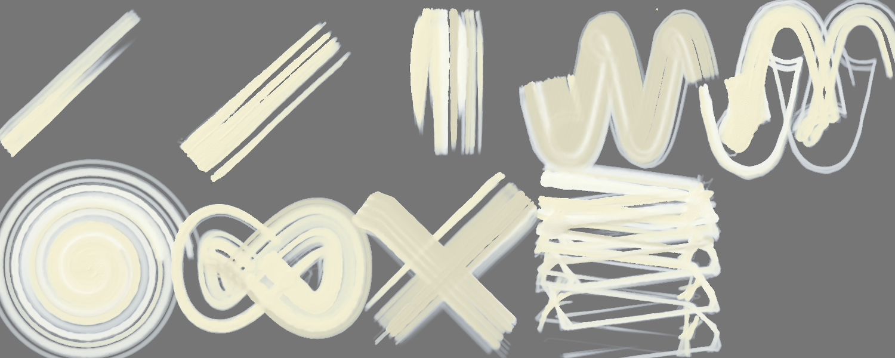

A light paint: laid on a grey sheet (on white it cannot be seen); **dark** = how far it is from the grey either way.

| stroke | covered | width | dark | spread | ms |
|---|---|---|---|---|---|
| light line | 15 % → 7 % | 44.1 px | 0.40 | 0.48 | 309 |
| heavy line | 23 % → 21 % | 68.1 px | 0.40 | 0.89 | 399 |
| pressure swell | 26 % → 22 % | 99.3 px | 0.39 | 0.82 | 312 |
| fast wave | 61 % → 55 % | 70.8 px | 0.35 | 0.90 | 1214 |
| slow wave | 51 % → 35 % | 58.9 px | 0.40 | 0.69 | 2109 |
| spiral | 87 % → 58 % | 57.7 px | 0.40 | 0.66 | 2208 |
| loop | 60 % → 50 % | 78.0 px | 0.39 | 0.82 | 1048 |
| tilted | 30 % → 30 % | 84.2 px | 0.34 | 1.00 | 676 |
| over the wet one | 56 % → 42 % | 70.8 px | 0.34 | 0.75 | 559 |
| long, no reload | 68 % → 55 % | 30.6 px | 0.41 | 0.81 | 2643 | quarters: 0.00 → 0.01 → 0.02 → 0.04

Numbers say: light vs heavy: width 44.1 → 68.1 px, dark 0.40 → 0.40; the long stroke does not run out of paint.

## Oil focus · C dilute 0.4
Gouache 1.00 + turpentine 40 % · 130 px · 49.2 s

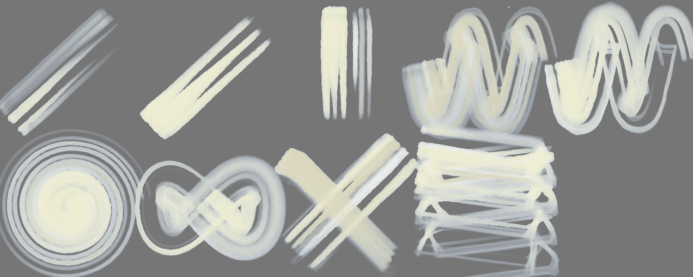

A light paint: laid on a grey sheet (on white it cannot be seen); **dark** = how far it is from the grey either way.

| stroke | covered | width | dark | spread | ms |
|---|---|---|---|---|---|
| light line | 24 % → 5 % | 70.2 px | 0.35 | 0.21 | 332 |
| heavy line | 23 % → 22 % | 67.4 px | 0.39 | 0.95 | 402 |
| pressure swell | 21 % → 16 % | 78.9 px | 0.38 | 0.78 | 267 |
| fast wave | 66 % → 48 % | 75.8 px | 0.32 | 0.73 | 1082 |
| slow wave | 56 % → 44 % | 65.3 px | 0.35 | 0.77 | 2110 |
| spiral | 74 % → 48 % | 49.0 px | 0.36 | 0.64 | 2135 |
| loop | 52 % → 38 % | 67.3 px | 0.34 | 0.73 | 1051 |
| tilted | 27 % → 27 % | 74.2 px | 0.34 | 1.00 | 688 |
| over the wet one | 52 % → 43 % | 70.8 px | 0.34 | 0.83 | 592 |
| long, no reload | 75 % → 53 % | 33.6 px | 0.36 | 0.71 | 2794 | quarters: 0.00 → 0.00 → 0.01 → 0.02

Numbers say: light vs heavy: width 70.2 → 67.4 px, dark 0.35 → 0.39; pressure barely changes the width; the long stroke does not run out of paint.

## Oil focus · D worn tip
Gouache 1.00 + turpentine 30 % · 130 px · 52.2 s

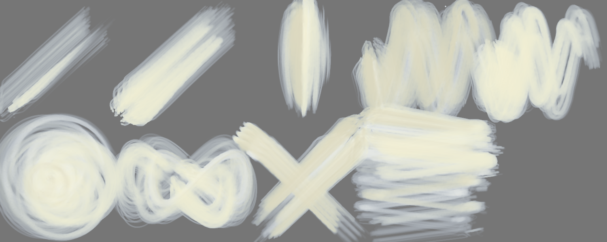

A light paint: laid on a grey sheet (on white it cannot be seen); **dark** = how far it is from the grey either way.

| stroke | covered | width | dark | spread | ms |
|---|---|---|---|---|---|
| light line | 32 % → 4 % | 94.3 px | 0.32 | 0.11 | 447 |
| heavy line | 46 % → 26 % | 133.9 px | 0.35 | 0.56 | 584 |
| pressure swell | 34 % → 20 % | 126.0 px | 0.32 | 0.59 | 451 |
| fast wave | 83 % → 67 % | 96.2 px | 0.30 | 0.80 | 1683 |
| slow wave | 71 % → 50 % | 81.7 px | 0.35 | 0.71 | 2732 |
| spiral | 85 % → 58 % | 56.0 px | 0.34 | 0.68 | 2788 |
| loop | 69 % → 46 % | 89.7 px | 0.33 | 0.67 | 1416 |
| tilted | 33 % → 33 % | 92.5 px | 0.31 | 1.00 | 815 |
| over the wet one | 66 % → 49 % | 90.8 px | 0.31 | 0.74 | 709 |
| long, no reload | 93 % → 62 % | 41.6 px | 0.33 | 0.66 | 3640 | quarters: 0.00 → 0.00 → 0.00 → 0.01

Numbers say: light vs heavy: width 94.3 → 133.9 px, dark 0.32 → 0.35.

## Oil focus · E stiff dry
Gouache 1.00 + turpentine 25 % · 130 px · 41.5 s

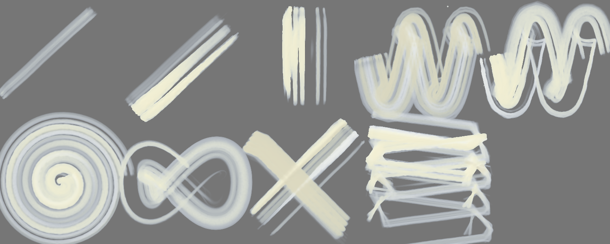

A light paint: laid on a grey sheet (on white it cannot be seen); **dark** = how far it is from the grey either way.

| stroke | covered | width | dark | spread | ms |
|---|---|---|---|---|---|
| light line | 10 % → 0 % | 28.9 px | 0.00 | 0.00 | 281 |
| heavy line | 26 % → 12 % | 74.7 px | 0.36 | 0.48 | 431 |
| pressure swell | 18 % → 11 % | 68.2 px | 0.37 | 0.59 | 281 |
| fast wave | 66 % → 27 % | 75.8 px | 0.30 | 0.41 | 1208 |
| slow wave | 54 % → 28 % | 62.9 px | 0.34 | 0.51 | 2067 |
| spiral | 86 % → 35 % | 56.9 px | 0.33 | 0.41 | 1979 |
| loop | 45 % → 13 % | 58.9 px | 0.31 | 0.29 | 968 |
| tilted | 26 % → 26 % | 73.6 px | 0.31 | 1.00 | 716 |
| over the wet one | 46 % → 29 % | 53.7 px | 0.31 | 0.63 | 453 |
| long, no reload | 64 % → 35 % | 28.8 px | 0.35 | 0.55 | 2583 | quarters: 0.02 → 0.01 → 0.02 → 0.05

Numbers say: light vs heavy: width 28.9 → 74.7 px, dark 0.00 → 0.36; the long stroke does not run out of paint.

## Oil focus · F texture deep
Gouache 1.00 + turpentine 25 % · 130 px · 48.8 s

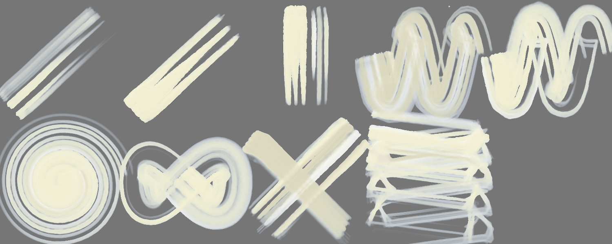

A light paint: laid on a grey sheet (on white it cannot be seen); **dark** = how far it is from the grey either way.

| stroke | covered | width | dark | spread | ms |
|---|---|---|---|---|---|
| light line | 24 % → 6 % | 71.0 px | 0.39 | 0.22 | 339 |
| heavy line | 23 % → 22 % | 67.7 px | 0.41 | 0.96 | 419 |
| pressure swell | 21 % → 17 % | 79.2 px | 0.40 | 0.82 | 268 |
| fast wave | 66 % → 51 % | 76.1 px | 0.35 | 0.78 | 1231 |
| slow wave | 57 % → 46 % | 65.6 px | 0.39 | 0.81 | 2111 |
| spiral | 75 % → 52 % | 49.3 px | 0.39 | 0.69 | 2195 |
| loop | 52 % → 41 % | 67.8 px | 0.38 | 0.78 | 1052 |
| tilted | 27 % → 27 % | 75.2 px | 0.35 | 1.00 | 704 |
| over the wet one | 52 % → 44 % | 71.1 px | 0.35 | 0.85 | 592 |
| long, no reload | 75 % → 55 % | 33.6 px | 0.39 | 0.73 | 2760 | quarters: 0.00 → 0.00 → 0.01 → 0.02

Numbers say: light vs heavy: width 71.0 → 67.7 px, dark 0.39 → 0.41; pressure barely changes the width; the long stroke does not run out of paint.

## Oil focus · G soft clump
Gouache 1.00 + turpentine 25 % · 130 px · 49.5 s

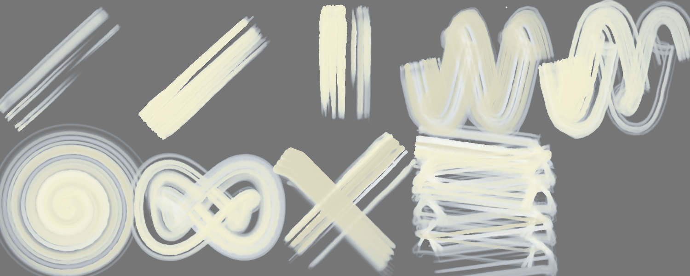

A light paint: laid on a grey sheet (on white it cannot be seen); **dark** = how far it is from the grey either way.

| stroke | covered | width | dark | spread | ms |
|---|---|---|---|---|---|
| light line | 18 % → 0 % | 53.6 px | 0.34 | 0.00 | 294 |
| heavy line | 28 % → 25 % | 79.9 px | 0.39 | 0.90 | 431 |
| pressure swell | 25 % → 19 % | 92.1 px | 0.37 | 0.79 | 292 |
| fast wave | 70 % → 55 % | 80.7 px | 0.33 | 0.79 | 1252 |
| slow wave | 68 % → 44 % | 78.3 px | 0.36 | 0.65 | 2334 |
| spiral | 88 % → 52 % | 57.8 px | 0.35 | 0.60 | 2222 |
| loop | 65 % → 49 % | 84.5 px | 0.36 | 0.75 | 1098 |
| tilted | 28 % → 28 % | 79.1 px | 0.32 | 1.00 | 700 |
| over the wet one | 50 % → 39 % | 61.5 px | 0.32 | 0.77 | 610 |
| long, no reload | 89 % → 61 % | 39.8 px | 0.36 | 0.69 | 2957 | quarters: 0.00 → 0.00 → 0.00 → 0.02

Numbers say: light vs heavy: width 53.6 → 79.9 px, dark 0.34 → 0.39; the long stroke does not run out of paint.

## Oil focus · H linen in brush
Gouache 1.00 + turpentine 25 % · 130 px · 49.1 s

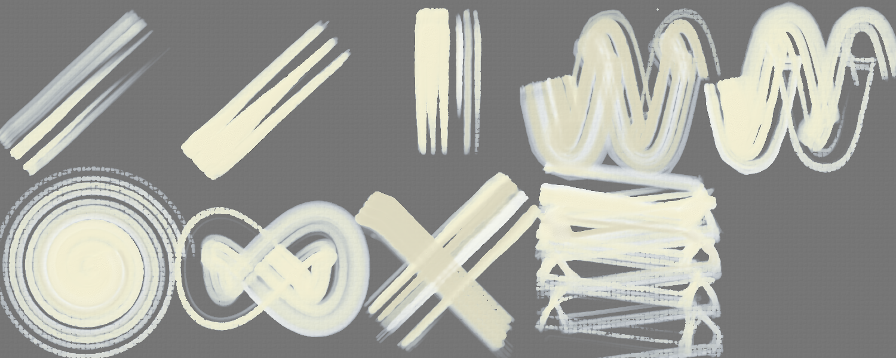

A light paint: laid on a grey sheet (on white it cannot be seen); **dark** = how far it is from the grey either way.

| stroke | covered | width | dark | spread | ms |
|---|---|---|---|---|---|
| light line | 24 % → 5 % | 70.9 px | 0.39 | 0.22 | 328 |
| heavy line | 23 % → 22 % | 67.6 px | 0.41 | 0.96 | 419 |
| pressure swell | 21 % → 17 % | 78.6 px | 0.40 | 0.81 | 283 |
| fast wave | 66 % → 51 % | 75.7 px | 0.35 | 0.78 | 1244 |
| slow wave | 56 % → 46 % | 65.2 px | 0.39 | 0.82 | 2152 |
| spiral | 73 % → 53 % | 48.3 px | 0.38 | 0.72 | 2272 |
| loop | 52 % → 41 % | 67.8 px | 0.38 | 0.78 | 1040 |
| tilted | 27 % → 27 % | 75.1 px | 0.36 | 1.00 | 704 |
| over the wet one | 52 % → 44 % | 71.1 px | 0.36 | 0.85 | 663 |
| long, no reload | 74 % → 56 % | 33.2 px | 0.39 | 0.75 | 2770 | quarters: 0.00 → 0.00 → 0.01 → 0.02

Numbers say: light vs heavy: width 70.9 → 67.6 px, dark 0.39 → 0.41; pressure barely changes the width; the long stroke does not run out of paint.

## Oil focus · A base — own sheet
own sheet 1000 × 660 · Gouache 1.00 + turpentine 25 % · 130 px · 13.1 s

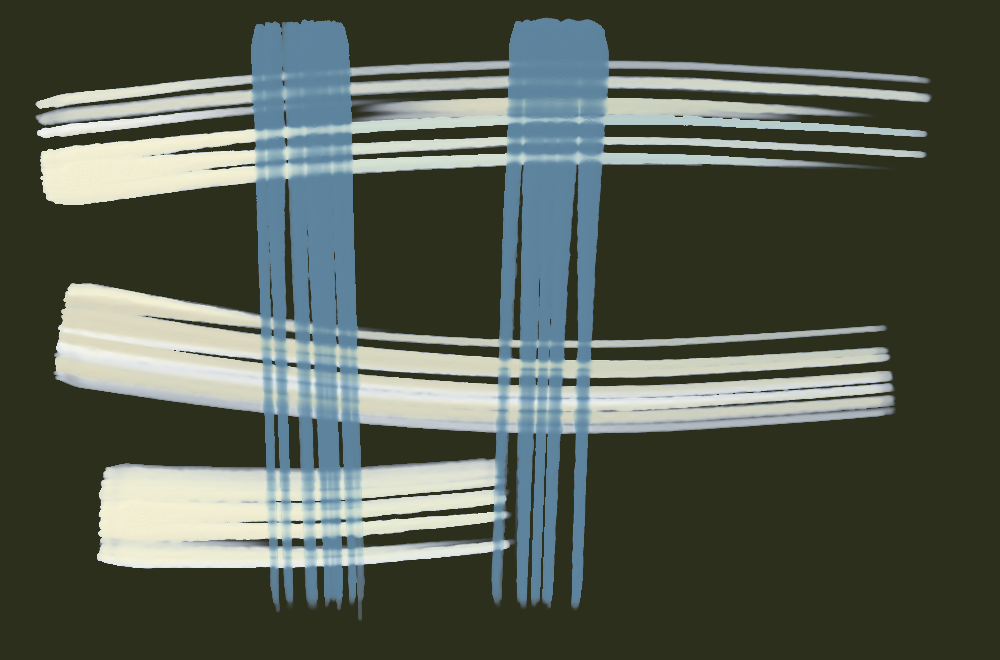

| stroke | covered | width | dark | spread | ms |
|---|---|---|---|---|---|
| stroke 1 | 13 % → 48 % | 79.5 px | 0.51 | 3.73 | 736 |
| stroke 2 | 22 % → 39 % | 139.8 px | 0.46 | 1.73 | 701 |
| stroke 3 | 27 % → 37 % | 127.4 px | 0.51 | 1.35 | 1204 |
| stroke 4 | 32 % → 34 % | 220.9 px | 0.53 | 1.09 | 1138 |
| stroke 5 | 39 % → 37 % | 315.7 px | 0.54 | 0.96 | 583 |

Numbers say: wet paint spreads well beyond the stroke.

## Oil focus · B no solvent body 0.45 — own sheet
own sheet 1000 × 660 · Gouache 0.98 · 130 px · 13.3 s

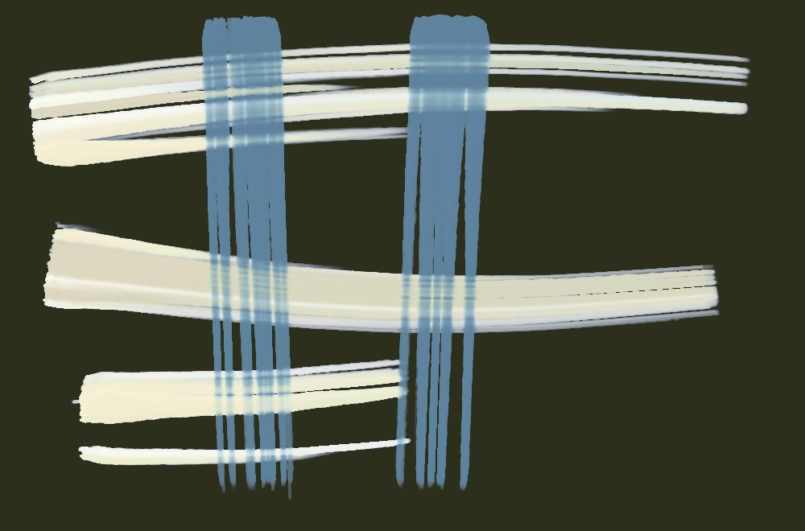

| stroke | covered | width | dark | spread | ms |
|---|---|---|---|---|---|
| stroke 1 | 13 % → 47 % | 79.5 px | 0.53 | 3.69 | 728 |
| stroke 2 | 22 % → 38 % | 139.8 px | 0.48 | 1.68 | 668 |
| stroke 3 | 29 % → 38 % | 136.4 px | 0.54 | 1.32 | 1235 |
| stroke 4 | 32 % → 34 % | 224.5 px | 0.55 | 1.04 | 1249 |
| stroke 5 | 36 % → 34 % | 293.0 px | 0.54 | 0.96 | 635 |

Numbers say: wet paint spreads well beyond the stroke.

## Oil focus · C dilute 0.4 — own sheet
own sheet 1000 × 660 · Gouache 1.00 + turpentine 40 % · 130 px · 14.0 s

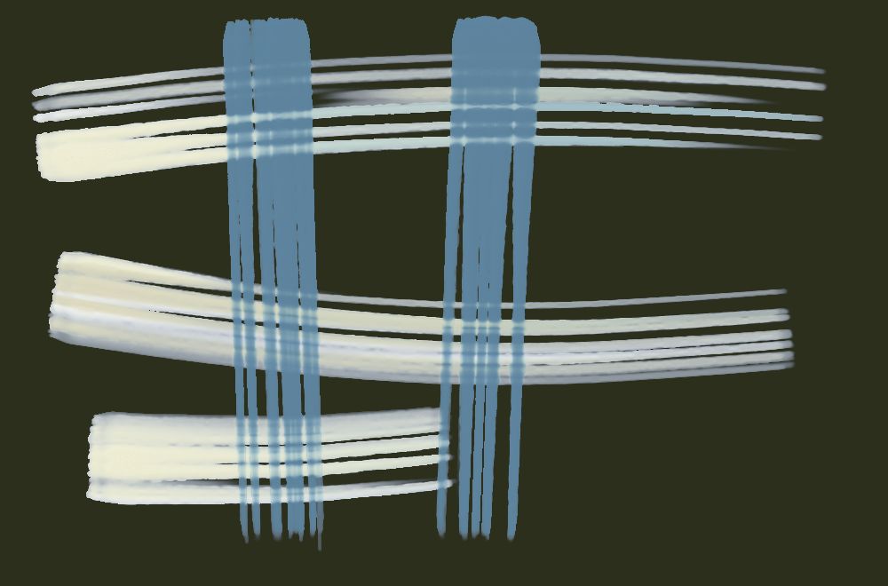

| stroke | covered | width | dark | spread | ms |
|---|---|---|---|---|---|
| stroke 1 | 13 % → 47 % | 79.5 px | 0.48 | 3.72 | 772 |
| stroke 2 | 22 % → 39 % | 139.8 px | 0.43 | 1.72 | 708 |
| stroke 3 | 27 % → 36 % | 127.2 px | 0.47 | 1.35 | 1347 |
| stroke 4 | 32 % → 34 % | 220.3 px | 0.49 | 1.09 | 1238 |
| stroke 5 | 38 % → 37 % | 315.0 px | 0.50 | 0.96 | 610 |

Numbers say: wet paint spreads well beyond the stroke.

## Oil focus · D worn tip — own sheet
own sheet 1000 × 660 · Gouache 1.00 + turpentine 30 % · 130 px · 17.0 s

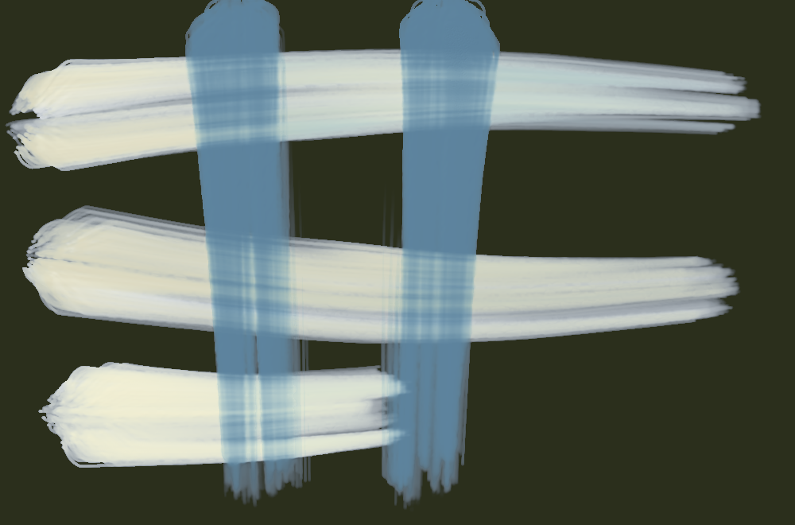

| stroke | covered | width | dark | spread | ms |
|---|---|---|---|---|---|
| stroke 1 | 19 % → 64 % | 120.6 px | 0.49 | 3.28 | 960 |
| stroke 2 | 35 % → 53 % | 216.7 px | 0.45 | 1.52 | 935 |
| stroke 3 | 39 % → 52 % | 185.0 px | 0.49 | 1.31 | 1921 |
| stroke 4 | 46 % → 48 % | 320.7 px | 0.51 | 1.04 | 1788 |
| stroke 5 | 54 % → 50 % | 442.2 px | 0.51 | 0.93 | 875 |

Numbers say: wet paint spreads well beyond the stroke.

## Oil focus · E stiff dry — own sheet
own sheet 1000 × 660 · Gouache 1.00 + turpentine 25 % · 130 px · 13.4 s

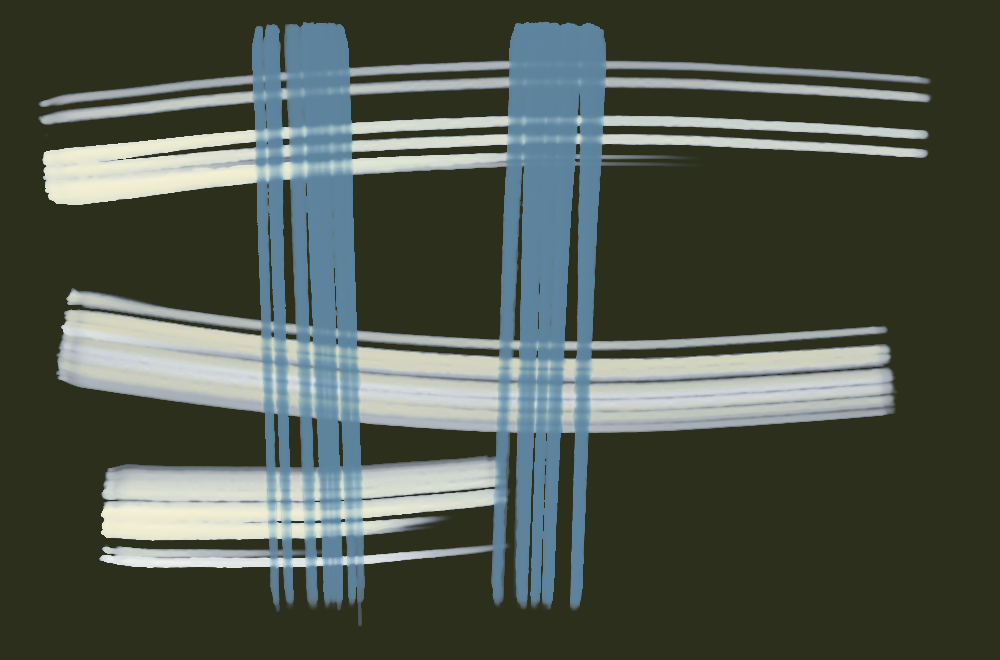

| stroke | covered | width | dark | spread | ms |
|---|---|---|---|---|---|
| stroke 1 | 13 % → 43 % | 78.1 px | 0.46 | 3.41 | 834 |
| stroke 2 | 23 % → 36 % | 142.9 px | 0.42 | 1.57 | 766 |
| stroke 3 | 25 % → 33 % | 116.6 px | 0.47 | 1.31 | 1142 |
| stroke 4 | 31 % → 31 % | 214.5 px | 0.48 | 1.00 | 1215 |
| stroke 5 | 38 % → 35 % | 314.5 px | 0.48 | 0.90 | 564 |

Numbers say: wet paint spreads well beyond the stroke.

## Oil focus · F texture deep — own sheet
own sheet 1000 × 660 · Gouache 1.00 + turpentine 25 % · 130 px · 14.2 s

| stroke | covered | width | dark | spread | ms |
|---|---|---|---|---|---|
| stroke 1 | 13 % → 48 % | 79.5 px | 0.51 | 3.73 | 789 |
| stroke 2 | 22 % → 39 % | 140.2 px | 0.46 | 1.72 | 732 |
| stroke 3 | 27 % → 37 % | 127.7 px | 0.51 | 1.35 | 1234 |
| stroke 4 | 32 % → 34 % | 221.1 px | 0.53 | 1.09 | 1289 |
| stroke 5 | 39 % → 37 % | 316.2 px | 0.54 | 0.96 | 617 |

Numbers say: wet paint spreads well beyond the stroke.

## Oil focus · G soft clump — own sheet
own sheet 1000 × 660 · Gouache 1.00 + turpentine 25 % · 130 px · 12.4 s

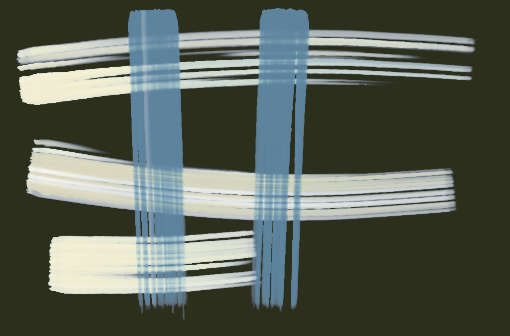

| stroke | covered | width | dark | spread | ms |
|---|---|---|---|---|---|
| stroke 1 | 15 % → 52 % | 95.0 px | 0.51 | 3.44 | 849 |
| stroke 2 | 26 % → 43 % | 164.7 px | 0.45 | 1.62 | 785 |
| stroke 3 | 31 % → 40 % | 144.0 px | 0.50 | 1.29 | 1295 |
| stroke 4 | 36 % → 38 % | 251.9 px | 0.52 | 1.05 | 1355 |
| stroke 5 | 44 % → 42 % | 362.8 px | 0.53 | 0.95 | 682 |

Numbers say: wet paint spreads well beyond the stroke.

## Oil focus · H linen in brush — own sheet
own sheet 1000 × 660 · Gouache 1.00 + turpentine 25 % · 130 px · 11.4 s

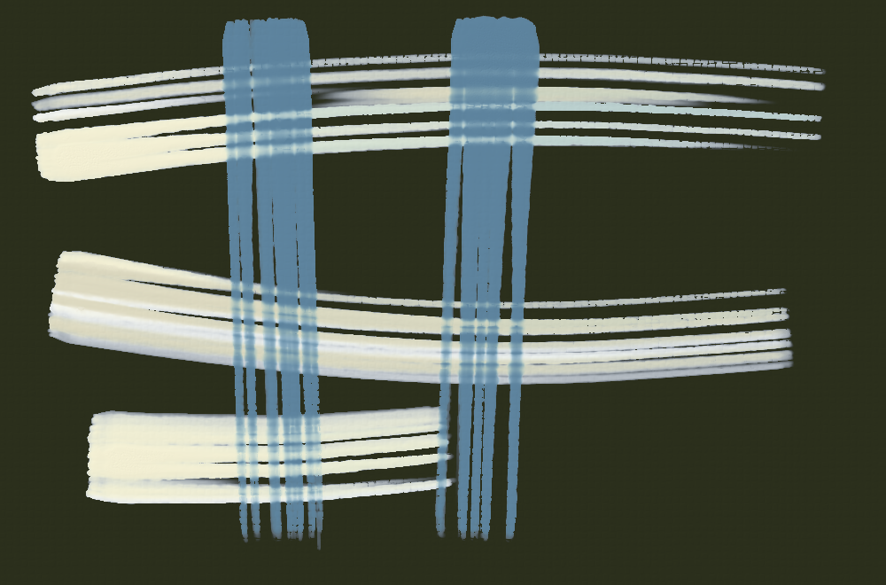

| stroke | covered | width | dark | spread | ms |
|---|---|---|---|---|---|
| stroke 1 | 13 % → 47 % | 79.4 px | 0.51 | 3.73 | 744 |
| stroke 2 | 22 % → 39 % | 139.7 px | 0.46 | 1.72 | 736 |
| stroke 3 | 27 % → 37 % | 126.8 px | 0.51 | 1.35 | 1211 |
| stroke 4 | 32 % → 34 % | 220.2 px | 0.53 | 1.09 | 1194 |
| stroke 5 | 38 % → 37 % | 315.6 px | 0.54 | 0.96 | 586 |

Numbers say: wet paint spreads well beyond the stroke.

