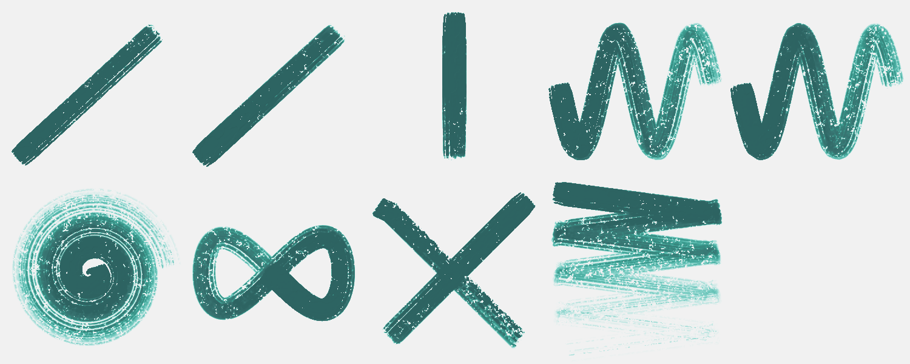
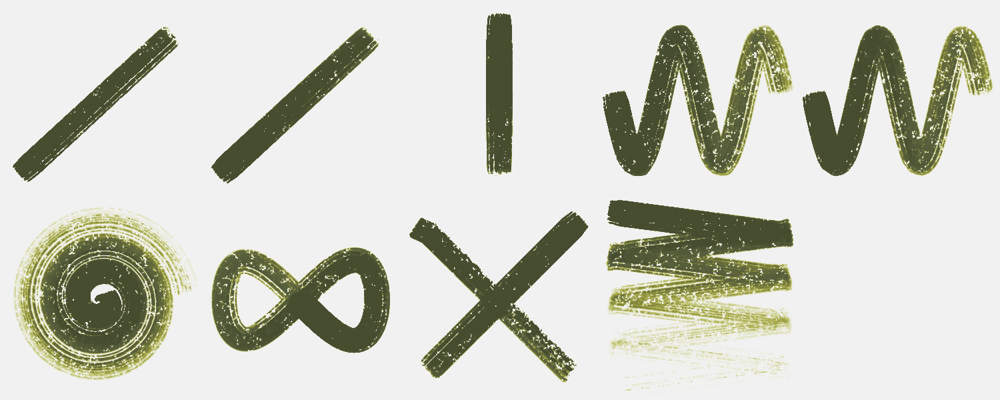
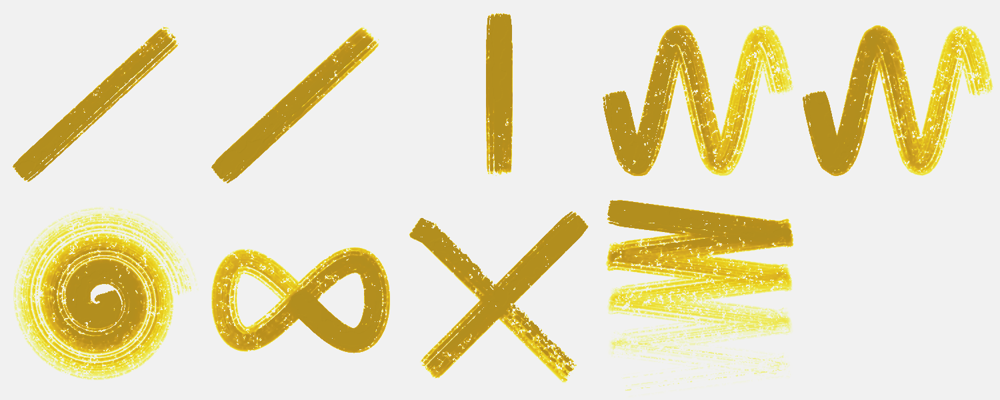
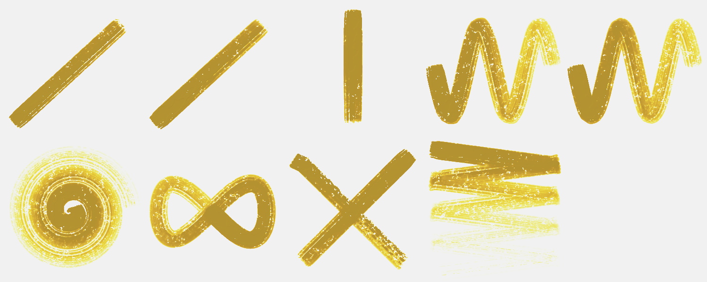
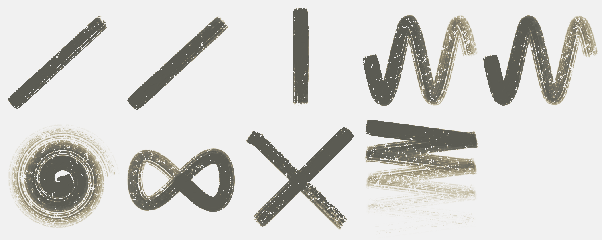

# Brush Lab — 155 brushes · Nov 3, 2026 at 9:44 PM

Every sheet: 1500 × 600, ten strokes in a 5 × 2 grid — 1. light line · 2. heavy line · 3. pressure swell · 4. fast wave · 5. slow wave · 6. spiral · 7. loop · 8. tilted · 9. over the wet one · 10. long, no reload (cell 8 holds «tilted» and «over the wet one» crossed). The CPU reference of Mamay's paint engine; the wet layer settles 20 s at the end.

Columns: **covered** = share of the cell with paint right after the stroke → after settling; **width** = painted area of the stroke ÷ its length (px); **dark** = mean darkness of the painted pixels above the paper's own grain (0 = paper, 1 = black); **spread** = how far wet paint went beyond the stroke (1.0 = stayed); **ms** = the stroke on the CPU; long stroke: paint in each quarter of its length (it should run out: wet → streaks → dry tail).

## Ink Line
Ink · 12 px · 33.7 s

| stroke | covered | width | dark | spread | ms |
|---|---|---|---|---|---|
| light line | 1 % → 4 % | 4.3 px | 0.55 | 2.44 | 70 |
| heavy line | 5 % → 6 % | 15.7 px | 0.68 | 1.13 | 88 |
| pressure swell | 3 % → 4 % | 11.3 px | 0.64 | 1.40 | 60 |
| fast wave | 10 % → 11 % | 11.2 px | 0.59 | 1.11 | 200 |
| slow wave | 8 % → 10 % | 9.6 px | 0.57 | 1.16 | 186 |
| spiral | 14 % → 15 % | 8.9 px | 0.50 | 1.07 | 807 |
| loop | 8 % → 9 % | 10.6 px | 0.61 | 1.16 | 278 |
| tilted | 5 % → 5 % | 14.4 px | 0.65 | 1.05 | 98 |
| over the wet one | 10 % → 11 % | 12.5 px | 0.65 | 1.15 | 72 |
| long, no reload | 18 % → 17 % | 8.1 px | 0.47 | 0.96 | 519 | quarters: 0.22 → 0.09 → 0.04 → 0.02

Numbers say: light vs heavy: width 4.3 → 15.7 px, dark 0.55 → 0.68; wet paint spreads well beyond the stroke.

## Dense Ink
Ink · 14 px · 35.8 s

| stroke | covered | width | dark | spread | ms |
|---|---|---|---|---|---|
| light line | 5 % → 7 % | 15.2 px | 0.72 | 1.26 | 68 |
| heavy line | 7 % → 7 % | 19.1 px | 0.73 | 1.09 | 104 |
| pressure swell | 5 % → 6 % | 17.9 px | 0.72 | 1.17 | 89 |
| fast wave | 13 % → 13 % | 15.3 px | 0.69 | 1.01 | 221 |
| slow wave | 12 % → 12 % | 13.6 px | 0.67 | 1.04 | 272 |
| spiral | 18 % → 15 % | 12.2 px | 0.65 | 0.80 | 954 |
| loop | 11 % → 12 % | 14.8 px | 0.69 | 1.08 | 323 |
| tilted | 5 % → 6 % | 14.6 px | 0.72 | 1.07 | 84 |
| over the wet one | 12 % → 13 % | 17.7 px | 0.72 | 1.11 | 104 |
| long, no reload | 23 % → 15 % | 10.1 px | 0.64 | 0.66 | 415 | quarters: 0.30 → 0.12 → 0.04 → 0.02

Numbers say: light vs heavy: width 15.2 → 19.1 px, dark 0.72 → 0.73.

## Transparent Wash
Watercolor · 22 px · 36.6 s

| stroke | covered | width | dark | spread | ms |
|---|---|---|---|---|---|
| light line | 2 % → 5 % | 6.9 px | 0.27 | 2.25 | 60 |
| heavy line | 7 % → 9 % | 20.4 px | 0.27 | 1.22 | 75 |
| pressure swell | 4 % → 6 % | 15.2 px | 0.28 | 1.54 | 57 |
| fast wave | 14 % → 16 % | 16.1 px | 0.20 | 1.17 | 194 |
| slow wave | 12 % → 15 % | 13.7 px | 0.21 | 1.28 | 264 |
| spiral | 18 % → 22 % | 11.9 px | 0.16 | 1.23 | 785 |
| loop | 11 % → 13 % | 14.5 px | 0.22 | 1.20 | 234 |
| tilted | 8 % → 8 % | 21.1 px | 0.24 | 1.06 | 107 |
| over the wet one | 13 % → 16 % | 16.4 px | 0.24 | 1.18 | 63 |
| long, no reload | 26 % → 32 % | 11.6 px | 0.13 | 1.22 | 469 | quarters: 0.11 → 0.04 → 0.02 → 0.01

Numbers say: light vs heavy: width 6.9 → 20.4 px, dark 0.27 → 0.27; wet paint spreads well beyond the stroke.

## Dry Brush
Gouache · 24 px · 32.4 s

| stroke | covered | width | dark | spread | ms |
|---|---|---|---|---|---|
| light line | 5 % → 0 % | 14.0 px | 0.65 | 0.09 | 137 |
| heavy line | 6 % → 0 % | 18.6 px | 0.65 | 0.02 | 188 |
| pressure swell | 5 % → 0 % | 18.2 px | 0.65 | 0.08 | 74 |
| fast wave | 6 % → 1 % | 7.3 px | 0.65 | 0.08 | 248 |
| slow wave | 7 % → 0 % | 8.1 px | 0.65 | 0.06 | 444 |
| spiral | 7 % → 0 % | 4.6 px | 0.65 | 0.07 | 407 |
| loop | 10 % → 0 % | 12.4 px | 0.65 | 0.04 | 221 |
| tilted | 4 % → 3 % | 10.6 px | 0.65 | 0.88 | 124 |
| over the wet one | 9 % → 1 % | 14.5 px | 0.65 | 0.12 | 96 |
| long, no reload | 6 % → 1 % | 2.9 px | 0.65 | 0.14 | 932 | quarters: 0.12 → 0.00 → 0.00 → 0.00

Numbers say: light vs heavy: width 14.0 → 18.6 px, dark 0.65 → 0.65.

## Wax Crayon
Wax · 8 px · 16.4 s

| stroke | covered | width | dark | spread | ms |
|---|---|---|---|---|---|
| light line | 1 % → 1 % | 2.5 px | 0.71 | 1.00 | 23 |
| heavy line | 1 % → 1 % | 3.9 px | 0.69 | 1.00 | 30 |
| pressure swell | 1 % → 1 % | 3.3 px | 0.70 | 1.00 | 34 |
| fast wave | 3 % → 3 % | 3.5 px | 0.69 | 1.00 | 71 |
| slow wave | 3 % → 3 % | 3.4 px | 0.70 | 1.00 | 73 |
| spiral | 5 % → 5 % | 3.3 px | 0.70 | 1.00 | 116 |
| loop | 3 % → 3 % | 3.3 px | 0.70 | 1.00 | 71 |
| tilted | 2 % → 2 % | 5.6 px | 0.68 | 1.00 | 58 |
| over the wet one | 3 % → 3 % | 3.6 px | 0.68 | 1.00 | 28 |
| long, no reload | 7 % → 7 % | 3.3 px | 0.70 | 1.00 | 210 | quarters: 0.06 → 0.06 → 0.06 → 0.06

Numbers say: light vs heavy: width 2.5 → 3.9 px, dark 0.71 → 0.69; the long stroke does not run out of paint.

## Oil Pastel
Wax · 12 px · 17.0 s

| stroke | covered | width | dark | spread | ms |
|---|---|---|---|---|---|
| light line | 1 % → 1 % | 4.0 px | 0.68 | 1.00 | 57 |
| heavy line | 2 % → 2 % | 6.5 px | 0.68 | 1.00 | 51 |
| pressure swell | 2 % → 2 % | 5.7 px | 0.69 | 1.00 | 31 |
| fast wave | 5 % → 5 % | 5.7 px | 0.68 | 1.00 | 95 |
| slow wave | 5 % → 5 % | 5.5 px | 0.68 | 1.00 | 118 |
| spiral | 8 % → 8 % | 5.5 px | 0.68 | 1.00 | 171 |
| loop | 4 % → 4 % | 5.6 px | 0.68 | 1.00 | 80 |
| tilted | 2 % → 2 % | 6.8 px | 0.68 | 1.00 | 76 |
| over the wet one | 5 % → 5 % | 5.8 px | 0.68 | 1.00 | 44 |
| long, no reload | 13 % → 13 % | 5.6 px | 0.68 | 1.00 | 250 | quarters: 0.10 → 0.09 → 0.10 → 0.10

Numbers say: light vs heavy: width 4.0 → 6.5 px, dark 0.68 → 0.68; the long stroke does not run out of paint.

## Charcoal
Charcoal · 5 px · 15.4 s

| stroke | covered | width | dark | spread | ms |
|---|---|---|---|---|---|
| light line | 1 % → 1 % | 2.0 px | 0.74 | 1.00 | 34 |
| heavy line | 1 % → 1 % | 3.0 px | 0.74 | 1.00 | 15 |
| pressure swell | 1 % → 1 % | 2.7 px | 0.74 | 1.00 | 12 |
| fast wave | 2 % → 2 % | 2.7 px | 0.73 | 1.00 | 58 |
| slow wave | 2 % → 2 % | 2.6 px | 0.74 | 1.00 | 39 |
| spiral | 4 % → 4 % | 2.5 px | 0.74 | 1.00 | 73 |
| loop | 2 % → 2 % | 2.6 px | 0.74 | 1.00 | 46 |
| tilted | 2 % → 2 % | 4.3 px | 0.72 | 1.00 | 33 |
| over the wet one | 2 % → 2 % | 2.4 px | 0.72 | 1.00 | 21 |
| long, no reload | 6 % → 6 % | 2.7 px | 0.73 | 1.00 | 151 | quarters: 0.05 → 0.05 → 0.05 → 0.05

Numbers say: light vs heavy: width 2.0 → 3.0 px, dark 0.74 → 0.74; the long stroke does not run out of paint.

## Impasto
Heavy acrylic · 22 px · 24.9 s

| stroke | covered | width | dark | spread | ms |
|---|---|---|---|---|---|
| light line | 8 % → 8 % | 24.1 px | 0.71 | 0.93 | 103 |
| heavy line | 10 % → 9 % | 28.8 px | 0.70 | 0.94 | 123 |
| pressure swell | 7 % → 7 % | 28.1 px | 0.72 | 0.94 | 81 |
| fast wave | 20 % → 13 % | 23.5 px | 0.71 | 0.64 | 281 |
| slow wave | 21 % → 14 % | 24.5 px | 0.71 | 0.66 | 433 |
| spiral | 30 % → 14 % | 20.0 px | 0.71 | 0.46 | 681 |
| loop | 18 % → 14 % | 23.9 px | 0.71 | 0.77 | 330 |
| tilted | 8 % → 8 % | 21.8 px | 0.70 | 1.00 | 98 |
| over the wet one | 17 % → 15 % | 25.4 px | 0.70 | 0.91 | 87 |
| long, no reload | 34 % → 14 % | 15.2 px | 0.71 | 0.41 | 607 | quarters: 0.38 → 0.21 → 0.10 → 0.03

Numbers say: light vs heavy: width 24.1 → 28.8 px, dark 0.71 → 0.70.

## Oil Round
Oil · 18 px · 27.2 s

| stroke | covered | width | dark | spread | ms |
|---|---|---|---|---|---|
| light line | 2 % → 2 % | 7.2 px | 0.75 | 1.00 | 88 |
| heavy line | 7 % → 7 % | 19.3 px | 0.73 | 1.00 | 143 |
| pressure swell | 4 % → 4 % | 13.7 px | 0.72 | 1.00 | 70 |
| fast wave | 11 % → 11 % | 12.7 px | 0.65 | 1.00 | 213 |
| slow wave | 8 % → 8 % | 9.0 px | 0.57 | 1.00 | 295 |
| spiral | 10 % → 10 % | 6.6 px | 0.50 | 1.00 | 355 |
| loop | 5 % → 5 % | 7.1 px | 0.45 | 1.00 | 255 |
| tilted | 4 % → 4 % | 10.1 px | 0.52 | 1.00 | 117 |
| over the wet one | 6 % → 6 % | 7.4 px | 0.52 | 1.00 | 154 |
| long, no reload | 15 % → 15 % | 6.8 px | 0.42 | 1.00 | 572 | quarters: 0.08 → 0.08 → 0.07 → 0.06

Numbers say: light vs heavy: width 7.2 → 19.3 px, dark 0.75 → 0.73.

## Palette Knife
Oil · 20 px · 26.6 s

| stroke | covered | width | dark | spread | ms |
|---|---|---|---|---|---|
| light line | 8 % → 8 % | 21.9 px | 0.67 | 1.00 | 28 |
| heavy line | 8 % → 8 % | 22.5 px | 0.73 | 1.00 | 19 |
| pressure swell | 6 % → 6 % | 22.4 px | 0.74 | 1.00 | 15 |
| fast wave | 17 % → 17 % | 19.3 px | 0.49 | 1.00 | 46 |
| slow wave | 17 % → 17 % | 19.9 px | 0.43 | 1.00 | 55 |
| spiral | 18 % → 18 % | 11.7 px | 0.45 | 1.00 | 117 |
| loop | 16 % → 16 % | 21.0 px | 0.58 | 1.00 | 56 |
| tilted | 5 % → 5 % | 15.0 px | 0.72 | 1.00 | 26 |
| over the wet one | 13 % → 13 % | 21.0 px | 0.72 | 1.00 | 36 |
| long, no reload | 17 % → 17 % | 7.5 px | 0.47 | 1.00 | 139 | quarters: 0.29 → 0.05 → 0.00 → 0.00

Numbers say: light vs heavy: width 21.9 → 22.5 px, dark 0.67 → 0.73; pressure barely changes the width.

## Water
Watercolor · 20 px · 45.5 s · over bands of wet oil paint and oil pastel in turn (it works on paint already there: look at what it does to the bands; covered counts the bands too)

| stroke | covered | width | dark | spread | ms |
|---|---|---|---|---|---|
| light line | 25 % → 27 % | 73.8 px | 0.80 | 1.06 | 35 |
| heavy line | 24 % → 25 % | 69.8 px | 0.81 | 1.04 | 127 |
| pressure swell | 24 % → 25 % | 89.6 px | 0.81 | 1.03 | 69 |
| fast wave | 24 % → 26 % | 27.7 px | 0.81 | 1.07 | 185 |
| slow wave | 24 % → 25 % | 27.7 px | 0.81 | 1.06 | 162 |
| spiral | 24 % → 26 % | 15.9 px | 0.81 | 1.07 | 241 |
| loop | 24 % → 25 % | 31.1 px | 0.81 | 1.03 | 139 |
| tilted | 24 % → 24 % | 67.0 px | 0.81 | 1.00 | 86 |
| over the wet one | 24 % → 25 % | 0.0 px | 0.81 | 1.06 | 55 |
| long, no reload | 24 % → 26 % | 10.7 px | 0.81 | 1.08 | 338 | quarters: 0.21 → 0.27 → 0.18 → 0.27

Numbers say: light vs heavy: width 73.8 → 69.8 px, dark 0.80 → 0.81; pressure barely changes the width; the long stroke does not run out of paint.

## Blender
Pastel · 16 px · 26.3 s · over bands of wet oil paint and oil pastel in turn (it works on paint already there: look at what it does to the bands; covered counts the bands too)

| stroke | covered | width | dark | spread | ms |
|---|---|---|---|---|---|
| light line | 24 % → 24 % | 70.7 px | 0.81 | 1.00 | 39 |
| heavy line | 25 % → 25 % | 72.1 px | 0.80 | 1.00 | 106 |
| pressure swell | 24 % → 24 % | 91.3 px | 0.81 | 1.00 | 68 |
| fast wave | 26 % → 26 % | 30.0 px | 0.79 | 1.00 | 149 |
| slow wave | 26 % → 26 % | 29.9 px | 0.80 | 1.00 | 114 |
| spiral | 28 % → 28 % | 18.7 px | 0.77 | 1.00 | 237 |
| loop | 25 % → 25 % | 32.9 px | 0.80 | 1.00 | 108 |
| tilted | 25 % → 25 % | 70.1 px | 0.79 | 1.00 | 54 |
| over the wet one | 26 % → 26 % | 1.8 px | 0.79 | 1.00 | 47 |
| long, no reload | 30 % → 30 % | 13.7 px | 0.76 | 1.00 | 244 | quarters: 0.20 → 0.28 → 0.23 → 0.30

Numbers say: light vs heavy: width 70.7 → 72.1 px, dark 0.81 → 0.80; pressure barely changes the width; the long stroke does not run out of paint.

## Eraser
Eraser · 16 px · 26.0 s · over bands of wet oil paint and oil pastel in turn (it works on paint already there: look at what it does to the bands; covered counts the bands too)

| stroke | covered | width | dark | spread | ms |
|---|---|---|---|---|---|
| light line | 24 % → 24 % | 69.5 px | 0.82 | 1.00 | 46 |
| heavy line | 23 % → 23 % | 67.9 px | 0.82 | 1.00 | 94 |
| pressure swell | 23 % → 23 % | 87.3 px | 0.82 | 1.00 | 53 |
| fast wave | 22 % → 22 % | 25.7 px | 0.82 | 1.00 | 117 |
| slow wave | 22 % → 22 % | 25.7 px | 0.82 | 1.00 | 183 |
| spiral | 22 % → 22 % | 14.4 px | 0.82 | 1.00 | 191 |
| loop | 22 % → 22 % | 28.6 px | 0.82 | 1.00 | 109 |
| tilted | 23 % → 23 % | 65.1 px | 0.82 | 1.00 | 45 |
| over the wet one | 23 % → 23 % | 0.0 px | 0.82 | 1.00 | 43 |
| long, no reload | 20 % → 20 % | 8.9 px | 0.82 | 1.00 | 227 | quarters: 0.15 → 0.20 → 0.15 → 0.20

Numbers say: light vs heavy: width 69.5 → 67.9 px, dark 0.82 → 0.82; pressure barely changes the width; the long stroke does not run out of paint.

## Fan
Gouache · 30 px · 38.0 s

| stroke | covered | width | dark | spread | ms |
|---|---|---|---|---|---|
| light line | 9 % → 3 % | 25.7 px | 0.63 | 0.37 | 49 |
| heavy line | 11 % → 4 % | 31.0 px | 0.63 | 0.39 | 62 |
| pressure swell | 8 % → 5 % | 31.7 px | 0.63 | 0.55 | 56 |
| fast wave | 18 % → 5 % | 20.3 px | 0.63 | 0.26 | 132 |
| slow wave | 18 % → 5 % | 21.1 px | 0.63 | 0.25 | 334 |
| spiral | 24 % → 5 % | 15.8 px | 0.63 | 0.20 | 264 |
| loop | 17 % → 5 % | 22.7 px | 0.63 | 0.29 | 179 |
| tilted | 5 % → 6 % | 15.1 px | 0.63 | 1.05 | 77 |
| over the wet one | 16 % → 8 % | 29.8 px | 0.63 | 0.50 | 62 |
| long, no reload | 23 % → 5 % | 10.1 px | 0.63 | 0.22 | 322 | quarters: 0.29 → 0.07 → 0.01 → 0.00

Numbers say: light vs heavy: width 25.7 → 31.0 px, dark 0.63 → 0.63.

## Sponge
Gouache · 30 px · 39.3 s

| stroke | covered | width | dark | spread | ms |
|---|---|---|---|---|---|
| light line | 4 % → 0 % | 11.4 px | 0.62 | 0.12 | 70 |
| heavy line | 12 % → 2 % | 35.4 px | 0.62 | 0.14 | 66 |
| pressure swell | 7 % → 2 % | 27.9 px | 0.62 | 0.27 | 53 |
| fast wave | 20 % → 4 % | 23.2 px | 0.62 | 0.19 | 174 |
| slow wave | 21 % → 4 % | 23.7 px | 0.62 | 0.18 | 501 |
| spiral | 28 % → 4 % | 18.3 px | 0.62 | 0.14 | 272 |
| loop | 18 % → 5 % | 23.0 px | 0.62 | 0.29 | 193 |
| tilted | 7 % → 7 % | 18.2 px | 0.62 | 1.04 | 126 |
| over the wet one | 16 % → 6 % | 27.8 px | 0.62 | 0.37 | 116 |
| long, no reload | 29 % → 5 % | 12.9 px | 0.62 | 0.17 | 311 | quarters: 0.29 → 0.13 → 0.07 → 0.04

Numbers say: light vs heavy: width 11.4 → 35.4 px, dark 0.62 → 0.62.

## Ink — sumi brush
Watercolor · 22 px · 39.8 s

| stroke | covered | width | dark | spread | ms |
|---|---|---|---|---|---|
| light line | 8 % → 9 % | 23.8 px | 0.77 | 1.13 | 104 |
| heavy line | 13 % → 13 % | 38.0 px | 0.72 | 1.01 | 148 |
| pressure swell | 9 % → 10 % | 34.5 px | 0.75 | 1.05 | 61 |
| fast wave | 27 % → 28 % | 31.7 px | 0.58 | 1.03 | 358 |
| slow wave | 25 % → 26 % | 29.0 px | 0.61 | 1.05 | 450 |
| spiral | 37 % → 38 % | 24.3 px | 0.51 | 1.03 | 368 |
| loop | 22 % → 22 % | 28.2 px | 0.66 | 1.03 | 172 |
| tilted | 9 % → 9 % | 24.7 px | 0.73 | 1.03 | 79 |
| over the wet one | 20 % → 21 % | 31.1 px | 0.73 | 1.03 | 65 |
| long, no reload | 42 % → 43 % | 18.9 px | 0.46 | 1.02 | 466 | quarters: 0.47 → 0.23 → 0.11 → 0.06

Numbers say: light vs heavy: width 23.8 → 38.0 px, dark 0.77 → 0.72.

## Ink — wash
Watercolor · 40 px · 41.3 s

| stroke | covered | width | dark | spread | ms |
|---|---|---|---|---|---|
| light line | 13 % → 13 % | 36.5 px | 0.17 | 1.04 | 96 |
| heavy line | 18 % → 19 % | 53.5 px | 0.13 | 1.04 | 130 |
| pressure swell | 12 % → 13 % | 46.6 px | 0.16 | 1.05 | 92 |
| fast wave | 40 % → 42 % | 45.9 px | 0.12 | 1.06 | 240 |
| slow wave | 38 % → 40 % | 43.6 px | 0.17 | 1.06 | 513 |
| spiral | 58 % → 62 % | 38.5 px | 0.12 | 1.06 | 641 |
| loop | 33 % → 34 % | 42.9 px | 0.15 | 1.03 | 301 |
| tilted | 14 % → 14 % | 38.1 px | 0.17 | 1.03 | 137 |
| over the wet one | 29 % → 31 % | 43.2 px | 0.17 | 1.06 | 122 |
| long, no reload | 66 % → 75 % | 29.8 px | 0.12 | 1.12 | 698 | quarters: 0.16 → 0.11 → 0.07 → 0.04

Numbers say: light vs heavy: width 36.5 → 53.5 px, dark 0.17 → 0.13.

## Ink — dry brush
Ink · 30 px · 29.2 s

| stroke | covered | width | dark | spread | ms |
|---|---|---|---|---|---|
| light line | 9 % → 7 % | 25.2 px | 0.81 | 0.79 | 127 |
| heavy line | 10 % → 8 % | 29.6 px | 0.80 | 0.76 | 120 |
| pressure swell | 7 % → 6 % | 27.9 px | 0.81 | 0.85 | 121 |
| fast wave | 21 % → 8 % | 24.2 px | 0.79 | 0.40 | 394 |
| slow wave | 18 % → 7 % | 20.3 px | 0.79 | 0.39 | 537 |
| spiral | 24 % → 8 % | 15.6 px | 0.78 | 0.34 | 540 |
| loop | 19 % → 8 % | 24.3 px | 0.78 | 0.45 | 296 |
| tilted | 8 % → 8 % | 22.2 px | 0.78 | 1.02 | 167 |
| over the wet one | 17 % → 14 % | 25.9 px | 0.78 | 0.81 | 137 |
| long, no reload | 20 % → 8 % | 9.1 px | 0.79 | 0.41 | 751 | quarters: 0.32 → 0.02 → 0.00 → 0.00

Numbers say: light vs heavy: width 25.2 → 29.6 px, dark 0.81 → 0.80.

## Ink — nib
Watercolor · 5 px · 27.3 s

| stroke | covered | width | dark | spread | ms |
|---|---|---|---|---|---|
| light line | 2 % → 5 % | 5.4 px | 0.86 | 2.45 | 56 |
| heavy line | 2 % → 5 % | 6.4 px | 0.86 | 2.33 | 38 |
| pressure swell | 2 % → 4 % | 6.2 px | 0.86 | 2.52 | 29 |
| fast wave | 5 % → 8 % | 5.8 px | 0.82 | 1.65 | 83 |
| slow wave | 5 % → 8 % | 5.6 px | 0.82 | 1.73 | 94 |
| spiral | 7 % → 11 % | 4.8 px | 0.75 | 1.45 | 156 |
| loop | 4 % → 8 % | 5.6 px | 0.84 | 1.75 | 99 |
| tilted | 4 % → 4 % | 10.1 px | 0.85 | 1.04 | 31 |
| over the wet one | 6 % → 9 % | 6.3 px | 0.85 | 1.61 | 42 |
| long, no reload | 9 % → 12 % | 4.0 px | 0.70 | 1.37 | 214 | quarters: 0.23 → 0.08 → 0.04 → 0.02

Numbers say: light vs heavy: width 5.4 → 6.4 px, dark 0.86 → 0.86; wet paint spreads well beyond the stroke.

## 0.45 · Dry brush
Gouache · 34 px · 30.9 s

| stroke | covered | width | dark | spread | ms |
|---|---|---|---|---|---|
| light line | 10 % → 3 % | 29.4 px | 0.67 | 0.27 | 205 |
| heavy line | 11 % → 3 % | 31.6 px | 0.67 | 0.29 | 161 |
| pressure swell | 8 % → 3 % | 31.5 px | 0.67 | 0.41 | 130 |
| fast wave | 19 % → 3 % | 22.5 px | 0.67 | 0.18 | 425 |
| slow wave | 20 % → 4 % | 23.2 px | 0.67 | 0.18 | 587 |
| spiral | 21 % → 3 % | 14.1 px | 0.67 | 0.16 | 571 |
| loop | 20 % → 4 % | 26.1 px | 0.67 | 0.20 | 406 |
| tilted | 9 % → 8 % | 24.0 px | 0.67 | 0.98 | 170 |
| over the wet one | 19 % → 6 % | 28.2 px | 0.67 | 0.34 | 155 |
| long, no reload | 20 % → 4 % | 9.1 px | 0.67 | 0.19 | 1199 | quarters: 0.36 → 0.10 → 0.00 → 0.00

Numbers say: light vs heavy: width 29.4 → 31.6 px, dark 0.67 → 0.67; pressure barely changes the width.

## Dry pastel
Pastel · 26 px · 13.2 s

| stroke | covered | width | dark | spread | ms |
|---|---|---|---|---|---|
| light line | 3 % → 3 % | 8.3 px | 0.38 | 1.00 | 39 |
| heavy line | 5 % → 5 % | 13.2 px | 0.39 | 1.00 | 50 |
| pressure swell | 3 % → 3 % | 11.7 px | 0.38 | 1.00 | 35 |
| fast wave | 10 % → 10 % | 11.9 px | 0.39 | 1.00 | 94 |
| slow wave | 10 % → 10 % | 11.3 px | 0.39 | 1.00 | 244 |
| spiral | 15 % → 15 % | 9.6 px | 0.39 | 1.00 | 146 |
| loop | 7 % → 7 % | 9.4 px | 0.39 | 1.00 | 124 |
| tilted | 3 % → 3 % | 8.3 px | 0.38 | 1.00 | 71 |
| over the wet one | 7 % → 7 % | 11.1 px | 0.38 | 1.00 | 59 |
| long, no reload | 18 % → 18 % | 8.2 px | 0.39 | 1.00 | 245 | quarters: 0.08 → 0.08 → 0.08 → 0.07

Numbers say: light vs heavy: width 8.3 → 13.2 px, dark 0.38 → 0.39; the long stroke does not run out of paint.

## 0.45 · Charcoal
Charcoal · 18 px · 12.6 s

| stroke | covered | width | dark | spread | ms |
|---|---|---|---|---|---|
| light line | 2 % → 2 % | 6.5 px | 0.80 | 1.00 | 28 |
| heavy line | 3 % → 3 % | 9.2 px | 0.80 | 1.00 | 35 |
| pressure swell | 2 % → 2 % | 8.8 px | 0.80 | 1.00 | 19 |
| fast wave | 7 % → 7 % | 8.5 px | 0.80 | 1.00 | 69 |
| slow wave | 7 % → 7 % | 8.0 px | 0.80 | 1.00 | 98 |
| spiral | 12 % → 12 % | 7.9 px | 0.80 | 1.00 | 79 |
| loop | 6 % → 6 % | 8.1 px | 0.80 | 1.00 | 52 |
| tilted | 3 % → 3 % | 7.5 px | 0.80 | 1.00 | 27 |
| over the wet one | 6 % → 6 % | 7.9 px | 0.80 | 1.00 | 18 |
| long, no reload | 17 % → 17 % | 7.8 px | 0.80 | 1.00 | 156 | quarters: 0.15 → 0.16 → 0.15 → 0.16

Numbers say: light vs heavy: width 6.5 → 9.2 px, dark 0.80 → 0.80; the long stroke does not run out of paint.

## Watercolour — wash
Watercolor · 50 px · 40.5 s

| stroke | covered | width | dark | spread | ms |
|---|---|---|---|---|---|
| light line | 15 % → 16 % | 43.3 px | 0.03 | 1.05 | 159 |
| heavy line | 21 % → 22 % | 62.1 px | 0.03 | 1.04 | 189 |
| pressure swell | 14 % → 15 % | 54.3 px | 0.03 | 1.04 | 78 |
| fast wave | 47 % → 49 % | 53.8 px | 0.02 | 1.04 | 291 |
| slow wave | 45 % → 46 % | 52.0 px | 0.04 | 1.03 | 612 |
| spiral | 64 % → 66 % | 42.5 px | 0.03 | 1.03 | 614 |
| loop | 39 % → 40 % | 50.3 px | 0.03 | 1.02 | 498 |
| tilted | 17 % → 17 % | 47.3 px | 0.04 | 1.03 | 232 |
| over the wet one | 35 % → 36 % | 49.0 px | 0.04 | 1.04 | 128 |
| long, no reload | 79 % → 84 % | 35.5 px | 0.03 | 1.06 | 862 | quarters: 0.04 → 0.03 → 0.02 → 0.01

Numbers say: light vs heavy: width 43.3 → 62.1 px, dark 0.03 → 0.03.

## Watercolour — wet-in-wet
Watercolor · 44 px · 41.5 s

| stroke | covered | width | dark | spread | ms |
|---|---|---|---|---|---|
| light line | 13 % → 19 % | 36.6 px | 0.05 | 1.51 | 120 |
| heavy line | 18 % → 20 % | 52.4 px | 0.05 | 1.09 | 207 |
| pressure swell | 12 % → 15 % | 44.9 px | 0.06 | 1.26 | 82 |
| fast wave | 40 % → 45 % | 45.9 px | 0.05 | 1.13 | 274 |
| slow wave | 39 % → 45 % | 45.0 px | 0.07 | 1.15 | 502 |
| spiral | 62 % → 67 % | 40.8 px | 0.06 | 1.08 | 425 |
| loop | 33 % → 37 % | 43.2 px | 0.06 | 1.12 | 351 |
| tilted | 14 % → 14 % | 39.1 px | 0.06 | 1.03 | 271 |
| over the wet one | 29 % → 37 % | 41.7 px | 0.06 | 1.28 | 102 |
| long, no reload | 75 % → 84 % | 33.6 px | 0.06 | 1.12 | 547 | quarters: 0.07 → 0.06 → 0.04 → 0.03

Numbers say: light vs heavy: width 36.6 → 52.4 px, dark 0.05 → 0.05; wet paint spreads well beyond the stroke.

## Watercolour — glaze
Watercolor · 38 px · 35.5 s

| stroke | covered | width | dark | spread | ms |
|---|---|---|---|---|---|
| light line | 12 % → 13 % | 35.2 px | 0.03 | 1.05 | 132 |
| heavy line | 18 % → 19 % | 52.2 px | 0.02 | 1.06 | 137 |
| pressure swell | 12 % → 13 % | 44.6 px | 0.02 | 1.07 | 65 |
| fast wave | 37 % → 40 % | 42.4 px | 0.02 | 1.08 | 243 |
| slow wave | 35 % → 37 % | 40.2 px | 0.02 | 1.08 | 324 |
| spiral | 54 % → 59 % | 35.9 px | 0.02 | 1.09 | 522 |
| loop | 32 % → 33 % | 40.8 px | 0.02 | 1.05 | 203 |
| tilted | 13 % → 14 % | 37.0 px | 0.03 | 1.03 | 112 |
| over the wet one | 28 % → 30 % | 41.7 px | 0.03 | 1.06 | 94 |
| long, no reload | 60 % → 69 % | 26.8 px | 0.02 | 1.15 | 622 | quarters: 0.02 → 0.01 → 0.01 → 0.00

Numbers say: light vs heavy: width 35.2 → 52.2 px, dark 0.03 → 0.02.

## Watercolour — granulating
Watercolor · 44 px · 35.2 s

| stroke | covered | width | dark | spread | ms |
|---|---|---|---|---|---|
| light line | 14 % → 14 % | 40.5 px | 0.05 | 1.03 | 91 |
| heavy line | 20 % → 21 % | 59.2 px | 0.04 | 1.02 | 167 |
| pressure swell | 14 % → 14 % | 51.3 px | 0.05 | 1.02 | 72 |
| fast wave | 44 % → 45 % | 50.3 px | 0.04 | 1.04 | 269 |
| slow wave | 40 % → 42 % | 46.0 px | 0.06 | 1.06 | 396 |
| spiral | 59 % → 63 % | 38.7 px | 0.04 | 1.07 | 626 |
| loop | 36 % → 37 % | 46.9 px | 0.05 | 1.02 | 205 |
| tilted | 15 % → 16 % | 43.1 px | 0.06 | 1.03 | 117 |
| over the wet one | 32 % → 33 % | 46.6 px | 0.06 | 1.04 | 84 |
| long, no reload | 68 % → 76 % | 30.3 px | 0.04 | 1.12 | 569 | quarters: 0.06 → 0.04 → 0.02 → 0.02

Numbers say: light vs heavy: width 40.5 → 59.2 px, dark 0.05 → 0.04.

## Watercolour — dry brush
Watercolor · 36 px · 27.9 s

| stroke | covered | width | dark | spread | ms |
|---|---|---|---|---|---|
| light line | 9 % → 9 % | 24.9 px | 0.07 | 1.09 | 91 |
| heavy line | 13 % → 13 % | 36.7 px | 0.06 | 0.99 | 105 |
| pressure swell | 10 % → 10 % | 36.4 px | 0.06 | 1.04 | 71 |
| fast wave | 24 % → 19 % | 27.3 px | 0.05 | 0.82 | 252 |
| slow wave | 22 % → 17 % | 25.2 px | 0.05 | 0.78 | 433 |
| spiral | 29 % → 20 % | 19.3 px | 0.05 | 0.67 | 433 |
| loop | 19 % → 18 % | 24.6 px | 0.05 | 0.94 | 217 |
| tilted | 9 % → 10 % | 24.3 px | 0.06 | 1.10 | 115 |
| over the wet one | 20 % → 20 % | 31.7 px | 0.06 | 0.99 | 103 |
| long, no reload | 28 % → 19 % | 12.4 px | 0.05 | 0.70 | 845 | quarters: 0.03 → 0.01 → 0.00 → 0.00

Numbers say: light vs heavy: width 24.9 → 36.7 px, dark 0.07 → 0.06.

## Gouache
Gouache · 30 px · 26.8 s

A light paint: laid on a grey sheet (on white it cannot be seen); **dark** = how far it is from the grey either way.

| stroke | covered | width | dark | spread | ms |
|---|---|---|---|---|---|
| light line | 8 % → 5 % | 24.4 px | 0.28 | 0.64 | 70 |
| heavy line | 14 % → 6 % | 39.7 px | 0.28 | 0.47 | 83 |
| pressure swell | 10 % → 6 % | 38.6 px | 0.28 | 0.60 | 67 |
| fast wave | 28 % → 7 % | 32.2 px | 0.28 | 0.25 | 196 |
| slow wave | 27 % → 8 % | 31.4 px | 0.28 | 0.29 | 335 |
| spiral | 38 % → 8 % | 24.8 px | 0.27 | 0.22 | 333 |
| loop | 22 % → 8 % | 28.6 px | 0.28 | 0.35 | 318 |
| tilted | 9 % → 9 % | 23.8 px | 0.27 | 1.01 | 233 |
| over the wet one | 20 % → 13 % | 31.1 px | 0.27 | 0.66 | 126 |
| long, no reload | 40 % → 9 % | 17.9 px | 0.27 | 0.24 | 480 | quarters: 0.01 → 0.01 → 0.02 → 0.02

Numbers say: light vs heavy: width 24.4 → 39.7 px, dark 0.28 → 0.28; the long stroke does not run out of paint.

## Oil — alla prima
Oil · 30 px · 15.0 s

| stroke | covered | width | dark | spread | ms |
|---|---|---|---|---|---|
| light line | 10 % → 10 % | 27.6 px | 0.51 | 1.00 | 116 |
| heavy line | 10 % → 10 % | 30.4 px | 0.51 | 1.00 | 101 |
| pressure swell | 8 % → 8 % | 29.9 px | 0.53 | 1.00 | 72 |
| fast wave | 24 % → 24 % | 28.1 px | 0.51 | 1.00 | 214 |
| slow wave | 26 % → 26 % | 29.6 px | 0.51 | 1.00 | 395 |
| spiral | 40 % → 40 % | 26.4 px | 0.51 | 1.00 | 379 |
| loop | 21 % → 21 % | 27.7 px | 0.52 | 1.00 | 213 |
| tilted | 11 % → 11 % | 30.4 px | 0.51 | 1.00 | 112 |
| over the wet one | 20 % → 20 % | 26.6 px | 0.51 | 1.00 | 90 |
| long, no reload | 49 % → 49 % | 22.0 px | 0.50 | 1.00 | 559 | quarters: 0.32 → 0.29 → 0.26 → 0.22

Numbers say: light vs heavy: width 27.6 → 30.4 px, dark 0.51 → 0.51; pressure barely changes the width.

## Oil — impasto
Oil · 34 px · 19.7 s

| stroke | covered | width | dark | spread | ms |
|---|---|---|---|---|---|
| light line | 12 % → 12 % | 33.5 px | 0.24 | 1.00 | 110 |
| heavy line | 13 % → 13 % | 36.4 px | 0.23 | 1.00 | 104 |
| pressure swell | 10 % → 10 % | 35.9 px | 0.26 | 1.00 | 71 |
| fast wave | 30 % → 30 % | 35.1 px | 0.24 | 1.00 | 258 |
| slow wave | 31 % → 31 % | 35.8 px | 0.24 | 1.00 | 558 |
| spiral | 52 % → 52 % | 34.1 px | 0.22 | 1.00 | 513 |
| loop | 26 % → 26 % | 33.7 px | 0.24 | 1.00 | 246 |
| tilted | 12 % → 12 % | 32.8 px | 0.24 | 1.00 | 131 |
| over the wet one | 23 % → 23 % | 32.0 px | 0.24 | 1.00 | 113 |
| long, no reload | 60 % → 60 % | 27.0 px | 0.22 | 1.00 | 908 | quarters: 0.18 → 0.16 → 0.13 → 0.10

Numbers say: light vs heavy: width 33.5 → 36.4 px, dark 0.24 → 0.23; pressure barely changes the width.

## Oil — glaze
Oil · 40 px · 17.0 s

| stroke | covered | width | dark | spread | ms |
|---|---|---|---|---|---|
| light line | 9 % → 9 % | 25.4 px | 0.50 | 1.00 | 93 |
| heavy line | 13 % → 13 % | 36.3 px | 0.49 | 1.00 | 111 |
| pressure swell | 9 % → 9 % | 35.3 px | 0.50 | 1.00 | 91 |
| fast wave | 26 % → 26 % | 30.1 px | 0.48 | 1.00 | 294 |
| slow wave | 29 % → 29 % | 33.7 px | 0.49 | 1.00 | 506 |
| spiral | 44 % → 44 % | 29.0 px | 0.49 | 1.00 | 450 |
| loop | 23 % → 23 % | 30.2 px | 0.50 | 1.00 | 221 |
| tilted | 10 % → 10 % | 28.9 px | 0.50 | 1.00 | 170 |
| over the wet one | 22 % → 22 % | 31.6 px | 0.50 | 1.00 | 137 |
| long, no reload | 51 % → 51 % | 22.7 px | 0.49 | 1.00 | 783 | quarters: 0.33 → 0.29 → 0.26 → 0.22

Numbers say: light vs heavy: width 25.4 → 36.3 px, dark 0.50 → 0.49.

## Oil — scumble
Oil · 36 px · 14.9 s

A light paint: laid on a grey sheet (on white it cannot be seen); **dark** = how far it is from the grey either way.

| stroke | covered | width | dark | spread | ms |
|---|---|---|---|---|---|
| light line | 11 % → 11 % | 33.1 px | 0.28 | 1.00 | 123 |
| heavy line | 12 % → 12 % | 36.1 px | 0.28 | 1.00 | 129 |
| pressure swell | 9 % → 9 % | 35.5 px | 0.28 | 1.00 | 133 |
| fast wave | 26 % → 26 % | 29.6 px | 0.19 | 1.00 | 326 |
| slow wave | 27 % → 27 % | 30.9 px | 0.18 | 1.00 | 542 |
| spiral | 41 % → 41 % | 27.1 px | 0.13 | 1.00 | 726 |
| loop | 24 % → 24 % | 30.7 px | 0.20 | 1.00 | 398 |
| tilted | 11 % → 11 % | 30.5 px | 0.25 | 1.00 | 184 |
| over the wet one | 22 % → 22 % | 31.5 px | 0.25 | 1.00 | 130 |
| long, no reload | 45 % → 45 % | 20.3 px | 0.12 | 1.00 | 819 | quarters: 0.00 → 0.00 → 0.00 → 0.00

Numbers say: light vs heavy: width 33.1 → 36.1 px, dark 0.28 → 0.28; pressure barely changes the width.

## Acrylic — heavy body
Heavy acrylic · 30 px · 14.7 s

| stroke | covered | width | dark | spread | ms |
|---|---|---|---|---|---|
| light line | 10 % → 9 % | 29.0 px | 0.51 | 0.90 | 116 |
| heavy line | 11 % → 10 % | 31.2 px | 0.51 | 0.92 | 114 |
| pressure swell | 8 % → 8 % | 30.8 px | 0.53 | 0.94 | 63 |
| fast wave | 23 % → 15 % | 26.5 px | 0.52 | 0.64 | 225 |
| slow wave | 24 % → 16 % | 27.8 px | 0.51 | 0.64 | 381 |
| spiral | 35 % → 15 % | 23.3 px | 0.51 | 0.43 | 395 |
| loop | 21 % → 16 % | 26.9 px | 0.51 | 0.76 | 199 |
| tilted | 9 % → 9 % | 24.9 px | 0.51 | 0.99 | 112 |
| over the wet one | 19 % → 17 % | 27.8 px | 0.51 | 0.89 | 91 |
| long, no reload | 39 % → 16 % | 17.3 px | 0.51 | 0.41 | 545 | quarters: 0.29 → 0.20 → 0.12 → 0.04

Numbers say: light vs heavy: width 29.0 → 31.2 px, dark 0.51 → 0.51; pressure barely changes the width.

## Acrylic — fluid
Watercolor · 36 px · 29.8 s

| stroke | covered | width | dark | spread | ms |
|---|---|---|---|---|---|
| light line | 12 % → 12 % | 34.3 px | 0.08 | 1.02 | 69 |
| heavy line | 18 % → 18 % | 51.6 px | 0.07 | 1.01 | 82 |
| pressure swell | 12 % → 12 % | 44.8 px | 0.08 | 1.01 | 65 |
| fast wave | 37 % → 38 % | 42.6 px | 0.07 | 1.02 | 191 |
| slow wave | 34 % → 35 % | 39.2 px | 0.07 | 1.03 | 317 |
| spiral | 52 % → 53 % | 34.2 px | 0.07 | 1.03 | 327 |
| loop | 30 % → 31 % | 39.4 px | 0.07 | 1.02 | 193 |
| tilted | 12 % → 12 % | 32.6 px | 0.08 | 1.04 | 103 |
| over the wet one | 27 % → 28 % | 43.2 px | 0.08 | 1.02 | 77 |
| long, no reload | 56 % → 58 % | 25.3 px | 0.06 | 1.04 | 471 | quarters: 0.06 → 0.05 → 0.03 → 0.02

Numbers say: light vs heavy: width 34.3 → 51.6 px, dark 0.08 → 0.07.

## Acrylic — palette knife
Heavy acrylic · 42 px · 20.1 s

A light paint: laid on a grey sheet (on white it cannot be seen); **dark** = how far it is from the grey either way.

| stroke | covered | width | dark | spread | ms |
|---|---|---|---|---|---|
| light line | 15 % → 15 % | 44.0 px | 0.39 | 0.98 | 39 |
| heavy line | 15 % → 15 % | 44.2 px | 0.40 | 0.97 | 36 |
| pressure swell | 12 % → 12 % | 43.5 px | 0.42 | 0.99 | 14 |
| fast wave | 36 % → 20 % | 41.9 px | 0.36 | 0.56 | 83 |
| slow wave | 37 % → 21 % | 42.6 px | 0.37 | 0.57 | 91 |
| spiral | 50 % → 18 % | 32.7 px | 0.37 | 0.37 | 123 |
| loop | 32 % → 24 % | 41.2 px | 0.36 | 0.75 | 61 |
| tilted | 12 % → 12 % | 33.6 px | 0.39 | 1.00 | 26 |
| over the wet one | 26 % → 25 % | 39.7 px | 0.39 | 0.97 | 24 |
| long, no reload | 57 % → 21 % | 25.6 px | 0.34 | 0.36 | 127 | quarters: 0.00 → 0.00 → 0.00 → 0.01

Numbers say: light vs heavy: width 44.0 → 44.2 px, dark 0.39 → 0.40; pressure barely changes the width; the long stroke does not run out of paint.

## Finger on oil
Oil · 30 px · 13.4 s

| stroke | covered | width | dark | spread | ms |
|---|---|---|---|---|---|
| light line | 8 % → 8 % | 23.8 px | 0.41 | 1.00 | 62 |
| heavy line | 13 % → 13 % | 36.6 px | 0.39 | 1.00 | 81 |
| pressure swell | 9 % → 9 % | 33.4 px | 0.41 | 1.00 | 51 |
| fast wave | 22 % → 22 % | 26.0 px | 0.35 | 1.00 | 131 |
| slow wave | 24 % → 24 % | 27.9 px | 0.35 | 1.00 | 228 |
| spiral | 36 % → 36 % | 23.5 px | 0.28 | 1.00 | 262 |
| loop | 21 % → 21 % | 27.4 px | 0.36 | 1.00 | 113 |
| tilted | 10 % → 10 % | 26.5 px | 0.40 | 1.00 | 79 |
| over the wet one | 20 % → 20 % | 29.4 px | 0.40 | 1.00 | 54 |
| long, no reload | 37 % → 37 % | 16.4 px | 0.26 | 1.00 | 320 | quarters: 0.23 → 0.11 → 0.05 → 0.02

Numbers say: light vs heavy: width 23.8 → 36.6 px, dark 0.41 → 0.39.

## Palette knife — oil
Oil · 44 px · 17.5 s

A light paint: laid on a grey sheet (on white it cannot be seen); **dark** = how far it is from the grey either way.

| stroke | covered | width | dark | spread | ms |
|---|---|---|---|---|---|
| light line | 16 % → 16 % | 45.6 px | 0.36 | 1.00 | 24 |
| heavy line | 16 % → 16 % | 46.3 px | 0.38 | 1.00 | 27 |
| pressure swell | 12 % → 12 % | 45.2 px | 0.38 | 1.00 | 10 |
| fast wave | 39 % → 39 % | 44.9 px | 0.34 | 1.01 | 57 |
| slow wave | 39 % → 39 % | 45.4 px | 0.35 | 1.00 | 95 |
| spiral | 62 % → 62 % | 40.9 px | 0.27 | 1.00 | 105 |
| loop | 34 % → 34 % | 43.8 px | 0.35 | 1.00 | 57 |
| tilted | 13 % → 13 % | 36.6 px | 0.37 | 1.00 | 23 |
| over the wet one | 28 % → 28 % | 40.8 px | 0.37 | 1.00 | 25 |
| long, no reload | 74 % → 74 % | 33.1 px | 0.25 | 1.00 | 151 | quarters: 0.00 → 0.00 → 0.00 → 0.00

Numbers say: light vs heavy: width 45.6 → 46.3 px, dark 0.36 → 0.38; pressure barely changes the width; the long stroke does not run out of paint.

## 0.45 · Sponge
Watercolor · 46 px · 32.5 s

| stroke | covered | width | dark | spread | ms |
|---|---|---|---|---|---|
| light line | 23 % → 15 % | 66.4 px | 0.02 | 0.67 | 49 |
| heavy line | 28 % → 23 % | 81.1 px | 0.02 | 0.81 | 84 |
| pressure swell | 20 % → 16 % | 76.7 px | 0.03 | 0.76 | 56 |
| fast wave | 46 % → 32 % | 53.0 px | 0.03 | 0.70 | 154 |
| slow wave | 53 % → 46 % | 60.7 px | 0.04 | 0.87 | 269 |
| spiral | 65 % → 53 % | 42.6 px | 0.04 | 0.82 | 287 |
| loop | 46 % → 40 % | 60.1 px | 0.04 | 0.86 | 217 |
| tilted | 16 % → 17 % | 43.8 px | 0.05 | 1.07 | 103 |
| over the wet one | 40 % → 35 % | 67.3 px | 0.05 | 0.89 | 66 |
| long, no reload | 74 % → 65 % | 33.2 px | 0.04 | 0.88 | 469 | quarters: 0.05 → 0.04 → 0.03 → 0.02

Numbers say: light vs heavy: width 66.4 → 81.1 px, dark 0.02 → 0.02.

## 0.45 · Eraser
Eraser · 30 px · 20.2 s · over bands of wet oil paint and oil pastel in turn (it works on paint already there: look at what it does to the bands; covered counts the bands too)

| stroke | covered | width | dark | spread | ms |
|---|---|---|---|---|---|
| light line | 24 % → 24 % | 69.2 px | 0.82 | 1.00 | 40 |
| heavy line | 23 % → 23 % | 67.4 px | 0.81 | 1.00 | 50 |
| pressure swell | 23 % → 23 % | 86.7 px | 0.82 | 1.00 | 35 |
| fast wave | 21 % → 21 % | 24.7 px | 0.81 | 1.00 | 169 |
| slow wave | 20 % → 20 % | 23.5 px | 0.82 | 1.00 | 268 |
| spiral | 20 % → 20 % | 13.5 px | 0.79 | 1.00 | 235 |
| loop | 21 % → 21 % | 27.8 px | 0.80 | 1.00 | 112 |
| tilted | 23 % → 23 % | 64.8 px | 0.81 | 1.00 | 72 |
| over the wet one | 22 % → 22 % | 0.0 px | 0.81 | 1.00 | 61 |
| long, no reload | 17 % → 17 % | 7.5 px | 0.79 | 1.00 | 302 | quarters: 0.13 → 0.16 → 0.13 → 0.17

Numbers say: light vs heavy: width 69.2 → 67.4 px, dark 0.82 → 0.81; pressure barely changes the width; the long stroke does not run out of paint.

## Lift wet paint
Eraser · 30 px · 22.6 s · over bands of wet oil paint and oil pastel in turn (it works on paint already there: look at what it does to the bands; covered counts the bands too)

| stroke | covered | width | dark | spread | ms |
|---|---|---|---|---|---|
| light line | 24 % → 24 % | 70.1 px | 0.82 | 1.00 | 50 |
| heavy line | 24 % → 24 % | 69.8 px | 0.82 | 1.00 | 62 |
| pressure swell | 24 % → 24 % | 89.5 px | 0.82 | 1.00 | 37 |
| fast wave | 24 % → 24 % | 27.7 px | 0.82 | 1.00 | 119 |
| slow wave | 24 % → 24 % | 27.7 px | 0.82 | 1.00 | 163 |
| spiral | 24 % → 24 % | 15.9 px | 0.82 | 1.00 | 158 |
| loop | 24 % → 24 % | 31.1 px | 0.82 | 1.00 | 91 |
| tilted | 24 % → 24 % | 66.8 px | 0.82 | 1.00 | 52 |
| over the wet one | 24 % → 24 % | 0.0 px | 0.82 | 1.00 | 41 |
| long, no reload | 24 % → 24 % | 10.7 px | 0.82 | 1.00 | 246 | quarters: 0.18 → 0.24 → 0.17 → 0.24

Numbers say: light vs heavy: width 70.1 → 69.8 px, dark 0.82 → 0.82; pressure barely changes the width; the long stroke does not run out of paint.

## Sgraffito
Eraser · 10 px · 22.5 s · over bands of wet oil paint and oil pastel in turn (it works on paint already there: look at what it does to the bands; covered counts the bands too)

| stroke | covered | width | dark | spread | ms |
|---|---|---|---|---|---|
| light line | 24 % → 24 % | 69.5 px | 0.81 | 1.00 | 9 |
| heavy line | 24 % → 24 % | 69.5 px | 0.82 | 1.00 | 7 |
| pressure swell | 24 % → 24 % | 89.5 px | 0.82 | 1.00 | 5 |
| fast wave | 24 % → 24 % | 27.4 px | 0.82 | 1.00 | 19 |
| slow wave | 24 % → 24 % | 27.4 px | 0.81 | 1.00 | 18 |
| spiral | 24 % → 24 % | 15.7 px | 0.81 | 1.00 | 67 |
| loop | 24 % → 24 % | 30.9 px | 0.82 | 1.00 | 24 |
| tilted | 24 % → 24 % | 66.6 px | 0.82 | 1.00 | 8 |
| over the wet one | 24 % → 24 % | 0.0 px | 0.82 | 1.00 | 7 |
| long, no reload | 24 % → 24 % | 10.6 px | 0.82 | 1.00 | 44 | quarters: 0.17 → 0.24 → 0.17 → 0.24

Numbers say: light vs heavy: width 69.5 → 69.5 px, dark 0.81 → 0.82; pressure barely changes the width; the long stroke does not run out of paint.

## Brush Artist · Refs · #01 Henry Ward peach cloud
Gouache · 44 px · 38.0 s

A light paint: laid on a grey sheet (on white it cannot be seen); **dark** = how far it is from the grey either way.

| stroke | covered | width | dark | spread | ms |
|---|---|---|---|---|---|
| light line | 15 % → 12 % | 42.2 px | 0.32 | 0.80 | 257 |
| heavy line | 16 % → 13 % | 45.5 px | 0.32 | 0.83 | 173 |
| pressure swell | 12 % → 10 % | 44.0 px | 0.32 | 0.87 | 123 |
| fast wave | 37 % → 18 % | 43.0 px | 0.32 | 0.48 | 551 |
| slow wave | 37 % → 18 % | 43.1 px | 0.32 | 0.48 | 814 |
| spiral | 59 % → 19 % | 39.1 px | 0.32 | 0.32 | 793 |
| loop | 32 % → 19 % | 41.2 px | 0.32 | 0.60 | 683 |
| tilted | 13 % → 13 % | 36.6 px | 0.32 | 0.99 | 227 |
| over the wet one | 27 % → 23 % | 38.9 px | 0.32 | 0.85 | 218 |
| long, no reload | 69 % → 20 % | 30.8 px | 0.32 | 0.29 | 1286 | quarters: 0.01 → 0.01 → 0.01 → 0.02

Numbers say: light vs heavy: width 42.2 → 45.5 px, dark 0.32 → 0.32; pressure barely changes the width; the long stroke does not run out of paint.

## Brush Artist · Refs · #02 Henry Ward cream strokes
Gouache · 46 px · 35.0 s

A light paint: laid on a grey sheet (on white it cannot be seen); **dark** = how far it is from the grey either way.

| stroke | covered | width | dark | spread | ms |
|---|---|---|---|---|---|
| light line | 14 % → 13 % | 40.8 px | 0.41 | 0.90 | 201 |
| heavy line | 15 % → 14 % | 43.9 px | 0.41 | 0.92 | 160 |
| pressure swell | 11 % → 11 % | 42.8 px | 0.41 | 0.94 | 128 |
| fast wave | 35 % → 18 % | 40.9 px | 0.40 | 0.50 | 416 |
| slow wave | 36 % → 18 % | 41.1 px | 0.40 | 0.49 | 1150 |
| spiral | 58 % → 19 % | 38.0 px | 0.40 | 0.33 | 977 |
| loop | 31 % → 20 % | 39.7 px | 0.40 | 0.64 | 508 |
| tilted | 13 % → 13 % | 36.8 px | 0.41 | 0.99 | 243 |
| over the wet one | 27 % → 23 % | 37.8 px | 0.41 | 0.86 | 212 |
| long, no reload | 67 % → 21 % | 30.1 px | 0.40 | 0.31 | 981 | quarters: 0.01 → 0.01 → 0.01 → 0.02

Numbers say: light vs heavy: width 40.8 → 43.9 px, dark 0.41 → 0.41; pressure barely changes the width; the long stroke does not run out of paint.

## Brush Artist · Refs · #03 Henry Ward navy contours
Heavy acrylic · 22 px · 15.1 s

| stroke | covered | width | dark | spread | ms |
|---|---|---|---|---|---|
| light line | 7 % → 7 % | 21.6 px | 0.70 | 0.94 | 135 |
| heavy line | 8 % → 8 % | 23.5 px | 0.70 | 0.95 | 131 |
| pressure swell | 6 % → 6 % | 23.2 px | 0.73 | 0.94 | 62 |
| fast wave | 19 % → 12 % | 21.8 px | 0.72 | 0.66 | 283 |
| slow wave | 19 % → 13 % | 22.5 px | 0.72 | 0.69 | 344 |
| spiral | 30 % → 13 % | 19.5 px | 0.72 | 0.45 | 406 |
| loop | 17 % → 13 % | 21.5 px | 0.72 | 0.81 | 270 |
| tilted | 8 % → 8 % | 22.6 px | 0.71 | 1.00 | 106 |
| over the wet one | 16 % → 14 % | 21.4 px | 0.71 | 0.89 | 85 |
| long, no reload | 34 % → 13 % | 15.1 px | 0.72 | 0.40 | 588 | quarters: 0.35 → 0.29 → 0.20 → 0.08

Numbers say: light vs heavy: width 21.6 → 23.5 px, dark 0.70 → 0.70; pressure barely changes the width.

## Brush Artist · Refs · #04 Henry Ward grey cloud
Gouache · 50 px · 41.5 s

A light paint: laid on a grey sheet (on white it cannot be seen); **dark** = how far it is from the grey either way.

| stroke | covered | width | dark | spread | ms |
|---|---|---|---|---|---|
| light line | 16 % → 14 % | 46.7 px | 0.31 | 0.85 | 157 |
| heavy line | 17 % → 15 % | 50.2 px | 0.31 | 0.89 | 160 |
| pressure swell | 13 % → 12 % | 48.7 px | 0.31 | 0.91 | 112 |
| fast wave | 40 % → 20 % | 46.4 px | 0.31 | 0.51 | 405 |
| slow wave | 40 % → 20 % | 46.5 px | 0.31 | 0.49 | 711 |
| spiral | 61 % → 21 % | 40.0 px | 0.31 | 0.34 | 789 |
| loop | 35 % → 22 % | 45.2 px | 0.31 | 0.64 | 511 |
| tilted | 14 % → 14 % | 39.9 px | 0.31 | 1.00 | 288 |
| over the wet one | 30 % → 26 % | 42.8 px | 0.31 | 0.87 | 165 |
| long, no reload | 73 % → 23 % | 32.7 px | 0.31 | 0.31 | 1006 | quarters: 0.01 → 0.01 → 0.01 → 0.02

Numbers say: light vs heavy: width 46.7 → 50.2 px, dark 0.31 → 0.31; pressure barely changes the width; the long stroke does not run out of paint.

## Brush Artist · Refs · #05 Henry Ward green in rust loops
Heavy acrylic · 20 px · 17.8 s

| stroke | covered | width | dark | spread | ms |
|---|---|---|---|---|---|
| light line | 7 % → 6 % | 19.5 px | 0.55 | 0.94 | 70 |
| heavy line | 7 % → 7 % | 21.4 px | 0.55 | 0.94 | 72 |
| pressure swell | 6 % → 5 % | 21.5 px | 0.57 | 0.92 | 59 |
| fast wave | 17 % → 11 % | 19.8 px | 0.56 | 0.64 | 182 |
| slow wave | 18 % → 12 % | 20.4 px | 0.56 | 0.66 | 317 |
| spiral | 27 % → 11 % | 17.9 px | 0.55 | 0.42 | 427 |
| loop | 15 % → 12 % | 19.5 px | 0.55 | 0.80 | 186 |
| tilted | 8 % → 8 % | 21.7 px | 0.56 | 1.00 | 135 |
| over the wet one | 15 % → 13 % | 19.3 px | 0.56 | 0.87 | 139 |
| long, no reload | 30 % → 12 % | 13.4 px | 0.56 | 0.39 | 701 | quarters: 0.25 → 0.18 → 0.10 → 0.02

Numbers say: light vs heavy: width 19.5 → 21.4 px, dark 0.55 → 0.55; pressure barely changes the width.

## Brush Artist · Refs · #06 Henry Ward scrubbed grey
Gouache · 50 px · 42.8 s

A light paint: laid on a grey sheet (on white it cannot be seen); **dark** = how far it is from the grey either way.

| stroke | covered | width | dark | spread | ms |
|---|---|---|---|---|---|
| light line | 16 % → 14 % | 46.7 px | 0.33 | 0.85 | 200 |
| heavy line | 17 % → 15 % | 50.2 px | 0.33 | 0.89 | 268 |
| pressure swell | 13 % → 12 % | 48.7 px | 0.33 | 0.91 | 217 |
| fast wave | 40 % → 20 % | 46.4 px | 0.33 | 0.51 | 571 |
| slow wave | 40 % → 20 % | 46.5 px | 0.33 | 0.49 | 1062 |
| spiral | 61 % → 21 % | 40.0 px | 0.33 | 0.34 | 1251 |
| loop | 35 % → 22 % | 45.2 px | 0.32 | 0.64 | 536 |
| tilted | 14 % → 14 % | 39.9 px | 0.33 | 1.00 | 222 |
| over the wet one | 30 % → 26 % | 42.8 px | 0.33 | 0.87 | 230 |
| long, no reload | 73 % → 23 % | 32.7 px | 0.32 | 0.31 | 1557 | quarters: 0.01 → 0.01 → 0.01 → 0.02

Numbers say: light vs heavy: width 46.7 → 50.2 px, dark 0.33 → 0.33; pressure barely changes the width; the long stroke does not run out of paint.

## Brush Artist · Refs · #07 Henry Ward blue L + black zigzag
Heavy acrylic · 34 px · 21.0 s

| stroke | covered | width | dark | spread | ms |
|---|---|---|---|---|---|
| light line | 11 % → 11 % | 33.2 px | 0.57 | 0.93 | 151 |
| heavy line | 12 % → 12 % | 35.8 px | 0.57 | 0.93 | 130 |
| pressure swell | 9 % → 9 % | 35.2 px | 0.59 | 0.94 | 105 |
| fast wave | 29 % → 20 % | 33.6 px | 0.59 | 0.69 | 397 |
| slow wave | 30 % → 21 % | 34.2 px | 0.58 | 0.72 | 968 |
| spiral | 47 % → 22 % | 31.3 px | 0.58 | 0.46 | 942 |
| loop | 25 % → 21 % | 32.7 px | 0.58 | 0.82 | 274 |
| tilted | 11 % → 11 % | 29.9 px | 0.58 | 1.00 | 182 |
| over the wet one | 22 % → 20 % | 31.8 px | 0.58 | 0.91 | 123 |
| long, no reload | 53 % → 22 % | 23.8 px | 0.59 | 0.42 | 867 | quarters: 0.40 → 0.32 → 0.21 → 0.10

Numbers say: light vs heavy: width 33.2 → 35.8 px, dark 0.57 → 0.57; pressure barely changes the width.

## Brush Artist · Refs · #08 Henry Ward olive bands
Gouache · 34 px · 24.6 s

| stroke | covered | width | dark | spread | ms |
|---|---|---|---|---|---|
| light line | 8 % → 2 % | 24.7 px | 0.57 | 0.27 | 96 |
| heavy line | 12 % → 3 % | 33.9 px | 0.57 | 0.22 | 245 |
| pressure swell | 8 % → 3 % | 30.8 px | 0.57 | 0.38 | 129 |
| fast wave | 25 % → 4 % | 29.2 px | 0.57 | 0.15 | 440 |
| slow wave | 25 % → 4 % | 28.9 px | 0.57 | 0.15 | 629 |
| spiral | 39 % → 4 % | 25.7 px | 0.57 | 0.10 | 445 |
| loop | 22 % → 5 % | 28.8 px | 0.57 | 0.21 | 224 |
| tilted | 10 % → 10 % | 28.6 px | 0.57 | 0.98 | 137 |
| over the wet one | 20 % → 8 % | 28.3 px | 0.57 | 0.40 | 105 |
| long, no reload | 45 % → 6 % | 20.0 px | 0.57 | 0.13 | 650 | quarters: 0.35 → 0.27 → 0.17 → 0.08

Numbers say: light vs heavy: width 24.7 → 33.9 px, dark 0.57 → 0.57.

## Brush Artist · Refs · #09 Henry Ward white loops
Gouache · 46 px · 31.9 s

A light paint: laid on a grey sheet (on white it cannot be seen); **dark** = how far it is from the grey either way.

| stroke | covered | width | dark | spread | ms |
|---|---|---|---|---|---|
| light line | 14 % → 13 % | 40.8 px | 0.43 | 0.90 | 147 |
| heavy line | 15 % → 14 % | 43.9 px | 0.43 | 0.92 | 148 |
| pressure swell | 11 % → 11 % | 42.8 px | 0.44 | 0.94 | 129 |
| fast wave | 35 % → 18 % | 40.9 px | 0.43 | 0.50 | 375 |
| slow wave | 36 % → 18 % | 41.1 px | 0.43 | 0.49 | 653 |
| spiral | 58 % → 19 % | 38.0 px | 0.42 | 0.33 | 652 |
| loop | 31 % → 20 % | 39.7 px | 0.42 | 0.64 | 421 |
| tilted | 13 % → 13 % | 36.8 px | 0.43 | 0.99 | 176 |
| over the wet one | 27 % → 23 % | 37.8 px | 0.43 | 0.86 | 151 |
| long, no reload | 67 % → 21 % | 30.1 px | 0.42 | 0.31 | 929 | quarters: 0.01 → 0.01 → 0.01 → 0.02

Numbers say: light vs heavy: width 40.8 → 43.9 px, dark 0.43 → 0.43; pressure barely changes the width; the long stroke does not run out of paint.

## Brush Artist · Refs · #10 Henry Ward maroon loops
Heavy acrylic · 30 px · 15.5 s

| stroke | covered | width | dark | spread | ms |
|---|---|---|---|---|---|
| light line | 10 % → 9 % | 28.0 px | 0.71 | 0.94 | 88 |
| heavy line | 10 % → 10 % | 30.3 px | 0.71 | 0.95 | 88 |
| pressure swell | 8 % → 8 % | 30.0 px | 0.73 | 0.94 | 65 |
| fast wave | 25 % → 17 % | 28.3 px | 0.73 | 0.71 | 322 |
| slow wave | 25 % → 18 % | 29.0 px | 0.73 | 0.73 | 499 |
| spiral | 39 % → 18 % | 26.0 px | 0.72 | 0.47 | 480 |
| loop | 21 % → 18 % | 27.6 px | 0.72 | 0.85 | 205 |
| tilted | 10 % → 10 % | 27.9 px | 0.72 | 1.00 | 112 |
| over the wet one | 20 % → 18 % | 27.0 px | 0.72 | 0.91 | 93 |
| long, no reload | 46 % → 18 % | 20.6 px | 0.73 | 0.40 | 543 | quarters: 0.44 → 0.38 → 0.31 → 0.22

Numbers say: light vs heavy: width 28.0 → 30.3 px, dark 0.71 → 0.71; pressure barely changes the width.

## Brush Artist · Refs · #11 Henry Ward purple spun balls
Heavy acrylic · 36 px · 15.9 s

| stroke | covered | width | dark | spread | ms |
|---|---|---|---|---|---|
| light line | 12 % → 11 % | 34.2 px | 0.71 | 0.96 | 119 |
| heavy line | 13 % → 12 % | 36.7 px | 0.71 | 0.95 | 106 |
| pressure swell | 10 % → 9 % | 36.2 px | 0.74 | 0.95 | 76 |
| fast wave | 30 % → 23 % | 34.6 px | 0.73 | 0.75 | 265 |
| slow wave | 30 % → 24 % | 35.0 px | 0.73 | 0.79 | 463 |
| spiral | 49 % → 25 % | 32.3 px | 0.73 | 0.50 | 460 |
| loop | 26 % → 23 % | 33.4 px | 0.73 | 0.88 | 236 |
| tilted | 11 % → 11 % | 31.2 px | 0.72 | 1.00 | 166 |
| over the wet one | 23 % → 21 % | 32.3 px | 0.72 | 0.93 | 155 |
| long, no reload | 55 % → 24 % | 24.8 px | 0.73 | 0.44 | 857 | quarters: 0.51 → 0.46 → 0.39 → 0.28

Numbers say: light vs heavy: width 34.2 → 36.7 px, dark 0.71 → 0.71; pressure barely changes the width.

## Brush Artist · Refs · #12 Henry Ward black-olive cage
Gouache · 28 px · 21.9 s

| stroke | covered | width | dark | spread | ms |
|---|---|---|---|---|---|
| light line | 7 % → 3 % | 20.9 px | 0.61 | 0.35 | 56 |
| heavy line | 9 % → 4 % | 26.1 px | 0.61 | 0.41 | 115 |
| pressure swell | 6 % → 4 % | 23.9 px | 0.61 | 0.61 | 66 |
| fast wave | 20 % → 4 % | 23.7 px | 0.61 | 0.19 | 244 |
| slow wave | 20 % → 4 % | 23.3 px | 0.61 | 0.21 | 438 |
| spiral | 32 % → 4 % | 21.4 px | 0.61 | 0.14 | 356 |
| loop | 18 % → 5 % | 22.8 px | 0.61 | 0.28 | 187 |
| tilted | 9 % → 9 % | 25.4 px | 0.61 | 0.98 | 100 |
| over the wet one | 17 % → 8 % | 21.8 px | 0.61 | 0.46 | 87 |
| long, no reload | 39 % → 6 % | 17.6 px | 0.61 | 0.15 | 523 | quarters: 0.31 → 0.26 → 0.19 → 0.10

Numbers say: light vs heavy: width 20.9 → 26.1 px, dark 0.61 → 0.61.

## Brush Artist · Refs · #13 Henry Ward blue streaky form
Gouache · 50 px · 35.2 s

A light paint: laid on a grey sheet (on white it cannot be seen); **dark** = how far it is from the grey either way.

| stroke | covered | width | dark | spread | ms |
|---|---|---|---|---|---|
| light line | 16 % → 14 % | 46.7 px | 0.33 | 0.85 | 206 |
| heavy line | 17 % → 15 % | 50.2 px | 0.33 | 0.89 | 237 |
| pressure swell | 13 % → 12 % | 48.7 px | 0.33 | 0.91 | 116 |
| fast wave | 40 % → 20 % | 46.4 px | 0.33 | 0.51 | 405 |
| slow wave | 40 % → 20 % | 46.5 px | 0.33 | 0.49 | 809 |
| spiral | 61 % → 21 % | 40.0 px | 0.32 | 0.34 | 705 |
| loop | 35 % → 22 % | 45.2 px | 0.32 | 0.64 | 361 |
| tilted | 14 % → 14 % | 39.9 px | 0.33 | 1.00 | 226 |
| over the wet one | 30 % → 26 % | 42.8 px | 0.33 | 0.87 | 164 |
| long, no reload | 73 % → 23 % | 32.7 px | 0.32 | 0.31 | 1195 | quarters: 0.01 → 0.01 → 0.01 → 0.02

Numbers say: light vs heavy: width 46.7 → 50.2 px, dark 0.33 → 0.33; pressure barely changes the width; the long stroke does not run out of paint.

## Brush Artist · Refs · #14 Henry Ward olive totem
Heavy acrylic · 48 px · 18.3 s

| stroke | covered | width | dark | spread | ms |
|---|---|---|---|---|---|
| light line | 15 % → 15 % | 44.8 px | 0.31 | 0.94 | 175 |
| heavy line | 16 % → 16 % | 47.7 px | 0.31 | 0.95 | 208 |
| pressure swell | 13 % → 12 % | 47.0 px | 0.32 | 0.95 | 136 |
| fast wave | 38 % → 30 % | 43.9 px | 0.30 | 0.79 | 353 |
| slow wave | 39 % → 31 % | 44.6 px | 0.30 | 0.81 | 596 |
| spiral | 58 % → 32 % | 38.2 px | 0.30 | 0.55 | 648 |
| loop | 33 % → 29 % | 42.7 px | 0.30 | 0.89 | 326 |
| tilted | 13 % → 13 % | 37.5 px | 0.31 | 1.00 | 169 |
| over the wet one | 28 % → 26 % | 41.2 px | 0.31 | 0.93 | 139 |
| long, no reload | 68 % → 33 % | 30.3 px | 0.30 | 0.49 | 865 | quarters: 0.25 → 0.18 → 0.10 → 0.03

Numbers say: light vs heavy: width 44.8 → 47.7 px, dark 0.31 → 0.31; pressure barely changes the width.

## Brush Artist · Refs · #15 Ultramarine brush script
Ink · 4 px · 22.7 s

| stroke | covered | width | dark | spread | ms |
|---|---|---|---|---|---|
| light line | 1 % → 3 % | 2.2 px | 0.55 | 3.86 | 31 |
| heavy line | 6 % → 6 % | 16.6 px | 0.58 | 0.99 | 66 |
| pressure swell | 3 % → 4 % | 12.0 px | 0.64 | 1.15 | 42 |
| fast wave | 9 % → 7 % | 10.5 px | 0.55 | 0.82 | 88 |
| slow wave | 7 % → 7 % | 8.4 px | 0.54 | 0.93 | 105 |
| spiral | 11 % → 7 % | 7.2 px | 0.52 | 0.68 | 196 |
| loop | 7 % → 7 % | 9.2 px | 0.53 | 0.99 | 79 |
| tilted | 3 % → 3 % | 8.0 px | 0.62 | 1.02 | 38 |
| over the wet one | 7 % → 7 % | 11.4 px | 0.62 | 1.05 | 37 |
| long, no reload | 16 % → 8 % | 7.3 px | 0.50 | 0.49 | 221 | quarters: 0.14 → 0.04 → 0.01 → 0.00

Numbers say: light vs heavy: width 2.2 → 16.6 px, dark 0.55 → 0.58; wet paint spreads well beyond the stroke.

## Brush Artist · Refs · #18 Blue oil-stick scribbles
Pastel · 10 px · 9.9 s

| stroke | covered | width | dark | spread | ms |
|---|---|---|---|---|---|
| light line | 1 % → 1 % | 2.9 px | 0.52 | 1.00 | 21 |
| heavy line | 2 % → 2 % | 5.5 px | 0.53 | 1.00 | 25 |
| pressure swell | 1 % → 1 % | 5.0 px | 0.53 | 1.00 | 17 |
| fast wave | 4 % → 4 % | 4.8 px | 0.53 | 1.00 | 62 |
| slow wave | 4 % → 4 % | 4.4 px | 0.53 | 1.00 | 60 |
| spiral | 7 % → 7 % | 4.5 px | 0.52 | 1.00 | 101 |
| loop | 3 % → 3 % | 4.5 px | 0.52 | 1.00 | 52 |
| tilted | 2 % → 2 % | 4.7 px | 0.53 | 1.00 | 30 |
| over the wet one | 3 % → 3 % | 4.7 px | 0.53 | 1.00 | 27 |
| long, no reload | 10 % → 10 % | 4.4 px | 0.53 | 1.00 | 150 | quarters: 0.06 → 0.06 → 0.06 → 0.06

Numbers say: light vs heavy: width 2.9 → 5.5 px, dark 0.52 → 0.53; the long stroke does not run out of paint.

## Brush Artist · Refs · #20 Orange-red crayon scribble
Pastel · 14 px · 11.4 s

| stroke | covered | width | dark | spread | ms |
|---|---|---|---|---|---|
| light line | 1 % → 1 % | 4.0 px | 0.53 | 1.00 | 22 |
| heavy line | 3 % → 3 % | 8.0 px | 0.53 | 1.00 | 26 |
| pressure swell | 2 % → 2 % | 7.6 px | 0.53 | 1.00 | 19 |
| fast wave | 6 % → 6 % | 7.2 px | 0.53 | 1.00 | 73 |
| slow wave | 6 % → 6 % | 6.6 px | 0.53 | 1.00 | 112 |
| spiral | 9 % → 9 % | 6.2 px | 0.53 | 1.00 | 192 |
| loop | 5 % → 5 % | 6.2 px | 0.53 | 1.00 | 102 |
| tilted | 2 % → 2 % | 5.6 px | 0.53 | 1.00 | 64 |
| over the wet one | 4 % → 4 % | 6.6 px | 0.53 | 1.00 | 43 |
| long, no reload | 13 % → 13 % | 5.7 px | 0.53 | 1.00 | 272 | quarters: 0.07 → 0.07 → 0.08 → 0.08

Numbers say: light vs heavy: width 4.0 → 8.0 px, dark 0.53 → 0.53; the long stroke does not run out of paint.

## Brush Artist · Refs · #21 Gritty black contours
Gouache · 12 px · 20.8 s

| stroke | covered | width | dark | spread | ms |
|---|---|---|---|---|---|
| light line | 3 % → 0 % | 8.8 px | 0.79 | 0.12 | 58 |
| heavy line | 4 % → 0 % | 11.9 px | 0.79 | 0.10 | 105 |
| pressure swell | 3 % → 0 % | 11.6 px | 0.79 | 0.15 | 63 |
| fast wave | 7 % → 1 % | 8.5 px | 0.79 | 0.10 | 297 |
| slow wave | 8 % → 1 % | 9.0 px | 0.79 | 0.09 | 259 |
| spiral | 9 % → 1 % | 6.0 px | 0.79 | 0.10 | 365 |
| loop | 8 % → 1 % | 9.9 px | 0.79 | 0.09 | 175 |
| tilted | 4 % → 4 % | 10.8 px | 0.79 | 0.90 | 87 |
| over the wet one | 7 % → 1 % | 9.7 px | 0.79 | 0.17 | 84 |
| long, no reload | 7 % → 1 % | 3.3 px | 0.79 | 0.12 | 500 | quarters: 0.20 → 0.07 → 0.00 → 0.00

Numbers say: light vs heavy: width 8.8 → 11.9 px, dark 0.79 → 0.79.

## Brush Artist · Refs · #22 Bold black brush poster
Ink · 20 px · 26.8 s

| stroke | covered | width | dark | spread | ms |
|---|---|---|---|---|---|
| light line | 3 % → 5 % | 9.5 px | 0.79 | 1.63 | 34 |
| heavy line | 15 % → 15 % | 44.6 px | 0.88 | 0.99 | 82 |
| pressure swell | 9 % → 9 % | 31.9 px | 0.87 | 1.04 | 50 |
| fast wave | 27 % → 26 % | 31.2 px | 0.87 | 0.98 | 199 |
| slow wave | 22 % → 21 % | 25.2 px | 0.87 | 0.98 | 302 |
| spiral | 34 % → 32 % | 22.2 px | 0.87 | 0.94 | 263 |
| loop | 20 % → 20 % | 26.2 px | 0.88 | 1.00 | 122 |
| tilted | 8 % → 8 % | 22.7 px | 0.88 | 1.01 | 66 |
| over the wet one | 19 % → 19 % | 30.5 px | 0.88 | 1.00 | 62 |
| long, no reload | 45 % → 38 % | 20.2 px | 0.86 | 0.84 | 350 | quarters: 0.54 → 0.45 → 0.35 → 0.27

Numbers say: light vs heavy: width 9.5 → 44.6 px, dark 0.79 → 0.88; wet paint spreads well beyond the stroke.

## Brush Artist · Refs · #23 Dry white on orange + black line
Gouache · 50 px · 24.9 s

A light paint: laid on a grey sheet (on white it cannot be seen); **dark** = how far it is from the grey either way.

| stroke | covered | width | dark | spread | ms |
|---|---|---|---|---|---|
| light line | 12 % → 2 % | 35.1 px | 0.39 | 0.13 | 89 |
| heavy line | 16 % → 2 % | 46.9 px | 0.39 | 0.11 | 220 |
| pressure swell | 11 % → 2 % | 42.6 px | 0.39 | 0.19 | 123 |
| fast wave | 34 % → 3 % | 39.7 px | 0.39 | 0.09 | 386 |
| slow wave | 34 % → 3 % | 39.0 px | 0.39 | 0.10 | 659 |
| spiral | 49 % → 4 % | 32.6 px | 0.38 | 0.07 | 645 |
| loop | 30 % → 4 % | 39.1 px | 0.38 | 0.12 | 335 |
| tilted | 13 % → 12 % | 34.9 px | 0.38 | 0.98 | 182 |
| over the wet one | 26 % → 7 % | 38.0 px | 0.38 | 0.27 | 159 |
| long, no reload | 58 % → 5 % | 26.1 px | 0.38 | 0.09 | 1358 | quarters: 0.02 → 0.02 → 0.03 → 0.04

Numbers say: light vs heavy: width 35.1 → 46.9 px, dark 0.39 → 0.39; the long stroke does not run out of paint.

## Brush Artist · Refs · #24 Picasso flat oil
Oil · 34 px · 15.1 s

| stroke | covered | width | dark | spread | ms |
|---|---|---|---|---|---|
| light line | 11 % → 11 % | 32.4 px | 0.40 | 1.00 | 111 |
| heavy line | 12 % → 12 % | 35.2 px | 0.40 | 1.00 | 143 |
| pressure swell | 9 % → 9 % | 34.4 px | 0.41 | 1.00 | 88 |
| fast wave | 30 % → 30 % | 34.2 px | 0.41 | 1.00 | 312 |
| slow wave | 30 % → 30 % | 35.0 px | 0.41 | 1.00 | 601 |
| spiral | 51 % → 51 % | 33.8 px | 0.40 | 1.00 | 725 |
| loop | 25 % → 25 % | 32.6 px | 0.41 | 1.00 | 266 |
| tilted | 11 % → 11 % | 32.0 px | 0.41 | 1.00 | 142 |
| over the wet one | 23 % → 23 % | 30.8 px | 0.41 | 1.00 | 122 |
| long, no reload | 62 % → 62 % | 27.6 px | 0.39 | 1.00 | 1069 | quarters: 0.28 → 0.28 → 0.26 → 0.24

Numbers say: light vs heavy: width 32.4 → 35.2 px, dark 0.40 → 0.40; pressure barely changes the width.

## Brush Artist · Refs · #25 Yellow heavy flat stroke
Heavy acrylic · 110 px · 35.5 s

A light paint: laid on a grey sheet (on white it cannot be seen); **dark** = how far it is from the grey either way.

| stroke | covered | width | dark | spread | ms |
|---|---|---|---|---|---|
| light line | 35 % → 36 % | 101.5 px | 0.30 | 1.02 | 548 |
| heavy line | 36 % → 35 % | 105.1 px | 0.31 | 0.97 | 507 |
| pressure swell | 28 % → 29 % | 105.4 px | 0.30 | 1.04 | 266 |
| fast wave | 73 % → 76 % | 83.8 px | 0.31 | 1.05 | 1016 |
| slow wave | 73 % → 72 % | 84.7 px | 0.30 | 0.98 | 1689 |
| spiral | 86 % → 83 % | 56.7 px | 0.29 | 0.97 | 1664 |
| loop | 65 % → 64 % | 83.6 px | 0.31 | 0.99 | 887 |
| tilted | 26 % → 26 % | 71.5 px | 0.30 | 1.00 | 473 |
| over the wet one | 55 % → 54 % | 83.2 px | 0.30 | 0.97 | 459 |
| long, no reload | 98 % → 97 % | 44.1 px | 0.29 | 0.99 | 3480 | quarters: 0.00 → 0.00 → 0.00 → 0.00

Numbers say: light vs heavy: width 101.5 → 105.1 px, dark 0.30 → 0.31; pressure barely changes the width; the long stroke does not run out of paint.

## Brush Artist · Refs · #27 Orange impasto swatch
Heavy acrylic · 60 px · 22.9 s

| stroke | covered | width | dark | spread | ms |
|---|---|---|---|---|---|
| light line | 20 % → 19 % | 56.8 px | 0.34 | 0.97 | 173 |
| heavy line | 20 % → 20 % | 59.5 px | 0.34 | 0.97 | 168 |
| pressure swell | 16 % → 15 % | 59.6 px | 0.36 | 0.97 | 128 |
| fast wave | 48 % → 46 % | 55.0 px | 0.35 | 0.98 | 423 |
| slow wave | 48 % → 47 % | 55.9 px | 0.35 | 0.98 | 753 |
| spiral | 69 % → 62 % | 45.5 px | 0.34 | 0.91 | 736 |
| loop | 42 % → 40 % | 53.9 px | 0.35 | 0.97 | 380 |
| tilted | 16 % → 16 % | 44.0 px | 0.35 | 1.00 | 208 |
| over the wet one | 34 % → 33 % | 50.9 px | 0.35 | 0.96 | 179 |
| long, no reload | 85 % → 75 % | 38.1 px | 0.35 | 0.88 | 1234 | quarters: 0.33 → 0.31 → 0.29 → 0.26

Numbers say: light vs heavy: width 56.8 → 59.5 px, dark 0.34 → 0.34; pressure barely changes the width.

## Brush Artist · Refs · #28 Miles Davis black lines
Ink · 22 px · 28.4 s

| stroke | covered | width | dark | spread | ms |
|---|---|---|---|---|---|
| light line | 4 % → 6 % | 12.2 px | 0.81 | 1.48 | 42 |
| heavy line | 17 % → 17 % | 49.1 px | 0.88 | 0.99 | 88 |
| pressure swell | 10 % → 10 % | 35.9 px | 0.87 | 1.03 | 49 |
| fast wave | 30 % → 30 % | 35.0 px | 0.87 | 0.98 | 175 |
| slow wave | 25 % → 25 % | 28.5 px | 0.87 | 0.99 | 432 |
| spiral | 38 % → 37 % | 25.3 px | 0.87 | 0.96 | 506 |
| loop | 23 % → 23 % | 29.4 px | 0.88 | 1.00 | 133 |
| tilted | 9 % → 9 % | 25.0 px | 0.88 | 1.01 | 71 |
| over the wet one | 21 % → 21 % | 34.1 px | 0.88 | 1.00 | 66 |
| long, no reload | 51 % → 43 % | 22.7 px | 0.86 | 0.85 | 380 | quarters: 0.59 → 0.51 → 0.40 → 0.31

Numbers say: light vs heavy: width 12.2 → 49.1 px, dark 0.81 → 0.88.

## Brush Artist · Refs · #29 Shrigley magenta asterisk
Watercolor · 70 px · 32.1 s

| stroke | covered | width | dark | spread | ms |
|---|---|---|---|---|---|
| light line | 10 % → 13 % | 28.0 px | 0.65 | 1.36 | 53 |
| heavy line | 17 % → 18 % | 50.3 px | 0.64 | 1.03 | 120 |
| pressure swell | 11 % → 12 % | 41.1 px | 0.65 | 1.13 | 73 |
| fast wave | 38 % → 38 % | 43.7 px | 0.64 | 1.00 | 253 |
| slow wave | 35 % → 39 % | 41.0 px | 0.65 | 1.10 | 408 |
| spiral | 61 % → 61 % | 40.0 px | 0.64 | 1.01 | 476 |
| loop | 31 % → 32 % | 40.2 px | 0.65 | 1.03 | 218 |
| tilted | 18 % → 18 % | 49.0 px | 0.65 | 1.00 | 216 |
| over the wet one | 31 % → 34 % | 38.4 px | 0.65 | 1.07 | 137 |
| long, no reload | 75 % → 75 % | 33.5 px | 0.64 | 1.00 | 624 | quarters: 0.55 → 0.53 → 0.52 → 0.49

Numbers say: light vs heavy: width 28.0 → 50.3 px, dark 0.65 → 0.64; the long stroke does not run out of paint.

## Brush Artist · Refs · #30 Red gouache face patch
Gouache · 60 px · 36.7 s

| stroke | covered | width | dark | spread | ms |
|---|---|---|---|---|---|
| light line | 16 % → 15 % | 46.9 px | 0.49 | 0.91 | 143 |
| heavy line | 25 % → 20 % | 73.8 px | 0.49 | 0.80 | 238 |
| pressure swell | 19 % → 17 % | 72.6 px | 0.49 | 0.86 | 182 |
| fast wave | 48 % → 28 % | 55.1 px | 0.49 | 0.58 | 447 |
| slow wave | 48 % → 28 % | 55.3 px | 0.49 | 0.59 | 1120 |
| spiral | 59 % → 28 % | 39.1 px | 0.49 | 0.48 | 714 |
| loop | 40 % → 29 % | 51.3 px | 0.49 | 0.74 | 388 |
| tilted | 16 % → 16 % | 45.7 px | 0.49 | 1.01 | 233 |
| over the wet one | 36 % → 32 % | 55.3 px | 0.49 | 0.88 | 169 |
| long, no reload | 67 % → 30 % | 30.0 px | 0.49 | 0.45 | 1346 | quarters: 0.43 → 0.38 → 0.32 → 0.26

Numbers say: light vs heavy: width 46.9 → 73.8 px, dark 0.49 → 0.49.

## Brush Artist · Refs · #31 Warhol blotted line
Ink · 6 px · 21.9 s

| stroke | covered | width | dark | spread | ms |
|---|---|---|---|---|---|
| light line | 1 % → 3 % | 2.6 px | 0.75 | 3.30 | 48 |
| heavy line | 7 % → 7 % | 20.6 px | 0.83 | 0.97 | 78 |
| pressure swell | 4 % → 4 % | 14.8 px | 0.84 | 1.12 | 34 |
| fast wave | 12 % → 9 % | 13.8 px | 0.82 | 0.77 | 201 |
| slow wave | 10 % → 8 % | 11.2 px | 0.80 | 0.85 | 170 |
| spiral | 15 % → 9 % | 9.7 px | 0.80 | 0.58 | 274 |
| loop | 9 % → 9 % | 11.9 px | 0.80 | 0.94 | 107 |
| tilted | 3 % → 3 % | 8.6 px | 0.84 | 1.04 | 47 |
| over the wet one | 8 % → 8 % | 14.5 px | 0.84 | 1.02 | 45 |
| long, no reload | 21 % → 9 % | 9.6 px | 0.78 | 0.43 | 278 | quarters: 0.25 → 0.13 → 0.05 → 0.01

Numbers say: light vs heavy: width 2.6 → 20.6 px, dark 0.75 → 0.83; wet paint spreads well beyond the stroke.

## Brush Artist · Refs · #32 Thick orange swipes
Heavy acrylic · 90 px · 30.4 s

| stroke | covered | width | dark | spread | ms |
|---|---|---|---|---|---|
| light line | 29 % → 29 % | 83.1 px | 0.38 | 1.00 | 277 |
| heavy line | 30 % → 29 % | 86.4 px | 0.38 | 0.97 | 282 |
| pressure swell | 23 % → 23 % | 86.5 px | 0.38 | 1.01 | 203 |
| fast wave | 63 % → 65 % | 73.1 px | 0.38 | 1.03 | 886 |
| slow wave | 64 % → 63 % | 73.5 px | 0.38 | 0.98 | 1601 |
| spiral | 79 % → 77 % | 52.2 px | 0.38 | 0.98 | 1373 |
| loop | 57 % → 56 % | 73.4 px | 0.38 | 0.99 | 652 |
| tilted | 21 % → 21 % | 59.3 px | 0.38 | 1.00 | 396 |
| over the wet one | 47 % → 45 % | 71.0 px | 0.38 | 0.97 | 305 |
| long, no reload | 95 % → 93 % | 42.8 px | 0.38 | 0.97 | 1809 | quarters: 0.38 → 0.38 → 0.37 → 0.35

Numbers say: light vs heavy: width 83.1 → 86.4 px, dark 0.38 → 0.38; pressure barely changes the width; the long stroke does not run out of paint.

## Brush Artist · Refs · #33 Red wet-in-wet band
Watercolor · 80 px · 45.3 s

| stroke | covered | width | dark | spread | ms |
|---|---|---|---|---|---|
| light line | 19 % → 30 % | 55.6 px | 0.59 | 1.58 | 102 |
| heavy line | 29 % → 38 % | 83.7 px | 0.59 | 1.33 | 194 |
| pressure swell | 19 % → 27 % | 71.5 px | 0.61 | 1.40 | 157 |
| fast wave | 58 % → 73 % | 67.4 px | 0.61 | 1.26 | 498 |
| slow wave | 57 % → 71 % | 65.7 px | 0.63 | 1.25 | 813 |
| spiral | 75 % → 84 % | 49.5 px | 0.64 | 1.12 | 687 |
| loop | 51 % → 62 % | 66.4 px | 0.63 | 1.21 | 353 |
| tilted | 24 % → 25 % | 66.3 px | 0.60 | 1.03 | 246 |
| over the wet one | 48 % → 66 % | 66.6 px | 0.60 | 1.38 | 159 |
| long, no reload | 95 % → 99 % | 42.4 px | 0.66 | 1.05 | 957 | quarters: 0.68 → 0.68 → 0.68 → 0.63

Numbers say: light vs heavy: width 55.6 → 83.7 px, dark 0.59 → 0.59; the long stroke does not run out of paint; wet paint spreads well beyond the stroke.

## Brush Artist · Refs · #34 Magenta oil patches
Oil · 60 px · 22.0 s

| stroke | covered | width | dark | spread | ms |
|---|---|---|---|---|---|
| light line | 19 % → 19 % | 55.8 px | 0.61 | 1.00 | 192 |
| heavy line | 21 % → 21 % | 59.9 px | 0.61 | 1.00 | 278 |
| pressure swell | 16 % → 16 % | 58.9 px | 0.62 | 1.01 | 222 |
| fast wave | 48 % → 49 % | 55.4 px | 0.62 | 1.02 | 679 |
| slow wave | 48 % → 48 % | 55.8 px | 0.62 | 1.00 | 916 |
| spiral | 70 % → 70 % | 46.3 px | 0.62 | 1.00 | 909 |
| loop | 42 % → 42 % | 54.3 px | 0.62 | 1.00 | 472 |
| tilted | 17 % → 17 % | 46.8 px | 0.61 | 1.00 | 311 |
| over the wet one | 35 % → 35 % | 50.1 px | 0.61 | 1.00 | 256 |
| long, no reload | 86 % → 86 % | 38.7 px | 0.62 | 1.00 | 1473 | quarters: 0.59 → 0.58 → 0.57 → 0.52

Numbers say: light vs heavy: width 55.8 → 59.9 px, dark 0.61 → 0.61; pressure barely changes the width; the long stroke does not run out of paint.

## Brush Artist · Refs · #35 Red band with runs
Watercolor · 70 px · 44.5 s

| stroke | covered | width | dark | spread | ms |
|---|---|---|---|---|---|
| light line | 17 % → 32 % | 48.3 px | 0.49 | 1.91 | 94 |
| heavy line | 25 % → 39 % | 73.9 px | 0.51 | 1.55 | 168 |
| pressure swell | 17 % → 25 % | 63.0 px | 0.55 | 1.47 | 128 |
| fast wave | 54 % → 72 % | 61.8 px | 0.52 | 1.34 | 347 |
| slow wave | 52 % → 70 % | 59.8 px | 0.55 | 1.35 | 569 |
| spiral | 72 % → 88 % | 47.3 px | 0.56 | 1.22 | 556 |
| loop | 47 % → 68 % | 61.0 px | 0.53 | 1.44 | 278 |
| tilted | 21 % → 22 % | 57.7 px | 0.51 | 1.06 | 276 |
| over the wet one | 43 % → 67 % | 62.0 px | 0.51 | 1.57 | 176 |
| long, no reload | 92 % → 98 % | 41.3 px | 0.59 | 1.07 | 791 | quarters: 0.60 → 0.60 → 0.59 → 0.56

Numbers say: light vs heavy: width 48.3 → 73.9 px, dark 0.49 → 0.51; the long stroke does not run out of paint; wet paint spreads well beyond the stroke.

## Brush Artist · Refs · #36 Magenta letters flat brush
Gouache · 36 px · 32.6 s

| stroke | covered | width | dark | spread | ms |
|---|---|---|---|---|---|
| light line | 10 % → 10 % | 29.0 px | 0.45 | 0.98 | 72 |
| heavy line | 17 % → 14 % | 49.1 px | 0.45 | 0.85 | 108 |
| pressure swell | 13 % → 12 % | 49.4 px | 0.45 | 0.89 | 66 |
| fast wave | 35 % → 19 % | 40.3 px | 0.45 | 0.54 | 254 |
| slow wave | 35 % → 19 % | 39.9 px | 0.45 | 0.54 | 520 |
| spiral | 46 % → 19 % | 30.4 px | 0.45 | 0.42 | 367 |
| loop | 27 % → 20 % | 35.3 px | 0.45 | 0.72 | 185 |
| tilted | 11 % → 11 % | 29.8 px | 0.45 | 1.00 | 104 |
| over the wet one | 24 % → 22 % | 38.1 px | 0.45 | 0.92 | 91 |
| long, no reload | 46 % → 19 % | 20.8 px | 0.45 | 0.40 | 528 | quarters: 0.29 → 0.25 → 0.22 → 0.18

Numbers say: light vs heavy: width 29.0 → 49.1 px, dark 0.45 → 0.45.

## Brush Artist · Refs · #37 Oil still life dabs
Oil · 40 px · 16.8 s

| stroke | covered | width | dark | spread | ms |
|---|---|---|---|---|---|
| light line | 13 % → 13 % | 38.0 px | 0.38 | 1.00 | 129 |
| heavy line | 14 % → 14 % | 41.1 px | 0.38 | 1.00 | 141 |
| pressure swell | 11 % → 11 % | 40.2 px | 0.40 | 1.00 | 100 |
| fast wave | 34 % → 34 % | 39.8 px | 0.39 | 1.00 | 359 |
| slow wave | 35 % → 35 % | 40.2 px | 0.39 | 1.00 | 657 |
| spiral | 59 % → 59 % | 38.7 px | 0.38 | 1.00 | 715 |
| loop | 29 % → 29 % | 37.8 px | 0.39 | 1.00 | 399 |
| tilted | 13 % → 13 % | 36.3 px | 0.39 | 1.00 | 230 |
| over the wet one | 26 % → 26 % | 35.8 px | 0.39 | 1.00 | 216 |
| long, no reload | 69 % → 69 % | 30.9 px | 0.37 | 1.00 | 1427 | quarters: 0.31 → 0.30 → 0.28 → 0.24

Numbers say: light vs heavy: width 38.0 → 41.1 px, dark 0.38 → 0.38; pressure barely changes the width.

## Brush Artist · Refs · #38 Sanguine drawing
Pastel · 6 px · 9.4 s

| stroke | covered | width | dark | spread | ms |
|---|---|---|---|---|---|
| light line | 1 % → 1 % | 2.0 px | 0.61 | 1.00 | 23 |
| heavy line | 1 % → 1 % | 3.5 px | 0.62 | 1.00 | 25 |
| pressure swell | 1 % → 1 % | 3.3 px | 0.62 | 1.00 | 16 |
| fast wave | 3 % → 3 % | 3.2 px | 0.61 | 1.00 | 48 |
| slow wave | 3 % → 3 % | 3.0 px | 0.61 | 1.00 | 53 |
| spiral | 4 % → 4 % | 2.9 px | 0.61 | 1.00 | 71 |
| loop | 2 % → 2 % | 3.0 px | 0.61 | 1.00 | 37 |
| tilted | 1 % → 1 % | 3.4 px | 0.62 | 1.00 | 21 |
| over the wet one | 2 % → 2 % | 2.9 px | 0.62 | 1.00 | 17 |
| long, no reload | 7 % → 7 % | 3.0 px | 0.61 | 1.00 | 135 | quarters: 0.04 → 0.05 → 0.05 → 0.05

Numbers say: light vs heavy: width 2.0 → 3.5 px, dark 0.61 → 0.62; the long stroke does not run out of paint.

## Brush Artist · Refs · #39 Very thick impasto
Heavy acrylic · 60 px · 22.2 s

| stroke | covered | width | dark | spread | ms |
|---|---|---|---|---|---|
| light line | 20 % → 19 % | 56.9 px | 0.60 | 0.97 | 171 |
| heavy line | 21 % → 20 % | 59.6 px | 0.60 | 0.97 | 176 |
| pressure swell | 16 % → 15 % | 59.7 px | 0.62 | 0.97 | 135 |
| fast wave | 48 % → 47 % | 55.2 px | 0.62 | 0.98 | 443 |
| slow wave | 49 % → 47 % | 56.0 px | 0.62 | 0.98 | 788 |
| spiral | 69 % → 65 % | 45.6 px | 0.62 | 0.93 | 775 |
| loop | 42 % → 41 % | 54.0 px | 0.62 | 0.97 | 408 |
| tilted | 16 % → 16 % | 44.0 px | 0.61 | 1.00 | 213 |
| over the wet one | 34 % → 33 % | 51.0 px | 0.61 | 0.97 | 299 |
| long, no reload | 85 % → 79 % | 38.3 px | 0.62 | 0.92 | 1419 | quarters: 0.58 → 0.57 → 0.55 → 0.52

Numbers say: light vs heavy: width 56.9 → 59.6 px, dark 0.60 → 0.60; pressure barely changes the width; the long stroke does not run out of paint.

## Brush Artist · Refs · #40 Watercolour blooms
Watercolor · 90 px · 48.7 s

| stroke | covered | width | dark | spread | ms |
|---|---|---|---|---|---|
| light line | 22 % → 33 % | 63.3 px | 0.10 | 1.51 | 134 |
| heavy line | 33 % → 41 % | 94.9 px | 0.11 | 1.26 | 262 |
| pressure swell | 22 % → 30 % | 84.1 px | 0.12 | 1.33 | 157 |
| fast wave | 64 % → 78 % | 73.9 px | 0.11 | 1.22 | 729 |
| slow wave | 63 % → 75 % | 72.3 px | 0.16 | 1.20 | 855 |
| spiral | 79 % → 86 % | 52.0 px | 0.15 | 1.09 | 823 |
| loop | 56 % → 65 % | 72.5 px | 0.13 | 1.17 | 434 |
| tilted | 26 % → 27 % | 73.1 px | 0.13 | 1.03 | 312 |
| over the wet one | 53 % → 71 % | 73.8 px | 0.13 | 1.35 | 200 |
| long, no reload | 97 % → 100 % | 43.4 px | 0.16 | 1.03 | 1221 | quarters: 0.21 → 0.19 → 0.16 → 0.12

Numbers say: light vs heavy: width 63.3 → 94.9 px, dark 0.10 → 0.11; wet paint spreads well beyond the stroke.

## Brush Artist · Refs · #41 Coloured pencil hatching
Pastel · 4 px · 9.0 s

| stroke | covered | width | dark | spread | ms |
|---|---|---|---|---|---|
| light line | 1 % → 1 % | 1.6 px | 0.42 | 1.00 | 16 |
| heavy line | 1 % → 1 % | 2.6 px | 0.43 | 1.00 | 14 |
| pressure swell | 1 % → 1 % | 2.1 px | 0.43 | 1.00 | 12 |
| fast wave | 2 % → 2 % | 2.2 px | 0.42 | 1.00 | 44 |
| slow wave | 2 % → 2 % | 2.1 px | 0.43 | 1.00 | 41 |
| spiral | 3 % → 3 % | 2.1 px | 0.43 | 1.00 | 51 |
| loop | 2 % → 2 % | 2.2 px | 0.43 | 1.00 | 27 |
| tilted | 1 % → 1 % | 3.0 px | 0.42 | 1.00 | 15 |
| over the wet one | 2 % → 2 % | 2.2 px | 0.42 | 1.00 | 13 |
| long, no reload | 5 % → 5 % | 2.3 px | 0.43 | 1.00 | 92 | quarters: 0.02 → 0.02 → 0.02 → 0.03

Numbers say: light vs heavy: width 1.6 → 2.6 px, dark 0.42 → 0.43; the long stroke does not run out of paint.

## Brush Artist · Refs · #42 Oil pastel shaggy
Pastel · 18 px · 9.7 s

A light paint: laid on a grey sheet (on white it cannot be seen); **dark** = how far it is from the grey either way.

| stroke | covered | width | dark | spread | ms |
|---|---|---|---|---|---|
| light line | 2 % → 2 % | 5.1 px | 0.35 | 1.00 | 19 |
| heavy line | 4 % → 4 % | 10.7 px | 0.36 | 1.00 | 26 |
| pressure swell | 3 % → 3 % | 9.5 px | 0.36 | 1.00 | 18 |
| fast wave | 8 % → 8 % | 9.0 px | 0.36 | 1.00 | 65 |
| slow wave | 7 % → 7 % | 8.2 px | 0.36 | 1.00 | 87 |
| spiral | 12 % → 12 % | 7.7 px | 0.36 | 1.00 | 113 |
| loop | 6 % → 6 % | 7.9 px | 0.36 | 1.00 | 58 |
| tilted | 2 % → 2 % | 6.9 px | 0.36 | 1.00 | 32 |
| over the wet one | 6 % → 6 % | 8.5 px | 0.36 | 1.00 | 27 |
| long, no reload | 15 % → 15 % | 6.9 px | 0.36 | 1.00 | 204 | quarters: 0.00 → 0.00 → 0.00 → 0.00

Numbers say: light vs heavy: width 5.1 → 10.7 px, dark 0.35 → 0.36; the long stroke does not run out of paint.

## Brush Artist · Refs · #43 Dragged black ink blocks
Gouache · 70 px · 29.6 s

| stroke | covered | width | dark | spread | ms |
|---|---|---|---|---|---|
| light line | 19 % → 5 % | 54.9 px | 0.57 | 0.28 | 120 |
| heavy line | 24 % → 9 % | 69.0 px | 0.57 | 0.38 | 309 |
| pressure swell | 17 % → 9 % | 63.4 px | 0.57 | 0.53 | 177 |
| fast wave | 51 % → 11 % | 58.7 px | 0.57 | 0.21 | 551 |
| slow wave | 50 % → 10 % | 58.1 px | 0.57 | 0.20 | 899 |
| spiral | 65 % → 14 % | 42.6 px | 0.57 | 0.22 | 886 |
| loop | 45 % → 12 % | 58.1 px | 0.57 | 0.27 | 459 |
| tilted | 17 % → 16 % | 46.4 px | 0.57 | 0.98 | 393 |
| over the wet one | 37 % → 20 % | 55.6 px | 0.57 | 0.56 | 323 |
| long, no reload | 82 % → 17 % | 36.6 px | 0.57 | 0.21 | 1334 | quarters: 0.54 → 0.52 → 0.47 → 0.40

Numbers say: light vs heavy: width 54.9 → 69.0 px, dark 0.57 → 0.57.

## Brush Artist · Refs · #44 Blue looping ribbon
Oil · 80 px · 25.4 s

| stroke | covered | width | dark | spread | ms |
|---|---|---|---|---|---|
| light line | 26 % → 27 % | 74.9 px | 0.72 | 1.04 | 262 |
| heavy line | 27 % → 27 % | 79.6 px | 0.72 | 1.00 | 301 |
| pressure swell | 21 % → 21 % | 78.1 px | 0.72 | 1.03 | 193 |
| fast wave | 61 % → 64 % | 70.3 px | 0.73 | 1.05 | 735 |
| slow wave | 61 % → 61 % | 70.0 px | 0.73 | 1.00 | 1235 |
| spiral | 78 % → 78 % | 51.3 px | 0.73 | 1.00 | 1514 |
| loop | 54 % → 54 % | 69.7 px | 0.73 | 1.00 | 810 |
| tilted | 21 % → 21 % | 57.3 px | 0.72 | 1.00 | 341 |
| over the wet one | 44 % → 44 % | 64.9 px | 0.72 | 1.00 | 282 |
| long, no reload | 96 % → 96 % | 42.8 px | 0.73 | 1.00 | 1883 | quarters: 0.72 → 0.73 → 0.73 → 0.69

Numbers say: light vs heavy: width 74.9 → 79.6 px, dark 0.72 → 0.72; pressure barely changes the width; the long stroke does not run out of paint.

## Brush Artist · Refs · #45 Soft pastel pepper
Pastel · 40 px · 11.6 s

| stroke | covered | width | dark | spread | ms |
|---|---|---|---|---|---|
| light line | 4 % → 4 % | 11.3 px | 0.53 | 1.00 | 45 |
| heavy line | 8 % → 8 % | 23.0 px | 0.53 | 1.00 | 50 |
| pressure swell | 5 % → 5 % | 19.5 px | 0.53 | 1.00 | 37 |
| fast wave | 17 % → 17 % | 19.4 px | 0.53 | 1.00 | 124 |
| slow wave | 15 % → 15 % | 17.1 px | 0.53 | 1.00 | 233 |
| spiral | 25 % → 25 % | 16.3 px | 0.53 | 1.00 | 223 |
| loop | 12 % → 12 % | 16.1 px | 0.53 | 1.00 | 110 |
| tilted | 5 % → 5 % | 12.8 px | 0.53 | 1.00 | 62 |
| over the wet one | 11 % → 11 % | 17.7 px | 0.53 | 1.00 | 52 |
| long, no reload | 30 % → 30 % | 13.6 px | 0.53 | 1.00 | 369 | quarters: 0.18 → 0.18 → 0.18 → 0.18

Numbers say: light vs heavy: width 11.3 → 23.0 px, dark 0.53 → 0.53; the long stroke does not run out of paint.

## Brush Artist · Refs · #46 Red-brown ink lips
Watercolor · 50 px · 39.8 s

| stroke | covered | width | dark | spread | ms |
|---|---|---|---|---|---|
| light line | 12 % → 23 % | 33.6 px | 0.67 | 2.00 | 56 |
| heavy line | 19 % → 30 % | 54.1 px | 0.65 | 1.59 | 102 |
| pressure swell | 12 % → 20 % | 43.7 px | 0.67 | 1.73 | 63 |
| fast wave | 40 % → 60 % | 46.7 px | 0.66 | 1.48 | 245 |
| slow wave | 39 % → 58 % | 44.6 px | 0.69 | 1.52 | 994 |
| spiral | 63 % → 75 % | 41.6 px | 0.70 | 1.19 | 461 |
| loop | 35 % → 51 % | 44.9 px | 0.68 | 1.48 | 186 |
| tilted | 16 % → 17 % | 43.6 px | 0.67 | 1.07 | 143 |
| over the wet one | 33 % → 51 % | 47.6 px | 0.67 | 1.55 | 102 |
| long, no reload | 78 % → 95 % | 35.2 px | 0.70 | 1.21 | 587 | quarters: 0.71 → 0.71 → 0.70 → 0.64

Numbers say: light vs heavy: width 33.6 → 54.1 px, dark 0.67 → 0.65; the long stroke does not run out of paint; wet paint spreads well beyond the stroke.

## Brush Artist · Refs · #47 Pink knife slabs
Heavy acrylic · 90 px · 30.1 s

A light paint: laid on a grey sheet (on white it cannot be seen); **dark** = how far it is from the grey either way.

| stroke | covered | width | dark | spread | ms |
|---|---|---|---|---|---|
| light line | 28 % → 27 % | 81.1 px | 0.29 | 0.97 | 192 |
| heavy line | 29 % → 28 % | 83.5 px | 0.29 | 0.97 | 222 |
| pressure swell | 22 % → 22 % | 83.4 px | 0.29 | 1.01 | 150 |
| fast wave | 61 % → 60 % | 70.2 px | 0.28 | 0.98 | 1039 |
| slow wave | 61 % → 59 % | 71.0 px | 0.27 | 0.96 | 1530 |
| spiral | 76 % → 58 % | 50.0 px | 0.27 | 0.76 | 972 |
| loop | 55 % → 54 % | 71.7 px | 0.28 | 0.97 | 472 |
| tilted | 21 % → 21 % | 59.3 px | 0.29 | 1.00 | 276 |
| over the wet one | 46 % → 44 % | 68.0 px | 0.29 | 0.96 | 227 |
| long, no reload | 92 % → 76 % | 41.3 px | 0.26 | 0.83 | 1373 | quarters: 0.00 → 0.00 → 0.00 → 0.00

Numbers say: light vs heavy: width 81.1 → 83.5 px, dark 0.29 → 0.29; pressure barely changes the width; the long stroke does not run out of paint.

## Brush Artist · Refs · #48 Black bands with drips
Gouache · 70 px · 40.3 s

| stroke | covered | width | dark | spread | ms |
|---|---|---|---|---|---|
| light line | 19 % → 18 % | 54.6 px | 0.69 | 0.93 | 182 |
| heavy line | 29 % → 24 % | 83.0 px | 0.69 | 0.84 | 246 |
| pressure swell | 23 % → 21 % | 86.1 px | 0.69 | 0.92 | 163 |
| fast wave | 53 % → 36 % | 61.8 px | 0.69 | 0.68 | 538 |
| slow wave | 53 % → 36 % | 61.7 px | 0.69 | 0.67 | 1212 |
| spiral | 64 % → 35 % | 41.9 px | 0.69 | 0.55 | 834 |
| loop | 45 % → 36 % | 57.8 px | 0.69 | 0.81 | 434 |
| tilted | 19 % → 19 % | 52.3 px | 0.69 | 1.00 | 252 |
| over the wet one | 41 % → 38 % | 62.4 px | 0.69 | 0.92 | 200 |
| long, no reload | 74 % → 37 % | 33.3 px | 0.69 | 0.50 | 1235 | quarters: 0.64 → 0.61 → 0.54 → 0.45

Numbers say: light vs heavy: width 54.6 → 83.0 px, dark 0.69 → 0.69.

## Brush Artist · Refs · #49 Magenta letters round brush
Ink · 30 px · 29.4 s

| stroke | covered | width | dark | spread | ms |
|---|---|---|---|---|---|
| light line | 6 % → 8 % | 17.5 px | 0.50 | 1.28 | 39 |
| heavy line | 21 % → 21 % | 62.0 px | 0.51 | 0.99 | 103 |
| pressure swell | 12 % → 13 % | 46.3 px | 0.52 | 1.01 | 59 |
| fast wave | 38 % → 38 % | 44.3 px | 0.51 | 0.99 | 183 |
| slow wave | 32 % → 31 % | 36.4 px | 0.51 | 0.99 | 292 |
| spiral | 50 % → 48 % | 32.8 px | 0.51 | 0.97 | 296 |
| loop | 29 % → 29 % | 37.6 px | 0.51 | 1.00 | 153 |
| tilted | 11 % → 11 % | 30.7 px | 0.52 | 1.01 | 97 |
| over the wet one | 26 % → 26 % | 42.1 px | 0.52 | 1.01 | 91 |
| long, no reload | 61 % → 56 % | 27.5 px | 0.51 | 0.92 | 442 | quarters: 0.41 → 0.36 → 0.30 → 0.25

Numbers say: light vs heavy: width 17.5 → 62.0 px, dark 0.50 → 0.51.

## Brush Artist · Refs · #50 Thick swipes on photo
Heavy acrylic · 40 px · 17.6 s

A light paint: laid on a grey sheet (on white it cannot be seen); **dark** = how far it is from the grey either way.

| stroke | covered | width | dark | spread | ms |
|---|---|---|---|---|---|
| light line | 13 % → 13 % | 38.1 px | 0.26 | 0.96 | 162 |
| heavy line | 14 % → 13 % | 40.2 px | 0.27 | 0.96 | 154 |
| pressure swell | 11 % → 10 % | 40.1 px | 0.25 | 0.95 | 84 |
| fast wave | 33 % → 31 % | 38.3 px | 0.25 | 0.93 | 282 |
| slow wave | 34 % → 32 % | 39.1 px | 0.26 | 0.95 | 495 |
| spiral | 58 % → 47 % | 38.5 px | 0.24 | 0.80 | 499 |
| loop | 28 % → 27 % | 36.9 px | 0.26 | 0.95 | 251 |
| tilted | 12 % → 12 % | 34.0 px | 0.26 | 1.00 | 133 |
| over the wet one | 25 % → 24 % | 35.3 px | 0.26 | 0.95 | 116 |
| long, no reload | 66 % → 46 % | 29.6 px | 0.24 | 0.69 | 716 | quarters: 0.00 → 0.00 → 0.00 → 0.00

Numbers say: light vs heavy: width 38.1 → 40.2 px, dark 0.26 → 0.27; pressure barely changes the width; the long stroke does not run out of paint.

## Brush Artist · Refs · Drag #22403f
Gouache · 40 px · 23.1 s

| stroke | covered | width | dark | spread | ms |
|---|---|---|---|---|---|
| light line | 12 % → 1 % | 35.1 px | 0.50 | 0.06 | 149 |
| heavy line | 14 % → 2 % | 39.4 px | 0.50 | 0.12 | 189 |
| pressure swell | 10 % → 2 % | 37.8 px | 0.50 | 0.21 | 134 |
| fast wave | 30 % → 3 % | 35.1 px | 0.50 | 0.08 | 336 |
| slow wave | 30 % → 3 % | 35.2 px | 0.50 | 0.09 | 574 |
| spiral | 41 % → 3 % | 26.8 px | 0.50 | 0.07 | 623 |
| loop | 27 % → 3 % | 34.5 px | 0.50 | 0.12 | 295 |
| tilted | 11 % → 11 % | 30.6 px | 0.50 | 0.96 | 155 |
| over the wet one | 23 % → 5 % | 33.4 px | 0.50 | 0.23 | 136 |
| long, no reload | 37 % → 4 % | 16.8 px | 0.50 | 0.10 | 823 | quarters: 0.34 → 0.17 → 0.02 → 0.00

Numbers say: light vs heavy: width 35.1 → 39.4 px, dark 0.50 → 0.50.

## Brush Artist · Refs · Drag #2b2f1c
Gouache · 40 px · 24.0 s

| stroke | covered | width | dark | spread | ms |
|---|---|---|---|---|---|
| light line | 12 % → 1 % | 35.1 px | 0.54 | 0.06 | 114 |
| heavy line | 14 % → 2 % | 39.4 px | 0.54 | 0.12 | 122 |
| pressure swell | 10 % → 2 % | 37.8 px | 0.54 | 0.21 | 106 |
| fast wave | 30 % → 3 % | 35.1 px | 0.54 | 0.08 | 328 |
| slow wave | 30 % → 3 % | 35.2 px | 0.54 | 0.09 | 538 |
| spiral | 41 % → 3 % | 26.8 px | 0.54 | 0.07 | 540 |
| loop | 27 % → 3 % | 34.5 px | 0.54 | 0.12 | 432 |
| tilted | 11 % → 11 % | 30.6 px | 0.54 | 0.96 | 223 |
| over the wet one | 23 % → 5 % | 33.4 px | 0.54 | 0.23 | 129 |
| long, no reload | 37 % → 4 % | 16.8 px | 0.54 | 0.10 | 755 | quarters: 0.37 → 0.21 → 0.04 → 0.00

Numbers say: light vs heavy: width 35.1 → 39.4 px, dark 0.54 → 0.54.

## Brush Artist · Refs · Drag #8a6a20
Gouache · 40 px · 24.3 s

| stroke | covered | width | dark | spread | ms |
|---|---|---|---|---|---|
| light line | 12 % → 1 % | 35.1 px | 0.33 | 0.06 | 116 |
| heavy line | 14 % → 2 % | 39.4 px | 0.33 | 0.12 | 130 |
| pressure swell | 10 % → 2 % | 37.8 px | 0.33 | 0.21 | 93 |
| fast wave | 30 % → 3 % | 35.1 px | 0.33 | 0.08 | 331 |
| slow wave | 30 % → 3 % | 35.2 px | 0.33 | 0.09 | 842 |
| spiral | 41 % → 3 % | 26.8 px | 0.33 | 0.07 | 557 |
| loop | 27 % → 3 % | 34.5 px | 0.33 | 0.12 | 290 |
| tilted | 11 % → 11 % | 30.6 px | 0.33 | 0.96 | 159 |
| over the wet one | 23 % → 5 % | 33.4 px | 0.33 | 0.23 | 138 |
| long, no reload | 37 % → 4 % | 16.8 px | 0.33 | 0.10 | 788 | quarters: 0.21 → 0.06 → 0.00 → 0.00

Numbers say: light vs heavy: width 35.1 → 39.4 px, dark 0.33 → 0.33.

## Brush Artist · Refs · Drag #8c6e28
Gouache · 40 px · 23.9 s

| stroke | covered | width | dark | spread | ms |
|---|---|---|---|---|---|
| light line | 12 % → 1 % | 35.1 px | 0.32 | 0.06 | 135 |
| heavy line | 14 % → 2 % | 39.4 px | 0.32 | 0.12 | 376 |
| pressure swell | 10 % → 2 % | 37.8 px | 0.32 | 0.21 | 223 |
| fast wave | 30 % → 3 % | 35.1 px | 0.32 | 0.08 | 334 |
| slow wave | 30 % → 3 % | 35.2 px | 0.32 | 0.09 | 566 |
| spiral | 41 % → 3 % | 26.8 px | 0.32 | 0.07 | 542 |
| loop | 27 % → 3 % | 34.5 px | 0.32 | 0.12 | 282 |
| tilted | 11 % → 11 % | 30.6 px | 0.32 | 0.96 | 168 |
| over the wet one | 23 % → 5 % | 33.4 px | 0.32 | 0.23 | 141 |
| long, no reload | 37 % → 4 % | 16.8 px | 0.32 | 0.10 | 770 | quarters: 0.20 → 0.05 → 0.00 → 0.00

Numbers say: light vs heavy: width 35.1 → 39.4 px, dark 0.32 → 0.32.

## Brush Artist · Refs · Drag #e8b4a8
Gouache · 40 px · 23.3 s

A light paint: laid on a grey sheet (on white it cannot be seen); **dark** = how far it is from the grey either way.

| stroke | covered | width | dark | spread | ms |
|---|---|---|---|---|---|
| light line | 12 % → 1 % | 35.1 px | 0.31 | 0.06 | 119 |
| heavy line | 14 % → 2 % | 39.4 px | 0.31 | 0.12 | 153 |
| pressure swell | 10 % → 2 % | 37.8 px | 0.31 | 0.21 | 108 |
| fast wave | 30 % → 3 % | 35.1 px | 0.31 | 0.08 | 324 |
| slow wave | 30 % → 3 % | 35.2 px | 0.31 | 0.09 | 560 |
| spiral | 41 % → 3 % | 26.8 px | 0.31 | 0.07 | 547 |
| loop | 27 % → 3 % | 34.5 px | 0.31 | 0.12 | 507 |
| tilted | 11 % → 11 % | 30.6 px | 0.31 | 0.96 | 205 |
| over the wet one | 23 % → 5 % | 33.4 px | 0.31 | 0.23 | 137 |
| long, no reload | 37 % → 4 % | 16.8 px | 0.31 | 0.10 | 760 | quarters: 0.01 → 0.02 → 0.03 → 0.05

Numbers say: light vs heavy: width 35.1 → 39.4 px, dark 0.31 → 0.31; the long stroke does not run out of paint.

## Brush Artist · Refs · Drag #e8e4e0
Gouache · 40 px · 23.5 s

A light paint: laid on a grey sheet (on white it cannot be seen); **dark** = how far it is from the grey either way.

| stroke | covered | width | dark | spread | ms |
|---|---|---|---|---|---|
| light line | 12 % → 1 % | 35.1 px | 0.39 | 0.06 | 114 |
| heavy line | 14 % → 2 % | 39.4 px | 0.39 | 0.12 | 128 |
| pressure swell | 10 % → 2 % | 37.8 px | 0.39 | 0.21 | 90 |
| fast wave | 30 % → 3 % | 35.1 px | 0.39 | 0.08 | 315 |
| slow wave | 30 % → 3 % | 35.2 px | 0.39 | 0.09 | 766 |
| spiral | 41 % → 3 % | 26.8 px | 0.39 | 0.07 | 534 |
| loop | 27 % → 3 % | 34.5 px | 0.38 | 0.12 | 274 |
| tilted | 11 % → 11 % | 30.6 px | 0.38 | 0.96 | 152 |
| over the wet one | 23 % → 5 % | 33.4 px | 0.38 | 0.23 | 132 |
| long, no reload | 37 % → 4 % | 16.8 px | 0.38 | 0.10 | 831 | quarters: 0.01 → 0.02 → 0.04 → 0.05

Numbers say: light vs heavy: width 35.1 → 39.4 px, dark 0.39 → 0.39; the long stroke does not run out of paint.

## Brush Artist · Refs · Drag #3a3a34
Gouache · 40 px · 23.8 s

| stroke | covered | width | dark | spread | ms |
|---|---|---|---|---|---|
| light line | 12 % → 1 % | 35.1 px | 0.49 | 0.06 | 118 |
| heavy line | 14 % → 2 % | 39.4 px | 0.49 | 0.12 | 132 |
| pressure swell | 10 % → 2 % | 37.8 px | 0.49 | 0.21 | 138 |
| fast wave | 30 % → 3 % | 35.1 px | 0.49 | 0.08 | 457 |
| slow wave | 30 % → 3 % | 35.2 px | 0.49 | 0.09 | 561 |
| spiral | 41 % → 3 % | 26.8 px | 0.49 | 0.07 | 547 |
| loop | 27 % → 3 % | 34.5 px | 0.49 | 0.12 | 289 |
| tilted | 11 % → 11 % | 30.6 px | 0.49 | 0.96 | 157 |
| over the wet one | 23 % → 5 % | 33.4 px | 0.49 | 0.23 | 152 |
| long, no reload | 37 % → 4 % | 16.8 px | 0.49 | 0.10 | 759 | quarters: 0.33 → 0.16 → 0.02 → 0.00

Numbers say: light vs heavy: width 35.1 → 39.4 px, dark 0.49 → 0.49.

## Brush Artist · Refs · Finger
Pastel · 36 px · 21.6 s · over bands of wet oil paint and oil pastel in turn (it works on paint already there: look at what it does to the bands; covered counts the bands too)

| stroke | covered | width | dark | spread | ms |
|---|---|---|---|---|---|
| light line | 27 % → 27 % | 79.5 px | 0.78 | 1.00 | 40 |
| heavy line | 30 % → 30 % | 87.1 px | 0.76 | 1.00 | 45 |
| pressure swell | 28 % → 28 % | 103.6 px | 0.78 | 1.00 | 33 |
| fast wave | 36 % → 36 % | 41.8 px | 0.72 | 1.00 | 117 |
| slow wave | 35 % → 35 % | 40.3 px | 0.72 | 1.00 | 196 |
| spiral | 43 % → 43 % | 28.7 px | 0.68 | 1.00 | 194 |
| loop | 33 % → 33 % | 42.9 px | 0.73 | 1.00 | 103 |
| tilted | 28 % → 28 % | 77.0 px | 0.74 | 1.00 | 75 |
| over the wet one | 32 % → 32 % | 13.1 px | 0.74 | 1.00 | 66 |
| long, no reload | 48 % → 48 % | 21.5 px | 0.66 | 1.00 | 404 | quarters: 0.33 → 0.35 → 0.33 → 0.37

Numbers say: light vs heavy: width 79.5 → 87.1 px, dark 0.78 → 0.76; pressure barely changes the width; the long stroke does not run out of paint.

## Brush Artist · Ink — wash
Watercolor · 38 px · 33.6 s

| stroke | covered | width | dark | spread | ms |
|---|---|---|---|---|---|
| light line | 11 % → 11 % | 31.6 px | 0.38 | 1.03 | 60 |
| heavy line | 19 % → 19 % | 54.3 px | 0.32 | 1.03 | 95 |
| pressure swell | 12 % → 12 % | 45.1 px | 0.36 | 1.04 | 71 |
| fast wave | 39 % → 41 % | 44.7 px | 0.30 | 1.05 | 190 |
| slow wave | 37 % → 38 % | 42.6 px | 0.37 | 1.04 | 316 |
| spiral | 57 % → 60 % | 37.9 px | 0.30 | 1.04 | 450 |
| loop | 32 % → 33 % | 41.8 px | 0.34 | 1.02 | 168 |
| tilted | 13 % → 14 % | 36.8 px | 0.38 | 1.04 | 103 |
| over the wet one | 29 % → 30 % | 42.8 px | 0.38 | 1.04 | 80 |
| long, no reload | 65 % → 70 % | 29.2 px | 0.29 | 1.08 | 681 | quarters: 0.33 → 0.26 → 0.18 → 0.11

Numbers say: light vs heavy: width 31.6 → 54.3 px, dark 0.38 → 0.32.

## Brush Artist · Ink — brush line
Ink · 16 px · 28.0 s

| stroke | covered | width | dark | spread | ms |
|---|---|---|---|---|---|
| light line | 3 % → 5 % | 7.7 px | 0.78 | 1.80 | 36 |
| heavy line | 13 % → 13 % | 39.0 px | 0.88 | 0.99 | 79 |
| pressure swell | 8 % → 8 % | 28.4 px | 0.87 | 1.05 | 55 |
| fast wave | 24 % → 23 % | 27.6 px | 0.87 | 0.96 | 205 |
| slow wave | 19 % → 19 % | 22.5 px | 0.87 | 0.97 | 231 |
| spiral | 30 % → 27 % | 19.9 px | 0.86 | 0.90 | 266 |
| loop | 18 % → 18 % | 23.4 px | 0.88 | 1.00 | 158 |
| tilted | 7 % → 7 % | 20.1 px | 0.88 | 1.01 | 82 |
| over the wet one | 17 % → 17 % | 26.8 px | 0.88 | 1.00 | 77 |
| long, no reload | 42 % → 31 % | 18.8 px | 0.85 | 0.73 | 422 | quarters: 0.49 → 0.40 → 0.30 → 0.21

Numbers say: light vs heavy: width 7.7 → 39.0 px, dark 0.78 → 0.88; wet paint spreads well beyond the stroke.

## Brush Artist · Ink — dry brush
Gouache · 30 px · 23.8 s

| stroke | covered | width | dark | spread | ms |
|---|---|---|---|---|---|
| light line | 7 % → 1 % | 21.8 px | 0.71 | 0.11 | 63 |
| heavy line | 10 % → 1 % | 27.7 px | 0.71 | 0.10 | 153 |
| pressure swell | 7 % → 2 % | 25.5 px | 0.71 | 0.23 | 86 |
| fast wave | 21 % → 2 % | 24.2 px | 0.71 | 0.09 | 281 |
| slow wave | 21 % → 2 % | 23.9 px | 0.71 | 0.08 | 440 |
| spiral | 31 % → 2 % | 20.6 px | 0.71 | 0.06 | 387 |
| loop | 18 % → 2 % | 23.9 px | 0.71 | 0.13 | 203 |
| tilted | 9 % → 8 % | 24.1 px | 0.71 | 0.96 | 107 |
| over the wet one | 17 % → 4 % | 22.8 px | 0.71 | 0.24 | 95 |
| long, no reload | 31 % → 3 % | 14.0 px | 0.71 | 0.09 | 612 | quarters: 0.38 → 0.32 → 0.22 → 0.09

Numbers say: light vs heavy: width 21.8 → 27.7 px, dark 0.71 → 0.71.

## Brush Artist · Watercolour — blue
Watercolor · 40 px · 30.3 s

| stroke | covered | width | dark | spread | ms |
|---|---|---|---|---|---|
| light line | 6 % → 10 % | 16.7 px | 0.25 | 1.70 | 36 |
| heavy line | 11 % → 12 % | 31.5 px | 0.25 | 1.13 | 66 |
| pressure swell | 7 % → 9 % | 25.4 px | 0.26 | 1.32 | 55 |
| fast wave | 24 % → 25 % | 27.8 px | 0.24 | 1.05 | 152 |
| slow wave | 22 % → 27 % | 25.9 px | 0.26 | 1.22 | 233 |
| spiral | 38 % → 41 % | 25.1 px | 0.22 | 1.08 | 249 |
| loop | 20 % → 22 % | 25.3 px | 0.26 | 1.13 | 201 |
| tilted | 12 % → 12 % | 33.3 px | 0.26 | 1.00 | 271 |
| over the wet one | 21 % → 24 % | 24.7 px | 0.26 | 1.15 | 79 |
| long, no reload | 51 % → 54 % | 23.0 px | 0.22 | 1.04 | 370 | quarters: 0.18 → 0.14 → 0.11 → 0.08

Numbers say: light vs heavy: width 16.7 → 31.5 px, dark 0.25 → 0.25; wet paint spreads well beyond the stroke.

## Brush Artist · Watercolour — violet
Watercolor · 40 px · 28.4 s

| stroke | covered | width | dark | spread | ms |
|---|---|---|---|---|---|
| light line | 6 % → 10 % | 16.7 px | 0.40 | 1.70 | 54 |
| heavy line | 11 % → 12 % | 31.5 px | 0.40 | 1.13 | 71 |
| pressure swell | 7 % → 9 % | 25.4 px | 0.41 | 1.32 | 44 |
| fast wave | 24 % → 25 % | 27.8 px | 0.38 | 1.05 | 191 |
| slow wave | 22 % → 27 % | 25.9 px | 0.40 | 1.22 | 238 |
| spiral | 38 % → 41 % | 25.1 px | 0.36 | 1.08 | 238 |
| loop | 20 % → 22 % | 25.3 px | 0.40 | 1.13 | 132 |
| tilted | 12 % → 12 % | 33.3 px | 0.40 | 1.00 | 100 |
| over the wet one | 21 % → 24 % | 24.7 px | 0.40 | 1.15 | 58 |
| long, no reload | 51 % → 54 % | 23.0 px | 0.34 | 1.04 | 367 | quarters: 0.28 → 0.22 → 0.17 → 0.14

Numbers say: light vs heavy: width 16.7 → 31.5 px, dark 0.40 → 0.40; wet paint spreads well beyond the stroke.

## Brush Artist · Watercolour — teal
Watercolor · 40 px · 28.9 s

| stroke | covered | width | dark | spread | ms |
|---|---|---|---|---|---|
| light line | 6 % → 10 % | 16.7 px | 0.16 | 1.70 | 33 |
| heavy line | 11 % → 12 % | 31.5 px | 0.16 | 1.13 | 65 |
| pressure swell | 7 % → 9 % | 25.4 px | 0.17 | 1.32 | 50 |
| fast wave | 24 % → 25 % | 27.8 px | 0.15 | 1.05 | 177 |
| slow wave | 22 % → 27 % | 25.9 px | 0.17 | 1.22 | 242 |
| spiral | 38 % → 41 % | 25.1 px | 0.15 | 1.08 | 248 |
| loop | 20 % → 22 % | 25.3 px | 0.16 | 1.13 | 117 |
| tilted | 12 % → 12 % | 33.3 px | 0.16 | 1.00 | 98 |
| over the wet one | 21 % → 24 % | 24.7 px | 0.16 | 1.15 | 63 |
| long, no reload | 51 % → 54 % | 23.0 px | 0.14 | 1.04 | 352 | quarters: 0.11 → 0.09 → 0.07 → 0.06

Numbers say: light vs heavy: width 16.7 → 31.5 px, dark 0.16 → 0.16; wet paint spreads well beyond the stroke.

## Brush Artist · Gouache
Gouache · 30 px · 34.2 s

A light paint: laid on a grey sheet (on white it cannot be seen); **dark** = how far it is from the grey either way.

| stroke | covered | width | dark | spread | ms |
|---|---|---|---|---|---|
| light line | 8 % → 8 % | 24.4 px | 0.27 | 0.97 | 73 |
| heavy line | 15 % → 11 % | 42.8 px | 0.27 | 0.78 | 96 |
| pressure swell | 11 % → 9 % | 41.0 px | 0.27 | 0.84 | 94 |
| fast wave | 30 % → 13 % | 34.4 px | 0.26 | 0.45 | 232 |
| slow wave | 29 % → 14 % | 33.9 px | 0.26 | 0.46 | 341 |
| spiral | 40 % → 14 % | 26.6 px | 0.26 | 0.35 | 344 |
| loop | 23 % → 15 % | 30.4 px | 0.26 | 0.62 | 172 |
| tilted | 10 % → 10 % | 27.1 px | 0.26 | 1.01 | 94 |
| over the wet one | 21 % → 19 % | 32.8 px | 0.26 | 0.89 | 88 |
| long, no reload | 43 % → 15 % | 19.1 px | 0.26 | 0.35 | 497 | quarters: 0.01 → 0.01 → 0.01 → 0.01

Numbers say: light vs heavy: width 24.4 → 42.8 px, dark 0.27 → 0.27; the long stroke does not run out of paint.

## Brush Artist · Oil — bristle
Oil · 30 px · 14.9 s

| stroke | covered | width | dark | spread | ms |
|---|---|---|---|---|---|
| light line | 9 % → 9 % | 26.3 px | 0.54 | 1.00 | 109 |
| heavy line | 10 % → 10 % | 28.6 px | 0.54 | 1.00 | 109 |
| pressure swell | 8 % → 8 % | 28.2 px | 0.55 | 1.00 | 76 |
| fast wave | 24 % → 24 % | 27.3 px | 0.55 | 1.00 | 298 |
| slow wave | 25 % → 25 % | 28.3 px | 0.55 | 1.00 | 510 |
| spiral | 39 % → 39 % | 25.6 px | 0.54 | 1.00 | 481 |
| loop | 20 % → 20 % | 26.3 px | 0.54 | 1.00 | 261 |
| tilted | 11 % → 11 % | 29.9 px | 0.53 | 1.00 | 141 |
| over the wet one | 20 % → 20 % | 25.5 px | 0.53 | 1.00 | 118 |
| long, no reload | 50 % → 50 % | 22.4 px | 0.54 | 1.00 | 714 | quarters: 0.32 → 0.30 → 0.29 → 0.28

Numbers say: light vs heavy: width 26.3 → 28.6 px, dark 0.54 → 0.54; pressure barely changes the width; the long stroke does not run out of paint.

## Brush Artist · Charcoal — stick
Charcoal · 28 px · 10.6 s

| stroke | covered | width | dark | spread | ms |
|---|---|---|---|---|---|
| light line | 3 % → 3 % | 8.4 px | 0.85 | 1.00 | 21 |
| heavy line | 6 % → 6 % | 17.8 px | 0.85 | 1.00 | 23 |
| pressure swell | 4 % → 4 % | 13.9 px | 0.85 | 1.00 | 17 |
| fast wave | 12 % → 12 % | 14.0 px | 0.85 | 1.00 | 52 |
| slow wave | 11 % → 11 % | 12.5 px | 0.85 | 1.00 | 88 |
| spiral | 19 % → 19 % | 12.7 px | 0.85 | 1.00 | 81 |
| loop | 10 % → 10 % | 12.8 px | 0.85 | 1.00 | 44 |
| tilted | 4 % → 4 % | 10.9 px | 0.85 | 1.00 | 33 |
| over the wet one | 9 % → 9 % | 13.5 px | 0.85 | 1.00 | 27 |
| long, no reload | 27 % → 27 % | 12.2 px | 0.85 | 1.00 | 126 | quarters: 0.26 → 0.25 → 0.26 → 0.27

Numbers say: light vs heavy: width 8.4 → 17.8 px, dark 0.85 → 0.85; the long stroke does not run out of paint.

## Brush Artist · Charcoal — stick B
Charcoal · 36 px · 11.3 s

| stroke | covered | width | dark | spread | ms |
|---|---|---|---|---|---|
| light line | 4 % → 4 % | 10.5 px | 0.85 | 1.00 | 27 |
| heavy line | 7 % → 7 % | 21.1 px | 0.85 | 1.00 | 37 |
| pressure swell | 4 % → 4 % | 16.5 px | 0.85 | 1.00 | 22 |
| fast wave | 15 % → 15 % | 16.8 px | 0.85 | 1.00 | 76 |
| slow wave | 13 % → 13 % | 14.7 px | 0.85 | 1.00 | 117 |
| spiral | 23 % → 23 % | 15.0 px | 0.85 | 1.00 | 108 |
| loop | 11 % → 11 % | 14.8 px | 0.85 | 1.00 | 62 |
| tilted | 4 % → 4 % | 12.3 px | 0.85 | 1.00 | 44 |
| over the wet one | 10 % → 10 % | 15.9 px | 0.85 | 1.00 | 29 |
| long, no reload | 31 % → 31 % | 13.9 px | 0.85 | 1.00 | 177 | quarters: 0.30 → 0.28 → 0.29 → 0.30

Numbers say: light vs heavy: width 10.5 → 21.1 px, dark 0.85 → 0.85; the long stroke does not run out of paint.

## Brush Artist · Charcoal — stick C
Charcoal · 22 px · 10.9 s

| stroke | covered | width | dark | spread | ms |
|---|---|---|---|---|---|
| light line | 2 % → 2 % | 6.9 px | 0.85 | 1.00 | 19 |
| heavy line | 5 % → 5 % | 15.3 px | 0.85 | 1.00 | 18 |
| pressure swell | 3 % → 3 % | 12.2 px | 0.85 | 1.00 | 12 |
| fast wave | 10 % → 10 % | 12.1 px | 0.85 | 1.00 | 41 |
| slow wave | 9 % → 9 % | 10.8 px | 0.85 | 1.00 | 78 |
| spiral | 17 % → 17 % | 11.0 px | 0.85 | 1.00 | 84 |
| loop | 9 % → 9 % | 11.4 px | 0.85 | 1.00 | 40 |
| tilted | 4 % → 4 % | 9.9 px | 0.85 | 1.00 | 27 |
| over the wet one | 8 % → 8 % | 11.7 px | 0.85 | 1.00 | 18 |
| long, no reload | 24 % → 24 % | 11.0 px | 0.85 | 1.00 | 103 | quarters: 0.24 → 0.22 → 0.23 → 0.24

Numbers say: light vs heavy: width 6.9 → 15.3 px, dark 0.85 → 0.85; the long stroke does not run out of paint.

## Brush Artist · Refs · #01 Henry Ward peach cloud — own sheet
own sheet 600 × 600 · Gouache · 44 px · 14.4 s

| stroke | covered | width | dark | spread | ms |
|---|---|---|---|---|---|
| stroke 1 | 16 % → 22 % | 45.1 px | 0.07 | 1.40 | 202 |
| stroke 2 | 27 % → 15 % | 88.6 px | 0.07 | 0.57 | 169 |
| stroke 3 | 31 % → 9 % | 90.5 px | 0.07 | 0.28 | 148 |
| stroke 4 | 34 % → 5 % | 109.7 px | 0.07 | 0.15 | 156 |
| stroke 5 | 33 % → 1 % | 95.9 px | 0.07 | 0.04 | 148 |
| stroke 6 | 33 % → 0 % | 100.5 px | 0.07 | 0.01 | 153 |
| stroke 7 | 18 % → 13 % | 44.9 px | 0.07 | 0.74 | 171 |
| stroke 8 | 19 % → 12 % | 48.4 px | 0.07 | 0.64 | 196 |
| stroke 9 | 23 % → 12 % | 58.1 px | 0.07 | 0.54 | 175 |
| stroke 10 | 25 % → 12 % | 66.9 px | 0.07 | 0.46 | 165 |
| stroke 11 | 27 % → 12 % | 77.1 px | 0.07 | 0.43 | 165 |
| stroke 12 | 31 % → 11 % | 92.9 px | 0.07 | 0.36 | 165 |
| stroke 13 | 39 % → 11 % | 113.6 px | 0.07 | 0.28 | 165 |
| stroke 14 | 41 % → 11 % | 118.2 px | 0.07 | 0.27 | 192 |
| stroke 15 | 55 % → 11 % | 163.8 px | 0.07 | 0.20 | 168 |
| stroke 16 | 57 % → 11 % | 171.6 px | 0.07 | 0.19 | 151 |
| stroke 17 | 57 % → 11 % | 160.1 px | 0.07 | 0.20 | 158 |
| stroke 18 | 58 % → 10 % | 169.0 px | 0.07 | 0.17 | 165 |
| stroke 19 | 60 % → 7 % | 167.7 px | 0.07 | 0.12 | 165 |
| stroke 20 | 59 % → 6 % | 170.4 px | 0.07 | 0.11 | 172 |
| stroke 21 | 59 % → 5 % | 171.3 px | 0.07 | 0.09 | 173 |
| stroke 22 | 60 % → 5 % | 176.0 px | 0.07 | 0.09 | 158 |
| stroke 23 | 60 % → 6 % | 170.9 px | 0.07 | 0.10 | 154 |
| stroke 24 | 64 % → 6 % | 190.6 px | 0.07 | 0.09 | 159 |
| stroke 25 | 18 % → 12 % | 38.2 px | 0.07 | 0.63 | 232 |
| stroke 26 | 30 % → 10 % | 70.6 px | 0.07 | 0.32 | 499 |
| stroke 27 | 15 % → 12 % | 36.7 px | 0.07 | 0.75 | 284 |
| stroke 28 | 29 % → 11 % | 71.5 px | 0.07 | 0.39 | 299 |
| stroke 29 | 18 % → 6 % | 35.5 px | 0.07 | 0.36 | 293 |

## Brush Artist · Refs · #02 Henry Ward cream strokes — own sheet
own sheet 600 × 600 · Gouache · 46 px · 9.5 s

| stroke | covered | width | dark | spread | ms |
|---|---|---|---|---|---|
| stroke 1 | 21 % → 6 % | 42.9 px | 0.09 | 0.28 | 273 |
| stroke 2 | 32 % → 9 % | 84.2 px | 0.09 | 0.28 | 213 |
| stroke 3 | 31 % → 9 % | 79.6 px | 0.09 | 0.30 | 225 |
| stroke 4 | 34 % → 9 % | 83.2 px | 0.09 | 0.27 | 241 |
| stroke 5 | 39 % → 8 % | 96.5 px | 0.09 | 0.21 | 228 |
| stroke 6 | 32 % → 6 % | 76.6 px | 0.09 | 0.19 | 212 |
| stroke 7 | 34 % → 10 % | 86.1 px | 0.09 | 0.30 | 221 |
| stroke 8 | 14 % → 6 % | 36.7 px | 0.09 | 0.40 | 193 |
| stroke 9 | 15 % → 10 % | 39.8 px | 0.09 | 0.63 | 209 |
| stroke 10 | 30 % → 10 % | 74.6 px | 0.09 | 0.33 | 179 |
| stroke 11 | 14 % → 8 % | 36.9 px | 0.09 | 0.55 | 184 |
| stroke 12 | 23 % → 9 % | 52.4 px | 0.09 | 0.36 | 203 |

## Brush Artist · Refs · #03 Henry Ward navy contours — own sheet
own sheet 600 × 600 · Heavy acrylic · 22 px · 2.8 s

| stroke | covered | width | dark | spread | ms |
|---|---|---|---|---|---|
| stroke 1 | 11 % → 18 % | 23.1 px | 0.69 | 1.56 | 184 |
| stroke 2 | 20 % → 23 % | 28.3 px | 0.69 | 1.14 | 114 |
| stroke 3 | 23 % → 23 % | 33.4 px | 0.69 | 1.01 | 128 |
| stroke 4 | 23 % → 21 % | 50.8 px | 0.69 | 0.92 | 150 |

Numbers say: wet paint spreads well beyond the stroke.

## Brush Artist · Refs · #04 Henry Ward grey cloud — own sheet
own sheet 600 × 600 · Gouache · 50 px · 15.4 s

| stroke | covered | width | dark | spread | ms |
|---|---|---|---|---|---|
| stroke 1 | 17 % → 9 % | 48.9 px | 0.05 | 0.55 | 214 |
| stroke 2 | 20 % → 9 % | 57.9 px | 0.05 | 0.42 | 232 |
| stroke 3 | 29 % → 9 % | 81.5 px | 0.05 | 0.30 | 243 |
| stroke 4 | 32 % → 8 % | 93.3 px | 0.05 | 0.26 | 336 |
| stroke 5 | 38 % → 8 % | 116.0 px | 0.05 | 0.21 | 357 |
| stroke 6 | 41 % → 7 % | 135.7 px | 0.05 | 0.18 | 347 |
| stroke 7 | 48 % → 9 % | 140.2 px | 0.05 | 0.18 | 324 |
| stroke 8 | 46 % → 9 % | 137.6 px | 0.05 | 0.19 | 284 |
| stroke 9 | 47 % → 9 % | 142.0 px | 0.05 | 0.19 | 227 |
| stroke 10 | 48 % → 9 % | 153.3 px | 0.05 | 0.18 | 204 |
| stroke 11 | 48 % → 9 % | 135.7 px | 0.05 | 0.20 | 230 |
| stroke 12 | 49 % → 9 % | 147.0 px | 0.05 | 0.18 | 225 |
| stroke 13 | 48 % → 5 % | 137.3 px | 0.05 | 0.10 | 221 |
| stroke 14 | 49 % → 5 % | 144.8 px | 0.05 | 0.09 | 244 |
| stroke 15 | 49 % → 9 % | 139.9 px | 0.05 | 0.19 | 232 |
| stroke 16 | 49 % → 9 % | 148.5 px | 0.05 | 0.19 | 229 |
| stroke 17 | 48 % → 13 % | 136.9 px | 0.05 | 0.27 | 238 |
| stroke 18 | 47 % → 13 % | 154.0 px | 0.05 | 0.29 | 210 |
| stroke 19 | 48 % → 11 % | 142.0 px | 0.05 | 0.23 | 221 |
| stroke 20 | 48 % → 11 % | 152.3 px | 0.05 | 0.22 | 208 |
| stroke 21 | 16 % → 7 % | 35.9 px | 0.05 | 0.46 | 191 |
| stroke 22 | 16 % → 8 % | 41.0 px | 0.05 | 0.49 | 208 |
| stroke 23 | 22 % → 7 % | 67.2 px | 0.05 | 0.33 | 200 |
| stroke 24 | 14 % → 10 % | 36.7 px | 0.05 | 0.73 | 306 |
| stroke 25 | 24 % → 10 % | 67.7 px | 0.05 | 0.41 | 307 |

## Brush Artist · Refs · #05 Henry Ward green in rust loops — own sheet
own sheet 600 × 600 · Heavy acrylic · 20 px · 2.4 s

| stroke | covered | width | dark | spread | ms |
|---|---|---|---|---|---|
| stroke 1 | 12 % → 19 % | 20.9 px | 0.02 | 1.60 | 121 |
| stroke 2 | 12 % → 11 % | 23.5 px | 0.02 | 0.93 | 161 |
| stroke 3 | 23 % → 21 % | 41.5 px | 0.02 | 0.93 | 133 |

Numbers say: wet paint spreads well beyond the stroke.

## Brush Artist · Refs · #06 Henry Ward scrubbed grey — own sheet
own sheet 600 × 600 · Gouache · 50 px · 14.9 s

| stroke | covered | width | dark | spread | ms |
|---|---|---|---|---|---|
| stroke 1 | 20 % → 8 % | 48.6 px | 0.06 | 0.42 | 227 |
| stroke 2 | 24 % → 9 % | 64.3 px | 0.06 | 0.38 | 226 |
| stroke 3 | 31 % → 9 % | 93.7 px | 0.06 | 0.29 | 221 |
| stroke 4 | 31 % → 8 % | 98.4 px | 0.06 | 0.27 | 200 |
| stroke 5 | 45 % → 7 % | 136.1 px | 0.06 | 0.15 | 212 |
| stroke 6 | 48 % → 7 % | 145.5 px | 0.06 | 0.14 | 227 |
| stroke 7 | 49 % → 5 % | 139.4 px | 0.06 | 0.09 | 229 |
| stroke 8 | 48 % → 5 % | 152.1 px | 0.06 | 0.09 | 219 |
| stroke 9 | 47 % → 7 % | 144.7 px | 0.06 | 0.16 | 325 |
| stroke 10 | 47 % → 9 % | 152.5 px | 0.06 | 0.19 | 320 |
| stroke 11 | 48 % → 9 % | 141.3 px | 0.06 | 0.19 | 378 |
| stroke 12 | 48 % → 9 % | 147.5 px | 0.06 | 0.18 | 374 |
| stroke 13 | 47 % → 6 % | 133.4 px | 0.06 | 0.13 | 329 |
| stroke 14 | 46 % → 5 % | 135.2 px | 0.06 | 0.11 | 237 |
| stroke 15 | 47 % → 6 % | 134.5 px | 0.06 | 0.12 | 319 |
| stroke 16 | 48 % → 9 % | 152.3 px | 0.06 | 0.18 | 259 |
| stroke 17 | 48 % → 11 % | 141.3 px | 0.06 | 0.23 | 382 |
| stroke 18 | 49 % → 12 % | 147.0 px | 0.06 | 0.26 | 306 |
| stroke 19 | 47 % → 14 % | 139.2 px | 0.06 | 0.30 | 349 |
| stroke 20 | 47 % → 14 % | 146.3 px | 0.06 | 0.29 | 325 |
| stroke 21 | 47 % → 13 % | 137.0 px | 0.06 | 0.27 | 208 |
| stroke 22 | 47 % → 11 % | 156.1 px | 0.06 | 0.24 | 201 |
| stroke 23 | 18 % → 6 % | 37.3 px | 0.06 | 0.32 | 187 |
| stroke 24 | 14 % → 5 % | 41.6 px | 0.06 | 0.32 | 210 |
| stroke 25 | 13 % → 6 % | 38.3 px | 0.06 | 0.42 | 211 |
| stroke 26 | 18 % → 11 % | 49.6 px | 0.06 | 0.59 | 180 |
| stroke 27 | 25 % → 10 % | 67.7 px | 0.06 | 0.39 | 182 |

## Brush Artist · Refs · #07 Henry Ward blue L + black zigzag — own sheet
own sheet 600 × 600 · Heavy acrylic · 34 px · 2.0 s

| stroke | covered | width | dark | spread | ms |
|---|---|---|---|---|---|
| stroke 1 | 15 % → 17 % | 35.6 px | 0.59 | 1.14 | 117 |
| stroke 2 | 17 % → 16 % | 42.8 px | 0.59 | 0.93 | 89 |

## Brush Artist · Refs · #08 Henry Ward olive bands — own sheet
own sheet 600 × 600 · Gouache · 34 px · 7.6 s

| stroke | covered | width | dark | spread | ms |
|---|---|---|---|---|---|
| stroke 1 | 16 % → 16 % | 32.3 px | 0.57 | 1.03 | 269 |
| stroke 2 | 27 % → 21 % | 61.7 px | 0.57 | 0.76 | 278 |
| stroke 3 | 24 % → 29 % | 50.1 px | 0.57 | 1.23 | 308 |
| stroke 4 | 28 % → 26 % | 61.0 px | 0.57 | 0.91 | 327 |
| stroke 5 | 36 % → 31 % | 73.5 px | 0.57 | 0.87 | 293 |
| stroke 6 | 25 % → 15 % | 46.3 px | 0.57 | 0.61 | 185 |

## Brush Artist · Refs · #09 Henry Ward white loops — own sheet
own sheet 600 × 600 · Gouache · 46 px · 9.0 s

| stroke | covered | width | dark | spread | ms |
|---|---|---|---|---|---|
| stroke 1 | 29 % → 15 % | 15.7 px | 0.04 | 0.50 | 1082 |
| stroke 2 | 37 % → 10 % | 36.9 px | 0.05 | 0.28 | 1145 |
| stroke 3 | 43 % → 10 % | 39.6 px | 0.05 | 0.23 | 991 |
| stroke 4 | 15 % → 5 % | 35.7 px | 0.04 | 0.31 | 215 |
| stroke 5 | 13 % → 5 % | 36.4 px | 0.05 | 0.35 | 195 |
| stroke 6 | 14 % → 10 % | 37.4 px | 0.05 | 0.72 | 189 |
| stroke 7 | 27 % → 10 % | 70.6 px | 0.05 | 0.37 | 186 |
| stroke 8 | 21 % → 7 % | 35.8 px | 0.03 | 0.35 | 194 |

## Brush Artist · Refs · #10 Henry Ward maroon loops — own sheet
own sheet 600 × 600 · Heavy acrylic · 30 px · 3.2 s

| stroke | covered | width | dark | spread | ms |
|---|---|---|---|---|---|
| stroke 1 | 12 % → 28 % | 28.7 px | 0.72 | 2.39 | 223 |
| stroke 2 | 22 % → 40 % | 48.5 px | 0.72 | 1.87 | 130 |
| stroke 3 | 29 % → 37 % | 58.5 px | 0.72 | 1.27 | 172 |
| stroke 4 | 41 % → 39 % | 92.8 px | 0.72 | 0.96 | 108 |
| stroke 5 | 34 % → 32 % | 85.8 px | 0.72 | 0.93 | 141 |

Numbers say: wet paint spreads well beyond the stroke.

## Brush Artist · Refs · #11 Henry Ward purple spun balls — own sheet
own sheet 600 × 600 · Heavy acrylic · 36 px · 2.7 s

| stroke | covered | width | dark | spread | ms |
|---|---|---|---|---|---|
| stroke 1 | 24 % → 35 % | 26.5 px | 0.68 | 1.43 | 235 |
| stroke 2 | 35 % → 46 % | 38.2 px | 0.68 | 1.33 | 218 |
| stroke 3 | 36 % → 34 % | 39.2 px | 0.68 | 0.97 | 219 |

## Brush Artist · Refs · #12 Henry Ward black-olive cage — own sheet
own sheet 600 × 600 · Gouache · 28 px · 5.9 s

| stroke | covered | width | dark | spread | ms |
|---|---|---|---|---|---|
| stroke 1 | 13 % → 21 % | 24.3 px | 0.59 | 1.64 | 209 |
| stroke 2 | 13 % → 22 % | 29.9 px | 0.59 | 1.76 | 183 |
| stroke 3 | 27 % → 28 % | 43.0 px | 0.59 | 1.04 | 236 |
| stroke 4 | 28 % → 27 % | 55.3 px | 0.59 | 0.98 | 130 |
| stroke 5 | 28 % → 18 % | 51.1 px | 0.59 | 0.65 | 131 |
| stroke 6 | 44 % → 30 % | 84.4 px | 0.59 | 0.68 | 168 |

Numbers say: wet paint spreads well beyond the stroke.

## Brush Artist · Refs · #13 Henry Ward blue streaky form — own sheet
own sheet 600 × 600 · Gouache · 50 px · 12.8 s

| stroke | covered | width | dark | spread | ms |
|---|---|---|---|---|---|
| stroke 1 | 16 % → 9 % | 48.6 px | 0.04 | 0.60 | 200 |
| stroke 2 | 22 % → 9 % | 67.0 px | 0.04 | 0.41 | 211 |
| stroke 3 | 33 % → 9 % | 95.7 px | 0.04 | 0.29 | 221 |
| stroke 4 | 33 % → 9 % | 105.7 px | 0.04 | 0.27 | 201 |
| stroke 5 | 48 % → 10 % | 138.8 px | 0.04 | 0.21 | 235 |
| stroke 6 | 47 % → 11 % | 135.4 px | 0.04 | 0.24 | 248 |
| stroke 7 | 49 % → 12 % | 144.2 px | 0.04 | 0.25 | 255 |
| stroke 8 | 49 % → 10 % | 149.4 px | 0.04 | 0.21 | 251 |
| stroke 9 | 48 % → 9 % | 150.0 px | 0.04 | 0.19 | 219 |
| stroke 10 | 48 % → 9 % | 159.4 px | 0.04 | 0.18 | 261 |
| stroke 11 | 46 % → 7 % | 142.9 px | 0.04 | 0.14 | 267 |
| stroke 12 | 48 % → 8 % | 142.7 px | 0.04 | 0.17 | 319 |
| stroke 13 | 47 % → 10 % | 145.1 px | 0.04 | 0.21 | 258 |
| stroke 14 | 45 % → 9 % | 134.4 px | 0.04 | 0.21 | 219 |
| stroke 15 | 46 % → 10 % | 132.4 px | 0.04 | 0.21 | 208 |
| stroke 16 | 48 % → 10 % | 141.9 px | 0.04 | 0.20 | 207 |
| stroke 17 | 58 % → 6 % | 144.8 px | 0.04 | 0.11 | 204 |
| stroke 18 | 60 % → 6 % | 145.4 px | 0.04 | 0.10 | 211 |
| stroke 19 | 67 % → 7 % | 136.1 px | 0.04 | 0.11 | 207 |
| stroke 20 | 75 % → 8 % | 143.1 px | 0.04 | 0.10 | 239 |
| stroke 21 | 17 % → 5 % | 35.8 px | 0.04 | 0.32 | 171 |
| stroke 22 | 13 % → 9 % | 38.5 px | 0.04 | 0.66 | 200 |
| stroke 23 | 25 % → 10 % | 79.1 px | 0.04 | 0.38 | 162 |
| stroke 24 | 16 % → 7 % | 43.6 px | 0.04 | 0.42 | 194 |
| stroke 25 | 21 % → 8 % | 54.3 px | 0.04 | 0.36 | 199 |

## Brush Artist · Refs · #14 Henry Ward olive totem — own sheet
own sheet 600 × 600 · Heavy acrylic · 48 px · 9.7 s

| stroke | covered | width | dark | spread | ms |
|---|---|---|---|---|---|
| stroke 1 | 18 % → 6 % | 46.9 px | 0.02 | 0.34 | 164 |
| stroke 2 | 21 % → 8 % | 64.3 px | 0.02 | 0.40 | 148 |
| stroke 3 | 29 % → 10 % | 100.6 px | 0.02 | 0.35 | 147 |
| stroke 4 | 30 % → 9 % | 113.7 px | 0.02 | 0.30 | 156 |
| stroke 5 | 39 % → 10 % | 135.6 px | 0.02 | 0.27 | 136 |
| stroke 6 | 39 % → 11 % | 150.4 px | 0.02 | 0.28 | 120 |
| stroke 7 | 37 % → 12 % | 124.3 px | 0.02 | 0.34 | 149 |
| stroke 8 | 37 % → 12 % | 142.4 px | 0.02 | 0.31 | 178 |
| stroke 9 | 38 % → 12 % | 130.9 px | 0.02 | 0.31 | 145 |
| stroke 10 | 38 % → 11 % | 141.0 px | 0.02 | 0.28 | 171 |
| stroke 11 | 40 % → 11 % | 143.7 px | 0.02 | 0.28 | 145 |
| stroke 12 | 38 % → 11 % | 144.2 px | 0.02 | 0.29 | 208 |
| stroke 13 | 39 % → 11 % | 135.5 px | 0.02 | 0.30 | 160 |
| stroke 14 | 37 % → 10 % | 134.5 px | 0.02 | 0.28 | 205 |
| stroke 15 | 40 % → 6 % | 136.9 px | 0.02 | 0.15 | 158 |
| stroke 16 | 38 % → 5 % | 138.8 px | 0.02 | 0.13 | 155 |
| stroke 17 | 38 % → 6 % | 126.2 px | 0.02 | 0.16 | 126 |
| stroke 18 | 40 % → 8 % | 154.9 px | 0.03 | 0.20 | 118 |
| stroke 19 | 40 % → 11 % | 137.9 px | 0.03 | 0.28 | 124 |
| stroke 20 | 41 % → 10 % | 144.4 px | 0.03 | 0.25 | 130 |
| stroke 21 | 46 % → 7 % | 137.7 px | 0.03 | 0.15 | 135 |
| stroke 22 | 54 % → 8 % | 146.7 px | 0.03 | 0.14 | 123 |
| stroke 23 | 15 % → 8 % | 37.5 px | 0.02 | 0.56 | 200 |
| stroke 24 | 24 % → 12 % | 76.3 px | 0.02 | 0.51 | 174 |
| stroke 25 | 24 % → 9 % | 68.0 px | 0.02 | 0.39 | 187 |
| stroke 26 | 16 % → 5 % | 46.5 px | 0.02 | 0.32 | 237 |
| stroke 27 | 17 % → 6 % | 36.8 px | 0.03 | 0.37 | 176 |

## Brush Artist · Refs · #15 Ultramarine brush script — own sheet
own sheet 600 × 600 · Ink · 4 px · 8.6 s

| stroke | covered | width | dark | spread | ms |
|---|---|---|---|---|---|
| stroke 1 | 39 % → 42 % | 8.9 px | 0.67 | 1.05 | 60 |
| stroke 2 | 40 % → 42 % | 8.8 px | 0.66 | 1.06 | 57 |
| stroke 3 | 40 % → 42 % | 9.5 px | 0.73 | 1.06 | 26 |
| stroke 4 | 42 % → 45 % | 10.1 px | 0.74 | 1.08 | 16 |
| stroke 5 | 44 % → 48 % | 9.7 px | 0.73 | 1.08 | 25 |
| stroke 6 | 42 % → 44 % | 9.4 px | 0.65 | 1.04 | 52 |
| stroke 7 | 43 % → 46 % | 9.2 px | 0.72 | 1.08 | 29 |
| stroke 8 | 38 % → 40 % | 9.2 px | 0.68 | 1.06 | 44 |
| stroke 9 | 40 % → 42 % | 9.2 px | 0.69 | 1.06 | 41 |
| stroke 10 | 36 % → 38 % | 9.8 px | 0.68 | 1.05 | 44 |
| stroke 11 | 42 % → 45 % | 9.5 px | 0.70 | 1.06 | 38 |
| stroke 12 | 39 % → 41 % | 9.4 px | 0.66 | 1.05 | 48 |
| stroke 13 | 45 % → 48 % | 10.2 px | 0.71 | 1.06 | 33 |
| stroke 14 | 38 % → 41 % | 9.8 px | 0.72 | 1.06 | 25 |
| stroke 15 | 37 % → 39 % | 9.1 px | 0.69 | 1.06 | 43 |
| stroke 16 | 42 % → 45 % | 9.4 px | 0.72 | 1.06 | 27 |
| stroke 17 | 41 % → 44 % | 7.1 px | 0.71 | 1.08 | 43 |
| stroke 18 | 43 % → 45 % | 9.2 px | 0.73 | 1.06 | 26 |
| stroke 19 | 39 % → 41 % | 8.8 px | 0.66 | 1.05 | 56 |
| stroke 20 | 40 % → 43 % | 9.4 px | 0.71 | 1.06 | 32 |
| stroke 21 | 40 % → 43 % | 9.9 px | 0.70 | 1.06 | 34 |
| stroke 22 | 42 % → 44 % | 8.4 px | 0.65 | 1.06 | 54 |
| stroke 23 | 40 % → 43 % | 10.1 px | 0.73 | 1.07 | 23 |
| stroke 24 | 38 % → 40 % | 8.7 px | 0.73 | 1.07 | 32 |
| stroke 25 | 40 % → 43 % | 9.8 px | 0.72 | 1.07 | 29 |
| stroke 26 | 46 % → 48 % | 9.2 px | 0.68 | 1.05 | 47 |
| stroke 27 | 42 % → 45 % | 8.8 px | 0.63 | 1.05 | 66 |
| stroke 28 | 44 % → 46 % | 9.1 px | 0.70 | 1.06 | 42 |
| stroke 29 | 36 % → 39 % | 10.6 px | 0.72 | 1.08 | 26 |
| stroke 30 | 39 % → 40 % | 8.6 px | 0.71 | 1.04 | 39 |
| stroke 31 | 43 % → 46 % | 10.3 px | 0.75 | 1.07 | 18 |
| stroke 32 | 42 % → 45 % | 9.4 px | 0.73 | 1.09 | 25 |
| stroke 33 | 35 % → 38 % | 10.8 px | 0.72 | 1.08 | 22 |
| stroke 34 | 40 % → 43 % | 9.7 px | 0.73 | 1.07 | 27 |
| stroke 35 | 35 % → 37 % | 9.3 px | 0.65 | 1.05 | 46 |

## Brush Artist · Refs · #18 Blue oil-stick scribbles — own sheet
own sheet 600 × 600 · Pastel · 10 px · 3.3 s

| stroke | covered | width | dark | spread | ms |
|---|---|---|---|---|---|
| stroke 1 | 15 % → 31 % | 3.8 px | 0.49 | 2.11 | 140 |
| stroke 2 | 13 % → 37 % | 3.6 px | 0.49 | 2.73 | 170 |
| stroke 3 | 16 % → 26 % | 5.8 px | 0.49 | 1.66 | 198 |
| stroke 4 | 15 % → 29 % | 8.0 px | 0.49 | 1.88 | 209 |
| stroke 5 | 29 % → 34 % | 8.4 px | 0.49 | 1.19 | 184 |
| stroke 6 | 25 % → 26 % | 9.4 px | 0.49 | 1.02 | 143 |
| stroke 7 | 26 % → 32 % | 8.3 px | 0.49 | 1.24 | 177 |
| stroke 8 | 30 % → 30 % | 17.0 px | 0.49 | 1.00 | 192 |

Numbers say: wet paint spreads well beyond the stroke.

## Brush Artist · Refs · #20 Orange-red crayon scribble — own sheet
own sheet 600 × 600 · Pastel · 14 px · 3.3 s

| stroke | covered | width | dark | spread | ms |
|---|---|---|---|---|---|
| stroke 1 | 8 % → 18 % | 5.5 px | 0.59 | 2.46 | 224 |
| stroke 2 | 9 % → 23 % | 6.8 px | 0.59 | 2.48 | 183 |
| stroke 3 | 13 % → 21 % | 8.5 px | 0.59 | 1.64 | 163 |
| stroke 4 | 24 % → 32 % | 8.9 px | 0.59 | 1.34 | 205 |
| stroke 5 | 27 % → 27 % | 7.7 px | 0.59 | 1.00 | 203 |
| stroke 6 | 22 % → 22 % | 16.8 px | 0.59 | 1.00 | 181 |

Numbers say: wet paint spreads well beyond the stroke.

## Brush Artist · Refs · #21 Gritty black contours — own sheet
own sheet 600 × 600 · Gouache · 12 px · 4.8 s

| stroke | covered | width | dark | spread | ms |
|---|---|---|---|---|---|
| stroke 1 | 10 % → 8 % | 10.6 px | 0.36 | 0.84 | 183 |
| stroke 2 | 9 % → 5 % | 15.4 px | 0.36 | 0.57 | 219 |
| stroke 3 | 14 % → 4 % | 12.9 px | 0.36 | 0.28 | 146 |
| stroke 4 | 16 % → 8 % | 19.7 px | 0.36 | 0.50 | 139 |
| stroke 5 | 18 % → 8 % | 21.5 px | 0.36 | 0.47 | 92 |

## Brush Artist · Refs · #22 Bold black brush poster — own sheet
own sheet 600 × 600 · Ink · 20 px · 6.0 s

| stroke | covered | width | dark | spread | ms |
|---|---|---|---|---|---|
| stroke 1 | 22 % → 27 % | 36.3 px | 0.94 | 1.20 | 102 |
| stroke 2 | 27 % → 37 % | 41.4 px | 0.95 | 1.36 | 43 |
| stroke 3 | 28 % → 28 % | 43.6 px | 0.94 | 1.00 | 64 |
| stroke 4 | 27 % → 39 % | 53.8 px | 0.94 | 1.42 | 78 |
| stroke 5 | 25 % → 25 % | 42.9 px | 0.94 | 1.00 | 119 |

## Brush Artist · Refs · #23 Dry white on orange + black line — own sheet
own sheet 600 × 600 · Gouache · 50 px · 10.3 s

| stroke | covered | width | dark | spread | ms |
|---|---|---|---|---|---|
| stroke 1 | 13 % → 35 % | 44.0 px | 0.44 | 2.78 | 205 |
| stroke 2 | 15 % → 32 % | 53.3 px | 0.44 | 2.13 | 260 |
| stroke 3 | 22 % → 35 % | 82.6 px | 0.44 | 1.59 | 202 |
| stroke 4 | 24 % → 39 % | 95.4 px | 0.44 | 1.61 | 225 |
| stroke 5 | 35 % → 47 % | 126.2 px | 0.44 | 1.36 | 156 |
| stroke 6 | 36 % → 51 % | 146.8 px | 0.44 | 1.43 | 148 |
| stroke 7 | 31 % → 50 % | 118.1 px | 0.44 | 1.61 | 150 |
| stroke 8 | 31 % → 48 % | 122.2 px | 0.44 | 1.52 | 160 |
| stroke 9 | 31 % → 48 % | 117.4 px | 0.44 | 1.54 | 180 |
| stroke 10 | 32 % → 49 % | 127.1 px | 0.43 | 1.51 | 165 |
| stroke 11 | 35 % → 51 % | 129.9 px | 0.43 | 1.48 | 165 |
| stroke 12 | 35 % → 50 % | 135.5 px | 0.44 | 1.45 | 210 |
| stroke 13 | 36 % → 53 % | 134.7 px | 0.43 | 1.45 | 173 |
| stroke 14 | 35 % → 52 % | 137.7 px | 0.43 | 1.48 | 161 |
| stroke 15 | 35 % → 47 % | 132.2 px | 0.43 | 1.33 | 157 |
| stroke 16 | 34 % → 41 % | 135.8 px | 0.43 | 1.19 | 163 |
| stroke 17 | 34 % → 34 % | 119.2 px | 0.43 | 1.01 | 154 |
| stroke 18 | 41 % → 36 % | 149.1 px | 0.43 | 0.88 | 136 |

Numbers say: wet paint spreads well beyond the stroke.

## Brush Artist · Refs · #24 Picasso flat oil — own sheet
own sheet 600 × 600 · Oil · 34 px · 5.4 s

| stroke | covered | width | dark | spread | ms |
|---|---|---|---|---|---|
| stroke 1 | 16 % → 45 % | 34.7 px | 0.23 | 2.74 | 171 |
| stroke 2 | 20 % → 48 % | 47.2 px | 0.24 | 2.40 | 140 |
| stroke 3 | 29 % → 59 % | 62.5 px | 0.23 | 2.07 | 141 |
| stroke 4 | 37 % → 65 % | 83.1 px | 0.23 | 1.76 | 147 |
| stroke 5 | 43 % → 71 % | 94.5 px | 0.23 | 1.65 | 151 |
| stroke 6 | 44 % → 66 % | 102.1 px | 0.23 | 1.50 | 174 |
| stroke 7 | 45 % → 66 % | 94.8 px | 0.23 | 1.46 | 154 |
| stroke 8 | 44 % → 66 % | 106.9 px | 0.23 | 1.50 | 145 |
| stroke 9 | 37 % → 62 % | 81.5 px | 0.23 | 1.67 | 120 |
| stroke 10 | 39 % → 62 % | 93.1 px | 0.23 | 1.58 | 134 |
| stroke 11 | 37 % → 60 % | 78.6 px | 0.23 | 1.62 | 140 |
| stroke 12 | 38 % → 61 % | 91.1 px | 0.23 | 1.60 | 126 |
| stroke 13 | 38 % → 67 % | 84.4 px | 0.23 | 1.76 | 136 |
| stroke 14 | 39 % → 69 % | 88.9 px | 0.23 | 1.75 | 131 |
| stroke 15 | 39 % → 62 % | 83.3 px | 0.23 | 1.58 | 126 |
| stroke 16 | 38 % → 55 % | 87.9 px | 0.23 | 1.43 | 138 |
| stroke 17 | 43 % → 48 % | 90.0 px | 0.23 | 1.12 | 131 |
| stroke 18 | 42 % → 42 % | 102.6 px | 0.23 | 1.00 | 129 |

Numbers say: wet paint spreads well beyond the stroke.

## Brush Artist · Refs · #25 Yellow heavy flat stroke — own sheet
own sheet 600 × 600 · Heavy acrylic · 110 px · 2.8 s

| stroke | covered | width | dark | spread | ms |
|---|---|---|---|---|---|
| stroke 1 | 18 % → 18 % | 104.2 px | 0.17 | 0.98 | 615 |

## Brush Artist · Refs · #27 Orange impasto swatch — own sheet
own sheet 600 × 600 · Heavy acrylic · 60 px · 3.3 s

| stroke | covered | width | dark | spread | ms |
|---|---|---|---|---|---|
| stroke 1 | 8 % → 21 % | 61.8 px | 0.33 | 2.60 | 77 |
| stroke 2 | 7 % → 33 % | 62.5 px | 0.33 | 4.67 | 45 |
| stroke 3 | 25 % → 36 % | 245.4 px | 0.33 | 1.40 | 39 |
| stroke 4 | 10 % → 12 % | 69.5 px | 0.33 | 1.25 | 73 |
| stroke 5 | 17 % → 33 % | 63.5 px | 0.33 | 1.90 | 74 |
| stroke 6 | 18 % → 31 % | 145.0 px | 0.33 | 1.79 | 79 |
| stroke 7 | 8 % → 15 % | 70.2 px | 0.33 | 1.86 | 56 |
| stroke 8 | 33 % → 34 % | 337.0 px | 0.33 | 1.04 | 52 |
| stroke 9 | 38 % → 37 % | 185.4 px | 0.33 | 0.98 | 82 |
| stroke 10 | 33 % → 33 % | 304.7 px | 0.33 | 0.98 | 55 |

Numbers say: wet paint spreads well beyond the stroke.

## Brush Artist · Refs · #28 Miles Davis black lines — own sheet
own sheet 600 × 600 · Ink · 22 px · 6.5 s

| stroke | covered | width | dark | spread | ms |
|---|---|---|---|---|---|
| stroke 1 | 22 % → 32 % | 36.4 px | 0.88 | 1.42 | 166 |
| stroke 2 | 28 % → 48 % | 38.1 px | 0.88 | 1.73 | 156 |
| stroke 3 | 39 % → 44 % | 75.0 px | 0.88 | 1.12 | 116 |
| stroke 4 | 42 % → 48 % | 83.5 px | 0.88 | 1.15 | 190 |
| stroke 5 | 55 % → 55 % | 109.6 px | 0.88 | 1.00 | 124 |

Numbers say: wet paint spreads well beyond the stroke.

## Brush Artist · Refs · #29 Shrigley magenta asterisk — own sheet
own sheet 600 × 600 · Watercolor · 70 px · 6.3 s

| stroke | covered | width | dark | spread | ms |
|---|---|---|---|---|---|
| stroke 1 | 13 % → 37 % | 46.6 px | 0.72 | 2.85 | 163 |
| stroke 2 | 12 % → 12 % | 87.1 px | 0.71 | 1.00 | 181 |
| stroke 3 | 28 % → 37 % | 100.9 px | 0.72 | 1.31 | 205 |
| stroke 4 | 23 % → 23 % | 163.9 px | 0.71 | 1.02 | 248 |

Numbers say: wet paint spreads well beyond the stroke.

## Brush Artist · Refs · #30 Red gouache face patch — own sheet
own sheet 600 × 600 · Gouache · 60 px · 12.0 s

| stroke | covered | width | dark | spread | ms |
|---|---|---|---|---|---|
| stroke 1 | 12 % → 37 % | 51.5 px | 0.53 | 3.23 | 149 |
| stroke 2 | 15 % → 40 % | 74.5 px | 0.53 | 2.72 | 158 |
| stroke 3 | 24 % → 50 % | 115.9 px | 0.53 | 2.06 | 214 |
| stroke 4 | 27 % → 51 % | 134.0 px | 0.53 | 1.93 | 226 |
| stroke 5 | 34 % → 60 % | 159.9 px | 0.53 | 1.77 | 213 |
| stroke 6 | 35 % → 61 % | 178.2 px | 0.53 | 1.76 | 208 |
| stroke 7 | 34 % → 59 % | 160.8 px | 0.53 | 1.73 | 298 |
| stroke 8 | 34 % → 56 % | 162.4 px | 0.53 | 1.65 | 222 |
| stroke 9 | 36 % → 60 % | 173.0 px | 0.53 | 1.66 | 143 |
| stroke 10 | 38 % → 62 % | 196.7 px | 0.53 | 1.64 | 159 |
| stroke 11 | 37 % → 61 % | 182.4 px | 0.53 | 1.66 | 154 |
| stroke 12 | 36 % → 58 % | 178.3 px | 0.53 | 1.62 | 153 |
| stroke 13 | 33 % → 46 % | 156.5 px | 0.53 | 1.39 | 147 |
| stroke 14 | 33 % → 41 % | 157.6 px | 0.53 | 1.25 | 169 |
| stroke 15 | 33 % → 37 % | 153.3 px | 0.53 | 1.12 | 163 |
| stroke 16 | 39 % → 39 % | 184.8 px | 0.53 | 0.99 | 141 |

Numbers say: wet paint spreads well beyond the stroke.

## Brush Artist · Refs · #31 Warhol blotted line — own sheet
own sheet 600 × 600 · Ink · 6 px · 4.4 s

| stroke | covered | width | dark | spread | ms |
|---|---|---|---|---|---|
| stroke 1 | 21 % → 42 % | 15.7 px | 0.82 | 1.98 | 87 |
| stroke 2 | 17 % → 23 % | 15.8 px | 0.82 | 1.34 | 75 |
| stroke 3 | 24 % → 25 % | 25.0 px | 0.82 | 1.02 | 78 |
| stroke 4 | 31 % → 40 % | 31.7 px | 0.82 | 1.28 | 49 |
| stroke 5 | 35 % → 43 % | 36.3 px | 0.82 | 1.23 | 72 |
| stroke 6 | 32 % → 33 % | 26.5 px | 0.81 | 1.03 | 66 |

Numbers say: wet paint spreads well beyond the stroke.

## Brush Artist · Refs · #32 Thick orange swipes — own sheet
own sheet 600 × 600 · Heavy acrylic · 90 px · 3.4 s

| stroke | covered | width | dark | spread | ms |
|---|---|---|---|---|---|
| stroke 1 | 14 % → 27 % | 86.0 px | 0.03 | 1.90 | 295 |
| stroke 2 | 26 % → 38 % | 176.9 px | 0.03 | 1.43 | 278 |
| stroke 3 | 28 % → 27 % | 177.5 px | 0.03 | 0.98 | 263 |

Numbers say: wet paint spreads well beyond the stroke.

## Brush Artist · Refs · #33 Red wet-in-wet band — own sheet
own sheet 600 × 600 · Watercolor · 80 px · 9.0 s

| stroke | covered | width | dark | spread | ms |
|---|---|---|---|---|---|
| stroke 1 | 23 % → 56 % | 88.2 px | 0.62 | 2.41 | 324 |
| stroke 2 | 30 % → 51 % | 243.8 px | 0.62 | 1.69 | 87 |
| stroke 3 | 37 % → 53 % | 355.7 px | 0.62 | 1.45 | 109 |
| stroke 4 | 42 % → 60 % | 410.7 px | 0.63 | 1.41 | 91 |
| stroke 5 | 42 % → 54 % | 352.8 px | 0.62 | 1.31 | 127 |
| stroke 6 | 42 % → 46 % | 320.2 px | 0.61 | 1.10 | 118 |

Numbers say: wet paint spreads well beyond the stroke.

## Brush Artist · Refs · #34 Magenta oil patches — own sheet
own sheet 600 × 600 · Oil · 60 px · 4.7 s

| stroke | covered | width | dark | spread | ms |
|---|---|---|---|---|---|
| stroke 1 | 9 % → 42 % | 61.9 px | 0.13 | 4.82 | 105 |
| stroke 2 | 9 % → 29 % | 62.8 px | 0.13 | 3.15 | 75 |
| stroke 3 | 7 % → 35 % | 62.3 px | 0.13 | 4.71 | 97 |
| stroke 4 | 16 % → 20 % | 132.0 px | 0.12 | 1.27 | 76 |
| stroke 5 | 23 % → 33 % | 124.6 px | 0.13 | 1.43 | 130 |
| stroke 6 | 20 % → 38 % | 171.4 px | 0.13 | 1.90 | 72 |
| stroke 7 | 30 % → 35 % | 237.9 px | 0.13 | 1.18 | 86 |
| stroke 8 | 33 % → 39 % | 235.0 px | 0.13 | 1.18 | 110 |
| stroke 9 | 25 % → 26 % | 159.7 px | 0.13 | 1.07 | 105 |
| stroke 10 | 29 % → 29 % | 257.2 px | 0.13 | 1.00 | 81 |
| stroke 11 | 36 % → 36 % | 324.6 px | 0.13 | 1.00 | 58 |
| stroke 12 | 26 % → 26 % | 184.4 px | 0.13 | 1.00 | 65 |

Numbers say: wet paint spreads well beyond the stroke.

## Brush Artist · Refs · #35 Red band with runs — own sheet
own sheet 600 × 600 · Watercolor · 70 px · 5.4 s

| stroke | covered | width | dark | spread | ms |
|---|---|---|---|---|---|
| stroke 1 | 21 % → 32 % | 77.5 px | 0.50 | 1.54 | 233 |

Numbers say: wet paint spreads well beyond the stroke.

## Brush Artist · Refs · #36 Magenta letters flat brush — own sheet
own sheet 600 × 600 · Gouache · 36 px · 10.4 s

| stroke | covered | width | dark | spread | ms |
|---|---|---|---|---|---|
| stroke 1 | 20 % → 39 % | 59.1 px | 0.50 | 1.95 | 38 |
| stroke 2 | 20 % → 32 % | 46.7 px | 0.50 | 1.59 | 42 |
| stroke 3 | 29 % → 54 % | 86.9 px | 0.50 | 1.86 | 45 |
| stroke 4 | 26 % → 44 % | 51.2 px | 0.50 | 1.67 | 126 |
| stroke 5 | 33 % → 55 % | 96.1 px | 0.50 | 1.67 | 89 |
| stroke 6 | 42 % → 56 % | 242.5 px | 0.50 | 1.33 | 15 |
| stroke 7 | 30 % → 44 % | 56.7 px | 0.50 | 1.45 | 105 |
| stroke 8 | 31 % → 53 % | 98.5 px | 0.50 | 1.68 | 60 |
| stroke 9 | 38 % → 51 % | 158.3 px | 0.50 | 1.33 | 24 |
| stroke 10 | 37 % → 63 % | 106.7 px | 0.50 | 1.72 | 68 |
| stroke 11 | 39 % → 62 % | 225.9 px | 0.50 | 1.58 | 15 |
| stroke 12 | 43 % → 56 % | 81.8 px | 0.50 | 1.29 | 104 |
| stroke 13 | 33 % → 46 % | 117.7 px | 0.50 | 1.43 | 30 |
| stroke 14 | 35 % → 52 % | 134.5 px | 0.50 | 1.47 | 29 |
| stroke 15 | 38 % → 56 % | 108.5 px | 0.50 | 1.49 | 68 |
| stroke 16 | 41 % → 50 % | 231.8 px | 0.50 | 1.23 | 14 |
| stroke 17 | 44 % → 52 % | 81.6 px | 0.50 | 1.19 | 108 |
| stroke 18 | 27 % → 36 % | 97.6 px | 0.50 | 1.35 | 30 |
| stroke 19 | 40 % → 39 % | 117.2 px | 0.50 | 0.96 | 29 |
| stroke 20 | 45 % → 45 % | 132.3 px | 0.50 | 0.98 | 28 |
| stroke 21 | 41 % → 39 % | 78.6 px | 0.50 | 0.96 | 77 |

Numbers say: wet paint spreads well beyond the stroke.

## Brush Artist · Refs · #37 Oil still life dabs — own sheet
own sheet 600 × 600 · Oil · 40 px · 3.3 s

| stroke | covered | width | dark | spread | ms |
|---|---|---|---|---|---|
| stroke 1 | 7 % → 7 % | 44.1 px | 0.39 | 1.00 | 29 |
| stroke 2 | 6 % → 27 % | 44.4 px | 0.39 | 4.43 | 22 |
| stroke 3 | 12 % → 36 % | 92.6 px | 0.39 | 3.01 | 18 |
| stroke 4 | 9 % → 9 % | 42.7 px | 0.39 | 1.00 | 36 |
| stroke 5 | 6 % → 10 % | 43.2 px | 0.39 | 1.71 | 20 |
| stroke 6 | 13 % → 31 % | 83.4 px | 0.39 | 2.32 | 28 |
| stroke 7 | 11 % → 24 % | 115.5 px | 0.39 | 2.18 | 13 |
| stroke 8 | 8 % → 14 % | 89.6 px | 0.39 | 1.63 | 14 |
| stroke 9 | 13 % → 14 % | 68.1 px | 0.38 | 1.09 | 33 |
| stroke 10 | 21 % → 25 % | 106.5 px | 0.39 | 1.20 | 34 |
| stroke 11 | 24 % → 28 % | 201.6 px | 0.39 | 1.17 | 18 |
| stroke 12 | 21 % → 21 % | 227.4 px | 0.39 | 1.01 | 13 |
| stroke 13 | 16 % → 16 % | 167.7 px | 0.40 | 1.00 | 13 |
| stroke 14 | 16 % → 16 % | 132.7 px | 0.39 | 1.00 | 17 |

Numbers say: wet paint spreads well beyond the stroke.

## Brush Artist · Refs · #38 Sanguine drawing — own sheet
own sheet 600 × 600 · Pastel · 6 px · 2.1 s

| stroke | covered | width | dark | spread | ms |
|---|---|---|---|---|---|
| stroke 1 | 3 % → 14 % | 2.9 px | 0.57 | 5.29 | 6 |
| stroke 2 | 3 % → 7 % | 2.9 px | 0.57 | 2.89 | 6 |
| stroke 3 | 3 % → 9 % | 2.9 px | 0.57 | 3.40 | 6 |
| stroke 4 | 2 % → 17 % | 2.7 px | 0.57 | 7.20 | 6 |
| stroke 5 | 2 % → 7 % | 2.7 px | 0.57 | 3.03 | 6 |
| stroke 6 | 3 % → 19 % | 3.4 px | 0.57 | 6.31 | 6 |
| stroke 7 | 5 % → 14 % | 5.2 px | 0.57 | 3.07 | 6 |
| stroke 8 | 4 % → 16 % | 4.7 px | 0.57 | 3.79 | 6 |
| stroke 9 | 3 % → 7 % | 2.9 px | 0.57 | 2.66 | 6 |
| stroke 10 | 4 % → 16 % | 4.7 px | 0.57 | 3.83 | 6 |
| stroke 11 | 3 % → 4 % | 2.9 px | 0.57 | 1.61 | 6 |
| stroke 12 | 4 % → 15 % | 4.8 px | 0.57 | 3.58 | 6 |
| stroke 13 | 8 % → 17 % | 8.9 px | 0.57 | 2.23 | 6 |
| stroke 14 | 4 % → 14 % | 4.9 px | 0.57 | 3.19 | 6 |
| stroke 15 | 9 % → 18 % | 10.7 px | 0.57 | 1.86 | 6 |
| stroke 16 | 6 % → 16 % | 6.6 px | 0.57 | 2.71 | 6 |
| stroke 17 | 4 % → 9 % | 4.4 px | 0.57 | 2.25 | 6 |
| stroke 18 | 3 % → 5 % | 2.9 px | 0.57 | 1.85 | 6 |
| stroke 19 | 6 % → 16 % | 6.9 px | 0.57 | 2.68 | 6 |
| stroke 20 | 8 % → 14 % | 9.2 px | 0.57 | 1.70 | 6 |
| stroke 21 | 4 % → 4 % | 4.3 px | 0.57 | 1.00 | 6 |
| stroke 22 | 8 % → 13 % | 8.6 px | 0.57 | 1.79 | 6 |
| stroke 23 | 7 % → 12 % | 8.3 px | 0.57 | 1.61 | 6 |
| stroke 24 | 4 % → 7 % | 4.7 px | 0.57 | 1.71 | 6 |
| stroke 25 | 8 % → 14 % | 8.7 px | 0.57 | 1.84 | 6 |
| stroke 26 | 6 % → 8 % | 6.5 px | 0.57 | 1.34 | 6 |
| stroke 27 | 4 % → 4 % | 4.3 px | 0.57 | 1.10 | 7 |
| stroke 28 | 7 % → 11 % | 8.2 px | 0.57 | 1.59 | 6 |
| stroke 29 | 8 % → 17 % | 8.8 px | 0.57 | 2.21 | 7 |
| stroke 30 | 13 % → 17 % | 14.9 px | 0.57 | 1.29 | 6 |
| stroke 31 | 5 % → 6 % | 5.4 px | 0.57 | 1.29 | 6 |
| stroke 32 | 10 % → 13 % | 11.8 px | 0.57 | 1.24 | 6 |
| stroke 33 | 7 % → 8 % | 8.5 px | 0.57 | 1.07 | 6 |
| stroke 34 | 11 % → 14 % | 12.0 px | 0.57 | 1.36 | 6 |
| stroke 35 | 9 % → 14 % | 10.0 px | 0.57 | 1.61 | 6 |
| stroke 36 | 10 % → 13 % | 11.4 px | 0.57 | 1.26 | 6 |
| stroke 37 | 9 % → 16 % | 10.5 px | 0.57 | 1.71 | 6 |
| stroke 38 | 13 % → 19 % | 14.8 px | 0.57 | 1.48 | 6 |
| stroke 39 | 14 % → 17 % | 15.7 px | 0.57 | 1.21 | 6 |
| stroke 40 | 6 % → 7 % | 7.2 px | 0.57 | 1.14 | 6 |
| stroke 41 | 16 % → 16 % | 17.7 px | 0.57 | 1.01 | 6 |
| stroke 42 | 14 % → 16 % | 15.2 px | 0.57 | 1.17 | 6 |
| stroke 43 | 10 % → 12 % | 11.6 px | 0.57 | 1.17 | 6 |
| stroke 44 | 12 % → 15 % | 14.3 px | 0.57 | 1.22 | 6 |
| stroke 45 | 2 % → 2 % | 2.7 px | 0.57 | 1.00 | 6 |
| stroke 46 | 16 % → 16 % | 18.5 px | 0.57 | 1.00 | 6 |
| stroke 47 | 13 % → 13 % | 15.0 px | 0.57 | 1.00 | 6 |
| stroke 48 | 12 % → 13 % | 14.3 px | 0.57 | 1.07 | 6 |
| stroke 49 | 19 % → 19 % | 21.5 px | 0.57 | 1.00 | 6 |
| stroke 50 | 10 % → 10 % | 11.6 px | 0.57 | 1.00 | 6 |

Numbers say: wet paint spreads well beyond the stroke.

## Brush Artist · Refs · #39 Very thick impasto — own sheet
own sheet 600 × 600 · Heavy acrylic · 60 px · 4.4 s

| stroke | covered | width | dark | spread | ms |
|---|---|---|---|---|---|
| stroke 1 | 26 % → 37 % | 59.6 px | 0.43 | 1.42 | 257 |
| stroke 2 | 31 % → 48 % | 93.9 px | 0.44 | 1.54 | 315 |
| stroke 3 | 37 % → 49 % | 124.6 px | 0.43 | 1.33 | 281 |
| stroke 4 | 31 % → 44 % | 90.9 px | 0.44 | 1.41 | 303 |
| stroke 5 | 42 % → 41 % | 104.2 px | 0.44 | 0.98 | 256 |

Numbers say: wet paint spreads well beyond the stroke.

## Brush Artist · Refs · #40 Watercolour blooms — own sheet
own sheet 600 × 600 · Watercolor · 90 px · 6.7 s

| stroke | covered | width | dark | spread | ms |
|---|---|---|---|---|---|
| stroke 1 | 21 % → 25 % | 92.4 px | 0.13 | 1.19 | 747 |

## Brush Artist · Refs · #41 Coloured pencil hatching — own sheet
own sheet 600 × 600 · Pastel · 4 px · 3.0 s

| stroke | covered | width | dark | spread | ms |
|---|---|---|---|---|---|
| stroke 1 | 3 % → 13 % | 2.2 px | 0.35 | 4.64 | 5 |
| stroke 2 | 3 % → 7 % | 2.3 px | 0.35 | 2.29 | 4 |
| stroke 3 | 2 % → 11 % | 1.9 px | 0.35 | 4.38 | 4 |
| stroke 4 | 3 % → 19 % | 2.1 px | 0.35 | 6.73 | 4 |
| stroke 5 | 4 % → 7 % | 2.9 px | 0.35 | 1.83 | 4 |
| stroke 6 | 3 % → 13 % | 2.3 px | 0.35 | 4.19 | 4 |
| stroke 7 | 3 % → 15 % | 2.6 px | 0.35 | 4.43 | 4 |
| stroke 8 | 3 % → 12 % | 2.1 px | 0.35 | 4.20 | 6 |
| stroke 9 | 5 % → 11 % | 3.6 px | 0.35 | 2.27 | 5 |
| stroke 10 | 5 % → 15 % | 3.8 px | 0.35 | 2.99 | 5 |
| stroke 11 | 4 % → 13 % | 3.0 px | 0.35 | 3.28 | 4 |
| stroke 12 | 3 % → 3 % | 2.1 px | 0.35 | 1.00 | 4 |
| stroke 13 | 7 % → 17 % | 5.2 px | 0.35 | 2.45 | 4 |
| stroke 14 | 3 % → 13 % | 2.4 px | 0.35 | 4.19 | 6 |
| stroke 15 | 6 % → 12 % | 4.4 px | 0.35 | 2.09 | 7 |
| stroke 16 | 7 % → 11 % | 5.1 px | 0.35 | 1.61 | 4 |
| stroke 17 | 3 % → 3 % | 2.1 px | 0.35 | 1.00 | 4 |
| stroke 18 | 5 % → 8 % | 3.6 px | 0.35 | 1.65 | 4 |
| stroke 19 | 5 % → 13 % | 3.8 px | 0.35 | 2.72 | 4 |
| stroke 20 | 5 % → 14 % | 3.7 px | 0.35 | 2.92 | 4 |
| stroke 21 | 4 % → 13 % | 3.2 px | 0.35 | 3.20 | 6 |
| stroke 22 | 9 % → 16 % | 6.8 px | 0.35 | 1.77 | 4 |
| stroke 23 | 9 % → 13 % | 6.5 px | 0.35 | 1.55 | 4 |
| stroke 24 | 6 % → 14 % | 4.7 px | 0.35 | 2.18 | 4 |
| stroke 25 | 5 % → 10 % | 3.5 px | 0.35 | 2.27 | 4 |
| stroke 26 | 3 % → 6 % | 2.7 px | 0.35 | 1.81 | 4 |
| stroke 27 | 3 % → 7 % | 2.3 px | 0.35 | 2.26 | 4 |
| stroke 28 | 6 % → 10 % | 4.5 px | 0.35 | 1.70 | 4 |
| stroke 29 | 3 % → 13 % | 2.4 px | 0.35 | 4.21 | 4 |
| stroke 30 | 6 % → 9 % | 4.4 px | 0.35 | 1.46 | 4 |
| stroke 31 | 7 % → 14 % | 5.1 px | 0.35 | 2.14 | 4 |
| stroke 32 | 3 % → 6 % | 2.5 px | 0.35 | 1.79 | 4 |
| stroke 33 | 6 % → 11 % | 5.0 px | 0.35 | 1.67 | 4 |
| stroke 34 | 3 % → 6 % | 2.6 px | 0.35 | 1.73 | 4 |
| stroke 35 | 7 % → 14 % | 5.0 px | 0.35 | 2.09 | 4 |
| stroke 36 | 5 % → 5 % | 3.7 px | 0.35 | 1.01 | 5 |
| stroke 37 | 7 % → 15 % | 5.2 px | 0.35 | 2.15 | 4 |
| stroke 38 | 8 % → 13 % | 5.8 px | 0.35 | 1.66 | 4 |
| stroke 39 | 7 % → 11 % | 5.1 px | 0.35 | 1.67 | 4 |
| stroke 40 | 8 % → 18 % | 6.2 px | 0.35 | 2.21 | 4 |
| stroke 41 | 9 % → 13 % | 6.9 px | 0.35 | 1.48 | 4 |
| stroke 42 | 10 % → 17 % | 7.7 px | 0.35 | 1.73 | 4 |
| stroke 43 | 5 % → 9 % | 3.9 px | 0.35 | 1.66 | 4 |
| stroke 44 | 10 % → 13 % | 7.3 px | 0.35 | 1.40 | 4 |
| stroke 45 | 13 % → 18 % | 9.9 px | 0.35 | 1.35 | 4 |
| stroke 46 | 5 % → 7 % | 3.6 px | 0.34 | 1.41 | 4 |
| stroke 47 | 11 % → 13 % | 8.0 px | 0.35 | 1.20 | 4 |
| stroke 48 | 12 % → 16 % | 9.2 px | 0.35 | 1.34 | 4 |
| stroke 49 | 6 % → 9 % | 4.2 px | 0.35 | 1.66 | 5 |
| stroke 50 | 7 % → 7 % | 5.2 px | 0.34 | 1.00 | 4 |
| stroke 51 | 8 % → 15 % | 6.4 px | 0.35 | 1.74 | 4 |
| stroke 52 | 12 % → 14 % | 9.1 px | 0.35 | 1.19 | 4 |
| stroke 53 | 11 % → 14 % | 8.1 px | 0.35 | 1.36 | 4 |
| stroke 54 | 10 % → 14 % | 7.4 px | 0.35 | 1.47 | 4 |
| stroke 55 | 11 % → 14 % | 8.2 px | 0.35 | 1.33 | 4 |
| stroke 56 | 11 % → 12 % | 8.4 px | 0.35 | 1.11 | 4 |
| stroke 57 | 9 % → 13 % | 7.1 px | 0.35 | 1.37 | 4 |
| stroke 58 | 10 % → 11 % | 7.7 px | 0.35 | 1.14 | 4 |
| stroke 59 | 11 % → 13 % | 8.4 px | 0.35 | 1.18 | 4 |
| stroke 60 | 16 % → 20 % | 11.9 px | 0.35 | 1.26 | 4 |
| stroke 61 | 19 % → 20 % | 14.5 px | 0.35 | 1.04 | 4 |
| stroke 62 | 10 % → 10 % | 7.3 px | 0.35 | 1.00 | 5 |
| stroke 63 | 11 % → 12 % | 8.7 px | 0.35 | 1.07 | 7 |
| stroke 64 | 14 % → 14 % | 10.7 px | 0.35 | 1.02 | 5 |
| stroke 65 | 15 % → 15 % | 11.5 px | 0.35 | 1.00 | 6 |
| stroke 66 | 14 % → 14 % | 10.7 px | 0.35 | 1.00 | 6 |
| stroke 67 | 12 % → 12 % | 8.8 px | 0.35 | 1.06 | 7 |
| stroke 68 | 5 % → 9 % | 3.6 px | 0.35 | 1.88 | 5 |
| stroke 69 | 5 % → 5 % | 4.1 px | 0.35 | 1.00 | 7 |
| stroke 70 | 10 % → 13 % | 7.4 px | 0.35 | 1.28 | 7 |
| stroke 71 | 9 % → 11 % | 7.1 px | 0.35 | 1.15 | 5 |
| stroke 72 | 5 % → 7 % | 4.2 px | 0.35 | 1.23 | 12 |
| stroke 73 | 12 % → 12 % | 9.3 px | 0.35 | 1.00 | 6 |
| stroke 74 | 14 % → 14 % | 10.8 px | 0.35 | 1.00 | 5 |
| stroke 75 | 15 % → 15 % | 11.4 px | 0.35 | 1.00 | 5 |
| stroke 76 | 14 % → 14 % | 10.5 px | 0.35 | 1.00 | 6 |
| stroke 77 | 7 % → 10 % | 5.4 px | 0.35 | 1.34 | 10 |
| stroke 78 | 9 % → 9 % | 7.0 px | 0.35 | 1.00 | 4 |
| stroke 79 | 7 % → 7 % | 5.7 px | 0.35 | 1.00 | 6 |
| stroke 80 | 11 % → 11 % | 8.3 px | 0.35 | 1.00 | 5 |

Numbers say: wet paint spreads well beyond the stroke.

## Brush Artist · Refs · #42 Oil pastel shaggy — own sheet
own sheet 600 × 600 · Pastel · 18 px · 3.1 s

| stroke | covered | width | dark | spread | ms |
|---|---|---|---|---|---|
| stroke 1 | 5 % → 27 % | 8.0 px | 0.28 | 5.73 | 10 |
| stroke 2 | 5 % → 24 % | 8.6 px | 0.28 | 4.69 | 9 |
| stroke 3 | 5 % → 29 % | 8.9 px | 0.28 | 5.42 | 10 |
| stroke 4 | 5 % → 11 % | 8.8 px | 0.28 | 2.08 | 10 |
| stroke 5 | 6 % → 11 % | 9.9 px | 0.28 | 1.85 | 10 |
| stroke 6 | 8 % → 37 % | 13.9 px | 0.29 | 4.44 | 10 |
| stroke 7 | 11 % → 31 % | 17.6 px | 0.28 | 2.90 | 11 |
| stroke 8 | 7 % → 38 % | 11.4 px | 0.28 | 5.55 | 10 |
| stroke 9 | 8 % → 21 % | 13.9 px | 0.28 | 2.53 | 9 |
| stroke 10 | 8 % → 18 % | 13.2 px | 0.28 | 2.32 | 10 |
| stroke 11 | 6 % → 27 % | 9.4 px | 0.28 | 4.74 | 10 |
| stroke 12 | 8 % → 19 % | 13.6 px | 0.28 | 2.29 | 10 |
| stroke 13 | 13 % → 24 % | 21.0 px | 0.28 | 1.92 | 10 |
| stroke 14 | 5 % → 23 % | 7.9 px | 0.28 | 4.77 | 9 |
| stroke 15 | 5 % → 24 % | 9.0 px | 0.29 | 4.38 | 10 |
| stroke 16 | 9 % → 21 % | 15.7 px | 0.29 | 2.18 | 9 |
| stroke 17 | 17 % → 39 % | 27.9 px | 0.29 | 2.34 | 10 |
| stroke 18 | 14 % → 25 % | 22.8 px | 0.29 | 1.79 | 10 |
| stroke 19 | 15 % → 32 % | 24.9 px | 0.28 | 2.09 | 10 |
| stroke 20 | 21 % → 39 % | 35.1 px | 0.28 | 1.85 | 10 |
| stroke 21 | 9 % → 16 % | 14.4 px | 0.28 | 1.88 | 11 |
| stroke 22 | 14 % → 17 % | 23.9 px | 0.28 | 1.20 | 14 |
| stroke 23 | 12 % → 17 % | 20.6 px | 0.29 | 1.34 | 16 |
| stroke 24 | 18 % → 26 % | 30.0 px | 0.29 | 1.44 | 12 |
| stroke 25 | 20 % → 34 % | 32.6 px | 0.28 | 1.74 | 15 |
| stroke 26 | 6 % → 14 % | 9.2 px | 0.28 | 2.43 | 15 |
| stroke 27 | 18 % → 26 % | 30.4 px | 0.29 | 1.41 | 11 |
| stroke 28 | 14 % → 24 % | 23.7 px | 0.28 | 1.68 | 13 |
| stroke 29 | 9 % → 27 % | 14.9 px | 0.29 | 3.01 | 15 |
| stroke 30 | 15 % → 36 % | 24.9 px | 0.29 | 2.43 | 15 |
| stroke 31 | 14 % → 17 % | 23.3 px | 0.28 | 1.23 | 10 |
| stroke 32 | 16 % → 29 % | 27.0 px | 0.29 | 1.82 | 14 |
| stroke 33 | 15 % → 16 % | 24.5 px | 0.29 | 1.09 | 14 |
| stroke 34 | 19 % → 27 % | 31.4 px | 0.28 | 1.44 | 15 |
| stroke 35 | 26 % → 36 % | 42.5 px | 0.28 | 1.40 | 12 |
| stroke 36 | 25 % → 34 % | 41.0 px | 0.28 | 1.36 | 13 |
| stroke 37 | 12 % → 12 % | 19.3 px | 0.28 | 1.03 | 16 |
| stroke 38 | 19 % → 25 % | 31.7 px | 0.28 | 1.30 | 18 |
| stroke 39 | 16 % → 22 % | 27.3 px | 0.28 | 1.37 | 13 |
| stroke 40 | 22 % → 31 % | 36.6 px | 0.28 | 1.38 | 18 |
| stroke 41 | 32 % → 36 % | 53.1 px | 0.28 | 1.12 | 14 |
| stroke 42 | 23 % → 30 % | 38.1 px | 0.29 | 1.29 | 11 |
| stroke 43 | 12 % → 12 % | 20.3 px | 0.28 | 1.00 | 11 |
| stroke 44 | 30 % → 37 % | 48.9 px | 0.28 | 1.26 | 11 |
| stroke 45 | 16 % → 16 % | 26.2 px | 0.28 | 1.00 | 10 |
| stroke 46 | 29 % → 34 % | 47.9 px | 0.29 | 1.15 | 11 |
| stroke 47 | 38 % → 41 % | 62.0 px | 0.28 | 1.10 | 13 |
| stroke 48 | 29 % → 36 % | 47.8 px | 0.29 | 1.27 | 12 |
| stroke 49 | 27 % → 30 % | 45.1 px | 0.29 | 1.11 | 15 |
| stroke 50 | 38 % → 40 % | 63.4 px | 0.28 | 1.06 | 14 |
| stroke 51 | 16 % → 16 % | 26.0 px | 0.28 | 1.00 | 13 |
| stroke 52 | 37 % → 38 % | 62.4 px | 0.29 | 1.01 | 13 |
| stroke 53 | 22 % → 26 % | 36.9 px | 0.28 | 1.18 | 12 |
| stroke 54 | 17 % → 19 % | 29.0 px | 0.29 | 1.09 | 14 |
| stroke 55 | 15 % → 15 % | 25.0 px | 0.28 | 1.00 | 15 |
| stroke 56 | 13 % → 14 % | 21.6 px | 0.28 | 1.08 | 12 |
| stroke 57 | 23 % → 23 % | 37.7 px | 0.29 | 1.00 | 15 |
| stroke 58 | 28 % → 29 % | 46.1 px | 0.28 | 1.05 | 11 |
| stroke 59 | 40 % → 40 % | 67.3 px | 0.28 | 1.00 | 15 |
| stroke 60 | 22 % → 22 % | 35.6 px | 0.28 | 1.00 | 18 |

Numbers say: wet paint spreads well beyond the stroke.

## Brush Artist · Refs · #43 Dragged black ink blocks — own sheet
own sheet 600 × 600 · Gouache · 70 px · 8.8 s

| stroke | covered | width | dark | spread | ms |
|---|---|---|---|---|---|
| stroke 1 | 29 % → 29 % | 66.4 px | 0.42 | 1.00 | 390 |
| stroke 2 | 30 % → 31 % | 105.8 px | 0.42 | 1.02 | 397 |
| stroke 3 | 37 % → 36 % | 132.0 px | 0.42 | 0.99 | 388 |
| stroke 4 | 37 % → 34 % | 128.9 px | 0.42 | 0.93 | 394 |
| stroke 5 | 44 % → 30 % | 103.8 px | 0.42 | 0.66 | 418 |

## Brush Artist · Refs · #44 Blue looping ribbon — own sheet
own sheet 600 × 600 · Oil · 80 px · 4.5 s

| stroke | covered | width | dark | spread | ms |
|---|---|---|---|---|---|
| stroke 1 | 32 % → 32 % | 42.2 px | 0.78 | 1.00 | 2276 |

## Brush Artist · Refs · #45 Soft pastel pepper — own sheet
own sheet 600 × 600 · Pastel · 40 px · 4.1 s

| stroke | covered | width | dark | spread | ms |
|---|---|---|---|---|---|
| stroke 1 | 10 % → 40 % | 11.3 px | 0.49 | 3.87 | 316 |
| stroke 2 | 18 % → 34 % | 21.3 px | 0.49 | 1.90 | 297 |
| stroke 3 | 25 % → 38 % | 17.6 px | 0.49 | 1.48 | 283 |
| stroke 4 | 24 % → 36 % | 30.5 px | 0.49 | 1.46 | 308 |
| stroke 5 | 30 % → 30 % | 21.2 px | 0.49 | 1.00 | 204 |
| stroke 6 | 39 % → 46 % | 24.6 px | 0.49 | 1.20 | 260 |
| stroke 7 | 41 % → 45 % | 22.6 px | 0.49 | 1.11 | 288 |
| stroke 8 | 45 % → 45 % | 45.8 px | 0.49 | 1.00 | 263 |

Numbers say: wet paint spreads well beyond the stroke.

## Brush Artist · Refs · #46 Red-brown ink lips — own sheet
own sheet 600 × 600 · Watercolor · 50 px · 5.8 s

| stroke | covered | width | dark | spread | ms |
|---|---|---|---|---|---|
| stroke 1 | 12 % → 23 % | 51.9 px | 0.60 | 1.87 | 160 |
| stroke 2 | 16 % → 26 % | 68.2 px | 0.55 | 1.67 | 126 |

Numbers say: wet paint spreads well beyond the stroke.

## Brush Artist · Refs · #47 Pink knife slabs — own sheet
own sheet 600 × 600 · Heavy acrylic · 90 px · 5.0 s

| stroke | covered | width | dark | spread | ms |
|---|---|---|---|---|---|
| stroke 1 | 17 % → 32 % | 83.2 px | 0.11 | 1.94 | 508 |
| stroke 2 | 29 % → 43 % | 165.7 px | 0.11 | 1.46 | 418 |
| stroke 3 | 29 % → 43 % | 165.6 px | 0.11 | 1.47 | 436 |
| stroke 4 | 39 % → 38 % | 165.6 px | 0.11 | 0.98 | 314 |

Numbers say: wet paint spreads well beyond the stroke.

## Brush Artist · Refs · #48 Black bands with drips — own sheet
own sheet 600 × 600 · Gouache · 70 px · 10.0 s

| stroke | covered | width | dark | spread | ms |
|---|---|---|---|---|---|
| stroke 1 | 23 % → 36 % | 58.8 px | 0.39 | 1.58 | 438 |
| stroke 2 | 34 % → 47 % | 108.3 px | 0.39 | 1.41 | 472 |
| stroke 3 | 36 % → 48 % | 112.5 px | 0.39 | 1.34 | 569 |
| stroke 4 | 38 % → 36 % | 111.4 px | 0.39 | 0.95 | 418 |

Numbers say: wet paint spreads well beyond the stroke.

## Brush Artist · Refs · #49 Magenta letters round brush — own sheet
own sheet 600 × 600 · Ink · 30 px · 9.8 s

| stroke | covered | width | dark | spread | ms |
|---|---|---|---|---|---|
| stroke 1 | 27 % → 46 % | 64.3 px | 0.52 | 1.69 | 32 |
| stroke 2 | 29 % → 40 % | 52.5 px | 0.53 | 1.39 | 30 |
| stroke 3 | 41 % → 67 % | 96.4 px | 0.52 | 1.64 | 32 |
| stroke 4 | 34 % → 52 % | 53.7 px | 0.52 | 1.55 | 145 |
| stroke 5 | 40 % → 66 % | 94.7 px | 0.52 | 1.65 | 95 |
| stroke 6 | 54 % → 70 % | 231.1 px | 0.52 | 1.29 | 23 |
| stroke 7 | 41 % → 56 % | 63.9 px | 0.52 | 1.35 | 146 |
| stroke 8 | 36 % → 61 % | 91.9 px | 0.53 | 1.72 | 85 |
| stroke 9 | 49 % → 60 % | 152.9 px | 0.53 | 1.24 | 30 |
| stroke 10 | 42 % → 72 % | 100.4 px | 0.52 | 1.71 | 86 |
| stroke 11 | 52 % → 72 % | 219.5 px | 0.52 | 1.39 | 20 |
| stroke 12 | 53 % → 68 % | 82.2 px | 0.52 | 1.29 | 145 |
| stroke 13 | 42 % → 54 % | 116.0 px | 0.53 | 1.29 | 38 |
| stroke 14 | 45 % → 69 % | 131.9 px | 0.53 | 1.52 | 28 |
| stroke 15 | 43 % → 63 % | 102.4 px | 0.52 | 1.46 | 66 |
| stroke 16 | 52 % → 61 % | 220.2 px | 0.52 | 1.18 | 14 |
| stroke 17 | 53 % → 64 % | 82.2 px | 0.52 | 1.19 | 102 |
| stroke 18 | 36 % → 44 % | 99.6 px | 0.52 | 1.21 | 31 |
| stroke 19 | 54 % → 53 % | 123.8 px | 0.52 | 0.99 | 28 |
| stroke 20 | 54 % → 54 % | 125.3 px | 0.52 | 1.00 | 27 |
| stroke 21 | 49 % → 49 % | 81.3 px | 0.52 | 1.00 | 77 |

Numbers say: wet paint spreads well beyond the stroke.

## Brush Artist · Refs · #50 Thick swipes on photo — own sheet
own sheet 600 × 600 · Heavy acrylic · 40 px · 3.0 s

| stroke | covered | width | dark | spread | ms |
|---|---|---|---|---|---|
| stroke 1 | 9 % → 21 % | 42.6 px | 0.33 | 2.35 | 49 |
| stroke 2 | 9 % → 16 % | 42.4 px | 0.33 | 1.79 | 36 |
| stroke 3 | 10 % → 11 % | 41.8 px | 0.33 | 1.06 | 55 |
| stroke 4 | 11 % → 18 % | 42.6 px | 0.33 | 1.64 | 51 |
| stroke 5 | 11 % → 10 % | 41.8 px | 0.33 | 0.95 | 43 |
| stroke 6 | 17 % → 21 % | 97.3 px | 0.32 | 1.20 | 33 |
| stroke 7 | 22 % → 26 % | 92.7 px | 0.33 | 1.18 | 50 |
| stroke 8 | 21 % → 21 % | 119.6 px | 0.33 | 0.97 | 39 |
| stroke 9 | 9 % → 10 % | 42.0 px | 0.32 | 1.09 | 49 |
| stroke 10 | 22 % → 21 % | 73.6 px | 0.32 | 0.96 | 52 |
| stroke 11 | 9 % → 8 % | 42.6 px | 0.33 | 0.95 | 42 |
| stroke 12 | 17 % → 16 % | 93.0 px | 0.33 | 0.96 | 27 |

Numbers say: wet paint spreads well beyond the stroke.

## Brush Artist · Ink — dry brush — own sheet
own sheet 600 × 600 · Gouache · 30 px · 3.2 s

| stroke | covered | width | dark | spread | ms |
|---|---|---|---|---|---|
| ear | 13 % → 4 % | 16.7 px | 0.82 | 0.32 | 486 |
| drag0 | 14 % → 16 % | 25.0 px | 0.82 | 1.22 | 122 |
| drag1 | 17 % → 18 % | 35.3 px | 0.82 | 1.02 | 104 |
| drag2 | 20 % → 18 % | 45.7 px | 0.82 | 0.91 | 86 |
| drag3 | 22 % → 19 % | 56.9 px | 0.82 | 0.84 | 78 |

## Brush Artist · Watercolour — blue — own sheet
own sheet 600 × 600 · Watercolor · 40 px · 9.5 s

| stroke | covered | width | dark | spread | ms |
|---|---|---|---|---|---|
| s0 | 7 % → 23 % | 28.4 px | 0.25 | 3.20 | 45 |
| s1 | 5 % → 32 % | 9.9 px | 0.38 | 5.84 | 49 |
| s2 | 10 % → 18 % | 43.5 px | 0.19 | 1.75 | 34 |
| s3 | 9 % → 17 % | 26.3 px | 0.28 | 1.85 | 45 |
| s4 | 14 % → 29 % | 37.9 px | 0.36 | 2.11 | 56 |
| s5 | 19 % → 29 % | 38.9 px | 0.37 | 1.51 | 48 |
| s6 | 17 % → 21 % | 47.6 px | 0.27 | 1.22 | 58 |
| s7 | 24 % → 35 % | 31.9 px | 0.37 | 1.44 | 40 |
| s8 | 20 % → 23 % | 77.5 px | 0.27 | 1.18 | 42 |

Numbers say: wet paint spreads well beyond the stroke.

## Brush Artist · Charcoal — stick — own sheet
own sheet 600 × 600 · Charcoal · 28 px · 1.1 s

| stroke | covered | width | dark | spread | ms |
|---|---|---|---|---|---|
| finger0 | 9 % → 18 % | 15.5 px | 0.83 | 2.01 | 28 |
| tip0 | 8 % → 14 % | 22.1 px | 0.83 | 1.75 | 8 |
| finger1 | 17 % → 29 % | 29.4 px | 0.83 | 1.74 | 29 |
| tip1 | 15 % → 21 % | 39.1 px | 0.83 | 1.42 | 8 |
| finger2 | 17 % → 25 % | 29.5 px | 0.83 | 1.53 | 26 |
| tip2 | 14 % → 20 % | 39.0 px | 0.83 | 1.41 | 8 |
| finger3 | 16 % → 19 % | 29.3 px | 0.83 | 1.16 | 24 |
| tip3 | 15 % → 15 % | 39.0 px | 0.83 | 1.00 | 8 |
| cig0 | 25 % → 35 % | 54.8 px | 0.83 | 1.41 | 11 |
| cig1 | 26 % → 35 % | 58.8 px | 0.83 | 1.32 | 10 |
| cig2 | 28 % → 35 % | 63.2 px | 0.83 | 1.22 | 9 |
| cig3 | 30 % → 34 % | 67.3 px | 0.83 | 1.14 | 9 |
| cig4 | 32 % → 34 % | 71.5 px | 0.83 | 1.06 | 9 |
| cig5 | 34 % → 34 % | 75.3 px | 0.83 | 1.00 | 10 |

Numbers say: wet paint spreads well beyond the stroke.

