# Brush Lab — 16 brushes · 9 Nov 2026 at 00:18

Every sheet: 1500 × 600, ten strokes in a 5 × 2 grid — 1. light line · 2. heavy line · 3. pressure swell · 4. fast wave · 5. slow wave · 6. spiral · 7. loop · 8. tilted · 9. over the wet one · 10. long, no reload (cell 8 holds «tilted» and «over the wet one» crossed). The CPU reference of Mamay's paint engine; the wet layer settles 20 s at the end.

Columns: **covered** = share of the cell with paint right after the stroke → after settling; **width** = painted area of the stroke ÷ its length (px); **dark** = mean darkness of the painted pixels above the paper's own grain (0 = paper, 1 = black); **spread** = how far wet paint went beyond the stroke (1.0 = stayed); **ms** = the stroke on the CPU; long stroke: paint in each quarter of its length (it should run out: wet → streaks → dry tail).

## Oil focus · A clump 0
Gouache 0.85 · Ink 0.15 + turpentine 50 % · 130 px · 58.2 s

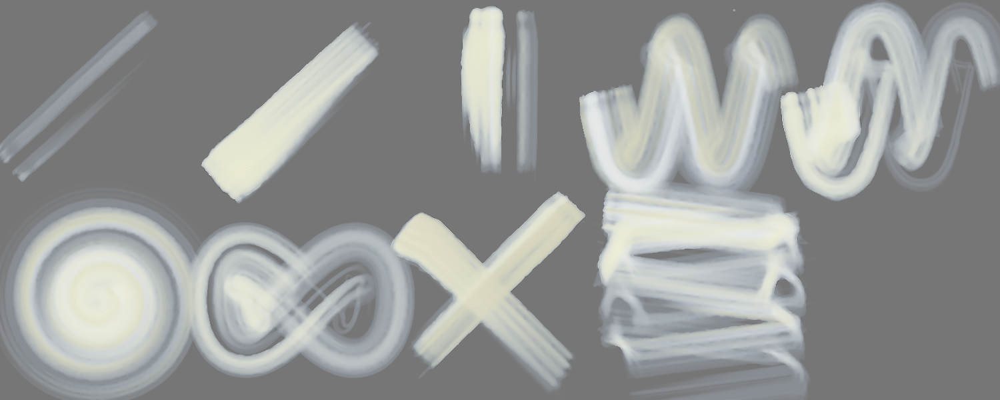

A light paint: laid on a grey sheet (on white it cannot be seen); **dark** = how far it is from the grey either way.

| stroke | covered | width | dark | spread | ms |
|---|---|---|---|---|---|
| light line | 15 % → 0 % | 42.7 px | 0.00 | 0.00 | 337 |
| heavy line | 28 % → 26 % | 82.3 px | 0.37 | 0.91 | 551 |
| pressure swell | 24 % → 17 % | 89.4 px | 0.36 | 0.72 | 337 |
| fast wave | 67 % → 59 % | 77.1 px | 0.29 | 0.88 | 1753 |
| slow wave | 67 % → 47 % | 77.1 px | 0.31 | 0.70 | 2332 |
| spiral | 87 % → 59 % | 57.6 px | 0.32 | 0.68 | 2631 |
| loop | 66 % → 46 % | 85.2 px | 0.27 | 0.70 | 1240 |
| tilted | 28 % → 28 % | 77.5 px | 0.31 | 1.00 | 1026 |
| over the wet one | 44 % → 39 % | 46.2 px | 0.31 | 0.89 | 564 |
| long, no reload | 91 % → 67 % | 41.0 px | 0.30 | 0.73 | 3985 | quarters: 0.00 → 0.00 → 0.00 → 0.00

Numbers say: light vs heavy: width 42.7 → 82.3 px, dark 0.00 → 0.37; the long stroke does not run out of paint.

## Oil focus · B clump 0.2
Gouache 0.85 · Ink 0.15 + turpentine 50 % · 130 px · 57.6 s

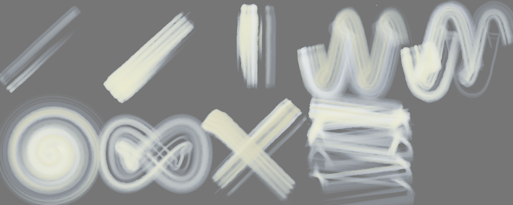

A light paint: laid on a grey sheet (on white it cannot be seen); **dark** = how far it is from the grey either way.

| stroke | covered | width | dark | spread | ms |
|---|---|---|---|---|---|
| light line | 17 % → 1 % | 48.4 px | 0.23 | 0.05 | 293 |
| heavy line | 28 % → 26 % | 82.1 px | 0.36 | 0.91 | 538 |
| pressure swell | 24 % → 17 % | 91.7 px | 0.35 | 0.71 | 356 |
| fast wave | 68 % → 59 % | 78.2 px | 0.28 | 0.88 | 1606 |
| slow wave | 66 % → 45 % | 76.0 px | 0.30 | 0.68 | 2316 |
| spiral | 88 % → 59 % | 58.1 px | 0.31 | 0.67 | 2440 |
| loop | 68 % → 48 % | 87.7 px | 0.26 | 0.71 | 1430 |
| tilted | 29 % → 29 % | 80.2 px | 0.30 | 1.00 | 893 |
| over the wet one | 51 % → 42 % | 62.2 px | 0.30 | 0.82 | 510 |
| long, no reload | 88 % → 62 % | 39.4 px | 0.30 | 0.71 | 3532 | quarters: 0.00 → 0.00 → 0.00 → 0.01

Numbers say: light vs heavy: width 48.4 → 82.1 px, dark 0.23 → 0.36; the long stroke does not run out of paint.

## Oil focus · C clump 0.35
Gouache 0.85 · Ink 0.15 + turpentine 50 % · 130 px · 58.9 s

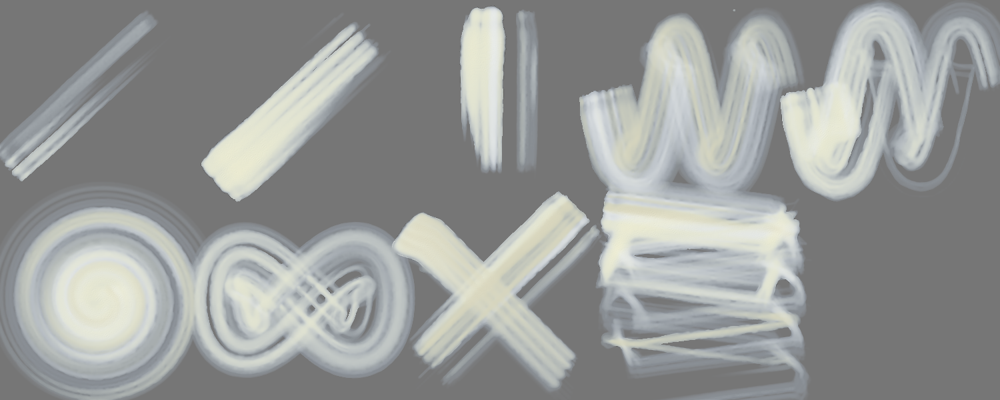

A light paint: laid on a grey sheet (on white it cannot be seen); **dark** = how far it is from the grey either way.

| stroke | covered | width | dark | spread | ms |
|---|---|---|---|---|---|
| light line | 19 % → 3 % | 54.8 px | 0.26 | 0.16 | 365 |
| heavy line | 30 % → 26 % | 86.8 px | 0.36 | 0.88 | 503 |
| pressure swell | 23 % → 18 % | 88.1 px | 0.36 | 0.75 | 358 |
| fast wave | 69 % → 61 % | 80.3 px | 0.28 | 0.87 | 1591 |
| slow wave | 66 % → 46 % | 76.3 px | 0.30 | 0.69 | 2445 |
| spiral | 89 % → 60 % | 58.6 px | 0.30 | 0.68 | 2436 |
| loop | 69 % → 53 % | 89.0 px | 0.28 | 0.78 | 1227 |
| tilted | 29 % → 29 % | 81.0 px | 0.30 | 1.00 | 917 |
| over the wet one | 54 % → 44 % | 70.4 px | 0.30 | 0.81 | 531 |
| long, no reload | 84 % → 62 % | 37.8 px | 0.30 | 0.74 | 3746 | quarters: 0.00 → 0.00 → 0.00 → 0.01

Numbers say: light vs heavy: width 54.8 → 86.8 px, dark 0.26 → 0.36; the long stroke does not run out of paint.

## Oil focus · D worn clump 0.2
Gouache 0.85 · Ink 0.15 + turpentine 50 % · 130 px · 61.1 s

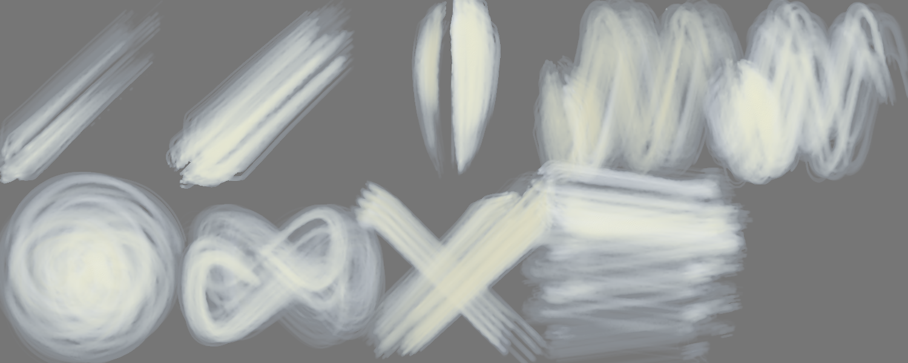

A light paint: laid on a grey sheet (on white it cannot be seen); **dark** = how far it is from the grey either way.

| stroke | covered | width | dark | spread | ms |
|---|---|---|---|---|---|
| light line | 35 % → 9 % | 100.7 px | 0.24 | 0.27 | 440 |
| heavy line | 49 % → 30 % | 141.3 px | 0.30 | 0.62 | 676 |
| pressure swell | 32 % → 23 % | 121.6 px | 0.32 | 0.70 | 575 |
| fast wave | 85 % → 67 % | 97.8 px | 0.25 | 0.80 | 2068 |
| slow wave | 80 % → 54 % | 92.4 px | 0.29 | 0.68 | 3098 |
| spiral | 86 % → 64 % | 56.4 px | 0.29 | 0.75 | 3266 |
| loop | 71 % → 51 % | 92.0 px | 0.25 | 0.72 | 1617 |
| tilted | 33 % → 33 % | 91.8 px | 0.27 | 1.01 | 759 |
| over the wet one | 69 % → 54 % | 101.4 px | 0.27 | 0.78 | 843 |
| long, no reload | 96 % → 65 % | 43.0 px | 0.26 | 0.68 | 4372 | quarters: 0.00 → 0.00 → 0.00 → 0.00

Numbers say: light vs heavy: width 100.7 → 141.3 px, dark 0.24 → 0.30.

## Oil focus · E filbert clump 0.2
Gouache 0.85 · Ink 0.15 + turpentine 50 % · 130 px · 59.4 s

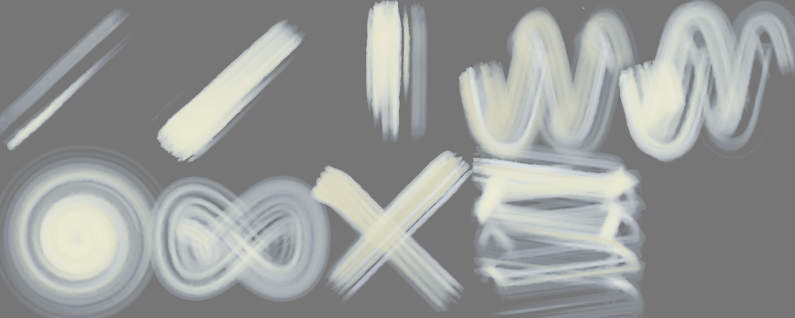

A light paint: laid on a grey sheet (on white it cannot be seen); **dark** = how far it is from the grey either way.

| stroke | covered | width | dark | spread | ms |
|---|---|---|---|---|---|
| light line | 17 % → 3 % | 49.8 px | 0.29 | 0.20 | 445 |
| heavy line | 30 % → 26 % | 87.1 px | 0.36 | 0.87 | 610 |
| pressure swell | 27 % → 21 % | 102.6 px | 0.33 | 0.77 | 401 |
| fast wave | 72 % → 61 % | 83.6 px | 0.28 | 0.84 | 1784 |
| slow wave | 71 % → 51 % | 82.2 px | 0.30 | 0.72 | 2754 |
| spiral | 88 % → 60 % | 58.1 px | 0.29 | 0.68 | 2714 |
| loop | 71 % → 54 % | 92.2 px | 0.25 | 0.76 | 1521 |
| tilted | 29 % → 29 % | 81.4 px | 0.30 | 1.00 | 822 |
| over the wet one | 50 % → 43 % | 59.2 px | 0.30 | 0.86 | 535 |
| long, no reload | 92 % → 63 % | 41.3 px | 0.29 | 0.68 | 4051 | quarters: 0.00 → 0.00 → 0.00 → 0.01

Numbers say: light vs heavy: width 49.8 → 87.1 px, dark 0.29 → 0.36; the long stroke does not run out of paint.

## Oil focus · F clump 0.2 dry 0.7
Gouache 0.85 · Ink 0.15 + turpentine 50 % · 130 px · 52.7 s

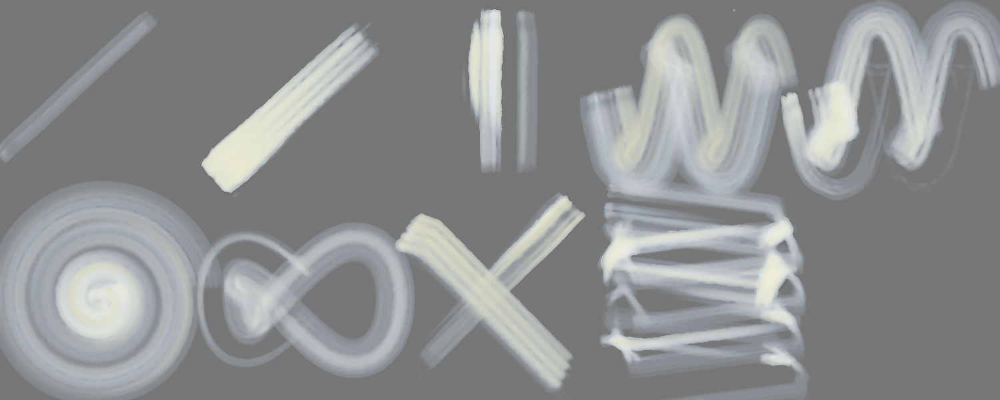

A light paint: laid on a grey sheet (on white it cannot be seen); **dark** = how far it is from the grey either way.

| stroke | covered | width | dark | spread | ms |
|---|---|---|---|---|---|
| light line | 10 % → 0 % | 29.4 px | 0.13 | 0.03 | 381 |
| heavy line | 22 % → 21 % | 65.0 px | 0.34 | 0.93 | 478 |
| pressure swell | 20 % → 11 % | 74.1 px | 0.32 | 0.55 | 355 |
| fast wave | 67 % → 53 % | 76.9 px | 0.25 | 0.80 | 1536 |
| slow wave | 59 % → 32 % | 67.8 px | 0.28 | 0.55 | 2091 |
| spiral | 90 % → 56 % | 59.3 px | 0.23 | 0.63 | 2403 |
| loop | 49 % → 21 % | 62.9 px | 0.22 | 0.42 | 1343 |
| tilted | 28 % → 28 % | 76.8 px | 0.27 | 1.00 | 1075 |
| over the wet one | 41 % → 30 % | 38.0 px | 0.27 | 0.74 | 482 |
| long, no reload | 75 % → 42 % | 33.6 px | 0.26 | 0.56 | 2841 | quarters: 0.00 → 0.00 → 0.00 → 0.01

Numbers say: light vs heavy: width 29.4 → 65.0 px, dark 0.13 → 0.34; the long stroke does not run out of paint.

## Oil focus · G clump 0.2 no texture
Gouache 0.85 · Ink 0.15 + turpentine 50 % · 130 px · 57.9 s

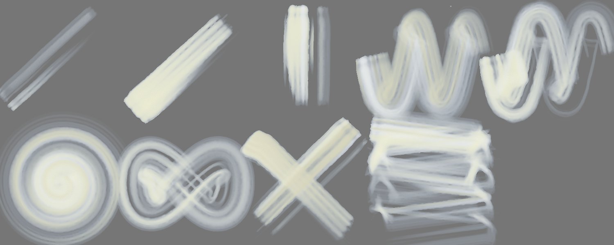

A light paint: laid on a grey sheet (on white it cannot be seen); **dark** = how far it is from the grey either way.

| stroke | covered | width | dark | spread | ms |
|---|---|---|---|---|---|
| light line | 17 % → 1 % | 48.4 px | 0.23 | 0.05 | 392 |
| heavy line | 28 % → 26 % | 82.0 px | 0.36 | 0.91 | 484 |
| pressure swell | 24 % → 17 % | 91.7 px | 0.35 | 0.71 | 359 |
| fast wave | 68 % → 59 % | 78.2 px | 0.28 | 0.88 | 1462 |
| slow wave | 66 % → 45 % | 76.0 px | 0.30 | 0.68 | 2134 |
| spiral | 88 % → 59 % | 58.1 px | 0.31 | 0.67 | 2553 |
| loop | 68 % → 48 % | 87.7 px | 0.26 | 0.71 | 1166 |
| tilted | 29 % → 29 % | 80.2 px | 0.30 | 1.00 | 770 |
| over the wet one | 51 % → 42 % | 62.2 px | 0.30 | 0.82 | 531 |
| long, no reload | 88 % → 62 % | 39.4 px | 0.30 | 0.71 | 3685 | quarters: 0.00 → 0.00 → 0.00 → 0.01

Numbers say: light vs heavy: width 48.4 → 82.0 px, dark 0.23 → 0.36; the long stroke does not run out of paint.

## Oil focus · H clump 0.2 thick
Gouache 1.00 + turpentine 15 % · 130 px · 57.7 s

A light paint: laid on a grey sheet (on white it cannot be seen); **dark** = how far it is from the grey either way.

| stroke | covered | width | dark | spread | ms |
|---|---|---|---|---|---|
| light line | 16 % → 1 % | 46.4 px | 0.37 | 0.08 | 323 |
| heavy line | 32 % → 26 % | 92.2 px | 0.39 | 0.81 | 513 |
| pressure swell | 24 % → 18 % | 90.3 px | 0.38 | 0.75 | 354 |
| fast wave | 69 % → 59 % | 79.4 px | 0.33 | 0.86 | 1687 |
| slow wave | 68 % → 46 % | 78.9 px | 0.38 | 0.67 | 2632 |
| spiral | 88 % → 54 % | 57.9 px | 0.35 | 0.62 | 2775 |
| loop | 68 % → 50 % | 88.1 px | 0.37 | 0.73 | 1366 |
| tilted | 28 % → 28 % | 77.6 px | 0.34 | 1.00 | 941 |
| over the wet one | 46 % → 39 % | 51.7 px | 0.34 | 0.84 | 548 |
| long, no reload | 90 % → 64 % | 40.2 px | 0.36 | 0.71 | 3920 | quarters: 0.00 → 0.00 → 0.00 → 0.02

Numbers say: light vs heavy: width 46.4 → 92.2 px, dark 0.37 → 0.39; the long stroke does not run out of paint.

## Oil focus · A clump 0 — own sheet
own sheet 1000 × 660 · Gouache 0.85 · Ink 0.15 + turpentine 50 % · 130 px · 17.2 s

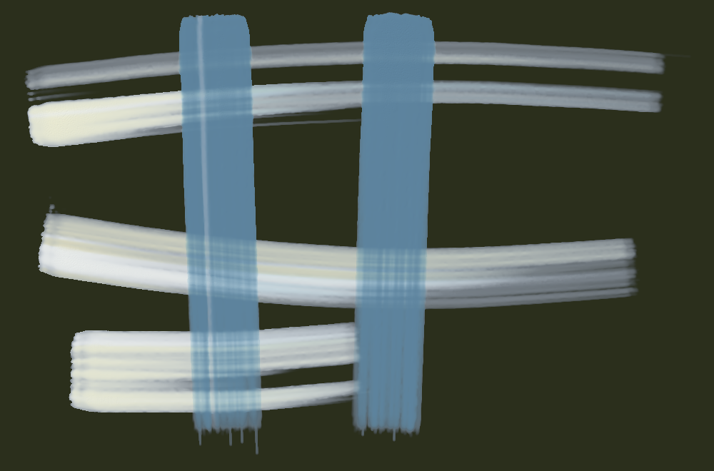

| stroke | covered | width | dark | spread | ms |
|---|---|---|---|---|---|
| stroke 1 | 16 % → 53 % | 99.0 px | 0.44 | 3.36 | 921 |
| stroke 2 | 29 % → 45 % | 181.9 px | 0.38 | 1.56 | 922 |
| stroke 3 | 31 % → 40 % | 146.0 px | 0.42 | 1.30 | 1511 |
| stroke 4 | 37 % → 39 % | 255.9 px | 0.44 | 1.07 | 1606 |
| stroke 5 | 45 % → 43 % | 369.0 px | 0.46 | 0.96 | 829 |

Numbers say: wet paint spreads well beyond the stroke.

## Oil focus · B clump 0.2 — own sheet
own sheet 1000 × 660 · Gouache 0.85 · Ink 0.15 + turpentine 50 % · 130 px · 16.7 s

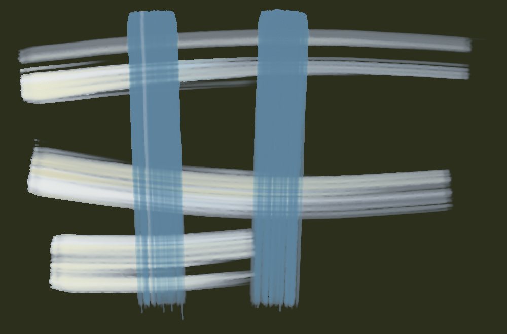

| stroke | covered | width | dark | spread | ms |
|---|---|---|---|---|---|
| stroke 1 | 16 % → 54 % | 98.0 px | 0.44 | 3.41 | 974 |
| stroke 2 | 29 % → 45 % | 181.8 px | 0.38 | 1.56 | 856 |
| stroke 3 | 32 % → 41 % | 149.1 px | 0.42 | 1.29 | 1495 |
| stroke 4 | 38 % → 40 % | 262.1 px | 0.43 | 1.06 | 1655 |
| stroke 5 | 46 % → 44 % | 375.7 px | 0.45 | 0.96 | 786 |

Numbers say: wet paint spreads well beyond the stroke.

## Oil focus · C clump 0.35 — own sheet
own sheet 1000 × 660 · Gouache 0.85 · Ink 0.15 + turpentine 50 % · 130 px · 16.6 s

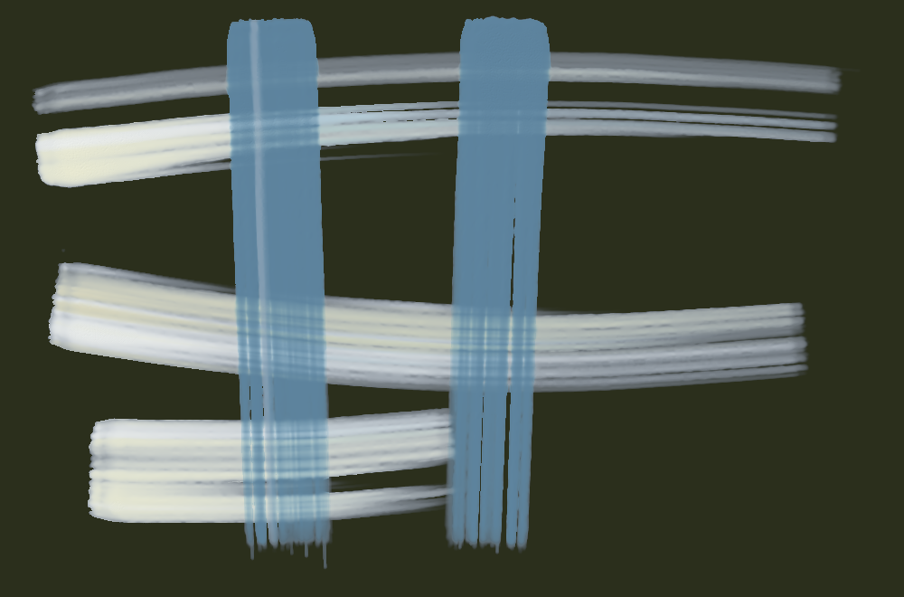

| stroke | covered | width | dark | spread | ms |
|---|---|---|---|---|---|
| stroke 1 | 16 % → 54 % | 97.1 px | 0.44 | 3.44 | 1027 |
| stroke 2 | 28 % → 45 % | 174.4 px | 0.38 | 1.60 | 831 |
| stroke 3 | 31 % → 41 % | 144.2 px | 0.42 | 1.32 | 1402 |
| stroke 4 | 37 % → 39 % | 255.1 px | 0.44 | 1.08 | 1414 |
| stroke 5 | 45 % → 44 % | 370.6 px | 0.46 | 0.97 | 940 |

Numbers say: wet paint spreads well beyond the stroke.

## Oil focus · D worn clump 0.2 — own sheet
own sheet 1000 × 660 · Gouache 0.85 · Ink 0.15 + turpentine 50 % · 130 px · 20.8 s

| stroke | covered | width | dark | spread | ms |
|---|---|---|---|---|---|
| stroke 1 | 19 % → 65 % | 118.3 px | 0.43 | 3.40 | 1247 |
| stroke 2 | 35 % → 54 % | 220.3 px | 0.36 | 1.52 | 1231 |
| stroke 3 | 42 % → 52 % | 195.6 px | 0.40 | 1.24 | 2159 |
| stroke 4 | 47 % → 48 % | 330.6 px | 0.42 | 1.01 | 2446 |
| stroke 5 | 56 % → 51 % | 459.1 px | 0.43 | 0.90 | 1182 |

Numbers say: wet paint spreads well beyond the stroke.

## Oil focus · E filbert clump 0.2 — own sheet
own sheet 1000 × 660 · Gouache 0.85 · Ink 0.15 + turpentine 50 % · 130 px · 17.9 s

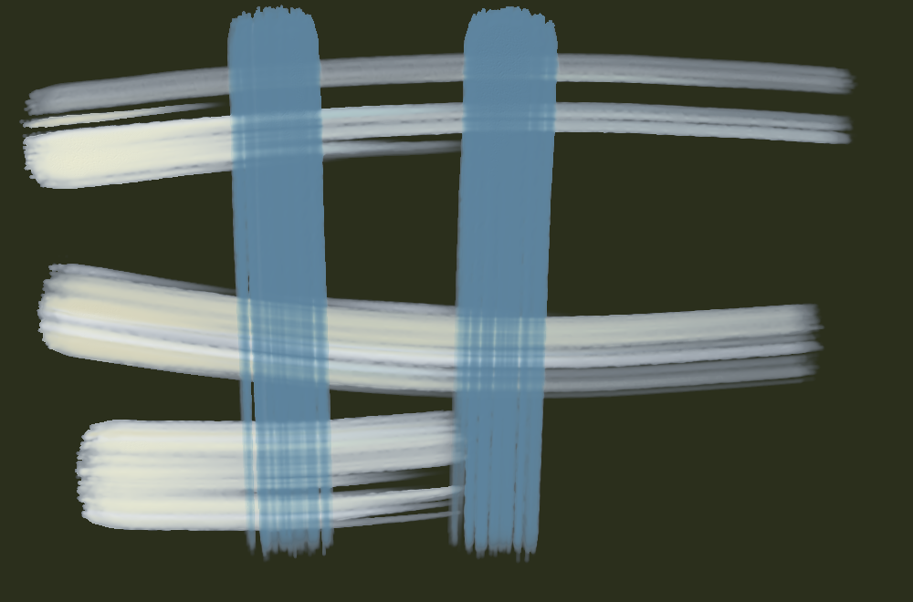

| stroke | covered | width | dark | spread | ms |
|---|---|---|---|---|---|
| stroke 1 | 16 % → 56 % | 99.3 px | 0.44 | 3.53 | 968 |
| stroke 2 | 30 % → 47 % | 184.0 px | 0.38 | 1.58 | 935 |
| stroke 3 | 33 % → 43 % | 153.4 px | 0.42 | 1.32 | 1604 |
| stroke 4 | 38 % → 42 % | 268.4 px | 0.44 | 1.08 | 1584 |
| stroke 5 | 48 % → 45 % | 393.1 px | 0.46 | 0.95 | 920 |

Numbers say: wet paint spreads well beyond the stroke.

## Oil focus · F clump 0.2 dry 0.7 — own sheet
own sheet 1000 × 660 · Gouache 0.85 · Ink 0.15 + turpentine 50 % · 130 px · 16.8 s

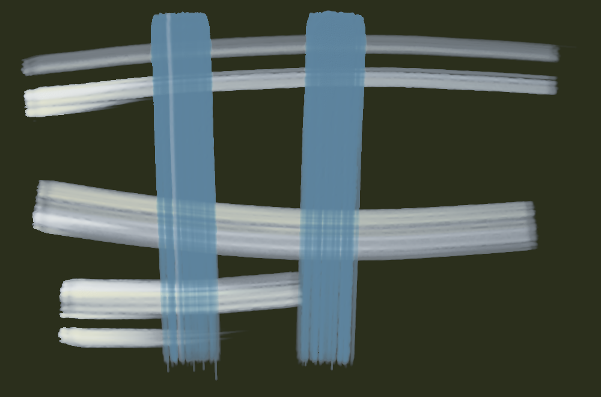

| stroke | covered | width | dark | spread | ms |
|---|---|---|---|---|---|
| stroke 1 | 16 % → 49 % | 98.0 px | 0.40 | 3.14 | 1064 |
| stroke 2 | 29 % → 44 % | 181.8 px | 0.36 | 1.51 | 893 |
| stroke 3 | 30 % → 39 % | 140.5 px | 0.40 | 1.31 | 1359 |
| stroke 4 | 36 % → 38 % | 249.4 px | 0.40 | 1.05 | 1757 |
| stroke 5 | 43 % → 41 % | 351.0 px | 0.42 | 0.97 | 826 |

Numbers say: wet paint spreads well beyond the stroke.

## Oil focus · G clump 0.2 no texture — own sheet
own sheet 1000 × 660 · Gouache 0.85 · Ink 0.15 + turpentine 50 % · 130 px · 12.9 s

| stroke | covered | width | dark | spread | ms |
|---|---|---|---|---|---|
| stroke 1 | 16 % → 54 % | 98.0 px | 0.44 | 3.41 | 956 |
| stroke 2 | 29 % → 45 % | 181.8 px | 0.38 | 1.56 | 998 |
| stroke 3 | 32 % → 41 % | 149.1 px | 0.42 | 1.28 | 1457 |
| stroke 4 | 38 % → 40 % | 262.1 px | 0.43 | 1.06 | 1406 |
| stroke 5 | 46 % → 44 % | 375.7 px | 0.45 | 0.96 | 629 |

Numbers say: wet paint spreads well beyond the stroke.

## Oil focus · H clump 0.2 thick — own sheet
own sheet 1000 × 660 · Gouache 1.00 + turpentine 15 % · 130 px · 11.7 s

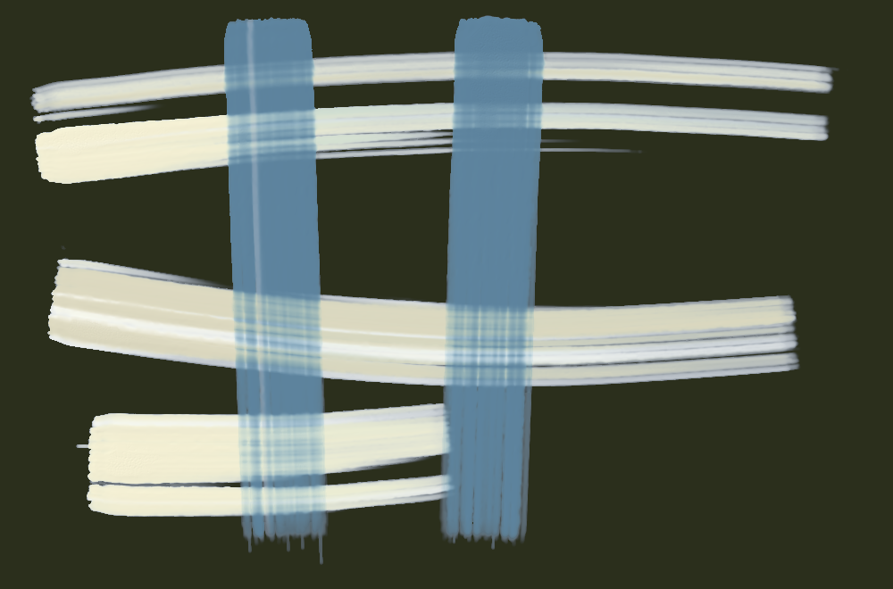

| stroke | covered | width | dark | spread | ms |
|---|---|---|---|---|---|
| stroke 1 | 16 % → 53 % | 98.0 px | 0.51 | 3.39 | 904 |
| stroke 2 | 29 % → 45 % | 181.8 px | 0.46 | 1.55 | 858 |
| stroke 3 | 31 % → 40 % | 147.5 px | 0.51 | 1.28 | 1342 |
| stroke 4 | 37 % → 39 % | 259.3 px | 0.53 | 1.06 | 1317 |
| stroke 5 | 46 % → 43 % | 374.7 px | 0.53 | 0.95 | 586 |

Numbers say: wet paint spreads well beyond the stroke.

