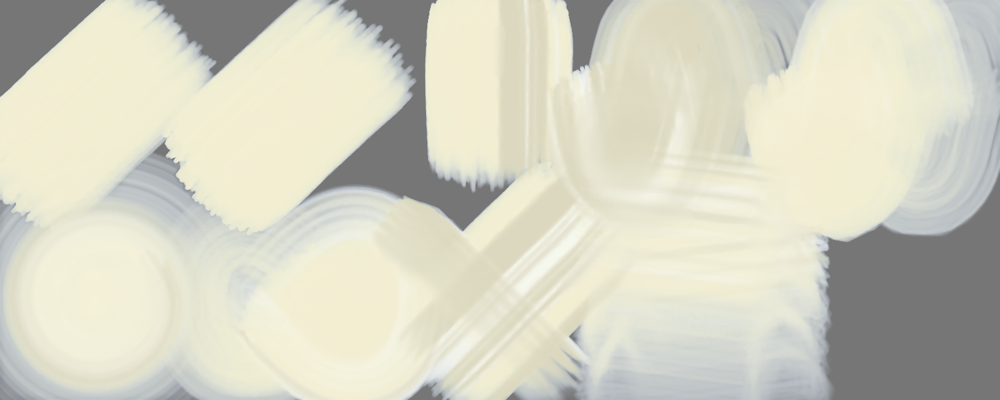
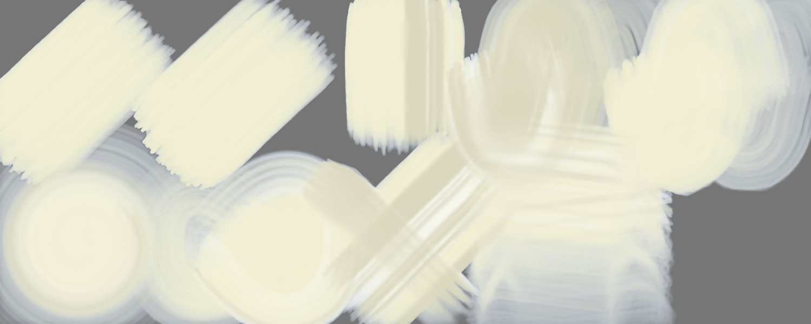
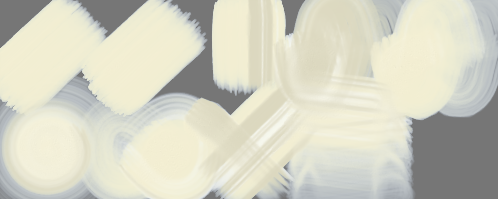
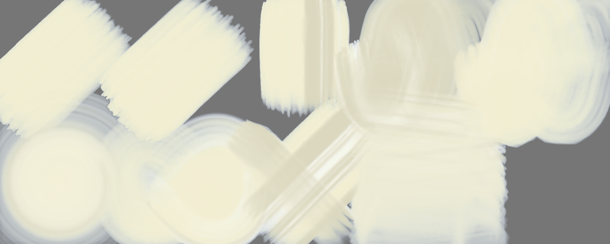
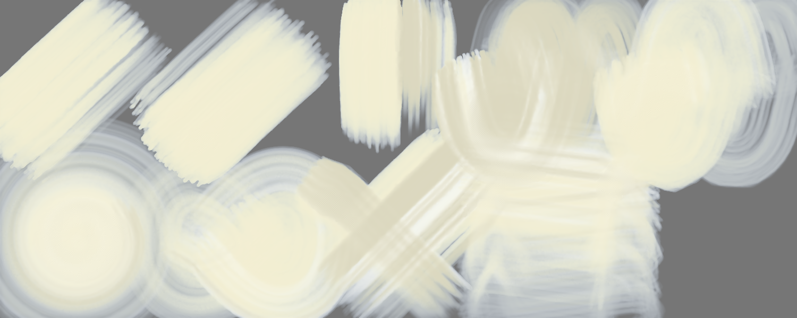
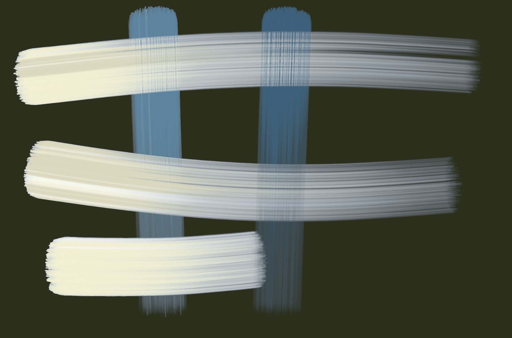
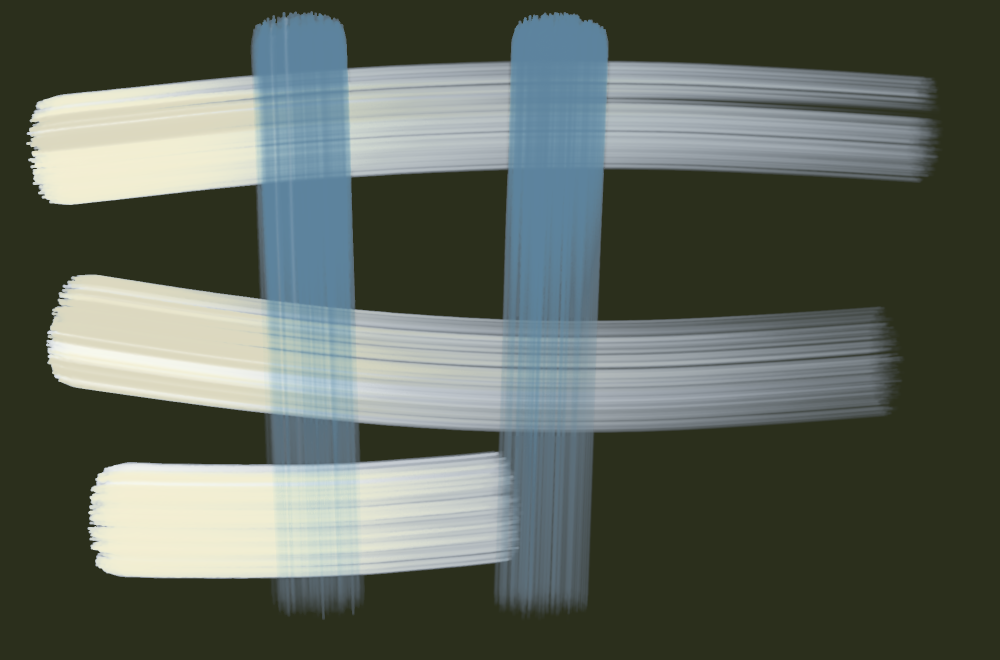
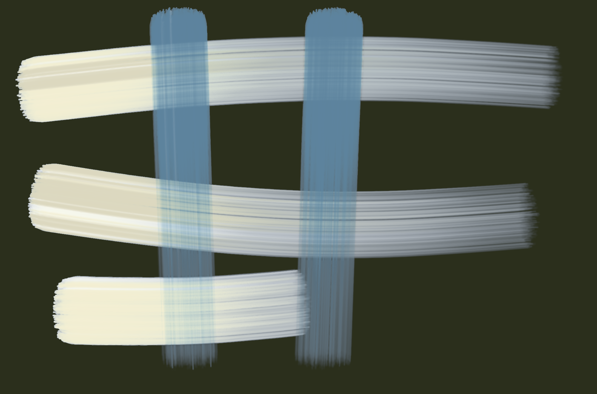
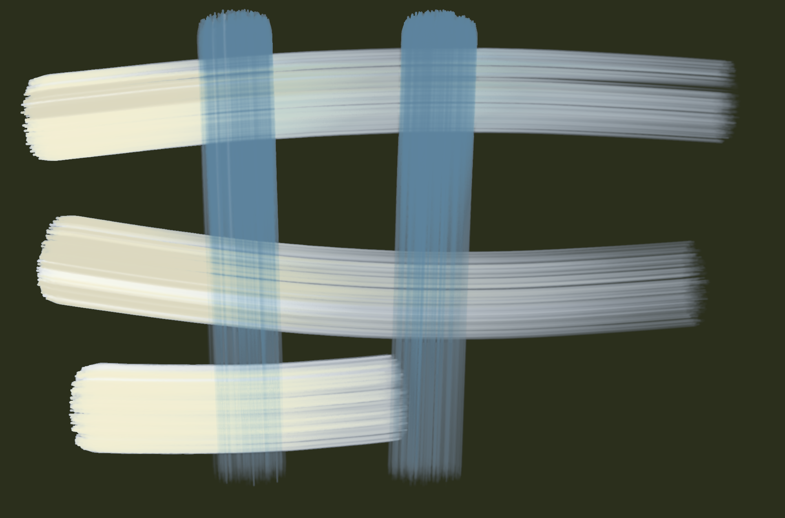
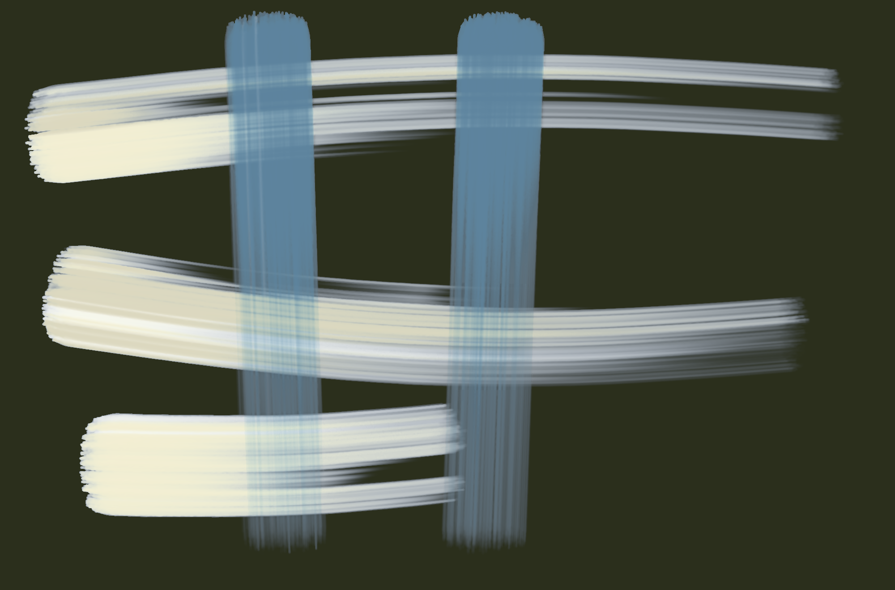

# Brush Lab — 16 brushes · 9 Nov 2026 at 04:19

Every sheet: 1500 × 600, ten strokes in a 5 × 2 grid — 1. light line · 2. heavy line · 3. pressure swell · 4. fast wave · 5. slow wave · 6. spiral · 7. loop · 8. tilted · 9. over the wet one · 10. long, no reload (cell 8 holds «tilted» and «over the wet one» crossed). The CPU reference of Mamay's paint engine; the wet layer settles 20 s at the end.

Columns: **covered** = share of the cell with paint right after the stroke → after settling; **width** = painted area of the stroke ÷ its length (px); **dark** = mean darkness of the painted pixels above the paper's own grain (0 = paper, 1 = black); **spread** = how far wet paint went beyond the stroke (1.0 = stayed); **ms** = the stroke on the CPU; long stroke: paint in each quarter of its length (it should run out: wet → streaks → dry tail).

## Oil focus · A F pick 0.01
Gouache 1.00 + turpentine 15 % · 260 px · 144.5 s

A light paint: laid on a grey sheet (on white it cannot be seen); **dark** = how far it is from the grey either way.

| stroke | covered | width | dark | spread | ms |
|---|---|---|---|---|---|
| light line | 74 % → 72 % | 213.4 px | 0.29 | 0.98 | 1628 |
| heavy line | 75 % → 67 % | 218.7 px | 0.29 | 0.89 | 1933 |
| pressure swell | 67 % → 74 % | 249.6 px | 0.26 | 1.11 | 1819 |
| fast wave | 99 % → 85 % | 114.8 px | 0.25 | 0.86 | 10146 |
| slow wave | 100 % → 70 % | 115.0 px | 0.29 | 0.70 | 21276 |
| spiral | 100 % → 73 % | 65.9 px | 0.28 | 0.73 | 14657 |
| loop | 100 % → 87 % | 129.5 px | 0.29 | 0.87 | 5906 |
| tilted | 55 % → 55 % | 154.4 px | 0.26 | 1.00 | 3136 |
| over the wet one | 92 % → 88 % | 103.0 px | 0.26 | 0.95 | 2809 |
| long, no reload | 100 % → 74 % | 44.8 px | 0.27 | 0.74 | 13763 | quarters: 0.00 → 0.00 → 0.00 → 0.00

Numbers say: light vs heavy: width 213.4 → 218.7 px, dark 0.29 → 0.29; pressure barely changes the width.

## Oil focus · B F pick 0 opaque
Gouache 1.00 + turpentine 15 % · 260 px · 142.3 s

A light paint: laid on a grey sheet (on white it cannot be seen); **dark** = how far it is from the grey either way.

| stroke | covered | width | dark | spread | ms |
|---|---|---|---|---|---|
| light line | 74 % → 72 % | 213.4 px | 0.29 | 0.98 | 1573 |
| heavy line | 75 % → 67 % | 218.7 px | 0.29 | 0.89 | 1887 |
| pressure swell | 67 % → 74 % | 249.6 px | 0.26 | 1.11 | 1873 |
| fast wave | 99 % → 85 % | 114.8 px | 0.24 | 0.86 | 9331 |
| slow wave | 100 % → 70 % | 115.0 px | 0.28 | 0.70 | 21760 |
| spiral | 100 % → 73 % | 65.9 px | 0.27 | 0.73 | 13214 |
| loop | 100 % → 86 % | 129.5 px | 0.28 | 0.86 | 5607 |
| tilted | 55 % → 55 % | 154.4 px | 0.25 | 1.00 | 2885 |
| over the wet one | 92 % → 88 % | 103.0 px | 0.25 | 0.95 | 2616 |
| long, no reload | 100 % → 73 % | 44.8 px | 0.27 | 0.73 | 13116 | quarters: 0.00 → 0.00 → 0.00 → 0.00

Numbers say: light vs heavy: width 213.4 → 218.7 px, dark 0.29 → 0.29; pressure barely changes the width.

## Oil focus · C F dry under
Gouache 1.00 + turpentine 15 % · 260 px · 142.5 s

A light paint: laid on a grey sheet (on white it cannot be seen); **dark** = how far it is from the grey either way.

| stroke | covered | width | dark | spread | ms |
|---|---|---|---|---|---|
| light line | 74 % → 72 % | 213.4 px | 0.29 | 0.98 | 1544 |
| heavy line | 75 % → 67 % | 218.7 px | 0.29 | 0.89 | 1896 |
| pressure swell | 67 % → 74 % | 249.6 px | 0.26 | 1.11 | 1870 |
| fast wave | 99 % → 85 % | 114.8 px | 0.25 | 0.86 | 10179 |
| slow wave | 100 % → 70 % | 115.0 px | 0.29 | 0.70 | 21099 |
| spiral | 100 % → 73 % | 65.9 px | 0.28 | 0.73 | 14577 |
| loop | 100 % → 87 % | 129.5 px | 0.29 | 0.87 | 5818 |
| tilted | 55 % → 55 % | 154.4 px | 0.26 | 1.00 | 2789 |
| over the wet one | 92 % → 88 % | 103.0 px | 0.26 | 0.95 | 3120 |
| long, no reload | 100 % → 74 % | 44.8 px | 0.27 | 0.74 | 13067 | quarters: 0.00 → 0.00 → 0.00 → 0.00

Numbers say: light vs heavy: width 213.4 → 218.7 px, dark 0.29 → 0.29; pressure barely changes the width.

## Oil focus · D F texture strong
Gouache 1.00 + turpentine 15 % · 260 px · 142.0 s

A light paint: laid on a grey sheet (on white it cannot be seen); **dark** = how far it is from the grey either way.

| stroke | covered | width | dark | spread | ms |
|---|---|---|---|---|---|
| light line | 73 % → 71 % | 213.3 px | 0.29 | 0.97 | 1543 |
| heavy line | 75 % → 67 % | 218.7 px | 0.29 | 0.88 | 1977 |
| pressure swell | 66 % → 74 % | 249.3 px | 0.26 | 1.11 | 1765 |
| fast wave | 99 % → 85 % | 114.8 px | 0.24 | 0.85 | 10011 |
| slow wave | 100 % → 69 % | 115.0 px | 0.28 | 0.70 | 20988 |
| spiral | 100 % → 73 % | 65.9 px | 0.28 | 0.73 | 14400 |
| loop | 100 % → 86 % | 129.5 px | 0.28 | 0.86 | 5630 |
| tilted | 55 % → 55 % | 153.9 px | 0.25 | 1.00 | 2668 |
| over the wet one | 92 % → 87 % | 103.2 px | 0.25 | 0.95 | 2793 |
| long, no reload | 100 % → 73 % | 44.8 px | 0.27 | 0.73 | 13384 | quarters: 0.00 → 0.00 → 0.00 → 0.00

Numbers say: light vs heavy: width 213.3 → 218.7 px, dark 0.29 → 0.29; pressure barely changes the width.

## Oil focus · E F texture calm
Gouache 1.00 + turpentine 15 % · 260 px · 143.6 s

A light paint: laid on a grey sheet (on white it cannot be seen); **dark** = how far it is from the grey either way.

| stroke | covered | width | dark | spread | ms |
|---|---|---|---|---|---|
| light line | 73 % → 72 % | 213.3 px | 0.29 | 0.99 | 1578 |
| heavy line | 76 % → 69 % | 219.5 px | 0.29 | 0.91 | 2008 |
| pressure swell | 67 % → 74 % | 251.7 px | 0.27 | 1.11 | 1789 |
| fast wave | 99 % → 88 % | 114.8 px | 0.25 | 0.89 | 9939 |
| slow wave | 100 % → 70 % | 115.0 px | 0.29 | 0.70 | 21668 |
| spiral | 100 % → 73 % | 65.9 px | 0.28 | 0.73 | 14318 |
| loop | 100 % → 84 % | 129.5 px | 0.29 | 0.84 | 5809 |
| tilted | 55 % → 55 % | 154.1 px | 0.26 | 1.00 | 2954 |
| over the wet one | 92 % → 87 % | 103.0 px | 0.26 | 0.95 | 3380 |
| long, no reload | 100 % → 74 % | 44.8 px | 0.27 | 0.74 | 13375 | quarters: 0.00 → 0.00 → 0.00 → 0.00

Numbers say: light vs heavy: width 213.3 → 219.5 px, dark 0.29 → 0.29; pressure barely changes the width.

## Oil focus · F F pick 0.35
Gouache 1.00 + turpentine 15 % · 260 px · 143.5 s

A light paint: laid on a grey sheet (on white it cannot be seen); **dark** = how far it is from the grey either way.

| stroke | covered | width | dark | spread | ms |
|---|---|---|---|---|---|
| light line | 74 % → 72 % | 213.5 px | 0.33 | 0.98 | 1568 |
| heavy line | 75 % → 68 % | 218.8 px | 0.33 | 0.90 | 1916 |
| pressure swell | 67 % → 74 % | 249.8 px | 0.30 | 1.11 | 1781 |
| fast wave | 99 % → 91 % | 114.8 px | 0.28 | 0.92 | 10026 |
| slow wave | 100 % → 83 % | 115.1 px | 0.32 | 0.83 | 21067 |
| spiral | 100 % → 80 % | 66.0 px | 0.32 | 0.80 | 15099 |
| loop | 100 % → 97 % | 129.5 px | 0.32 | 0.97 | 5687 |
| tilted | 56 % → 56 % | 155.0 px | 0.29 | 1.00 | 2670 |
| over the wet one | 92 % → 91 % | 102.6 px | 0.29 | 0.98 | 3031 |
| long, no reload | 100 % → 96 % | 44.8 px | 0.31 | 0.96 | 12788 | quarters: 0.00 → 0.00 → 0.00 → 0.00

Numbers say: light vs heavy: width 213.5 → 218.8 px, dark 0.33 → 0.33; pressure barely changes the width.

## Oil focus · G F sheen
Gouache 1.00 + turpentine 15 % · 260 px · 142.1 s

A light paint: laid on a grey sheet (on white it cannot be seen); **dark** = how far it is from the grey either way.

| stroke | covered | width | dark | spread | ms |
|---|---|---|---|---|---|
| light line | 74 % → 72 % | 213.4 px | 0.29 | 0.98 | 1591 |
| heavy line | 75 % → 67 % | 218.7 px | 0.29 | 0.89 | 1928 |
| pressure swell | 67 % → 74 % | 249.6 px | 0.26 | 1.11 | 1736 |
| fast wave | 99 % → 85 % | 114.8 px | 0.25 | 0.86 | 9407 |
| slow wave | 100 % → 70 % | 115.0 px | 0.29 | 0.70 | 21586 |
| spiral | 100 % → 73 % | 65.9 px | 0.28 | 0.73 | 15098 |
| loop | 100 % → 87 % | 129.5 px | 0.29 | 0.87 | 5862 |
| tilted | 55 % → 55 % | 154.4 px | 0.26 | 1.00 | 2654 |
| over the wet one | 92 % → 88 % | 103.0 px | 0.26 | 0.95 | 2869 |
| long, no reload | 100 % → 74 % | 44.8 px | 0.27 | 0.74 | 12850 | quarters: 0.00 → 0.00 → 0.00 → 0.00

Numbers say: light vs heavy: width 213.4 → 218.7 px, dark 0.29 → 0.29; pressure barely changes the width.

## Oil focus · H F scrub end
Gouache 1.00 + turpentine 15 % · 260 px · 136.8 s

A light paint: laid on a grey sheet (on white it cannot be seen); **dark** = how far it is from the grey either way.

| stroke | covered | width | dark | spread | ms |
|---|---|---|---|---|---|
| light line | 70 % → 54 % | 203.0 px | 0.27 | 0.77 | 1481 |
| heavy line | 74 % → 55 % | 215.9 px | 0.27 | 0.74 | 1893 |
| pressure swell | 63 % → 64 % | 237.8 px | 0.25 | 1.01 | 1701 |
| fast wave | 99 % → 83 % | 114.4 px | 0.23 | 0.84 | 7898 |
| slow wave | 99 % → 66 % | 114.8 px | 0.26 | 0.67 | 23908 |
| spiral | 100 % → 66 % | 65.9 px | 0.26 | 0.66 | 13300 |
| loop | 100 % → 80 % | 129.5 px | 0.26 | 0.80 | 6372 |
| tilted | 55 % → 55 % | 152.3 px | 0.23 | 1.00 | 3119 |
| over the wet one | 92 % → 78 % | 103.5 px | 0.23 | 0.85 | 2443 |
| long, no reload | 100 % → 74 % | 44.7 px | 0.26 | 0.74 | 13007 | quarters: 0.00 → 0.00 → 0.00 → 0.00

Numbers say: light vs heavy: width 203.0 → 215.9 px, dark 0.27 → 0.27; pressure barely changes the width.

## Oil focus · A F pick 0.01 — own sheet
own sheet 2000 × 1320 · Gouache 1.00 + turpentine 15 % · 260 px · 110.7 s

| stroke | covered | width | dark | spread | ms |
|---|---|---|---|---|---|
| stroke 1 | 15 % → 52 % | 190.5 px | 0.47 | 3.39 | 6285 |
| stroke 2 | 28 % → 34 % | 351.5 px | 0.37 | 1.19 | 8271 |
| stroke 3 | 36 % → 34 % | 337.0 px | 0.44 | 0.95 | 27713 |
| stroke 4 | 42 % → 33 % | 586.0 px | 0.48 | 0.78 | 16442 |
| stroke 5 | 50 % → 36 % | 811.8 px | 0.49 | 0.73 | 6017 |

Numbers say: wet paint spreads well beyond the stroke.

## Oil focus · B F pick 0 opaque — own sheet
own sheet 2000 × 1320 · Gouache 1.00 + turpentine 15 % · 260 px · 104.3 s

| stroke | covered | width | dark | spread | ms |
|---|---|---|---|---|---|
| stroke 1 | 15 % → 48 % | 188.1 px | 0.49 | 3.16 | 5487 |
| stroke 2 | 28 % → 29 % | 348.5 px | 0.39 | 1.02 | 7088 |
| stroke 3 | 36 % → 33 % | 335.2 px | 0.44 | 0.91 | 29475 |
| stroke 4 | 42 % → 30 % | 578.6 px | 0.50 | 0.71 | 14521 |
| stroke 5 | 49 % → 31 % | 801.7 px | 0.53 | 0.64 | 6521 |

Numbers say: wet paint spreads well beyond the stroke.

## Oil focus · C F dry under — own sheet
own sheet 2000 × 1320 · Gouache 1.00 + turpentine 15 % · 260 px · 81.5 s

| stroke | covered | width | dark | spread | ms |
|---|---|---|---|---|---|
| stroke 1 | 15 % → 34 % | 190.5 px | 0.58 | 2.24 | 5672 |
| stroke 2 | 28 % → 15 % | 351.5 px | 0.54 | 0.51 | 5419 |
| stroke 3 | 22 % → 20 % | 205.5 px | 0.57 | 0.89 | 9529 |
| stroke 4 | 31 % → 22 % | 430.0 px | 0.58 | 0.70 | 8471 |
| stroke 5 | 39 % → 26 % | 640.8 px | 0.58 | 0.66 | 4335 |

Numbers say: wet paint spreads well beyond the stroke.

## Oil focus · D F texture strong — own sheet
own sheet 2000 × 1320 · Gouache 1.00 + turpentine 15 % · 260 px · 92.9 s

| stroke | covered | width | dark | spread | ms |
|---|---|---|---|---|---|
| stroke 1 | 15 % → 50 % | 189.5 px | 0.47 | 3.29 | 5724 |
| stroke 2 | 28 % → 32 % | 351.3 px | 0.37 | 1.11 | 5453 |
| stroke 3 | 36 % → 34 % | 336.1 px | 0.43 | 0.93 | 10430 |
| stroke 4 | 42 % → 32 % | 584.6 px | 0.48 | 0.75 | 9191 |
| stroke 5 | 50 % → 35 % | 810.6 px | 0.50 | 0.69 | 4513 |

Numbers say: wet paint spreads well beyond the stroke.

## Oil focus · E F texture calm — own sheet
own sheet 2000 × 1320 · Gouache 1.00 + turpentine 15 % · 260 px · 90.2 s

| stroke | covered | width | dark | spread | ms |
|---|---|---|---|---|---|
| stroke 1 | 16 % → 53 % | 192.8 px | 0.47 | 3.39 | 5521 |
| stroke 2 | 28 % → 34 % | 352.6 px | 0.38 | 1.21 | 4730 |
| stroke 3 | 36 % → 36 % | 340.9 px | 0.44 | 0.97 | 20174 |
| stroke 4 | 43 % → 33 % | 595.8 px | 0.48 | 0.78 | 18352 |
| stroke 5 | 50 % → 36 % | 814.9 px | 0.50 | 0.72 | 4844 |

Numbers say: wet paint spreads well beyond the stroke.

## Oil focus · F F pick 0.35 — own sheet
own sheet 2000 × 1320 · Gouache 1.00 + turpentine 15 % · 260 px · 88.8 s

| stroke | covered | width | dark | spread | ms |
|---|---|---|---|---|---|
| stroke 1 | 15 % → 54 % | 190.8 px | 0.49 | 3.51 | 5075 |
| stroke 2 | 28 % → 38 % | 351.8 px | 0.40 | 1.33 | 5391 |
| stroke 3 | 36 % → 38 % | 339.9 px | 0.46 | 1.04 | 30151 |
| stroke 4 | 43 % → 35 % | 593.0 px | 0.49 | 0.83 | 11512 |
| stroke 5 | 50 % → 37 % | 813.2 px | 0.51 | 0.74 | 5244 |

Numbers say: wet paint spreads well beyond the stroke.

## Oil focus · G F sheen — own sheet
own sheet 2000 × 1320 · Gouache 1.00 + turpentine 15 % · 260 px · 87.9 s

| stroke | covered | width | dark | spread | ms |
|---|---|---|---|---|---|
| stroke 1 | 15 % → 51 % | 190.5 px | 0.47 | 3.32 | 5087 |
| stroke 2 | 28 % → 32 % | 351.5 px | 0.37 | 1.14 | 5428 |
| stroke 3 | 36 % → 34 % | 336.5 px | 0.43 | 0.94 | 29239 |
| stroke 4 | 42 % → 32 % | 585.0 px | 0.48 | 0.76 | 11353 |
| stroke 5 | 50 % → 35 % | 809.9 px | 0.50 | 0.70 | 5333 |

Numbers say: wet paint spreads well beyond the stroke.

## Oil focus · H F scrub end — own sheet
own sheet 2000 × 1320 · Gouache 1.00 + turpentine 15 % · 260 px · 85.2 s

| stroke | covered | width | dark | spread | ms |
|---|---|---|---|---|---|
| stroke 1 | 15 % → 46 % | 189.5 px | 0.48 | 3.01 | 4976 |
| stroke 2 | 28 % → 30 % | 350.5 px | 0.38 | 1.05 | 5418 |
| stroke 3 | 31 % → 32 % | 291.9 px | 0.44 | 1.02 | 24990 |
| stroke 4 | 37 % → 29 % | 507.8 px | 0.48 | 0.80 | 12932 |
| stroke 5 | 46 % → 33 % | 754.0 px | 0.52 | 0.71 | 5176 |

Numbers say: wet paint spreads well beyond the stroke.

