# Brush Lab — 57 brushes · Nov 3, 2026 at 10:46 AM

Every sheet: 1500 × 600, ten strokes in a 5 × 2 grid — 1. light line · 2. heavy line · 3. pressure swell · 4. fast wave · 5. slow wave · 6. spiral · 7. loop · 8. tilted · 9. over the wet one · 10. long, no reload (cell 8 holds «tilted» and «over the wet one» crossed). The CPU reference of Mamay's paint engine; the wet layer settles 20 s at the end.

Columns: **covered** = share of the cell with paint right after the stroke → after settling; **dark** = mean darkness of the painted pixels above the paper's own grain (0 = paper, 1 = black); **spread** = how far wet paint went beyond the stroke (1.0 = stayed); **ms** = the stroke on the CPU; long stroke: paint in each quarter of its length (it should run out: wet → streaks → dry tail).

## Ink Line
Ink · 12 px · 31.0 s

| stroke | covered | dark | spread | ms |
|---|---|---|---|---|
| light line | 1 % → 4 % | 0.55 | 2.44 | 144 |
| heavy line | 5 % → 6 % | 0.68 | 1.13 | 102 |
| pressure swell | 3 % → 4 % | 0.64 | 1.40 | 40 |
| fast wave | 10 % → 11 % | 0.59 | 1.11 | 126 |
| slow wave | 8 % → 10 % | 0.57 | 1.16 | 129 |
| spiral | 14 % → 15 % | 0.50 | 1.07 | 317 |
| loop | 8 % → 9 % | 0.61 | 1.16 | 430 |
| tilted | 5 % → 5 % | 0.65 | 1.05 | 194 |
| over the wet one | 10 % → 11 % | 0.65 | 1.15 | 73 |
| long, no reload | 18 % → 17 % | 0.47 | 0.96 | 434 | quarters: 0.22 → 0.09 → 0.04 → 0.02

Numbers say: wet paint spreads well beyond the stroke.

## Dense Ink
Ink · 14 px · 31.6 s

| stroke | covered | dark | spread | ms |
|---|---|---|---|---|
| light line | 5 % → 7 % | 0.72 | 1.26 | 193 |
| heavy line | 7 % → 7 % | 0.73 | 1.09 | 109 |
| pressure swell | 5 % → 6 % | 0.72 | 1.17 | 50 |
| fast wave | 13 % → 13 % | 0.69 | 1.01 | 136 |
| slow wave | 12 % → 12 % | 0.67 | 1.04 | 163 |
| spiral | 18 % → 15 % | 0.65 | 0.80 | 413 |
| loop | 11 % → 12 % | 0.69 | 1.08 | 460 |
| tilted | 5 % → 6 % | 0.72 | 1.07 | 97 |
| over the wet one | 12 % → 13 % | 0.72 | 1.11 | 78 |
| long, no reload | 23 % → 15 % | 0.64 | 0.66 | 496 | quarters: 0.30 → 0.12 → 0.04 → 0.02

## Transparent Wash
Watercolor · 22 px · 32.5 s

| stroke | covered | dark | spread | ms |
|---|---|---|---|---|
| light line | 2 % → 5 % | 0.27 | 2.25 | 116 |
| heavy line | 7 % → 9 % | 0.27 | 1.22 | 105 |
| pressure swell | 4 % → 6 % | 0.28 | 1.54 | 36 |
| fast wave | 14 % → 16 % | 0.20 | 1.17 | 121 |
| slow wave | 12 % → 15 % | 0.21 | 1.28 | 199 |
| spiral | 18 % → 22 % | 0.16 | 1.23 | 288 |
| loop | 11 % → 13 % | 0.22 | 1.20 | 447 |
| tilted | 8 % → 8 % | 0.24 | 1.06 | 201 |
| over the wet one | 13 % → 16 % | 0.24 | 1.18 | 71 |
| long, no reload | 26 % → 32 % | 0.13 | 1.22 | 416 | quarters: 0.11 → 0.04 → 0.02 → 0.01

Numbers say: wet paint spreads well beyond the stroke.

## Dry Brush
Gouache · 24 px · 22.9 s

| stroke | covered | dark | spread | ms |
|---|---|---|---|---|
| light line | 5 % → 0 % | 0.65 | 0.09 | 52 |
| heavy line | 6 % → 0 % | 0.65 | 0.02 | 141 |
| pressure swell | 5 % → 0 % | 0.65 | 0.08 | 79 |
| fast wave | 6 % → 1 % | 0.65 | 0.08 | 172 |
| slow wave | 7 % → 0 % | 0.65 | 0.06 | 319 |
| spiral | 7 % → 0 % | 0.65 | 0.07 | 308 |
| loop | 10 % → 0 % | 0.65 | 0.04 | 170 |
| tilted | 4 % → 3 % | 0.65 | 0.88 | 74 |
| over the wet one | 9 % → 1 % | 0.65 | 0.12 | 67 |
| long, no reload | 6 % → 1 % | 0.65 | 0.14 | 403 | quarters: 0.12 → 0.00 → 0.00 → 0.00

## Wax Crayon
Wax · 8 px · 11.1 s

| stroke | covered | dark | spread | ms |
|---|---|---|---|---|
| light line | 1 % → 1 % | 0.71 | 1.00 | 46 |
| heavy line | 1 % → 1 % | 0.69 | 1.00 | 30 |
| pressure swell | 1 % → 1 % | 0.70 | 1.00 | 30 |
| fast wave | 3 % → 3 % | 0.69 | 1.00 | 64 |
| slow wave | 3 % → 3 % | 0.70 | 1.00 | 74 |
| spiral | 5 % → 5 % | 0.70 | 1.00 | 78 |
| loop | 3 % → 3 % | 0.70 | 1.00 | 36 |
| tilted | 2 % → 2 % | 0.68 | 1.00 | 38 |
| over the wet one | 3 % → 3 % | 0.68 | 1.00 | 23 |
| long, no reload | 7 % → 7 % | 0.70 | 1.00 | 127 | quarters: 0.06 → 0.06 → 0.06 → 0.06

Numbers say: the long stroke does not run out of paint.

## Oil Pastel
Wax · 12 px · 11.2 s

| stroke | covered | dark | spread | ms |
|---|---|---|---|---|
| light line | 1 % → 1 % | 0.68 | 1.00 | 52 |
| heavy line | 2 % → 2 % | 0.68 | 1.00 | 44 |
| pressure swell | 2 % → 2 % | 0.69 | 1.00 | 24 |
| fast wave | 5 % → 5 % | 0.68 | 1.00 | 71 |
| slow wave | 5 % → 5 % | 0.68 | 1.00 | 59 |
| spiral | 8 % → 8 % | 0.68 | 1.00 | 115 |
| loop | 4 % → 4 % | 0.68 | 1.00 | 69 |
| tilted | 2 % → 2 % | 0.68 | 1.00 | 52 |
| over the wet one | 5 % → 5 % | 0.68 | 1.00 | 38 |
| long, no reload | 13 % → 13 % | 0.68 | 1.00 | 194 | quarters: 0.10 → 0.09 → 0.10 → 0.10

Numbers say: the long stroke does not run out of paint.

## Charcoal
Charcoal · 5 px · 11.6 s

| stroke | covered | dark | spread | ms |
|---|---|---|---|---|
| light line | 1 % → 1 % | 0.74 | 1.00 | 12 |
| heavy line | 1 % → 1 % | 0.74 | 1.00 | 19 |
| pressure swell | 1 % → 1 % | 0.74 | 1.00 | 14 |
| fast wave | 2 % → 2 % | 0.73 | 1.00 | 44 |
| slow wave | 2 % → 2 % | 0.74 | 1.00 | 31 |
| spiral | 4 % → 4 % | 0.74 | 1.00 | 84 |
| loop | 2 % → 2 % | 0.74 | 1.00 | 38 |
| tilted | 2 % → 2 % | 0.72 | 1.00 | 28 |
| over the wet one | 2 % → 2 % | 0.72 | 1.00 | 20 |
| long, no reload | 6 % → 6 % | 0.73 | 1.00 | 87 | quarters: 0.05 → 0.05 → 0.05 → 0.05

Numbers say: the long stroke does not run out of paint.

## Impasto
Heavy acrylic · 22 px · 17.2 s

| stroke | covered | dark | spread | ms |
|---|---|---|---|---|
| light line | 8 % → 8 % | 0.71 | 0.93 | 73 |
| heavy line | 10 % → 9 % | 0.70 | 0.94 | 126 |
| pressure swell | 7 % → 7 % | 0.72 | 0.94 | 59 |
| fast wave | 20 % → 13 % | 0.71 | 0.64 | 245 |
| slow wave | 21 % → 14 % | 0.71 | 0.66 | 368 |
| spiral | 30 % → 14 % | 0.71 | 0.46 | 328 |
| loop | 18 % → 14 % | 0.71 | 0.77 | 227 |
| tilted | 8 % → 8 % | 0.70 | 1.00 | 107 |
| over the wet one | 17 % → 15 % | 0.70 | 0.91 | 80 |
| long, no reload | 34 % → 14 % | 0.71 | 0.41 | 516 | quarters: 0.38 → 0.21 → 0.10 → 0.03

## Oil Round
Oil · 18 px · 18.1 s

| stroke | covered | dark | spread | ms |
|---|---|---|---|---|
| light line | 2 % → 2 % | 0.71 | 1.00 | 49 |
| heavy line | 6 % → 6 % | 0.72 | 1.00 | 100 |
| pressure swell | 3 % → 3 % | 0.63 | 1.00 | 40 |
| fast wave | 7 % → 7 % | 0.54 | 1.00 | 137 |
| slow wave | 4 % → 4 % | 0.36 | 1.00 | 233 |
| spiral | 5 % → 5 % | 0.21 | 1.00 | 320 |
| loop | 3 % → 3 % | 0.18 | 1.00 | 205 |
| tilted | 2 % → 2 % | 0.33 | 1.00 | 62 |
| over the wet one | 3 % → 3 % | 0.33 | 1.00 | 54 |
| long, no reload | 8 % → 8 % | 0.17 | 1.00 | 344 | quarters: 0.02 → 0.02 → 0.01 → 0.01

## Palette Knife
Oil · 20 px · 17.7 s

| stroke | covered | dark | spread | ms |
|---|---|---|---|---|
| light line | 8 % → 8 % | 0.67 | 1.00 | 31 |
| heavy line | 8 % → 8 % | 0.73 | 1.00 | 13 |
| pressure swell | 6 % → 6 % | 0.74 | 1.00 | 6 |
| fast wave | 17 % → 17 % | 0.49 | 1.00 | 25 |
| slow wave | 17 % → 17 % | 0.43 | 1.00 | 46 |
| spiral | 18 % → 18 % | 0.45 | 1.00 | 54 |
| loop | 16 % → 16 % | 0.58 | 1.00 | 28 |
| tilted | 5 % → 5 % | 0.72 | 1.00 | 10 |
| over the wet one | 13 % → 13 % | 0.72 | 1.00 | 11 |
| long, no reload | 17 % → 17 % | 0.47 | 1.00 | 61 | quarters: 0.29 → 0.05 → 0.00 → 0.00

Numbers say: pressure barely changes the width.

## Water
Watercolor · 20 px · 36.1 s · over bands of wet oil paint and oil pastel in turn (it works on paint already there: look at what it does to the bands; covered counts the bands too)

| stroke | covered | dark | spread | ms |
|---|---|---|---|---|
| light line | 25 % → 26 % | 0.78 | 1.07 | 29 |
| heavy line | 23 % → 24 % | 0.80 | 1.04 | 63 |
| pressure swell | 23 % → 24 % | 0.80 | 1.03 | 39 |
| fast wave | 23 % → 25 % | 0.80 | 1.07 | 108 |
| slow wave | 23 % → 25 % | 0.80 | 1.06 | 141 |
| spiral | 23 % → 25 % | 0.79 | 1.08 | 235 |
| loop | 23 % → 24 % | 0.80 | 1.03 | 120 |
| tilted | 23 % → 23 % | 0.80 | 1.00 | 57 |
| over the wet one | 23 % → 25 % | 0.80 | 1.07 | 41 |
| long, no reload | 23 % → 25 % | 0.80 | 1.08 | 289 | quarters: 0.21 → 0.26 → 0.17 → 0.25

Numbers say: pressure barely changes the width; the long stroke does not run out of paint.

## Blender
Pastel · 16 px · 21.9 s · over bands of wet oil paint and oil pastel in turn (it works on paint already there: look at what it does to the bands; covered counts the bands too)

| stroke | covered | dark | spread | ms |
|---|---|---|---|---|
| light line | 24 % → 24 % | 0.80 | 1.00 | 20 |
| heavy line | 24 % → 24 % | 0.80 | 1.00 | 32 |
| pressure swell | 24 % → 24 % | 0.80 | 1.00 | 26 |
| fast wave | 25 % → 25 % | 0.78 | 1.00 | 166 |
| slow wave | 25 % → 25 % | 0.78 | 1.00 | 155 |
| spiral | 27 % → 27 % | 0.76 | 1.00 | 192 |
| loop | 25 % → 25 % | 0.79 | 1.00 | 64 |
| tilted | 24 % → 24 % | 0.78 | 1.00 | 48 |
| over the wet one | 25 % → 25 % | 0.78 | 1.00 | 35 |
| long, no reload | 29 % → 29 % | 0.74 | 1.00 | 268 | quarters: 0.19 → 0.26 → 0.21 → 0.28

Numbers say: pressure barely changes the width; the long stroke does not run out of paint.

## Eraser
Eraser · 16 px · 21.5 s · over bands of wet oil paint and oil pastel in turn (it works on paint already there: look at what it does to the bands; covered counts the bands too)

| stroke | covered | dark | spread | ms |
|---|---|---|---|---|
| light line | 23 % → 23 % | 0.81 | 1.00 | 28 |
| heavy line | 23 % → 23 % | 0.81 | 1.00 | 45 |
| pressure swell | 23 % → 23 % | 0.81 | 1.00 | 55 |
| fast wave | 22 % → 22 % | 0.81 | 1.00 | 125 |
| slow wave | 22 % → 22 % | 0.81 | 1.00 | 156 |
| spiral | 21 % → 21 % | 0.81 | 1.00 | 202 |
| loop | 22 % → 22 % | 0.81 | 1.00 | 65 |
| tilted | 23 % → 23 % | 0.81 | 1.00 | 54 |
| over the wet one | 22 % → 22 % | 0.81 | 1.00 | 42 |
| long, no reload | 19 % → 19 % | 0.81 | 1.00 | 272 | quarters: 0.15 → 0.19 → 0.14 → 0.20

Numbers say: pressure barely changes the width; the long stroke does not run out of paint.

## Fan
Gouache · 30 px · 27.3 s

| stroke | covered | dark | spread | ms |
|---|---|---|---|---|
| light line | 9 % → 3 % | 0.63 | 0.37 | 37 |
| heavy line | 11 % → 4 % | 0.63 | 0.39 | 70 |
| pressure swell | 8 % → 5 % | 0.63 | 0.55 | 30 |
| fast wave | 18 % → 5 % | 0.63 | 0.26 | 103 |
| slow wave | 18 % → 5 % | 0.63 | 0.25 | 166 |
| spiral | 24 % → 5 % | 0.63 | 0.20 | 191 |
| loop | 17 % → 5 % | 0.63 | 0.29 | 130 |
| tilted | 5 % → 6 % | 0.63 | 1.05 | 38 |
| over the wet one | 16 % → 8 % | 0.63 | 0.50 | 41 |
| long, no reload | 23 % → 5 % | 0.63 | 0.22 | 237 | quarters: 0.29 → 0.07 → 0.01 → 0.00

## Sponge
Gouache · 30 px · 27.0 s

| stroke | covered | dark | spread | ms |
|---|---|---|---|---|
| light line | 4 % → 0 % | 0.62 | 0.12 | 40 |
| heavy line | 12 % → 2 % | 0.62 | 0.14 | 71 |
| pressure swell | 7 % → 2 % | 0.62 | 0.27 | 40 |
| fast wave | 20 % → 4 % | 0.62 | 0.19 | 117 |
| slow wave | 21 % → 4 % | 0.62 | 0.18 | 225 |
| spiral | 28 % → 4 % | 0.62 | 0.14 | 226 |
| loop | 18 % → 5 % | 0.62 | 0.29 | 125 |
| tilted | 7 % → 7 % | 0.62 | 1.04 | 85 |
| over the wet one | 16 % → 6 % | 0.62 | 0.37 | 47 |
| long, no reload | 29 % → 5 % | 0.62 | 0.17 | 283 | quarters: 0.29 → 0.13 → 0.07 → 0.04

## Ink — sumi brush
Watercolor · 22 px · 26.4 s

| stroke | covered | dark | spread | ms |
|---|---|---|---|---|
| light line | 6 % → 7 % | 0.46 | 1.06 | 54 |
| heavy line | 10 % → 11 % | 0.38 | 1.05 | 57 |
| pressure swell | 7 % → 8 % | 0.42 | 1.04 | 48 |
| fast wave | 21 % → 21 % | 0.32 | 1.00 | 197 |
| slow wave | 19 % → 19 % | 0.37 | 1.01 | 251 |
| spiral | 28 % → 26 % | 0.30 | 0.92 | 244 |
| loop | 17 % → 18 % | 0.37 | 1.06 | 124 |
| tilted | 6 % → 7 % | 0.40 | 1.17 | 64 |
| over the wet one | 16 % → 16 % | 0.40 | 1.01 | 58 |
| long, no reload | 33 % → 29 % | 0.30 | 0.86 | 350 | quarters: 0.23 → 0.11 → 0.06 → 0.04

## Ink — wash
Watercolor · 40 px · 32.5 s

| stroke | covered | dark | spread | ms |
|---|---|---|---|---|
| light line | 8 % → 9 % | 0.05 | 1.26 | 65 |
| heavy line | 11 % → 13 % | 0.04 | 1.22 | 78 |
| pressure swell | 7 % → 9 % | 0.05 | 1.25 | 60 |
| fast wave | 22 % → 27 % | 0.04 | 1.21 | 222 |
| slow wave | 21 % → 26 % | 0.06 | 1.23 | 315 |
| spiral | 34 % → 41 % | 0.04 | 1.21 | 317 |
| loop | 19 % → 24 % | 0.05 | 1.25 | 169 |
| tilted | 7 % → 9 % | 0.05 | 1.21 | 106 |
| over the wet one | 18 % → 21 % | 0.05 | 1.18 | 77 |
| long, no reload | 39 % → 46 % | 0.05 | 1.19 | 465 | quarters: 0.04 → 0.03 → 0.02 → 0.01

## Ink — dry brush
Ink · 30 px · 22.1 s

| stroke | covered | dark | spread | ms |
|---|---|---|---|---|
| light line | 9 % → 7 % | 0.81 | 0.78 | 76 |
| heavy line | 11 % → 8 % | 0.80 | 0.73 | 108 |
| pressure swell | 8 % → 7 % | 0.81 | 0.85 | 69 |
| fast wave | 22 % → 8 % | 0.78 | 0.38 | 233 |
| slow wave | 18 % → 6 % | 0.80 | 0.36 | 348 |
| spiral | 23 % → 8 % | 0.77 | 0.35 | 330 |
| loop | 20 % → 8 % | 0.77 | 0.41 | 180 |
| tilted | 9 % → 9 % | 0.78 | 1.01 | 108 |
| over the wet one | 19 % → 14 % | 0.78 | 0.75 | 91 |
| long, no reload | 20 % → 9 % | 0.78 | 0.42 | 478 | quarters: 0.32 → 0.01 → 0.00 → 0.00

## Ink — nib
Watercolor · 5 px · 19.9 s

| stroke | covered | dark | spread | ms |
|---|---|---|---|---|
| light line | 2 % → 2 % | 0.76 | 1.17 | 25 |
| heavy line | 2 % → 2 % | 0.77 | 1.16 | 25 |
| pressure swell | 1 % → 2 % | 0.78 | 1.22 | 20 |
| fast wave | 4 % → 4 % | 0.66 | 1.09 | 61 |
| slow wave | 4 % → 4 % | 0.68 | 1.11 | 61 |
| spiral | 6 % → 6 % | 0.58 | 1.08 | 110 |
| loop | 3 % → 4 % | 0.69 | 1.12 | 62 |
| tilted | 2 % → 2 % | 0.64 | 1.21 | 27 |
| over the wet one | 4 % → 4 % | 0.64 | 1.03 | 25 |
| long, no reload | 7 % → 7 % | 0.53 | 1.02 | 155 | quarters: 0.09 → 0.04 → 0.03 → 0.02

## 0.45 · Dry brush
Gouache · 34 px · 24.8 s

| stroke | covered | dark | spread | ms |
|---|---|---|---|---|
| light line | 11 % → 3 % | 0.67 | 0.28 | 131 |
| heavy line | 12 % → 3 % | 0.67 | 0.30 | 114 |
| pressure swell | 9 % → 4 % | 0.67 | 0.40 | 77 |
| fast wave | 20 % → 4 % | 0.67 | 0.19 | 257 |
| slow wave | 20 % → 4 % | 0.67 | 0.18 | 453 |
| spiral | 21 % → 4 % | 0.67 | 0.17 | 917 |
| loop | 21 % → 4 % | 0.67 | 0.19 | 385 |
| tilted | 9 % → 9 % | 0.67 | 0.97 | 125 |
| over the wet one | 20 % → 7 % | 0.67 | 0.33 | 122 |
| long, no reload | 20 % → 4 % | 0.67 | 0.21 | 629 | quarters: 0.38 → 0.07 → 0.00 → 0.00

Numbers say: pressure barely changes the width.

## Dry pastel
Pastel · 26 px · 11.7 s

| stroke | covered | dark | spread | ms |
|---|---|---|---|---|
| light line | 5 % → 5 % | 0.36 | 1.00 | 34 |
| heavy line | 6 % → 6 % | 0.36 | 1.00 | 38 |
| pressure swell | 5 % → 5 % | 0.36 | 1.00 | 23 |
| fast wave | 15 % → 15 % | 0.36 | 1.00 | 75 |
| slow wave | 14 % → 14 % | 0.36 | 1.00 | 129 |
| spiral | 23 % → 23 % | 0.36 | 1.00 | 128 |
| loop | 11 % → 11 % | 0.36 | 1.00 | 64 |
| tilted | 5 % → 5 % | 0.37 | 1.00 | 34 |
| over the wet one | 10 % → 10 % | 0.37 | 1.00 | 30 |
| long, no reload | 26 % → 26 % | 0.36 | 1.00 | 180 | quarters: 0.11 → 0.10 → 0.10 → 0.11

Numbers say: the long stroke does not run out of paint.

## 0.45 · Charcoal
Charcoal · 18 px · 9.7 s

| stroke | covered | dark | spread | ms |
|---|---|---|---|---|
| light line | 4 % → 4 % | 0.79 | 1.00 | 16 |
| heavy line | 4 % → 4 % | 0.79 | 1.00 | 15 |
| pressure swell | 4 % → 4 % | 0.79 | 1.00 | 15 |
| fast wave | 11 % → 11 % | 0.79 | 1.00 | 56 |
| slow wave | 11 % → 11 % | 0.78 | 1.00 | 64 |
| spiral | 20 % → 20 % | 0.79 | 1.00 | 92 |
| loop | 10 % → 10 % | 0.79 | 1.00 | 34 |
| tilted | 4 % → 4 % | 0.78 | 1.00 | 27 |
| over the wet one | 9 % → 9 % | 0.78 | 1.00 | 15 |
| long, no reload | 26 % → 26 % | 0.79 | 1.00 | 95 | quarters: 0.23 → 0.22 → 0.23 → 0.24

Numbers say: pressure barely changes the width; the long stroke does not run out of paint.

## Watercolour — wash
Watercolor · 50 px · 32.9 s

| stroke | covered | dark | spread | ms |
|---|---|---|---|---|
| light line | 9 % → 11 % | 0.01 | 1.22 | 110 |
| heavy line | 12 % → 14 % | 0.01 | 1.17 | 148 |
| pressure swell | 8 % → 10 % | 0.01 | 1.22 | 69 |
| fast wave | 26 % → 30 % | 0.01 | 1.18 | 245 |
| slow wave | 25 % → 29 % | 0.01 | 1.18 | 395 |
| spiral | 39 % → 46 % | 0.01 | 1.17 | 401 |
| loop | 22 % → 27 % | 0.01 | 1.21 | 214 |
| tilted | 10 % → 11 % | 0.01 | 1.18 | 142 |
| over the wet one | 22 % → 25 % | 0.01 | 1.14 | 93 |
| long, no reload | 45 % → 54 % | 0.01 | 1.18 | 591 | quarters: 0.01 → 0.01 → 0.01 → 0.00

## Watercolour — wet-in-wet
Watercolor · 44 px · 33.1 s

| stroke | covered | dark | spread | ms |
|---|---|---|---|---|
| light line | 7 % → 9 % | 0.02 | 1.26 | 63 |
| heavy line | 10 % → 12 % | 0.02 | 1.22 | 90 |
| pressure swell | 7 % → 9 % | 0.02 | 1.21 | 56 |
| fast wave | 23 % → 27 % | 0.02 | 1.17 | 184 |
| slow wave | 22 % → 26 % | 0.02 | 1.18 | 334 |
| spiral | 36 % → 43 % | 0.02 | 1.20 | 454 |
| loop | 19 % → 23 % | 0.02 | 1.20 | 161 |
| tilted | 7 % → 9 % | 0.02 | 1.19 | 103 |
| over the wet one | 17 % → 19 % | 0.02 | 1.12 | 75 |
| long, no reload | 42 % → 49 % | 0.02 | 1.18 | 447 | quarters: 0.01 → 0.01 → 0.01 → 0.01

## Watercolour — glaze
Watercolor · 38 px · 33.7 s

| stroke | covered | dark | spread | ms |
|---|---|---|---|---|
| light line | 7 % → 9 % | 0.01 | 1.28 | 128 |
| heavy line | 10 % → 13 % | 0.01 | 1.25 | 74 |
| pressure swell | 7 % → 9 % | 0.01 | 1.29 | 51 |
| fast wave | 20 % → 25 % | 0.01 | 1.24 | 174 |
| slow wave | 19 % → 24 % | 0.01 | 1.26 | 285 |
| spiral | 31 % → 37 % | 0.01 | 1.21 | 287 |
| loop | 18 % → 23 % | 0.01 | 1.27 | 163 |
| tilted | 7 % → 8 % | 0.01 | 1.20 | 96 |
| over the wet one | 17 % → 20 % | 0.01 | 1.19 | 92 |
| long, no reload | 36 % → 42 % | 0.01 | 1.17 | 413 | quarters: 0.01 → 0.00 → 0.00 → 0.00

## Watercolour — granulating
Watercolor · 44 px · 42.4 s

| stroke | covered | dark | spread | ms |
|---|---|---|---|---|
| light line | 8 % → 10 % | 0.02 | 1.18 | 97 |
| heavy line | 12 % → 14 % | 0.01 | 1.15 | 102 |
| pressure swell | 8 % → 10 % | 0.02 | 1.18 | 86 |
| fast wave | 25 % → 29 % | 0.01 | 1.15 | 434 |
| slow wave | 24 % → 27 % | 0.02 | 1.16 | 565 |
| spiral | 39 % → 44 % | 0.01 | 1.15 | 471 |
| loop | 22 % → 25 % | 0.01 | 1.17 | 293 |
| tilted | 9 % → 11 % | 0.02 | 1.15 | 212 |
| over the wet one | 21 % → 23 % | 0.02 | 1.11 | 130 |
| long, no reload | 45 % → 52 % | 0.01 | 1.15 | 729 | quarters: 0.01 → 0.01 → 0.01 → 0.01

## Watercolour — dry brush
Watercolor · 36 px · 34.1 s

| stroke | covered | dark | spread | ms |
|---|---|---|---|---|
| light line | 7 % → 8 % | 0.05 | 1.07 | 118 |
| heavy line | 11 % → 12 % | 0.04 | 1.03 | 120 |
| pressure swell | 9 % → 10 % | 0.05 | 1.07 | 106 |
| fast wave | 21 % → 14 % | 0.04 | 0.68 | 337 |
| slow wave | 19 % → 13 % | 0.04 | 0.70 | 562 |
| spiral | 24 % → 15 % | 0.04 | 0.61 | 590 |
| loop | 17 % → 14 % | 0.04 | 0.85 | 419 |
| tilted | 7 % → 8 % | 0.05 | 1.19 | 145 |
| over the wet one | 17 % → 17 % | 0.05 | 0.99 | 145 |
| long, no reload | 22 % → 15 % | 0.04 | 0.68 | 861 | quarters: 0.02 → 0.00 → 0.00 → 0.00

## Gouache
Gouache · 30 px · 33.9 s

| stroke | covered | dark | spread | ms |
|---|---|---|---|---|
| light line | 8 % → 6 % | 0.14 | 0.67 | 91 |
| heavy line | 13 % → 6 % | 0.14 | 0.47 | 108 |
| pressure swell | 10 % → 6 % | 0.14 | 0.61 | 97 |
| fast wave | 27 % → 7 % | 0.14 | 0.27 | 266 |
| slow wave | 27 % → 7 % | 0.14 | 0.27 | 488 |
| spiral | 37 % → 8 % | 0.14 | 0.22 | 538 |
| loop | 22 % → 8 % | 0.14 | 0.36 | 226 |
| tilted | 9 % → 9 % | 0.14 | 1.02 | 108 |
| over the wet one | 20 % → 13 % | 0.14 | 0.67 | 100 |
| long, no reload | 38 % → 10 % | 0.14 | 0.25 | 535 | quarters: 0.07 → 0.04 → 0.01 → 0.01

## Oil — alla prima
Oil · 30 px · 22.4 s

| stroke | covered | dark | spread | ms |
|---|---|---|---|---|
| light line | 9 % → 9 % | 0.50 | 1.00 | 120 |
| heavy line | 10 % → 10 % | 0.50 | 1.00 | 110 |
| pressure swell | 8 % → 8 % | 0.52 | 1.00 | 80 |
| fast wave | 24 % → 24 % | 0.49 | 1.00 | 309 |
| slow wave | 25 % → 25 % | 0.50 | 1.00 | 448 |
| spiral | 38 % → 38 % | 0.44 | 1.00 | 561 |
| loop | 21 % → 21 % | 0.50 | 1.00 | 272 |
| tilted | 11 % → 11 % | 0.50 | 1.00 | 120 |
| over the wet one | 20 % → 20 % | 0.50 | 1.00 | 111 |
| long, no reload | 46 % → 46 % | 0.40 | 1.00 | 593 | quarters: 0.31 → 0.24 → 0.17 → 0.10

Numbers say: pressure barely changes the width.

## Oil — impasto
Oil · 34 px · 23.5 s

| stroke | covered | dark | spread | ms |
|---|---|---|---|---|
| light line | 11 % → 11 % | 0.24 | 1.00 | 114 |
| heavy line | 12 % → 12 % | 0.23 | 1.00 | 120 |
| pressure swell | 9 % → 9 % | 0.25 | 1.00 | 105 |
| fast wave | 29 % → 29 % | 0.21 | 1.00 | 347 |
| slow wave | 29 % → 29 % | 0.21 | 1.00 | 507 |
| spiral | 48 % → 48 % | 0.17 | 1.00 | 644 |
| loop | 25 % → 25 % | 0.21 | 1.00 | 288 |
| tilted | 12 % → 12 % | 0.24 | 1.00 | 163 |
| over the wet one | 23 % → 23 % | 0.24 | 1.00 | 130 |
| long, no reload | 55 % → 55 % | 0.15 | 1.00 | 682 | quarters: 0.16 → 0.11 → 0.06 → 0.02

Numbers say: pressure barely changes the width.

## Oil — glaze
Oil · 40 px · 19.7 s

| stroke | covered | dark | spread | ms |
|---|---|---|---|---|
| light line | 10 % → 10 % | 0.49 | 1.00 | 117 |
| heavy line | 14 % → 14 % | 0.48 | 1.00 | 119 |
| pressure swell | 10 % → 10 % | 0.49 | 1.00 | 101 |
| fast wave | 28 % → 28 % | 0.46 | 1.00 | 298 |
| slow wave | 30 % → 30 % | 0.46 | 1.00 | 467 |
| spiral | 42 % → 42 % | 0.44 | 1.00 | 535 |
| loop | 24 % → 24 % | 0.47 | 1.00 | 244 |
| tilted | 11 % → 11 % | 0.47 | 1.00 | 193 |
| over the wet one | 23 % → 23 % | 0.47 | 1.00 | 157 |
| long, no reload | 47 % → 47 % | 0.43 | 1.00 | 894 | quarters: 0.33 → 0.24 → 0.18 → 0.14

## Oil — scumble
Oil · 36 px · 23.2 s

| stroke | covered | dark | spread | ms |
|---|---|---|---|---|
| light line | 11 % → 11 % | 0.06 | 1.00 | 225 |
| heavy line | 12 % → 12 % | 0.05 | 1.00 | 255 |
| pressure swell | 9 % → 9 % | 0.06 | 1.00 | 167 |
| fast wave | 18 % → 18 % | 0.04 | 1.00 | 484 |
| slow wave | 20 % → 20 % | 0.04 | 1.00 | 777 |
| spiral | 19 % → 19 % | 0.03 | 1.00 | 608 |
| loop | 22 % → 22 % | 0.04 | 1.00 | 349 |
| tilted | 10 % → 10 % | 0.05 | 1.00 | 188 |
| over the wet one | 21 % → 21 % | 0.05 | 1.00 | 179 |
| long, no reload | 18 % → 18 % | 0.04 | 1.00 | 915 | quarters: 0.03 → 0.00 → 0.00 → 0.00

Numbers say: pressure barely changes the width.

## Acrylic — heavy body
Heavy acrylic · 30 px · 18.1 s

| stroke | covered | dark | spread | ms |
|---|---|---|---|---|
| light line | 10 % → 9 % | 0.51 | 0.93 | 145 |
| heavy line | 11 % → 10 % | 0.51 | 0.93 | 170 |
| pressure swell | 8 % → 8 % | 0.52 | 0.94 | 93 |
| fast wave | 24 % → 14 % | 0.51 | 0.58 | 386 |
| slow wave | 25 % → 15 % | 0.51 | 0.59 | 440 |
| spiral | 37 % → 15 % | 0.51 | 0.40 | 396 |
| loop | 22 % → 16 % | 0.51 | 0.73 | 298 |
| tilted | 10 % → 10 % | 0.51 | 1.00 | 148 |
| over the wet one | 20 % → 17 % | 0.51 | 0.88 | 119 |
| long, no reload | 39 % → 15 % | 0.51 | 0.40 | 676 | quarters: 0.30 → 0.20 → 0.10 → 0.02

Numbers say: pressure barely changes the width.

## Acrylic — fluid
Watercolor · 36 px · 31.2 s

| stroke | covered | dark | spread | ms |
|---|---|---|---|---|
| light line | 9 % → 10 % | 0.06 | 1.11 | 115 |
| heavy line | 13 % → 14 % | 0.05 | 1.07 | 120 |
| pressure swell | 9 % → 10 % | 0.07 | 1.09 | 68 |
| fast wave | 26 % → 28 % | 0.05 | 1.07 | 210 |
| slow wave | 24 % → 26 % | 0.07 | 1.08 | 400 |
| spiral | 39 % → 41 % | 0.05 | 1.06 | 411 |
| loop | 22 % → 25 % | 0.06 | 1.11 | 184 |
| tilted | 8 % → 9 % | 0.07 | 1.17 | 100 |
| over the wet one | 21 % → 22 % | 0.07 | 1.05 | 83 |
| long, no reload | 44 % → 47 % | 0.05 | 1.06 | 593 | quarters: 0.05 → 0.03 → 0.02 → 0.01

## Acrylic — palette knife
Heavy acrylic · 42 px · 21.7 s

| stroke | covered | dark | spread | ms |
|---|---|---|---|---|
| light line | 15 % → 15 % | 0.06 | 0.98 | 25 |
| heavy line | 15 % → 15 % | 0.05 | 0.98 | 20 |
| pressure swell | 12 % → 12 % | 0.06 | 0.99 | 9 |
| fast wave | 37 % → 20 % | 0.06 | 0.54 | 48 |
| slow wave | 37 % → 21 % | 0.06 | 0.56 | 82 |
| spiral | 48 % → 19 % | 0.06 | 0.38 | 82 |
| loop | 32 % → 24 % | 0.05 | 0.75 | 53 |
| tilted | 12 % → 12 % | 0.05 | 1.00 | 51 |
| over the wet one | 26 % → 26 % | 0.05 | 0.98 | 24 |
| long, no reload | 55 % → 20 % | 0.06 | 0.36 | 111 | quarters: 0.04 → 0.02 → 0.00 → 0.00

Numbers say: pressure barely changes the width.

## Finger on oil
Oil · 30 px · 15.0 s

| stroke | covered | dark | spread | ms |
|---|---|---|---|---|
| light line | 8 % → 8 % | 0.34 | 1.00 | 57 |
| heavy line | 12 % → 12 % | 0.30 | 1.00 | 56 |
| pressure swell | 8 % → 8 % | 0.35 | 1.00 | 37 |
| fast wave | 16 % → 16 % | 0.22 | 1.00 | 120 |
| slow wave | 17 % → 17 % | 0.23 | 1.00 | 304 |
| spiral | 18 % → 18 % | 0.22 | 1.00 | 361 |
| loop | 18 % → 18 % | 0.23 | 1.00 | 136 |
| tilted | 9 % → 9 % | 0.31 | 1.00 | 83 |
| over the wet one | 18 % → 18 % | 0.31 | 1.00 | 47 |
| long, no reload | 15 % → 15 % | 0.23 | 1.00 | 330 | quarters: 0.13 → 0.01 → 0.00 → 0.00

## Palette knife — oil
Oil · 44 px · 21.7 s

| stroke | covered | dark | spread | ms |
|---|---|---|---|---|
| light line | 16 % → 16 % | 0.10 | 1.00 | 24 |
| heavy line | 16 % → 16 % | 0.09 | 1.00 | 22 |
| pressure swell | 12 % → 12 % | 0.10 | 1.00 | 9 |
| fast wave | 39 % → 39 % | 0.07 | 1.00 | 56 |
| slow wave | 39 % → 39 % | 0.07 | 1.00 | 84 |
| spiral | 54 % → 54 % | 0.05 | 1.00 | 90 |
| loop | 34 % → 34 % | 0.08 | 1.00 | 56 |
| tilted | 13 % → 13 % | 0.09 | 1.00 | 39 |
| over the wet one | 28 % → 28 % | 0.09 | 1.00 | 40 |
| long, no reload | 65 % → 65 % | 0.05 | 1.00 | 229 | quarters: 0.08 → 0.04 → 0.01 → 0.00

Numbers say: pressure barely changes the width.

## 0.45 · Sponge
Watercolor · 46 px · 24.9 s

| stroke | covered | dark | spread | ms |
|---|---|---|---|---|
| light line | 11 % → 0 % | 0.00 | 0.00 | 131 |
| heavy line | 13 % → 0 % | 0.01 | 0.00 | 124 |
| pressure swell | 9 % → 1 % | 0.02 | 0.14 | 41 |
| fast wave | 23 % → 2 % | 0.01 | 0.08 | 136 |
| slow wave | 26 % → 8 % | 0.02 | 0.30 | 248 |
| spiral | 34 % → 11 % | 0.02 | 0.32 | 239 |
| loop | 22 % → 4 % | 0.02 | 0.19 | 144 |
| tilted | 9 % → 10 % | 0.04 | 1.19 | 116 |
| over the wet one | 22 % → 10 % | 0.04 | 0.44 | 113 |
| long, no reload | 41 % → 19 % | 0.02 | 0.47 | 374 | quarters: 0.01 → 0.01 → 0.01 → 0.01

## 0.45 · Eraser
Eraser · 30 px · 19.7 s · over bands of wet oil paint and oil pastel in turn (it works on paint already there: look at what it does to the bands; covered counts the bands too)

| stroke | covered | dark | spread | ms |
|---|---|---|---|---|
| light line | 23 % → 23 % | 0.81 | 1.00 | 37 |
| heavy line | 22 % → 22 % | 0.81 | 1.00 | 48 |
| pressure swell | 22 % → 22 % | 0.81 | 1.00 | 35 |
| fast wave | 21 % → 21 % | 0.80 | 1.00 | 122 |
| slow wave | 20 % → 20 % | 0.81 | 1.00 | 297 |
| spiral | 20 % → 20 % | 0.79 | 1.00 | 197 |
| loop | 21 % → 21 % | 0.79 | 1.00 | 108 |
| tilted | 22 % → 22 % | 0.80 | 1.00 | 55 |
| over the wet one | 21 % → 21 % | 0.80 | 1.00 | 49 |
| long, no reload | 16 % → 16 % | 0.79 | 1.00 | 295 | quarters: 0.13 → 0.15 → 0.12 → 0.16

Numbers say: pressure barely changes the width; the long stroke does not run out of paint.

## Lift wet paint
Eraser · 30 px · 20.4 s · over bands of wet oil paint and oil pastel in turn (it works on paint already there: look at what it does to the bands; covered counts the bands too)

| stroke | covered | dark | spread | ms |
|---|---|---|---|---|
| light line | 23 % → 23 % | 0.81 | 1.00 | 30 |
| heavy line | 23 % → 23 % | 0.81 | 1.00 | 40 |
| pressure swell | 23 % → 23 % | 0.81 | 1.00 | 28 |
| fast wave | 23 % → 23 % | 0.81 | 1.00 | 111 |
| slow wave | 23 % → 23 % | 0.81 | 1.00 | 201 |
| spiral | 23 % → 23 % | 0.81 | 1.00 | 154 |
| loop | 23 % → 23 % | 0.81 | 1.00 | 130 |
| tilted | 23 % → 23 % | 0.81 | 1.00 | 66 |
| over the wet one | 23 % → 23 % | 0.81 | 1.00 | 42 |
| long, no reload | 23 % → 23 % | 0.81 | 1.00 | 281 | quarters: 0.18 → 0.23 → 0.16 → 0.23

Numbers say: pressure barely changes the width; the long stroke does not run out of paint.

## Sgraffito
Eraser · 10 px · 21.4 s · over bands of wet oil paint and oil pastel in turn (it works on paint already there: look at what it does to the bands; covered counts the bands too)

| stroke | covered | dark | spread | ms |
|---|---|---|---|---|
| light line | 23 % → 23 % | 0.80 | 1.00 | 8 |
| heavy line | 23 % → 23 % | 0.81 | 1.00 | 8 |
| pressure swell | 23 % → 23 % | 0.81 | 1.00 | 5 |
| fast wave | 23 % → 23 % | 0.81 | 1.00 | 19 |
| slow wave | 23 % → 23 % | 0.81 | 1.00 | 17 |
| spiral | 23 % → 23 % | 0.81 | 1.00 | 32 |
| loop | 23 % → 23 % | 0.81 | 1.00 | 17 |
| tilted | 23 % → 23 % | 0.81 | 1.00 | 7 |
| over the wet one | 23 % → 23 % | 0.81 | 1.00 | 9 |
| long, no reload | 23 % → 23 % | 0.81 | 1.00 | 43 | quarters: 0.17 → 0.23 → 0.16 → 0.23

Numbers say: pressure barely changes the width; the long stroke does not run out of paint.

## Brush Artist · Ink wash A
Watercolor · 40 px · 38.5 s

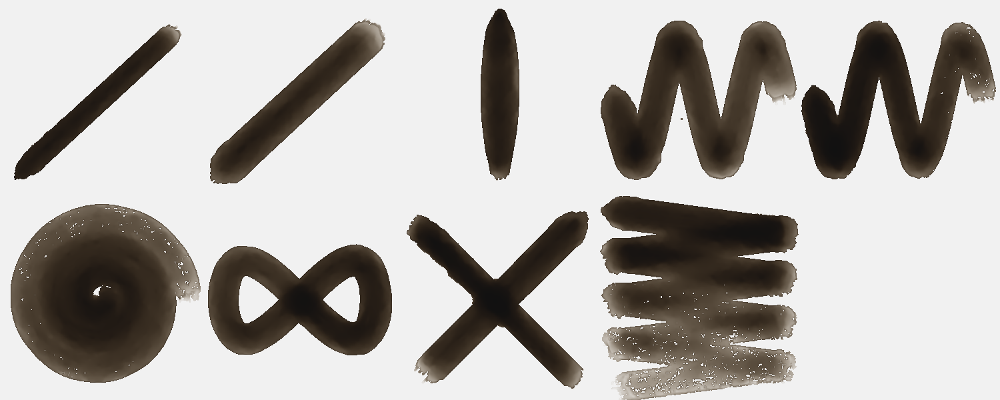

| stroke | covered | dark | spread | ms |
|---|---|---|---|---|
| light line | 12 % → 12 % | 0.80 | 1.01 | 64 |
| heavy line | 20 % → 20 % | 0.73 | 1.00 | 96 |
| pressure swell | 13 % → 13 % | 0.79 | 1.01 | 59 |
| fast wave | 43 % → 43 % | 0.71 | 1.01 | 188 |
| slow wave | 40 % → 40 % | 0.78 | 1.00 | 320 |
| spiral | 62 % → 62 % | 0.71 | 1.01 | 323 |
| loop | 34 % → 34 % | 0.77 | 1.00 | 165 |
| tilted | 15 % → 15 % | 0.78 | 1.01 | 113 |
| over the wet one | 31 % → 31 % | 0.78 | 1.01 | 90 |
| long, no reload | 75 % → 76 % | 0.67 | 1.02 | 574 | quarters: 0.71 → 0.63 → 0.51 → 0.36

## Brush Artist · Ink wash B
Watercolor · 40 px · 38.4 s

| stroke | covered | dark | spread | ms |
|---|---|---|---|---|
| light line | 12 % → 12 % | 0.80 | 1.01 | 117 |
| heavy line | 20 % → 21 % | 0.72 | 1.00 | 203 |
| pressure swell | 13 % → 13 % | 0.79 | 1.01 | 92 |
| fast wave | 43 % → 43 % | 0.71 | 1.01 | 250 |
| slow wave | 40 % → 40 % | 0.78 | 1.01 | 397 |
| spiral | 62 % → 62 % | 0.71 | 1.01 | 508 |
| loop | 34 % → 34 % | 0.77 | 1.00 | 244 |
| tilted | 15 % → 15 % | 0.78 | 1.01 | 148 |
| over the wet one | 31 % → 32 % | 0.78 | 1.02 | 128 |
| long, no reload | 75 % → 77 % | 0.66 | 1.02 | 1140 | quarters: 0.71 → 0.63 → 0.49 → 0.34

## Brush Artist · Ink wash C
Watercolor · 36 px · 35.3 s

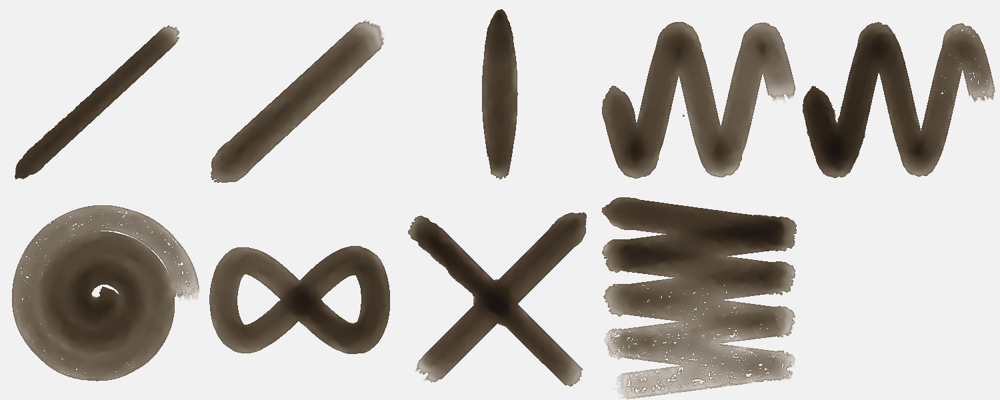

| stroke | covered | dark | spread | ms |
|---|---|---|---|---|
| light line | 11 % → 11 % | 0.71 | 1.02 | 91 |
| heavy line | 19 % → 19 % | 0.62 | 1.00 | 133 |
| pressure swell | 12 % → 12 % | 0.69 | 1.01 | 81 |
| fast wave | 39 % → 39 % | 0.61 | 1.01 | 251 |
| slow wave | 36 % → 37 % | 0.69 | 1.01 | 415 |
| spiral | 59 % → 60 % | 0.59 | 1.01 | 532 |
| loop | 31 % → 32 % | 0.67 | 1.00 | 146 |
| tilted | 14 % → 14 % | 0.69 | 1.01 | 93 |
| over the wet one | 29 % → 29 % | 0.69 | 1.02 | 68 |
| long, no reload | 70 % → 71 % | 0.56 | 1.02 | 491 | quarters: 0.60 → 0.50 → 0.38 → 0.26

## Brush Artist · Ink wash D (ink path)
Ink · 40 px · 46.0 s

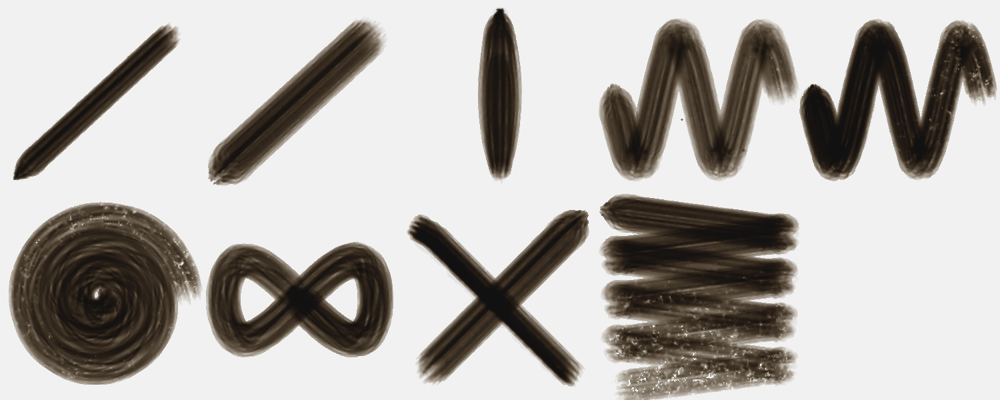

| stroke | covered | dark | spread | ms |
|---|---|---|---|---|
| light line | 14 % → 14 % | 0.73 | 1.00 | 67 |
| heavy line | 24 % → 23 % | 0.66 | 0.99 | 111 |
| pressure swell | 15 % → 15 % | 0.70 | 1.01 | 66 |
| fast wave | 47 % → 47 % | 0.61 | 1.00 | 220 |
| slow wave | 44 % → 44 % | 0.74 | 1.00 | 318 |
| spiral | 65 % → 65 % | 0.70 | 1.00 | 388 |
| loop | 39 % → 39 % | 0.70 | 1.00 | 177 |
| tilted | 16 % → 16 % | 0.70 | 1.00 | 122 |
| over the wet one | 34 % → 34 % | 0.70 | 1.00 | 98 |
| long, no reload | 84 % → 84 % | 0.64 | 1.01 | 1250 | quarters: 0.70 → 0.64 → 0.56 → 0.43

## Brush Artist · Ink dry A
Ink · 30 px · 34.2 s

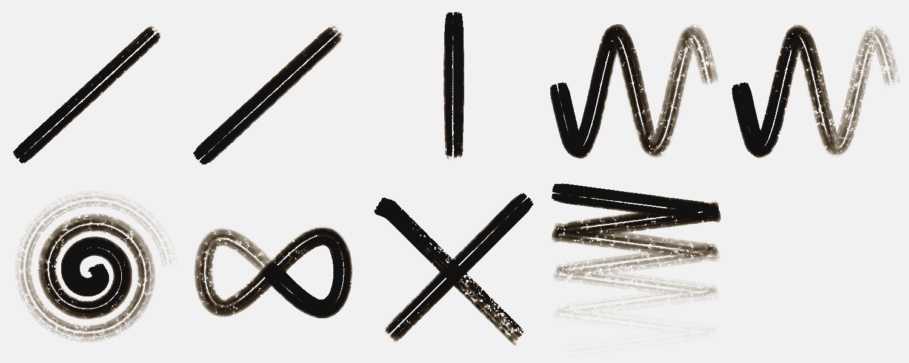

| stroke | covered | dark | spread | ms |
|---|---|---|---|---|
| light line | 9 % → 9 % | 0.82 | 0.99 | 94 |
| heavy line | 11 % → 11 % | 0.81 | 0.96 | 132 |
| pressure swell | 8 % → 8 % | 0.82 | 1.00 | 89 |
| fast wave | 26 % → 16 % | 0.79 | 0.63 | 247 |
| slow wave | 24 % → 13 % | 0.80 | 0.54 | 393 |
| spiral | 38 % → 16 % | 0.78 | 0.42 | 511 |
| loop | 22 % → 16 % | 0.78 | 0.73 | 280 |
| tilted | 10 % → 10 % | 0.81 | 1.01 | 161 |
| over the wet one | 20 % → 19 % | 0.81 | 0.96 | 147 |
| long, no reload | 39 % → 17 % | 0.78 | 0.43 | 782 | quarters: 0.48 → 0.19 → 0.03 → 0.00

## Brush Artist · Ink dry B
Ink · 30 px · 38.2 s

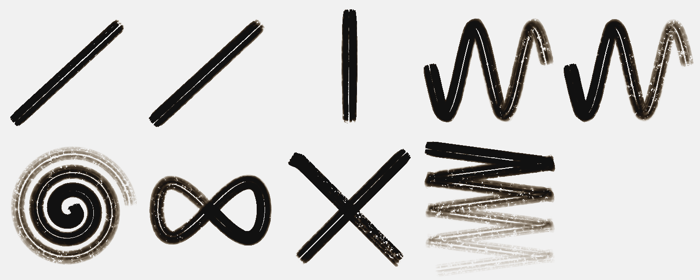

| stroke | covered | dark | spread | ms |
|---|---|---|---|---|
| light line | 10 % → 10 % | 0.83 | 1.01 | 86 |
| heavy line | 11 % → 11 % | 0.82 | 0.99 | 140 |
| pressure swell | 8 % → 8 % | 0.83 | 1.01 | 93 |
| fast wave | 27 % → 23 % | 0.80 | 0.84 | 318 |
| slow wave | 26 % → 20 % | 0.80 | 0.77 | 544 |
| spiral | 43 % → 24 % | 0.79 | 0.57 | 509 |
| loop | 23 % → 21 % | 0.80 | 0.93 | 436 |
| tilted | 10 % → 10 % | 0.83 | 1.01 | 165 |
| over the wet one | 20 % → 20 % | 0.83 | 1.01 | 102 |
| long, no reload | 49 % → 24 % | 0.78 | 0.48 | 788 | quarters: 0.52 → 0.35 → 0.14 → 0.04

## Brush Artist · Ink dry C
Ink · 30 px · 38.4 s

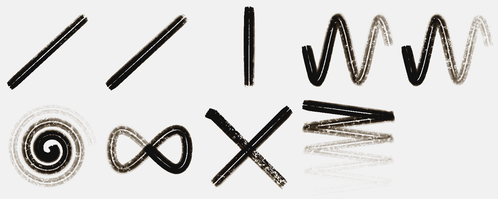

| stroke | covered | dark | spread | ms |
|---|---|---|---|---|
| light line | 9 % → 9 % | 0.82 | 0.95 | 112 |
| heavy line | 11 % → 10 % | 0.80 | 0.93 | 163 |
| pressure swell | 8 % → 8 % | 0.81 | 0.97 | 188 |
| fast wave | 25 % → 14 % | 0.79 | 0.56 | 453 |
| slow wave | 23 % → 11 % | 0.80 | 0.49 | 495 |
| spiral | 36 % → 14 % | 0.77 | 0.39 | 518 |
| loop | 22 % → 14 % | 0.78 | 0.65 | 299 |
| tilted | 10 % → 10 % | 0.80 | 1.01 | 133 |
| over the wet one | 20 % → 18 % | 0.80 | 0.91 | 116 |
| long, no reload | 35 % → 14 % | 0.77 | 0.40 | 724 | quarters: 0.44 → 0.14 → 0.02 → 0.00

## Brush Artist · Watercolour wash A
Watercolor · 46 px · 51.6 s

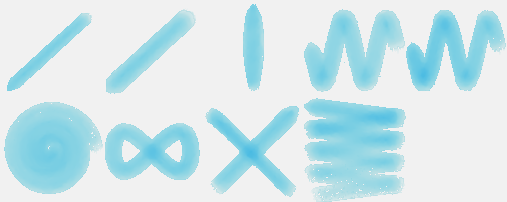

| stroke | covered | dark | spread | ms |
|---|---|---|---|---|
| light line | 13 % → 13 % | 0.17 | 1.00 | 101 |
| heavy line | 22 % → 22 % | 0.15 | 1.00 | 253 |
| pressure swell | 14 % → 14 % | 0.17 | 1.00 | 212 |
| fast wave | 46 % → 46 % | 0.15 | 1.01 | 350 |
| slow wave | 44 % → 44 % | 0.18 | 1.00 | 567 |
| spiral | 65 % → 65 % | 0.16 | 1.00 | 587 |
| loop | 38 % → 38 % | 0.17 | 1.00 | 291 |
| tilted | 17 % → 17 % | 0.18 | 1.01 | 169 |
| over the wet one | 34 % → 34 % | 0.18 | 1.00 | 139 |
| long, no reload | 82 % → 82 % | 0.16 | 1.01 | 795 | quarters: 0.17 → 0.15 → 0.13 → 0.10

## Brush Artist · Watercolour wash B
Watercolor · 46 px · 52.0 s

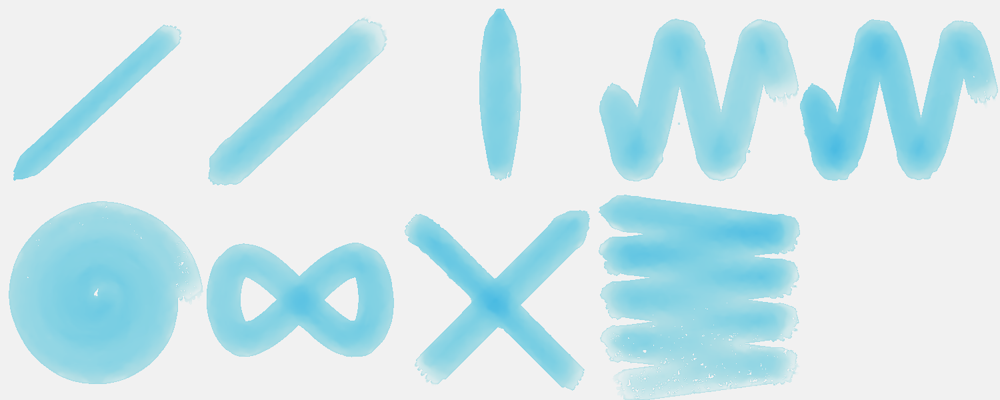

| stroke | covered | dark | spread | ms |
|---|---|---|---|---|
| light line | 13 % → 13 % | 0.17 | 1.00 | 91 |
| heavy line | 22 % → 22 % | 0.15 | 1.00 | 194 |
| pressure swell | 14 % → 14 % | 0.17 | 1.01 | 99 |
| fast wave | 46 % → 47 % | 0.15 | 1.01 | 362 |
| slow wave | 44 % → 44 % | 0.18 | 1.00 | 554 |
| spiral | 65 % → 65 % | 0.16 | 1.00 | 703 |
| loop | 38 % → 38 % | 0.17 | 1.00 | 515 |
| tilted | 17 % → 17 % | 0.18 | 1.01 | 181 |
| over the wet one | 34 % → 34 % | 0.18 | 1.01 | 158 |
| long, no reload | 82 % → 83 % | 0.15 | 1.01 | 886 | quarters: 0.17 → 0.15 → 0.13 → 0.09

## Brush Artist · Watercolour wash C
Watercolor · 50 px · 44.1 s

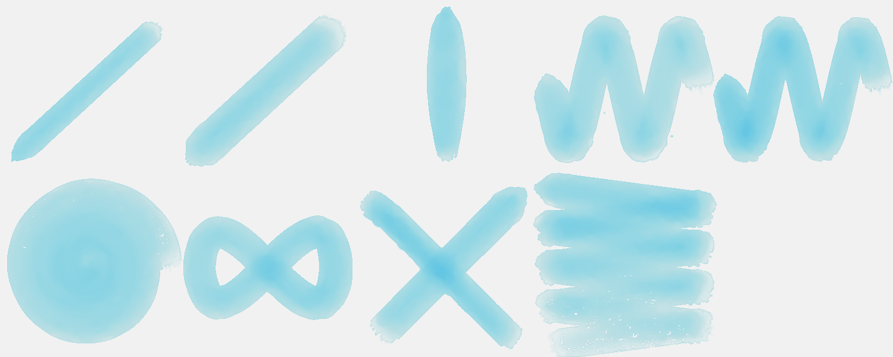

| stroke | covered | dark | spread | ms |
|---|---|---|---|---|
| light line | 14 % → 15 % | 0.14 | 1.01 | 98 |
| heavy line | 24 % → 24 % | 0.12 | 1.00 | 144 |
| pressure swell | 15 % → 15 % | 0.14 | 1.01 | 79 |
| fast wave | 49 % → 50 % | 0.12 | 1.01 | 451 |
| slow wave | 46 % → 47 % | 0.15 | 1.00 | 865 |
| spiral | 66 % → 66 % | 0.14 | 1.01 | 513 |
| loop | 40 % → 40 % | 0.14 | 1.00 | 324 |
| tilted | 18 % → 18 % | 0.15 | 1.02 | 279 |
| over the wet one | 36 % → 37 % | 0.15 | 1.01 | 130 |
| long, no reload | 84 % → 85 % | 0.13 | 1.02 | 811 | quarters: 0.15 → 0.13 → 0.11 → 0.08

## Brush Artist · Gouache A
Gouache · 30 px · 38.6 s

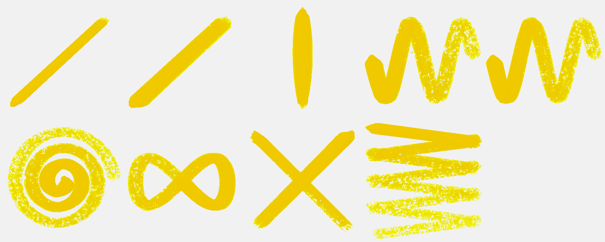

| stroke | covered | dark | spread | ms |
|---|---|---|---|---|
| light line | 8 % → 8 % | 0.16 | 0.97 | 65 |
| heavy line | 15 % → 12 % | 0.16 | 0.78 | 122 |
| pressure swell | 11 % → 9 % | 0.16 | 0.85 | 124 |
| fast wave | 30 % → 14 % | 0.16 | 0.45 | 267 |
| slow wave | 29 % → 14 % | 0.16 | 0.47 | 386 |
| spiral | 40 % → 14 % | 0.16 | 0.35 | 434 |
| loop | 24 % → 15 % | 0.16 | 0.62 | 259 |
| tilted | 10 % → 10 % | 0.16 | 1.01 | 110 |
| over the wet one | 22 % → 19 % | 0.16 | 0.89 | 82 |
| long, no reload | 43 % → 15 % | 0.16 | 0.35 | 566 | quarters: 0.10 → 0.07 → 0.04 → 0.02

## Brush Artist · Gouache B
Gouache · 30 px · 36.0 s

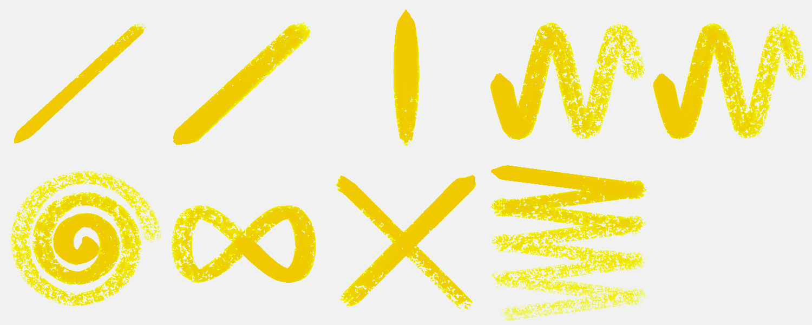

| stroke | covered | dark | spread | ms |
|---|---|---|---|---|
| light line | 8 % → 5 % | 0.16 | 0.69 | 80 |
| heavy line | 14 % → 6 % | 0.16 | 0.44 | 145 |
| pressure swell | 10 % → 6 % | 0.16 | 0.60 | 61 |
| fast wave | 26 % → 7 % | 0.16 | 0.26 | 232 |
| slow wave | 26 % → 7 % | 0.16 | 0.27 | 461 |
| spiral | 35 % → 7 % | 0.16 | 0.21 | 422 |
| loop | 21 % → 7 % | 0.16 | 0.35 | 242 |
| tilted | 9 % → 9 % | 0.16 | 1.02 | 89 |
| over the wet one | 20 % → 13 % | 0.16 | 0.65 | 85 |
| long, no reload | 36 % → 9 % | 0.16 | 0.24 | 592 | quarters: 0.08 → 0.04 → 0.02 → 0.01

## Brush Artist · Oil A
Oil · 30 px · 26.8 s

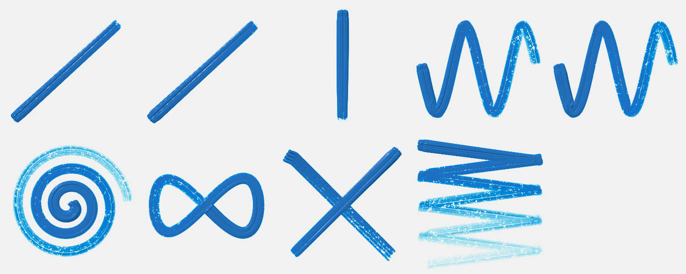

| stroke | covered | dark | spread | ms |
|---|---|---|---|---|
| light line | 8 % → 8 % | 0.53 | 1.00 | 128 |
| heavy line | 9 % → 9 % | 0.53 | 1.00 | 134 |
| pressure swell | 7 % → 7 % | 0.54 | 1.00 | 104 |
| fast wave | 22 % → 22 % | 0.50 | 1.00 | 364 |
| slow wave | 22 % → 22 % | 0.50 | 1.00 | 603 |
| spiral | 34 % → 34 % | 0.41 | 1.00 | 653 |
| loop | 19 % → 19 % | 0.52 | 1.00 | 314 |
| tilted | 10 % → 10 % | 0.52 | 1.00 | 211 |
| over the wet one | 19 % → 19 % | 0.52 | 1.00 | 187 |
| long, no reload | 42 % → 42 % | 0.35 | 1.00 | 959 | quarters: 0.29 → 0.22 → 0.10 → 0.03

Numbers say: pressure barely changes the width.

## Brush Artist · Oil B
Oil · 30 px · 27.4 s

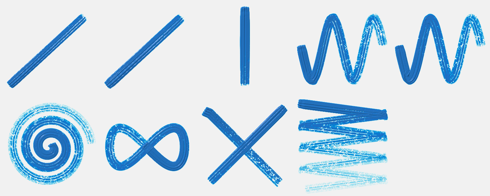

| stroke | covered | dark | spread | ms |
|---|---|---|---|---|
| light line | 10 % → 10 % | 0.51 | 1.00 | 142 |
| heavy line | 10 % → 10 % | 0.51 | 1.00 | 165 |
| pressure swell | 8 % → 8 % | 0.54 | 1.00 | 135 |
| fast wave | 25 % → 25 % | 0.47 | 1.00 | 497 |
| slow wave | 25 % → 25 % | 0.48 | 1.00 | 558 |
| spiral | 38 % → 38 % | 0.40 | 1.00 | 625 |
| loop | 21 % → 21 % | 0.50 | 1.00 | 295 |
| tilted | 10 % → 10 % | 0.50 | 1.00 | 185 |
| over the wet one | 20 % → 20 % | 0.50 | 1.00 | 122 |
| long, no reload | 45 % → 45 % | 0.35 | 1.00 | 863 | quarters: 0.32 → 0.22 → 0.11 → 0.05

Numbers say: pressure barely changes the width.

## Brush Artist · Charcoal A
Charcoal · 14 px · 14.3 s

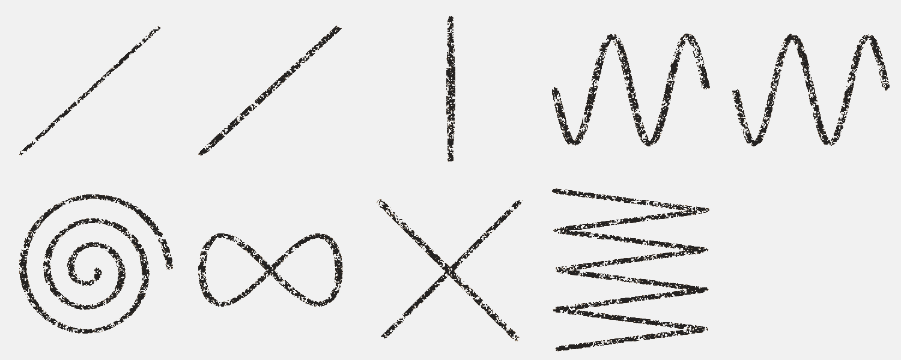

| stroke | covered | dark | spread | ms |
|---|---|---|---|---|
| light line | 2 % → 2 % | 0.76 | 1.00 | 23 |
| heavy line | 3 % → 3 % | 0.76 | 1.00 | 22 |
| pressure swell | 3 % → 3 % | 0.76 | 1.00 | 19 |
| fast wave | 8 % → 8 % | 0.75 | 1.00 | 57 |
| slow wave | 7 % → 7 % | 0.75 | 1.00 | 57 |
| spiral | 12 % → 12 % | 0.75 | 1.00 | 91 |
| loop | 6 % → 6 % | 0.75 | 1.00 | 50 |
| tilted | 3 % → 3 % | 0.73 | 1.00 | 46 |
| over the wet one | 5 % → 5 % | 0.73 | 1.00 | 26 |
| long, no reload | 14 % → 14 % | 0.76 | 1.00 | 120 | quarters: 0.12 → 0.12 → 0.12 → 0.13

Numbers say: the long stroke does not run out of paint.

## Brush Artist · Charcoal B
Charcoal · 20 px · 12.5 s

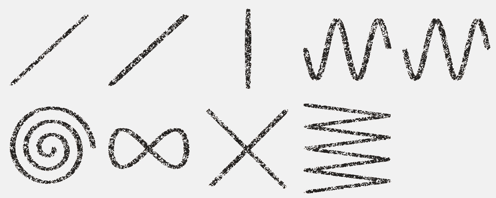

| stroke | covered | dark | spread | ms |
|---|---|---|---|---|
| light line | 3 % → 3 % | 0.76 | 1.00 | 23 |
| heavy line | 4 % → 4 % | 0.77 | 1.00 | 23 |
| pressure swell | 3 % → 3 % | 0.77 | 1.00 | 15 |
| fast wave | 10 % → 10 % | 0.77 | 1.00 | 60 |
| slow wave | 10 % → 10 % | 0.76 | 1.00 | 111 |
| spiral | 15 % → 15 % | 0.76 | 1.00 | 115 |
| loop | 8 % → 8 % | 0.76 | 1.00 | 66 |
| tilted | 3 % → 3 % | 0.76 | 1.00 | 36 |
| over the wet one | 7 % → 7 % | 0.76 | 1.00 | 21 |
| long, no reload | 17 % → 17 % | 0.77 | 1.00 | 146 | quarters: 0.15 → 0.14 → 0.15 → 0.15

Numbers say: the long stroke does not run out of paint.

