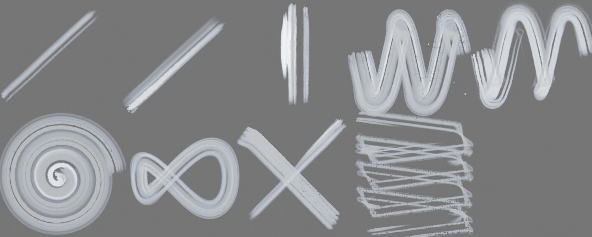
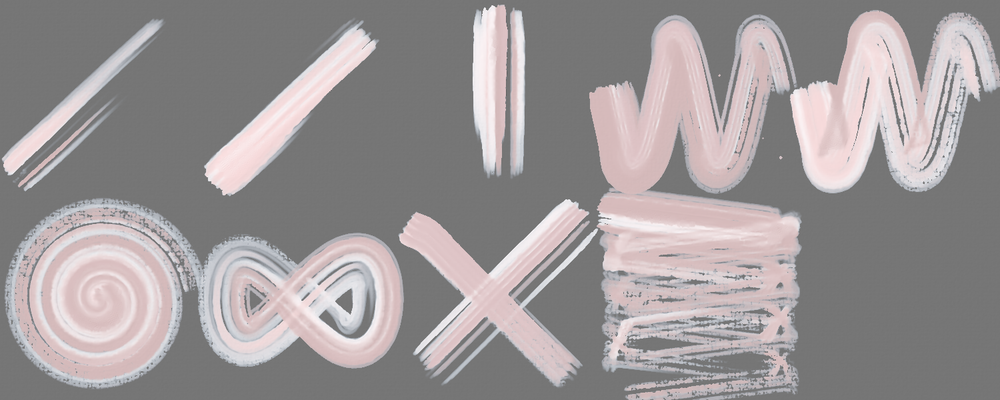
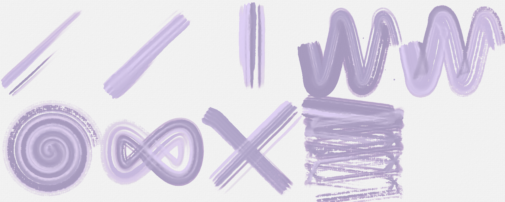
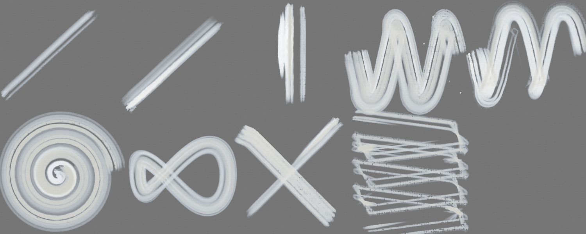
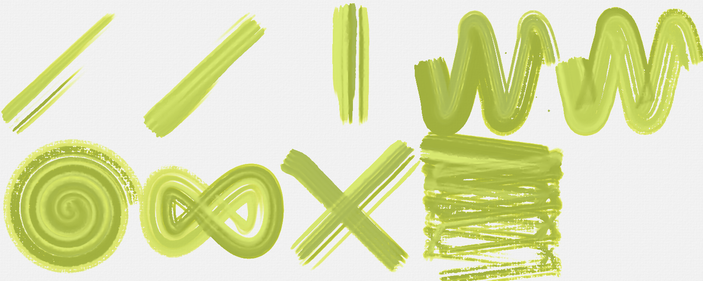
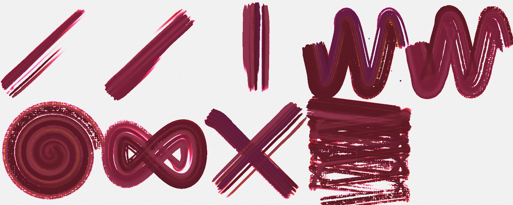
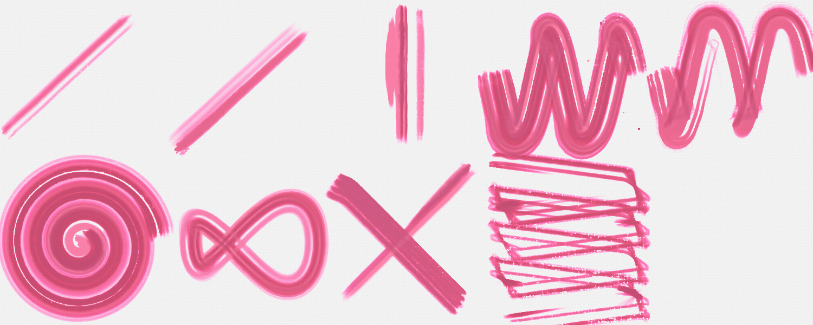
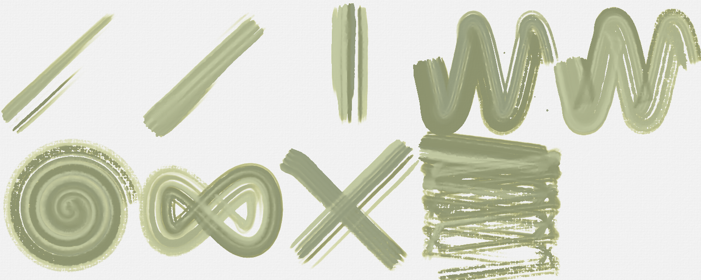

# Brush Lab — 241 brushes · Nov 8, 2026 at 3:44 PM

Every sheet: 1500 × 600, ten strokes in a 5 × 2 grid — 1. light line · 2. heavy line · 3. pressure swell · 4. fast wave · 5. slow wave · 6. spiral · 7. loop · 8. tilted · 9. over the wet one · 10. long, no reload (cell 8 holds «tilted» and «over the wet one» crossed). The CPU reference of Mamay's paint engine; the wet layer settles 20 s at the end.

Columns: **covered** = share of the cell with paint right after the stroke → after settling; **width** = painted area of the stroke ÷ its length (px); **dark** = mean darkness of the painted pixels above the paper's own grain (0 = paper, 1 = black); **spread** = how far wet paint went beyond the stroke (1.0 = stayed); **ms** = the stroke on the CPU; long stroke: paint in each quarter of its length (it should run out: wet → streaks → dry tail).

## Ink Line
Ink · 12 px · 32.8 s

| stroke | covered | width | dark | spread | ms |
|---|---|---|---|---|---|
| light line | 1 % → 4 % | 4.3 px | 0.55 | 2.45 | 79 |
| heavy line | 5 % → 6 % | 15.7 px | 0.68 | 1.14 | 178 |
| pressure swell | 3 % → 4 % | 11.3 px | 0.64 | 1.40 | 91 |
| fast wave | 10 % → 11 % | 11.2 px | 0.59 | 1.11 | 221 |
| slow wave | 8 % → 10 % | 9.6 px | 0.57 | 1.16 | 288 |
| spiral | 14 % → 15 % | 8.9 px | 0.49 | 1.07 | 300 |
| loop | 8 % → 9 % | 10.6 px | 0.61 | 1.15 | 154 |
| tilted | 5 % → 5 % | 14.3 px | 0.64 | 1.05 | 80 |
| over the wet one | 10 % → 11 % | 12.5 px | 0.64 | 1.15 | 70 |
| long, no reload | 18 % → 17 % | 8.1 px | 0.47 | 0.96 | 602 | quarters: 0.22 → 0.09 → 0.04 → 0.02

Numbers say: light vs heavy: width 4.3 → 15.7 px, dark 0.55 → 0.68; wet paint spreads well beyond the stroke.

## Dense Ink
Ink · 14 px · 34.3 s

| stroke | covered | width | dark | spread | ms |
|---|---|---|---|---|---|
| light line | 5 % → 7 % | 15.2 px | 0.72 | 1.27 | 142 |
| heavy line | 7 % → 7 % | 19.1 px | 0.73 | 1.09 | 169 |
| pressure swell | 5 % → 6 % | 17.9 px | 0.72 | 1.18 | 139 |
| fast wave | 13 % → 13 % | 15.2 px | 0.69 | 1.01 | 277 |
| slow wave | 12 % → 12 % | 13.5 px | 0.67 | 1.04 | 312 |
| spiral | 18 % → 15 % | 12.2 px | 0.65 | 0.80 | 340 |
| loop | 11 % → 12 % | 14.8 px | 0.69 | 1.08 | 173 |
| tilted | 5 % → 6 % | 14.5 px | 0.72 | 1.07 | 93 |
| over the wet one | 12 % → 13 % | 17.7 px | 0.72 | 1.12 | 109 |
| long, no reload | 23 % → 15 % | 10.1 px | 0.64 | 0.66 | 612 | quarters: 0.30 → 0.12 → 0.04 → 0.02

Numbers say: light vs heavy: width 15.2 → 19.1 px, dark 0.72 → 0.73.

## Transparent Wash
Watercolor · 22 px · 36.2 s

| stroke | covered | width | dark | spread | ms |
|---|---|---|---|---|---|
| light line | 2 % → 5 % | 6.9 px | 0.27 | 2.26 | 68 |
| heavy line | 7 % → 9 % | 20.4 px | 0.27 | 1.23 | 145 |
| pressure swell | 4 % → 6 % | 15.2 px | 0.28 | 1.54 | 96 |
| fast wave | 14 % → 16 % | 16.1 px | 0.20 | 1.17 | 273 |
| slow wave | 12 % → 15 % | 13.7 px | 0.21 | 1.28 | 290 |
| spiral | 18 % → 22 % | 11.9 px | 0.16 | 1.22 | 250 |
| loop | 11 % → 13 % | 14.5 px | 0.22 | 1.20 | 135 |
| tilted | 8 % → 8 % | 21.1 px | 0.24 | 1.06 | 74 |
| over the wet one | 13 % → 16 % | 16.4 px | 0.24 | 1.19 | 89 |
| long, no reload | 26 % → 32 % | 11.6 px | 0.13 | 1.22 | 591 | quarters: 0.11 → 0.04 → 0.02 → 0.01

Numbers say: light vs heavy: width 6.9 → 20.4 px, dark 0.27 → 0.27; wet paint spreads well beyond the stroke.

## Dry Brush
Gouache · 24 px · 30.6 s

| stroke | covered | width | dark | spread | ms |
|---|---|---|---|---|---|
| light line | 5 % → 1 % | 13.8 px | 0.65 | 0.11 | 45 |
| heavy line | 6 % → 0 % | 18.4 px | 0.65 | 0.02 | 123 |
| pressure swell | 5 % → 0 % | 18.1 px | 0.65 | 0.09 | 104 |
| fast wave | 6 % → 1 % | 6.9 px | 0.65 | 0.08 | 204 |
| slow wave | 7 % → 0 % | 7.8 px | 0.65 | 0.07 | 331 |
| spiral | 7 % → 1 % | 4.4 px | 0.65 | 0.08 | 375 |
| loop | 9 % → 0 % | 12.2 px | 0.65 | 0.05 | 208 |
| tilted | 4 % → 3 % | 10.3 px | 0.65 | 0.89 | 116 |
| over the wet one | 9 % → 1 % | 14.3 px | 0.65 | 0.12 | 113 |
| long, no reload | 6 % → 1 % | 2.7 px | 0.65 | 0.15 | 522 | quarters: 0.12 → 0.00 → 0.00 → 0.00

Numbers say: light vs heavy: width 13.8 → 18.4 px, dark 0.65 → 0.65.

## Wax Crayon
Wax · 8 px · 13.6 s

| stroke | covered | width | dark | spread | ms |
|---|---|---|---|---|---|
| light line | 1 % → 1 % | 2.5 px | 0.71 | 1.00 | 28 |
| heavy line | 1 % → 1 % | 3.9 px | 0.69 | 1.00 | 42 |
| pressure swell | 1 % → 1 % | 3.3 px | 0.70 | 1.00 | 32 |
| fast wave | 3 % → 3 % | 3.5 px | 0.69 | 1.00 | 75 |
| slow wave | 3 % → 3 % | 3.4 px | 0.70 | 1.00 | 54 |
| spiral | 5 % → 5 % | 3.3 px | 0.70 | 1.00 | 81 |
| loop | 3 % → 3 % | 3.3 px | 0.70 | 1.00 | 56 |
| tilted | 2 % → 2 % | 5.6 px | 0.68 | 1.00 | 35 |
| over the wet one | 3 % → 3 % | 3.6 px | 0.68 | 1.00 | 21 |
| long, no reload | 7 % → 7 % | 3.3 px | 0.70 | 1.00 | 152 | quarters: 0.06 → 0.06 → 0.06 → 0.06

Numbers say: light vs heavy: width 2.5 → 3.9 px, dark 0.71 → 0.69; the long stroke does not run out of paint.

## Oil Pastel
Wax · 12 px · 13.3 s

| stroke | covered | width | dark | spread | ms |
|---|---|---|---|---|---|
| light line | 1 % → 1 % | 4.0 px | 0.68 | 1.00 | 28 |
| heavy line | 2 % → 2 % | 6.5 px | 0.68 | 1.00 | 57 |
| pressure swell | 2 % → 2 % | 5.7 px | 0.69 | 1.00 | 30 |
| fast wave | 5 % → 5 % | 5.7 px | 0.68 | 1.00 | 86 |
| slow wave | 5 % → 5 % | 5.5 px | 0.68 | 1.00 | 85 |
| spiral | 8 % → 8 % | 5.5 px | 0.68 | 1.00 | 141 |
| loop | 4 % → 4 % | 5.6 px | 0.68 | 1.00 | 82 |
| tilted | 2 % → 2 % | 6.8 px | 0.68 | 1.00 | 51 |
| over the wet one | 5 % → 5 % | 5.8 px | 0.68 | 1.00 | 38 |
| long, no reload | 13 % → 13 % | 5.6 px | 0.68 | 1.00 | 258 | quarters: 0.10 → 0.09 → 0.10 → 0.10

Numbers say: light vs heavy: width 4.0 → 6.5 px, dark 0.68 → 0.68; the long stroke does not run out of paint.

## Charcoal
Charcoal · 5 px · 12.1 s

| stroke | covered | width | dark | spread | ms |
|---|---|---|---|---|---|
| light line | 1 % → 1 % | 2.0 px | 0.74 | 1.00 | 16 |
| heavy line | 1 % → 1 % | 3.0 px | 0.74 | 1.00 | 18 |
| pressure swell | 1 % → 1 % | 2.7 px | 0.74 | 1.00 | 9 |
| fast wave | 2 % → 2 % | 2.7 px | 0.73 | 1.00 | 40 |
| slow wave | 2 % → 2 % | 2.6 px | 0.74 | 1.00 | 35 |
| spiral | 4 % → 4 % | 2.5 px | 0.74 | 1.00 | 87 |
| loop | 2 % → 2 % | 2.6 px | 0.74 | 1.00 | 30 |
| tilted | 2 % → 2 % | 4.3 px | 0.72 | 1.00 | 23 |
| over the wet one | 2 % → 2 % | 2.4 px | 0.72 | 1.00 | 14 |
| long, no reload | 6 % → 6 % | 2.7 px | 0.73 | 1.00 | 95 | quarters: 0.05 → 0.05 → 0.05 → 0.05

Numbers say: light vs heavy: width 2.0 → 3.0 px, dark 0.74 → 0.74; the long stroke does not run out of paint.

## Impasto
Heavy acrylic · 22 px · 20.3 s

| stroke | covered | width | dark | spread | ms |
|---|---|---|---|---|---|
| light line | 8 % → 8 % | 24.1 px | 0.72 | 0.93 | 66 |
| heavy line | 10 % → 9 % | 28.8 px | 0.70 | 0.94 | 122 |
| pressure swell | 7 % → 7 % | 28.1 px | 0.72 | 0.94 | 71 |
| fast wave | 20 % → 13 % | 23.4 px | 0.71 | 0.64 | 220 |
| slow wave | 21 % → 14 % | 24.5 px | 0.71 | 0.66 | 356 |
| spiral | 30 % → 14 % | 19.9 px | 0.71 | 0.46 | 330 |
| loop | 18 % → 14 % | 23.9 px | 0.71 | 0.77 | 271 |
| tilted | 8 % → 8 % | 21.7 px | 0.70 | 1.00 | 125 |
| over the wet one | 17 % → 15 % | 25.4 px | 0.70 | 0.91 | 123 |
| long, no reload | 33 % → 14 % | 14.9 px | 0.71 | 0.42 | 583 | quarters: 0.38 → 0.21 → 0.10 → 0.03

Numbers say: light vs heavy: width 24.1 → 28.8 px, dark 0.72 → 0.70.

## Oil Round
Oil · 18 px · 27.1 s

| stroke | covered | width | dark | spread | ms |
|---|---|---|---|---|---|
| light line | 2 % → 2 % | 7.2 px | 0.75 | 1.00 | 89 |
| heavy line | 7 % → 7 % | 19.3 px | 0.73 | 1.00 | 98 |
| pressure swell | 4 % → 4 % | 13.7 px | 0.72 | 1.00 | 68 |
| fast wave | 11 % → 11 % | 12.8 px | 0.65 | 1.00 | 204 |
| slow wave | 8 % → 8 % | 9.0 px | 0.57 | 1.00 | 287 |
| spiral | 10 % → 10 % | 6.6 px | 0.50 | 1.00 | 325 |
| loop | 6 % → 6 % | 7.2 px | 0.45 | 1.00 | 158 |
| tilted | 4 % → 4 % | 10.1 px | 0.52 | 1.00 | 75 |
| over the wet one | 6 % → 6 % | 7.6 px | 0.52 | 1.00 | 106 |
| long, no reload | 15 % → 15 % | 6.9 px | 0.42 | 1.00 | 534 | quarters: 0.09 → 0.08 → 0.07 → 0.06

Numbers say: light vs heavy: width 7.2 → 19.3 px, dark 0.75 → 0.73.

## Palette Knife
Oil · 20 px · 26.4 s

| stroke | covered | width | dark | spread | ms |
|---|---|---|---|---|---|
| light line | 8 % → 8 % | 21.9 px | 0.67 | 1.00 | 22 |
| heavy line | 8 % → 8 % | 22.5 px | 0.74 | 1.00 | 27 |
| pressure swell | 6 % → 6 % | 22.3 px | 0.74 | 1.00 | 8 |
| fast wave | 16 % → 16 % | 18.9 px | 0.50 | 1.00 | 43 |
| slow wave | 17 % → 17 % | 19.9 px | 0.43 | 1.00 | 65 |
| spiral | 17 % → 17 % | 11.3 px | 0.46 | 1.00 | 72 |
| loop | 16 % → 16 % | 21.0 px | 0.59 | 1.00 | 31 |
| tilted | 5 % → 5 % | 15.0 px | 0.72 | 1.00 | 17 |
| over the wet one | 13 % → 13 % | 21.0 px | 0.72 | 1.00 | 19 |
| long, no reload | 16 % → 16 % | 7.2 px | 0.49 | 1.00 | 148 | quarters: 0.29 → 0.05 → 0.00 → 0.00

Numbers say: light vs heavy: width 21.9 → 22.5 px, dark 0.67 → 0.74; pressure barely changes the width.

## Water
Watercolor · 20 px · 48.7 s · over bands of wet oil paint and oil pastel in turn (it works on paint already there: look at what it does to the bands; covered counts the bands too)

| stroke | covered | width | dark | spread | ms |
|---|---|---|---|---|---|
| light line | 25 % → 27 % | 73.8 px | 0.80 | 1.06 | 34 |
| heavy line | 24 % → 25 % | 69.8 px | 0.81 | 1.04 | 58 |
| pressure swell | 24 % → 25 % | 89.6 px | 0.81 | 1.03 | 45 |
| fast wave | 24 % → 26 % | 27.7 px | 0.81 | 1.07 | 164 |
| slow wave | 24 % → 25 % | 27.8 px | 0.81 | 1.06 | 213 |
| spiral | 24 % → 26 % | 15.9 px | 0.81 | 1.07 | 347 |
| loop | 24 % → 25 % | 31.1 px | 0.81 | 1.03 | 142 |
| tilted | 24 % → 24 % | 67.0 px | 0.81 | 1.00 | 84 |
| over the wet one | 24 % → 25 % | 0.0 px | 0.81 | 1.06 | 66 |
| long, no reload | 24 % → 26 % | 10.7 px | 0.81 | 1.08 | 384 | quarters: 0.21 → 0.27 → 0.18 → 0.27

Numbers say: light vs heavy: width 73.8 → 69.8 px, dark 0.80 → 0.81; pressure barely changes the width; the long stroke does not run out of paint.

## Blender
Pastel · 16 px · 26.8 s · over bands of wet oil paint and oil pastel in turn (it works on paint already there: look at what it does to the bands; covered counts the bands too)

| stroke | covered | width | dark | spread | ms |
|---|---|---|---|---|---|
| light line | 24 % → 24 % | 70.7 px | 0.81 | 1.00 | 59 |
| heavy line | 25 % → 25 % | 72.1 px | 0.80 | 1.00 | 59 |
| pressure swell | 24 % → 24 % | 91.3 px | 0.81 | 1.00 | 39 |
| fast wave | 26 % → 26 % | 30.0 px | 0.79 | 1.00 | 108 |
| slow wave | 26 % → 26 % | 29.9 px | 0.80 | 1.00 | 132 |
| spiral | 28 % → 28 % | 18.7 px | 0.77 | 1.00 | 232 |
| loop | 25 % → 25 % | 33.0 px | 0.80 | 1.00 | 111 |
| tilted | 25 % → 25 % | 70.1 px | 0.79 | 1.00 | 50 |
| over the wet one | 26 % → 26 % | 1.8 px | 0.79 | 1.00 | 41 |
| long, no reload | 30 % → 30 % | 13.7 px | 0.76 | 1.00 | 268 | quarters: 0.20 → 0.28 → 0.23 → 0.30

Numbers say: light vs heavy: width 70.7 → 72.1 px, dark 0.81 → 0.80; pressure barely changes the width; the long stroke does not run out of paint.

## Eraser
Eraser · 16 px · 26.4 s · over bands of wet oil paint and oil pastel in turn (it works on paint already there: look at what it does to the bands; covered counts the bands too)

| stroke | covered | width | dark | spread | ms |
|---|---|---|---|---|---|
| light line | 24 % → 24 % | 69.6 px | 0.82 | 1.00 | 44 |
| heavy line | 23 % → 23 % | 67.9 px | 0.82 | 1.00 | 39 |
| pressure swell | 23 % → 23 % | 87.3 px | 0.82 | 1.00 | 39 |
| fast wave | 22 % → 22 % | 25.7 px | 0.82 | 1.00 | 121 |
| slow wave | 22 % → 22 % | 25.7 px | 0.82 | 1.00 | 107 |
| spiral | 22 % → 22 % | 14.4 px | 0.82 | 1.00 | 195 |
| loop | 22 % → 22 % | 28.6 px | 0.82 | 1.00 | 91 |
| tilted | 23 % → 23 % | 65.1 px | 0.82 | 1.00 | 52 |
| over the wet one | 23 % → 23 % | 0.0 px | 0.82 | 1.00 | 55 |
| long, no reload | 20 % → 20 % | 8.9 px | 0.82 | 1.00 | 224 | quarters: 0.15 → 0.20 → 0.15 → 0.20

Numbers say: light vs heavy: width 69.6 → 67.9 px, dark 0.82 → 0.82; pressure barely changes the width; the long stroke does not run out of paint.

## Fan
Gouache · 30 px · 40.0 s

| stroke | covered | width | dark | spread | ms |
|---|---|---|---|---|---|
| light line | 9 % → 3 % | 25.6 px | 0.63 | 0.37 | 47 |
| heavy line | 11 % → 4 % | 30.9 px | 0.63 | 0.39 | 91 |
| pressure swell | 8 % → 5 % | 31.7 px | 0.63 | 0.55 | 52 |
| fast wave | 17 % → 5 % | 20.2 px | 0.63 | 0.26 | 135 |
| slow wave | 18 % → 5 % | 21.0 px | 0.63 | 0.25 | 244 |
| spiral | 24 % → 5 % | 15.5 px | 0.63 | 0.19 | 322 |
| loop | 17 % → 5 % | 22.7 px | 0.63 | 0.28 | 128 |
| tilted | 5 % → 6 % | 15.0 px | 0.63 | 1.05 | 50 |
| over the wet one | 16 % → 8 % | 29.7 px | 0.63 | 0.49 | 66 |
| long, no reload | 22 % → 5 % | 9.9 px | 0.63 | 0.22 | 396 | quarters: 0.29 → 0.07 → 0.01 → 0.00

Numbers say: light vs heavy: width 25.6 → 30.9 px, dark 0.63 → 0.63.

## Sponge
Gouache · 30 px · 39.5 s

| stroke | covered | width | dark | spread | ms |
|---|---|---|---|---|---|
| light line | 4 % → 0 % | 11.3 px | 0.62 | 0.12 | 57 |
| heavy line | 12 % → 2 % | 35.4 px | 0.62 | 0.14 | 95 |
| pressure swell | 7 % → 2 % | 27.9 px | 0.62 | 0.28 | 55 |
| fast wave | 20 % → 4 % | 23.2 px | 0.62 | 0.19 | 291 |
| slow wave | 21 % → 4 % | 23.8 px | 0.62 | 0.18 | 386 |
| spiral | 28 % → 4 % | 18.3 px | 0.62 | 0.14 | 300 |
| loop | 18 % → 5 % | 23.0 px | 0.62 | 0.29 | 162 |
| tilted | 7 % → 7 % | 18.2 px | 0.62 | 1.04 | 132 |
| over the wet one | 16 % → 6 % | 27.8 px | 0.62 | 0.37 | 77 |
| long, no reload | 29 % → 5 % | 12.9 px | 0.62 | 0.17 | 418 | quarters: 0.29 → 0.13 → 0.07 → 0.04

Numbers say: light vs heavy: width 11.3 → 35.4 px, dark 0.62 → 0.62.

## Ink — sumi brush
Watercolour 1.00 · 22 px · 41.5 s

| stroke | covered | width | dark | spread | ms |
|---|---|---|---|---|---|
| light line | 8 % → 9 % | 23.9 px | 0.87 | 1.13 | 82 |
| heavy line | 12 % → 13 % | 36.2 px | 0.86 | 1.01 | 94 |
| pressure swell | 10 % → 10 % | 36.1 px | 0.87 | 1.04 | 103 |
| fast wave | 27 % → 27 % | 31.0 px | 0.82 | 1.00 | 270 |
| slow wave | 27 % → 28 % | 31.2 px | 0.82 | 1.02 | 393 |
| spiral | 38 % → 36 % | 25.2 px | 0.75 | 0.95 | 361 |
| loop | 22 % → 23 % | 29.0 px | 0.84 | 1.01 | 175 |
| tilted | 9 % → 9 % | 25.7 px | 0.86 | 1.00 | 114 |
| over the wet one | 20 % → 20 % | 30.0 px | 0.86 | 1.02 | 105 |
| long, no reload | 46 % → 41 % | 20.7 px | 0.70 | 0.90 | 583 | quarters: 0.57 → 0.42 → 0.24 → 0.15

Numbers say: light vs heavy: width 23.9 → 36.2 px, dark 0.87 → 0.86.

## Ink — wash
Watercolour 1.00 · 40 px · 44.3 s

| stroke | covered | width | dark | spread | ms |
|---|---|---|---|---|---|
| light line | 13 % → 13 % | 37.3 px | 0.42 | 1.02 | 76 |
| heavy line | 19 % → 19 % | 55.2 px | 0.35 | 1.01 | 130 |
| pressure swell | 13 % → 13 % | 48.2 px | 0.41 | 1.02 | 80 |
| fast wave | 41 % → 42 % | 47.8 px | 0.32 | 1.02 | 350 |
| slow wave | 39 % → 40 % | 45.3 px | 0.42 | 1.02 | 403 |
| spiral | 60 % → 62 % | 39.7 px | 0.33 | 1.02 | 447 |
| loop | 34 % → 34 % | 43.8 px | 0.39 | 1.01 | 246 |
| tilted | 15 % → 15 % | 40.7 px | 0.43 | 1.01 | 141 |
| over the wet one | 30 % → 31 % | 43.4 px | 0.43 | 1.02 | 109 |
| long, no reload | 71 % → 75 % | 32.0 px | 0.31 | 1.05 | 634 | quarters: 0.40 → 0.29 → 0.19 → 0.12

Numbers say: light vs heavy: width 37.3 → 55.2 px, dark 0.42 → 0.35.

## Ink — dry brush
Ink 1.00 · 30 px · 31.5 s

| stroke | covered | width | dark | spread | ms |
|---|---|---|---|---|---|
| light line | 5 % → 5 % | 14.9 px | 0.82 | 0.88 | 150 |
| heavy line | 7 % → 6 % | 19.4 px | 0.82 | 0.87 | 289 |
| pressure swell | 5 % → 5 % | 18.9 px | 0.81 | 0.96 | 117 |
| fast wave | 12 % → 7 % | 13.4 px | 0.80 | 0.65 | 302 |
| slow wave | 12 % → 8 % | 14.1 px | 0.81 | 0.62 | 601 |
| spiral | 16 % → 8 % | 10.8 px | 0.80 | 0.47 | 588 |
| loop | 11 % → 9 % | 14.5 px | 0.79 | 0.77 | 311 |
| tilted | 5 % → 6 % | 15.0 px | 0.81 | 1.08 | 153 |
| over the wet one | 12 % → 11 % | 18.4 px | 0.81 | 0.94 | 143 |
| long, no reload | 21 % → 10 % | 9.2 px | 0.77 | 0.47 | 837 | quarters: 0.28 → 0.10 → 0.03 → 0.01

Numbers say: light vs heavy: width 14.9 → 19.4 px, dark 0.82 → 0.82.

## Ink — nib
Watercolour 1.00 · 5 px · 29.2 s

| stroke | covered | width | dark | spread | ms |
|---|---|---|---|---|---|
| light line | 2 % → 5 % | 5.5 px | 0.89 | 2.46 | 36 |
| heavy line | 2 % → 5 % | 6.4 px | 0.89 | 2.34 | 36 |
| pressure swell | 2 % → 4 % | 6.2 px | 0.89 | 2.53 | 25 |
| fast wave | 5 % → 8 % | 5.9 px | 0.89 | 1.63 | 102 |
| slow wave | 5 % → 8 % | 5.7 px | 0.89 | 1.70 | 82 |
| spiral | 8 % → 11 % | 5.0 px | 0.87 | 1.41 | 155 |
| loop | 4 % → 8 % | 5.7 px | 0.89 | 1.74 | 74 |
| tilted | 4 % → 4 % | 10.3 px | 0.89 | 1.02 | 44 |
| over the wet one | 6 % → 9 % | 6.1 px | 0.89 | 1.61 | 31 |
| long, no reload | 9 % → 12 % | 4.2 px | 0.85 | 1.30 | 248 | quarters: 0.24 → 0.11 → 0.07 → 0.05

Numbers say: light vs heavy: width 5.5 → 6.4 px, dark 0.89 → 0.89; wet paint spreads well beyond the stroke.

## 0.45 · Dry brush
Gouache 0.91 · Ink 0.07 · 34 px · 43.6 s

| stroke | covered | width | dark | spread | ms |
|---|---|---|---|---|---|
| light line | 8 % → 2 % | 22.9 px | 0.68 | 0.26 | 150 |
| heavy line | 10 % → 5 % | 27.8 px | 0.68 | 0.52 | 171 |
| pressure swell | 7 % → 4 % | 26.5 px | 0.68 | 0.59 | 127 |
| fast wave | 19 % → 6 % | 21.4 px | 0.68 | 0.33 | 462 |
| slow wave | 20 % → 7 % | 23.0 px | 0.68 | 0.38 | 707 |
| spiral | 27 % → 8 % | 17.6 px | 0.68 | 0.29 | 1004 |
| loop | 18 % → 9 % | 23.0 px | 0.68 | 0.51 | 402 |
| tilted | 8 % → 8 % | 21.8 px | 0.68 | 1.02 | 177 |
| over the wet one | 17 % → 12 % | 25.0 px | 0.68 | 0.73 | 159 |
| long, no reload | 34 % → 9 % | 15.3 px | 0.68 | 0.28 | 1130 | quarters: 0.37 → 0.26 → 0.19 → 0.17

Numbers say: light vs heavy: width 22.9 → 27.8 px, dark 0.68 → 0.68.

## Dry pastel
Pastel 1.00 · 26 px · 13.9 s

| stroke | covered | width | dark | spread | ms |
|---|---|---|---|---|---|
| light line | 3 % → 3 % | 8.2 px | 0.37 | 1.00 | 54 |
| heavy line | 5 % → 5 % | 13.1 px | 0.39 | 1.00 | 42 |
| pressure swell | 3 % → 3 % | 11.5 px | 0.39 | 1.00 | 37 |
| fast wave | 10 % → 10 % | 11.8 px | 0.39 | 1.00 | 126 |
| slow wave | 10 % → 10 % | 11.1 px | 0.39 | 1.00 | 307 |
| spiral | 14 % → 14 % | 9.1 px | 0.38 | 1.00 | 225 |
| loop | 7 % → 7 % | 9.5 px | 0.38 | 1.00 | 99 |
| tilted | 3 % → 3 % | 7.5 px | 0.39 | 1.00 | 65 |
| over the wet one | 6 % → 6 % | 10.6 px | 0.39 | 1.00 | 49 |
| long, no reload | 17 % → 17 % | 7.6 px | 0.38 | 1.00 | 333 | quarters: 0.08 → 0.07 → 0.07 → 0.07

Numbers say: light vs heavy: width 8.2 → 13.1 px, dark 0.37 → 0.39; the long stroke does not run out of paint.

## 0.45 · Charcoal
Charcoal 1.00 · 18 px · 13.9 s

| stroke | covered | width | dark | spread | ms |
|---|---|---|---|---|---|
| light line | 2 % → 2 % | 5.4 px | 0.79 | 1.00 | 31 |
| heavy line | 3 % → 3 % | 8.0 px | 0.79 | 1.00 | 26 |
| pressure swell | 2 % → 2 % | 7.8 px | 0.80 | 1.00 | 31 |
| fast wave | 8 % → 8 % | 8.8 px | 0.80 | 1.00 | 68 |
| slow wave | 6 % → 6 % | 7.3 px | 0.80 | 1.00 | 77 |
| spiral | 10 % → 10 % | 6.7 px | 0.80 | 1.00 | 122 |
| loop | 6 % → 6 % | 8.2 px | 0.80 | 1.00 | 50 |
| tilted | 3 % → 3 % | 7.2 px | 0.79 | 1.00 | 35 |
| over the wet one | 5 % → 5 % | 7.4 px | 0.79 | 1.00 | 27 |
| long, no reload | 17 % → 17 % | 7.8 px | 0.80 | 1.00 | 185 | quarters: 0.15 → 0.16 → 0.16 → 0.16

Numbers say: light vs heavy: width 5.4 → 8.0 px, dark 0.79 → 0.79; the long stroke does not run out of paint.

## Watercolour — wash
Watercolour 1.00 · 50 px · 49.8 s

| stroke | covered | width | dark | spread | ms |
|---|---|---|---|---|---|
| light line | 16 % → 16 % | 45.5 px | 0.22 | 1.01 | 126 |
| heavy line | 22 % → 22 % | 64.9 px | 0.19 | 1.00 | 157 |
| pressure swell | 15 % → 15 % | 56.1 px | 0.22 | 1.01 | 105 |
| fast wave | 48 % → 49 % | 55.5 px | 0.19 | 1.01 | 492 |
| slow wave | 46 % → 46 % | 53.3 px | 0.24 | 1.00 | 1027 |
| spiral | 66 % → 66 % | 43.7 px | 0.21 | 1.00 | 643 |
| loop | 40 % → 40 % | 51.4 px | 0.22 | 1.00 | 645 |
| tilted | 18 % → 18 % | 49.7 px | 0.23 | 1.00 | 375 |
| over the wet one | 36 % → 36 % | 49.6 px | 0.23 | 1.01 | 229 |
| long, no reload | 84 % → 84 % | 37.7 px | 0.20 | 1.00 | 1323 | quarters: 0.24 → 0.20 → 0.16 → 0.12

Numbers say: light vs heavy: width 45.5 → 64.9 px, dark 0.22 → 0.19.

## Watercolour — wet-in-wet
Watercolour 1.00 · 44 px · 52.5 s

| stroke | covered | width | dark | spread | ms |
|---|---|---|---|---|---|
| light line | 13 % → 21 % | 37.4 px | 0.32 | 1.63 | 237 |
| heavy line | 19 % → 22 % | 54.7 px | 0.34 | 1.17 | 237 |
| pressure swell | 12 % → 17 % | 45.7 px | 0.36 | 1.36 | 181 |
| fast wave | 42 % → 49 % | 48.5 px | 0.33 | 1.16 | 592 |
| slow wave | 40 % → 48 % | 45.7 px | 0.41 | 1.22 | 758 |
| spiral | 63 % → 69 % | 41.3 px | 0.37 | 1.11 | 533 |
| loop | 34 % → 41 % | 44.0 px | 0.37 | 1.21 | 290 |
| tilted | 16 % → 17 % | 44.6 px | 0.36 | 1.05 | 171 |
| over the wet one | 32 % → 40 % | 44.4 px | 0.36 | 1.26 | 146 |
| long, no reload | 79 % → 87 % | 35.3 px | 0.36 | 1.11 | 734 | quarters: 0.40 → 0.37 → 0.33 → 0.26

Numbers say: light vs heavy: width 37.4 → 54.7 px, dark 0.32 → 0.34; wet paint spreads well beyond the stroke.

## Watercolour — glaze
Watercolour 1.00 · 38 px · 44.1 s

| stroke | covered | width | dark | spread | ms |
|---|---|---|---|---|---|
| light line | 13 % → 13 % | 36.6 px | 0.07 | 1.02 | 165 |
| heavy line | 19 % → 19 % | 55.4 px | 0.07 | 1.00 | 157 |
| pressure swell | 13 % → 13 % | 47.0 px | 0.07 | 1.02 | 86 |
| fast wave | 39 % → 40 % | 45.6 px | 0.07 | 1.01 | 295 |
| slow wave | 37 % → 37 % | 42.8 px | 0.07 | 1.01 | 485 |
| spiral | 59 % → 60 % | 38.8 px | 0.06 | 1.01 | 427 |
| loop | 33 % → 33 % | 42.6 px | 0.07 | 1.00 | 247 |
| tilted | 14 % → 14 % | 40.1 px | 0.07 | 1.00 | 151 |
| over the wet one | 30 % → 30 % | 42.3 px | 0.07 | 1.01 | 134 |
| long, no reload | 69 % → 70 % | 30.9 px | 0.06 | 1.01 | 608 | quarters: 0.06 → 0.05 → 0.03 → 0.02

Numbers say: light vs heavy: width 36.6 → 55.4 px, dark 0.07 → 0.07.

## Watercolour — granulating
Watercolour 1.00 · 44 px · 48.9 s

| stroke | covered | width | dark | spread | ms |
|---|---|---|---|---|---|
| light line | 14 % → 14 % | 41.4 px | 0.35 | 1.01 | 108 |
| heavy line | 21 % → 21 % | 60.4 px | 0.31 | 1.00 | 168 |
| pressure swell | 14 % → 14 % | 52.2 px | 0.34 | 1.01 | 114 |
| fast wave | 45 % → 45 % | 51.7 px | 0.29 | 1.01 | 467 |
| slow wave | 42 % → 42 % | 48.2 px | 0.35 | 1.01 | 519 |
| spiral | 62 % → 63 % | 41.0 px | 0.30 | 1.01 | 600 |
| loop | 37 % → 37 % | 47.6 px | 0.33 | 1.00 | 254 |
| tilted | 16 % → 16 % | 45.5 px | 0.36 | 1.00 | 171 |
| over the wet one | 33 % → 33 % | 46.2 px | 0.36 | 1.01 | 130 |
| long, no reload | 75 % → 76 % | 33.6 px | 0.29 | 1.01 | 833 | quarters: 0.34 → 0.26 → 0.20 → 0.14

Numbers say: light vs heavy: width 41.4 → 60.4 px, dark 0.35 → 0.31.

## Watercolour — dry brush
Watercolour 1.00 · 36 px · 39.2 s

| stroke | covered | width | dark | spread | ms |
|---|---|---|---|---|---|
| light line | 10 % → 9 % | 27.8 px | 0.17 | 0.99 | 134 |
| heavy line | 14 % → 12 % | 39.3 px | 0.16 | 0.92 | 157 |
| pressure swell | 11 % → 10 % | 39.6 px | 0.16 | 0.95 | 108 |
| fast wave | 27 % → 20 % | 31.3 px | 0.13 | 0.74 | 493 |
| slow wave | 25 % → 17 % | 28.9 px | 0.14 | 0.70 | 721 |
| spiral | 34 % → 19 % | 22.6 px | 0.13 | 0.56 | 578 |
| loop | 21 % → 18 % | 27.7 px | 0.14 | 0.85 | 320 |
| tilted | 10 % → 10 % | 28.5 px | 0.16 | 1.01 | 173 |
| over the wet one | 21 % → 20 % | 31.0 px | 0.16 | 0.95 | 182 |
| long, no reload | 35 % → 19 % | 15.9 px | 0.14 | 0.54 | 960 | quarters: 0.09 → 0.03 → 0.01 → 0.00

Numbers say: light vs heavy: width 27.8 → 39.3 px, dark 0.17 → 0.16.

## Gouache
Gouache 1.00 · 30 px · 42.9 s

A light paint: laid on a grey sheet (on white it cannot be seen); **dark** = how far it is from the grey either way.

| stroke | covered | width | dark | spread | ms |
|---|---|---|---|---|---|
| light line | 8 % → 5 % | 23.3 px | 0.29 | 0.61 | 151 |
| heavy line | 12 % → 5 % | 35.6 px | 0.28 | 0.41 | 136 |
| pressure swell | 10 % → 5 % | 36.2 px | 0.28 | 0.49 | 122 |
| fast wave | 22 % → 6 % | 25.0 px | 0.28 | 0.27 | 288 |
| slow wave | 22 % → 7 % | 25.9 px | 0.28 | 0.30 | 797 |
| spiral | 28 % → 7 % | 18.5 px | 0.28 | 0.23 | 838 |
| loop | 18 % → 7 % | 23.7 px | 0.28 | 0.37 | 445 |
| tilted | 9 % → 9 % | 24.0 px | 0.28 | 1.01 | 271 |
| over the wet one | 19 % → 12 % | 28.7 px | 0.28 | 0.62 | 227 |
| long, no reload | 27 % → 8 % | 12.2 px | 0.28 | 0.31 | 698 | quarters: 0.01 → 0.02 → 0.02 → 0.02

Numbers say: light vs heavy: width 23.3 → 35.6 px, dark 0.29 → 0.28; the long stroke does not run out of paint.

## Oil — alla prima
Oil 0.89 · Oil glaze 0.11 · 30 px · 19.5 s

| stroke | covered | width | dark | spread | ms |
|---|---|---|---|---|---|
| light line | 9 % → 9 % | 27.5 px | 0.49 | 1.00 | 118 |
| heavy line | 10 % → 10 % | 28.7 px | 0.50 | 1.00 | 123 |
| pressure swell | 7 % → 7 % | 27.5 px | 0.50 | 1.00 | 97 |
| fast wave | 22 % → 22 % | 25.5 px | 0.50 | 1.00 | 405 |
| slow wave | 25 % → 25 % | 29.0 px | 0.50 | 1.00 | 835 |
| spiral | 37 % → 37 % | 24.5 px | 0.49 | 1.00 | 768 |
| loop | 21 % → 21 % | 27.5 px | 0.50 | 1.00 | 287 |
| tilted | 10 % → 10 % | 26.8 px | 0.50 | 1.00 | 139 |
| over the wet one | 19 % → 19 % | 27.7 px | 0.50 | 1.00 | 131 |
| long, no reload | 46 % → 46 % | 20.5 px | 0.47 | 1.00 | 907 | quarters: 0.31 → 0.25 → 0.22 → 0.18

Numbers say: light vs heavy: width 27.5 → 28.7 px, dark 0.49 → 0.50; pressure barely changes the width.

## Oil — impasto
Oil heavy 1.00 · 34 px · 21.3 s

| stroke | covered | width | dark | spread | ms |
|---|---|---|---|---|---|
| light line | 8 % → 8 % | 24.0 px | 0.22 | 1.00 | 191 |
| heavy line | 12 % → 12 % | 35.3 px | 0.22 | 1.00 | 278 |
| pressure swell | 9 % → 9 % | 33.1 px | 0.23 | 1.00 | 154 |
| fast wave | 29 % → 29 % | 33.7 px | 0.22 | 1.00 | 462 |
| slow wave | 30 % → 30 % | 34.6 px | 0.22 | 1.00 | 708 |
| spiral | 47 % → 47 % | 31.3 px | 0.21 | 1.00 | 746 |
| loop | 25 % → 25 % | 32.5 px | 0.22 | 1.00 | 364 |
| tilted | 11 % → 11 % | 31.8 px | 0.24 | 1.00 | 191 |
| over the wet one | 21 % → 21 % | 26.8 px | 0.24 | 1.00 | 176 |
| long, no reload | 54 % → 54 % | 24.4 px | 0.20 | 1.00 | 960 | quarters: 0.16 → 0.14 → 0.11 → 0.09

Numbers say: light vs heavy: width 24.0 → 35.3 px, dark 0.22 → 0.22.

## Oil — glaze
Oil glaze 1.00 · 40 px · 21.3 s

| stroke | covered | width | dark | spread | ms |
|---|---|---|---|---|---|
| light line | 9 % → 9 % | 27.0 px | 0.50 | 1.00 | 176 |
| heavy line | 13 % → 13 % | 38.3 px | 0.49 | 1.00 | 342 |
| pressure swell | 10 % → 10 % | 36.6 px | 0.50 | 1.00 | 125 |
| fast wave | 29 % → 29 % | 33.5 px | 0.49 | 1.00 | 395 |
| slow wave | 30 % → 30 % | 34.6 px | 0.50 | 1.00 | 667 |
| spiral | 46 % → 46 % | 30.1 px | 0.49 | 1.00 | 673 |
| loop | 24 % → 24 % | 31.4 px | 0.50 | 1.00 | 308 |
| tilted | 11 % → 11 % | 30.4 px | 0.50 | 1.00 | 190 |
| over the wet one | 23 % → 23 % | 32.5 px | 0.50 | 1.00 | 171 |
| long, no reload | 52 % → 52 % | 23.5 px | 0.49 | 1.00 | 911 | quarters: 0.34 → 0.30 → 0.27 → 0.22

Numbers say: light vs heavy: width 27.0 → 38.3 px, dark 0.50 → 0.49.

## Oil — scumble
Oil 1.00 · 36 px · 19.9 s

A light paint: laid on a grey sheet (on white it cannot be seen); **dark** = how far it is from the grey either way.

| stroke | covered | width | dark | spread | ms |
|---|---|---|---|---|---|
| light line | 5 % → 5 % | 13.1 px | 0.08 | 1.00 | 198 |
| heavy line | 6 % → 6 % | 17.3 px | 0.26 | 1.00 | 175 |
| pressure swell | 7 % → 7 % | 26.1 px | 0.19 | 1.00 | 138 |
| fast wave | 18 % → 18 % | 21.3 px | 0.18 | 1.00 | 475 |
| slow wave | 23 % → 23 % | 26.7 px | 0.17 | 1.00 | 880 |
| spiral | 30 % → 30 % | 20.0 px | 0.15 | 1.00 | 859 |
| loop | 18 % → 18 % | 23.0 px | 0.16 | 1.00 | 424 |
| tilted | 10 % → 10 % | 26.6 px | 0.22 | 1.00 | 211 |
| over the wet one | 16 % → 16 % | 18.6 px | 0.22 | 1.00 | 160 |
| long, no reload | 32 % → 32 % | 14.6 px | 0.13 | 1.00 | 1455 | quarters: 0.01 → 0.00 → 0.00 → 0.00

Numbers say: light vs heavy: width 13.1 → 17.3 px, dark 0.08 → 0.26.

## Acrylic — heavy body
Impasto 0.98 · 30 px · 20.4 s

| stroke | covered | width | dark | spread | ms |
|---|---|---|---|---|---|
| light line | 9 % → 7 % | 25.4 px | 0.52 | 0.83 | 137 |
| heavy line | 8 % → 7 % | 24.6 px | 0.52 | 0.88 | 115 |
| pressure swell | 8 % → 7 % | 28.6 px | 0.53 | 0.89 | 103 |
| fast wave | 17 % → 13 % | 19.4 px | 0.52 | 0.78 | 287 |
| slow wave | 19 % → 15 % | 21.6 px | 0.52 | 0.79 | 590 |
| spiral | 24 % → 15 % | 15.8 px | 0.52 | 0.61 | 679 |
| loop | 17 % → 13 % | 22.2 px | 0.52 | 0.78 | 394 |
| tilted | 8 % → 8 % | 23.3 px | 0.53 | 0.99 | 212 |
| over the wet one | 18 % → 15 % | 25.6 px | 0.53 | 0.85 | 175 |
| long, no reload | 31 % → 18 % | 14.0 px | 0.52 | 0.58 | 813 | quarters: 0.26 → 0.16 → 0.11 → 0.09

Numbers say: light vs heavy: width 25.4 → 24.6 px, dark 0.52 → 0.52; pressure barely changes the width.

## Acrylic — fluid
Watercolour 1.00 · 36 px · 47.0 s

| stroke | covered | width | dark | spread | ms |
|---|---|---|---|---|---|
| light line | 12 % → 12 % | 33.6 px | 0.24 | 1.01 | 110 |
| heavy line | 18 % → 17 % | 50.9 px | 0.21 | 0.99 | 122 |
| pressure swell | 12 % → 12 % | 45.5 px | 0.23 | 1.01 | 96 |
| fast wave | 39 % → 39 % | 45.1 px | 0.19 | 0.99 | 401 |
| slow wave | 35 % → 35 % | 40.9 px | 0.22 | 1.00 | 432 |
| spiral | 55 % → 54 % | 36.4 px | 0.19 | 0.98 | 519 |
| loop | 31 % → 31 % | 40.0 px | 0.21 | 1.00 | 267 |
| tilted | 13 % → 13 % | 36.0 px | 0.24 | 1.00 | 160 |
| over the wet one | 28 % → 28 % | 42.4 px | 0.24 | 1.01 | 111 |
| long, no reload | 61 % → 58 % | 27.4 px | 0.19 | 0.95 | 685 | quarters: 0.20 → 0.14 → 0.09 → 0.06

Numbers say: light vs heavy: width 33.6 → 50.9 px, dark 0.24 → 0.21.

## Acrylic — palette knife
Impasto 1.00 · 42 px · 29.6 s

A light paint: laid on a grey sheet (on white it cannot be seen); **dark** = how far it is from the grey either way.

| stroke | covered | width | dark | spread | ms |
|---|---|---|---|---|---|
| light line | 15 % → 15 % | 44.0 px | 0.39 | 0.98 | 69 |
| heavy line | 15 % → 15 % | 44.3 px | 0.40 | 0.98 | 87 |
| pressure swell | 12 % → 12 % | 43.6 px | 0.42 | 0.99 | 28 |
| fast wave | 36 % → 20 % | 42.0 px | 0.37 | 0.55 | 90 |
| slow wave | 37 % → 21 % | 42.7 px | 0.37 | 0.57 | 137 |
| spiral | 47 % → 18 % | 30.7 px | 0.37 | 0.39 | 161 |
| loop | 32 % → 24 % | 41.3 px | 0.36 | 0.77 | 110 |
| tilted | 12 % → 12 % | 33.7 px | 0.39 | 1.00 | 38 |
| over the wet one | 26 % → 25 % | 39.8 px | 0.39 | 0.97 | 57 |
| long, no reload | 53 % → 20 % | 23.7 px | 0.35 | 0.39 | 212 | quarters: 0.00 → 0.00 → 0.00 → 0.01

Numbers say: light vs heavy: width 44.0 → 44.3 px, dark 0.39 → 0.40; pressure barely changes the width; the long stroke does not run out of paint.

## Finger on oil
Oil 1.00 · 30 px · 21.2 s

| stroke | covered | width | dark | spread | ms |
|---|---|---|---|---|---|
| light line | 6 % → 6 % | 16.8 px | 0.23 | 1.00 | 78 |
| heavy line | 9 % → 9 % | 27.6 px | 0.28 | 1.00 | 116 |
| pressure swell | 7 % → 7 % | 25.3 px | 0.35 | 1.00 | 77 |
| fast wave | 15 % → 15 % | 17.0 px | 0.12 | 1.00 | 190 |
| slow wave | 16 % → 16 % | 18.6 px | 0.24 | 1.00 | 369 |
| spiral | 28 % → 28 % | 18.2 px | 0.24 | 1.00 | 267 |
| loop | 19 % → 19 % | 24.9 px | 0.28 | 1.00 | 179 |
| tilted | 9 % → 9 % | 26.4 px | 0.28 | 1.00 | 100 |
| over the wet one | 16 % → 16 % | 19.6 px | 0.28 | 1.00 | 58 |
| long, no reload | 36 % → 36 % | 15.9 px | 0.22 | 1.00 | 507 | quarters: 0.12 → 0.11 → 0.07 → 0.04

Numbers say: light vs heavy: width 16.8 → 27.6 px, dark 0.23 → 0.28.

## Palette knife — oil
Oil heavy 0.93 · Impasto 0.07 · 44 px · 27.3 s

A light paint: laid on a grey sheet (on white it cannot be seen); **dark** = how far it is from the grey either way.

| stroke | covered | width | dark | spread | ms |
|---|---|---|---|---|---|
| light line | 16 % → 14 % | 45.7 px | 0.37 | 0.91 | 118 |
| heavy line | 16 % → 16 % | 46.3 px | 0.38 | 0.98 | 66 |
| pressure swell | 12 % → 12 % | 45.2 px | 0.38 | 0.99 | 21 |
| fast wave | 39 % → 35 % | 44.9 px | 0.35 | 0.89 | 106 |
| slow wave | 39 % → 36 % | 45.4 px | 0.35 | 0.92 | 176 |
| spiral | 62 % → 37 % | 40.7 px | 0.35 | 0.60 | 210 |
| loop | 34 % → 31 % | 43.8 px | 0.36 | 0.92 | 112 |
| tilted | 13 % → 13 % | 36.6 px | 0.37 | 1.00 | 46 |
| over the wet one | 28 % → 27 % | 40.8 px | 0.37 | 0.97 | 52 |
| long, no reload | 74 % → 40 % | 33.0 px | 0.34 | 0.54 | 246 | quarters: 0.00 → 0.00 → 0.01 → 0.01

Numbers say: light vs heavy: width 45.7 → 46.3 px, dark 0.37 → 0.38; pressure barely changes the width; the long stroke does not run out of paint.

## 0.45 · Sponge
Watercolour 0.93 · Ink 0.07 · 46 px · 49.2 s

| stroke | covered | width | dark | spread | ms |
|---|---|---|---|---|---|
| light line | 27 % → 24 % | 77.5 px | 0.13 | 0.91 | 92 |
| heavy line | 32 % → 28 % | 92.0 px | 0.13 | 0.89 | 149 |
| pressure swell | 24 % → 22 % | 90.9 px | 0.13 | 0.91 | 88 |
| fast wave | 60 % → 54 % | 69.8 px | 0.12 | 0.90 | 282 |
| slow wave | 63 % → 59 % | 72.4 px | 0.17 | 0.94 | 467 |
| spiral | 77 % → 74 % | 51.0 px | 0.16 | 0.96 | 490 |
| loop | 54 % → 51 % | 70.4 px | 0.15 | 0.94 | 379 |
| tilted | 17 % → 17 % | 47.9 px | 0.17 | 1.01 | 163 |
| over the wet one | 45 % → 42 % | 76.8 px | 0.17 | 0.93 | 145 |
| long, no reload | 94 % → 90 % | 42.3 px | 0.17 | 0.96 | 730 | quarters: 0.18 → 0.18 → 0.17 → 0.14

Numbers say: light vs heavy: width 77.5 → 92.0 px, dark 0.13 → 0.13.

## 0.45 · Eraser
Watercolour 1.00 · 30 px · 31.7 s · over bands of wet oil paint and oil pastel in turn (it works on paint already there: look at what it does to the bands; covered counts the bands too)

| stroke | covered | width | dark | spread | ms |
|---|---|---|---|---|---|
| light line | 24 % → 24 % | 69.2 px | 0.82 | 1.00 | 62 |
| heavy line | 23 % → 23 % | 67.4 px | 0.82 | 1.00 | 121 |
| pressure swell | 23 % → 23 % | 86.8 px | 0.82 | 1.00 | 58 |
| fast wave | 21 % → 21 % | 24.7 px | 0.81 | 1.00 | 207 |
| slow wave | 20 % → 20 % | 23.5 px | 0.82 | 1.00 | 360 |
| spiral | 20 % → 20 % | 13.5 px | 0.79 | 1.00 | 326 |
| loop | 21 % → 21 % | 27.8 px | 0.80 | 1.00 | 195 |
| tilted | 23 % → 23 % | 64.8 px | 0.81 | 1.00 | 91 |
| over the wet one | 22 % → 22 % | 0.0 px | 0.81 | 1.00 | 96 |
| long, no reload | 17 % → 17 % | 7.5 px | 0.79 | 1.00 | 468 | quarters: 0.13 → 0.16 → 0.13 → 0.17

Numbers say: light vs heavy: width 69.2 → 67.4 px, dark 0.82 → 0.82; pressure barely changes the width; the long stroke does not run out of paint.

## Lift wet paint
Watercolour 1.00 · 30 px · 30.2 s · over bands of wet oil paint and oil pastel in turn (it works on paint already there: look at what it does to the bands; covered counts the bands too)

| stroke | covered | width | dark | spread | ms |
|---|---|---|---|---|---|
| light line | 24 % → 24 % | 70.1 px | 0.82 | 1.00 | 76 |
| heavy line | 24 % → 24 % | 69.8 px | 0.82 | 1.00 | 53 |
| pressure swell | 24 % → 24 % | 89.6 px | 0.82 | 1.00 | 42 |
| fast wave | 24 % → 24 % | 27.7 px | 0.82 | 1.00 | 137 |
| slow wave | 24 % → 24 % | 27.7 px | 0.82 | 1.00 | 242 |
| spiral | 24 % → 24 % | 15.9 px | 0.82 | 1.00 | 495 |
| loop | 24 % → 24 % | 31.1 px | 0.82 | 1.00 | 231 |
| tilted | 24 % → 24 % | 66.8 px | 0.82 | 1.00 | 89 |
| over the wet one | 24 % → 24 % | 0.0 px | 0.82 | 1.00 | 60 |
| long, no reload | 24 % → 24 % | 10.7 px | 0.82 | 1.00 | 397 | quarters: 0.18 → 0.24 → 0.17 → 0.24

Numbers say: light vs heavy: width 70.1 → 69.8 px, dark 0.82 → 0.82; pressure barely changes the width; the long stroke does not run out of paint.

## Sgraffito
Watercolour 1.00 · 10 px · 31.3 s · over bands of wet oil paint and oil pastel in turn (it works on paint already there: look at what it does to the bands; covered counts the bands too)

| stroke | covered | width | dark | spread | ms |
|---|---|---|---|---|---|
| light line | 24 % → 24 % | 69.9 px | 0.81 | 1.00 | 16 |
| heavy line | 24 % → 24 % | 69.8 px | 0.82 | 1.00 | 17 |
| pressure swell | 24 % → 24 % | 89.6 px | 0.82 | 1.00 | 12 |
| fast wave | 24 % → 24 % | 27.7 px | 0.82 | 1.00 | 46 |
| slow wave | 24 % → 24 % | 27.7 px | 0.82 | 1.00 | 31 |
| spiral | 24 % → 24 % | 15.9 px | 0.82 | 1.00 | 126 |
| loop | 24 % → 24 % | 31.1 px | 0.82 | 1.00 | 46 |
| tilted | 24 % → 24 % | 66.9 px | 0.82 | 1.00 | 50 |
| over the wet one | 24 % → 24 % | 0.0 px | 0.82 | 1.00 | 27 |
| long, no reload | 24 % → 24 % | 10.6 px | 0.82 | 1.00 | 142 | quarters: 0.17 → 0.24 → 0.17 → 0.24

Numbers say: light vs heavy: width 69.9 → 69.8 px, dark 0.81 → 0.82; pressure barely changes the width; the long stroke does not run out of paint.

## Brush Artist · Refs · #01 Henry Ward peach cloud
Gouache 1.00 · 44 px · 41.3 s

A light paint: laid on a grey sheet (on white it cannot be seen); **dark** = how far it is from the grey either way.

| stroke | covered | width | dark | spread | ms |
|---|---|---|---|---|---|
| light line | 5 % → 0 % | 13.4 px | 0.00 | 0.00 | 166 |
| heavy line | 8 % → 0 % | 22.4 px | 0.32 | 0.01 | 185 |
| pressure swell | 7 % → 3 % | 24.8 px | 0.33 | 0.40 | 151 |
| fast wave | 31 % → 3 % | 36.2 px | 0.27 | 0.09 | 600 |
| slow wave | 20 % → 2 % | 23.3 px | 0.32 | 0.10 | 1231 |
| spiral | 33 % → 2 % | 21.6 px | 0.35 | 0.07 | 2514 |
| loop | 17 % → 0 % | 22.4 px | 0.32 | 0.01 | 761 |
| tilted | 12 % → 11 % | 32.7 px | 0.25 | 0.97 | 344 |
| over the wet one | 16 % → 2 % | 12.9 px | 0.25 | 0.10 | 217 |
| long, no reload | 30 % → 2 % | 13.6 px | 0.32 | 0.08 | 1351 | quarters: 0.03 → 0.03 → 0.03 → 0.03

Numbers say: light vs heavy: width 13.4 → 22.4 px, dark 0.00 → 0.32; the long stroke does not run out of paint.

## Brush Artist · Refs · #02 Henry Ward cream strokes
Gouache 1.00 · 46 px · 46.1 s

A light paint: laid on a grey sheet (on white it cannot be seen); **dark** = how far it is from the grey either way.

| stroke | covered | width | dark | spread | ms |
|---|---|---|---|---|---|
| light line | 5 % → 0 % | 14.3 px | 0.00 | 0.00 | 221 |
| heavy line | 8 % → 2 % | 24.6 px | 0.41 | 0.22 | 382 |
| pressure swell | 7 % → 3 % | 27.7 px | 0.41 | 0.38 | 408 |
| fast wave | 30 % → 4 % | 34.5 px | 0.36 | 0.15 | 1153 |
| slow wave | 21 % → 5 % | 24.3 px | 0.39 | 0.21 | 1010 |
| spiral | 43 % → 4 % | 28.4 px | 0.40 | 0.10 | 1223 |
| loop | 19 % → 1 % | 24.8 px | 0.39 | 0.04 | 470 |
| tilted | 12 % → 12 % | 33.1 px | 0.34 | 0.98 | 290 |
| over the wet one | 17 % → 1 % | 13.0 px | 0.34 | 0.05 | 346 |
| long, no reload | 25 % → 4 % | 11.1 px | 0.41 | 0.17 | 1358 | quarters: 0.03 → 0.04 → 0.03 → 0.04

Numbers say: light vs heavy: width 14.3 → 24.6 px, dark 0.00 → 0.41; the long stroke does not run out of paint.

## Brush Artist · Refs · #03 Henry Ward navy contours
Impasto 1.00 · 22 px · 21.0 s

| stroke | covered | width | dark | spread | ms |
|---|---|---|---|---|---|
| light line | 7 % → 6 % | 19.4 px | 0.72 | 0.90 | 125 |
| heavy line | 6 % → 6 % | 18.3 px | 0.71 | 0.92 | 108 |
| pressure swell | 5 % → 5 % | 20.1 px | 0.75 | 0.89 | 91 |
| fast wave | 16 % → 11 % | 18.3 px | 0.76 | 0.71 | 350 |
| slow wave | 18 % → 14 % | 20.5 px | 0.72 | 0.78 | 465 |
| spiral | 28 % → 13 % | 18.3 px | 0.68 | 0.47 | 626 |
| loop | 13 % → 11 % | 17.0 px | 0.71 | 0.83 | 447 |
| tilted | 7 % → 7 % | 20.7 px | 0.73 | 0.99 | 206 |
| over the wet one | 15 % → 13 % | 20.4 px | 0.73 | 0.88 | 165 |
| long, no reload | 32 % → 13 % | 14.4 px | 0.71 | 0.41 | 686 | quarters: 0.33 → 0.27 → 0.19 → 0.08

Numbers say: light vs heavy: width 19.4 → 18.3 px, dark 0.72 → 0.71; pressure barely changes the width.

## Brush Artist · Refs · #04 Henry Ward grey cloud
Gouache 1.00 · 50 px · 44.8 s

A light paint: laid on a grey sheet (on white it cannot be seen); **dark** = how far it is from the grey either way.

| stroke | covered | width | dark | spread | ms |
|---|---|---|---|---|---|
| light line | 5 % → 0 % | 14.6 px | 0.00 | 0.00 | 180 |
| heavy line | 10 % → 2 % | 28.3 px | 0.31 | 0.25 | 253 |
| pressure swell | 7 % → 2 % | 24.5 px | 0.31 | 0.36 | 190 |
| fast wave | 32 % → 4 % | 37.5 px | 0.24 | 0.14 | 702 |
| slow wave | 23 % → 2 % | 26.3 px | 0.33 | 0.10 | 1432 |
| spiral | 47 % → 3 % | 30.8 px | 0.37 | 0.06 | 1197 |
| loop | 19 % → 0 % | 25.2 px | 0.00 | 0.00 | 543 |
| tilted | 12 % → 12 % | 33.3 px | 0.24 | 0.98 | 373 |
| over the wet one | 17 % → 3 % | 14.1 px | 0.24 | 0.17 | 223 |
| long, no reload | 22 % → 4 % | 9.9 px | 0.34 | 0.17 | 1318 | quarters: 0.03 → 0.04 → 0.04 → 0.04

Numbers say: light vs heavy: width 14.6 → 28.3 px, dark 0.00 → 0.31; the long stroke does not run out of paint.

## Brush Artist · Refs · #05 Henry Ward green in rust loops
Impasto 1.00 · 20 px · 19.9 s

| stroke | covered | width | dark | spread | ms |
|---|---|---|---|---|---|
| light line | 6 % → 6 % | 18.5 px | 0.56 | 0.88 | 121 |
| heavy line | 8 % → 7 % | 22.1 px | 0.56 | 0.87 | 130 |
| pressure swell | 4 % → 4 % | 16.1 px | 0.58 | 0.93 | 97 |
| fast wave | 16 % → 10 % | 17.9 px | 0.56 | 0.67 | 326 |
| slow wave | 16 % → 12 % | 19.1 px | 0.56 | 0.74 | 421 |
| spiral | 24 % → 11 % | 16.1 px | 0.53 | 0.46 | 510 |
| loop | 15 % → 12 % | 19.7 px | 0.56 | 0.79 | 245 |
| tilted | 7 % → 7 % | 19.8 px | 0.58 | 0.99 | 130 |
| over the wet one | 14 % → 12 % | 18.1 px | 0.58 | 0.85 | 136 |
| long, no reload | 28 % → 12 % | 12.6 px | 0.55 | 0.41 | 779 | quarters: 0.23 → 0.17 → 0.11 → 0.04

Numbers say: light vs heavy: width 18.5 → 22.1 px, dark 0.56 → 0.56.

## Brush Artist · Refs · #06 Henry Ward scrubbed grey
Gouache 1.00 · 50 px · 44.8 s

A light paint: laid on a grey sheet (on white it cannot be seen); **dark** = how far it is from the grey either way.

| stroke | covered | width | dark | spread | ms |
|---|---|---|---|---|---|
| light line | 5 % → 0 % | 14.6 px | 0.00 | 0.00 | 193 |
| heavy line | 10 % → 2 % | 28.3 px | 0.33 | 0.25 | 221 |
| pressure swell | 7 % → 2 % | 24.5 px | 0.33 | 0.36 | 189 |
| fast wave | 32 % → 4 % | 37.5 px | 0.25 | 0.14 | 636 |
| slow wave | 23 % → 2 % | 26.3 px | 0.34 | 0.10 | 974 |
| spiral | 47 % → 3 % | 30.8 px | 0.38 | 0.06 | 1357 |
| loop | 19 % → 0 % | 25.2 px | 0.00 | 0.00 | 602 |
| tilted | 12 % → 12 % | 33.3 px | 0.25 | 0.98 | 384 |
| over the wet one | 17 % → 3 % | 14.1 px | 0.25 | 0.17 | 303 |
| long, no reload | 22 % → 4 % | 9.9 px | 0.36 | 0.17 | 1499 | quarters: 0.03 → 0.04 → 0.04 → 0.04

Numbers say: light vs heavy: width 14.6 → 28.3 px, dark 0.00 → 0.33; the long stroke does not run out of paint.

## Brush Artist · Refs · #07 Henry Ward blue L + black zigzag
Impasto 1.00 · 34 px · 28.1 s

| stroke | covered | width | dark | spread | ms |
|---|---|---|---|---|---|
| light line | 10 % → 9 % | 30.2 px | 0.59 | 0.86 | 184 |
| heavy line | 11 % → 10 % | 30.8 px | 0.59 | 0.93 | 214 |
| pressure swell | 8 % → 8 % | 31.6 px | 0.59 | 0.92 | 129 |
| fast wave | 25 % → 19 % | 28.8 px | 0.60 | 0.77 | 585 |
| slow wave | 26 % → 20 % | 29.7 px | 0.57 | 0.76 | 719 |
| spiral | 44 % → 23 % | 29.1 px | 0.54 | 0.52 | 827 |
| loop | 24 % → 19 % | 30.4 px | 0.57 | 0.80 | 747 |
| tilted | 11 % → 11 % | 29.8 px | 0.61 | 1.00 | 363 |
| over the wet one | 22 % → 20 % | 32.0 px | 0.61 | 0.90 | 307 |
| long, no reload | 50 % → 23 % | 22.5 px | 0.57 | 0.46 | 2180 | quarters: 0.36 → 0.31 → 0.21 → 0.10

Numbers say: light vs heavy: width 30.2 → 30.8 px, dark 0.59 → 0.59; pressure barely changes the width.

## Brush Artist · Refs · #08 Henry Ward olive bands
Gouache 1.00 · 34 px · 32.0 s

| stroke | covered | width | dark | spread | ms |
|---|---|---|---|---|---|
| light line | 2 % → 0 % | 5.8 px | 0.00 | 0.00 | 113 |
| heavy line | 7 % → 1 % | 19.2 px | 0.61 | 0.15 | 234 |
| pressure swell | 5 % → 1 % | 19.1 px | 0.61 | 0.20 | 154 |
| fast wave | 18 % → 1 % | 21.1 px | 0.59 | 0.04 | 521 |
| slow wave | 16 % → 0 % | 18.3 px | 0.63 | 0.02 | 759 |
| spiral | 27 % → 0 % | 17.5 px | 0.52 | 0.01 | 811 |
| loop | 10 % → 1 % | 13.5 px | 0.61 | 0.12 | 391 |
| tilted | 7 % → 7 % | 20.5 px | 0.65 | 0.92 | 202 |
| over the wet one | 11 % → 1 % | 9.8 px | 0.65 | 0.12 | 330 |
| long, no reload | 23 % → 2 % | 10.4 px | 0.53 | 0.10 | 960 | quarters: 0.21 → 0.11 → 0.12 → 0.08

Numbers say: light vs heavy: width 5.8 → 19.2 px, dark 0.00 → 0.61.

## Brush Artist · Refs · #09 Henry Ward white loops
Gouache 1.00 · 46 px · 42.2 s

A light paint: laid on a grey sheet (on white it cannot be seen); **dark** = how far it is from the grey either way.

| stroke | covered | width | dark | spread | ms |
|---|---|---|---|---|---|
| light line | 5 % → 0 % | 14.3 px | 0.00 | 0.00 | 216 |
| heavy line | 8 % → 2 % | 24.6 px | 0.43 | 0.22 | 310 |
| pressure swell | 7 % → 3 % | 27.7 px | 0.43 | 0.38 | 198 |
| fast wave | 30 % → 4 % | 34.5 px | 0.38 | 0.15 | 714 |
| slow wave | 21 % → 5 % | 24.3 px | 0.40 | 0.21 | 1055 |
| spiral | 43 % → 4 % | 28.4 px | 0.41 | 0.10 | 1316 |
| loop | 19 % → 1 % | 24.8 px | 0.41 | 0.04 | 600 |
| tilted | 12 % → 12 % | 33.1 px | 0.37 | 0.98 | 347 |
| over the wet one | 17 % → 1 % | 13.0 px | 0.37 | 0.05 | 308 |
| long, no reload | 25 % → 4 % | 11.1 px | 0.41 | 0.17 | 1450 | quarters: 0.03 → 0.04 → 0.04 → 0.04

Numbers say: light vs heavy: width 14.3 → 24.6 px, dark 0.00 → 0.43; the long stroke does not run out of paint.

## Brush Artist · Refs · #10 Henry Ward maroon loops
Impasto 1.00 · 30 px · 23.2 s

| stroke | covered | width | dark | spread | ms |
|---|---|---|---|---|---|
| light line | 10 % → 8 % | 27.9 px | 0.73 | 0.88 | 126 |
| heavy line | 11 % → 10 % | 32.1 px | 0.73 | 0.90 | 119 |
| pressure swell | 8 % → 7 % | 29.7 px | 0.74 | 0.91 | 122 |
| fast wave | 23 % → 17 % | 26.5 px | 0.76 | 0.76 | 428 |
| slow wave | 22 % → 19 % | 25.9 px | 0.72 | 0.85 | 611 |
| spiral | 37 % → 18 % | 24.2 px | 0.72 | 0.50 | 628 |
| loop | 17 % → 15 % | 22.1 px | 0.73 | 0.86 | 340 |
| tilted | 10 % → 10 % | 27.6 px | 0.73 | 1.00 | 200 |
| over the wet one | 19 % → 17 % | 26.8 px | 0.73 | 0.86 | 145 |
| long, no reload | 40 % → 17 % | 18.0 px | 0.71 | 0.43 | 955 | quarters: 0.38 → 0.33 → 0.27 → 0.18

Numbers say: light vs heavy: width 27.9 → 32.1 px, dark 0.73 → 0.73.

## Brush Artist · Refs · #11 Henry Ward purple spun balls
Impasto 1.00 · 36 px · 23.7 s

| stroke | covered | width | dark | spread | ms |
|---|---|---|---|---|---|
| light line | 11 % → 10 % | 31.5 px | 0.74 | 0.93 | 174 |
| heavy line | 11 % → 10 % | 30.5 px | 0.74 | 0.95 | 153 |
| pressure swell | 10 % → 9 % | 36.4 px | 0.75 | 0.92 | 166 |
| fast wave | 27 % → 21 % | 31.1 px | 0.74 | 0.78 | 516 |
| slow wave | 30 % → 24 % | 34.6 px | 0.73 | 0.82 | 1353 |
| spiral | 40 % → 24 % | 26.5 px | 0.70 | 0.59 | 887 |
| loop | 24 % → 21 % | 30.7 px | 0.75 | 0.90 | 338 |
| tilted | 10 % → 10 % | 28.5 px | 0.73 | 1.00 | 178 |
| over the wet one | 22 % → 20 % | 33.9 px | 0.73 | 0.91 | 166 |
| long, no reload | 53 % → 25 % | 23.9 px | 0.74 | 0.46 | 1143 | quarters: 0.50 → 0.45 → 0.38 → 0.27

Numbers say: light vs heavy: width 31.5 → 30.5 px, dark 0.74 → 0.74; pressure barely changes the width.

## Brush Artist · Refs · #12 Henry Ward black-olive cage
Gouache 1.00 · 28 px · 30.2 s

| stroke | covered | width | dark | spread | ms |
|---|---|---|---|---|---|
| light line | 2 % → 0 % | 6.3 px | 0.00 | 0.00 | 99 |
| heavy line | 6 % → 1 % | 16.9 px | 0.64 | 0.21 | 223 |
| pressure swell | 5 % → 1 % | 17.2 px | 0.64 | 0.22 | 108 |
| fast wave | 14 % → 0 % | 16.6 px | 0.00 | 0.00 | 337 |
| slow wave | 14 % → 1 % | 15.6 px | 0.64 | 0.07 | 578 |
| spiral | 18 % → 0 % | 11.7 px | 0.63 | 0.02 | 575 |
| loop | 11 % → 1 % | 14.3 px | 0.63 | 0.10 | 292 |
| tilted | 6 % → 6 % | 17.8 px | 0.68 | 0.92 | 153 |
| over the wet one | 10 % → 0 % | 9.7 px | 0.68 | 0.04 | 112 |
| long, no reload | 18 % → 2 % | 8.0 px | 0.59 | 0.12 | 831 | quarters: 0.15 → 0.12 → 0.06 → 0.02

Numbers say: light vs heavy: width 6.3 → 16.9 px, dark 0.00 → 0.64.

## Brush Artist · Refs · #13 Henry Ward blue streaky form
Gouache 1.00 · 50 px · 42.2 s

A light paint: laid on a grey sheet (on white it cannot be seen); **dark** = how far it is from the grey either way.

| stroke | covered | width | dark | spread | ms |
|---|---|---|---|---|---|
| light line | 5 % → 0 % | 14.6 px | 0.00 | 0.00 | 188 |
| heavy line | 10 % → 2 % | 28.3 px | 0.33 | 0.25 | 245 |
| pressure swell | 7 % → 2 % | 24.5 px | 0.33 | 0.36 | 170 |
| fast wave | 32 % → 4 % | 37.5 px | 0.25 | 0.14 | 634 |
| slow wave | 23 % → 2 % | 26.3 px | 0.34 | 0.10 | 1077 |
| spiral | 47 % → 3 % | 30.8 px | 0.38 | 0.06 | 1032 |
| loop | 19 % → 0 % | 25.2 px | 0.00 | 0.00 | 845 |
| tilted | 12 % → 12 % | 33.3 px | 0.25 | 0.98 | 474 |
| over the wet one | 17 % → 3 % | 14.1 px | 0.25 | 0.17 | 427 |
| long, no reload | 22 % → 4 % | 9.9 px | 0.35 | 0.17 | 2086 | quarters: 0.03 → 0.04 → 0.04 → 0.04

Numbers say: light vs heavy: width 14.6 → 28.3 px, dark 0.00 → 0.33; the long stroke does not run out of paint.

## Brush Artist · Refs · #14 Henry Ward olive totem
Impasto 1.00 · 48 px · 29.4 s

| stroke | covered | width | dark | spread | ms |
|---|---|---|---|---|---|
| light line | 15 % → 14 % | 44.4 px | 0.31 | 0.91 | 293 |
| heavy line | 16 % → 15 % | 46.3 px | 0.31 | 0.95 | 236 |
| pressure swell | 12 % → 11 % | 44.0 px | 0.31 | 0.93 | 192 |
| fast wave | 36 % → 28 % | 41.7 px | 0.36 | 0.78 | 601 |
| slow wave | 37 % → 32 % | 42.3 px | 0.30 | 0.87 | 1165 |
| spiral | 59 % → 35 % | 38.7 px | 0.28 | 0.59 | 1822 |
| loop | 30 % → 27 % | 39.1 px | 0.29 | 0.89 | 758 |
| tilted | 13 % → 13 % | 36.4 px | 0.33 | 1.00 | 514 |
| over the wet one | 28 % → 25 % | 40.5 px | 0.33 | 0.92 | 484 |
| long, no reload | 61 % → 31 % | 27.3 px | 0.27 | 0.52 | 1780 | quarters: 0.20 → 0.15 → 0.09 → 0.04

Numbers say: light vs heavy: width 44.4 → 46.3 px, dark 0.31 → 0.31; pressure barely changes the width.

## Brush Artist · Refs · #15 Ultramarine brush script
Ink 1.00 · 4 px · 30.5 s

| stroke | covered | width | dark | spread | ms |
|---|---|---|---|---|---|
| light line | 1 % → 3 % | 2.1 px | 0.55 | 3.99 | 63 |
| heavy line | 5 % → 5 % | 15.6 px | 0.62 | 1.00 | 113 |
| pressure swell | 3 % → 4 % | 11.0 px | 0.62 | 1.21 | 52 |
| fast wave | 9 % → 7 % | 10.2 px | 0.54 | 0.81 | 128 |
| slow wave | 8 % → 7 % | 8.8 px | 0.53 | 0.89 | 147 |
| spiral | 11 % → 8 % | 7.3 px | 0.53 | 0.68 | 256 |
| loop | 7 % → 7 % | 9.4 px | 0.54 | 0.96 | 178 |
| tilted | 3 % → 3 % | 7.4 px | 0.64 | 1.04 | 54 |
| over the wet one | 7 % → 7 % | 10.7 px | 0.64 | 1.08 | 53 |
| long, no reload | 16 % → 7 % | 7.1 px | 0.51 | 0.47 | 323 | quarters: 0.14 → 0.04 → 0.01 → 0.00

Numbers say: light vs heavy: width 2.1 → 15.6 px, dark 0.55 → 0.62; wet paint spreads well beyond the stroke.

## Brush Artist · Refs · #18 Blue oil-stick scribbles
Pastel 1.00 · 10 px · 14.2 s

| stroke | covered | width | dark | spread | ms |
|---|---|---|---|---|---|
| light line | 1 % → 1 % | 2.9 px | 0.53 | 1.00 | 53 |
| heavy line | 2 % → 2 % | 6.0 px | 0.53 | 1.00 | 107 |
| pressure swell | 1 % → 1 % | 5.5 px | 0.52 | 1.00 | 28 |
| fast wave | 5 % → 5 % | 5.3 px | 0.53 | 1.00 | 94 |
| slow wave | 4 % → 4 % | 5.2 px | 0.53 | 1.00 | 72 |
| spiral | 7 % → 7 % | 4.4 px | 0.52 | 1.00 | 147 |
| loop | 4 % → 4 % | 4.6 px | 0.52 | 1.00 | 81 |
| tilted | 2 % → 2 % | 4.4 px | 0.53 | 1.00 | 42 |
| over the wet one | 3 % → 3 % | 4.8 px | 0.53 | 1.00 | 42 |
| long, no reload | 9 % → 9 % | 4.2 px | 0.52 | 1.00 | 221 | quarters: 0.05 → 0.05 → 0.06 → 0.06

Numbers say: light vs heavy: width 2.9 → 6.0 px, dark 0.53 → 0.53; the long stroke does not run out of paint.

## Brush Artist · Refs · #20 Orange-red crayon scribble
Pastel 1.00 · 14 px · 13.5 s

| stroke | covered | width | dark | spread | ms |
|---|---|---|---|---|---|
| light line | 1 % → 1 % | 3.8 px | 0.53 | 1.00 | 23 |
| heavy line | 3 % → 3 % | 8.0 px | 0.53 | 1.00 | 45 |
| pressure swell | 2 % → 2 % | 7.6 px | 0.55 | 1.00 | 38 |
| fast wave | 6 % → 6 % | 7.3 px | 0.56 | 1.00 | 109 |
| slow wave | 6 % → 6 % | 6.9 px | 0.53 | 1.00 | 128 |
| spiral | 9 % → 9 % | 6.0 px | 0.54 | 1.00 | 188 |
| loop | 5 % → 5 % | 6.1 px | 0.54 | 1.00 | 129 |
| tilted | 2 % → 2 % | 5.6 px | 0.55 | 1.00 | 75 |
| over the wet one | 4 % → 4 % | 6.2 px | 0.55 | 1.00 | 43 |
| long, no reload | 12 % → 12 % | 5.4 px | 0.53 | 1.00 | 254 | quarters: 0.07 → 0.07 → 0.07 → 0.07

Numbers say: light vs heavy: width 3.8 → 8.0 px, dark 0.53 → 0.53; the long stroke does not run out of paint.

## Brush Artist · Refs · #21 Gritty black contours
Gouache 1.00 · 12 px · 26.1 s

| stroke | covered | width | dark | spread | ms |
|---|---|---|---|---|---|
| light line | 1 % → 0 % | 3.2 px | 0.00 | 0.00 | 93 |
| heavy line | 2 % → 0 % | 6.0 px | 0.00 | 0.00 | 187 |
| pressure swell | 1 % → 0 % | 5.6 px | 0.00 | 0.00 | 89 |
| fast wave | 4 % → 0 % | 4.9 px | 0.00 | 0.00 | 342 |
| slow wave | 4 % → 0 % | 5.1 px | 0.81 | 0.01 | 284 |
| spiral | 7 % → 0 % | 4.6 px | 0.75 | 0.03 | 463 |
| loop | 4 % → 0 % | 5.5 px | 0.80 | 0.09 | 262 |
| tilted | 3 % → 2 % | 7.7 px | 0.66 | 0.84 | 165 |
| over the wet one | 3 % → 0 % | 2.1 px | 0.66 | 0.01 | 128 |
| long, no reload | 5 % → 0 % | 2.2 px | 0.76 | 0.00 | 786 | quarters: 0.07 → 0.03 → 0.03 → 0.02

Numbers say: light vs heavy: width 3.2 → 6.0 px, dark 0.00 → 0.00.

## Brush Artist · Refs · #22 Bold black brush poster
Ink 1.00 · 20 px · 39.6 s

| stroke | covered | width | dark | spread | ms |
|---|---|---|---|---|---|
| light line | 4 % → 5 % | 10.3 px | 0.79 | 1.52 | 69 |
| heavy line | 15 % → 14 % | 42.6 px | 0.88 | 0.99 | 131 |
| pressure swell | 9 % → 9 % | 33.6 px | 0.87 | 1.03 | 60 |
| fast wave | 28 % → 27 % | 32.3 px | 0.88 | 0.98 | 176 |
| slow wave | 23 % → 23 % | 27.0 px | 0.87 | 0.98 | 297 |
| spiral | 35 % → 32 % | 23.0 px | 0.87 | 0.92 | 362 |
| loop | 22 % → 22 % | 28.2 px | 0.88 | 1.00 | 172 |
| tilted | 9 % → 9 % | 24.2 px | 0.88 | 1.00 | 114 |
| over the wet one | 20 % → 20 % | 30.8 px | 0.88 | 1.00 | 127 |
| long, no reload | 48 % → 38 % | 21.3 px | 0.85 | 0.79 | 751 | quarters: 0.56 → 0.45 → 0.35 → 0.26

Numbers say: light vs heavy: width 10.3 → 42.6 px, dark 0.79 → 0.88; wet paint spreads well beyond the stroke.

## Brush Artist · Refs · #23 Dry white on orange + black line
Gouache 1.00 · 50 px · 35.4 s

A light paint: laid on a grey sheet (on white it cannot be seen); **dark** = how far it is from the grey either way.

| stroke | covered | width | dark | spread | ms |
|---|---|---|---|---|---|
| light line | 3 % → 0 % | 9.9 px | 0.00 | 0.00 | 143 |
| heavy line | 9 % → 2 % | 26.8 px | 0.42 | 0.20 | 360 |
| pressure swell | 7 % → 0 % | 24.9 px | 0.41 | 0.03 | 216 |
| fast wave | 25 % → 0 % | 28.6 px | 0.00 | 0.00 | 606 |
| slow wave | 24 % → 1 % | 27.6 px | 0.40 | 0.02 | 921 |
| spiral | 33 % → 1 % | 21.5 px | 0.40 | 0.02 | 1090 |
| loop | 20 % → 0 % | 26.0 px | 0.39 | 0.00 | 556 |
| tilted | 10 % → 9 % | 28.2 px | 0.38 | 0.93 | 322 |
| over the wet one | 15 % → 1 % | 13.1 px | 0.38 | 0.05 | 261 |
| long, no reload | 30 % → 4 % | 13.5 px | 0.40 | 0.12 | 1717 | quarters: 0.02 → 0.03 → 0.03 → 0.03

Numbers say: light vs heavy: width 9.9 → 26.8 px, dark 0.00 → 0.42; the long stroke does not run out of paint.

## Brush Artist · Refs · #24 Picasso flat oil
Oil 0.89 · Oil glaze 0.11 · 34 px · 24.0 s

| stroke | covered | width | dark | spread | ms |
|---|---|---|---|---|---|
| light line | 10 % → 10 % | 28.8 px | 0.39 | 1.00 | 244 |
| heavy line | 11 % → 11 % | 32.5 px | 0.39 | 1.00 | 233 |
| pressure swell | 8 % → 8 % | 31.7 px | 0.38 | 1.00 | 128 |
| fast wave | 30 % → 30 % | 35.2 px | 0.39 | 1.00 | 541 |
| slow wave | 28 % → 28 % | 32.8 px | 0.38 | 1.00 | 915 |
| spiral | 42 % → 42 % | 27.8 px | 0.38 | 1.00 | 751 |
| loop | 22 % → 22 % | 28.8 px | 0.40 | 1.00 | 354 |
| tilted | 11 % → 11 % | 31.3 px | 0.41 | 1.00 | 308 |
| over the wet one | 20 % → 20 % | 25.3 px | 0.41 | 1.00 | 214 |
| long, no reload | 58 % → 58 % | 26.0 px | 0.32 | 1.00 | 1386 | quarters: 0.23 → 0.22 → 0.19 → 0.17

Numbers say: light vs heavy: width 28.8 → 32.5 px, dark 0.39 → 0.39.

## Brush Artist · Refs · #25 Yellow heavy flat stroke
Impasto 1.00 · 110 px · 53.8 s

A light paint: laid on a grey sheet (on white it cannot be seen); **dark** = how far it is from the grey either way.

| stroke | covered | width | dark | spread | ms |
|---|---|---|---|---|---|
| light line | 35 % → 35 % | 101.0 px | 0.31 | 1.00 | 678 |
| heavy line | 36 % → 35 % | 104.1 px | 0.31 | 0.97 | 687 |
| pressure swell | 28 % → 29 % | 104.0 px | 0.28 | 1.05 | 521 |
| fast wave | 72 % → 75 % | 82.8 px | 0.25 | 1.04 | 1650 |
| slow wave | 72 % → 71 % | 83.7 px | 0.30 | 0.98 | 3577 |
| spiral | 86 % → 81 % | 56.5 px | 0.30 | 0.94 | 3156 |
| loop | 64 % → 63 % | 82.7 px | 0.31 | 0.99 | 1484 |
| tilted | 25 % → 25 % | 70.3 px | 0.28 | 1.00 | 977 |
| over the wet one | 55 % → 53 % | 83.3 px | 0.28 | 0.97 | 674 |
| long, no reload | 98 % → 96 % | 43.9 px | 0.31 | 0.98 | 5492 | quarters: 0.00 → 0.00 → 0.00 → 0.00

Numbers say: light vs heavy: width 101.0 → 104.1 px, dark 0.31 → 0.31; pressure barely changes the width; the long stroke does not run out of paint.

## Brush Artist · Refs · #27 Orange impasto swatch
Impasto 1.00 · 60 px · 33.8 s

| stroke | covered | width | dark | spread | ms |
|---|---|---|---|---|---|
| light line | 18 % → 18 % | 52.9 px | 0.34 | 0.97 | 304 |
| heavy line | 21 % → 20 % | 60.0 px | 0.34 | 0.95 | 278 |
| pressure swell | 15 % → 15 % | 57.8 px | 0.36 | 0.97 | 247 |
| fast wave | 48 % → 46 % | 55.2 px | 0.37 | 0.97 | 796 |
| slow wave | 46 % → 45 % | 53.6 px | 0.33 | 0.97 | 1328 |
| spiral | 68 % → 61 % | 45.1 px | 0.34 | 0.89 | 1418 |
| loop | 40 % → 39 % | 51.8 px | 0.33 | 0.97 | 612 |
| tilted | 16 % → 16 % | 43.7 px | 0.35 | 1.00 | 363 |
| over the wet one | 34 % → 32 % | 50.0 px | 0.35 | 0.97 | 343 |
| long, no reload | 84 % → 76 % | 37.8 px | 0.32 | 0.90 | 2069 | quarters: 0.30 → 0.29 → 0.28 → 0.25

Numbers say: light vs heavy: width 52.9 → 60.0 px, dark 0.34 → 0.34.

## Brush Artist · Refs · #28 Miles Davis black lines
Ink 1.00 · 22 px · 39.4 s

| stroke | covered | width | dark | spread | ms |
|---|---|---|---|---|---|
| light line | 4 % → 6 % | 12.3 px | 0.80 | 1.40 | 92 |
| heavy line | 16 % → 16 % | 45.9 px | 0.88 | 0.99 | 153 |
| pressure swell | 10 % → 10 % | 36.7 px | 0.87 | 1.03 | 80 |
| fast wave | 29 % → 29 % | 33.8 px | 0.88 | 0.99 | 230 |
| slow wave | 27 % → 26 % | 30.7 px | 0.88 | 0.99 | 364 |
| spiral | 39 % → 36 % | 25.4 px | 0.87 | 0.93 | 328 |
| loop | 24 % → 24 % | 31.0 px | 0.88 | 1.00 | 187 |
| tilted | 9 % → 9 % | 26.0 px | 0.88 | 1.01 | 106 |
| over the wet one | 21 % → 21 % | 32.9 px | 0.88 | 1.00 | 88 |
| long, no reload | 53 % → 45 % | 23.9 px | 0.85 | 0.83 | 555 | quarters: 0.61 → 0.53 → 0.41 → 0.31

Numbers say: light vs heavy: width 12.3 → 45.9 px, dark 0.80 → 0.88.

## Brush Artist · Refs · #29 Shrigley magenta asterisk
Watercolour 1.00 · 70 px · 44.0 s

| stroke | covered | width | dark | spread | ms |
|---|---|---|---|---|---|
| light line | 10 % → 13 % | 28.0 px | 0.61 | 1.39 | 99 |
| heavy line | 17 % → 18 % | 50.3 px | 0.61 | 1.04 | 197 |
| pressure swell | 11 % → 13 % | 41.1 px | 0.62 | 1.14 | 123 |
| fast wave | 38 % → 38 % | 43.8 px | 0.60 | 1.01 | 388 |
| slow wave | 35 % → 39 % | 41.0 px | 0.62 | 1.11 | 576 |
| spiral | 61 % → 61 % | 40.0 px | 0.60 | 1.01 | 654 |
| loop | 31 % → 32 % | 40.2 px | 0.61 | 1.03 | 534 |
| tilted | 18 % → 18 % | 49.0 px | 0.61 | 1.00 | 247 |
| over the wet one | 31 % → 34 % | 38.5 px | 0.61 | 1.08 | 125 |
| long, no reload | 75 % → 76 % | 33.6 px | 0.60 | 1.01 | 944 | quarters: 0.53 → 0.50 → 0.48 → 0.45

Numbers say: light vs heavy: width 28.0 → 50.3 px, dark 0.61 → 0.61; the long stroke does not run out of paint.

## Brush Artist · Refs · #30 Red gouache face patch
Gouache 1.00 · 60 px · 53.7 s

| stroke | covered | width | dark | spread | ms |
|---|---|---|---|---|---|
| light line | 16 % → 14 % | 45.5 px | 0.49 | 0.87 | 178 |
| heavy line | 25 % → 19 % | 71.4 px | 0.49 | 0.78 | 243 |
| pressure swell | 20 % → 17 % | 74.8 px | 0.50 | 0.84 | 230 |
| fast wave | 48 % → 28 % | 55.1 px | 0.51 | 0.58 | 589 |
| slow wave | 50 % → 31 % | 57.3 px | 0.48 | 0.62 | 844 |
| spiral | 59 % → 30 % | 39.0 px | 0.48 | 0.50 | 1195 |
| loop | 40 % → 28 % | 51.4 px | 0.48 | 0.71 | 741 |
| tilted | 17 % → 17 % | 46.7 px | 0.50 | 1.00 | 371 |
| over the wet one | 37 % → 32 % | 55.9 px | 0.50 | 0.87 | 271 |
| long, no reload | 66 % → 28 % | 29.6 px | 0.46 | 0.42 | 2135 | quarters: 0.40 → 0.36 → 0.31 → 0.26

Numbers say: light vs heavy: width 45.5 → 71.4 px, dark 0.49 → 0.49.

## Brush Artist · Refs · #31 Warhol blotted line
Ink 1.00 · 6 px · 30.6 s

| stroke | covered | width | dark | spread | ms |
|---|---|---|---|---|---|
| light line | 1 % → 4 % | 3.0 px | 0.72 | 3.49 | 41 |
| heavy line | 7 % → 7 % | 19.5 px | 0.84 | 0.98 | 69 |
| pressure swell | 4 % → 4 % | 14.2 px | 0.82 | 1.18 | 50 |
| fast wave | 12 % → 9 % | 13.6 px | 0.81 | 0.73 | 173 |
| slow wave | 11 % → 9 % | 12.3 px | 0.80 | 0.80 | 221 |
| spiral | 15 % → 9 % | 10.0 px | 0.79 | 0.58 | 371 |
| loop | 10 % → 9 % | 12.6 px | 0.80 | 0.94 | 138 |
| tilted | 4 % → 4 % | 11.0 px | 0.83 | 1.03 | 88 |
| over the wet one | 9 % → 9 % | 14.0 px | 0.83 | 1.05 | 71 |
| long, no reload | 21 % → 10 % | 9.5 px | 0.78 | 0.45 | 402 | quarters: 0.25 → 0.13 → 0.05 → 0.01

Numbers say: light vs heavy: width 3.0 → 19.5 px, dark 0.72 → 0.84; wet paint spreads well beyond the stroke.

## Brush Artist · Refs · #32 Thick orange swipes
Impasto 1.00 · 90 px · 47.6 s

| stroke | covered | width | dark | spread | ms |
|---|---|---|---|---|---|
| light line | 29 % → 28 % | 83.5 px | 0.37 | 0.99 | 605 |
| heavy line | 30 % → 29 % | 86.8 px | 0.37 | 0.97 | 465 |
| pressure swell | 23 % → 23 % | 84.8 px | 0.38 | 1.01 | 260 |
| fast wave | 64 % → 65 % | 74.2 px | 0.39 | 1.02 | 1030 |
| slow wave | 64 % → 62 % | 73.9 px | 0.37 | 0.97 | 1714 |
| spiral | 80 % → 75 % | 52.6 px | 0.35 | 0.94 | 1786 |
| loop | 56 % → 55 % | 73.0 px | 0.36 | 0.97 | 1193 |
| tilted | 21 % → 21 % | 58.8 px | 0.38 | 1.00 | 713 |
| over the wet one | 46 % → 45 % | 70.6 px | 0.38 | 0.96 | 724 |
| long, no reload | 95 % → 92 % | 42.8 px | 0.36 | 0.97 | 3459 | quarters: 0.35 → 0.35 → 0.35 → 0.34

Numbers say: light vs heavy: width 83.5 → 86.8 px, dark 0.37 → 0.37; pressure barely changes the width; the long stroke does not run out of paint.

## Brush Artist · Refs · #33 Red wet-in-wet band
Watercolour 1.00 · 80 px · 74.7 s

| stroke | covered | width | dark | spread | ms |
|---|---|---|---|---|---|
| light line | 24 % → 42 % | 69.3 px | 0.54 | 1.75 | 136 |
| heavy line | 33 % → 48 % | 96.9 px | 0.55 | 1.45 | 287 |
| pressure swell | 19 % → 30 % | 72.1 px | 0.57 | 1.56 | 169 |
| fast wave | 65 % → 79 % | 75.5 px | 0.60 | 1.21 | 555 |
| slow wave | 61 % → 78 % | 70.5 px | 0.63 | 1.28 | 956 |
| spiral | 77 % → 89 % | 50.8 px | 0.64 | 1.15 | 1172 |
| loop | 54 % → 67 % | 70.5 px | 0.62 | 1.23 | 797 |
| tilted | 28 % → 30 % | 78.0 px | 0.58 | 1.09 | 411 |
| over the wet one | 55 % → 79 % | 76.7 px | 0.58 | 1.43 | 314 |
| long, no reload | 96 % → 99 % | 42.9 px | 0.66 | 1.04 | 1838 | quarters: 0.68 → 0.68 → 0.68 → 0.64

Numbers say: light vs heavy: width 69.3 → 96.9 px, dark 0.54 → 0.55; the long stroke does not run out of paint; wet paint spreads well beyond the stroke.

## Brush Artist · Refs · #34 Magenta oil patches
Oil 0.89 · Oil glaze 0.11 · 60 px · 30.4 s

| stroke | covered | width | dark | spread | ms |
|---|---|---|---|---|---|
| light line | 18 % → 18 % | 51.4 px | 0.61 | 1.00 | 314 |
| heavy line | 19 % → 19 % | 55.1 px | 0.61 | 1.00 | 345 |
| pressure swell | 15 % → 15 % | 54.6 px | 0.61 | 1.01 | 271 |
| fast wave | 44 % → 45 % | 51.1 px | 0.61 | 1.02 | 982 |
| slow wave | 45 % → 45 % | 52.4 px | 0.61 | 1.00 | 1683 |
| spiral | 68 % → 68 % | 44.9 px | 0.58 | 1.00 | 2134 |
| loop | 42 % → 42 % | 54.2 px | 0.61 | 1.00 | 811 |
| tilted | 17 % → 17 % | 46.3 px | 0.61 | 1.00 | 475 |
| over the wet one | 34 % → 34 % | 48.4 px | 0.61 | 1.00 | 392 |
| long, no reload | 83 % → 83 % | 37.1 px | 0.59 | 1.00 | 2672 | quarters: 0.54 → 0.54 → 0.53 → 0.47

Numbers say: light vs heavy: width 51.4 → 55.1 px, dark 0.61 → 0.61; pressure barely changes the width; the long stroke does not run out of paint.

## Brush Artist · Refs · #35 Red band with runs
Watercolour 1.00 · 70 px · 69.9 s

| stroke | covered | width | dark | spread | ms |
|---|---|---|---|---|---|
| light line | 40 % → 45 % | 115.3 px | 0.42 | 1.14 | 288 |
| heavy line | 45 % → 50 % | 132.0 px | 0.42 | 1.09 | 393 |
| pressure swell | 20 % → 28 % | 76.7 px | 0.48 | 1.37 | 704 |
| fast wave | 66 % → 76 % | 76.8 px | 0.49 | 1.14 | 1462 |
| slow wave | 65 % → 76 % | 75.6 px | 0.52 | 1.16 | 2260 |
| spiral | 86 % → 94 % | 56.9 px | 0.53 | 1.09 | 1458 |
| loop | 79 % → 88 % | 102.7 px | 0.49 | 1.11 | 400 |
| tilted | 50 % → 51 % | 139.1 px | 0.47 | 1.02 | 343 |
| over the wet one | 78 % → 84 % | 77.5 px | 0.47 | 1.09 | 236 |
| long, no reload | 96 % → 100 % | 43.2 px | 0.58 | 1.04 | 1522 | quarters: 0.59 → 0.60 → 0.59 → 0.56

Numbers say: light vs heavy: width 115.3 → 132.0 px, dark 0.42 → 0.42; the long stroke does not run out of paint.

## Brush Artist · Refs · #36 Magenta letters flat brush
Gouache 1.00 · 36 px · 49.3 s

| stroke | covered | width | dark | spread | ms |
|---|---|---|---|---|---|
| light line | 10 % → 10 % | 29.6 px | 0.45 | 0.94 | 237 |
| heavy line | 16 % → 13 % | 47.5 px | 0.45 | 0.78 | 553 |
| pressure swell | 13 % → 11 % | 48.4 px | 0.47 | 0.85 | 304 |
| fast wave | 34 % → 16 % | 39.3 px | 0.47 | 0.48 | 634 |
| slow wave | 35 % → 20 % | 40.5 px | 0.45 | 0.57 | 1205 |
| spiral | 46 % → 19 % | 30.6 px | 0.44 | 0.41 | 829 |
| loop | 27 % → 18 % | 35.0 px | 0.45 | 0.67 | 486 |
| tilted | 12 % → 12 % | 32.8 px | 0.47 | 1.00 | 207 |
| over the wet one | 26 % → 22 % | 38.5 px | 0.47 | 0.88 | 143 |
| long, no reload | 49 % → 19 % | 22.0 px | 0.44 | 0.39 | 1024 | quarters: 0.30 → 0.27 → 0.22 → 0.18

Numbers say: light vs heavy: width 29.6 → 47.5 px, dark 0.45 → 0.45.

## Brush Artist · Refs · #37 Oil still life dabs
Oil 0.89 · Oil glaze 0.11 · 40 px · 19.9 s

| stroke | covered | width | dark | spread | ms |
|---|---|---|---|---|---|
| light line | 11 % → 11 % | 32.1 px | 0.36 | 1.00 | 230 |
| heavy line | 12 % → 12 % | 36.1 px | 0.39 | 1.00 | 170 |
| pressure swell | 10 % → 10 % | 39.3 px | 0.40 | 1.00 | 179 |
| fast wave | 30 % → 30 % | 35.0 px | 0.39 | 1.00 | 763 |
| slow wave | 35 % → 35 % | 40.6 px | 0.37 | 1.00 | 933 |
| spiral | 52 % → 52 % | 34.4 px | 0.38 | 1.00 | 901 |
| loop | 29 % → 29 % | 36.9 px | 0.39 | 1.00 | 501 |
| tilted | 12 % → 12 % | 34.7 px | 0.41 | 1.00 | 274 |
| over the wet one | 23 % → 23 % | 30.6 px | 0.41 | 1.00 | 282 |
| long, no reload | 59 % → 59 % | 26.6 px | 0.31 | 1.00 | 1417 | quarters: 0.23 → 0.22 → 0.20 → 0.17

Numbers say: light vs heavy: width 32.1 → 36.1 px, dark 0.36 → 0.39.

## Brush Artist · Refs · #38 Sanguine drawing
Pastel 1.00 · 6 px · 11.1 s

| stroke | covered | width | dark | spread | ms |
|---|---|---|---|---|---|
| light line | 1 % → 1 % | 2.1 px | 0.61 | 1.00 | 20 |
| heavy line | 1 % → 1 % | 3.9 px | 0.61 | 1.00 | 21 |
| pressure swell | 1 % → 1 % | 3.8 px | 0.61 | 1.00 | 21 |
| fast wave | 3 % → 3 % | 3.4 px | 0.61 | 1.00 | 51 |
| slow wave | 3 % → 3 % | 3.4 px | 0.61 | 1.00 | 51 |
| spiral | 4 % → 4 % | 2.8 px | 0.61 | 1.00 | 88 |
| loop | 2 % → 2 % | 3.1 px | 0.61 | 1.00 | 68 |
| tilted | 1 % → 1 % | 3.4 px | 0.61 | 1.00 | 42 |
| over the wet one | 2 % → 2 % | 2.9 px | 0.61 | 1.00 | 25 |
| long, no reload | 6 % → 6 % | 2.7 px | 0.61 | 1.00 | 171 | quarters: 0.04 → 0.04 → 0.04 → 0.04

Numbers say: light vs heavy: width 2.1 → 3.9 px, dark 0.61 → 0.61; the long stroke does not run out of paint.

## Brush Artist · Refs · #39 Very thick impasto
Impasto 1.00 · 60 px · 29.5 s

| stroke | covered | width | dark | spread | ms |
|---|---|---|---|---|---|
| light line | 18 % → 18 % | 53.1 px | 0.61 | 0.97 | 239 |
| heavy line | 21 % → 20 % | 60.0 px | 0.62 | 0.96 | 230 |
| pressure swell | 15 % → 15 % | 58.1 px | 0.62 | 0.97 | 262 |
| fast wave | 48 % → 47 % | 55.3 px | 0.63 | 0.98 | 929 |
| slow wave | 47 % → 45 % | 53.9 px | 0.61 | 0.97 | 1124 |
| spiral | 69 % → 63 % | 45.3 px | 0.61 | 0.92 | 1135 |
| loop | 40 % → 39 % | 52.1 px | 0.61 | 0.97 | 475 |
| tilted | 16 % → 16 % | 43.8 px | 0.62 | 1.00 | 385 |
| over the wet one | 34 % → 33 % | 50.1 px | 0.62 | 0.97 | 337 |
| long, no reload | 85 % → 79 % | 38.0 px | 0.60 | 0.93 | 1696 | quarters: 0.56 → 0.55 → 0.54 → 0.51

Numbers say: light vs heavy: width 53.1 → 60.0 px, dark 0.61 → 0.62; the long stroke does not run out of paint.

## Brush Artist · Refs · #40 Watercolour blooms
Watercolour 1.00 · 90 px · 70.7 s

| stroke | covered | width | dark | spread | ms |
|---|---|---|---|---|---|
| light line | 27 % → 47 % | 78.4 px | 0.08 | 1.72 | 165 |
| heavy line | 38 % → 51 % | 110.0 px | 0.09 | 1.36 | 308 |
| pressure swell | 24 % → 39 % | 91.8 px | 0.09 | 1.61 | 208 |
| fast wave | 68 % → 82 % | 78.3 px | 0.11 | 1.21 | 707 |
| slow wave | 68 % → 81 % | 79.1 px | 0.15 | 1.18 | 1376 |
| spiral | 81 % → 92 % | 53.5 px | 0.14 | 1.14 | 1164 |
| loop | 58 % → 72 % | 75.3 px | 0.13 | 1.24 | 718 |
| tilted | 34 % → 36 % | 94.8 px | 0.11 | 1.07 | 440 |
| over the wet one | 62 % → 81 % | 78.2 px | 0.11 | 1.31 | 338 |
| long, no reload | 97 % → 100 % | 43.6 px | 0.17 | 1.03 | 3204 | quarters: 0.21 → 0.20 → 0.17 → 0.13

Numbers say: light vs heavy: width 78.4 → 110.0 px, dark 0.08 → 0.09; wet paint spreads well beyond the stroke.

## Brush Artist · Refs · #41 Coloured pencil hatching
Pastel 1.00 · 4 px · 15.4 s

| stroke | covered | width | dark | spread | ms |
|---|---|---|---|---|---|
| light line | 1 % → 1 % | 1.6 px | 0.43 | 1.00 | 16 |
| heavy line | 1 % → 1 % | 2.9 px | 0.43 | 1.00 | 23 |
| pressure swell | 1 % → 1 % | 2.8 px | 0.43 | 1.00 | 15 |
| fast wave | 2 % → 2 % | 2.5 px | 0.43 | 1.00 | 35 |
| slow wave | 2 % → 2 % | 2.5 px | 0.43 | 1.00 | 38 |
| spiral | 3 % → 3 % | 2.1 px | 0.43 | 1.00 | 68 |
| loop | 2 % → 2 % | 2.3 px | 0.43 | 1.00 | 36 |
| tilted | 1 % → 1 % | 3.0 px | 0.43 | 1.00 | 22 |
| over the wet one | 2 % → 2 % | 2.3 px | 0.43 | 1.00 | 18 |
| long, no reload | 5 % → 5 % | 2.0 px | 0.42 | 1.00 | 117 | quarters: 0.02 → 0.02 → 0.02 → 0.02

Numbers say: light vs heavy: width 1.6 → 2.9 px, dark 0.43 → 0.43; the long stroke does not run out of paint.

## Brush Artist · Refs · #42 Oil pastel shaggy
Pastel 1.00 · 18 px · 14.3 s

A light paint: laid on a grey sheet (on white it cannot be seen); **dark** = how far it is from the grey either way.

| stroke | covered | width | dark | spread | ms |
|---|---|---|---|---|---|
| light line | 2 % → 2 % | 4.7 px | 0.36 | 1.00 | 63 |
| heavy line | 3 % → 3 % | 10.0 px | 0.36 | 1.00 | 71 |
| pressure swell | 2 % → 2 % | 9.3 px | 0.34 | 1.00 | 58 |
| fast wave | 8 % → 8 % | 9.2 px | 0.32 | 1.00 | 97 |
| slow wave | 7 % → 7 % | 8.6 px | 0.37 | 1.00 | 152 |
| spiral | 11 % → 11 % | 7.5 px | 0.36 | 1.00 | 173 |
| loop | 6 % → 6 % | 7.8 px | 0.35 | 1.00 | 76 |
| tilted | 2 % → 2 % | 6.5 px | 0.33 | 1.00 | 46 |
| over the wet one | 5 % → 5 % | 7.6 px | 0.33 | 1.00 | 42 |
| long, no reload | 15 % → 15 % | 6.5 px | 0.37 | 1.00 | 272 | quarters: 0.00 → 0.00 → 0.00 → 0.00

Numbers say: light vs heavy: width 4.7 → 10.0 px, dark 0.36 → 0.36; the long stroke does not run out of paint.

## Brush Artist · Refs · #43 Dragged black ink blocks
Gouache 1.00 · 70 px · 34.7 s

| stroke | covered | width | dark | spread | ms |
|---|---|---|---|---|---|
| light line | 5 % → 0 % | 14.8 px | 0.00 | 0.00 | 125 |
| heavy line | 14 % → 4 % | 40.5 px | 0.66 | 0.27 | 445 |
| pressure swell | 11 % → 4 % | 42.1 px | 0.65 | 0.33 | 244 |
| fast wave | 38 % → 1 % | 43.8 px | 0.66 | 0.03 | 863 |
| slow wave | 32 % → 2 % | 36.6 px | 0.57 | 0.05 | 1494 |
| spiral | 51 % → 4 % | 33.4 px | 0.54 | 0.07 | 1449 |
| loop | 30 % → 2 % | 38.3 px | 0.62 | 0.06 | 744 |
| tilted | 13 % → 13 % | 37.0 px | 0.66 | 0.95 | 371 |
| over the wet one | 21 % → 2 % | 22.9 px | 0.66 | 0.10 | 335 |
| long, no reload | 44 % → 7 % | 19.8 px | 0.66 | 0.16 | 1557 | quarters: 0.47 → 0.37 → 0.18 → 0.13

Numbers say: light vs heavy: width 14.8 → 40.5 px, dark 0.00 → 0.66.

## Brush Artist · Refs · #44 Blue looping ribbon
Oil 1.00 · 80 px · 35.1 s

| stroke | covered | width | dark | spread | ms |
|---|---|---|---|---|---|
| light line | 25 % → 26 % | 73.1 px | 0.72 | 1.04 | 432 |
| heavy line | 27 % → 27 % | 77.7 px | 0.71 | 1.00 | 446 |
| pressure swell | 20 % → 21 % | 76.5 px | 0.71 | 1.03 | 309 |
| fast wave | 62 % → 64 % | 71.4 px | 0.71 | 1.04 | 1246 |
| slow wave | 58 % → 58 % | 67.4 px | 0.70 | 1.00 | 1524 |
| spiral | 76 % → 77 % | 50.3 px | 0.69 | 1.00 | 2143 |
| loop | 53 % → 53 % | 69.2 px | 0.69 | 1.00 | 990 |
| tilted | 20 % → 20 % | 56.1 px | 0.74 | 1.00 | 564 |
| over the wet one | 41 % → 41 % | 58.7 px | 0.74 | 1.00 | 528 |
| long, no reload | 90 % → 90 % | 40.1 px | 0.69 | 1.00 | 3198 | quarters: 0.67 → 0.68 → 0.66 → 0.59

Numbers say: light vs heavy: width 73.1 → 77.7 px, dark 0.72 → 0.71; pressure barely changes the width; the long stroke does not run out of paint.

## Brush Artist · Refs · #45 Soft pastel pepper
Pastel 1.00 · 40 px · 13.8 s

| stroke | covered | width | dark | spread | ms |
|---|---|---|---|---|---|
| light line | 4 % → 4 % | 11.0 px | 0.53 | 1.00 | 61 |
| heavy line | 7 % → 7 % | 21.2 px | 0.53 | 1.00 | 54 |
| pressure swell | 5 % → 5 % | 19.0 px | 0.55 | 1.00 | 53 |
| fast wave | 17 % → 17 % | 19.3 px | 0.56 | 1.00 | 157 |
| slow wave | 16 % → 16 % | 18.0 px | 0.54 | 1.00 | 285 |
| spiral | 23 % → 23 % | 15.4 px | 0.54 | 1.00 | 339 |
| loop | 12 % → 12 % | 15.4 px | 0.54 | 1.00 | 192 |
| tilted | 4 % → 4 % | 11.4 px | 0.55 | 1.00 | 70 |
| over the wet one | 10 % → 10 % | 16.7 px | 0.55 | 1.00 | 61 |
| long, no reload | 28 % → 28 % | 12.6 px | 0.53 | 1.00 | 476 | quarters: 0.17 → 0.16 → 0.17 → 0.17

Numbers say: light vs heavy: width 11.0 → 21.2 px, dark 0.53 → 0.53; the long stroke does not run out of paint.

## Brush Artist · Refs · #46 Red-brown ink lips
Watercolour 1.00 · 50 px · 51.0 s

| stroke | covered | width | dark | spread | ms |
|---|---|---|---|---|---|
| light line | 15 % → 31 % | 43.9 px | 0.59 | 2.04 | 94 |
| heavy line | 22 % → 35 % | 63.4 px | 0.60 | 1.58 | 136 |
| pressure swell | 13 % → 22 % | 50.3 px | 0.63 | 1.64 | 98 |
| fast wave | 43 % → 64 % | 49.7 px | 0.64 | 1.50 | 314 |
| slow wave | 42 % → 63 % | 49.1 px | 0.67 | 1.49 | 491 |
| spiral | 65 % → 79 % | 42.6 px | 0.69 | 1.22 | 446 |
| loop | 38 % → 55 % | 48.8 px | 0.67 | 1.47 | 215 |
| tilted | 21 % → 23 % | 58.2 px | 0.60 | 1.11 | 275 |
| over the wet one | 42 % → 63 % | 58.5 px | 0.60 | 1.51 | 91 |
| long, no reload | 78 % → 95 % | 35.1 px | 0.70 | 1.21 | 788 | quarters: 0.71 → 0.71 → 0.69 → 0.65

Numbers say: light vs heavy: width 43.9 → 63.4 px, dark 0.59 → 0.60; the long stroke does not run out of paint; wet paint spreads well beyond the stroke.

## Brush Artist · Refs · #47 Pink knife slabs
Impasto 1.00 · 90 px · 37.0 s

A light paint: laid on a grey sheet (on white it cannot be seen); **dark** = how far it is from the grey either way.

| stroke | covered | width | dark | spread | ms |
|---|---|---|---|---|---|
| light line | 27 % → 26 % | 78.7 px | 0.29 | 0.97 | 276 |
| heavy line | 29 % → 28 % | 84.6 px | 0.29 | 0.96 | 322 |
| pressure swell | 22 % → 22 % | 81.2 px | 0.26 | 1.01 | 259 |
| fast wave | 62 % → 61 % | 71.8 px | 0.24 | 0.98 | 739 |
| slow wave | 62 % → 58 % | 71.5 px | 0.28 | 0.94 | 1172 |
| spiral | 75 % → 60 % | 49.3 px | 0.28 | 0.80 | 1607 |
| loop | 56 % → 54 % | 72.1 px | 0.29 | 0.97 | 693 |
| tilted | 22 % → 22 % | 60.2 px | 0.25 | 1.00 | 473 |
| over the wet one | 46 % → 44 % | 69.3 px | 0.25 | 0.96 | 411 |
| long, no reload | 93 % → 77 % | 41.9 px | 0.26 | 0.83 | 2249 | quarters: 0.00 → 0.00 → 0.00 → 0.00

Numbers say: light vs heavy: width 78.7 → 84.6 px, dark 0.29 → 0.29; pressure barely changes the width; the long stroke does not run out of paint.

## Brush Artist · Refs · #48 Black bands with drips
Gouache 1.00 · 70 px · 54.7 s

| stroke | covered | width | dark | spread | ms |
|---|---|---|---|---|---|
| light line | 28 % → 23 % | 80.2 px | 0.63 | 0.82 | 207 |
| heavy line | 35 % → 26 % | 100.7 px | 0.64 | 0.75 | 252 |
| pressure swell | 25 % → 21 % | 93.8 px | 0.63 | 0.85 | 235 |
| fast wave | 63 % → 41 % | 72.9 px | 0.63 | 0.64 | 900 |
| slow wave | 62 % → 41 % | 71.5 px | 0.63 | 0.66 | 965 |
| spiral | 69 % → 40 % | 45.7 px | 0.61 | 0.57 | 1413 |
| loop | 54 % → 40 % | 69.9 px | 0.63 | 0.74 | 647 |
| tilted | 29 % → 29 % | 80.5 px | 0.62 | 1.01 | 652 |
| over the wet one | 59 % → 48 % | 82.9 px | 0.62 | 0.82 | 575 |
| long, no reload | 78 % → 37 % | 34.9 px | 0.61 | 0.47 | 1584 | quarters: 0.58 → 0.54 → 0.47 → 0.39

Numbers say: light vs heavy: width 80.2 → 100.7 px, dark 0.63 → 0.64.

## Brush Artist · Refs · #49 Magenta letters round brush
Ink 1.00 · 30 px · 32.0 s

| stroke | covered | width | dark | spread | ms |
|---|---|---|---|---|---|
| light line | 6 % → 8 % | 18.1 px | 0.49 | 1.21 | 41 |
| heavy line | 21 % → 20 % | 60.3 px | 0.51 | 0.98 | 163 |
| pressure swell | 13 % → 13 % | 47.1 px | 0.51 | 1.01 | 84 |
| fast wave | 38 % → 38 % | 44.0 px | 0.51 | 1.00 | 199 |
| slow wave | 34 % → 34 % | 39.4 px | 0.51 | 0.99 | 396 |
| spiral | 49 % → 48 % | 32.6 px | 0.51 | 0.96 | 552 |
| loop | 30 % → 30 % | 38.3 px | 0.51 | 1.00 | 252 |
| tilted | 11 % → 12 % | 32.0 px | 0.52 | 1.00 | 122 |
| over the wet one | 27 % → 27 % | 42.2 px | 0.52 | 1.01 | 98 |
| long, no reload | 63 % → 56 % | 28.2 px | 0.50 | 0.90 | 480 | quarters: 0.42 → 0.37 → 0.30 → 0.25

Numbers say: light vs heavy: width 18.1 → 60.3 px, dark 0.49 → 0.51.

## Brush Artist · Refs · #50 Thick swipes on photo
Impasto 1.00 · 40 px · 19.0 s

A light paint: laid on a grey sheet (on white it cannot be seen); **dark** = how far it is from the grey either way.

| stroke | covered | width | dark | spread | ms |
|---|---|---|---|---|---|
| light line | 13 % → 13 % | 38.6 px | 0.27 | 0.95 | 135 |
| heavy line | 14 % → 13 % | 40.0 px | 0.27 | 0.96 | 148 |
| pressure swell | 11 % → 10 % | 40.1 px | 0.24 | 0.95 | 124 |
| fast wave | 35 % → 31 % | 40.1 px | 0.24 | 0.89 | 347 |
| slow wave | 34 % → 32 % | 39.5 px | 0.26 | 0.93 | 539 |
| spiral | 58 % → 46 % | 38.5 px | 0.29 | 0.79 | 595 |
| loop | 29 % → 28 % | 37.4 px | 0.26 | 0.96 | 309 |
| tilted | 12 % → 12 % | 33.6 px | 0.22 | 1.00 | 245 |
| over the wet one | 25 % → 24 % | 36.7 px | 0.22 | 0.96 | 192 |
| long, no reload | 68 % → 46 % | 30.4 px | 0.26 | 0.68 | 1237 | quarters: 0.00 → 0.00 → 0.00 → 0.00

Numbers say: light vs heavy: width 38.6 → 40.0 px, dark 0.27 → 0.27; pressure barely changes the width.

## Brush Artist · Refs · Drag #e8b4a8
Gouache 1.00 · 40 px · 17.9 s

A light paint: laid on a grey sheet (on white it cannot be seen); **dark** = how far it is from the grey either way.

| stroke | covered | width | dark | spread | ms |
|---|---|---|---|---|---|
| light line | 3 % → 0 % | 9.3 px | 0.00 | 0.00 | 113 |
| heavy line | 6 % → 0 % | 16.2 px | 0.34 | 0.01 | 136 |
| pressure swell | 3 % → 0 % | 12.9 px | 0.00 | 0.00 | 119 |
| fast wave | 16 % → 0 % | 18.1 px | 0.00 | 0.00 | 543 |
| slow wave | 13 % → 0 % | 15.0 px | 0.00 | 0.00 | 664 |
| spiral | 20 % → 0 % | 13.4 px | 0.00 | 0.00 | 574 |
| loop | 13 % → 0 % | 17.1 px | 0.00 | 0.00 | 292 |
| tilted | 6 % → 5 % | 16.8 px | 0.00 | 0.77 | 164 |
| over the wet one | 7 % → 0 % | 1.8 px | 0.00 | 0.00 | 120 |
| long, no reload | 10 % → 0 % | 4.6 px | 0.00 | 0.00 | 733 | quarters: 0.02 → 0.02 → 0.02 → 0.02

Numbers say: light vs heavy: width 9.3 → 16.2 px, dark 0.00 → 0.34; the long stroke does not run out of paint.

## Brush Artist · Refs · Drag #e8e4e0
Gouache 1.00 · 40 px · 17.4 s

A light paint: laid on a grey sheet (on white it cannot be seen); **dark** = how far it is from the grey either way.

| stroke | covered | width | dark | spread | ms |
|---|---|---|---|---|---|
| light line | 3 % → 0 % | 9.3 px | 0.00 | 0.00 | 112 |
| heavy line | 6 % → 0 % | 16.2 px | 0.43 | 0.01 | 132 |
| pressure swell | 3 % → 0 % | 12.9 px | 0.00 | 0.00 | 93 |
| fast wave | 16 % → 0 % | 18.1 px | 0.00 | 0.00 | 357 |
| slow wave | 13 % → 0 % | 15.0 px | 0.00 | 0.00 | 635 |
| spiral | 20 % → 0 % | 13.4 px | 0.00 | 0.00 | 693 |
| loop | 13 % → 0 % | 17.1 px | 0.00 | 0.00 | 298 |
| tilted | 6 % → 5 % | 16.8 px | 0.00 | 0.77 | 169 |
| over the wet one | 7 % → 0 % | 1.8 px | 0.00 | 0.00 | 126 |
| long, no reload | 10 % → 0 % | 4.6 px | 0.00 | 0.00 | 765 | quarters: 0.02 → 0.02 → 0.02 → 0.02

Numbers say: light vs heavy: width 9.3 → 16.2 px, dark 0.00 → 0.43; the long stroke does not run out of paint.

## Brush Artist · Refs · Finger
Pastel 1.00 · 36 px · 22.0 s · over bands of wet oil paint and oil pastel in turn (it works on paint already there: look at what it does to the bands; covered counts the bands too)

| stroke | covered | width | dark | spread | ms |
|---|---|---|---|---|---|
| light line | 26 % → 26 % | 74.4 px | 0.80 | 1.00 | 48 |
| heavy line | 27 % → 27 % | 79.3 px | 0.80 | 1.00 | 51 |
| pressure swell | 26 % → 26 % | 98.0 px | 0.80 | 1.00 | 44 |
| fast wave | 33 % → 33 % | 38.0 px | 0.78 | 1.00 | 155 |
| slow wave | 31 % → 31 % | 36.3 px | 0.78 | 1.00 | 248 |
| spiral | 38 % → 38 % | 25.3 px | 0.76 | 1.00 | 225 |
| loop | 31 % → 31 % | 39.5 px | 0.79 | 1.00 | 115 |
| tilted | 26 % → 26 % | 73.5 px | 0.78 | 1.00 | 67 |
| over the wet one | 29 % → 29 % | 7.5 px | 0.78 | 1.00 | 51 |
| long, no reload | 39 % → 39 % | 17.4 px | 0.76 | 1.00 | 308 | quarters: 0.24 → 0.36 → 0.32 → 0.37

Numbers say: light vs heavy: width 74.4 → 79.3 px, dark 0.80 → 0.80; pressure barely changes the width; the long stroke does not run out of paint.

## Brush Artist · Ink — wash
Watercolour 1.00 · 38 px · 33.7 s

| stroke | covered | width | dark | spread | ms |
|---|---|---|---|---|---|
| light line | 11 % → 11 % | 31.6 px | 0.39 | 1.04 | 64 |
| heavy line | 19 % → 19 % | 54.3 px | 0.32 | 1.03 | 104 |
| pressure swell | 12 % → 13 % | 45.2 px | 0.37 | 1.04 | 63 |
| fast wave | 39 % → 41 % | 45.5 px | 0.31 | 1.04 | 207 |
| slow wave | 37 % → 38 % | 42.9 px | 0.37 | 1.03 | 343 |
| spiral | 58 % → 61 % | 38.6 px | 0.31 | 1.04 | 504 |
| loop | 32 % → 33 % | 41.9 px | 0.35 | 1.02 | 198 |
| tilted | 13 % → 14 % | 37.0 px | 0.38 | 1.04 | 113 |
| over the wet one | 29 % → 30 % | 42.8 px | 0.38 | 1.04 | 84 |
| long, no reload | 67 % → 72 % | 30.0 px | 0.29 | 1.07 | 503 | quarters: 0.34 → 0.27 → 0.19 → 0.12

Numbers say: light vs heavy: width 31.6 → 54.3 px, dark 0.39 → 0.32.

## Brush Artist · Ink — brush line
Ink 1.00 · 16 px · 27.5 s

| stroke | covered | width | dark | spread | ms |
|---|---|---|---|---|---|
| light line | 3 % → 5 % | 8.2 px | 0.77 | 1.72 | 37 |
| heavy line | 12 % → 12 % | 35.2 px | 0.88 | 0.99 | 82 |
| pressure swell | 8 % → 8 % | 28.5 px | 0.86 | 1.06 | 48 |
| fast wave | 24 % → 24 % | 28.2 px | 0.87 | 0.98 | 270 |
| slow wave | 20 % → 20 % | 23.7 px | 0.87 | 0.97 | 313 |
| spiral | 31 % → 27 % | 20.3 px | 0.86 | 0.87 | 857 |
| loop | 19 % → 19 % | 24.3 px | 0.87 | 0.99 | 170 |
| tilted | 8 % → 8 % | 21.2 px | 0.88 | 1.01 | 72 |
| over the wet one | 17 % → 17 % | 26.2 px | 0.88 | 1.01 | 72 |
| long, no reload | 44 % → 31 % | 19.7 px | 0.84 | 0.70 | 381 | quarters: 0.51 → 0.41 → 0.30 → 0.20

Numbers say: light vs heavy: width 8.2 → 35.2 px, dark 0.77 → 0.88; wet paint spreads well beyond the stroke.

## Brush Artist · Ink — dry brush
Gouache 1.00 · 30 px · 19.5 s

| stroke | covered | width | dark | spread | ms |
|---|---|---|---|---|---|
| light line | 2 % → 0 % | 5.7 px | 0.00 | 0.00 | 123 |
| heavy line | 4 % → 0 % | 10.2 px | 0.77 | 0.01 | 179 |
| pressure swell | 4 % → 0 % | 14.1 px | 0.77 | 0.06 | 87 |
| fast wave | 12 % → 0 % | 14.0 px | 0.77 | 0.00 | 260 |
| slow wave | 10 % → 0 % | 11.9 px | 0.77 | 0.00 | 409 |
| spiral | 17 % → 0 % | 11.1 px | 0.77 | 0.00 | 395 |
| loop | 9 % → 0 % | 11.2 px | 0.77 | 0.01 | 209 |
| tilted | 5 % → 4 % | 13.5 px | 0.77 | 0.89 | 107 |
| over the wet one | 7 % → 0 % | 5.9 px | 0.77 | 0.00 | 91 |
| long, no reload | 14 % → 1 % | 6.5 px | 0.77 | 0.08 | 597 | quarters: 0.21 → 0.14 → 0.10 → 0.07

Numbers say: light vs heavy: width 5.7 → 10.2 px, dark 0.00 → 0.77.

## Brush Artist · Watercolour — blue
Watercolour 0.93 · Ink 0.07 · 40 px · 28.6 s

| stroke | covered | width | dark | spread | ms |
|---|---|---|---|---|---|
| light line | 6 % → 11 % | 16.2 px | 0.29 | 1.88 | 31 |
| heavy line | 11 % → 13 % | 31.9 px | 0.29 | 1.17 | 66 |
| pressure swell | 7 % → 9 % | 25.7 px | 0.30 | 1.38 | 41 |
| fast wave | 24 % → 27 % | 28.2 px | 0.29 | 1.12 | 133 |
| slow wave | 23 % → 32 % | 26.4 px | 0.31 | 1.41 | 224 |
| spiral | 39 % → 47 % | 25.6 px | 0.29 | 1.21 | 219 |
| loop | 20 % → 25 % | 25.7 px | 0.30 | 1.25 | 121 |
| tilted | 12 % → 12 % | 34.0 px | 0.30 | 1.00 | 87 |
| over the wet one | 21 % → 25 % | 25.2 px | 0.30 | 1.19 | 54 |
| long, no reload | 53 % → 59 % | 23.6 px | 0.30 | 1.12 | 564 | quarters: 0.23 → 0.21 → 0.19 → 0.16

Numbers say: light vs heavy: width 16.2 → 31.9 px, dark 0.29 → 0.29; wet paint spreads well beyond the stroke.

## Brush Artist · Watercolour — violet
Watercolour 0.93 · Ink 0.07 · 40 px · 29.9 s

| stroke | covered | width | dark | spread | ms |
|---|---|---|---|---|---|
| light line | 6 % → 11 % | 16.2 px | 0.36 | 1.88 | 32 |
| heavy line | 11 % → 13 % | 31.9 px | 0.37 | 1.17 | 69 |
| pressure swell | 7 % → 9 % | 25.7 px | 0.38 | 1.38 | 43 |
| fast wave | 24 % → 27 % | 28.2 px | 0.38 | 1.12 | 143 |
| slow wave | 23 % → 32 % | 26.4 px | 0.39 | 1.41 | 237 |
| spiral | 39 % → 47 % | 25.6 px | 0.37 | 1.21 | 229 |
| loop | 20 % → 25 % | 25.7 px | 0.38 | 1.25 | 157 |
| tilted | 12 % → 12 % | 34.0 px | 0.38 | 1.00 | 134 |
| over the wet one | 21 % → 25 % | 25.2 px | 0.38 | 1.19 | 56 |
| long, no reload | 53 % → 59 % | 23.6 px | 0.38 | 1.12 | 359 | quarters: 0.28 → 0.27 → 0.24 → 0.21

Numbers say: light vs heavy: width 16.2 → 31.9 px, dark 0.36 → 0.37; wet paint spreads well beyond the stroke.

## Brush Artist · Watercolour — teal
Watercolour 0.93 · Ink 0.07 · 40 px · 30.1 s

| stroke | covered | width | dark | spread | ms |
|---|---|---|---|---|---|
| light line | 6 % → 11 % | 16.2 px | 0.23 | 1.88 | 34 |
| heavy line | 11 % → 13 % | 31.9 px | 0.23 | 1.17 | 75 |
| pressure swell | 7 % → 9 % | 25.7 px | 0.24 | 1.38 | 40 |
| fast wave | 24 % → 27 % | 28.2 px | 0.23 | 1.12 | 259 |
| slow wave | 23 % → 32 % | 26.4 px | 0.25 | 1.41 | 235 |
| spiral | 39 % → 47 % | 25.6 px | 0.23 | 1.21 | 229 |
| loop | 20 % → 25 % | 25.7 px | 0.24 | 1.25 | 123 |
| tilted | 12 % → 12 % | 34.0 px | 0.24 | 1.00 | 95 |
| over the wet one | 21 % → 25 % | 25.2 px | 0.24 | 1.19 | 60 |
| long, no reload | 53 % → 59 % | 23.6 px | 0.24 | 1.12 | 366 | quarters: 0.18 → 0.16 → 0.15 → 0.13

Numbers say: light vs heavy: width 16.2 → 31.9 px, dark 0.23 → 0.23; wet paint spreads well beyond the stroke.

## Brush Artist · Gouache
Gouache 1.00 · 30 px · 47.7 s

A light paint: laid on a grey sheet (on white it cannot be seen); **dark** = how far it is from the grey either way.

| stroke | covered | width | dark | spread | ms |
|---|---|---|---|---|---|
| light line | 8 % → 8 % | 24.4 px | 0.27 | 0.97 | 69 |
| heavy line | 15 % → 12 % | 42.8 px | 0.27 | 0.78 | 118 |
| pressure swell | 11 % → 9 % | 41.0 px | 0.27 | 0.85 | 138 |
| fast wave | 30 % → 14 % | 34.9 px | 0.26 | 0.45 | 277 |
| slow wave | 29 % → 14 % | 34.0 px | 0.26 | 0.47 | 488 |
| spiral | 40 % → 14 % | 26.6 px | 0.26 | 0.35 | 547 |
| loop | 24 % → 15 % | 30.6 px | 0.26 | 0.62 | 278 |
| tilted | 10 % → 10 % | 27.4 px | 0.27 | 1.01 | 192 |
| over the wet one | 22 % → 19 % | 32.9 px | 0.27 | 0.89 | 119 |
| long, no reload | 43 % → 15 % | 19.1 px | 0.26 | 0.35 | 702 | quarters: 0.01 → 0.01 → 0.01 → 0.01

Numbers say: light vs heavy: width 24.4 → 42.8 px, dark 0.27 → 0.27; the long stroke does not run out of paint.

## Brush Artist · Oil — bristle
Oil 0.89 · Oil glaze 0.11 · 30 px · 22.3 s

| stroke | covered | width | dark | spread | ms |
|---|---|---|---|---|---|
| light line | 10 % → 10 % | 28.5 px | 0.53 | 1.00 | 211 |
| heavy line | 11 % → 11 % | 32.4 px | 0.54 | 1.00 | 151 |
| pressure swell | 8 % → 8 % | 31.8 px | 0.54 | 1.00 | 86 |
| fast wave | 28 % → 28 % | 32.0 px | 0.54 | 1.00 | 409 |
| slow wave | 27 % → 27 % | 31.6 px | 0.54 | 1.00 | 792 |
| spiral | 48 % → 48 % | 31.3 px | 0.53 | 1.00 | 807 |
| loop | 22 % → 22 % | 28.9 px | 0.54 | 1.00 | 386 |
| tilted | 11 % → 11 % | 29.9 px | 0.54 | 1.00 | 232 |
| over the wet one | 21 % → 21 % | 29.6 px | 0.54 | 1.00 | 203 |
| long, no reload | 55 % → 55 % | 24.7 px | 0.52 | 1.00 | 983 | quarters: 0.35 → 0.33 → 0.31 → 0.29

Numbers say: light vs heavy: width 28.5 → 32.4 px, dark 0.53 → 0.54.

## Brush Artist · Charcoal — stick
Charcoal 0.78 · Pastel 0.22 · 28 px · 14.9 s

| stroke | covered | width | dark | spread | ms |
|---|---|---|---|---|---|
| light line | 5 % → 5 % | 15.2 px | 0.85 | 1.00 | 32 |
| heavy line | 8 % → 8 % | 24.2 px | 0.85 | 1.00 | 46 |
| pressure swell | 5 % → 5 % | 19.3 px | 0.85 | 1.00 | 45 |
| fast wave | 19 % → 19 % | 21.5 px | 0.85 | 1.00 | 102 |
| slow wave | 18 % → 18 % | 21.1 px | 0.85 | 1.00 | 149 |
| spiral | 25 % → 25 % | 16.3 px | 0.85 | 1.00 | 182 |
| loop | 16 % → 16 % | 20.2 px | 0.85 | 1.00 | 123 |
| tilted | 6 % → 6 % | 17.3 px | 0.85 | 1.00 | 45 |
| over the wet one | 14 % → 14 % | 20.5 px | 0.85 | 1.00 | 50 |
| long, no reload | 41 % → 41 % | 18.5 px | 0.85 | 1.00 | 261 | quarters: 0.39 → 0.39 → 0.39 → 0.39

Numbers say: light vs heavy: width 15.2 → 24.2 px, dark 0.85 → 0.85; the long stroke does not run out of paint.

## Brush Artist · Charcoal — stick B
Charcoal 0.78 · Pastel 0.22 · 36 px · 18.4 s

| stroke | covered | width | dark | spread | ms |
|---|---|---|---|---|---|
| light line | 7 % → 7 % | 19.2 px | 0.85 | 1.00 | 60 |
| heavy line | 10 % → 10 % | 30.5 px | 0.85 | 1.00 | 99 |
| pressure swell | 7 % → 7 % | 24.5 px | 0.85 | 1.00 | 50 |
| fast wave | 24 % → 24 % | 27.6 px | 0.85 | 1.00 | 236 |
| slow wave | 23 % → 23 % | 26.6 px | 0.85 | 1.00 | 472 |
| spiral | 35 % → 35 % | 23.2 px | 0.85 | 1.00 | 494 |
| loop | 19 % → 19 % | 25.2 px | 0.85 | 1.00 | 421 |
| tilted | 7 % → 7 % | 20.3 px | 0.85 | 1.00 | 171 |
| over the wet one | 17 % → 17 % | 25.9 px | 0.85 | 1.00 | 110 |
| long, no reload | 50 % → 50 % | 22.6 px | 0.85 | 1.00 | 379 | quarters: 0.47 → 0.47 → 0.47 → 0.47

Numbers say: light vs heavy: width 19.2 → 30.5 px, dark 0.85 → 0.85; the long stroke does not run out of paint.

## Brush Artist · Charcoal — stick C
Charcoal 0.78 · Pastel 0.22 · 22 px · 16.3 s

| stroke | covered | width | dark | spread | ms |
|---|---|---|---|---|---|
| light line | 4 % → 4 % | 12.2 px | 0.85 | 1.00 | 40 |
| heavy line | 7 % → 7 % | 19.4 px | 0.85 | 1.00 | 57 |
| pressure swell | 4 % → 4 % | 14.3 px | 0.85 | 1.00 | 122 |
| fast wave | 15 % → 15 % | 17.1 px | 0.85 | 1.00 | 122 |
| slow wave | 15 % → 15 % | 17.0 px | 0.85 | 1.00 | 160 |
| spiral | 20 % → 20 % | 13.3 px | 0.85 | 1.00 | 139 |
| loop | 12 % → 12 % | 16.1 px | 0.85 | 1.00 | 78 |
| tilted | 5 % → 5 % | 15.1 px | 0.85 | 1.00 | 35 |
| over the wet one | 11 % → 11 % | 16.8 px | 0.85 | 1.00 | 31 |
| long, no reload | 34 % → 34 % | 15.3 px | 0.85 | 1.00 | 218 | quarters: 0.33 → 0.32 → 0.32 → 0.32

Numbers say: light vs heavy: width 12.2 → 19.4 px, dark 0.85 → 0.85; the long stroke does not run out of paint.

## Oil · Henry Ward · Loaded flat
Gouache 1.00 · 84 px · 70.5 s

A light paint: laid on a grey sheet (on white it cannot be seen); **dark** = how far it is from the grey either way.

| stroke | covered | width | dark | spread | ms |
|---|---|---|---|---|---|
| light line | 14 % → 3 % | 39.2 px | 0.39 | 0.25 | 582 |
| heavy line | 19 % → 18 % | 54.3 px | 0.40 | 0.98 | 598 |
| pressure swell | 16 % → 14 % | 61.8 px | 0.38 | 0.85 | 357 |
| fast wave | 52 % → 44 % | 60.0 px | 0.34 | 0.84 | 1510 |
| slow wave | 52 % → 41 % | 59.6 px | 0.39 | 0.79 | 2143 |
| spiral | 69 % → 42 % | 45.7 px | 0.38 | 0.60 | 2062 |
| loop | 48 % → 38 % | 62.6 px | 0.38 | 0.79 | 886 |
| tilted | 20 % → 20 % | 54.9 px | 0.34 | 1.00 | 579 |
| over the wet one | 38 % → 34 % | 51.8 px | 0.34 | 0.88 | 505 |
| long, no reload | 73 % → 49 % | 32.8 px | 0.40 | 0.67 | 2714 | quarters: 0.00 → 0.00 → 0.01 → 0.02

Numbers say: light vs heavy: width 39.2 → 54.3 px, dark 0.39 → 0.40; the long stroke does not run out of paint.

## Oil · Henry Ward · Dry scrub
Gouache 1.00 · 90 px · 48.3 s

A light paint: laid on a grey sheet (on white it cannot be seen); **dark** = how far it is from the grey either way.

| stroke | covered | width | dark | spread | ms |
|---|---|---|---|---|---|
| light line | 8 % → 0 % | 23.4 px | 0.00 | 0.00 | 395 |
| heavy line | 14 % → 4 % | 39.5 px | 0.35 | 0.26 | 484 |
| pressure swell | 12 % → 4 % | 44.4 px | 0.37 | 0.37 | 343 |
| fast wave | 48 % → 21 % | 55.5 px | 0.29 | 0.43 | 1665 |
| slow wave | 42 % → 14 % | 48.7 px | 0.34 | 0.34 | 2249 |
| spiral | 62 % → 4 % | 40.7 px | 0.33 | 0.06 | 2206 |
| loop | 33 % → 3 % | 42.9 px | 0.30 | 0.10 | 865 |
| tilted | 19 % → 19 % | 54.1 px | 0.31 | 1.00 | 609 |
| over the wet one | 28 % → 14 % | 22.7 px | 0.31 | 0.50 | 457 |
| long, no reload | 44 % → 4 % | 19.8 px | 0.35 | 0.09 | 2389 | quarters: 0.03 → 0.03 → 0.03 → 0.05

Numbers say: light vs heavy: width 23.4 → 39.5 px, dark 0.00 → 0.35; the long stroke does not run out of paint.

## Oil · Henry Ward · Dirty contour
Gouache 1.00 · 34 px · 53.9 s

| stroke | covered | width | dark | spread | ms |
|---|---|---|---|---|---|
| light line | 10 % → 8 % | 29.8 px | 0.67 | 0.77 | 167 |
| heavy line | 12 % → 11 % | 34.2 px | 0.68 | 0.89 | 191 |
| pressure swell | 9 % → 8 % | 32.7 px | 0.69 | 0.94 | 145 |
| fast wave | 23 % → 21 % | 27.1 px | 0.69 | 0.91 | 454 |
| slow wave | 29 % → 25 % | 33.1 px | 0.66 | 0.88 | 814 |
| spiral | 41 % → 30 % | 27.1 px | 0.62 | 0.74 | 744 |
| loop | 22 % → 20 % | 28.1 px | 0.66 | 0.93 | 411 |
| tilted | 10 % → 11 % | 29.1 px | 0.69 | 1.01 | 250 |
| over the wet one | 22 % → 21 % | 32.4 px | 0.69 | 0.97 | 231 |
| long, no reload | 52 % → 37 % | 23.2 px | 0.64 | 0.71 | 1302 | quarters: 0.44 → 0.41 → 0.32 → 0.31

Numbers say: light vs heavy: width 29.8 → 34.2 px, dark 0.67 → 0.68.

## Oil · Henry Ward · Wet drag
Gouache 1.00 · 80 px · 58.5 s

A light paint: laid on a grey sheet (on white it cannot be seen); **dark** = how far it is from the grey either way.

| stroke | covered | width | dark | spread | ms |
|---|---|---|---|---|---|
| light line | 12 % → 1 % | 36.3 px | 0.33 | 0.11 | 677 |
| heavy line | 17 % → 11 % | 50.6 px | 0.34 | 0.66 | 695 |
| pressure swell | 16 % → 7 % | 60.4 px | 0.33 | 0.44 | 543 |
| fast wave | 46 % → 14 % | 52.6 px | 0.31 | 0.32 | 2239 |
| slow wave | 51 % → 22 % | 59.4 px | 0.33 | 0.44 | 2412 |
| spiral | 69 % → 32 % | 45.4 px | 0.33 | 0.46 | 2123 |
| loop | 45 % → 17 % | 57.9 px | 0.32 | 0.39 | 976 |
| tilted | 20 % → 20 % | 54.4 px | 0.30 | 1.00 | 653 |
| over the wet one | 39 % → 28 % | 53.0 px | 0.30 | 0.73 | 411 |
| long, no reload | 79 % → 39 % | 35.6 px | 0.32 | 0.49 | 3267 | quarters: 0.00 → 0.00 → 0.01 → 0.02

Numbers say: light vs heavy: width 36.3 → 50.6 px, dark 0.33 → 0.34; the long stroke does not run out of paint.

## Oil · Henry Ward · Thin veil
Oil 0.81 · Ink 0.19 · 96 px · 67.0 s

A light paint: laid on a grey sheet (on white it cannot be seen); **dark** = how far it is from the grey either way.

| stroke | covered | width | dark | spread | ms |
|---|---|---|---|---|---|
| light line | 9 % → 4 % | 24.8 px | 0.06 | 0.49 | 482 |
| heavy line | 22 % → 20 % | 65.1 px | 0.25 | 0.89 | 962 |
| pressure swell | 20 % → 18 % | 73.9 px | 0.18 | 0.91 | 448 |
| fast wave | 59 % → 58 % | 68.3 px | 0.15 | 0.98 | 1373 |
| slow wave | 58 % → 52 % | 67.3 px | 0.18 | 0.89 | 2555 |
| spiral | 83 % → 67 % | 54.9 px | 0.17 | 0.80 | 3148 |
| loop | 57 % → 48 % | 74.1 px | 0.12 | 0.85 | 1330 |
| tilted | 23 % → 23 % | 63.1 px | 0.18 | 1.00 | 742 |
| over the wet one | 36 % → 34 % | 38.8 px | 0.18 | 0.93 | 537 |
| long, no reload | 82 % → 70 % | 36.9 px | 0.15 | 0.85 | 3360 | quarters: 0.00 → 0.01 → 0.01 → 0.01

Numbers say: light vs heavy: width 24.8 → 65.1 px, dark 0.06 → 0.25; the long stroke does not run out of paint.

## Oil · Henry Ward · Ground
Gouache 1.00 · 160 px · 111.4 s

A light paint: laid on a grey sheet (on white it cannot be seen); **dark** = how far it is from the grey either way.

| stroke | covered | width | dark | spread | ms |
|---|---|---|---|---|---|
| light line | 51 % → 46 % | 148.2 px | 0.37 | 0.89 | 995 |
| heavy line | 52 % → 47 % | 151.4 px | 0.37 | 0.91 | 1343 |
| pressure swell | 41 % → 45 % | 154.9 px | 0.37 | 1.10 | 1168 |
| fast wave | 85 % → 86 % | 98.0 px | 0.36 | 1.01 | 3301 |
| slow wave | 86 % → 74 % | 99.4 px | 0.37 | 0.86 | 5644 |
| spiral | 89 % → 70 % | 58.7 px | 0.37 | 0.79 | 4990 |
| loop | 75 % → 69 % | 97.1 px | 0.37 | 0.92 | 2970 |
| tilted | 39 % → 39 % | 107.6 px | 0.37 | 1.00 | 1618 |
| over the wet one | 76 % → 71 % | 104.6 px | 0.37 | 0.93 | 1241 |
| long, no reload | 99 % → 89 % | 44.3 px | 0.37 | 0.90 | 8554 | quarters: 0.00 → 0.00 → 0.00 → 0.00

Numbers say: light vs heavy: width 148.2 → 151.4 px, dark 0.37 → 0.37; pressure barely changes the width.

## Oil · Henry Ward · HW #02 cream over wet olive
Oil 0.81 · Ink 0.19 · 96 px · 69.6 s

| stroke | covered | width | dark | spread | ms |
|---|---|---|---|---|---|
| light line | 9 % → 4 % | 24.8 px | 0.56 | 0.49 | 425 |
| heavy line | 22 % → 20 % | 65.1 px | 0.62 | 0.89 | 611 |
| pressure swell | 20 % → 18 % | 73.9 px | 0.59 | 0.91 | 434 |
| fast wave | 59 % → 58 % | 68.3 px | 0.65 | 0.98 | 1968 |
| slow wave | 58 % → 52 % | 67.3 px | 0.65 | 0.89 | 2787 |
| spiral | 83 % → 67 % | 54.9 px | 0.70 | 0.80 | 2806 |
| loop | 57 % → 48 % | 74.1 px | 0.62 | 0.85 | 2542 |
| tilted | 23 % → 23 % | 63.1 px | 0.64 | 1.00 | 958 |
| over the wet one | 36 % → 34 % | 38.8 px | 0.64 | 0.93 | 559 |
| long, no reload | 82 % → 70 % | 36.9 px | 0.67 | 0.85 | 3771 | quarters: 0.65 → 0.63 → 0.55 → 0.28

Numbers say: light vs heavy: width 24.8 → 65.1 px, dark 0.56 → 0.62.

## Oil · Henry Ward · HW #04 grey arcs over ochre
Gouache 1.00 · 84 px · 72.3 s

A light paint: laid on a grey sheet (on white it cannot be seen); **dark** = how far it is from the grey either way.

| stroke | covered | width | dark | spread | ms |
|---|---|---|---|---|---|
| light line | 12 % → 7 % | 35.5 px | 0.29 | 0.55 | 679 |
| heavy line | 21 % → 20 % | 60.6 px | 0.36 | 0.94 | 521 |
| pressure swell | 16 % → 14 % | 60.7 px | 0.34 | 0.87 | 323 |
| fast wave | 51 % → 44 % | 59.4 px | 0.26 | 0.85 | 1274 |
| slow wave | 53 % → 41 % | 61.7 px | 0.30 | 0.78 | 2463 |
| spiral | 66 % → 51 % | 43.6 px | 0.24 | 0.77 | 2289 |
| loop | 52 % → 36 % | 67.4 px | 0.29 | 0.69 | 1181 |
| tilted | 19 % → 19 % | 53.0 px | 0.26 | 1.00 | 697 |
| over the wet one | 38 % → 34 % | 53.8 px | 0.26 | 0.89 | 546 |
| long, no reload | 78 % → 52 % | 35.1 px | 0.26 | 0.67 | 3020 | quarters: 0.00 → 0.00 → 0.00 → 0.01

Numbers say: light vs heavy: width 35.5 → 60.6 px, dark 0.29 → 0.36; the long stroke does not run out of paint.

## Oil · Henry Ward · HW #09 white arches over wet blue-grey
Gouache 1.00 · 84 px · 71.0 s

| stroke | covered | width | dark | spread | ms |
|---|---|---|---|---|---|
| light line | 14 % → 3 % | 39.2 px | 0.22 | 0.25 | 404 |
| heavy line | 19 % → 18 % | 54.3 px | 0.28 | 0.98 | 440 |
| pressure swell | 16 % → 14 % | 61.8 px | 0.30 | 0.85 | 353 |
| fast wave | 52 % → 44 % | 60.0 px | 0.36 | 0.84 | 1437 |
| slow wave | 52 % → 41 % | 59.6 px | 0.29 | 0.79 | 2664 |
| spiral | 69 % → 42 % | 45.7 px | 0.31 | 0.60 | 2234 |
| loop | 48 % → 38 % | 62.6 px | 0.26 | 0.79 | 1570 |
| tilted | 20 % → 20 % | 54.9 px | 0.32 | 1.00 | 1958 |
| over the wet one | 38 % → 34 % | 51.8 px | 0.32 | 0.88 | 581 |
| long, no reload | 73 % → 49 % | 32.8 px | 0.34 | 0.67 | 2733 | quarters: 0.30 → 0.29 → 0.21 → 0.14

Numbers say: light vs heavy: width 39.2 → 54.3 px, dark 0.22 → 0.28.

## Oil · Henry Ward · HW #03 navy contours over wet band
Gouache 1.00 · 84 px · 71.4 s

| stroke | covered | width | dark | spread | ms |
|---|---|---|---|---|---|
| light line | 14 % → 3 % | 39.2 px | 0.23 | 0.25 | 422 |
| heavy line | 19 % → 18 % | 54.3 px | 0.30 | 0.98 | 462 |
| pressure swell | 16 % → 14 % | 61.8 px | 0.31 | 0.85 | 373 |
| fast wave | 52 % → 44 % | 60.0 px | 0.38 | 0.84 | 1841 |
| slow wave | 52 % → 41 % | 59.6 px | 0.31 | 0.79 | 2104 |
| spiral | 69 % → 42 % | 45.7 px | 0.32 | 0.60 | 2633 |
| loop | 48 % → 38 % | 62.6 px | 0.28 | 0.79 | 2765 |
| tilted | 20 % → 20 % | 54.9 px | 0.34 | 1.00 | 732 |
| over the wet one | 38 % → 34 % | 51.8 px | 0.34 | 0.88 | 518 |
| long, no reload | 73 % → 49 % | 32.8 px | 0.36 | 0.67 | 2920 | quarters: 0.31 → 0.30 → 0.23 → 0.14

Numbers say: light vs heavy: width 39.2 → 54.3 px, dark 0.23 → 0.30.

## Oil · Henry Ward · HW #01 peach cloud and legs over teal
Gouache 1.00 · 84 px · 70.5 s

A light paint: laid on a grey sheet (on white it cannot be seen); **dark** = how far it is from the grey either way.

| stroke | covered | width | dark | spread | ms |
|---|---|---|---|---|---|
| light line | 12 % → 7 % | 35.5 px | 0.30 | 0.55 | 499 |
| heavy line | 21 % → 20 % | 60.6 px | 0.36 | 0.94 | 443 |
| pressure swell | 16 % → 14 % | 60.7 px | 0.34 | 0.87 | 338 |
| fast wave | 51 % → 44 % | 59.4 px | 0.27 | 0.85 | 1176 |
| slow wave | 53 % → 41 % | 61.7 px | 0.30 | 0.78 | 2197 |
| spiral | 66 % → 51 % | 43.6 px | 0.24 | 0.77 | 2430 |
| loop | 52 % → 36 % | 67.4 px | 0.29 | 0.69 | 1217 |
| tilted | 19 % → 19 % | 53.0 px | 0.27 | 1.00 | 717 |
| over the wet one | 38 % → 34 % | 53.8 px | 0.27 | 0.89 | 529 |
| long, no reload | 78 % → 52 % | 35.1 px | 0.26 | 0.67 | 3596 | quarters: 0.00 → 0.00 → 0.00 → 0.01

Numbers say: light vs heavy: width 35.5 → 60.6 px, dark 0.30 → 0.36; the long stroke does not run out of paint.

## Oil · Henry Ward · HW #05 rust, pink, green-black
Gouache 1.00 · 84 px · 70.2 s

| stroke | covered | width | dark | spread | ms |
|---|---|---|---|---|---|
| light line | 14 % → 3 % | 39.2 px | 0.40 | 0.25 | 409 |
| heavy line | 19 % → 18 % | 54.3 px | 0.47 | 0.98 | 456 |
| pressure swell | 16 % → 14 % | 61.8 px | 0.47 | 0.85 | 337 |
| fast wave | 52 % → 44 % | 60.0 px | 0.53 | 0.84 | 1287 |
| slow wave | 52 % → 41 % | 59.6 px | 0.48 | 0.79 | 2126 |
| spiral | 69 % → 42 % | 45.7 px | 0.49 | 0.60 | 2526 |
| loop | 48 % → 38 % | 62.6 px | 0.45 | 0.79 | 1322 |
| tilted | 20 % → 20 % | 54.9 px | 0.50 | 1.00 | 843 |
| over the wet one | 38 % → 34 % | 51.8 px | 0.50 | 0.88 | 863 |
| long, no reload | 73 % → 49 % | 32.8 px | 0.52 | 0.67 | 3359 | quarters: 0.47 → 0.46 → 0.37 → 0.24

Numbers say: light vs heavy: width 39.2 → 54.3 px, dark 0.40 → 0.47.

## Oil · Henry Ward · HW #07 blue L and zigzag on lilac
Gouache 1.00 · 90 px · 54.2 s

A light paint: laid on a grey sheet (on white it cannot be seen); **dark** = how far it is from the grey either way.

| stroke | covered | width | dark | spread | ms |
|---|---|---|---|---|---|
| light line | 8 % → 0 % | 23.8 px | 0.00 | 0.00 | 383 |
| heavy line | 17 % → 6 % | 50.0 px | 0.38 | 0.34 | 489 |
| pressure swell | 15 % → 6 % | 56.1 px | 0.35 | 0.39 | 322 |
| fast wave | 52 % → 15 % | 59.8 px | 0.33 | 0.30 | 1340 |
| slow wave | 40 % → 13 % | 46.4 px | 0.34 | 0.33 | 2568 |
| spiral | 68 % → 12 % | 44.8 px | 0.29 | 0.18 | 2419 |
| loop | 34 % → 3 % | 43.8 px | 0.30 | 0.09 | 1162 |
| tilted | 19 % → 19 % | 51.8 px | 0.30 | 1.00 | 1600 |
| over the wet one | 27 % → 11 % | 24.9 px | 0.30 | 0.40 | 520 |
| long, no reload | 53 % → 9 % | 23.8 px | 0.30 | 0.17 | 2829 | quarters: 0.04 → 0.02 → 0.03 → 0.05

Numbers say: light vs heavy: width 23.8 → 50.0 px, dark 0.00 → 0.38; the long stroke does not run out of paint.

## Oil · Henry Ward · HW #08 crown and dark oval
Gouache 1.00 · 84 px · 77.6 s

| stroke | covered | width | dark | spread | ms |
|---|---|---|---|---|---|
| light line | 13 % → 5 % | 37.2 px | 0.17 | 0.39 | 1219 |
| heavy line | 21 % → 19 % | 60.8 px | 0.15 | 0.89 | 543 |
| pressure swell | 18 % → 16 % | 67.8 px | 0.17 | 0.89 | 338 |
| fast wave | 54 % → 43 % | 62.2 px | 0.26 | 0.81 | 1309 |
| slow wave | 57 % → 47 % | 65.7 px | 0.17 | 0.83 | 2729 |
| spiral | 67 % → 49 % | 44.3 px | 0.22 | 0.73 | 2846 |
| loop | 53 % → 36 % | 68.2 px | 0.19 | 0.69 | 1229 |
| tilted | 20 % → 20 % | 54.6 px | 0.21 | 1.00 | 561 |
| over the wet one | 37 % → 31 % | 49.4 px | 0.21 | 0.83 | 500 |
| long, no reload | 78 % → 51 % | 35.1 px | 0.24 | 0.65 | 3198 | quarters: 0.22 → 0.21 → 0.15 → 0.09

Numbers say: light vs heavy: width 37.2 → 60.8 px, dark 0.17 → 0.15.

## Oil · Henry Ward · HW #10 green block over maroon
Gouache 1.00 · 84 px · 78.9 s

| stroke | covered | width | dark | spread | ms |
|---|---|---|---|---|---|
| light line | 13 % → 5 % | 37.2 px | 0.15 | 0.39 | 398 |
| heavy line | 21 % → 19 % | 60.8 px | 0.12 | 0.89 | 577 |
| pressure swell | 18 % → 16 % | 67.8 px | 0.15 | 0.89 | 470 |
| fast wave | 54 % → 43 % | 62.2 px | 0.24 | 0.81 | 1353 |
| slow wave | 57 % → 47 % | 65.7 px | 0.15 | 0.83 | 2338 |
| spiral | 67 % → 49 % | 44.3 px | 0.20 | 0.73 | 2886 |
| loop | 53 % → 36 % | 68.2 px | 0.17 | 0.69 | 1318 |
| tilted | 20 % → 20 % | 54.6 px | 0.19 | 1.00 | 814 |
| over the wet one | 37 % → 31 % | 49.4 px | 0.19 | 0.83 | 576 |
| long, no reload | 78 % → 51 % | 35.1 px | 0.22 | 0.65 | 4240 | quarters: 0.20 → 0.19 → 0.14 → 0.08

Numbers say: light vs heavy: width 37.2 → 60.8 px, dark 0.15 → 0.12.

## Oil · Henry Ward · HW #11 cream mass and purple balls
Gouache 1.00 · 84 px · 77.6 s

A light paint: laid on a grey sheet (on white it cannot be seen); **dark** = how far it is from the grey either way.

| stroke | covered | width | dark | spread | ms |
|---|---|---|---|---|---|
| light line | 14 % → 3 % | 39.2 px | 0.40 | 0.25 | 425 |
| heavy line | 19 % → 18 % | 54.3 px | 0.40 | 0.98 | 701 |
| pressure swell | 16 % → 14 % | 61.8 px | 0.35 | 0.85 | 373 |
| fast wave | 52 % → 44 % | 60.0 px | 0.30 | 0.84 | 1491 |
| slow wave | 52 % → 41 % | 59.6 px | 0.37 | 0.79 | 2593 |
| spiral | 69 % → 42 % | 45.7 px | 0.34 | 0.60 | 3527 |
| loop | 48 % → 38 % | 62.6 px | 0.37 | 0.79 | 2184 |
| tilted | 20 % → 20 % | 54.9 px | 0.33 | 1.00 | 868 |
| over the wet one | 38 % → 34 % | 51.8 px | 0.33 | 0.88 | 913 |
| long, no reload | 73 % → 49 % | 32.8 px | 0.31 | 0.67 | 3138 | quarters: 0.00 → 0.00 → 0.01 → 0.02

Numbers say: light vs heavy: width 39.2 → 54.3 px, dark 0.40 → 0.40; the long stroke does not run out of paint.

## Oil · Henry Ward · HW #13 blue scrub under red
Gouache 1.00 · 84 px · 71.6 s

| stroke | covered | width | dark | spread | ms |
|---|---|---|---|---|---|
| light line | 12 % → 7 % | 35.5 px | 0.55 | 0.55 | 412 |
| heavy line | 21 % → 20 % | 60.6 px | 0.53 | 0.94 | 507 |
| pressure swell | 16 % → 14 % | 60.7 px | 0.52 | 0.87 | 349 |
| fast wave | 51 % → 44 % | 59.4 px | 0.58 | 0.85 | 1407 |
| slow wave | 53 % → 41 % | 61.7 px | 0.56 | 0.78 | 2686 |
| spiral | 66 % → 51 % | 43.6 px | 0.60 | 0.77 | 2492 |
| loop | 52 % → 36 % | 67.4 px | 0.55 | 0.69 | 1420 |
| tilted | 19 % → 19 % | 53.0 px | 0.58 | 1.00 | 688 |
| over the wet one | 38 % → 34 % | 53.8 px | 0.58 | 0.89 | 752 |
| long, no reload | 78 % → 52 % | 35.1 px | 0.58 | 0.67 | 3454 | quarters: 0.56 → 0.53 → 0.46 → 0.30

Numbers say: light vs heavy: width 35.5 → 60.6 px, dark 0.55 → 0.53.

## Oil · Henry Ward · HW #14 olive totem on dark
Gouache 1.00 · 84 px · 67.3 s

| stroke | covered | width | dark | spread | ms |
|---|---|---|---|---|---|
| light line | 13 % → 5 % | 37.2 px | 0.23 | 0.39 | 333 |
| heavy line | 21 % → 19 % | 60.8 px | 0.21 | 0.89 | 359 |
| pressure swell | 18 % → 16 % | 67.8 px | 0.23 | 0.89 | 323 |
| fast wave | 54 % → 43 % | 62.2 px | 0.31 | 0.81 | 1222 |
| slow wave | 57 % → 47 % | 65.7 px | 0.23 | 0.83 | 2300 |
| spiral | 67 % → 49 % | 44.3 px | 0.28 | 0.73 | 2693 |
| loop | 53 % → 36 % | 68.2 px | 0.25 | 0.69 | 975 |
| tilted | 20 % → 20 % | 54.6 px | 0.26 | 1.00 | 632 |
| over the wet one | 37 % → 31 % | 49.4 px | 0.26 | 0.83 | 469 |
| long, no reload | 78 % → 51 % | 35.1 px | 0.29 | 0.65 | 4656 | quarters: 0.27 → 0.26 → 0.19 → 0.11

Numbers say: light vs heavy: width 37.2 → 60.8 px, dark 0.23 → 0.21.

## Oil · Henry Ward · Ground #2b2f1c flat
Gouache 1.00 · 160 px · 101.2 s

| stroke | covered | width | dark | spread | ms |
|---|---|---|---|---|---|
| light line | 51 % → 46 % | 148.2 px | 0.52 | 0.89 | 1084 |
| heavy line | 52 % → 47 % | 151.4 px | 0.52 | 0.91 | 1033 |
| pressure swell | 41 % → 45 % | 154.9 px | 0.53 | 1.10 | 683 |
| fast wave | 85 % → 86 % | 98.0 px | 0.53 | 1.01 | 2997 |
| slow wave | 86 % → 74 % | 99.4 px | 0.52 | 0.86 | 8644 |
| spiral | 89 % → 70 % | 58.7 px | 0.53 | 0.79 | 4225 |
| loop | 75 % → 69 % | 97.1 px | 0.53 | 0.92 | 2265 |
| tilted | 39 % → 39 % | 107.6 px | 0.52 | 1.00 | 1468 |
| over the wet one | 76 % → 71 % | 104.6 px | 0.52 | 0.93 | 1222 |
| long, no reload | 99 % → 89 % | 44.3 px | 0.52 | 0.90 | 8101 | quarters: 0.52 → 0.52 → 0.52 → 0.51

Numbers say: light vs heavy: width 148.2 → 151.4 px, dark 0.52 → 0.52; pressure barely changes the width; the long stroke does not run out of paint.

## Oil · Henry Ward · Thin veil #2b3a44 flat
Oil 0.81 · Ink 0.19 · 96 px · 64.4 s

| stroke | covered | width | dark | spread | ms |
|---|---|---|---|---|---|
| light line | 9 % → 4 % | 24.8 px | 0.56 | 0.49 | 464 |
| heavy line | 22 % → 20 % | 65.1 px | 0.62 | 0.89 | 673 |
| pressure swell | 20 % → 18 % | 73.9 px | 0.59 | 0.91 | 351 |
| fast wave | 59 % → 58 % | 68.3 px | 0.65 | 0.98 | 1444 |
| slow wave | 58 % → 52 % | 67.3 px | 0.65 | 0.89 | 2649 |
| spiral | 83 % → 67 % | 54.9 px | 0.70 | 0.80 | 3428 |
| loop | 57 % → 48 % | 74.1 px | 0.62 | 0.85 | 1444 |
| tilted | 23 % → 23 % | 63.1 px | 0.64 | 1.00 | 938 |
| over the wet one | 36 % → 34 % | 38.8 px | 0.64 | 0.93 | 608 |
| long, no reload | 82 % → 70 % | 36.9 px | 0.67 | 0.85 | 3739 | quarters: 0.65 → 0.63 → 0.55 → 0.28

Numbers say: light vs heavy: width 24.8 → 65.1 px, dark 0.56 → 0.62.

## Oil · Henry Ward · Loaded flat #ece6c0 flat
Gouache 1.00 · 84 px · 62.0 s

A light paint: laid on a grey sheet (on white it cannot be seen); **dark** = how far it is from the grey either way.

| stroke | covered | width | dark | spread | ms |
|---|---|---|---|---|---|
| light line | 14 % → 3 % | 39.2 px | 0.41 | 0.25 | 375 |
| heavy line | 19 % → 18 % | 54.3 px | 0.42 | 0.98 | 511 |
| pressure swell | 16 % → 14 % | 61.8 px | 0.37 | 0.85 | 358 |
| fast wave | 52 % → 44 % | 60.0 px | 0.32 | 0.84 | 1411 |
| slow wave | 52 % → 41 % | 59.6 px | 0.39 | 0.79 | 1646 |
| spiral | 69 % → 42 % | 45.7 px | 0.35 | 0.60 | 1968 |
| loop | 48 % → 38 % | 62.6 px | 0.39 | 0.79 | 959 |
| tilted | 20 % → 20 % | 54.9 px | 0.35 | 1.00 | 829 |
| over the wet one | 38 % → 34 % | 51.8 px | 0.35 | 0.88 | 766 |
| long, no reload | 73 % → 49 % | 32.8 px | 0.33 | 0.67 | 2920 | quarters: 0.00 → 0.00 → 0.01 → 0.02

Numbers say: light vs heavy: width 39.2 → 54.3 px, dark 0.41 → 0.42; the long stroke does not run out of paint.

## Oil · Henry Ward · Dry scrub #ece6c0 filbert
Gouache 1.00 · 90 px · 42.0 s

A light paint: laid on a grey sheet (on white it cannot be seen); **dark** = how far it is from the grey either way.

| stroke | covered | width | dark | spread | ms |
|---|---|---|---|---|---|
| light line | 8 % → 0 % | 23.8 px | 0.00 | 0.00 | 321 |
| heavy line | 17 % → 6 % | 50.0 px | 0.38 | 0.34 | 444 |
| pressure swell | 15 % → 6 % | 56.1 px | 0.34 | 0.39 | 252 |
| fast wave | 52 % → 15 % | 59.8 px | 0.31 | 0.30 | 1189 |
| slow wave | 40 % → 13 % | 46.4 px | 0.33 | 0.33 | 1698 |
| spiral | 68 % → 12 % | 44.8 px | 0.27 | 0.18 | 2540 |
| loop | 34 % → 3 % | 43.8 px | 0.28 | 0.09 | 852 |
| tilted | 19 % → 19 % | 51.8 px | 0.28 | 1.00 | 446 |
| over the wet one | 27 % → 11 % | 24.9 px | 0.28 | 0.40 | 317 |
| long, no reload | 53 % → 9 % | 23.8 px | 0.28 | 0.17 | 2159 | quarters: 0.03 → 0.02 → 0.03 → 0.05

Numbers say: light vs heavy: width 23.8 → 50.0 px, dark 0.00 → 0.38; the long stroke does not run out of paint.

## Oil · Henry Ward · Ground #8a6a20 flat
Gouache 1.00 · 160 px · 84.3 s

| stroke | covered | width | dark | spread | ms |
|---|---|---|---|---|---|
| light line | 51 % → 46 % | 148.2 px | 0.32 | 0.89 | 707 |
| heavy line | 52 % → 47 % | 151.4 px | 0.32 | 0.91 | 806 |
| pressure swell | 41 % → 45 % | 154.9 px | 0.33 | 1.10 | 675 |
| fast wave | 85 % → 86 % | 98.0 px | 0.33 | 1.01 | 2443 |
| slow wave | 86 % → 74 % | 99.4 px | 0.32 | 0.86 | 5064 |
| spiral | 89 % → 70 % | 58.7 px | 0.33 | 0.79 | 4254 |
| loop | 75 % → 69 % | 97.1 px | 0.32 | 0.92 | 2190 |
| tilted | 39 % → 39 % | 107.6 px | 0.32 | 1.00 | 1084 |
| over the wet one | 76 % → 71 % | 104.6 px | 0.32 | 0.93 | 946 |
| long, no reload | 99 % → 89 % | 44.3 px | 0.32 | 0.90 | 6056 | quarters: 0.32 → 0.32 → 0.32 → 0.30

Numbers say: light vs heavy: width 148.2 → 151.4 px, dark 0.32 → 0.32; pressure barely changes the width; the long stroke does not run out of paint.

## Oil · Henry Ward · Loaded flat #b8bcc0 filbert
Gouache 1.00 · 84 px · 53.4 s

A light paint: laid on a grey sheet (on white it cannot be seen); **dark** = how far it is from the grey either way.

| stroke | covered | width | dark | spread | ms |
|---|---|---|---|---|---|
| light line | 12 % → 7 % | 35.5 px | 0.29 | 0.55 | 266 |
| heavy line | 21 % → 20 % | 60.6 px | 0.36 | 0.94 | 421 |
| pressure swell | 16 % → 14 % | 60.7 px | 0.34 | 0.87 | 348 |
| fast wave | 51 % → 44 % | 59.4 px | 0.26 | 0.85 | 1540 |
| slow wave | 53 % → 41 % | 61.7 px | 0.30 | 0.78 | 1696 |
| spiral | 66 % → 51 % | 43.6 px | 0.24 | 0.77 | 1642 |
| loop | 52 % → 36 % | 67.4 px | 0.29 | 0.69 | 999 |
| tilted | 19 % → 19 % | 53.0 px | 0.26 | 1.00 | 690 |
| over the wet one | 38 % → 34 % | 53.8 px | 0.26 | 0.89 | 498 |
| long, no reload | 78 % → 52 % | 35.1 px | 0.26 | 0.67 | 2202 | quarters: 0.00 → 0.00 → 0.00 → 0.01

Numbers say: light vs heavy: width 35.5 → 60.6 px, dark 0.29 → 0.36; the long stroke does not run out of paint.

## Oil · Henry Ward · Dry scrub #c8ccd0 round
Gouache 1.00 · 90 px · 38.6 s

A light paint: laid on a grey sheet (on white it cannot be seen); **dark** = how far it is from the grey either way.

| stroke | covered | width | dark | spread | ms |
|---|---|---|---|---|---|
| light line | 8 % → 0 % | 24.6 px | 0.00 | 0.00 | 257 |
| heavy line | 15 % → 2 % | 42.4 px | 0.32 | 0.15 | 320 |
| pressure swell | 13 % → 6 % | 48.5 px | 0.34 | 0.49 | 234 |
| fast wave | 54 % → 11 % | 62.7 px | 0.26 | 0.20 | 1391 |
| slow wave | 42 % → 19 % | 48.8 px | 0.30 | 0.45 | 1459 |
| spiral | 78 % → 16 % | 51.7 px | 0.24 | 0.21 | 1562 |
| loop | 34 % → 4 % | 44.6 px | 0.25 | 0.11 | 834 |
| tilted | 19 % → 19 % | 51.9 px | 0.25 | 1.00 | 429 |
| over the wet one | 27 % → 11 % | 23.4 px | 0.25 | 0.40 | 324 |
| long, no reload | 45 % → 2 % | 20.3 px | 0.22 | 0.04 | 2317 | quarters: 0.03 → 0.02 → 0.03 → 0.04

Numbers say: light vs heavy: width 24.6 → 42.4 px, dark 0.00 → 0.32; the long stroke does not run out of paint.

## Oil · Henry Ward · Wet drag #9ea4aa flat
Gouache 1.00 · 80 px · 40.3 s

| stroke | covered | width | dark | spread | ms |
|---|---|---|---|---|---|
| light line | 12 % → 1 % | 36.3 px | 0.17 | 0.11 | 424 |
| heavy line | 17 % → 11 % | 50.6 px | 0.14 | 0.66 | 313 |
| pressure swell | 16 % → 7 % | 60.4 px | 0.18 | 0.44 | 246 |
| fast wave | 46 % → 14 % | 52.6 px | 0.24 | 0.32 | 798 |
| slow wave | 51 % → 22 % | 59.4 px | 0.14 | 0.44 | 1456 |
| spiral | 69 % → 32 % | 45.4 px | 0.22 | 0.46 | 1636 |
| loop | 45 % → 17 % | 57.9 px | 0.10 | 0.39 | 884 |
| tilted | 20 % → 20 % | 54.4 px | 0.22 | 1.00 | 691 |
| over the wet one | 39 % → 28 % | 53.0 px | 0.22 | 0.73 | 445 |
| long, no reload | 79 % → 39 % | 35.6 px | 0.22 | 0.49 | 1937 | quarters: 0.18 → 0.18 → 0.15 → 0.09

Numbers say: light vs heavy: width 36.3 → 50.6 px, dark 0.17 → 0.14.

## Oil · Henry Ward · Ground #e8b4a8 flat
Gouache 1.00 · 160 px · 85.4 s

A light paint: laid on a grey sheet (on white it cannot be seen); **dark** = how far it is from the grey either way.

| stroke | covered | width | dark | spread | ms |
|---|---|---|---|---|---|
| light line | 51 % → 46 % | 148.2 px | 0.30 | 0.89 | 707 |
| heavy line | 52 % → 47 % | 151.4 px | 0.31 | 0.91 | 798 |
| pressure swell | 41 % → 45 % | 154.9 px | 0.30 | 1.10 | 607 |
| fast wave | 85 % → 86 % | 98.0 px | 0.30 | 1.01 | 2319 |
| slow wave | 86 % → 74 % | 99.4 px | 0.30 | 0.86 | 4298 |
| spiral | 89 % → 70 % | 58.7 px | 0.30 | 0.79 | 3544 |
| loop | 75 % → 69 % | 97.1 px | 0.30 | 0.92 | 2031 |
| tilted | 39 % → 39 % | 107.6 px | 0.30 | 1.00 | 1126 |
| over the wet one | 76 % → 71 % | 104.6 px | 0.30 | 0.93 | 1014 |
| long, no reload | 99 % → 89 % | 44.3 px | 0.30 | 0.90 | 6545 | quarters: 0.00 → 0.00 → 0.00 → 0.00

Numbers say: light vs heavy: width 148.2 → 151.4 px, dark 0.30 → 0.31; pressure barely changes the width.

## Oil · Henry Ward · Loaded flat #6e7f90 flat
Gouache 1.00 · 84 px · 56.7 s

| stroke | covered | width | dark | spread | ms |
|---|---|---|---|---|---|
| light line | 14 % → 3 % | 39.2 px | 0.22 | 0.25 | 259 |
| heavy line | 19 % → 18 % | 54.3 px | 0.28 | 0.98 | 298 |
| pressure swell | 16 % → 14 % | 61.8 px | 0.30 | 0.85 | 229 |
| fast wave | 52 % → 44 % | 60.0 px | 0.36 | 0.84 | 946 |
| slow wave | 52 % → 41 % | 59.6 px | 0.29 | 0.79 | 1539 |
| spiral | 69 % → 42 % | 45.7 px | 0.31 | 0.60 | 1593 |
| loop | 48 % → 38 % | 62.6 px | 0.26 | 0.79 | 841 |
| tilted | 20 % → 20 % | 54.9 px | 0.32 | 1.00 | 612 |
| over the wet one | 38 % → 34 % | 51.8 px | 0.32 | 0.88 | 464 |
| long, no reload | 73 % → 49 % | 32.8 px | 0.34 | 0.67 | 1971 | quarters: 0.30 → 0.29 → 0.21 → 0.14

Numbers say: light vs heavy: width 39.2 → 54.3 px, dark 0.22 → 0.28.

## Oil · Henry Ward · Loaded flat #f6f6f2 filbert
Gouache 1.00 · 84 px · 58.2 s

A light paint: laid on a grey sheet (on white it cannot be seen); **dark** = how far it is from the grey either way.

| stroke | covered | width | dark | spread | ms |
|---|---|---|---|---|---|
| light line | 12 % → 7 % | 35.5 px | 0.38 | 0.55 | 326 |
| heavy line | 21 % → 20 % | 60.6 px | 0.45 | 0.94 | 383 |
| pressure swell | 16 % → 14 % | 60.7 px | 0.41 | 0.87 | 359 |
| fast wave | 51 % → 44 % | 59.4 px | 0.37 | 0.85 | 1322 |
| slow wave | 53 % → 41 % | 61.7 px | 0.40 | 0.78 | 2649 |
| spiral | 66 % → 51 % | 43.6 px | 0.35 | 0.77 | 2288 |
| loop | 52 % → 36 % | 67.4 px | 0.38 | 0.69 | 1924 |
| tilted | 19 % → 19 % | 53.0 px | 0.37 | 1.00 | 639 |
| over the wet one | 38 % → 34 % | 53.8 px | 0.37 | 0.89 | 370 |
| long, no reload | 78 % → 52 % | 35.1 px | 0.36 | 0.67 | 2230 | quarters: 0.00 → 0.00 → 0.01 → 0.02

Numbers say: light vs heavy: width 35.5 → 60.6 px, dark 0.38 → 0.45; the long stroke does not run out of paint.

## Oil · Henry Ward · Dry scrub #f6f6f2 filbert
Gouache 1.00 · 90 px · 35.7 s

A light paint: laid on a grey sheet (on white it cannot be seen); **dark** = how far it is from the grey either way.

| stroke | covered | width | dark | spread | ms |
|---|---|---|---|---|---|
| light line | 8 % → 0 % | 23.8 px | 0.00 | 0.00 | 271 |
| heavy line | 17 % → 6 % | 50.0 px | 0.38 | 0.34 | 340 |
| pressure swell | 15 % → 6 % | 56.1 px | 0.36 | 0.39 | 239 |
| fast wave | 52 % → 15 % | 59.8 px | 0.33 | 0.30 | 989 |
| slow wave | 40 % → 13 % | 46.4 px | 0.35 | 0.33 | 1512 |
| spiral | 68 % → 12 % | 44.8 px | 0.30 | 0.18 | 1488 |
| loop | 34 % → 3 % | 43.8 px | 0.30 | 0.09 | 1187 |
| tilted | 19 % → 19 % | 51.8 px | 0.31 | 1.00 | 471 |
| over the wet one | 27 % → 11 % | 24.9 px | 0.31 | 0.40 | 317 |
| long, no reload | 53 % → 9 % | 23.8 px | 0.30 | 0.17 | 1917 | quarters: 0.04 → 0.02 → 0.03 → 0.05

Numbers say: light vs heavy: width 23.8 → 50.0 px, dark 0.00 → 0.38; the long stroke does not run out of paint.

## Oil · Henry Ward · Ground #e8e2da flat
Gouache 1.00 · 160 px · 79.7 s

A light paint: laid on a grey sheet (on white it cannot be seen); **dark** = how far it is from the grey either way.

| stroke | covered | width | dark | spread | ms |
|---|---|---|---|---|---|
| light line | 51 % → 46 % | 148.2 px | 0.39 | 0.89 | 696 |
| heavy line | 52 % → 47 % | 151.4 px | 0.39 | 0.91 | 782 |
| pressure swell | 41 % → 45 % | 154.9 px | 0.38 | 1.10 | 612 |
| fast wave | 85 % → 86 % | 98.0 px | 0.37 | 1.01 | 2469 |
| slow wave | 86 % → 74 % | 99.4 px | 0.38 | 0.86 | 4071 |
| spiral | 89 % → 70 % | 58.7 px | 0.38 | 0.79 | 3445 |
| loop | 75 % → 69 % | 97.1 px | 0.39 | 0.92 | 1900 |
| tilted | 39 % → 39 % | 107.6 px | 0.38 | 1.00 | 1100 |
| over the wet one | 76 % → 71 % | 104.6 px | 0.38 | 0.93 | 886 |
| long, no reload | 99 % → 89 % | 44.3 px | 0.38 | 0.90 | 5988 | quarters: 0.00 → 0.00 → 0.00 → 0.00

Numbers say: light vs heavy: width 148.2 → 151.4 px, dark 0.39 → 0.39; pressure barely changes the width.

## Oil · Henry Ward · Loaded flat #6a7a80 flat
Gouache 1.00 · 84 px · 51.4 s

| stroke | covered | width | dark | spread | ms |
|---|---|---|---|---|---|
| light line | 14 % → 3 % | 39.2 px | 0.23 | 0.25 | 274 |
| heavy line | 19 % → 18 % | 54.3 px | 0.30 | 0.98 | 349 |
| pressure swell | 16 % → 14 % | 61.8 px | 0.31 | 0.85 | 250 |
| fast wave | 52 % → 44 % | 60.0 px | 0.38 | 0.84 | 904 |
| slow wave | 52 % → 41 % | 59.6 px | 0.31 | 0.79 | 1505 |
| spiral | 69 % → 42 % | 45.7 px | 0.32 | 0.60 | 2130 |
| loop | 48 % → 38 % | 62.6 px | 0.28 | 0.79 | 861 |
| tilted | 20 % → 20 % | 54.9 px | 0.34 | 1.00 | 547 |
| over the wet one | 38 % → 34 % | 51.8 px | 0.34 | 0.88 | 379 |
| long, no reload | 73 % → 49 % | 32.8 px | 0.36 | 0.67 | 2274 | quarters: 0.31 → 0.30 → 0.23 → 0.14

Numbers say: light vs heavy: width 39.2 → 54.3 px, dark 0.23 → 0.30.

## Oil · Henry Ward · Loaded flat #5a1810 flat
Gouache 1.00 · 84 px · 51.8 s

| stroke | covered | width | dark | spread | ms |
|---|---|---|---|---|---|
| light line | 14 % → 3 % | 39.2 px | 0.56 | 0.25 | 261 |
| heavy line | 19 % → 18 % | 54.3 px | 0.62 | 0.98 | 375 |
| pressure swell | 16 % → 14 % | 61.8 px | 0.61 | 0.85 | 228 |
| fast wave | 52 % → 44 % | 60.0 px | 0.64 | 0.84 | 859 |
| slow wave | 52 % → 41 % | 59.6 px | 0.62 | 0.79 | 1703 |
| spiral | 69 % → 42 % | 45.7 px | 0.61 | 0.60 | 1796 |
| loop | 48 % → 38 % | 62.6 px | 0.60 | 0.79 | 864 |
| tilted | 20 % → 20 % | 54.9 px | 0.62 | 1.00 | 687 |
| over the wet one | 38 % → 34 % | 51.8 px | 0.62 | 0.88 | 381 |
| long, no reload | 73 % → 49 % | 32.8 px | 0.63 | 0.67 | 3122 | quarters: 0.59 → 0.56 → 0.47 → 0.30

Numbers say: light vs heavy: width 39.2 → 54.3 px, dark 0.56 → 0.62.

## Oil · Henry Ward · Dirty contour #1c2240 flat
Gouache 1.00 · 34 px · 37.1 s

| stroke | covered | width | dark | spread | ms |
|---|---|---|---|---|---|
| light line | 10 % → 8 % | 29.8 px | 0.64 | 0.77 | 132 |
| heavy line | 12 % → 11 % | 34.2 px | 0.64 | 0.89 | 159 |
| pressure swell | 9 % → 8 % | 32.7 px | 0.69 | 0.94 | 104 |
| fast wave | 23 % → 21 % | 27.1 px | 0.74 | 0.91 | 357 |
| slow wave | 29 % → 25 % | 33.1 px | 0.69 | 0.88 | 765 |
| spiral | 41 % → 30 % | 27.1 px | 0.73 | 0.74 | 705 |
| loop | 22 % → 20 % | 28.1 px | 0.68 | 0.93 | 342 |
| tilted | 10 % → 11 % | 29.1 px | 0.70 | 1.01 | 183 |
| over the wet one | 22 % → 21 % | 32.4 px | 0.70 | 0.97 | 166 |
| long, no reload | 52 % → 37 % | 23.2 px | 0.70 | 0.71 | 894 | quarters: 0.47 → 0.44 → 0.36 → 0.35

Numbers say: light vs heavy: width 29.8 → 34.2 px, dark 0.64 → 0.64.

## Oil · Henry Ward · Ground #22403f flat
Gouache 1.00 · 160 px · 82.2 s

| stroke | covered | width | dark | spread | ms |
|---|---|---|---|---|---|
| light line | 51 % → 46 % | 148.2 px | 0.48 | 0.89 | 738 |
| heavy line | 52 % → 47 % | 151.4 px | 0.48 | 0.91 | 884 |
| pressure swell | 41 % → 45 % | 154.9 px | 0.49 | 1.10 | 661 |
| fast wave | 85 % → 86 % | 98.0 px | 0.49 | 1.01 | 3070 |
| slow wave | 86 % → 74 % | 99.4 px | 0.48 | 0.86 | 4027 |
| spiral | 89 % → 70 % | 58.7 px | 0.49 | 0.79 | 4706 |
| loop | 75 % → 69 % | 97.1 px | 0.48 | 0.92 | 1902 |
| tilted | 39 % → 39 % | 107.6 px | 0.48 | 1.00 | 1185 |
| over the wet one | 76 % → 71 % | 104.6 px | 0.48 | 0.93 | 974 |
| long, no reload | 99 % → 89 % | 44.3 px | 0.48 | 0.90 | 7072 | quarters: 0.48 → 0.48 → 0.48 → 0.47

Numbers say: light vs heavy: width 148.2 → 151.4 px, dark 0.48 → 0.48; pressure barely changes the width; the long stroke does not run out of paint.

## Oil · Henry Ward · Loaded flat #f0b89a filbert
Gouache 1.00 · 84 px · 52.4 s

A light paint: laid on a grey sheet (on white it cannot be seen); **dark** = how far it is from the grey either way.

| stroke | covered | width | dark | spread | ms |
|---|---|---|---|---|---|
| light line | 12 % → 7 % | 35.5 px | 0.30 | 0.55 | 266 |
| heavy line | 21 % → 20 % | 60.6 px | 0.36 | 0.94 | 343 |
| pressure swell | 16 % → 14 % | 60.7 px | 0.34 | 0.87 | 239 |
| fast wave | 51 % → 44 % | 59.4 px | 0.27 | 0.85 | 878 |
| slow wave | 53 % → 41 % | 61.7 px | 0.30 | 0.78 | 1552 |
| spiral | 66 % → 51 % | 43.6 px | 0.24 | 0.77 | 1591 |
| loop | 52 % → 36 % | 67.4 px | 0.29 | 0.69 | 1228 |
| tilted | 19 % → 19 % | 53.0 px | 0.27 | 1.00 | 502 |
| over the wet one | 38 % → 34 % | 53.8 px | 0.27 | 0.89 | 362 |
| long, no reload | 78 % → 52 % | 35.1 px | 0.26 | 0.67 | 3088 | quarters: 0.00 → 0.00 → 0.00 → 0.01

Numbers say: light vs heavy: width 35.5 → 60.6 px, dark 0.30 → 0.36; the long stroke does not run out of paint.

## Oil · Henry Ward · Dry scrub #f0b89a filbert
Gouache 1.00 · 90 px · 39.5 s

A light paint: laid on a grey sheet (on white it cannot be seen); **dark** = how far it is from the grey either way.

| stroke | covered | width | dark | spread | ms |
|---|---|---|---|---|---|
| light line | 8 % → 0 % | 23.8 px | 0.00 | 0.00 | 274 |
| heavy line | 17 % → 6 % | 50.0 px | 0.33 | 0.34 | 324 |
| pressure swell | 15 % → 6 % | 56.1 px | 0.30 | 0.39 | 309 |
| fast wave | 52 % → 15 % | 59.8 px | 0.25 | 0.30 | 1230 |
| slow wave | 40 % → 13 % | 46.4 px | 0.28 | 0.33 | 1565 |
| spiral | 68 % → 12 % | 44.8 px | 0.20 | 0.18 | 1945 |
| loop | 34 % → 3 % | 43.8 px | 0.22 | 0.09 | 1238 |
| tilted | 19 % → 19 % | 51.8 px | 0.21 | 1.00 | 441 |
| over the wet one | 27 % → 11 % | 24.9 px | 0.21 | 0.40 | 436 |
| long, no reload | 53 % → 9 % | 23.8 px | 0.21 | 0.17 | 1930 | quarters: 0.03 → 0.01 → 0.02 → 0.04

Numbers say: light vs heavy: width 23.8 → 50.0 px, dark 0.00 → 0.33; the long stroke does not run out of paint.

## Oil · Henry Ward · Dirty contour #1c2238 flat
Gouache 1.00 · 34 px · 37.9 s

| stroke | covered | width | dark | spread | ms |
|---|---|---|---|---|---|
| light line | 10 % → 8 % | 29.8 px | 0.65 | 0.77 | 128 |
| heavy line | 12 % → 11 % | 34.2 px | 0.64 | 0.89 | 133 |
| pressure swell | 9 % → 8 % | 32.7 px | 0.69 | 0.94 | 114 |
| fast wave | 23 % → 21 % | 27.1 px | 0.74 | 0.91 | 475 |
| slow wave | 29 % → 25 % | 33.1 px | 0.69 | 0.88 | 622 |
| spiral | 41 % → 30 % | 27.1 px | 0.73 | 0.74 | 845 |
| loop | 22 % → 20 % | 28.1 px | 0.69 | 0.93 | 336 |
| tilted | 10 % → 11 % | 29.1 px | 0.70 | 1.01 | 190 |
| over the wet one | 22 % → 21 % | 32.4 px | 0.70 | 0.97 | 162 |
| long, no reload | 52 % → 37 % | 23.2 px | 0.71 | 0.71 | 904 | quarters: 0.48 → 0.45 → 0.37 → 0.35

Numbers say: light vs heavy: width 29.8 → 34.2 px, dark 0.65 → 0.64.

## Oil · Henry Ward · Ground #ece8e2 flat
Gouache 1.00 · 160 px · 84.4 s

A light paint: laid on a grey sheet (on white it cannot be seen); **dark** = how far it is from the grey either way.

| stroke | covered | width | dark | spread | ms |
|---|---|---|---|---|---|
| light line | 51 % → 46 % | 148.2 px | 0.40 | 0.89 | 1050 |
| heavy line | 52 % → 47 % | 151.4 px | 0.40 | 0.91 | 997 |
| pressure swell | 41 % → 45 % | 154.9 px | 0.39 | 1.10 | 641 |
| fast wave | 85 % → 86 % | 98.0 px | 0.38 | 1.01 | 2375 |
| slow wave | 86 % → 74 % | 99.4 px | 0.39 | 0.86 | 4598 |
| spiral | 89 % → 70 % | 58.7 px | 0.39 | 0.79 | 3863 |
| loop | 75 % → 69 % | 97.1 px | 0.40 | 0.92 | 2440 |
| tilted | 39 % → 39 % | 107.6 px | 0.39 | 1.00 | 1161 |
| over the wet one | 76 % → 71 % | 104.6 px | 0.39 | 0.93 | 1069 |
| long, no reload | 99 % → 89 % | 44.3 px | 0.39 | 0.90 | 6768 | quarters: 0.00 → 0.00 → 0.00 → 0.00

Numbers say: light vs heavy: width 148.2 → 151.4 px, dark 0.40 → 0.40; pressure barely changes the width.

## Oil · Henry Ward · Loaded flat #a03c1c flat
Gouache 1.00 · 84 px · 54.1 s

| stroke | covered | width | dark | spread | ms |
|---|---|---|---|---|---|
| light line | 14 % → 3 % | 39.2 px | 0.40 | 0.25 | 264 |
| heavy line | 19 % → 18 % | 54.3 px | 0.47 | 0.98 | 319 |
| pressure swell | 16 % → 14 % | 61.8 px | 0.47 | 0.85 | 336 |
| fast wave | 52 % → 44 % | 60.0 px | 0.53 | 0.84 | 1366 |
| slow wave | 52 % → 41 % | 59.6 px | 0.48 | 0.79 | 2018 |
| spiral | 69 % → 42 % | 45.7 px | 0.49 | 0.60 | 1697 |
| loop | 48 % → 38 % | 62.6 px | 0.45 | 0.79 | 859 |
| tilted | 20 % → 20 % | 54.9 px | 0.50 | 1.00 | 655 |
| over the wet one | 38 % → 34 % | 51.8 px | 0.50 | 0.88 | 400 |
| long, no reload | 73 % → 49 % | 32.8 px | 0.52 | 0.67 | 2521 | quarters: 0.47 → 0.46 → 0.37 → 0.24

Numbers say: light vs heavy: width 39.2 → 54.3 px, dark 0.40 → 0.47.

## Oil · Henry Ward · Dirty contour #1f3a2c flat
Gouache 1.00 · 34 px · 40.8 s

| stroke | covered | width | dark | spread | ms |
|---|---|---|---|---|---|
| light line | 10 % → 8 % | 29.8 px | 0.57 | 0.77 | 151 |
| heavy line | 12 % → 11 % | 34.2 px | 0.57 | 0.89 | 135 |
| pressure swell | 9 % → 8 % | 32.7 px | 0.62 | 0.94 | 105 |
| fast wave | 23 % → 21 % | 27.1 px | 0.68 | 0.91 | 352 |
| slow wave | 29 % → 25 % | 33.1 px | 0.61 | 0.88 | 822 |
| spiral | 41 % → 30 % | 27.1 px | 0.66 | 0.74 | 653 |
| loop | 22 % → 20 % | 28.1 px | 0.61 | 0.93 | 366 |
| tilted | 10 % → 11 % | 29.1 px | 0.63 | 1.01 | 192 |
| over the wet one | 22 % → 21 % | 32.4 px | 0.63 | 0.97 | 167 |
| long, no reload | 52 % → 37 % | 23.2 px | 0.63 | 0.71 | 1799 | quarters: 0.42 → 0.40 → 0.32 → 0.31

Numbers say: light vs heavy: width 29.8 → 34.2 px, dark 0.57 → 0.57.

## Oil · Henry Ward · Loaded flat #ecc8c8 round
Gouache 1.00 · 84 px · 55.4 s

A light paint: laid on a grey sheet (on white it cannot be seen); **dark** = how far it is from the grey either way.

| stroke | covered | width | dark | spread | ms |
|---|---|---|---|---|---|
| light line | 13 % → 5 % | 37.2 px | 0.36 | 0.39 | 388 |
| heavy line | 21 % → 19 % | 60.8 px | 0.39 | 0.89 | 420 |
| pressure swell | 18 % → 16 % | 67.8 px | 0.36 | 0.89 | 281 |
| fast wave | 54 % → 43 % | 62.2 px | 0.28 | 0.81 | 952 |
| slow wave | 57 % → 47 % | 65.7 px | 0.35 | 0.83 | 1911 |
| spiral | 67 % → 49 % | 44.3 px | 0.31 | 0.73 | 1810 |
| loop | 53 % → 36 % | 68.2 px | 0.32 | 0.69 | 1302 |
| tilted | 20 % → 20 % | 54.6 px | 0.32 | 1.00 | 556 |
| over the wet one | 37 % → 31 % | 49.4 px | 0.32 | 0.83 | 414 |
| long, no reload | 78 % → 51 % | 35.1 px | 0.29 | 0.65 | 2180 | quarters: 0.00 → 0.00 → 0.01 → 0.02

Numbers say: light vs heavy: width 37.2 → 60.8 px, dark 0.36 → 0.39; the long stroke does not run out of paint.

## Oil · Henry Ward · Loaded flat #62c8e8 flat
Gouache 1.00 · 84 px · 54.2 s

A light paint: laid on a grey sheet (on white it cannot be seen); **dark** = how far it is from the grey either way.

| stroke | covered | width | dark | spread | ms |
|---|---|---|---|---|---|
| light line | 14 % → 3 % | 39.2 px | 0.32 | 0.25 | 322 |
| heavy line | 19 % → 18 % | 54.3 px | 0.28 | 0.98 | 380 |
| pressure swell | 16 % → 14 % | 61.8 px | 0.25 | 0.85 | 241 |
| fast wave | 52 % → 44 % | 60.0 px | 0.19 | 0.84 | 1035 |
| slow wave | 52 % → 41 % | 59.6 px | 0.26 | 0.79 | 1652 |
| spiral | 69 % → 42 % | 45.7 px | 0.24 | 0.60 | 1908 |
| loop | 48 % → 38 % | 62.6 px | 0.27 | 0.79 | 877 |
| tilted | 20 % → 20 % | 54.9 px | 0.23 | 1.00 | 618 |
| over the wet one | 38 % → 34 % | 51.8 px | 0.23 | 0.88 | 479 |
| long, no reload | 73 % → 49 % | 32.8 px | 0.21 | 0.67 | 2152 | quarters: 0.00 → 0.00 → 0.01 → 0.01

Numbers say: light vs heavy: width 39.2 → 54.3 px, dark 0.32 → 0.28; the long stroke does not run out of paint.

## Oil · Henry Ward · Loaded flat #0f2018 flat
Gouache 1.00 · 84 px · 54.1 s

| stroke | covered | width | dark | spread | ms |
|---|---|---|---|---|---|
| light line | 14 % → 3 % | 39.2 px | 0.58 | 0.25 | 266 |
| heavy line | 19 % → 18 % | 54.3 px | 0.64 | 0.98 | 353 |
| pressure swell | 16 % → 14 % | 61.8 px | 0.64 | 0.85 | 272 |
| fast wave | 52 % → 44 % | 60.0 px | 0.69 | 0.84 | 922 |
| slow wave | 52 % → 41 % | 59.6 px | 0.65 | 0.79 | 1602 |
| spiral | 69 % → 42 % | 45.7 px | 0.66 | 0.60 | 1708 |
| loop | 48 % → 38 % | 62.6 px | 0.62 | 0.79 | 994 |
| tilted | 20 % → 20 % | 54.9 px | 0.67 | 1.00 | 572 |
| over the wet one | 38 % → 34 % | 51.8 px | 0.67 | 0.88 | 485 |
| long, no reload | 73 % → 49 % | 32.8 px | 0.68 | 0.67 | 2148 | quarters: 0.63 → 0.61 → 0.51 → 0.33

Numbers say: light vs heavy: width 39.2 → 54.3 px, dark 0.58 → 0.64.

## Oil · Henry Ward · Ground #e6e2ee flat
Gouache 1.00 · 160 px · 88.2 s

A light paint: laid on a grey sheet (on white it cannot be seen); **dark** = how far it is from the grey either way.

| stroke | covered | width | dark | spread | ms |
|---|---|---|---|---|---|
| light line | 51 % → 46 % | 148.2 px | 0.39 | 0.89 | 807 |
| heavy line | 52 % → 47 % | 151.4 px | 0.39 | 0.91 | 950 |
| pressure swell | 41 % → 45 % | 154.9 px | 0.38 | 1.10 | 720 |
| fast wave | 85 % → 86 % | 98.0 px | 0.38 | 1.01 | 3080 |
| slow wave | 86 % → 74 % | 99.4 px | 0.39 | 0.86 | 4180 |
| spiral | 89 % → 70 % | 58.7 px | 0.38 | 0.79 | 4542 |
| loop | 75 % → 69 % | 97.1 px | 0.39 | 0.92 | 1932 |
| tilted | 39 % → 39 % | 107.6 px | 0.38 | 1.00 | 1438 |
| over the wet one | 76 % → 71 % | 104.6 px | 0.38 | 0.93 | 1161 |
| long, no reload | 99 % → 89 % | 44.3 px | 0.38 | 0.90 | 6983 | quarters: 0.00 → 0.00 → 0.00 → 0.00

Numbers say: light vs heavy: width 148.2 → 151.4 px, dark 0.39 → 0.39; pressure barely changes the width.

## Oil · Henry Ward · Dry scrub #f2f0f6 filbert
Gouache 1.00 · 90 px · 40.1 s

A light paint: laid on a grey sheet (on white it cannot be seen); **dark** = how far it is from the grey either way.

| stroke | covered | width | dark | spread | ms |
|---|---|---|---|---|---|
| light line | 8 % → 0 % | 23.8 px | 0.00 | 0.00 | 270 |
| heavy line | 17 % → 6 % | 50.0 px | 0.38 | 0.34 | 347 |
| pressure swell | 15 % → 6 % | 56.1 px | 0.35 | 0.39 | 260 |
| fast wave | 52 % → 15 % | 59.8 px | 0.33 | 0.30 | 1170 |
| slow wave | 40 % → 13 % | 46.4 px | 0.34 | 0.33 | 1856 |
| spiral | 68 % → 12 % | 44.8 px | 0.29 | 0.18 | 1542 |
| loop | 34 % → 3 % | 43.8 px | 0.30 | 0.09 | 729 |
| tilted | 19 % → 19 % | 51.8 px | 0.30 | 1.00 | 442 |
| over the wet one | 27 % → 11 % | 24.9 px | 0.30 | 0.40 | 334 |
| long, no reload | 53 % → 9 % | 23.8 px | 0.30 | 0.17 | 2366 | quarters: 0.04 → 0.02 → 0.03 → 0.05

Numbers say: light vs heavy: width 23.8 → 50.0 px, dark 0.00 → 0.38; the long stroke does not run out of paint.

## Oil · Henry Ward · Dirty contour #1e4a78 flat
Gouache 1.00 · 34 px · 39.8 s

| stroke | covered | width | dark | spread | ms |
|---|---|---|---|---|---|
| light line | 10 % → 8 % | 29.8 px | 0.50 | 0.77 | 130 |
| heavy line | 12 % → 11 % | 34.2 px | 0.50 | 0.89 | 133 |
| pressure swell | 9 % → 8 % | 32.7 px | 0.56 | 0.94 | 101 |
| fast wave | 23 % → 21 % | 27.1 px | 0.62 | 0.91 | 367 |
| slow wave | 29 % → 25 % | 33.1 px | 0.55 | 0.88 | 819 |
| spiral | 41 % → 30 % | 27.1 px | 0.60 | 0.74 | 828 |
| loop | 22 % → 20 % | 28.1 px | 0.55 | 0.93 | 430 |
| tilted | 10 % → 11 % | 29.1 px | 0.56 | 1.01 | 194 |
| over the wet one | 22 % → 21 % | 32.4 px | 0.56 | 0.97 | 172 |
| long, no reload | 52 % → 37 % | 23.2 px | 0.57 | 0.71 | 1027 | quarters: 0.38 → 0.36 → 0.29 → 0.28

Numbers say: light vs heavy: width 29.8 → 34.2 px, dark 0.50 → 0.50.

## Oil · Henry Ward · Dirty contour #141414 flat
Gouache 1.00 · 34 px · 42.3 s

| stroke | covered | width | dark | spread | ms |
|---|---|---|---|---|---|
| light line | 10 % → 8 % | 29.8 px | 0.73 | 0.77 | 197 |
| heavy line | 12 % → 11 % | 34.2 px | 0.72 | 0.89 | 269 |
| pressure swell | 9 % → 8 % | 32.7 px | 0.75 | 0.94 | 104 |
| fast wave | 23 % → 21 % | 27.1 px | 0.80 | 0.91 | 388 |
| slow wave | 29 % → 25 % | 33.1 px | 0.76 | 0.88 | 652 |
| spiral | 41 % → 30 % | 27.1 px | 0.79 | 0.74 | 674 |
| loop | 22 % → 20 % | 28.1 px | 0.76 | 0.93 | 344 |
| tilted | 10 % → 11 % | 29.1 px | 0.76 | 1.01 | 208 |
| over the wet one | 22 % → 21 % | 32.4 px | 0.76 | 0.97 | 161 |
| long, no reload | 52 % → 37 % | 23.2 px | 0.77 | 0.71 | 1239 | quarters: 0.52 → 0.49 → 0.40 → 0.39

Numbers say: light vs heavy: width 29.8 → 34.2 px, dark 0.73 → 0.72.

## Oil · Henry Ward · Dry scrub #c89038 filbert
Gouache 1.00 · 90 px · 44.3 s

| stroke | covered | width | dark | spread | ms |
|---|---|---|---|---|---|
| light line | 8 % → 0 % | 23.8 px | 0.00 | 0.00 | 261 |
| heavy line | 17 % → 6 % | 50.0 px | 0.13 | 0.34 | 665 |
| pressure swell | 15 % → 6 % | 56.1 px | 0.19 | 0.39 | 267 |
| fast wave | 52 % → 15 % | 59.8 px | 0.21 | 0.30 | 932 |
| slow wave | 40 % → 13 % | 46.4 px | 0.17 | 0.33 | 2991 |
| spiral | 68 % → 12 % | 44.8 px | 0.29 | 0.18 | 1830 |
| loop | 34 % → 3 % | 43.8 px | 0.24 | 0.09 | 1066 |
| tilted | 19 % → 19 % | 51.8 px | 0.26 | 1.00 | 459 |
| over the wet one | 27 % → 11 % | 24.9 px | 0.26 | 0.40 | 334 |
| long, no reload | 53 % → 9 % | 23.8 px | 0.27 | 0.17 | 2457 | quarters: 0.10 → 0.15 → 0.11 → 0.05

Numbers say: light vs heavy: width 23.8 → 50.0 px, dark 0.00 → 0.13.

## Oil · Henry Ward · Ground #efe8b8 flat
Gouache 1.00 · 160 px · 95.2 s

A light paint: laid on a grey sheet (on white it cannot be seen); **dark** = how far it is from the grey either way.

| stroke | covered | width | dark | spread | ms |
|---|---|---|---|---|---|
| light line | 51 % → 46 % | 148.2 px | 0.39 | 0.89 | 773 |
| heavy line | 52 % → 47 % | 151.4 px | 0.39 | 0.91 | 853 |
| pressure swell | 41 % → 45 % | 154.9 px | 0.38 | 1.10 | 854 |
| fast wave | 85 % → 86 % | 98.0 px | 0.38 | 1.01 | 3215 |
| slow wave | 86 % → 74 % | 99.4 px | 0.39 | 0.86 | 4376 |
| spiral | 89 % → 70 % | 58.7 px | 0.38 | 0.79 | 4966 |
| loop | 75 % → 69 % | 97.1 px | 0.39 | 0.92 | 1919 |
| tilted | 39 % → 39 % | 107.6 px | 0.38 | 1.00 | 1081 |
| over the wet one | 76 % → 71 % | 104.6 px | 0.38 | 0.93 | 970 |
| long, no reload | 99 % → 89 % | 44.3 px | 0.39 | 0.90 | 6356 | quarters: 0.00 → 0.00 → 0.00 → 0.00

Numbers say: light vs heavy: width 148.2 → 151.4 px, dark 0.39 → 0.39; pressure barely changes the width.

## Oil · Henry Ward · Loaded flat #a89ac8 round
Gouache 1.00 · 84 px · 58.5 s

| stroke | covered | width | dark | spread | ms |
|---|---|---|---|---|---|
| light line | 13 % → 5 % | 37.2 px | 0.17 | 0.39 | 307 |
| heavy line | 21 % → 19 % | 60.8 px | 0.15 | 0.89 | 365 |
| pressure swell | 18 % → 16 % | 67.8 px | 0.17 | 0.89 | 591 |
| fast wave | 54 % → 43 % | 62.2 px | 0.26 | 0.81 | 922 |
| slow wave | 57 % → 47 % | 65.7 px | 0.17 | 0.83 | 1842 |
| spiral | 67 % → 49 % | 44.3 px | 0.22 | 0.73 | 1918 |
| loop | 53 % → 36 % | 68.2 px | 0.19 | 0.69 | 1096 |
| tilted | 20 % → 20 % | 54.6 px | 0.21 | 1.00 | 574 |
| over the wet one | 37 % → 31 % | 49.4 px | 0.21 | 0.83 | 474 |
| long, no reload | 78 % → 51 % | 35.1 px | 0.24 | 0.65 | 2318 | quarters: 0.22 → 0.21 → 0.15 → 0.09

Numbers say: light vs heavy: width 37.2 → 60.8 px, dark 0.17 → 0.15.

## Oil · Henry Ward · Dirty contour #2a2418 flat
Gouache 1.00 · 34 px · 42.9 s

| stroke | covered | width | dark | spread | ms |
|---|---|---|---|---|---|
| light line | 10 % → 8 % | 29.8 px | 0.64 | 0.77 | 131 |
| heavy line | 12 % → 11 % | 34.2 px | 0.63 | 0.89 | 131 |
| pressure swell | 9 % → 8 % | 32.7 px | 0.68 | 0.94 | 98 |
| fast wave | 23 % → 21 % | 27.1 px | 0.73 | 0.91 | 478 |
| slow wave | 29 % → 25 % | 33.1 px | 0.68 | 0.88 | 1007 |
| spiral | 41 % → 30 % | 27.1 px | 0.72 | 0.74 | 819 |
| loop | 22 % → 20 % | 28.1 px | 0.67 | 0.93 | 480 |
| tilted | 10 % → 11 % | 29.1 px | 0.68 | 1.01 | 183 |
| over the wet one | 22 % → 21 % | 32.4 px | 0.68 | 0.97 | 157 |
| long, no reload | 52 % → 37 % | 23.2 px | 0.70 | 0.71 | 879 | quarters: 0.47 → 0.44 → 0.36 → 0.35

Numbers say: light vs heavy: width 29.8 → 34.2 px, dark 0.64 → 0.63.

## Oil · Henry Ward · Loaded flat #2a2418 filbert
Gouache 1.00 · 84 px · 68.6 s

| stroke | covered | width | dark | spread | ms |
|---|---|---|---|---|---|
| light line | 12 % → 7 % | 35.5 px | 0.61 | 0.55 | 466 |
| heavy line | 21 % → 20 % | 60.6 px | 0.58 | 0.94 | 375 |
| pressure swell | 16 % → 14 % | 60.7 px | 0.58 | 0.87 | 271 |
| fast wave | 51 % → 44 % | 59.4 px | 0.64 | 0.85 | 1351 |
| slow wave | 53 % → 41 % | 61.7 px | 0.62 | 0.78 | 2304 |
| spiral | 66 % → 51 % | 43.6 px | 0.67 | 0.77 | 3438 |
| loop | 52 % → 36 % | 67.4 px | 0.62 | 0.69 | 1147 |
| tilted | 19 % → 19 % | 53.0 px | 0.64 | 1.00 | 615 |
| over the wet one | 38 % → 34 % | 53.8 px | 0.64 | 0.89 | 446 |
| long, no reload | 78 % → 52 % | 35.1 px | 0.65 | 0.67 | 2717 | quarters: 0.63 → 0.60 → 0.52 → 0.33

Numbers say: light vs heavy: width 35.5 → 60.6 px, dark 0.61 → 0.58.

## Oil · Henry Ward · Dry scrub #efeee6 round
Gouache 1.00 · 90 px · 46.6 s

A light paint: laid on a grey sheet (on white it cannot be seen); **dark** = how far it is from the grey either way.

| stroke | covered | width | dark | spread | ms |
|---|---|---|---|---|---|
| light line | 8 % → 0 % | 24.6 px | 0.00 | 0.00 | 402 |
| heavy line | 15 % → 2 % | 42.4 px | 0.37 | 0.15 | 602 |
| pressure swell | 13 % → 6 % | 48.5 px | 0.36 | 0.49 | 414 |
| fast wave | 54 % → 11 % | 62.7 px | 0.31 | 0.20 | 1880 |
| slow wave | 42 % → 19 % | 48.8 px | 0.34 | 0.45 | 2018 |
| spiral | 78 % → 16 % | 51.7 px | 0.29 | 0.21 | 1889 |
| loop | 34 % → 4 % | 44.6 px | 0.29 | 0.11 | 918 |
| tilted | 19 % → 19 % | 51.9 px | 0.31 | 1.00 | 613 |
| over the wet one | 27 % → 11 % | 23.4 px | 0.31 | 0.40 | 632 |
| long, no reload | 45 % → 2 % | 20.3 px | 0.28 | 0.04 | 2624 | quarters: 0.04 → 0.03 → 0.04 → 0.05

Numbers say: light vs heavy: width 24.6 → 42.4 px, dark 0.00 → 0.37; the long stroke does not run out of paint.

## Oil · Henry Ward · Ground #e6e2f0 flat
Gouache 1.00 · 160 px · 111.9 s

A light paint: laid on a grey sheet (on white it cannot be seen); **dark** = how far it is from the grey either way.

| stroke | covered | width | dark | spread | ms |
|---|---|---|---|---|---|
| light line | 51 % → 46 % | 148.2 px | 0.39 | 0.89 | 1212 |
| heavy line | 52 % → 47 % | 151.4 px | 0.39 | 0.91 | 1184 |
| pressure swell | 41 % → 45 % | 154.9 px | 0.38 | 1.10 | 863 |
| fast wave | 85 % → 86 % | 98.0 px | 0.38 | 1.01 | 3404 |
| slow wave | 86 % → 74 % | 99.4 px | 0.39 | 0.86 | 6384 |
| spiral | 89 % → 70 % | 58.7 px | 0.38 | 0.79 | 7580 |
| loop | 75 % → 69 % | 97.1 px | 0.39 | 0.92 | 2137 |
| tilted | 39 % → 39 % | 107.6 px | 0.38 | 1.00 | 1316 |
| over the wet one | 76 % → 71 % | 104.6 px | 0.38 | 0.93 | 1538 |
| long, no reload | 99 % → 89 % | 44.3 px | 0.38 | 0.90 | 6988 | quarters: 0.00 → 0.00 → 0.00 → 0.00

Numbers say: light vs heavy: width 148.2 → 151.4 px, dark 0.39 → 0.39; pressure barely changes the width.

## Oil · Henry Ward · Loaded flat #a8b84a round
Gouache 1.00 · 84 px · 66.3 s

| stroke | covered | width | dark | spread | ms |
|---|---|---|---|---|---|
| light line | 13 % → 5 % | 37.2 px | 0.15 | 0.39 | 405 |
| heavy line | 21 % → 19 % | 60.8 px | 0.12 | 0.89 | 490 |
| pressure swell | 18 % → 16 % | 67.8 px | 0.15 | 0.89 | 358 |
| fast wave | 54 % → 43 % | 62.2 px | 0.24 | 0.81 | 1333 |
| slow wave | 57 % → 47 % | 65.7 px | 0.15 | 0.83 | 4611 |
| spiral | 67 % → 49 % | 44.3 px | 0.20 | 0.73 | 2346 |
| loop | 53 % → 36 % | 68.2 px | 0.17 | 0.69 | 905 |
| tilted | 20 % → 20 % | 54.6 px | 0.19 | 1.00 | 643 |
| over the wet one | 37 % → 31 % | 49.4 px | 0.19 | 0.83 | 629 |
| long, no reload | 78 % → 51 % | 35.1 px | 0.22 | 0.65 | 2712 | quarters: 0.20 → 0.19 → 0.14 → 0.08

Numbers say: light vs heavy: width 37.2 → 60.8 px, dark 0.15 → 0.12.

## Oil · Henry Ward · Thin veil #5a8a6a flat
Oil 0.81 · Ink 0.19 · 96 px · 66.5 s

| stroke | covered | width | dark | spread | ms |
|---|---|---|---|---|---|
| light line | 9 % → 4 % | 24.8 px | 0.21 | 0.49 | 415 |
| heavy line | 22 % → 20 % | 65.1 px | 0.34 | 0.89 | 564 |
| pressure swell | 20 % → 18 % | 73.9 px | 0.30 | 0.91 | 293 |
| fast wave | 59 % → 58 % | 68.3 px | 0.36 | 0.98 | 1387 |
| slow wave | 58 % → 52 % | 67.3 px | 0.35 | 0.89 | 3316 |
| spiral | 83 % → 67 % | 54.9 px | 0.41 | 0.80 | 2385 |
| loop | 57 % → 48 % | 74.1 px | 0.28 | 0.85 | 1281 |
| tilted | 23 % → 23 % | 63.1 px | 0.36 | 1.00 | 880 |
| over the wet one | 36 % → 34 % | 38.8 px | 0.36 | 0.93 | 515 |
| long, no reload | 82 % → 70 % | 36.9 px | 0.36 | 0.85 | 2827 | quarters: 0.39 → 0.34 → 0.27 → 0.12

Numbers say: light vs heavy: width 24.8 → 65.1 px, dark 0.21 → 0.34.

## Oil · Henry Ward · Loaded flat #4a1420 round
Gouache 1.00 · 84 px · 78.3 s

| stroke | covered | width | dark | spread | ms |
|---|---|---|---|---|---|
| light line | 13 % → 5 % | 37.2 px | 0.63 | 0.39 | 483 |
| heavy line | 21 % → 19 % | 60.8 px | 0.61 | 0.89 | 594 |
| pressure swell | 18 % → 16 % | 67.8 px | 0.61 | 0.89 | 411 |
| fast wave | 54 % → 43 % | 62.2 px | 0.66 | 0.81 | 2024 |
| slow wave | 57 % → 47 % | 65.7 px | 0.62 | 0.83 | 3273 |
| spiral | 67 % → 49 % | 44.3 px | 0.63 | 0.73 | 4747 |
| loop | 53 % → 36 % | 68.2 px | 0.63 | 0.69 | 1404 |
| tilted | 20 % → 20 % | 54.6 px | 0.63 | 1.00 | 822 |
| over the wet one | 37 % → 31 % | 49.4 px | 0.63 | 0.83 | 536 |
| long, no reload | 78 % → 51 % | 35.1 px | 0.65 | 0.65 | 4045 | quarters: 0.63 → 0.60 → 0.52 → 0.34

Numbers say: light vs heavy: width 37.2 → 60.8 px, dark 0.63 → 0.61.

## Oil · Henry Ward · Dirty contour #2a0a10 flat
Gouache 1.00 · 34 px · 56.7 s

| stroke | covered | width | dark | spread | ms |
|---|---|---|---|---|---|
| light line | 10 % → 8 % | 29.8 px | 0.74 | 0.77 | 354 |
| heavy line | 12 % → 11 % | 34.2 px | 0.74 | 0.89 | 388 |
| pressure swell | 9 % → 8 % | 32.7 px | 0.76 | 0.94 | 207 |
| fast wave | 23 % → 21 % | 27.1 px | 0.79 | 0.91 | 552 |
| slow wave | 29 % → 25 % | 33.1 px | 0.76 | 0.88 | 1085 |
| spiral | 41 % → 30 % | 27.1 px | 0.78 | 0.74 | 1031 |
| loop | 22 % → 20 % | 28.1 px | 0.76 | 0.93 | 515 |
| tilted | 10 % → 11 % | 29.1 px | 0.76 | 1.01 | 262 |
| over the wet one | 22 % → 21 % | 32.4 px | 0.76 | 0.97 | 361 |
| long, no reload | 52 % → 37 % | 23.2 px | 0.76 | 0.71 | 1583 | quarters: 0.52 → 0.48 → 0.40 → 0.39

Numbers say: light vs heavy: width 29.8 → 34.2 px, dark 0.74 → 0.74.

## Oil · Henry Ward · Dry scrub #c0506a round
Gouache 1.00 · 90 px · 49.7 s

| stroke | covered | width | dark | spread | ms |
|---|---|---|---|---|---|
| light line | 8 % → 0 % | 24.6 px | 0.00 | 0.00 | 581 |
| heavy line | 15 % → 2 % | 42.4 px | 0.32 | 0.15 | 701 |
| pressure swell | 13 % → 6 % | 48.5 px | 0.29 | 0.49 | 409 |
| fast wave | 54 % → 11 % | 62.7 px | 0.36 | 0.20 | 1477 |
| slow wave | 42 % → 19 % | 48.8 px | 0.34 | 0.45 | 2496 |
| spiral | 78 % → 16 % | 51.7 px | 0.39 | 0.21 | 2925 |
| loop | 34 % → 4 % | 44.6 px | 0.36 | 0.11 | 1241 |
| tilted | 19 % → 19 % | 51.9 px | 0.38 | 1.00 | 480 |
| over the wet one | 27 % → 11 % | 23.4 px | 0.38 | 0.40 | 449 |
| long, no reload | 45 % → 2 % | 20.3 px | 0.42 | 0.04 | 3002 | quarters: 0.12 → 0.16 → 0.13 → 0.10

Numbers say: light vs heavy: width 24.6 → 42.4 px, dark 0.00 → 0.32.

## Oil · Henry Ward · Ground #d8d4c8 flat
Gouache 1.00 · 160 px · 106.0 s

A light paint: laid on a grey sheet (on white it cannot be seen); **dark** = how far it is from the grey either way.

| stroke | covered | width | dark | spread | ms |
|---|---|---|---|---|---|
| light line | 51 % → 46 % | 148.2 px | 0.36 | 0.89 | 1240 |
| heavy line | 52 % → 47 % | 151.4 px | 0.36 | 0.91 | 1311 |
| pressure swell | 41 % → 45 % | 154.9 px | 0.35 | 1.10 | 712 |
| fast wave | 85 % → 86 % | 98.0 px | 0.35 | 1.01 | 2765 |
| slow wave | 86 % → 74 % | 99.4 px | 0.36 | 0.86 | 6786 |
| spiral | 89 % → 70 % | 58.7 px | 0.35 | 0.79 | 4871 |
| loop | 75 % → 69 % | 97.1 px | 0.36 | 0.92 | 2432 |
| tilted | 39 % → 39 % | 107.6 px | 0.35 | 1.00 | 1442 |
| over the wet one | 76 % → 71 % | 104.6 px | 0.35 | 0.93 | 1392 |
| long, no reload | 99 % → 89 % | 44.3 px | 0.36 | 0.90 | 7782 | quarters: 0.00 → 0.00 → 0.00 → 0.00

Numbers say: light vs heavy: width 148.2 → 151.4 px, dark 0.36 → 0.36; pressure barely changes the width.

## Oil · Henry Ward · Loaded flat #e8d8b0 flat
Gouache 1.00 · 84 px · 64.6 s

A light paint: laid on a grey sheet (on white it cannot be seen); **dark** = how far it is from the grey either way.

| stroke | covered | width | dark | spread | ms |
|---|---|---|---|---|---|
| light line | 14 % → 3 % | 39.2 px | 0.40 | 0.25 | 305 |
| heavy line | 19 % → 18 % | 54.3 px | 0.40 | 0.98 | 383 |
| pressure swell | 16 % → 14 % | 61.8 px | 0.35 | 0.85 | 243 |
| fast wave | 52 % → 44 % | 60.0 px | 0.30 | 0.84 | 2362 |
| slow wave | 52 % → 41 % | 59.6 px | 0.37 | 0.79 | 1791 |
| spiral | 69 % → 42 % | 45.7 px | 0.34 | 0.60 | 2146 |
| loop | 48 % → 38 % | 62.6 px | 0.37 | 0.79 | 1305 |
| tilted | 20 % → 20 % | 54.9 px | 0.33 | 1.00 | 697 |
| over the wet one | 38 % → 34 % | 51.8 px | 0.33 | 0.88 | 576 |
| long, no reload | 73 % → 49 % | 32.8 px | 0.31 | 0.67 | 2798 | quarters: 0.00 → 0.00 → 0.01 → 0.02

Numbers say: light vs heavy: width 39.2 → 54.3 px, dark 0.40 → 0.40; the long stroke does not run out of paint.

## Oil · Henry Ward · Dry scrub #f2ead0 filbert
Gouache 1.00 · 90 px · 50.6 s

A light paint: laid on a grey sheet (on white it cannot be seen); **dark** = how far it is from the grey either way.

| stroke | covered | width | dark | spread | ms |
|---|---|---|---|---|---|
| light line | 8 % → 0 % | 23.8 px | 0.00 | 0.00 | 352 |
| heavy line | 17 % → 6 % | 50.0 px | 0.38 | 0.34 | 400 |
| pressure swell | 15 % → 6 % | 56.1 px | 0.35 | 0.39 | 787 |
| fast wave | 52 % → 15 % | 59.8 px | 0.32 | 0.30 | 1755 |
| slow wave | 40 % → 13 % | 46.4 px | 0.34 | 0.33 | 1941 |
| spiral | 68 % → 12 % | 44.8 px | 0.28 | 0.18 | 1766 |
| loop | 34 % → 3 % | 43.8 px | 0.29 | 0.09 | 1134 |
| tilted | 19 % → 19 % | 51.8 px | 0.29 | 1.00 | 616 |
| over the wet one | 27 % → 11 % | 24.9 px | 0.29 | 0.40 | 485 |
| long, no reload | 53 % → 9 % | 23.8 px | 0.29 | 0.17 | 2705 | quarters: 0.04 → 0.02 → 0.03 → 0.05

Numbers say: light vs heavy: width 23.8 → 50.0 px, dark 0.00 → 0.38; the long stroke does not run out of paint.

## Oil · Henry Ward · Loaded flat #2a1428 flat
Gouache 1.00 · 84 px · 60.3 s

| stroke | covered | width | dark | spread | ms |
|---|---|---|---|---|---|
| light line | 14 % → 3 % | 39.2 px | 0.59 | 0.25 | 398 |
| heavy line | 19 % → 18 % | 54.3 px | 0.65 | 0.98 | 594 |
| pressure swell | 16 % → 14 % | 61.8 px | 0.64 | 0.85 | 361 |
| fast wave | 52 % → 44 % | 60.0 px | 0.69 | 0.84 | 1105 |
| slow wave | 52 % → 41 % | 59.6 px | 0.65 | 0.79 | 1983 |
| spiral | 69 % → 42 % | 45.7 px | 0.66 | 0.60 | 2015 |
| loop | 48 % → 38 % | 62.6 px | 0.63 | 0.79 | 1249 |
| tilted | 20 % → 20 % | 54.9 px | 0.66 | 1.00 | 547 |
| over the wet one | 38 % → 34 % | 51.8 px | 0.66 | 0.88 | 421 |
| long, no reload | 73 % → 49 % | 32.8 px | 0.68 | 0.67 | 3104 | quarters: 0.63 → 0.60 → 0.51 → 0.33

Numbers say: light vs heavy: width 39.2 → 54.3 px, dark 0.59 → 0.65.

## Oil · Henry Ward · Ground #e8e4e0 flat
Gouache 1.00 · 160 px · 94.1 s

A light paint: laid on a grey sheet (on white it cannot be seen); **dark** = how far it is from the grey either way.

| stroke | covered | width | dark | spread | ms |
|---|---|---|---|---|---|
| light line | 51 % → 46 % | 148.2 px | 0.39 | 0.89 | 993 |
| heavy line | 52 % → 47 % | 151.4 px | 0.39 | 0.91 | 1154 |
| pressure swell | 41 % → 45 % | 154.9 px | 0.38 | 1.10 | 759 |
| fast wave | 85 % → 86 % | 98.0 px | 0.38 | 1.01 | 2636 |
| slow wave | 86 % → 74 % | 99.4 px | 0.39 | 0.86 | 6685 |
| spiral | 89 % → 70 % | 58.7 px | 0.38 | 0.79 | 4367 |
| loop | 75 % → 69 % | 97.1 px | 0.39 | 0.92 | 2554 |
| tilted | 39 % → 39 % | 107.6 px | 0.38 | 1.00 | 1401 |
| over the wet one | 76 % → 71 % | 104.6 px | 0.38 | 0.93 | 1307 |
| long, no reload | 99 % → 89 % | 44.3 px | 0.39 | 0.90 | 7077 | quarters: 0.00 → 0.00 → 0.00 → 0.00

Numbers say: light vs heavy: width 148.2 → 151.4 px, dark 0.39 → 0.39; pressure barely changes the width.

## Oil · Henry Ward · Loaded flat #8a2a18 filbert
Gouache 1.00 · 84 px · 57.3 s

| stroke | covered | width | dark | spread | ms |
|---|---|---|---|---|---|
| light line | 12 % → 7 % | 35.5 px | 0.55 | 0.55 | 402 |
| heavy line | 21 % → 20 % | 60.6 px | 0.53 | 0.94 | 508 |
| pressure swell | 16 % → 14 % | 60.7 px | 0.52 | 0.87 | 519 |
| fast wave | 51 % → 44 % | 59.4 px | 0.58 | 0.85 | 976 |
| slow wave | 53 % → 41 % | 61.7 px | 0.56 | 0.78 | 1682 |
| spiral | 66 % → 51 % | 43.6 px | 0.60 | 0.77 | 1717 |
| loop | 52 % → 36 % | 67.4 px | 0.55 | 0.69 | 865 |
| tilted | 19 % → 19 % | 53.0 px | 0.58 | 1.00 | 747 |
| over the wet one | 38 % → 34 % | 53.8 px | 0.58 | 0.89 | 427 |
| long, no reload | 78 % → 52 % | 35.1 px | 0.58 | 0.67 | 2536 | quarters: 0.56 → 0.53 → 0.46 → 0.30

Numbers say: light vs heavy: width 35.5 → 60.6 px, dark 0.55 → 0.53.

## Oil · Henry Ward · Loaded flat #a8c8dc filbert
Gouache 1.00 · 84 px · 56.3 s

A light paint: laid on a grey sheet (on white it cannot be seen); **dark** = how far it is from the grey either way.

| stroke | covered | width | dark | spread | ms |
|---|---|---|---|---|---|
| light line | 12 % → 7 % | 35.5 px | 0.30 | 0.55 | 304 |
| heavy line | 21 % → 20 % | 60.6 px | 0.37 | 0.94 | 441 |
| pressure swell | 16 % → 14 % | 60.7 px | 0.35 | 0.87 | 408 |
| fast wave | 51 % → 44 % | 59.4 px | 0.27 | 0.85 | 1166 |
| slow wave | 53 % → 41 % | 61.7 px | 0.31 | 0.78 | 1759 |
| spiral | 66 % → 51 % | 43.6 px | 0.25 | 0.77 | 1977 |
| loop | 52 % → 36 % | 67.4 px | 0.30 | 0.69 | 1034 |
| tilted | 19 % → 19 % | 53.0 px | 0.27 | 1.00 | 573 |
| over the wet one | 38 % → 34 % | 53.8 px | 0.27 | 0.89 | 387 |
| long, no reload | 78 % → 52 % | 35.1 px | 0.27 | 0.67 | 2604 | quarters: 0.00 → 0.00 → 0.00 → 0.01

Numbers say: light vs heavy: width 35.5 → 60.6 px, dark 0.30 → 0.37; the long stroke does not run out of paint.

## Oil · Henry Ward · Dry scrub #d8e8f0 filbert
Gouache 1.00 · 90 px · 36.9 s

A light paint: laid on a grey sheet (on white it cannot be seen); **dark** = how far it is from the grey either way.

| stroke | covered | width | dark | spread | ms |
|---|---|---|---|---|---|
| light line | 8 % → 0 % | 23.8 px | 0.00 | 0.00 | 276 |
| heavy line | 17 % → 6 % | 50.0 px | 0.38 | 0.34 | 373 |
| pressure swell | 15 % → 6 % | 56.1 px | 0.35 | 0.39 | 254 |
| fast wave | 52 % → 15 % | 59.8 px | 0.31 | 0.30 | 967 |
| slow wave | 40 % → 13 % | 46.4 px | 0.33 | 0.33 | 1686 |
| spiral | 68 % → 12 % | 44.8 px | 0.27 | 0.18 | 1841 |
| loop | 34 % → 3 % | 43.8 px | 0.28 | 0.09 | 732 |
| tilted | 19 % → 19 % | 51.8 px | 0.28 | 1.00 | 425 |
| over the wet one | 27 % → 11 % | 24.9 px | 0.28 | 0.40 | 315 |
| long, no reload | 53 % → 9 % | 23.8 px | 0.28 | 0.17 | 1953 | quarters: 0.04 → 0.02 → 0.03 → 0.05

Numbers say: light vs heavy: width 23.8 → 50.0 px, dark 0.00 → 0.38; the long stroke does not run out of paint.

## Oil · Henry Ward · Ground #3a3a34 flat
Gouache 1.00 · 160 px · 83.0 s

| stroke | covered | width | dark | spread | ms |
|---|---|---|---|---|---|
| light line | 51 % → 46 % | 148.2 px | 0.48 | 0.89 | 749 |
| heavy line | 52 % → 47 % | 151.4 px | 0.48 | 0.91 | 819 |
| pressure swell | 41 % → 45 % | 154.9 px | 0.48 | 1.10 | 666 |
| fast wave | 85 % → 86 % | 98.0 px | 0.48 | 1.01 | 2728 |
| slow wave | 86 % → 74 % | 99.4 px | 0.48 | 0.86 | 3774 |
| spiral | 89 % → 70 % | 58.7 px | 0.48 | 0.79 | 3692 |
| loop | 75 % → 69 % | 97.1 px | 0.48 | 0.92 | 1772 |
| tilted | 39 % → 39 % | 107.6 px | 0.47 | 1.00 | 1142 |
| over the wet one | 76 % → 71 % | 104.6 px | 0.47 | 0.93 | 1114 |
| long, no reload | 99 % → 89 % | 44.3 px | 0.47 | 0.90 | 7100 | quarters: 0.47 → 0.47 → 0.47 → 0.46

Numbers say: light vs heavy: width 148.2 → 151.4 px, dark 0.48 → 0.48; pressure barely changes the width; the long stroke does not run out of paint.

## Oil · Henry Ward · Loaded flat #8a906a round
Gouache 1.00 · 84 px · 52.8 s

| stroke | covered | width | dark | spread | ms |
|---|---|---|---|---|---|
| light line | 13 % → 5 % | 37.2 px | 0.23 | 0.39 | 255 |
| heavy line | 21 % → 19 % | 60.8 px | 0.21 | 0.89 | 323 |
| pressure swell | 18 % → 16 % | 67.8 px | 0.23 | 0.89 | 232 |
| fast wave | 54 % → 43 % | 62.2 px | 0.31 | 0.81 | 856 |
| slow wave | 57 % → 47 % | 65.7 px | 0.23 | 0.83 | 1558 |
| spiral | 67 % → 49 % | 44.3 px | 0.28 | 0.73 | 1810 |
| loop | 53 % → 36 % | 68.2 px | 0.25 | 0.69 | 839 |
| tilted | 20 % → 20 % | 54.6 px | 0.26 | 1.00 | 505 |
| over the wet one | 37 % → 31 % | 49.4 px | 0.26 | 0.83 | 391 |
| long, no reload | 78 % → 51 % | 35.1 px | 0.29 | 0.65 | 2440 | quarters: 0.27 → 0.26 → 0.19 → 0.11

Numbers say: light vs heavy: width 37.2 → 60.8 px, dark 0.23 → 0.21.

## Oil · Henry Ward · Loaded flat #7a8458 flat
Gouache 1.00 · 84 px · 56.1 s

| stroke | covered | width | dark | spread | ms |
|---|---|---|---|---|---|
| light line | 14 % → 3 % | 39.2 px | 0.21 | 0.25 | 262 |
| heavy line | 19 % → 18 % | 54.3 px | 0.28 | 0.98 | 382 |
| pressure swell | 16 % → 14 % | 61.8 px | 0.29 | 0.85 | 230 |
| fast wave | 52 % → 44 % | 60.0 px | 0.35 | 0.84 | 848 |
| slow wave | 52 % → 41 % | 59.6 px | 0.28 | 0.79 | 1725 |
| spiral | 69 % → 42 % | 45.7 px | 0.30 | 0.60 | 1641 |
| loop | 48 % → 38 % | 62.6 px | 0.26 | 0.79 | 786 |
| tilted | 20 % → 20 % | 54.9 px | 0.32 | 1.00 | 519 |
| over the wet one | 38 % → 34 % | 51.8 px | 0.32 | 0.88 | 375 |
| long, no reload | 73 % → 49 % | 32.8 px | 0.34 | 0.67 | 2028 | quarters: 0.29 → 0.28 → 0.21 → 0.13

Numbers say: light vs heavy: width 39.2 → 54.3 px, dark 0.21 → 0.28.

## Oil · Henry Ward · Dry scrub #a8ae88 filbert
Gouache 1.00 · 90 px · 43.8 s

| stroke | covered | width | dark | spread | ms |
|---|---|---|---|---|---|
| light line | 8 % → 0 % | 23.8 px | 0.00 | 0.00 | 265 |
| heavy line | 17 % → 6 % | 50.0 px | 0.07 | 0.34 | 470 |
| pressure swell | 15 % → 6 % | 56.1 px | 0.13 | 0.39 | 390 |
| fast wave | 52 % → 15 % | 59.8 px | 0.16 | 0.30 | 916 |
| slow wave | 40 % → 13 % | 46.4 px | 0.12 | 0.33 | 2079 |
| spiral | 68 % → 12 % | 44.8 px | 0.24 | 0.18 | 1786 |
| loop | 34 % → 3 % | 43.8 px | 0.18 | 0.09 | 885 |
| tilted | 19 % → 19 % | 51.8 px | 0.21 | 1.00 | 725 |
| over the wet one | 27 % → 11 % | 24.9 px | 0.21 | 0.40 | 360 |
| long, no reload | 53 % → 9 % | 23.8 px | 0.22 | 0.17 | 2454 | quarters: 0.07 → 0.11 → 0.08 → 0.03

Numbers say: light vs heavy: width 23.8 → 50.0 px, dark 0.00 → 0.07.

## v3 · Any shape · K stamp
Gouache 1.00 · 48 px · 52.1 s

| stroke | covered | width | dark | spread | ms |
|---|---|---|---|---|---|
| light line | 20 % → 18 % | 59.0 px | 0.40 | 0.91 | 286 |
| heavy line | 20 % → 19 % | 59.2 px | 0.40 | 0.95 | 307 |
| pressure swell | 12 % → 11 % | 43.7 px | 0.40 | 0.98 | 214 |
| fast wave | 42 % → 34 % | 48.2 px | 0.40 | 0.82 | 762 |
| slow wave | 42 % → 33 % | 48.3 px | 0.40 | 0.80 | 1261 |
| spiral | 66 % → 49 % | 43.6 px | 0.40 | 0.74 | 1239 |
| loop | 37 % → 33 % | 48.2 px | 0.40 | 0.90 | 480 |
| tilted | 15 % → 15 % | 42.0 px | 0.40 | 1.01 | 308 |
| over the wet one | 33 % → 31 % | 51.2 px | 0.40 | 0.94 | 265 |
| long, no reload | 81 % → 51 % | 36.5 px | 0.40 | 0.63 | 1446 | quarters: 0.35 → 0.35 → 0.33 → 0.31

Numbers say: light vs heavy: width 59.0 → 59.2 px, dark 0.40 → 0.40; pressure barely changes the width; the long stroke does not run out of paint.

## v3 · Any shape · K of hairs
Oil 1.00 · 48 px · 20.3 s

| stroke | covered | width | dark | spread | ms |
|---|---|---|---|---|---|
| light line | 18 % → 18 % | 51.3 px | 0.40 | 1.00 | 194 |
| heavy line | 27 % → 27 % | 78.5 px | 0.46 | 1.00 | 253 |
| pressure swell | 16 % → 16 % | 58.2 px | 0.47 | 1.01 | 160 |
| fast wave | 49 % → 51 % | 57.1 px | 0.45 | 1.04 | 544 |
| slow wave | 50 % → 50 % | 58.1 px | 0.48 | 1.00 | 864 |
| spiral | 68 % → 68 % | 44.6 px | 0.45 | 1.00 | 772 |
| loop | 46 % → 46 % | 59.0 px | 0.48 | 1.00 | 457 |
| tilted | 16 % → 16 % | 45.9 px | 0.46 | 1.00 | 245 |
| over the wet one | 39 % → 39 % | 62.7 px | 0.46 | 1.01 | 215 |
| long, no reload | 85 % → 85 % | 38.0 px | 0.43 | 1.00 | 1213 | quarters: 0.48 → 0.45 → 0.34 → 0.27

Numbers say: light vs heavy: width 51.3 → 78.5 px, dark 0.40 → 0.46.

## v3 · Any shape · Star stamp
Gouache 1.00 · 44 px · 41.4 s

A light paint: laid on a grey sheet (on white it cannot be seen); **dark** = how far it is from the grey either way.

| stroke | covered | width | dark | spread | ms |
|---|---|---|---|---|---|
| light line | 13 % → 10 % | 37.9 px | 0.36 | 0.79 | 149 |
| heavy line | 13 % → 12 % | 38.5 px | 0.36 | 0.88 | 178 |
| pressure swell | 10 % → 10 % | 39.2 px | 0.36 | 0.93 | 133 |
| fast wave | 33 % → 27 % | 38.0 px | 0.36 | 0.83 | 408 |
| slow wave | 33 % → 26 % | 38.4 px | 0.35 | 0.79 | 740 |
| spiral | 56 % → 42 % | 37.3 px | 0.35 | 0.75 | 838 |
| loop | 28 % → 24 % | 36.0 px | 0.36 | 0.88 | 321 |
| tilted | 13 % → 13 % | 36.9 px | 0.36 | 1.01 | 179 |
| over the wet one | 26 % → 23 % | 36.3 px | 0.36 | 0.89 | 240 |
| long, no reload | 68 % → 47 % | 30.5 px | 0.35 | 0.70 | 1060 | quarters: 0.01 → 0.01 → 0.01 → 0.01

Numbers say: light vs heavy: width 37.9 → 38.5 px, dark 0.36 → 0.36; pressure barely changes the width; the long stroke does not run out of paint.

## v3 · Any shape · Star of hairs
Oil 1.00 · 44 px · 20.9 s

| stroke | covered | width | dark | spread | ms |
|---|---|---|---|---|---|
| light line | 15 % → 15 % | 43.7 px | 0.34 | 1.00 | 184 |
| heavy line | 23 % → 23 % | 68.0 px | 0.32 | 1.00 | 185 |
| pressure swell | 14 % → 14 % | 53.2 px | 0.35 | 1.00 | 137 |
| fast wave | 45 % → 46 % | 52.0 px | 0.32 | 1.01 | 928 |
| slow wave | 44 % → 44 % | 51.0 px | 0.33 | 1.00 | 1136 |
| spiral | 64 % → 64 % | 41.9 px | 0.32 | 1.00 | 823 |
| loop | 39 % → 39 % | 50.6 px | 0.34 | 1.00 | 438 |
| tilted | 14 % → 14 % | 39.2 px | 0.34 | 1.00 | 248 |
| over the wet one | 34 % → 34 % | 55.5 px | 0.34 | 1.00 | 245 |
| long, no reload | 79 % → 79 % | 35.3 px | 0.30 | 1.00 | 1152 | quarters: 0.32 → 0.29 → 0.24 → 0.17

Numbers say: light vs heavy: width 43.7 → 68.0 px, dark 0.34 → 0.32.

## v3 · Any shape · Rag
Oil 1.00 · 60 px · 21.8 s

| stroke | covered | width | dark | spread | ms |
|---|---|---|---|---|---|
| light line | 22 % → 24 % | 62.8 px | 0.16 | 1.12 | 352 |
| heavy line | 38 % → 38 % | 111.4 px | 0.29 | 1.00 | 461 |
| pressure swell | 25 % → 26 % | 93.9 px | 0.23 | 1.02 | 194 |
| fast wave | 68 % → 73 % | 79.1 px | 0.26 | 1.07 | 699 |
| slow wave | 71 % → 71 % | 82.1 px | 0.27 | 1.00 | 1377 |
| spiral | 82 % → 82 % | 53.9 px | 0.28 | 1.00 | 1670 |
| loop | 61 % → 61 % | 79.5 px | 0.29 | 1.00 | 606 |
| tilted | 22 % → 22 % | 61.2 px | 0.26 | 1.00 | 268 |
| over the wet one | 51 % → 52 % | 80.3 px | 0.26 | 1.03 | 232 |
| long, no reload | 94 % → 94 % | 42.2 px | 0.29 | 1.00 | 1686 | quarters: 0.35 → 0.32 → 0.27 → 0.21

Numbers say: light vs heavy: width 62.8 → 111.4 px, dark 0.16 → 0.29.

## v3 · Any shape · Dry oil on canvas
Oil 1.00 · 40 px · 14.0 s

A light paint: laid on a grey sheet (on white it cannot be seen); **dark** = how far it is from the grey either way.

| stroke | covered | width | dark | spread | ms |
|---|---|---|---|---|---|
| light line | 5 % → 5 % | 13.4 px | 0.14 | 1.00 | 109 |
| heavy line | 8 % → 8 % | 23.6 px | 0.35 | 1.00 | 125 |
| pressure swell | 9 % → 9 % | 32.6 px | 0.27 | 1.00 | 75 |
| fast wave | 27 % → 27 % | 31.8 px | 0.25 | 1.00 | 269 |
| slow wave | 26 % → 26 % | 30.4 px | 0.24 | 1.00 | 752 |
| spiral | 46 % → 46 % | 30.2 px | 0.24 | 1.00 | 632 |
| loop | 21 % → 21 % | 27.4 px | 0.24 | 1.00 | 221 |
| tilted | 9 % → 9 % | 26.5 px | 0.23 | 1.00 | 113 |
| over the wet one | 18 % → 18 % | 23.1 px | 0.23 | 1.00 | 104 |
| long, no reload | 41 % → 41 % | 18.3 px | 0.21 | 1.00 | 611 | quarters: 0.00 → 0.00 → 0.01 → 0.00

Numbers say: light vs heavy: width 13.4 → 23.6 px, dark 0.14 → 0.35; the long stroke does not run out of paint.

## v3 · Any shape · Two colours streaks
Oil 1.00 · 44 px · 15.9 s

| stroke | covered | width | dark | spread | ms |
|---|---|---|---|---|---|
| light line | 14 % → 14 % | 39.7 px | 0.35 | 1.00 | 154 |
| heavy line | 16 % → 16 % | 46.1 px | 0.30 | 1.00 | 163 |
| pressure swell | 11 % → 11 % | 42.7 px | 0.39 | 1.00 | 177 |
| fast wave | 37 % → 37 % | 43.1 px | 0.34 | 1.00 | 503 |
| slow wave | 36 % → 36 % | 41.1 px | 0.30 | 1.00 | 606 |
| spiral | 62 % → 62 % | 40.6 px | 0.35 | 1.00 | 678 |
| loop | 32 % → 32 % | 41.1 px | 0.32 | 1.00 | 318 |
| tilted | 13 % → 13 % | 37.2 px | 0.36 | 1.00 | 202 |
| over the wet one | 27 % → 27 % | 39.1 px | 0.36 | 1.00 | 136 |
| long, no reload | 73 % → 73 % | 32.8 px | 0.32 | 1.00 | 885 | quarters: 0.29 → 0.28 → 0.25 → 0.20

Numbers say: light vs heavy: width 39.7 → 46.1 px, dark 0.35 → 0.30.

## Brush Artist · Refs · #01 Henry Ward peach cloud — own sheet
own sheet 600 × 600 · Gouache 1.00 · 44 px · 11.3 s

| stroke | covered | width | dark | spread | ms |
|---|---|---|---|---|---|
| stroke 1 | 5 % → 16 % | 15.6 px | 0.53 | 2.97 | 252 |
| stroke 2 | 11 % → 29 % | 35.1 px | 0.54 | 2.71 | 197 |
| stroke 3 | 16 % → 31 % | 45.4 px | 0.54 | 2.00 | 181 |
| stroke 4 | 21 % → 34 % | 68.0 px | 0.54 | 1.63 | 221 |
| stroke 5 | 21 % → 31 % | 60.5 px | 0.54 | 1.48 | 145 |
| stroke 6 | 20 % → 24 % | 61.5 px | 0.54 | 1.21 | 144 |
| stroke 7 | 9 % → 33 % | 22.9 px | 0.53 | 3.58 | 135 |
| stroke 8 | 14 % → 32 % | 34.7 px | 0.53 | 2.28 | 206 |
| stroke 9 | 13 % → 33 % | 33.9 px | 0.53 | 2.47 | 145 |
| stroke 10 | 13 % → 34 % | 35.3 px | 0.53 | 2.57 | 143 |
| stroke 11 | 14 % → 36 % | 40.5 px | 0.54 | 2.53 | 151 |
| stroke 12 | 14 % → 39 % | 42.4 px | 0.54 | 2.76 | 113 |
| stroke 13 | 19 % → 42 % | 54.8 px | 0.54 | 2.23 | 135 |
| stroke 14 | 27 % → 44 % | 77.4 px | 0.54 | 1.63 | 179 |
| stroke 15 | 30 % → 48 % | 88.5 px | 0.53 | 1.60 | 135 |
| stroke 16 | 35 % → 48 % | 104.8 px | 0.53 | 1.39 | 166 |
| stroke 17 | 35 % → 50 % | 98.5 px | 0.53 | 1.41 | 152 |
| stroke 18 | 41 % → 49 % | 117.6 px | 0.53 | 1.21 | 152 |
| stroke 19 | 41 % → 49 % | 116.0 px | 0.54 | 1.18 | 152 |
| stroke 20 | 43 % → 46 % | 123.0 px | 0.54 | 1.07 | 168 |
| stroke 21 | 43 % → 42 % | 125.4 px | 0.54 | 0.96 | 182 |
| stroke 22 | 45 % → 42 % | 131.2 px | 0.54 | 0.94 | 168 |
| stroke 23 | 49 % → 43 % | 139.0 px | 0.54 | 0.88 | 155 |
| stroke 24 | 52 % → 45 % | 156.2 px | 0.54 | 0.86 | 126 |

Numbers say: wet paint spreads well beyond the stroke.

## Brush Artist · Refs · #02 Henry Ward cream strokes — own sheet
own sheet 600 × 600 · Gouache 1.00 · 46 px · 7.2 s

| stroke | covered | width | dark | spread | ms |
|---|---|---|---|---|---|
| stroke 1 | 9 % → 2 % | 17.7 px | 0.65 | 0.26 | 214 |
| stroke 2 | 15 % → 6 % | 39.4 px | 0.66 | 0.41 | 197 |
| stroke 3 | 19 % → 22 % | 48.9 px | 0.64 | 1.15 | 205 |
| stroke 4 | 23 % → 22 % | 56.7 px | 0.64 | 0.97 | 248 |
| stroke 5 | 24 % → 27 % | 59.0 px | 0.64 | 1.11 | 214 |
| stroke 6 | 18 % → 16 % | 43.4 px | 0.64 | 0.88 | 226 |
| stroke 7 | 21 % → 10 % | 53.1 px | 0.64 | 0.48 | 209 |

## Brush Artist · Refs · #03 Henry Ward navy contours — own sheet
own sheet 600 × 600 · Impasto 1.00 · 22 px · 3.0 s

| stroke | covered | width | dark | spread | ms |
|---|---|---|---|---|---|
| stroke 1 | 10 % → 15 % | 20.0 px | 0.70 | 1.51 | 112 |
| stroke 2 | 16 % → 19 % | 22.1 px | 0.70 | 1.19 | 98 |
| stroke 3 | 20 % → 20 % | 29.5 px | 0.71 | 0.99 | 177 |
| stroke 4 | 19 % → 17 % | 43.6 px | 0.71 | 0.89 | 242 |

Numbers say: wet paint spreads well beyond the stroke.

## Brush Artist · Refs · #04 Henry Ward grey cloud — own sheet
own sheet 600 × 600 · Gouache 1.00 · 50 px · 10.8 s

| stroke | covered | width | dark | spread | ms |
|---|---|---|---|---|---|
| stroke 1 | 5 % → 21 % | 15.7 px | 0.32 | 3.88 | 234 |
| stroke 2 | 14 % → 21 % | 40.2 px | 0.31 | 1.53 | 299 |
| stroke 3 | 21 % → 22 % | 59.7 px | 0.31 | 1.05 | 290 |
| stroke 4 | 27 % → 23 % | 79.5 px | 0.31 | 0.84 | 331 |
| stroke 5 | 27 % → 26 % | 83.3 px | 0.31 | 0.94 | 253 |
| stroke 6 | 33 % → 30 % | 109.0 px | 0.31 | 0.89 | 206 |
| stroke 7 | 34 % → 36 % | 100.8 px | 0.30 | 1.03 | 217 |
| stroke 8 | 38 % → 38 % | 112.6 px | 0.30 | 0.99 | 203 |
| stroke 9 | 32 % → 39 % | 94.9 px | 0.31 | 1.23 | 178 |
| stroke 10 | 33 % → 39 % | 106.9 px | 0.31 | 1.19 | 182 |
| stroke 11 | 34 % → 36 % | 96.9 px | 0.31 | 1.05 | 217 |
| stroke 12 | 32 % → 34 % | 96.3 px | 0.30 | 1.06 | 179 |
| stroke 13 | 27 % → 38 % | 78.1 px | 0.31 | 1.38 | 192 |
| stroke 14 | 34 % → 38 % | 100.7 px | 0.31 | 1.11 | 242 |
| stroke 15 | 35 % → 37 % | 100.1 px | 0.31 | 1.07 | 189 |
| stroke 16 | 38 % → 36 % | 116.5 px | 0.31 | 0.93 | 232 |
| stroke 17 | 39 % → 31 % | 112.7 px | 0.31 | 0.79 | 198 |
| stroke 18 | 40 % → 28 % | 133.2 px | 0.31 | 0.70 | 201 |
| stroke 19 | 38 % → 24 % | 113.0 px | 0.32 | 0.63 | 199 |
| stroke 20 | 40 % → 23 % | 125.2 px | 0.32 | 0.57 | 225 |

Numbers say: wet paint spreads well beyond the stroke.

## Brush Artist · Refs · #05 Henry Ward green in rust loops — own sheet
own sheet 600 × 600 · Impasto 1.00 · 20 px · 2.2 s

| stroke | covered | width | dark | spread | ms |
|---|---|---|---|---|---|
| stroke 1 | 11 % → 16 % | 19.1 px | 0.02 | 1.49 | 109 |
| stroke 2 | 12 % → 10 % | 24.0 px | 0.02 | 0.86 | 149 |
| stroke 3 | 20 % → 17 % | 35.4 px | 0.02 | 0.89 | 129 |

## Brush Artist · Refs · #06 Henry Ward scrubbed grey — own sheet
own sheet 600 × 600 · Gouache 1.00 · 50 px · 11.8 s

| stroke | covered | width | dark | spread | ms |
|---|---|---|---|---|---|
| stroke 1 | 6 % → 24 % | 15.9 px | 0.32 | 3.69 | 189 |
| stroke 2 | 16 % → 25 % | 41.5 px | 0.31 | 1.58 | 211 |
| stroke 3 | 21 % → 23 % | 64.7 px | 0.31 | 1.10 | 193 |
| stroke 4 | 25 % → 24 % | 78.0 px | 0.31 | 0.96 | 229 |
| stroke 5 | 31 % → 30 % | 92.8 px | 0.31 | 0.97 | 198 |
| stroke 6 | 38 % → 31 % | 115.7 px | 0.31 | 0.81 | 212 |
| stroke 7 | 36 % → 35 % | 103.6 px | 0.31 | 0.98 | 209 |
| stroke 8 | 40 % → 36 % | 125.1 px | 0.31 | 0.90 | 200 |
| stroke 9 | 35 % → 37 % | 107.6 px | 0.31 | 1.06 | 175 |
| stroke 10 | 34 % → 38 % | 111.3 px | 0.31 | 1.10 | 185 |
| stroke 11 | 35 % → 37 % | 101.5 px | 0.31 | 1.06 | 216 |
| stroke 12 | 33 % → 35 % | 99.4 px | 0.31 | 1.08 | 170 |
| stroke 13 | 24 % → 37 % | 69.3 px | 0.31 | 1.53 | 194 |
| stroke 14 | 30 % → 39 % | 88.5 px | 0.31 | 1.30 | 236 |
| stroke 15 | 33 % → 44 % | 95.1 px | 0.32 | 1.34 | 244 |
| stroke 16 | 35 % → 45 % | 111.8 px | 0.32 | 1.28 | 244 |
| stroke 17 | 37 % → 42 % | 110.5 px | 0.32 | 1.12 | 197 |
| stroke 18 | 41 % → 40 % | 123.6 px | 0.32 | 0.98 | 228 |
| stroke 19 | 38 % → 35 % | 112.0 px | 0.32 | 0.93 | 219 |
| stroke 20 | 38 % → 34 % | 117.9 px | 0.32 | 0.90 | 226 |
| stroke 21 | 40 % → 30 % | 116.2 px | 0.33 | 0.75 | 297 |
| stroke 22 | 39 % → 28 % | 127.1 px | 0.33 | 0.73 | 246 |

Numbers say: wet paint spreads well beyond the stroke.

## Brush Artist · Refs · #07 Henry Ward blue L + black zigzag — own sheet
own sheet 600 × 600 · Impasto 1.00 · 34 px · 1.9 s

| stroke | covered | width | dark | spread | ms |
|---|---|---|---|---|---|
| stroke 1 | 13 % → 15 % | 31.2 px | 0.58 | 1.09 | 114 |
| stroke 2 | 15 % → 14 % | 37.7 px | 0.58 | 0.90 | 83 |

## Brush Artist · Refs · #08 Henry Ward olive bands — own sheet
own sheet 600 × 600 · Gouache 1.00 · 34 px · 5.4 s

| stroke | covered | width | dark | spread | ms |
|---|---|---|---|---|---|
| stroke 1 | 8 % → 4 % | 15.7 px | 0.58 | 0.53 | 152 |
| stroke 2 | 12 % → 4 % | 28.0 px | 0.58 | 0.35 | 163 |
| stroke 3 | 13 % → 11 % | 27.5 px | 0.58 | 0.87 | 253 |
| stroke 4 | 17 % → 10 % | 37.3 px | 0.58 | 0.57 | 209 |
| stroke 5 | 22 % → 13 % | 45.2 px | 0.56 | 0.59 | 189 |
| stroke 6 | 16 % → 6 % | 30.5 px | 0.54 | 0.40 | 183 |

## Brush Artist · Refs · #09 Henry Ward white loops — own sheet
own sheet 600 × 600 · Gouache 1.00 · 46 px · 6.9 s

| stroke | covered | width | dark | spread | ms |
|---|---|---|---|---|---|
| stroke 1 | 23 % → 0 % | 12.1 px | 0.06 | 0.00 | 942 |
| stroke 2 | 27 % → 0 % | 27.4 px | 0.07 | 0.00 | 1451 |
| stroke 3 | 34 % → 0 % | 31.4 px | 0.07 | 0.00 | 987 |
| stroke 4 | 8 % → 0 % | 18.4 px | 0.00 | 0.00 | 200 |
| stroke 5 | 5 % → 0 % | 14.8 px | 0.06 | 0.00 | 180 |
| stroke 6 | 5 % → 0 % | 13.8 px | 0.08 | 0.00 | 163 |
| stroke 7 | 10 % → 0 % | 26.8 px | 0.08 | 0.00 | 168 |
| stroke 8 | 5 % → 0 % | 8.2 px | 0.00 | 0.00 | 184 |

## Brush Artist · Refs · #10 Henry Ward maroon loops — own sheet
own sheet 600 × 600 · Impasto 1.00 · 30 px · 3.5 s

| stroke | covered | width | dark | spread | ms |
|---|---|---|---|---|---|
| stroke 1 | 12 % → 26 % | 28.9 px | 0.72 | 2.25 | 300 |
| stroke 2 | 23 % → 39 % | 51.0 px | 0.72 | 1.74 | 177 |
| stroke 3 | 30 % → 36 % | 59.6 px | 0.72 | 1.20 | 267 |
| stroke 4 | 40 % → 38 % | 91.4 px | 0.72 | 0.94 | 167 |
| stroke 5 | 33 % → 29 % | 82.1 px | 0.71 | 0.89 | 187 |

Numbers say: wet paint spreads well beyond the stroke.

## Brush Artist · Refs · #11 Henry Ward purple spun balls — own sheet
own sheet 600 × 600 · Impasto 1.00 · 36 px · 2.7 s

| stroke | covered | width | dark | spread | ms |
|---|---|---|---|---|---|
| stroke 1 | 22 % → 31 % | 24.4 px | 0.69 | 1.42 | 222 |
| stroke 2 | 31 % → 44 % | 34.3 px | 0.69 | 1.39 | 219 |
| stroke 3 | 34 % → 33 % | 37.7 px | 0.69 | 0.97 | 270 |

## Brush Artist · Refs · #12 Henry Ward black-olive cage — own sheet
own sheet 600 × 600 · Gouache 1.00 · 28 px · 5.0 s

| stroke | covered | width | dark | spread | ms |
|---|---|---|---|---|---|
| stroke 1 | 9 % → 10 % | 17.0 px | 0.58 | 1.15 | 214 |
| stroke 2 | 7 % → 10 % | 15.8 px | 0.58 | 1.46 | 192 |
| stroke 3 | 18 % → 13 % | 28.0 px | 0.58 | 0.72 | 248 |
| stroke 4 | 20 % → 14 % | 39.4 px | 0.59 | 0.70 | 148 |
| stroke 5 | 18 % → 7 % | 33.8 px | 0.58 | 0.40 | 154 |
| stroke 6 | 29 % → 15 % | 54.8 px | 0.58 | 0.52 | 195 |

## Brush Artist · Refs · #13 Henry Ward blue streaky form — own sheet
own sheet 600 × 600 · Gouache 1.00 · 50 px · 10.2 s

| stroke | covered | width | dark | spread | ms |
|---|---|---|---|---|---|
| stroke 1 | 5 % → 0 % | 15.9 px | 0.00 | 0.00 | 211 |
| stroke 2 | 13 % → 0 % | 40.6 px | 0.00 | 0.00 | 209 |
| stroke 3 | 22 % → 0 % | 62.3 px | 0.00 | 0.00 | 204 |
| stroke 4 | 24 % → 0 % | 78.4 px | 0.00 | 0.00 | 229 |
| stroke 5 | 31 % → 0 % | 90.1 px | 0.00 | 0.00 | 207 |
| stroke 6 | 37 % → 0 % | 105.3 px | 0.00 | 0.00 | 243 |
| stroke 7 | 36 % → 0 % | 107.2 px | 0.00 | 0.00 | 217 |
| stroke 8 | 40 % → 0 % | 120.3 px | 0.00 | 0.00 | 207 |
| stroke 9 | 33 % → 0 % | 102.9 px | 0.00 | 0.00 | 181 |
| stroke 10 | 32 % → 0 % | 105.4 px | 0.00 | 0.00 | 181 |
| stroke 11 | 30 % → 0 % | 92.1 px | 0.00 | 0.00 | 242 |
| stroke 12 | 26 % → 0 % | 78.3 px | 0.00 | 0.00 | 207 |
| stroke 13 | 24 % → 0 % | 74.8 px | 0.00 | 0.00 | 217 |
| stroke 14 | 29 % → 0 % | 84.9 px | 0.00 | 0.00 | 243 |
| stroke 15 | 30 % → 0 % | 86.3 px | 0.00 | 0.00 | 190 |
| stroke 16 | 35 % → 0 % | 104.8 px | 0.00 | 0.00 | 237 |
| stroke 17 | 41 % → 0 % | 103.0 px | 0.00 | 0.00 | 216 |
| stroke 18 | 49 % → 0 % | 117.7 px | 0.00 | 0.00 | 223 |
| stroke 19 | 51 % → 0 % | 104.2 px | 0.00 | 0.00 | 258 |
| stroke 20 | 60 % → 0 % | 115.5 px | 0.00 | 0.00 | 485 |
| stroke 21 | 7 % → 0 % | 15.0 px | 0.00 | 0.00 | 266 |
| stroke 22 | 6 % → 0 % | 18.5 px | 0.00 | 0.00 | 263 |
| stroke 23 | 11 % → 0 % | 35.1 px | 0.00 | 0.00 | 177 |
| stroke 24 | 4 % → 0 % | 11.0 px | 0.00 | 0.00 | 164 |
| stroke 25 | 4 % → 0 % | 9.1 px | 0.00 | 0.00 | 156 |

## Brush Artist · Refs · #14 Henry Ward olive totem — own sheet
own sheet 600 × 600 · Impasto 1.00 · 48 px · 7.9 s

| stroke | covered | width | dark | spread | ms |
|---|---|---|---|---|---|
| stroke 1 | 18 % → 46 % | 46.6 px | 0.38 | 2.57 | 172 |
| stroke 2 | 20 % → 50 % | 61.7 px | 0.38 | 2.53 | 132 |
| stroke 3 | 27 % → 52 % | 93.9 px | 0.39 | 1.89 | 145 |
| stroke 4 | 30 % → 54 % | 110.9 px | 0.39 | 1.82 | 158 |
| stroke 5 | 38 % → 63 % | 134.1 px | 0.39 | 1.64 | 138 |
| stroke 6 | 38 % → 64 % | 149.8 px | 0.39 | 1.67 | 150 |
| stroke 7 | 35 % → 60 % | 119.1 px | 0.39 | 1.70 | 130 |
| stroke 8 | 37 % → 62 % | 141.6 px | 0.39 | 1.67 | 159 |
| stroke 9 | 38 % → 62 % | 131.6 px | 0.39 | 1.64 | 140 |
| stroke 10 | 37 % → 61 % | 136.5 px | 0.39 | 1.65 | 153 |
| stroke 11 | 38 % → 64 % | 136.7 px | 0.39 | 1.66 | 138 |
| stroke 12 | 38 % → 64 % | 143.5 px | 0.38 | 1.68 | 145 |
| stroke 13 | 37 % → 66 % | 129.3 px | 0.39 | 1.78 | 132 |
| stroke 14 | 36 % → 61 % | 131.1 px | 0.39 | 1.70 | 169 |
| stroke 15 | 39 % → 65 % | 134.4 px | 0.39 | 1.66 | 126 |
| stroke 16 | 38 % → 63 % | 136.6 px | 0.39 | 1.67 | 175 |
| stroke 17 | 37 % → 61 % | 124.1 px | 0.39 | 1.64 | 190 |
| stroke 18 | 40 % → 65 % | 152.2 px | 0.39 | 1.63 | 169 |
| stroke 19 | 38 % → 58 % | 131.3 px | 0.39 | 1.54 | 148 |
| stroke 20 | 40 % → 53 % | 142.6 px | 0.39 | 1.31 | 203 |
| stroke 21 | 46 % → 53 % | 136.0 px | 0.39 | 1.15 | 141 |
| stroke 22 | 53 % → 51 % | 143.0 px | 0.39 | 0.97 | 151 |

Numbers say: wet paint spreads well beyond the stroke.

## Brush Artist · Refs · #15 Ultramarine brush script — own sheet
own sheet 600 × 600 · Ink 1.00 · 4 px · 9.0 s

| stroke | covered | width | dark | spread | ms |
|---|---|---|---|---|---|
| stroke 1 | 40 % → 42 % | 9.0 px | 0.65 | 1.05 | 55 |
| stroke 2 | 41 % → 43 % | 9.0 px | 0.67 | 1.07 | 58 |
| stroke 3 | 39 % → 42 % | 9.4 px | 0.72 | 1.08 | 32 |
| stroke 4 | 42 % → 46 % | 10.2 px | 0.74 | 1.10 | 21 |
| stroke 5 | 46 % → 49 % | 10.1 px | 0.72 | 1.06 | 30 |
| stroke 6 | 43 % → 45 % | 9.7 px | 0.65 | 1.05 | 62 |
| stroke 7 | 44 % → 47 % | 9.3 px | 0.72 | 1.08 | 36 |
| stroke 8 | 37 % → 39 % | 8.9 px | 0.65 | 1.06 | 58 |
| stroke 9 | 39 % → 42 % | 9.1 px | 0.70 | 1.07 | 50 |
| stroke 10 | 35 % → 37 % | 9.6 px | 0.66 | 1.05 | 53 |
| stroke 11 | 44 % → 47 % | 9.9 px | 0.69 | 1.06 | 48 |
| stroke 12 | 39 % → 41 % | 9.4 px | 0.65 | 1.06 | 49 |
| stroke 13 | 45 % → 46 % | 10.1 px | 0.69 | 1.04 | 30 |
| stroke 14 | 37 % → 40 % | 9.6 px | 0.71 | 1.07 | 24 |
| stroke 15 | 37 % → 38 % | 9.0 px | 0.67 | 1.05 | 43 |
| stroke 16 | 42 % → 45 % | 9.4 px | 0.70 | 1.06 | 28 |
| stroke 17 | 41 % → 45 % | 7.1 px | 0.71 | 1.09 | 43 |
| stroke 18 | 43 % → 45 % | 9.3 px | 0.73 | 1.05 | 26 |
| stroke 19 | 40 % → 42 % | 9.0 px | 0.65 | 1.06 | 57 |
| stroke 20 | 42 % → 44 % | 9.7 px | 0.69 | 1.06 | 32 |
| stroke 21 | 39 % → 42 % | 9.6 px | 0.69 | 1.07 | 37 |
| stroke 22 | 44 % → 46 % | 8.9 px | 0.65 | 1.06 | 62 |
| stroke 23 | 38 % → 42 % | 9.5 px | 0.72 | 1.10 | 25 |
| stroke 24 | 39 % → 42 % | 9.1 px | 0.73 | 1.06 | 36 |
| stroke 25 | 41 % → 44 % | 10.0 px | 0.71 | 1.06 | 33 |
| stroke 26 | 45 % → 47 % | 9.1 px | 0.66 | 1.04 | 45 |
| stroke 27 | 43 % → 45 % | 9.0 px | 0.62 | 1.05 | 59 |
| stroke 28 | 45 % → 47 % | 9.3 px | 0.70 | 1.06 | 40 |
| stroke 29 | 35 % → 38 % | 10.4 px | 0.69 | 1.08 | 34 |
| stroke 30 | 39 % → 40 % | 8.5 px | 0.70 | 1.04 | 53 |
| stroke 31 | 43 % → 46 % | 10.4 px | 0.74 | 1.07 | 22 |
| stroke 32 | 41 % → 45 % | 9.3 px | 0.70 | 1.09 | 58 |
| stroke 33 | 35 % → 40 % | 10.9 px | 0.73 | 1.13 | 37 |
| stroke 34 | 41 % → 45 % | 10.1 px | 0.74 | 1.09 | 48 |
| stroke 35 | 36 % → 38 % | 9.4 px | 0.67 | 1.06 | 86 |

## Brush Artist · Refs · #18 Blue oil-stick scribbles — own sheet
own sheet 600 × 600 · Pastel 1.00 · 10 px · 3.0 s

| stroke | covered | width | dark | spread | ms |
|---|---|---|---|---|---|
| stroke 1 | 16 % → 32 % | 3.9 px | 0.49 | 2.03 | 143 |
| stroke 2 | 13 % → 37 % | 3.6 px | 0.49 | 2.75 | 165 |
| stroke 3 | 16 % → 26 % | 5.8 px | 0.49 | 1.64 | 183 |
| stroke 4 | 15 % → 29 % | 7.9 px | 0.49 | 1.91 | 186 |
| stroke 5 | 29 % → 34 % | 8.5 px | 0.49 | 1.18 | 155 |
| stroke 6 | 26 % → 26 % | 9.4 px | 0.49 | 1.02 | 139 |
| stroke 7 | 26 % → 32 % | 8.4 px | 0.49 | 1.24 | 161 |
| stroke 8 | 30 % → 30 % | 17.0 px | 0.49 | 1.00 | 170 |

Numbers say: wet paint spreads well beyond the stroke.

## Brush Artist · Refs · #20 Orange-red crayon scribble — own sheet
own sheet 600 × 600 · Pastel 1.00 · 14 px · 2.8 s

| stroke | covered | width | dark | spread | ms |
|---|---|---|---|---|---|
| stroke 1 | 8 % → 19 % | 5.5 px | 0.59 | 2.47 | 189 |
| stroke 2 | 9 % → 22 % | 6.6 px | 0.60 | 2.50 | 164 |
| stroke 3 | 13 % → 21 % | 8.3 px | 0.60 | 1.65 | 159 |
| stroke 4 | 24 % → 32 % | 8.8 px | 0.60 | 1.36 | 179 |
| stroke 5 | 28 % → 28 % | 7.9 px | 0.59 | 1.00 | 173 |
| stroke 6 | 22 % → 22 % | 16.4 px | 0.60 | 1.00 | 187 |

Numbers say: wet paint spreads well beyond the stroke.

## Brush Artist · Refs · #21 Gritty black contours — own sheet
own sheet 600 × 600 · Gouache 1.00 · 12 px · 4.0 s

| stroke | covered | width | dark | spread | ms |
|---|---|---|---|---|---|
| stroke 1 | 6 % → 4 % | 6.2 px | 0.36 | 0.68 | 172 |
| stroke 2 | 5 % → 2 % | 7.9 px | 0.36 | 0.47 | 191 |
| stroke 3 | 9 % → 2 % | 7.8 px | 0.37 | 0.17 | 129 |
| stroke 4 | 9 % → 3 % | 10.9 px | 0.36 | 0.36 | 148 |
| stroke 5 | 10 % → 4 % | 12.7 px | 0.35 | 0.35 | 108 |

## Brush Artist · Refs · #22 Bold black brush poster — own sheet
own sheet 600 × 600 · Ink 1.00 · 20 px · 4.9 s

| stroke | covered | width | dark | spread | ms |
|---|---|---|---|---|---|
| stroke 1 | 24 % → 28 % | 38.8 px | 0.95 | 1.18 | 101 |
| stroke 2 | 28 % → 39 % | 42.9 px | 0.94 | 1.38 | 25 |
| stroke 3 | 30 % → 30 % | 46.0 px | 0.94 | 1.00 | 45 |
| stroke 4 | 30 % → 41 % | 57.8 px | 0.94 | 1.41 | 55 |
| stroke 5 | 27 % → 27 % | 46.3 px | 0.93 | 1.00 | 79 |

## Brush Artist · Refs · #23 Dry white on orange + black line — own sheet
own sheet 600 × 600 · Gouache 1.00 · 50 px · 8.2 s

| stroke | covered | width | dark | spread | ms |
|---|---|---|---|---|---|
| stroke 1 | 4 % → 11 % | 14.5 px | 0.38 | 2.70 | 137 |
| stroke 2 | 8 % → 10 % | 26.7 px | 0.38 | 1.35 | 162 |
| stroke 3 | 13 % → 11 % | 49.0 px | 0.38 | 0.81 | 149 |
| stroke 4 | 17 % → 12 % | 68.6 px | 0.38 | 0.67 | 171 |
| stroke 5 | 23 % → 13 % | 85.0 px | 0.38 | 0.55 | 180 |
| stroke 6 | 26 % → 14 % | 106.9 px | 0.38 | 0.53 | 200 |
| stroke 7 | 23 % → 13 % | 86.4 px | 0.38 | 0.57 | 179 |
| stroke 8 | 22 % → 12 % | 87.4 px | 0.38 | 0.53 | 195 |
| stroke 9 | 19 % → 11 % | 69.7 px | 0.38 | 0.60 | 166 |
| stroke 10 | 18 % → 11 % | 68.9 px | 0.38 | 0.63 | 150 |
| stroke 11 | 20 % → 11 % | 73.3 px | 0.38 | 0.56 | 155 |
| stroke 12 | 19 % → 12 % | 72.9 px | 0.38 | 0.65 | 152 |
| stroke 13 | 20 % → 14 % | 75.6 px | 0.38 | 0.70 | 148 |
| stroke 14 | 21 % → 14 % | 84.0 px | 0.38 | 0.64 | 182 |
| stroke 15 | 21 % → 13 % | 79.6 px | 0.38 | 0.62 | 138 |
| stroke 16 | 22 % → 11 % | 87.4 px | 0.38 | 0.52 | 158 |
| stroke 17 | 22 % → 9 % | 76.2 px | 0.38 | 0.40 | 148 |
| stroke 18 | 27 % → 9 % | 99.3 px | 0.38 | 0.34 | 146 |

Numbers say: wet paint spreads well beyond the stroke.

## Brush Artist · Refs · #24 Picasso flat oil — own sheet
own sheet 600 × 600 · Oil 0.89 · Oil glaze 0.11 · 34 px · 5.8 s

| stroke | covered | width | dark | spread | ms |
|---|---|---|---|---|---|
| stroke 1 | 14 % → 44 % | 30.0 px | 0.22 | 3.11 | 144 |
| stroke 2 | 19 % → 47 % | 44.5 px | 0.23 | 2.49 | 127 |
| stroke 3 | 27 % → 56 % | 59.7 px | 0.23 | 2.06 | 146 |
| stroke 4 | 37 % → 62 % | 82.9 px | 0.23 | 1.69 | 154 |
| stroke 5 | 41 % → 68 % | 91.2 px | 0.22 | 1.64 | 145 |
| stroke 6 | 42 % → 63 % | 96.5 px | 0.22 | 1.52 | 140 |
| stroke 7 | 42 % → 63 % | 87.5 px | 0.23 | 1.51 | 133 |
| stroke 8 | 42 % → 63 % | 101.6 px | 0.23 | 1.50 | 144 |
| stroke 9 | 34 % → 60 % | 74.4 px | 0.23 | 1.76 | 138 |
| stroke 10 | 38 % → 58 % | 89.8 px | 0.23 | 1.55 | 151 |
| stroke 11 | 35 % → 56 % | 74.6 px | 0.24 | 1.61 | 136 |
| stroke 12 | 37 % → 58 % | 88.3 px | 0.24 | 1.56 | 131 |
| stroke 13 | 35 % → 64 % | 77.9 px | 0.25 | 1.81 | 154 |
| stroke 14 | 36 % → 66 % | 82.0 px | 0.24 | 1.82 | 159 |
| stroke 15 | 36 % → 60 % | 76.0 px | 0.24 | 1.67 | 164 |
| stroke 16 | 36 % → 52 % | 83.2 px | 0.24 | 1.46 | 228 |
| stroke 17 | 41 % → 47 % | 86.1 px | 0.24 | 1.15 | 178 |
| stroke 18 | 42 % → 42 % | 101.0 px | 0.24 | 1.00 | 219 |

Numbers say: wet paint spreads well beyond the stroke.

## Brush Artist · Refs · #25 Yellow heavy flat stroke — own sheet
own sheet 600 × 600 · Impasto 1.00 · 110 px · 3.3 s

| stroke | covered | width | dark | spread | ms |
|---|---|---|---|---|---|
| stroke 1 | 18 % → 18 % | 103.7 px | 0.16 | 0.98 | 634 |

## Brush Artist · Refs · #27 Orange impasto swatch — own sheet
own sheet 600 × 600 · Impasto 1.00 · 60 px · 4.2 s

| stroke | covered | width | dark | spread | ms |
|---|---|---|---|---|---|
| stroke 1 | 8 % → 21 % | 58.4 px | 0.32 | 2.66 | 66 |
| stroke 2 | 7 % → 33 % | 62.2 px | 0.32 | 4.61 | 50 |
| stroke 3 | 25 % → 34 % | 238.0 px | 0.32 | 1.41 | 44 |
| stroke 4 | 10 % → 12 % | 69.5 px | 0.34 | 1.26 | 73 |
| stroke 5 | 17 % → 32 % | 61.8 px | 0.31 | 1.90 | 69 |
| stroke 6 | 17 % → 31 % | 143.7 px | 0.32 | 1.77 | 69 |
| stroke 7 | 8 % → 14 % | 68.6 px | 0.31 | 1.88 | 49 |
| stroke 8 | 32 % → 33 % | 328.8 px | 0.32 | 1.04 | 53 |
| stroke 9 | 37 % → 36 % | 182.9 px | 0.32 | 0.97 | 79 |
| stroke 10 | 33 % → 32 % | 298.6 px | 0.32 | 0.97 | 54 |

Numbers say: wet paint spreads well beyond the stroke.

## Brush Artist · Refs · #28 Miles Davis black lines — own sheet
own sheet 600 × 600 · Ink 1.00 · 22 px · 7.6 s

| stroke | covered | width | dark | spread | ms |
|---|---|---|---|---|---|
| stroke 1 | 22 % → 31 % | 36.1 px | 0.88 | 1.42 | 164 |
| stroke 2 | 26 % → 47 % | 35.8 px | 0.88 | 1.79 | 119 |
| stroke 3 | 38 % → 42 % | 73.3 px | 0.88 | 1.11 | 98 |
| stroke 4 | 41 % → 47 % | 81.4 px | 0.88 | 1.16 | 279 |
| stroke 5 | 54 % → 54 % | 108.2 px | 0.88 | 1.00 | 204 |

Numbers say: wet paint spreads well beyond the stroke.

## Brush Artist · Refs · #29 Shrigley magenta asterisk — own sheet
own sheet 600 × 600 · Watercolour 1.00 · 70 px · 7.8 s

| stroke | covered | width | dark | spread | ms |
|---|---|---|---|---|---|
| stroke 1 | 13 % → 37 % | 46.6 px | 0.67 | 2.86 | 166 |
| stroke 2 | 12 % → 12 % | 87.1 px | 0.67 | 1.00 | 281 |
| stroke 3 | 28 % → 37 % | 100.9 px | 0.67 | 1.31 | 314 |
| stroke 4 | 23 % → 23 % | 164.0 px | 0.67 | 1.02 | 338 |

Numbers say: wet paint spreads well beyond the stroke.

## Brush Artist · Refs · #30 Red gouache face patch — own sheet
own sheet 600 × 600 · Gouache 1.00 · 60 px · 13.3 s

| stroke | covered | width | dark | spread | ms |
|---|---|---|---|---|---|
| stroke 1 | 11 % → 37 % | 50.6 px | 0.54 | 3.29 | 276 |
| stroke 2 | 15 % → 41 % | 74.2 px | 0.54 | 2.74 | 281 |
| stroke 3 | 24 % → 50 % | 115.1 px | 0.54 | 2.08 | 329 |
| stroke 4 | 26 % → 52 % | 133.4 px | 0.54 | 1.95 | 279 |
| stroke 5 | 34 % → 60 % | 160.6 px | 0.54 | 1.77 | 221 |
| stroke 6 | 35 % → 61 % | 178.6 px | 0.54 | 1.76 | 200 |
| stroke 7 | 35 % → 59 % | 164.2 px | 0.54 | 1.70 | 177 |
| stroke 8 | 34 % → 56 % | 162.3 px | 0.54 | 1.66 | 223 |
| stroke 9 | 36 % → 60 % | 172.7 px | 0.53 | 1.66 | 226 |
| stroke 10 | 38 % → 62 % | 196.7 px | 0.53 | 1.64 | 225 |
| stroke 11 | 37 % → 61 % | 181.6 px | 0.53 | 1.67 | 225 |
| stroke 12 | 36 % → 58 % | 179.8 px | 0.53 | 1.60 | 186 |
| stroke 13 | 33 % → 46 % | 157.0 px | 0.53 | 1.38 | 173 |
| stroke 14 | 33 % → 41 % | 159.9 px | 0.53 | 1.24 | 223 |
| stroke 15 | 33 % → 37 % | 153.6 px | 0.53 | 1.12 | 307 |
| stroke 16 | 39 % → 39 % | 186.3 px | 0.53 | 0.98 | 256 |

Numbers say: wet paint spreads well beyond the stroke.

## Brush Artist · Refs · #31 Warhol blotted line — own sheet
own sheet 600 × 600 · Ink 1.00 · 6 px · 4.8 s

| stroke | covered | width | dark | spread | ms |
|---|---|---|---|---|---|
| stroke 1 | 22 % → 43 % | 16.5 px | 0.83 | 1.94 | 88 |
| stroke 2 | 17 % → 23 % | 15.7 px | 0.81 | 1.35 | 73 |
| stroke 3 | 24 % → 25 % | 24.9 px | 0.81 | 1.03 | 79 |
| stroke 4 | 32 % → 41 % | 32.7 px | 0.83 | 1.28 | 51 |
| stroke 5 | 37 % → 45 % | 38.1 px | 0.83 | 1.21 | 78 |
| stroke 6 | 34 % → 35 % | 27.8 px | 0.81 | 1.03 | 69 |

Numbers say: wet paint spreads well beyond the stroke.

## Brush Artist · Refs · #32 Thick orange swipes — own sheet
own sheet 600 × 600 · Impasto 1.00 · 90 px · 4.0 s

| stroke | covered | width | dark | spread | ms |
|---|---|---|---|---|---|
| stroke 1 | 14 % → 27 % | 86.6 px | 0.02 | 1.89 | 326 |
| stroke 2 | 26 % → 37 % | 177.9 px | 0.02 | 1.41 | 334 |
| stroke 3 | 27 % → 27 % | 176.1 px | 0.02 | 0.98 | 484 |

Numbers say: wet paint spreads well beyond the stroke.

## Brush Artist · Refs · #33 Red wet-in-wet band — own sheet
own sheet 600 × 600 · Watercolour 1.00 · 80 px · 11.2 s

| stroke | covered | width | dark | spread | ms |
|---|---|---|---|---|---|
| stroke 1 | 22 % → 57 % | 83.4 px | 0.61 | 2.61 | 356 |
| stroke 2 | 28 % → 51 % | 228.4 px | 0.62 | 1.82 | 96 |
| stroke 3 | 34 % → 53 % | 330.0 px | 0.61 | 1.57 | 99 |
| stroke 4 | 40 % → 60 % | 389.9 px | 0.62 | 1.51 | 91 |
| stroke 5 | 40 % → 55 % | 339.4 px | 0.61 | 1.38 | 112 |
| stroke 6 | 41 % → 48 % | 310.3 px | 0.59 | 1.18 | 113 |

Numbers say: wet paint spreads well beyond the stroke.

## Brush Artist · Refs · #34 Magenta oil patches — own sheet
own sheet 600 × 600 · Oil 0.89 · Oil glaze 0.11 · 60 px · 3.4 s

| stroke | covered | width | dark | spread | ms |
|---|---|---|---|---|---|
| stroke 1 | 8 % → 39 % | 57.1 px | 0.13 | 4.77 | 91 |
| stroke 2 | 8 % → 28 % | 56.8 px | 0.14 | 3.32 | 77 |
| stroke 3 | 7 % → 32 % | 58.6 px | 0.13 | 4.60 | 90 |
| stroke 4 | 15 % → 19 % | 122.2 px | 0.12 | 1.26 | 63 |
| stroke 5 | 21 % → 30 % | 112.2 px | 0.13 | 1.45 | 92 |
| stroke 6 | 19 % → 36 % | 159.7 px | 0.13 | 1.91 | 65 |
| stroke 7 | 28 % → 33 % | 226.6 px | 0.13 | 1.17 | 73 |
| stroke 8 | 30 % → 37 % | 213.6 px | 0.13 | 1.21 | 97 |
| stroke 9 | 23 % → 25 % | 147.9 px | 0.14 | 1.07 | 97 |
| stroke 10 | 27 % → 27 % | 240.6 px | 0.14 | 1.00 | 77 |
| stroke 11 | 33 % → 33 % | 297.2 px | 0.13 | 1.00 | 67 |
| stroke 12 | 24 % → 24 % | 173.6 px | 0.13 | 1.00 | 69 |

Numbers say: wet paint spreads well beyond the stroke.

## Brush Artist · Refs · #35 Red band with runs — own sheet
own sheet 600 × 600 · Watercolour 1.00 · 70 px · 9.0 s

| stroke | covered | width | dark | spread | ms |
|---|---|---|---|---|---|
| stroke 1 | 37 % → 47 % | 140.3 px | 0.45 | 1.27 | 308 |

## Brush Artist · Refs · #36 Magenta letters flat brush — own sheet
own sheet 600 × 600 · Gouache 1.00 · 36 px · 11.6 s

| stroke | covered | width | dark | spread | ms |
|---|---|---|---|---|---|
| stroke 1 | 20 % → 38 % | 58.3 px | 0.50 | 1.95 | 30 |
| stroke 2 | 20 % → 31 % | 45.2 px | 0.51 | 1.54 | 29 |
| stroke 3 | 28 % → 52 % | 84.6 px | 0.50 | 1.83 | 41 |
| stroke 4 | 26 % → 44 % | 50.3 px | 0.51 | 1.69 | 129 |
| stroke 5 | 33 % → 54 % | 96.3 px | 0.50 | 1.63 | 73 |
| stroke 6 | 43 % → 56 % | 246.0 px | 0.49 | 1.30 | 16 |
| stroke 7 | 30 % → 43 % | 56.6 px | 0.50 | 1.43 | 153 |
| stroke 8 | 31 % → 52 % | 97.7 px | 0.51 | 1.66 | 100 |
| stroke 9 | 38 % → 50 % | 158.2 px | 0.51 | 1.31 | 50 |
| stroke 10 | 37 % → 62 % | 107.5 px | 0.50 | 1.68 | 116 |
| stroke 11 | 39 % → 61 % | 225.6 px | 0.49 | 1.55 | 23 |
| stroke 12 | 44 % → 55 % | 82.9 px | 0.50 | 1.26 | 124 |
| stroke 13 | 31 % → 45 % | 113.5 px | 0.51 | 1.43 | 37 |
| stroke 14 | 34 % → 50 % | 129.9 px | 0.51 | 1.47 | 35 |
| stroke 15 | 36 % → 54 % | 105.5 px | 0.50 | 1.49 | 69 |
| stroke 16 | 39 % → 47 % | 221.7 px | 0.50 | 1.23 | 17 |
| stroke 17 | 43 % → 51 % | 81.6 px | 0.50 | 1.18 | 136 |
| stroke 18 | 26 % → 35 % | 95.6 px | 0.50 | 1.34 | 35 |
| stroke 19 | 39 % → 37 % | 112.8 px | 0.50 | 0.97 | 36 |
| stroke 20 | 45 % → 44 % | 129.9 px | 0.51 | 0.98 | 53 |
| stroke 21 | 40 % → 38 % | 78.2 px | 0.50 | 0.94 | 138 |

Numbers say: wet paint spreads well beyond the stroke.

## Brush Artist · Refs · #37 Oil still life dabs — own sheet
own sheet 600 × 600 · Oil 0.89 · Oil glaze 0.11 · 40 px · 2.6 s

| stroke | covered | width | dark | spread | ms |
|---|---|---|---|---|---|
| stroke 1 | 6 % → 6 % | 38.2 px | 0.37 | 1.00 | 31 |
| stroke 2 | 6 % → 26 % | 39.8 px | 0.40 | 4.69 | 22 |
| stroke 3 | 11 % → 33 % | 86.6 px | 0.39 | 3.00 | 20 |
| stroke 4 | 8 % → 8 % | 39.3 px | 0.37 | 1.00 | 41 |
| stroke 5 | 6 % → 10 % | 43.2 px | 0.38 | 1.67 | 21 |
| stroke 6 | 13 % → 29 % | 80.2 px | 0.40 | 2.26 | 31 |
| stroke 7 | 11 % → 22 % | 113.9 px | 0.38 | 2.08 | 13 |
| stroke 8 | 8 % → 13 % | 85.3 px | 0.38 | 1.59 | 15 |
| stroke 9 | 12 % → 13 % | 61.1 px | 0.36 | 1.12 | 37 |
| stroke 10 | 20 % → 24 % | 100.4 px | 0.40 | 1.20 | 48 |
| stroke 11 | 23 % → 27 % | 194.4 px | 0.41 | 1.15 | 20 |
| stroke 12 | 20 % → 20 % | 212.5 px | 0.39 | 1.00 | 13 |
| stroke 13 | 15 % → 15 % | 150.5 px | 0.42 | 1.00 | 16 |
| stroke 14 | 15 % → 15 % | 121.2 px | 0.38 | 1.00 | 19 |

Numbers say: wet paint spreads well beyond the stroke.

## Brush Artist · Refs · #38 Sanguine drawing — own sheet
own sheet 600 × 600 · Pastel 1.00 · 6 px · 2.3 s

| stroke | covered | width | dark | spread | ms |
|---|---|---|---|---|---|
| stroke 1 | 3 % → 15 % | 3.3 px | 0.57 | 4.99 | 7 |
| stroke 2 | 3 % → 8 % | 2.9 px | 0.57 | 3.03 | 6 |
| stroke 3 | 3 % → 9 % | 3.3 px | 0.57 | 3.13 | 6 |
| stroke 4 | 2 % → 18 % | 2.8 px | 0.57 | 7.17 | 6 |
| stroke 5 | 3 % → 7 % | 2.9 px | 0.57 | 2.87 | 6 |
| stroke 6 | 3 % → 19 % | 3.5 px | 0.57 | 6.36 | 6 |
| stroke 7 | 5 % → 15 % | 5.3 px | 0.57 | 3.13 | 6 |
| stroke 8 | 4 % → 16 % | 4.8 px | 0.57 | 3.71 | 6 |
| stroke 9 | 3 % → 8 % | 3.4 px | 0.57 | 2.52 | 8 |
| stroke 10 | 4 % → 16 % | 4.9 px | 0.57 | 3.75 | 7 |
| stroke 11 | 3 % → 4 % | 3.0 px | 0.57 | 1.63 | 6 |
| stroke 12 | 4 % → 16 % | 4.7 px | 0.57 | 3.75 | 6 |
| stroke 13 | 8 % → 18 % | 9.2 px | 0.57 | 2.20 | 6 |
| stroke 14 | 5 % → 14 % | 5.3 px | 0.57 | 2.95 | 6 |
| stroke 15 | 9 % → 18 % | 10.7 px | 0.57 | 1.88 | 6 |
| stroke 16 | 6 % → 16 % | 7.0 px | 0.57 | 2.64 | 6 |
| stroke 17 | 4 % → 9 % | 5.0 px | 0.57 | 2.12 | 6 |
| stroke 18 | 3 % → 5 % | 3.1 px | 0.57 | 1.89 | 6 |
| stroke 19 | 6 % → 17 % | 7.4 px | 0.57 | 2.68 | 6 |
| stroke 20 | 9 % → 14 % | 9.8 px | 0.57 | 1.66 | 6 |
| stroke 21 | 4 % → 4 % | 4.6 px | 0.57 | 1.00 | 6 |
| stroke 22 | 8 % → 14 % | 9.2 px | 0.57 | 1.71 | 6 |
| stroke 23 | 8 % → 12 % | 8.7 px | 0.57 | 1.63 | 6 |
| stroke 24 | 4 % → 8 % | 5.0 px | 0.57 | 1.72 | 5 |
| stroke 25 | 8 % → 15 % | 9.3 px | 0.57 | 1.87 | 6 |
| stroke 26 | 6 % → 8 % | 6.9 px | 0.57 | 1.32 | 6 |
| stroke 27 | 4 % → 5 % | 4.8 px | 0.57 | 1.07 | 6 |
| stroke 28 | 8 % → 13 % | 8.9 px | 0.57 | 1.61 | 6 |
| stroke 29 | 8 % → 17 % | 9.0 px | 0.57 | 2.18 | 6 |
| stroke 30 | 13 % → 17 % | 15.2 px | 0.57 | 1.29 | 7 |
| stroke 31 | 5 % → 7 % | 6.0 px | 0.57 | 1.24 | 6 |
| stroke 32 | 11 % → 14 % | 12.9 px | 0.57 | 1.23 | 6 |
| stroke 33 | 8 % → 9 % | 9.5 px | 0.57 | 1.06 | 6 |
| stroke 34 | 11 % → 14 % | 12.3 px | 0.57 | 1.34 | 6 |
| stroke 35 | 9 % → 15 % | 10.7 px | 0.57 | 1.57 | 6 |
| stroke 36 | 10 % → 13 % | 11.9 px | 0.57 | 1.26 | 6 |
| stroke 37 | 10 % → 16 % | 11.4 px | 0.57 | 1.63 | 6 |
| stroke 38 | 14 % → 20 % | 15.3 px | 0.57 | 1.46 | 6 |
| stroke 39 | 14 % → 17 % | 16.5 px | 0.57 | 1.20 | 6 |
| stroke 40 | 6 % → 7 % | 7.3 px | 0.57 | 1.15 | 6 |
| stroke 41 | 16 % → 16 % | 18.2 px | 0.57 | 1.01 | 6 |
| stroke 42 | 14 % → 16 % | 16.1 px | 0.57 | 1.15 | 6 |
| stroke 43 | 11 % → 13 % | 13.0 px | 0.57 | 1.16 | 6 |
| stroke 44 | 13 % → 16 % | 15.2 px | 0.57 | 1.19 | 6 |
| stroke 45 | 2 % → 2 % | 2.8 px | 0.56 | 1.00 | 8 |
| stroke 46 | 17 % → 17 % | 18.9 px | 0.57 | 1.00 | 6 |
| stroke 47 | 14 % → 14 % | 15.9 px | 0.57 | 1.00 | 6 |
| stroke 48 | 13 % → 14 % | 14.7 px | 0.57 | 1.06 | 6 |
| stroke 49 | 19 % → 19 % | 21.8 px | 0.57 | 1.00 | 6 |
| stroke 50 | 11 % → 11 % | 12.2 px | 0.57 | 1.00 | 6 |

Numbers say: wet paint spreads well beyond the stroke.

## Brush Artist · Refs · #39 Very thick impasto — own sheet
own sheet 600 × 600 · Impasto 1.00 · 60 px · 4.6 s

| stroke | covered | width | dark | spread | ms |
|---|---|---|---|---|---|
| stroke 1 | 24 % → 35 % | 55.6 px | 0.43 | 1.44 | 279 |
| stroke 2 | 30 % → 46 % | 91.2 px | 0.43 | 1.52 | 335 |
| stroke 3 | 37 % → 48 % | 123.1 px | 0.44 | 1.31 | 366 |
| stroke 4 | 31 % → 43 % | 90.2 px | 0.43 | 1.39 | 361 |
| stroke 5 | 41 % → 39 % | 102.0 px | 0.43 | 0.97 | 267 |

Numbers say: wet paint spreads well beyond the stroke.

## Brush Artist · Refs · #40 Watercolour blooms — own sheet
own sheet 600 × 600 · Watercolour 1.00 · 90 px · 8.9 s

| stroke | covered | width | dark | spread | ms |
|---|---|---|---|---|---|
| stroke 1 | 21 % → 27 % | 92.8 px | 0.12 | 1.28 | 699 |

## Brush Artist · Refs · #41 Coloured pencil hatching — own sheet
own sheet 600 × 600 · Pastel 1.00 · 4 px · 2.4 s

| stroke | covered | width | dark | spread | ms |
|---|---|---|---|---|---|
| stroke 1 | 3 % → 15 % | 2.3 px | 0.35 | 5.04 | 5 |
| stroke 2 | 3 % → 8 % | 2.5 px | 0.35 | 2.34 | 4 |
| stroke 3 | 3 % → 12 % | 2.2 px | 0.35 | 4.03 | 4 |
| stroke 4 | 3 % → 20 % | 2.4 px | 0.35 | 6.35 | 4 |
| stroke 5 | 4 % → 8 % | 3.5 px | 0.35 | 1.78 | 4 |
| stroke 6 | 3 % → 14 % | 2.3 px | 0.35 | 4.57 | 4 |
| stroke 7 | 4 % → 17 % | 3.0 px | 0.35 | 4.34 | 5 |
| stroke 8 | 3 % → 13 % | 2.4 px | 0.35 | 4.14 | 4 |
| stroke 9 | 5 % → 12 % | 4.1 px | 0.35 | 2.18 | 4 |
| stroke 10 | 6 % → 17 % | 4.4 px | 0.35 | 2.92 | 4 |
| stroke 11 | 4 % → 14 % | 3.2 px | 0.35 | 3.38 | 4 |
| stroke 12 | 3 % → 3 % | 2.2 px | 0.35 | 1.00 | 4 |
| stroke 13 | 8 % → 19 % | 6.0 px | 0.35 | 2.35 | 4 |
| stroke 14 | 4 % → 15 % | 2.7 px | 0.35 | 4.14 | 4 |
| stroke 15 | 6 % → 13 % | 4.6 px | 0.35 | 2.12 | 4 |
| stroke 16 | 7 % → 12 % | 5.6 px | 0.35 | 1.63 | 4 |
| stroke 17 | 3 % → 3 % | 2.4 px | 0.35 | 1.00 | 4 |
| stroke 18 | 5 % → 9 % | 4.0 px | 0.36 | 1.63 | 5 |
| stroke 19 | 5 % → 14 % | 4.0 px | 0.35 | 2.72 | 4 |
| stroke 20 | 6 % → 16 % | 4.2 px | 0.35 | 2.94 | 4 |
| stroke 21 | 5 % → 15 % | 3.6 px | 0.35 | 3.13 | 4 |
| stroke 22 | 10 % → 18 % | 7.7 px | 0.35 | 1.77 | 4 |
| stroke 23 | 10 % → 15 % | 7.2 px | 0.35 | 1.54 | 4 |
| stroke 24 | 7 % → 15 % | 5.3 px | 0.35 | 2.12 | 4 |
| stroke 25 | 5 % → 12 % | 4.0 px | 0.35 | 2.27 | 4 |
| stroke 26 | 4 % → 7 % | 3.1 px | 0.35 | 1.79 | 4 |
| stroke 27 | 3 % → 8 % | 2.6 px | 0.35 | 2.35 | 4 |
| stroke 28 | 7 % → 11 % | 5.2 px | 0.36 | 1.68 | 4 |
| stroke 29 | 3 % → 15 % | 2.6 px | 0.35 | 4.48 | 4 |
| stroke 30 | 7 % → 10 % | 5.2 px | 0.35 | 1.40 | 4 |
| stroke 31 | 7 % → 16 % | 5.8 px | 0.35 | 2.09 | 4 |
| stroke 32 | 3 % → 6 % | 2.4 px | 0.36 | 1.93 | 4 |
| stroke 33 | 8 % → 13 % | 5.9 px | 0.35 | 1.65 | 5 |
| stroke 34 | 3 % → 6 % | 2.6 px | 0.35 | 1.71 | 4 |
| stroke 35 | 7 % → 15 % | 5.4 px | 0.35 | 2.11 | 4 |
| stroke 36 | 5 % → 5 % | 4.0 px | 0.35 | 1.01 | 4 |
| stroke 37 | 8 % → 16 % | 5.9 px | 0.35 | 2.07 | 4 |
| stroke 38 | 8 % → 14 % | 6.2 px | 0.35 | 1.71 | 4 |
| stroke 39 | 7 % → 12 % | 5.4 px | 0.35 | 1.65 | 4 |
| stroke 40 | 9 % → 20 % | 6.7 px | 0.36 | 2.23 | 4 |
| stroke 41 | 10 % → 15 % | 7.7 px | 0.35 | 1.46 | 4 |
| stroke 42 | 11 % → 19 % | 8.5 px | 0.36 | 1.73 | 5 |
| stroke 43 | 5 % → 9 % | 4.1 px | 0.35 | 1.66 | 4 |
| stroke 44 | 11 % → 15 % | 8.5 px | 0.36 | 1.41 | 4 |
| stroke 45 | 14 % → 19 % | 10.5 px | 0.35 | 1.37 | 4 |
| stroke 46 | 5 % → 7 % | 4.0 px | 0.35 | 1.38 | 4 |
| stroke 47 | 11 % → 14 % | 8.7 px | 0.36 | 1.21 | 4 |
| stroke 48 | 13 % → 18 % | 10.0 px | 0.36 | 1.36 | 5 |
| stroke 49 | 6 % → 9 % | 4.3 px | 0.35 | 1.65 | 4 |
| stroke 50 | 7 % → 7 % | 5.6 px | 0.35 | 1.00 | 4 |
| stroke 51 | 10 % → 16 % | 7.4 px | 0.36 | 1.67 | 4 |
| stroke 52 | 14 % → 16 % | 10.5 px | 0.35 | 1.19 | 4 |
| stroke 53 | 12 % → 16 % | 9.0 px | 0.35 | 1.35 | 5 |
| stroke 54 | 11 % → 16 % | 8.5 px | 0.35 | 1.46 | 4 |
| stroke 55 | 12 % → 16 % | 9.0 px | 0.35 | 1.34 | 4 |
| stroke 56 | 12 % → 13 % | 9.0 px | 0.35 | 1.11 | 4 |
| stroke 57 | 11 % → 14 % | 8.2 px | 0.36 | 1.31 | 4 |
| stroke 58 | 11 % → 12 % | 8.6 px | 0.35 | 1.12 | 4 |
| stroke 59 | 13 % → 15 % | 9.8 px | 0.35 | 1.16 | 4 |
| stroke 60 | 17 % → 22 % | 13.1 px | 0.35 | 1.26 | 5 |
| stroke 61 | 21 % → 22 % | 15.6 px | 0.35 | 1.05 | 7 |
| stroke 62 | 10 % → 10 % | 7.5 px | 0.35 | 1.00 | 4 |
| stroke 63 | 12 % → 13 % | 9.5 px | 0.35 | 1.09 | 4 |
| stroke 64 | 16 % → 17 % | 12.4 px | 0.35 | 1.02 | 4 |
| stroke 65 | 17 % → 17 % | 12.7 px | 0.35 | 1.00 | 4 |
| stroke 66 | 15 % → 15 % | 11.9 px | 0.35 | 1.00 | 4 |
| stroke 67 | 13 % → 14 % | 9.9 px | 0.35 | 1.06 | 7 |
| stroke 68 | 5 % → 10 % | 4.1 px | 0.35 | 1.90 | 5 |
| stroke 69 | 6 % → 6 % | 4.3 px | 0.35 | 1.00 | 4 |
| stroke 70 | 11 % → 14 % | 8.5 px | 0.35 | 1.28 | 4 |
| stroke 71 | 10 % → 12 % | 7.7 px | 0.35 | 1.17 | 4 |
| stroke 72 | 6 % → 7 % | 4.5 px | 0.35 | 1.26 | 4 |
| stroke 73 | 14 % → 14 % | 10.4 px | 0.35 | 1.00 | 4 |
| stroke 74 | 16 % → 16 % | 12.3 px | 0.35 | 1.00 | 4 |
| stroke 75 | 17 % → 17 % | 13.1 px | 0.35 | 1.00 | 4 |
| stroke 76 | 15 % → 15 % | 11.7 px | 0.36 | 1.00 | 4 |
| stroke 77 | 8 % → 10 % | 6.0 px | 0.35 | 1.32 | 4 |
| stroke 78 | 10 % → 10 % | 7.5 px | 0.35 | 1.00 | 4 |
| stroke 79 | 8 % → 8 % | 6.2 px | 0.35 | 1.00 | 4 |
| stroke 80 | 12 % → 12 % | 9.1 px | 0.36 | 1.00 | 4 |

Numbers say: wet paint spreads well beyond the stroke.

## Brush Artist · Refs · #42 Oil pastel shaggy — own sheet
own sheet 600 × 600 · Pastel 1.00 · 18 px · 2.9 s

| stroke | covered | width | dark | spread | ms |
|---|---|---|---|---|---|
| stroke 1 | 5 % → 27 % | 8.5 px | 0.27 | 5.25 | 11 |
| stroke 2 | 5 % → 24 % | 7.8 px | 0.29 | 5.02 | 10 |
| stroke 3 | 5 % → 29 % | 8.8 px | 0.28 | 5.49 | 11 |
| stroke 4 | 5 % → 11 % | 9.1 px | 0.26 | 1.99 | 10 |
| stroke 5 | 6 % → 11 % | 10.2 px | 0.26 | 1.77 | 10 |
| stroke 6 | 8 % → 36 % | 13.4 px | 0.28 | 4.52 | 10 |
| stroke 7 | 11 % → 30 % | 18.0 px | 0.28 | 2.79 | 10 |
| stroke 8 | 7 % → 37 % | 10.8 px | 0.28 | 5.63 | 10 |
| stroke 9 | 8 % → 21 % | 13.4 px | 0.28 | 2.61 | 15 |
| stroke 10 | 8 % → 18 % | 13.2 px | 0.29 | 2.30 | 10 |
| stroke 11 | 5 % → 26 % | 8.8 px | 0.28 | 4.89 | 10 |
| stroke 12 | 8 % → 19 % | 13.1 px | 0.28 | 2.33 | 10 |
| stroke 13 | 12 % → 23 % | 20.4 px | 0.28 | 1.91 | 10 |
| stroke 14 | 5 % → 22 % | 7.6 px | 0.28 | 4.76 | 10 |
| stroke 15 | 6 % → 24 % | 9.1 px | 0.28 | 4.28 | 10 |
| stroke 16 | 9 % → 21 % | 15.5 px | 0.29 | 2.21 | 10 |
| stroke 17 | 16 % → 37 % | 26.3 px | 0.28 | 2.36 | 10 |
| stroke 18 | 14 % → 25 % | 22.6 px | 0.28 | 1.82 | 10 |
| stroke 19 | 14 % → 30 % | 23.7 px | 0.28 | 2.08 | 10 |
| stroke 20 | 21 % → 39 % | 35.4 px | 0.28 | 1.81 | 10 |
| stroke 21 | 9 % → 16 % | 14.2 px | 0.28 | 1.88 | 10 |
| stroke 22 | 14 % → 17 % | 23.1 px | 0.27 | 1.19 | 10 |
| stroke 23 | 12 % → 17 % | 20.4 px | 0.29 | 1.37 | 10 |
| stroke 24 | 18 % → 26 % | 30.0 px | 0.29 | 1.43 | 10 |
| stroke 25 | 19 % → 34 % | 32.1 px | 0.28 | 1.75 | 10 |
| stroke 26 | 5 % → 13 % | 8.8 px | 0.28 | 2.45 | 10 |
| stroke 27 | 18 % → 26 % | 30.3 px | 0.29 | 1.41 | 10 |
| stroke 28 | 14 % → 23 % | 23.2 px | 0.29 | 1.66 | 12 |
| stroke 29 | 9 % → 26 % | 14.2 px | 0.29 | 3.08 | 10 |
| stroke 30 | 15 % → 36 % | 24.5 px | 0.28 | 2.44 | 10 |
| stroke 31 | 13 % → 17 % | 22.3 px | 0.29 | 1.24 | 10 |
| stroke 32 | 16 % → 29 % | 26.3 px | 0.29 | 1.82 | 11 |
| stroke 33 | 15 % → 16 % | 24.3 px | 0.28 | 1.09 | 11 |
| stroke 34 | 19 % → 27 % | 31.4 px | 0.28 | 1.44 | 10 |
| stroke 35 | 25 % → 35 % | 40.9 px | 0.28 | 1.39 | 10 |
| stroke 36 | 24 % → 33 % | 40.2 px | 0.28 | 1.34 | 10 |
| stroke 37 | 11 % → 12 % | 18.4 px | 0.28 | 1.04 | 10 |
| stroke 38 | 19 % → 24 % | 30.7 px | 0.29 | 1.31 | 13 |
| stroke 39 | 16 % → 22 % | 27.0 px | 0.27 | 1.35 | 10 |
| stroke 40 | 21 % → 29 % | 34.9 px | 0.28 | 1.37 | 10 |
| stroke 41 | 31 % → 34 % | 51.2 px | 0.28 | 1.12 | 10 |
| stroke 42 | 23 % → 29 % | 37.9 px | 0.28 | 1.28 | 10 |
| stroke 43 | 12 % → 12 % | 20.2 px | 0.28 | 1.00 | 10 |
| stroke 44 | 29 % → 36 % | 48.3 px | 0.28 | 1.24 | 10 |
| stroke 45 | 16 % → 16 % | 25.6 px | 0.27 | 1.00 | 10 |
| stroke 46 | 28 % → 33 % | 46.9 px | 0.28 | 1.15 | 10 |
| stroke 47 | 37 % → 41 % | 61.6 px | 0.28 | 1.09 | 10 |
| stroke 48 | 28 % → 35 % | 47.2 px | 0.28 | 1.26 | 10 |
| stroke 49 | 27 % → 30 % | 43.8 px | 0.29 | 1.11 | 10 |
| stroke 50 | 37 % → 40 % | 61.8 px | 0.28 | 1.07 | 10 |
| stroke 51 | 15 % → 15 % | 25.8 px | 0.28 | 1.00 | 10 |
| stroke 52 | 37 % → 37 % | 61.4 px | 0.28 | 1.01 | 10 |
| stroke 53 | 22 % → 26 % | 35.6 px | 0.29 | 1.20 | 10 |
| stroke 54 | 17 % → 19 % | 29.0 px | 0.29 | 1.10 | 10 |
| stroke 55 | 15 % → 15 % | 24.6 px | 0.29 | 1.00 | 10 |
| stroke 56 | 13 % → 14 % | 21.3 px | 0.27 | 1.08 | 10 |
| stroke 57 | 23 % → 23 % | 38.0 px | 0.29 | 1.00 | 11 |
| stroke 58 | 26 % → 28 % | 43.7 px | 0.28 | 1.06 | 10 |
| stroke 59 | 40 % → 40 % | 66.1 px | 0.28 | 1.00 | 10 |
| stroke 60 | 21 % → 21 % | 34.4 px | 0.29 | 1.00 | 10 |

Numbers say: wet paint spreads well beyond the stroke.

## Brush Artist · Refs · #43 Dragged black ink blocks — own sheet
own sheet 600 × 600 · Gouache 1.00 · 70 px · 6.8 s

| stroke | covered | width | dark | spread | ms |
|---|---|---|---|---|---|
| stroke 1 | 11 % → 4 % | 24.9 px | 0.46 | 0.40 | 346 |
| stroke 2 | 10 % → 8 % | 35.4 px | 0.46 | 0.82 | 403 |
| stroke 3 | 18 % → 14 % | 66.1 px | 0.46 | 0.77 | 460 |
| stroke 4 | 22 % → 11 % | 75.0 px | 0.43 | 0.53 | 631 |
| stroke 5 | 31 % → 13 % | 72.0 px | 0.43 | 0.43 | 534 |

## Brush Artist · Refs · #44 Blue looping ribbon — own sheet
own sheet 600 × 600 · Oil 1.00 · 80 px · 4.8 s

| stroke | covered | width | dark | spread | ms |
|---|---|---|---|---|---|
| stroke 1 | 32 % → 32 % | 42.1 px | 0.78 | 1.00 | 2630 |

## Brush Artist · Refs · #45 Soft pastel pepper — own sheet
own sheet 600 × 600 · Pastel 1.00 · 40 px · 4.6 s

| stroke | covered | width | dark | spread | ms |
|---|---|---|---|---|---|
| stroke 1 | 10 % → 38 % | 11.3 px | 0.50 | 3.71 | 334 |
| stroke 2 | 18 % → 33 % | 20.7 px | 0.50 | 1.88 | 308 |
| stroke 3 | 25 % → 36 % | 16.9 px | 0.50 | 1.46 | 297 |
| stroke 4 | 24 % → 34 % | 29.4 px | 0.50 | 1.45 | 338 |
| stroke 5 | 30 % → 30 % | 20.9 px | 0.49 | 1.00 | 272 |
| stroke 6 | 35 % → 44 % | 22.7 px | 0.50 | 1.24 | 392 |
| stroke 7 | 39 % → 43 % | 21.3 px | 0.50 | 1.11 | 473 |
| stroke 8 | 43 % → 43 % | 43.7 px | 0.50 | 1.00 | 388 |

Numbers say: wet paint spreads well beyond the stroke.

## Brush Artist · Refs · #46 Red-brown ink lips — own sheet
own sheet 600 × 600 · Watercolour 1.00 · 50 px · 8.0 s

| stroke | covered | width | dark | spread | ms |
|---|---|---|---|---|---|
| stroke 1 | 13 % → 26 % | 54.5 px | 0.56 | 1.96 | 102 |
| stroke 2 | 17 % → 31 % | 72.4 px | 0.53 | 1.89 | 75 |

Numbers say: wet paint spreads well beyond the stroke.

## Brush Artist · Refs · #47 Pink knife slabs — own sheet
own sheet 600 × 600 · Impasto 1.00 · 90 px · 4.3 s

| stroke | covered | width | dark | spread | ms |
|---|---|---|---|---|---|
| stroke 1 | 16 % → 32 % | 81.5 px | 0.10 | 1.97 | 296 |
| stroke 2 | 29 % → 42 % | 165.6 px | 0.11 | 1.45 | 243 |
| stroke 3 | 29 % → 43 % | 165.1 px | 0.13 | 1.47 | 333 |
| stroke 4 | 39 % → 38 % | 165.8 px | 0.14 | 0.97 | 311 |

Numbers say: wet paint spreads well beyond the stroke.

## Brush Artist · Refs · #48 Black bands with drips — own sheet
own sheet 600 × 600 · Gouache 1.00 · 70 px · 12.3 s

| stroke | covered | width | dark | spread | ms |
|---|---|---|---|---|---|
| stroke 1 | 28 % → 40 % | 72.6 px | 0.38 | 1.43 | 452 |
| stroke 2 | 43 % → 55 % | 137.3 px | 0.38 | 1.30 | 407 |
| stroke 3 | 45 % → 56 % | 141.4 px | 0.38 | 1.23 | 514 |
| stroke 4 | 48 % → 45 % | 139.2 px | 0.37 | 0.94 | 705 |

## Brush Artist · Refs · #49 Magenta letters round brush — own sheet
own sheet 600 × 600 · Ink 1.00 · 30 px · 10.2 s

| stroke | covered | width | dark | spread | ms |
|---|---|---|---|---|---|
| stroke 1 | 27 % → 46 % | 64.7 px | 0.52 | 1.68 | 29 |
| stroke 2 | 29 % → 41 % | 53.0 px | 0.53 | 1.40 | 30 |
| stroke 3 | 42 % → 68 % | 98.0 px | 0.52 | 1.62 | 28 |
| stroke 4 | 33 % → 52 % | 53.5 px | 0.52 | 1.56 | 102 |
| stroke 5 | 41 % → 66 % | 97.1 px | 0.52 | 1.62 | 67 |
| stroke 6 | 56 % → 72 % | 237.9 px | 0.52 | 1.28 | 15 |
| stroke 7 | 42 % → 58 % | 65.1 px | 0.52 | 1.36 | 105 |
| stroke 8 | 36 % → 61 % | 92.6 px | 0.53 | 1.71 | 61 |
| stroke 9 | 50 % → 62 % | 156.5 px | 0.52 | 1.24 | 29 |
| stroke 10 | 43 % → 73 % | 102.9 px | 0.52 | 1.68 | 70 |
| stroke 11 | 52 % → 72 % | 221.9 px | 0.52 | 1.39 | 17 |
| stroke 12 | 54 % → 70 % | 84.9 px | 0.52 | 1.28 | 106 |
| stroke 13 | 42 % → 53 % | 116.2 px | 0.53 | 1.27 | 31 |
| stroke 14 | 45 % → 68 % | 131.6 px | 0.53 | 1.52 | 35 |
| stroke 15 | 43 % → 63 % | 101.8 px | 0.52 | 1.47 | 112 |
| stroke 16 | 52 % → 61 % | 220.3 px | 0.52 | 1.19 | 23 |
| stroke 17 | 53 % → 64 % | 82.3 px | 0.52 | 1.19 | 147 |
| stroke 18 | 36 % → 43 % | 98.8 px | 0.53 | 1.20 | 42 |
| stroke 19 | 53 % → 52 % | 122.0 px | 0.52 | 0.99 | 42 |
| stroke 20 | 55 % → 55 % | 127.4 px | 0.52 | 1.00 | 46 |
| stroke 21 | 49 % → 49 % | 80.4 px | 0.52 | 1.00 | 91 |

Numbers say: wet paint spreads well beyond the stroke.

## Brush Artist · Refs · #50 Thick swipes on photo — own sheet
own sheet 600 × 600 · Impasto 1.00 · 40 px · 3.4 s

| stroke | covered | width | dark | spread | ms |
|---|---|---|---|---|---|
| stroke 1 | 9 % → 21 % | 43.0 px | 0.35 | 2.32 | 52 |
| stroke 2 | 9 % → 16 % | 42.2 px | 0.34 | 1.82 | 31 |
| stroke 3 | 10 % → 11 % | 42.0 px | 0.32 | 1.06 | 63 |
| stroke 4 | 11 % → 18 % | 44.0 px | 0.35 | 1.60 | 63 |
| stroke 5 | 11 % → 10 % | 42.2 px | 0.34 | 0.94 | 50 |
| stroke 6 | 17 % → 21 % | 99.5 px | 0.35 | 1.19 | 34 |
| stroke 7 | 22 % → 26 % | 92.9 px | 0.35 | 1.18 | 42 |
| stroke 8 | 21 % → 20 % | 119.7 px | 0.35 | 0.96 | 53 |
| stroke 9 | 10 % → 11 % | 43.0 px | 0.30 | 1.11 | 57 |
| stroke 10 | 22 % → 22 % | 75.4 px | 0.35 | 0.96 | 65 |
| stroke 11 | 8 % → 8 % | 41.8 px | 0.36 | 0.95 | 44 |
| stroke 12 | 17 % → 16 % | 94.4 px | 0.35 | 0.96 | 23 |

Numbers say: wet paint spreads well beyond the stroke.

## Brush Artist · Ink — dry brush — own sheet
own sheet 600 × 600 · Gouache 1.00 · 30 px · 3.0 s

| stroke | covered | width | dark | spread | ms |
|---|---|---|---|---|---|
| ear | 8 % → 2 % | 9.7 px | 0.85 | 0.22 | 602 |
| drag0 | 4 % → 6 % | 7.6 px | 0.85 | 1.51 | 121 |
| drag1 | 7 % → 7 % | 15.1 px | 0.85 | 0.89 | 108 |
| drag2 | 10 % → 7 % | 22.1 px | 0.85 | 0.71 | 92 |
| drag3 | 12 % → 7 % | 30.1 px | 0.85 | 0.60 | 72 |

Numbers say: wet paint spreads well beyond the stroke.

## Brush Artist · Watercolour — blue — own sheet
own sheet 600 × 600 · Watercolour 0.93 · Ink 0.07 · 40 px · 10.4 s

| stroke | covered | width | dark | spread | ms |
|---|---|---|---|---|---|
| s0 | 7 % → 24 % | 28.8 px | 0.30 | 3.32 | 40 |
| s1 | 6 % → 33 % | 10.1 px | 0.37 | 6.00 | 40 |
| s2 | 10 % → 19 % | 44.2 px | 0.26 | 1.81 | 37 |
| s3 | 10 % → 18 % | 26.7 px | 0.31 | 1.92 | 44 |
| s4 | 14 % → 30 % | 38.6 px | 0.36 | 2.16 | 54 |
| s5 | 19 % → 29 % | 39.3 px | 0.37 | 1.54 | 56 |
| s6 | 18 % → 22 % | 48.7 px | 0.31 | 1.25 | 52 |
| s7 | 25 % → 36 % | 32.7 px | 0.37 | 1.46 | 41 |
| s8 | 21 % → 25 % | 79.8 px | 0.30 | 1.20 | 43 |

Numbers say: wet paint spreads well beyond the stroke.

## Brush Artist · Charcoal — stick — own sheet
own sheet 600 × 600 · Charcoal 0.78 · Pastel 0.22 · 28 px · 1.1 s

| stroke | covered | width | dark | spread | ms |
|---|---|---|---|---|---|
| finger0 | 12 % → 25 % | 21.2 px | 0.83 | 2.03 | 38 |
| tip0 | 13 % → 21 % | 33.8 px | 0.83 | 1.70 | 10 |
| finger1 | 23 % → 41 % | 40.4 px | 0.83 | 1.77 | 35 |
| tip1 | 21 % → 29 % | 57.3 px | 0.83 | 1.38 | 11 |
| finger2 | 25 % → 37 % | 43.8 px | 0.83 | 1.49 | 35 |
| tip2 | 21 % → 29 % | 55.7 px | 0.83 | 1.40 | 11 |
| finger3 | 24 % → 27 % | 42.7 px | 0.83 | 1.14 | 33 |
| tip3 | 20 % → 20 % | 54.1 px | 0.83 | 1.00 | 11 |
| cig0 | 34 % → 47 % | 75.0 px | 0.83 | 1.39 | 12 |
| cig1 | 36 % → 47 % | 80.5 px | 0.83 | 1.30 | 13 |
| cig2 | 39 % → 47 % | 86.7 px | 0.83 | 1.20 | 15 |
| cig3 | 41 % → 47 % | 91.3 px | 0.83 | 1.14 | 15 |
| cig4 | 44 % → 46 % | 97.5 px | 0.83 | 1.06 | 13 |
| cig5 | 46 % → 46 % | 102.9 px | 0.83 | 1.00 | 14 |

Numbers say: wet paint spreads well beyond the stroke.

## Oil · Henry Ward · HW #02 cream over wet olive — own sheet
own sheet 600 × 600 · Oil 0.81 · Ink 0.19 · 96 px · 37.1 s

| stroke | covered | width | dark | spread | ms |
|---|---|---|---|---|---|
| stroke 1 | 44 % → 51 % | 86.6 px | 0.44 | 1.16 | 1248 |
| stroke 2 | 57 % → 56 % | 148.4 px | 0.41 | 0.98 | 1581 |
| stroke 3 | 64 % → 56 % | 201.9 px | 0.44 | 0.87 | 2315 |
| stroke 4 | 68 % → 58 % | 239.0 px | 0.44 | 0.84 | 2073 |
| stroke 5 | 68 % → 63 % | 238.8 px | 0.44 | 0.93 | 1942 |
| stroke 6 | 68 % → 52 % | 239.6 px | 0.45 | 0.77 | 1645 |
| stroke 7 | 76 % → 42 % | 239.6 px | 0.46 | 0.55 | 1568 |
| stroke 8 | 96 % → 36 % | 239.0 px | 0.49 | 0.37 | 1857 |
| stroke 9 | 100 % → 33 % | 193.2 px | 0.47 | 0.33 | 1863 |
| stroke 10 | 9 % → 55 % | 65.0 px | 0.44 | 6.19 | 479 |
| stroke 11 | 16 % → 62 % | 106.3 px | 0.45 | 3.85 | 903 |
| stroke 12 | 14 % → 45 % | 132.9 px | 0.46 | 3.14 | 347 |
| stroke 13 | 36 % → 56 % | 156.9 px | 0.41 | 1.57 | 640 |
| stroke 14 | 37 % → 57 % | 213.0 px | 0.43 | 1.54 | 722 |
| stroke 15 | 37 % → 55 % | 250.4 px | 0.44 | 1.49 | 591 |
| stroke 16 | 39 % → 53 % | 202.2 px | 0.44 | 1.36 | 682 |
| stroke 17 | 44 % → 61 % | 293.8 px | 0.45 | 1.39 | 472 |
| stroke 18 | 48 % → 62 % | 339.4 px | 0.45 | 1.29 | 563 |
| stroke 19 | 46 % → 57 % | 398.0 px | 0.45 | 1.22 | 251 |
| stroke 20 | 40 % → 46 % | 329.0 px | 0.45 | 1.16 | 285 |
| stroke 21 | 45 % → 43 % | 224.0 px | 0.46 | 0.97 | 534 |
| stroke 22 | 59 % → 57 % | 510.4 px | 0.43 | 0.96 | 417 |
| stroke 23 | 56 % → 54 % | 380.5 px | 0.45 | 0.96 | 709 |
| stroke 24 | 63 % → 62 % | 415.5 px | 0.45 | 0.98 | 532 |
| stroke 25 | 67 % → 66 % | 592.2 px | 0.44 | 0.98 | 241 |
| stroke 26 | 47 % → 45 % | 378.5 px | 0.46 | 0.96 | 429 |

Numbers say: wet paint spreads well beyond the stroke.

## Oil · Henry Ward · HW #04 grey arcs over ochre — own sheet
own sheet 600 × 600 · Gouache 1.00 · 84 px · 42.8 s

| stroke | covered | width | dark | spread | ms |
|---|---|---|---|---|---|
| stroke 1 | 47 % → 58 % | 78.6 px | 0.21 | 1.24 | 1149 |
| stroke 2 | 63 % → 67 % | 148.9 px | 0.22 | 1.08 | 1822 |
| stroke 3 | 70 % → 60 % | 209.3 px | 0.22 | 0.86 | 2022 |
| stroke 4 | 71 % → 64 % | 217.6 px | 0.21 | 0.90 | 2177 |
| stroke 5 | 70 % → 60 % | 217.5 px | 0.20 | 0.86 | 1890 |
| stroke 6 | 71 % → 46 % | 217.1 px | 0.20 | 0.65 | 1606 |
| stroke 7 | 75 % → 33 % | 218.0 px | 0.17 | 0.44 | 1526 |
| stroke 8 | 94 % → 33 % | 217.0 px | 0.16 | 0.35 | 1947 |
| stroke 9 | 100 % → 29 % | 167.6 px | 0.16 | 0.29 | 1680 |
| stroke 10 | 12 % → 64 % | 71.4 px | 0.21 | 5.26 | 687 |
| stroke 11 | 18 % → 57 % | 95.3 px | 0.21 | 3.06 | 934 |
| stroke 12 | 24 % → 59 % | 152.5 px | 0.21 | 2.50 | 532 |
| stroke 13 | 32 % → 62 % | 200.6 px | 0.21 | 1.90 | 448 |
| stroke 14 | 31 % → 65 % | 262.1 px | 0.21 | 2.06 | 428 |
| stroke 15 | 37 % → 60 % | 284.9 px | 0.22 | 1.62 | 501 |
| stroke 16 | 32 % → 57 % | 155.5 px | 0.21 | 1.79 | 922 |
| stroke 17 | 51 % → 62 % | 220.1 px | 0.22 | 1.20 | 551 |
| stroke 18 | 45 % → 57 % | 210.3 px | 0.21 | 1.28 | 1043 |
| stroke 19 | 54 % → 59 % | 244.9 px | 0.22 | 1.11 | 917 |
| stroke 20 | 47 % → 60 % | 359.7 px | 0.21 | 1.29 | 421 |
| stroke 21 | 46 % → 61 % | 298.0 px | 0.21 | 1.33 | 701 |
| stroke 22 | 49 % → 64 % | 331.9 px | 0.21 | 1.31 | 443 |
| stroke 23 | 51 % → 59 % | 251.9 px | 0.21 | 1.14 | 711 |
| stroke 24 | 51 % → 58 % | 260.9 px | 0.21 | 1.15 | 618 |
| stroke 25 | 53 % → 57 % | 313.6 px | 0.21 | 1.07 | 559 |
| stroke 26 | 50 % → 57 % | 260.0 px | 0.21 | 1.16 | 729 |
| stroke 27 | 35 % → 47 % | 199.3 px | 0.19 | 1.32 | 292 |
| stroke 28 | 33 % → 40 % | 222.7 px | 0.18 | 1.21 | 301 |
| stroke 29 | 32 % → 35 % | 196.5 px | 0.18 | 1.08 | 426 |
| stroke 30 | 41 % → 34 % | 189.4 px | 0.16 | 0.83 | 288 |

Numbers say: wet paint spreads well beyond the stroke.

## Oil · Henry Ward · HW #09 white arches over wet blue-grey — own sheet
own sheet 600 × 600 · Gouache 1.00 · 84 px · 47.0 s

| stroke | covered | width | dark | spread | ms |
|---|---|---|---|---|---|
| stroke 1 | 47 % → 22 % | 80.7 px | 0.08 | 0.46 | 1162 |
| stroke 2 | 61 % → 34 % | 143.6 px | 0.07 | 0.55 | 1562 |
| stroke 3 | 70 % → 42 % | 206.3 px | 0.07 | 0.60 | 1697 |
| stroke 4 | 71 % → 55 % | 217.2 px | 0.07 | 0.76 | 2223 |
| stroke 5 | 71 % → 66 % | 218.2 px | 0.06 | 0.94 | 1901 |
| stroke 6 | 71 % → 67 % | 217.3 px | 0.07 | 0.94 | 2701 |
| stroke 7 | 75 % → 62 % | 217.9 px | 0.08 | 0.83 | 2010 |
| stroke 8 | 93 % → 60 % | 217.3 px | 0.09 | 0.65 | 2064 |
| stroke 9 | 100 % → 55 % | 167.6 px | 0.10 | 0.55 | 1570 |
| stroke 10 | 9 % → 50 % | 25.6 px | 0.08 | 5.43 | 1021 |
| stroke 11 | 15 % → 58 % | 36.1 px | 0.08 | 3.74 | 872 |
| stroke 12 | 17 % → 60 % | 51.0 px | 0.08 | 3.60 | 815 |
| stroke 13 | 19 % → 64 % | 63.8 px | 0.08 | 3.38 | 469 |
| stroke 14 | 22 % → 63 % | 32.3 px | 0.08 | 2.81 | 774 |
| stroke 15 | 30 % → 59 % | 133.7 px | 0.08 | 1.98 | 816 |
| stroke 16 | 40 % → 69 % | 206.2 px | 0.08 | 1.75 | 783 |
| stroke 17 | 39 % → 55 % | 144.0 px | 0.06 | 1.40 | 791 |
| stroke 18 | 47 % → 59 % | 188.0 px | 0.08 | 1.24 | 1083 |
| stroke 19 | 53 % → 60 % | 217.7 px | 0.07 | 1.14 | 831 |
| stroke 20 | 53 % → 64 % | 218.3 px | 0.08 | 1.19 | 1355 |
| stroke 21 | 54 % → 58 % | 201.6 px | 0.09 | 1.06 | 1365 |
| stroke 22 | 64 % → 70 % | 376.1 px | 0.08 | 1.10 | 712 |
| stroke 23 | 61 % → 63 % | 285.9 px | 0.08 | 1.03 | 859 |
| stroke 24 | 63 % → 66 % | 342.5 px | 0.07 | 1.05 | 621 |
| stroke 25 | 72 % → 75 % | 503.8 px | 0.08 | 1.04 | 318 |
| stroke 26 | 61 % → 62 % | 303.3 px | 0.08 | 1.02 | 603 |
| stroke 27 | 61 % → 63 % | 401.2 px | 0.09 | 1.03 | 368 |
| stroke 28 | 64 % → 59 % | 252.0 px | 0.09 | 0.93 | 589 |

Numbers say: wet paint spreads well beyond the stroke.

## Oil · Henry Ward · HW #03 navy contours over wet band — own sheet
own sheet 600 × 600 · Gouache 1.00 · 84 px · 27.2 s

| stroke | covered | width | dark | spread | ms |
|---|---|---|---|---|---|
| stroke 1 | 50 % → 31 % | 87.6 px | 0.66 | 0.63 | 1210 |
| stroke 2 | 61 % → 38 % | 145.4 px | 0.59 | 0.62 | 2048 |
| stroke 3 | 69 % → 40 % | 202.2 px | 0.56 | 0.58 | 1901 |
| stroke 4 | 71 % → 44 % | 218.6 px | 0.54 | 0.61 | 2005 |
| stroke 5 | 71 % → 44 % | 217.2 px | 0.55 | 0.61 | 1771 |
| stroke 6 | 71 % → 34 % | 222.3 px | 0.52 | 0.48 | 1619 |
| stroke 7 | 74 % → 25 % | 218.1 px | 0.53 | 0.33 | 1559 |
| stroke 8 | 95 % → 17 % | 218.1 px | 0.61 | 0.18 | 2559 |
| stroke 9 | 100 % → 11 % | 170.3 px | 0.70 | 0.11 | 1448 |
| stroke 10 | 7 % → 42 % | 49.7 px | 0.55 | 5.74 | 297 |
| stroke 11 | 14 % → 46 % | 128.3 px | 0.55 | 3.35 | 210 |
| stroke 12 | 22 % → 47 % | 211.4 px | 0.53 | 2.10 | 175 |
| stroke 13 | 23 % → 36 % | 198.4 px | 0.52 | 1.54 | 243 |
| stroke 14 | 21 % → 44 % | 182.8 px | 0.62 | 2.08 | 132 |
| stroke 15 | 32 % → 44 % | 259.7 px | 0.58 | 1.37 | 171 |
| stroke 16 | 33 % → 34 % | 99.0 px | 0.55 | 1.03 | 612 |
| stroke 17 | 36 % → 35 % | 130.7 px | 0.56 | 0.96 | 464 |

Numbers say: wet paint spreads well beyond the stroke.

## Oil · Henry Ward · HW #01 peach cloud and legs over teal — own sheet
own sheet 600 × 600 · Gouache 1.00 · 84 px · 33.3 s

| stroke | covered | width | dark | spread | ms |
|---|---|---|---|---|---|
| stroke 1 | 50 % → 52 % | 88.4 px | 0.42 | 1.04 | 1199 |
| stroke 2 | 62 % → 59 % | 146.6 px | 0.43 | 0.96 | 1544 |
| stroke 3 | 69 % → 61 % | 202.9 px | 0.43 | 0.89 | 1743 |
| stroke 4 | 71 % → 69 % | 219.8 px | 0.43 | 0.96 | 2035 |
| stroke 5 | 70 % → 60 % | 217.6 px | 0.43 | 0.85 | 2411 |
| stroke 6 | 71 % → 52 % | 218.3 px | 0.41 | 0.74 | 1649 |
| stroke 7 | 76 % → 44 % | 221.5 px | 0.36 | 0.57 | 1558 |
| stroke 8 | 95 % → 36 % | 217.7 px | 0.33 | 0.38 | 1852 |
| stroke 9 | 100 % → 28 % | 170.3 px | 0.24 | 0.28 | 1499 |
| stroke 10 | 18 % → 58 % | 67.3 px | 0.43 | 3.28 | 408 |
| stroke 11 | 26 % → 60 % | 117.5 px | 0.43 | 2.27 | 483 |
| stroke 12 | 32 % → 64 % | 165.2 px | 0.43 | 2.00 | 588 |
| stroke 13 | 39 % → 69 % | 198.9 px | 0.43 | 1.77 | 624 |
| stroke 14 | 56 % → 58 % | 211.8 px | 0.43 | 1.04 | 524 |
| stroke 15 | 44 % → 61 % | 217.9 px | 0.43 | 1.39 | 365 |
| stroke 16 | 41 % → 68 % | 215.1 px | 0.44 | 1.67 | 572 |
| stroke 17 | 36 % → 53 % | 195.5 px | 0.39 | 1.49 | 369 |
| stroke 18 | 42 % → 57 % | 356.6 px | 0.39 | 1.35 | 316 |
| stroke 19 | 54 % → 72 % | 445.1 px | 0.39 | 1.33 | 348 |
| stroke 20 | 53 % → 71 % | 411.2 px | 0.40 | 1.34 | 362 |
| stroke 21 | 49 % → 60 % | 402.5 px | 0.40 | 1.23 | 355 |
| stroke 22 | 47 % → 53 % | 328.3 px | 0.41 | 1.11 | 312 |
| stroke 23 | 39 % → 43 % | 139.2 px | 0.33 | 1.10 | 182 |
| stroke 24 | 42 % → 40 % | 155.7 px | 0.32 | 0.95 | 208 |

Numbers say: wet paint spreads well beyond the stroke.

## Oil · Henry Ward · HW #05 rust, pink, green-black — own sheet
own sheet 600 × 600 · Gouache 1.00 · 84 px · 35.2 s

| stroke | covered | width | dark | spread | ms |
|---|---|---|---|---|---|
| stroke 1 | 49 % → 55 % | 83.9 px | 0.57 | 1.13 | 1159 |
| stroke 2 | 63 % → 61 % | 148.1 px | 0.48 | 0.98 | 1570 |
| stroke 3 | 69 % → 61 % | 207.3 px | 0.40 | 0.89 | 1829 |
| stroke 4 | 71 % → 68 % | 218.6 px | 0.36 | 0.96 | 2569 |
| stroke 5 | 71 % → 65 % | 220.6 px | 0.38 | 0.92 | 1776 |
| stroke 6 | 70 % → 65 % | 216.1 px | 0.40 | 0.92 | 1657 |
| stroke 7 | 74 % → 57 % | 217.7 px | 0.47 | 0.77 | 1593 |
| stroke 8 | 93 % → 55 % | 217.2 px | 0.58 | 0.59 | 1915 |
| stroke 9 | 100 % → 51 % | 167.6 px | 0.73 | 0.51 | 1424 |
| stroke 10 | 16 % → 58 % | 57.5 px | 0.55 | 3.61 | 616 |
| stroke 11 | 27 % → 64 % | 111.6 px | 0.44 | 2.39 | 612 |
| stroke 12 | 30 % → 63 % | 156.3 px | 0.40 | 2.11 | 357 |
| stroke 13 | 36 % → 65 % | 191.5 px | 0.37 | 1.82 | 453 |
| stroke 14 | 51 % → 61 % | 230.9 px | 0.49 | 1.19 | 218 |
| stroke 15 | 44 % → 64 % | 222.4 px | 0.42 | 1.45 | 251 |
| stroke 16 | 38 % → 66 % | 257.1 px | 0.37 | 1.72 | 182 |
| stroke 17 | 41 % → 68 % | 210.3 px | 0.37 | 1.65 | 567 |
| stroke 18 | 42 % → 67 % | 229.9 px | 0.38 | 1.59 | 531 |
| stroke 19 | 34 % → 64 % | 172.9 px | 0.41 | 1.87 | 360 |
| stroke 20 | 44 % → 65 % | 329.4 px | 0.41 | 1.47 | 176 |
| stroke 21 | 47 % → 66 % | 345.3 px | 0.43 | 1.40 | 305 |
| stroke 22 | 48 % → 68 % | 401.6 px | 0.43 | 1.40 | 245 |
| stroke 23 | 43 % → 59 % | 248.4 px | 0.42 | 1.38 | 581 |
| stroke 24 | 44 % → 53 % | 209.2 px | 0.55 | 1.21 | 358 |
| stroke 25 | 56 % → 54 % | 199.6 px | 0.66 | 0.96 | 394 |

Numbers say: wet paint spreads well beyond the stroke.

## Oil · Henry Ward · HW #07 blue L and zigzag on lilac — own sheet
own sheet 600 × 600 · Gouache 1.00 · 90 px · 37.7 s

| stroke | covered | width | dark | spread | ms |
|---|---|---|---|---|---|
| stroke 1 | 45 % → 27 % | 81.5 px | 0.19 | 0.61 | 1124 |
| stroke 2 | 58 % → 37 % | 140.2 px | 0.28 | 0.64 | 1531 |
| stroke 3 | 67 % → 67 % | 204.8 px | 0.27 | 1.00 | 1752 |
| stroke 4 | 70 % → 49 % | 231.5 px | 0.25 | 0.70 | 1956 |
| stroke 5 | 69 % → 59 % | 227.8 px | 0.25 | 0.85 | 1821 |
| stroke 6 | 69 % → 61 % | 227.4 px | 0.23 | 0.89 | 1965 |
| stroke 7 | 75 % → 57 % | 228.1 px | 0.19 | 0.76 | 1766 |
| stroke 8 | 96 % → 53 % | 229.2 px | 0.14 | 0.55 | 1869 |
| stroke 9 | 100 % → 57 % | 182.6 px | 0.12 | 0.57 | 1496 |
| stroke 10 | 13 % → 32 % | 34.4 px | 0.22 | 2.53 | 422 |
| stroke 11 | 22 % → 39 % | 74.7 px | 0.29 | 1.75 | 520 |
| stroke 12 | 21 % → 40 % | 76.1 px | 0.29 | 1.88 | 371 |
| stroke 13 | 23 % → 44 % | 89.0 px | 0.27 | 1.93 | 426 |
| stroke 14 | 29 % → 48 % | 128.7 px | 0.26 | 1.67 | 534 |
| stroke 15 | 31 % → 53 % | 152.6 px | 0.24 | 1.74 | 411 |
| stroke 16 | 36 % → 60 % | 162.4 px | 0.24 | 1.64 | 591 |
| stroke 17 | 34 % → 61 % | 170.5 px | 0.23 | 1.81 | 547 |
| stroke 18 | 43 % → 61 % | 190.3 px | 0.21 | 1.42 | 707 |
| stroke 19 | 47 % → 57 % | 190.6 px | 0.19 | 1.21 | 612 |
| stroke 20 | 53 % → 57 % | 203.9 px | 0.16 | 1.09 | 495 |
| stroke 21 | 63 % → 54 % | 205.4 px | 0.14 | 0.86 | 561 |
| stroke 22 | 71 % → 54 % | 222.0 px | 0.13 | 0.75 | 590 |
| stroke 23 | 61 % → 52 % | 335.1 px | 0.21 | 0.86 | 412 |
| stroke 24 | 73 % → 58 % | 484.0 px | 0.16 | 0.78 | 330 |
| stroke 25 | 65 % → 51 % | 241.9 px | 0.24 | 0.79 | 874 |
| stroke 26 | 64 % → 58 % | 692.0 px | 0.22 | 0.91 | 302 |
| stroke 27 | 72 % → 62 % | 688.8 px | 0.21 | 0.86 | 320 |
| stroke 28 | 72 % → 61 % | 545.5 px | 0.21 | 0.85 | 320 |
| stroke 29 | 72 % → 61 % | 633.8 px | 0.21 | 0.85 | 196 |
| stroke 30 | 77 % → 64 % | 596.7 px | 0.21 | 0.83 | 268 |
| stroke 31 | 77 % → 64 % | 1143.6 px | 0.20 | 0.83 | 99 |

Numbers say: wet paint spreads well beyond the stroke.

## Oil · Henry Ward · HW #08 crown and dark oval — own sheet
own sheet 600 × 600 · Gouache 1.00 · 84 px · 26.8 s

| stroke | covered | width | dark | spread | ms |
|---|---|---|---|---|---|
| stroke 1 | 51 % → 0 % | 88.7 px | 0.00 | 0.00 | 1178 |
| stroke 2 | 61 % → 0 % | 142.2 px | 0.00 | 0.00 | 1519 |
| stroke 3 | 70 % → 3 % | 206.3 px | 0.11 | 0.04 | 1758 |
| stroke 4 | 72 % → 5 % | 223.5 px | 0.10 | 0.07 | 1931 |
| stroke 5 | 71 % → 9 % | 220.1 px | 0.08 | 0.13 | 1851 |
| stroke 6 | 71 % → 9 % | 219.6 px | 0.08 | 0.13 | 2100 |
| stroke 7 | 74 % → 9 % | 217.8 px | 0.08 | 0.13 | 1559 |
| stroke 8 | 94 % → 8 % | 217.4 px | 0.07 | 0.09 | 3182 |
| stroke 9 | 100 % → 6 % | 166.8 px | 0.06 | 0.06 | 1623 |
| stroke 10 | 17 % → 0 % | 69.7 px | 0.00 | 0.00 | 368 |
| stroke 11 | 26 % → 1 % | 135.2 px | 0.06 | 0.04 | 399 |
| stroke 12 | 32 % → 3 % | 202.1 px | 0.11 | 0.09 | 340 |
| stroke 13 | 22 % → 6 % | 66.5 px | 0.08 | 0.28 | 840 |
| stroke 14 | 33 % → 9 % | 237.2 px | 0.08 | 0.27 | 519 |
| stroke 15 | 32 % → 9 % | 267.5 px | 0.08 | 0.27 | 426 |
| stroke 16 | 33 % → 9 % | 268.2 px | 0.08 | 0.26 | 333 |
| stroke 17 | 39 % → 10 % | 248.0 px | 0.08 | 0.25 | 402 |
| stroke 18 | 7 % → 9 % | 64.3 px | 0.08 | 1.27 | 264 |
| stroke 19 | 13 % → 9 % | 111.2 px | 0.08 | 0.69 | 243 |
| stroke 20 | 19 % → 9 % | 144.9 px | 0.08 | 0.48 | 288 |

## Oil · Henry Ward · HW #10 green block over maroon — own sheet
own sheet 600 × 600 · Gouache 1.00 · 84 px · 32.3 s

| stroke | covered | width | dark | spread | ms |
|---|---|---|---|---|---|
| stroke 1 | 50 % → 40 % | 86.8 px | 0.28 | 0.81 | 1696 |
| stroke 2 | 61 % → 44 % | 141.4 px | 0.37 | 0.72 | 1597 |
| stroke 3 | 70 % → 47 % | 209.1 px | 0.47 | 0.67 | 1875 |
| stroke 4 | 71 % → 51 % | 218.3 px | 0.54 | 0.72 | 2522 |
| stroke 5 | 70 % → 52 % | 215.8 px | 0.61 | 0.74 | 1883 |
| stroke 6 | 71 % → 46 % | 218.9 px | 0.64 | 0.65 | 1686 |
| stroke 7 | 75 % → 38 % | 219.1 px | 0.66 | 0.50 | 1531 |
| stroke 8 | 94 % → 33 % | 217.8 px | 0.63 | 0.36 | 1960 |
| stroke 9 | 100 % → 25 % | 172.0 px | 0.55 | 0.25 | 1525 |
| stroke 10 | 13 % → 44 % | 72.6 px | 0.31 | 3.51 | 320 |
| stroke 11 | 20 % → 45 % | 130.5 px | 0.41 | 2.29 | 263 |
| stroke 12 | 23 % → 51 % | 197.4 px | 0.50 | 2.20 | 264 |
| stroke 13 | 36 % → 47 % | 239.6 px | 0.38 | 1.30 | 328 |
| stroke 14 | 33 % → 50 % | 265.0 px | 0.44 | 1.51 | 405 |
| stroke 15 | 28 % → 51 % | 254.4 px | 0.49 | 1.80 | 331 |
| stroke 16 | 27 % → 50 % | 191.3 px | 0.52 | 1.86 | 493 |
| stroke 17 | 29 % → 52 % | 197.2 px | 0.58 | 1.77 | 355 |
| stroke 18 | 31 % → 51 % | 217.3 px | 0.63 | 1.62 | 314 |
| stroke 19 | 32 % → 46 % | 230.3 px | 0.65 | 1.44 | 247 |
| stroke 20 | 32 % → 43 % | 228.9 px | 0.66 | 1.33 | 331 |
| stroke 21 | 38 % → 42 % | 139.5 px | 0.54 | 1.10 | 662 |
| stroke 22 | 35 % → 39 % | 286.0 px | 0.66 | 1.10 | 268 |
| stroke 23 | 36 % → 36 % | 220.9 px | 0.64 | 1.02 | 333 |
| stroke 24 | 35 % → 31 % | 194.7 px | 0.61 | 0.87 | 253 |

Numbers say: wet paint spreads well beyond the stroke.

## Oil · Henry Ward · HW #11 cream mass and purple balls — own sheet
own sheet 600 × 600 · Gouache 1.00 · 84 px · 34.9 s

| stroke | covered | width | dark | spread | ms |
|---|---|---|---|---|---|
| stroke 1 | 49 % → 48 % | 83.0 px | 0.05 | 0.98 | 1194 |
| stroke 2 | 62 % → 50 % | 147.3 px | 0.06 | 0.81 | 1524 |
| stroke 3 | 70 % → 52 % | 209.8 px | 0.05 | 0.74 | 1786 |
| stroke 4 | 71 % → 57 % | 220.6 px | 0.06 | 0.79 | 2036 |
| stroke 5 | 70 % → 56 % | 216.9 px | 0.18 | 0.79 | 2296 |
| stroke 6 | 70 % → 55 % | 216.6 px | 0.33 | 0.80 | 1624 |
| stroke 7 | 76 % → 46 % | 220.9 px | 0.41 | 0.61 | 1491 |
| stroke 8 | 94 % → 43 % | 217.9 px | 0.53 | 0.46 | 1861 |
| stroke 9 | 100 % → 42 % | 171.2 px | 0.72 | 0.42 | 1423 |
| stroke 10 | 14 % → 50 % | 59.8 px | 0.06 | 3.54 | 337 |
| stroke 11 | 20 % → 51 % | 107.4 px | 0.06 | 2.51 | 343 |
| stroke 12 | 26 % → 52 % | 147.8 px | 0.05 | 1.98 | 389 |
| stroke 13 | 32 % → 56 % | 197.9 px | 0.05 | 1.76 | 425 |
| stroke 14 | 34 % → 56 % | 230.3 px | 0.08 | 1.62 | 566 |
| stroke 15 | 35 % → 56 % | 213.1 px | 0.16 | 1.58 | 543 |
| stroke 16 | 34 % → 56 % | 230.8 px | 0.27 | 1.64 | 382 |
| stroke 17 | 33 % → 55 % | 208.1 px | 0.33 | 1.69 | 352 |
| stroke 18 | 51 % → 50 % | 260.4 px | 0.06 | 0.99 | 383 |
| stroke 19 | 51 % → 51 % | 303.8 px | 0.05 | 1.00 | 347 |
| stroke 20 | 52 % → 52 % | 367.5 px | 0.05 | 1.00 | 449 |
| stroke 21 | 57 % → 57 % | 443.3 px | 0.06 | 1.00 | 395 |
| stroke 22 | 52 % → 55 % | 362.1 px | 0.11 | 1.07 | 399 |
| stroke 23 | 42 % → 57 % | 277.2 px | 0.24 | 1.35 | 410 |
| stroke 24 | 37 % → 56 % | 261.0 px | 0.30 | 1.52 | 375 |
| stroke 25 | 44 % → 55 % | 123.5 px | 0.40 | 1.27 | 620 |
| stroke 26 | 58 % → 63 % | 172.7 px | 0.40 | 1.08 | 613 |
| stroke 27 | 56 % → 55 % | 145.5 px | 0.39 | 0.97 | 593 |

Numbers say: wet paint spreads well beyond the stroke.

## Oil · Henry Ward · HW #13 blue scrub under red — own sheet
own sheet 600 × 600 · Gouache 1.00 · 84 px · 37.6 s

| stroke | covered | width | dark | spread | ms |
|---|---|---|---|---|---|
| stroke 1 | 49 % → 13 % | 84.0 px | 0.07 | 0.27 | 1132 |
| stroke 2 | 61 % → 29 % | 142.6 px | 0.08 | 0.47 | 1575 |
| stroke 3 | 69 % → 37 % | 204.1 px | 0.08 | 0.54 | 1829 |
| stroke 4 | 71 % → 49 % | 220.2 px | 0.08 | 0.69 | 2300 |
| stroke 5 | 70 % → 65 % | 216.7 px | 0.07 | 0.93 | 1821 |
| stroke 6 | 71 % → 73 % | 220.4 px | 0.07 | 1.03 | 1585 |
| stroke 7 | 75 % → 72 % | 216.3 px | 0.07 | 0.96 | 1500 |
| stroke 8 | 95 % → 72 % | 222.8 px | 0.07 | 0.76 | 1875 |
| stroke 9 | 100 % → 74 % | 165.9 px | 0.07 | 0.74 | 1437 |
| stroke 10 | 18 % → 18 % | 66.4 px | 0.07 | 1.00 | 477 |
| stroke 11 | 21 % → 35 % | 127.3 px | 0.07 | 1.65 | 396 |
| stroke 12 | 26 % → 37 % | 157.8 px | 0.08 | 1.44 | 437 |
| stroke 13 | 13 % → 41 % | 62.4 px | 0.08 | 3.18 | 458 |
| stroke 14 | 24 % → 54 % | 127.4 px | 0.07 | 2.24 | 575 |
| stroke 15 | 35 % → 64 % | 186.4 px | 0.07 | 1.81 | 430 |
| stroke 16 | 41 % → 71 % | 212.9 px | 0.07 | 1.72 | 405 |
| stroke 17 | 43 % → 73 % | 228.2 px | 0.07 | 1.68 | 422 |
| stroke 18 | 45 % → 72 % | 204.6 px | 0.07 | 1.59 | 474 |
| stroke 19 | 48 % → 72 % | 198.5 px | 0.07 | 1.50 | 534 |
| stroke 20 | 58 % → 72 % | 218.9 px | 0.07 | 1.24 | 457 |
| stroke 21 | 72 % → 74 % | 218.2 px | 0.07 | 1.04 | 395 |
| stroke 22 | 48 % → 48 % | 262.1 px | 0.07 | 0.99 | 464 |
| stroke 23 | 62 % → 61 % | 316.8 px | 0.07 | 0.99 | 559 |
| stroke 24 | 66 % → 66 % | 380.1 px | 0.07 | 0.99 | 462 |
| stroke 25 | 74 % → 73 % | 362.5 px | 0.07 | 0.99 | 478 |
| stroke 26 | 73 % → 72 % | 378.2 px | 0.07 | 0.99 | 601 |
| stroke 27 | 72 % → 72 % | 348.3 px | 0.07 | 1.00 | 481 |
| stroke 28 | 73 % → 72 % | 303.5 px | 0.07 | 0.99 | 578 |
| stroke 29 | 75 % → 73 % | 291.0 px | 0.07 | 0.98 | 683 |

Numbers say: wet paint spreads well beyond the stroke.

## Oil · Henry Ward · HW #14 olive totem on dark — own sheet
own sheet 600 × 600 · Gouache 1.00 · 84 px · 35.7 s

| stroke | covered | width | dark | spread | ms |
|---|---|---|---|---|---|
| stroke 1 | 47 % → 39 % | 78.4 px | 0.29 | 0.84 | 1126 |
| stroke 2 | 62 % → 47 % | 145.7 px | 0.30 | 0.75 | 1509 |
| stroke 3 | 70 % → 46 % | 207.7 px | 0.30 | 0.65 | 1791 |
| stroke 4 | 71 % → 53 % | 219.0 px | 0.30 | 0.75 | 2029 |
| stroke 5 | 71 % → 60 % | 216.6 px | 0.29 | 0.84 | 1989 |
| stroke 6 | 71 % → 58 % | 216.9 px | 0.29 | 0.81 | 2053 |
| stroke 7 | 73 % → 47 % | 218.4 px | 0.28 | 0.65 | 1646 |
| stroke 8 | 93 % → 49 % | 216.6 px | 0.27 | 0.52 | 2051 |
| stroke 9 | 100 % → 46 % | 172.0 px | 0.27 | 0.46 | 1644 |
| stroke 10 | 15 % → 69 % | 63.7 px | 0.29 | 4.59 | 549 |
| stroke 11 | 25 % → 72 % | 105.8 px | 0.29 | 2.91 | 531 |
| stroke 12 | 36 % → 63 % | 149.1 px | 0.29 | 1.76 | 473 |
| stroke 13 | 33 % → 46 % | 160.0 px | 0.30 | 1.40 | 477 |
| stroke 14 | 37 % → 50 % | 215.2 px | 0.30 | 1.35 | 568 |
| stroke 15 | 44 % → 56 % | 239.0 px | 0.30 | 1.28 | 605 |
| stroke 16 | 36 % → 51 % | 199.4 px | 0.29 | 1.41 | 546 |
| stroke 17 | 35 % → 46 % | 180.7 px | 0.28 | 1.31 | 402 |
| stroke 18 | 46 % → 48 % | 213.7 px | 0.27 | 1.06 | 395 |
| stroke 19 | 49 % → 48 % | 263.6 px | 0.30 | 0.97 | 419 |
| stroke 20 | 47 % → 48 % | 289.7 px | 0.30 | 1.03 | 467 |
| stroke 21 | 52 % → 53 % | 339.5 px | 0.30 | 1.03 | 511 |
| stroke 22 | 57 % → 58 % | 384.4 px | 0.29 | 1.02 | 387 |
| stroke 23 | 62 % → 60 % | 398.8 px | 0.28 | 0.97 | 390 |
| stroke 24 | 59 % → 57 % | 407.5 px | 0.29 | 0.95 | 291 |
| stroke 25 | 55 % → 52 % | 361.4 px | 0.29 | 0.95 | 339 |
| stroke 26 | 51 % → 47 % | 311.5 px | 0.28 | 0.92 | 424 |
| stroke 27 | 51 % → 47 % | 249.3 px | 0.27 | 0.93 | 409 |

Numbers say: wet paint spreads well beyond the stroke.

