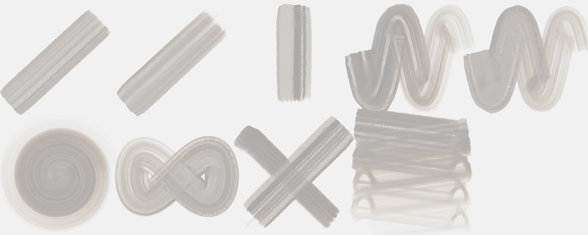
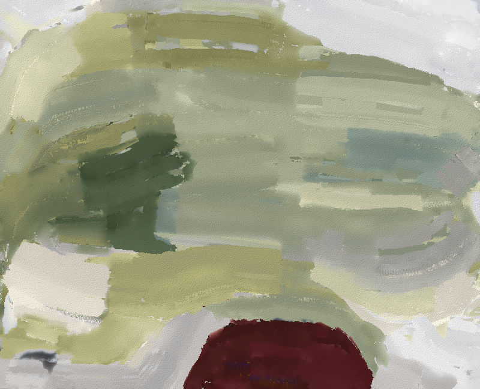
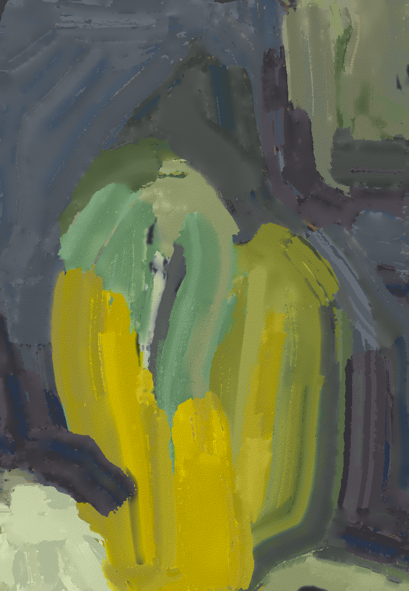

# Brush Lab — 4 brushes · 9 Nov 2026 at 15:56

Every sheet: 1500 × 600, ten strokes in a 5 × 2 grid — 1. light line · 2. heavy line · 3. pressure swell · 4. fast wave · 5. slow wave · 6. spiral · 7. loop · 8. tilted · 9. over the wet one · 10. long, no reload (cell 8 holds «tilted» and «over the wet one» crossed). The CPU reference of Mamay's paint engine; the wet layer settles 20 s at the end.

Columns: **covered** = share of the cell with paint right after the stroke → after settling; **width** = painted area of the stroke ÷ its length (px); **dark** = mean darkness of the painted pixels above the paper's own grain (0 = paper, 1 = black); **spread** = how far wet paint went beyond the stroke (1.0 = stayed); **ms** = the stroke on the CPU; long stroke: paint in each quarter of its length (it should run out: wet → streaks → dry tail).

## Refs v3 · #02 HW cream strokes
Gouache 1.00 + turpentine 30 % · 100 px · 140.1 s

| stroke | covered | width | dark | spread | ms |
|---|---|---|---|---|---|
| light line | 30 % → 29 % | 86.7 px | 0.15 | 0.97 | 719 |
| heavy line | 31 % → 28 % | 91.3 px | 0.15 | 0.88 | 1044 |
| pressure swell | 24 % → 23 % | 89.3 px | 0.16 | 0.98 | 657 |
| fast wave | 67 % → 36 % | 77.1 px | 0.21 | 0.53 | 1686 |
| slow wave | 65 % → 36 % | 75.1 px | 0.18 | 0.55 | 3372 |
| spiral | 76 % → 36 % | 50.3 px | 0.21 | 0.47 | 3039 |
| loop | 59 % → 40 % | 76.7 px | 0.17 | 0.68 | 1551 |
| tilted | 24 % → 24 % | 67.9 px | 0.20 | 1.00 | 1104 |
| over the wet one | 50 % → 46 % | 71.3 px | 0.20 | 0.93 | 735 |
| long, no reload | 96 % → 45 % | 43.0 px | 0.20 | 0.47 | 4808 | quarters: 0.19 → 0.17 → 0.10 → 0.03

Numbers say: light vs heavy: width 86.7 → 91.3 px, dark 0.15 → 0.15; pressure barely changes the width.

## Refs v3 · #24 Picasso flat oil
Gouache 1.00 + turpentine 20 % · 100 px · 144.5 s

| stroke | covered | width | dark | spread | ms |
|---|---|---|---|---|---|
| light line | 31 % → 29 % | 90.9 px | 0.47 | 0.91 | 786 |
| heavy line | 33 % → 29 % | 95.7 px | 0.47 | 0.88 | 1130 |
| pressure swell | 25 % → 25 % | 94.3 px | 0.48 | 1.00 | 816 |
| fast wave | 69 % → 38 % | 79.1 px | 0.51 | 0.56 | 1983 |
| slow wave | 68 % → 38 % | 78.0 px | 0.49 | 0.56 | 3553 |
| spiral | 79 % → 37 % | 52.0 px | 0.51 | 0.46 | 3302 |
| loop | 60 % → 43 % | 77.7 px | 0.48 | 0.71 | 1746 |
| tilted | 24 % → 24 % | 66.9 px | 0.51 | 1.00 | 1086 |
| over the wet one | 52 % → 47 % | 77.2 px | 0.51 | 0.92 | 826 |
| long, no reload | 97 % → 43 % | 43.3 px | 0.51 | 0.45 | 5848 | quarters: 0.50 → 0.50 → 0.45 → 0.32

Numbers say: light vs heavy: width 90.9 → 95.7 px, dark 0.47 → 0.47; pressure barely changes the width.

## Refs v3 · #02 HW cream strokes — own sheet
own sheet 800 × 648 · Gouache 1.00 + turpentine 30 % · 100 px · 1308.6 s

| stroke | covered | width | dark | spread | ms |
|---|---|---|---|---|---|
| stroke 1 | 12 % → 100 % | 56.2 px | 0.24 | 8.46 | 499 |
| stroke 2 | 4 % → 100 % | 61.2 px | 0.25 | 25.59 | 78 |
| stroke 3 | 10 % → 100 % | 111.7 px | 0.24 | 9.94 | 484 |
| stroke 4 | 13 % → 100 % | 150.6 px | 0.24 | 7.67 | 592 |
| stroke 5 | 15 % → 100 % | 124.4 px | 0.19 | 6.48 | 827 |
| stroke 6 | 15 % → 15 % | 183.0 px | 0.29 | 1.00 | 785 |
| stroke 7 | 29 % → 100 % | 266.1 px | 0.25 | 3.43 | 756 |
| stroke 8 | 26 % → 100 % | 169.0 px | 0.27 | 3.78 | 944 |
| stroke 9 | 11 % → 100 % | 88.8 px | 0.28 | 8.81 | 352 |
| stroke 10 | 17 % → 100 % | 195.6 px | 0.24 | 5.89 | 616 |
| stroke 11 | 39 % → 100 % | 388.5 px | 0.26 | 2.59 | 293 |
| stroke 12 | 38 % → 100 % | 299.0 px | 0.23 | 2.60 | 245 |
| stroke 13 | 42 % → 100 % | 1110.3 px | 0.18 | 2.37 | 62 |
| stroke 14 | 41 % → 100 % | 480.7 px | 0.19 | 2.45 | 279 |
| stroke 15 | 36 % → 100 % | 523.2 px | 0.29 | 2.81 | 132 |
| stroke 16 | 42 % → 100 % | 764.7 px | 0.15 | 2.38 | 70 |
| stroke 17 | 27 % → 100 % | 277.1 px | 0.18 | 3.73 | 549 |
| stroke 18 | 36 % → 100 % | 376.6 px | 0.26 | 2.79 | 702 |
| stroke 19 | 27 % → 100 % | 361.7 px | 0.25 | 3.77 | 412 |
| stroke 20 | 25 % → 100 % | 268.5 px | 0.27 | 3.94 | 458 |
| stroke 21 | 56 % → 100 % | 491.8 px | 0.27 | 1.77 | 512 |
| stroke 22 | 38 % → 100 % | 560.7 px | 0.26 | 2.65 | 311 |
| stroke 23 | 60 % → 100 % | 602.2 px | 0.25 | 1.67 | 370 |
| stroke 24 | 54 % → 100 % | 544.7 px | 0.25 | 1.86 | 455 |
| stroke 25 | 58 % → 100 % | 659.2 px | 0.28 | 1.73 | 596 |
| stroke 26 | 50 % → 100 % | 315.8 px | 0.18 | 1.99 | 271 |
| stroke 27 | 58 % → 100 % | 617.4 px | 0.26 | 1.74 | 512 |
| stroke 28 | 41 % → 41 % | 348.7 px | 0.17 | 1.00 | 302 |
| stroke 29 | 44 % → 100 % | 433.4 px | 0.22 | 2.25 | 256 |
| stroke 30 | 69 % → 100 % | 515.1 px | 0.27 | 1.45 | 608 |
| stroke 31 | 59 % → 100 % | 1081.4 px | 0.15 | 1.68 | 127 |
| stroke 32 | 62 % → 100 % | 490.3 px | 0.24 | 1.62 | 1285 |
| stroke 33 | 74 % → 100 % | 909.8 px | 0.28 | 1.35 | 306 |
| stroke 34 | 53 % → 100 % | 440.4 px | 0.22 | 1.90 | 722 |
| stroke 35 | 68 % → 100 % | 777.4 px | 0.26 | 1.46 | 633 |
| stroke 36 | 73 % → 100 % | 1251.6 px | 0.17 | 1.36 | 82 |
| stroke 37 | 67 % → 100 % | 868.3 px | 0.26 | 1.49 | 615 |
| stroke 38 | 68 % → 100 % | 1041.0 px | 0.26 | 1.46 | 494 |
| stroke 39 | 66 % → 100 % | 667.5 px | 0.22 | 1.53 | 650 |
| stroke 40 | 70 % → 100 % | 532.3 px | 0.26 | 1.42 | 1043 |
| stroke 41 | 71 % → 100 % | 677.2 px | 0.24 | 1.41 | 475 |
| stroke 42 | 65 % → 100 % | 339.2 px | 0.18 | 1.53 | 656 |
| stroke 43 | 72 % → 100 % | 1084.2 px | 0.25 | 1.40 | 642 |
| stroke 44 | 80 % → 100 % | 977.1 px | 0.26 | 1.25 | 531 |
| stroke 45 | 62 % → 100 % | 542.8 px | 0.17 | 1.60 | 460 |
| stroke 46 | 71 % → 100 % | 1345.3 px | 0.20 | 1.40 | 90 |
| stroke 47 | 72 % → 100 % | 1073.4 px | 0.25 | 1.39 | 503 |
| stroke 48 | 80 % → 100 % | 900.3 px | 0.27 | 1.25 | 601 |
| stroke 49 | 75 % → 100 % | 495.8 px | 0.28 | 1.33 | 1298 |
| stroke 50 | 75 % → 100 % | 1154.1 px | 0.19 | 1.33 | 334 |
| stroke 51 | 71 % → 100 % | 727.3 px | 0.25 | 1.40 | 747 |
| stroke 52 | 76 % → 100 % | 713.0 px | 0.24 | 1.32 | 574 |
| stroke 53 | 72 % → 100 % | 899.9 px | 0.25 | 1.39 | 527 |
| stroke 54 | 71 % → 100 % | 358.8 px | 0.19 | 1.40 | 1054 |
| stroke 55 | 70 % → 100 % | 595.1 px | 0.21 | 1.42 | 546 |
| stroke 56 | 80 % → 100 % | 1120.1 px | 0.25 | 1.25 | 653 |
| stroke 57 | 85 % → 100 % | 942.4 px | 0.26 | 1.17 | 496 |
| stroke 58 | 76 % → 100 % | 791.4 px | 0.25 | 1.31 | 465 |
| stroke 59 | 81 % → 100 % | 1076.7 px | 0.26 | 1.23 | 700 |
| stroke 60 | 90 % → 100 % | 1782.8 px | 0.28 | 1.11 | 75 |
| stroke 61 | 77 % → 100 % | 1109.7 px | 0.12 | 1.30 | 50 |
| stroke 62 | 74 % → 100 % | 522.2 px | 0.21 | 1.34 | 1461 |
| stroke 63 | 83 % → 100 % | 989.3 px | 0.29 | 1.20 | 415 |
| stroke 64 | 76 % → 100 % | 1106.2 px | 0.24 | 1.31 | 218 |
| stroke 65 | 91 % → 100 % | 814.4 px | 0.22 | 1.10 | 351 |
| stroke 66 | 81 % → 100 % | 874.6 px | 0.25 | 1.24 | 514 |
| stroke 67 | 77 % → 100 % | 1186.0 px | 0.17 | 1.30 | 249 |
| stroke 68 | 82 % → 100 % | 1066.0 px | 0.28 | 1.22 | 343 |
| stroke 69 | 73 % → 100 % | 476.3 px | 0.23 | 1.36 | 1191 |
| stroke 70 | 77 % → 100 % | 849.2 px | 0.19 | 1.30 | 727 |
| stroke 71 | 83 % → 100 % | 519.8 px | 0.25 | 1.21 | 2907 |
| stroke 72 | 76 % → 100 % | 700.7 px | 0.18 | 1.31 | 744 |
| stroke 73 | 76 % → 100 % | 701.1 px | 0.21 | 1.32 | 566 |
| stroke 74 | 82 % → 100 % | 653.6 px | 0.19 | 1.22 | 2484 |
| stroke 75 | 82 % → 82 % | 818.7 px | 0.29 | 1.00 | 2460 |
| stroke 76 | 87 % → 100 % | 769.5 px | 0.19 | 1.16 | 1005 |
| stroke 77 | 76 % → 100 % | 789.9 px | 0.23 | 1.32 | 1077 |
| stroke 78 | 82 % → 100 % | 843.9 px | 0.25 | 1.22 | 6047 |
| stroke 79 | 92 % → 100 % | 816.3 px | 0.22 | 1.08 | 537 |
| stroke 80 | 87 % → 100 % | 639.8 px | 0.25 | 1.15 | 1641 |
| stroke 81 | 88 % → 100 % | 1098.1 px | 0.26 | 1.14 | 709 |
| stroke 82 | 85 % → 100 % | 2426.3 px | 0.28 | 1.17 | 120 |
| stroke 83 | 84 % → 100 % | 1251.1 px | 0.26 | 1.20 | 784 |
| stroke 84 | 80 % → 100 % | 928.8 px | 0.16 | 1.24 | 231 |
| stroke 85 | 76 % → 100 % | 722.9 px | 0.24 | 1.32 | 756 |
| stroke 86 | 79 % → 100 % | 799.7 px | 0.22 | 1.26 | 689 |
| stroke 87 | 84 % → 100 % | 651.3 px | 0.24 | 1.19 | 2262 |
| stroke 88 | 94 % → 100 % | 1447.4 px | 0.24 | 1.06 | 301 |
| stroke 89 | 86 % → 100 % | 855.8 px | 0.19 | 1.17 | 5160 |
| stroke 90 | 88 % → 100 % | 711.4 px | 0.24 | 1.14 | 2104 |
| stroke 91 | 87 % → 100 % | 1218.5 px | 0.21 | 1.16 | 1016 |
| stroke 92 | 96 % → 96 % | 793.0 px | 0.24 | 1.00 | 708 |
| stroke 93 | 85 % → 100 % | 1001.3 px | 0.18 | 1.18 | 857 |
| stroke 94 | 84 % → 100 % | 819.8 px | 0.29 | 1.19 | 6376 |
| stroke 95 | 88 % → 100 % | 594.8 px | 0.23 | 1.13 | 2263 |
| stroke 96 | 86 % → 100 % | 492.2 px | 0.26 | 1.17 | 3491 |
| stroke 97 | 86 % → 100 % | 832.9 px | 0.24 | 1.16 | 1738 |
| stroke 98 | 88 % → 100 % | 1580.7 px | 0.15 | 1.13 | 170 |
| stroke 99 | 87 % → 100 % | 616.1 px | 0.24 | 1.15 | 2887 |
| stroke 100 | 84 % → 100 % | 987.9 px | 0.28 | 1.19 | 851 |
| stroke 101 | 87 % → 100 % | 1330.4 px | 0.25 | 1.15 | 1099 |
| stroke 102 | 82 % → 100 % | 787.7 px | 0.24 | 1.22 | 1007 |
| stroke 103 | 94 % → 100 % | 1421.2 px | 0.19 | 1.06 | 150 |
| stroke 104 | 88 % → 100 % | 989.6 px | 0.29 | 1.14 | 1324 |
| stroke 105 | 88 % → 100 % | 835.5 px | 0.26 | 1.13 | 1186 |
| stroke 106 | 82 % → 100 % | 639.6 px | 0.16 | 1.21 | 726 |
| stroke 107 | 85 % → 100 % | 1191.1 px | 0.16 | 1.17 | 497 |
| stroke 108 | 90 % → 100 % | 676.9 px | 0.26 | 1.11 | 2335 |
| stroke 109 | 86 % → 100 % | 760.9 px | 0.25 | 1.17 | 1331 |
| stroke 110 | 90 % → 100 % | 868.8 px | 0.29 | 1.12 | 708 |
| stroke 111 | 91 % → 100 % | 671.7 px | 0.24 | 1.10 | 1431 |
| stroke 112 | 89 % → 100 % | 2333.2 px | 0.25 | 1.13 | 187 |
| stroke 113 | 86 % → 100 % | 484.9 px | 0.21 | 1.17 | 1385 |
| stroke 114 | 90 % → 100 % | 781.5 px | 0.24 | 1.11 | 940 |
| stroke 115 | 91 % → 100 % | 842.8 px | 0.26 | 1.10 | 1458 |
| stroke 116 | 89 % → 100 % | 1396.2 px | 0.18 | 1.12 | 329 |
| stroke 117 | 84 % → 100 % | 692.7 px | 0.27 | 1.19 | 661 |
| stroke 118 | 94 % → 100 % | 750.1 px | 0.20 | 1.06 | 1045 |
| stroke 119 | 96 % → 100 % | 1453.0 px | 0.27 | 1.04 | 630 |
| stroke 120 | 93 % → 100 % | 1714.0 px | 0.15 | 1.08 | 92 |
| stroke 121 | 85 % → 100 % | 1307.2 px | 0.17 | 1.18 | 75 |
| stroke 122 | 90 % → 100 % | 584.5 px | 0.23 | 1.11 | 2182 |
| stroke 123 | 87 % → 100 % | 437.0 px | 0.17 | 1.15 | 931 |
| stroke 124 | 94 % → 100 % | 950.2 px | 0.22 | 1.06 | 512 |
| stroke 125 | 98 % → 100 % | 978.7 px | 0.27 | 1.02 | 751 |
| stroke 126 | 88 % → 100 % | 946.6 px | 0.26 | 1.14 | 744 |
| stroke 127 | 95 % → 100 % | 1078.4 px | 0.26 | 1.05 | 801 |
| stroke 128 | 94 % → 100 % | 2424.8 px | 0.17 | 1.06 | 113 |
| stroke 129 | 92 % → 100 % | 1355.7 px | 0.26 | 1.09 | 581 |
| stroke 130 | 94 % → 100 % | 1952.3 px | 0.15 | 1.06 | 116 |
| stroke 131 | 92 % → 100 % | 725.8 px | 0.24 | 1.09 | 1392 |
| stroke 132 | 97 % → 100 % | 1571.5 px | 0.28 | 1.03 | 247 |
| stroke 133 | 96 % → 100 % | 831.9 px | 0.23 | 1.04 | 766 |
| stroke 134 | 91 % → 100 % | 677.5 px | 0.24 | 1.10 | 465 |
| stroke 135 | 93 % → 100 % | 788.3 px | 0.25 | 1.08 | 448 |
| stroke 136 | 93 % → 100 % | 1125.3 px | 0.29 | 1.08 | 392 |
| stroke 137 | 99 % → 100 % | 909.8 px | 0.29 | 1.01 | 226 |
| stroke 138 | 91 % → 100 % | 949.0 px | 0.27 | 1.10 | 554 |
| stroke 139 | 95 % → 100 % | 946.6 px | 0.19 | 1.05 | 557 |
| stroke 140 | 92 % → 100 % | 581.8 px | 0.23 | 1.09 | 2253 |
| stroke 141 | 95 % → 100 % | 803.8 px | 0.24 | 1.05 | 690 |
| stroke 142 | 91 % → 100 % | 534.5 px | 0.24 | 1.10 | 294 |
| stroke 143 | 92 % → 100 % | 549.6 px | 0.18 | 1.08 | 788 |
| stroke 144 | 94 % → 100 % | 1010.2 px | 0.18 | 1.07 | 462 |
| stroke 145 | 93 % → 100 % | 972.4 px | 0.28 | 1.07 | 954 |
| stroke 146 | 93 % → 100 % | 894.2 px | 0.25 | 1.08 | 899 |
| stroke 147 | 89 % → 100 % | 1296.3 px | 0.24 | 1.12 | 380 |
| stroke 148 | 92 % → 100 % | 1103.4 px | 0.29 | 1.08 | 1475 |
| stroke 149 | 92 % → 100 % | 1187.9 px | 0.29 | 1.08 | 968 |
| stroke 150 | 98 % → 100 % | 1055.7 px | 0.28 | 1.02 | 1273 |
| stroke 151 | 95 % → 100 % | 791.2 px | 0.25 | 1.05 | 1990 |
| stroke 152 | 95 % → 100 % | 1398.8 px | 0.25 | 1.05 | 656 |
| stroke 153 | 97 % → 100 % | 1432.8 px | 0.25 | 1.03 | 705 |
| stroke 154 | 94 % → 100 % | 940.0 px | 0.21 | 1.07 | 1117 |
| stroke 155 | 97 % → 100 % | 2575.7 px | 0.18 | 1.03 | 135 |
| stroke 156 | 85 % → 100 % | 1261.2 px | 0.12 | 1.18 | 73 |
| stroke 157 | 97 % → 100 % | 1434.9 px | 0.27 | 1.03 | 374 |
| stroke 158 | 98 % → 100 % | 994.3 px | 0.27 | 1.02 | 592 |
| stroke 159 | 100 % → 100 % | 921.3 px | 0.30 | 1.00 | 194 |
| stroke 160 | 94 % → 100 % | 601.8 px | 0.22 | 1.06 | 2269 |
| stroke 161 | 94 % → 100 % | 1018.9 px | 0.17 | 1.06 | 509 |
| stroke 162 | 99 % → 100 % | 1507.3 px | 0.25 | 1.01 | 977 |
| stroke 163 | 97 % → 100 % | 979.5 px | 0.29 | 1.03 | 668 |
| stroke 164 | 97 % → 100 % | 937.0 px | 0.14 | 1.02 | 258 |
| stroke 165 | 99 % → 100 % | 2328.7 px | 0.31 | 1.01 | 71 |
| stroke 166 | 96 % → 100 % | 597.9 px | 0.26 | 1.05 | 2306 |
| stroke 167 | 96 % → 100 % | 1542.0 px | 0.24 | 1.04 | 133 |
| stroke 168 | 97 % → 100 % | 617.4 px | 0.23 | 1.03 | 2328 |
| stroke 169 | 97 % → 100 % | 2573.7 px | 0.18 | 1.03 | 101 |
| stroke 170 | 98 % → 100 % | 760.8 px | 0.24 | 1.02 | 2314 |
| stroke 171 | 96 % → 96 % | 588.2 px | 0.26 | 1.00 | 2909 |
| stroke 172 | 98 % → 100 % | 1040.4 px | 0.18 | 1.02 | 735 |
| stroke 173 | 99 % → 100 % | 1650.8 px | 0.29 | 1.01 | 425 |
| stroke 174 | 100 % → 100 % | 1512.5 px | 0.27 | 1.00 | 769 |
| stroke 175 | 100 % → 100 % | 743.8 px | 0.28 | 1.00 | 689 |
| stroke 176 | 95 % → 100 % | 774.8 px | 0.22 | 1.05 | 1220 |
| stroke 177 | 96 % → 100 % | 726.1 px | 0.22 | 1.04 | 624 |
| stroke 178 | 98 % → 100 % | 1460.3 px | 0.26 | 1.02 | 619 |
| stroke 179 | 97 % → 100 % | 932.3 px | 0.21 | 1.03 | 412 |
| stroke 180 | 99 % → 100 % | 1498.4 px | 0.26 | 1.01 | 395 |
| stroke 181 | 95 % → 100 % | 728.3 px | 0.28 | 1.05 | 446 |
| stroke 182 | 97 % → 100 % | 804.6 px | 0.26 | 1.03 | 355 |
| stroke 183 | 99 % → 100 % | 2064.8 px | 0.30 | 1.01 | 104 |
| stroke 184 | 97 % → 100 % | 1045.2 px | 0.21 | 1.03 | 326 |
| stroke 185 | 100 % → 100 % | 1684.0 px | 0.29 | 1.00 | 150 |
| stroke 186 | 100 % → 100 % | 2345.9 px | 0.32 | 1.00 | 38 |
| stroke 187 | 96 % → 100 % | 1279.7 px | 0.21 | 1.05 | 43 |
| stroke 188 | 98 % → 100 % | 773.0 px | 0.23 | 1.02 | 529 |
| stroke 189 | 95 % → 100 % | 481.0 px | 0.28 | 1.05 | 594 |
| stroke 190 | 97 % → 100 % | 735.3 px | 0.21 | 1.04 | 300 |
| stroke 191 | 97 % → 100 % | 1647.6 px | 0.13 | 1.02 | 51 |
| stroke 192 | 98 % → 100 % | 1084.6 px | 0.29 | 1.02 | 374 |
| stroke 193 | 99 % → 100 % | 1469.5 px | 0.29 | 1.01 | 148 |
| stroke 194 | 98 % → 100 % | 967.3 px | 0.19 | 1.02 | 305 |
| stroke 195 | 98 % → 100 % | 971.9 px | 0.29 | 1.02 | 320 |
| stroke 196 | 97 % → 100 % | 1040.1 px | 0.25 | 1.03 | 617 |
| stroke 197 | 97 % → 100 % | 513.7 px | 0.19 | 1.03 | 1133 |
| stroke 198 | 100 % → 100 % | 1304.4 px | 0.27 | 1.00 | 1128 |
| stroke 199 | 98 % → 100 % | 689.9 px | 0.24 | 1.02 | 1875 |
| stroke 200 | 97 % → 100 % | 2163.1 px | 0.27 | 1.03 | 220 |
| stroke 201 | 95 % → 100 % | 986.9 px | 0.26 | 1.06 | 981 |
| stroke 202 | 97 % → 100 % | 789.2 px | 0.23 | 1.03 | 812 |
| stroke 203 | 98 % → 100 % | 609.5 px | 0.17 | 1.02 | 910 |
| stroke 204 | 99 % → 100 % | 758.5 px | 0.24 | 1.01 | 1321 |
| stroke 205 | 97 % → 100 % | 639.9 px | 0.28 | 1.03 | 1004 |
| stroke 206 | 97 % → 100 % | 828.5 px | 0.27 | 1.03 | 2801 |
| stroke 207 | 95 % → 100 % | 489.8 px | 0.17 | 1.06 | 1164 |
| stroke 208 | 97 % → 100 % | 840.8 px | 0.24 | 1.03 | 649 |
| stroke 209 | 97 % → 100 % | 770.4 px | 0.16 | 1.03 | 639 |
| stroke 210 | 98 % → 100 % | 1024.3 px | 0.27 | 1.02 | 605 |
| stroke 211 | 98 % → 100 % | 684.3 px | 0.28 | 1.02 | 1405 |
| stroke 212 | 97 % → 100 % | 802.2 px | 0.22 | 1.03 | 888 |
| stroke 213 | 100 % → 100 % | 1301.2 px | 0.26 | 1.00 | 696 |
| stroke 214 | 97 % → 100 % | 718.1 px | 0.23 | 1.03 | 655 |
| stroke 215 | 97 % → 100 % | 883.7 px | 0.25 | 1.03 | 770 |
| stroke 216 | 98 % → 100 % | 731.6 px | 0.27 | 1.02 | 748 |
| stroke 217 | 98 % → 100 % | 980.8 px | 0.24 | 1.02 | 1519 |
| stroke 218 | 98 % → 100 % | 1081.0 px | 0.26 | 1.02 | 1051 |
| stroke 219 | 96 % → 100 % | 1178.1 px | 0.17 | 1.04 | 119 |
| stroke 220 | 98 % → 100 % | 2497.9 px | 0.27 | 1.02 | 397 |
| stroke 221 | 100 % → 100 % | 1601.0 px | 0.29 | 1.00 | 777 |
| stroke 222 | 98 % → 100 % | 1019.1 px | 0.22 | 1.02 | 1557 |
| stroke 223 | 98 % → 100 % | 954.7 px | 0.19 | 1.02 | 680 |
| stroke 224 | 98 % → 100 % | 1040.1 px | 0.26 | 1.02 | 782 |
| stroke 225 | 98 % → 100 % | 639.0 px | 0.26 | 1.02 | 1363 |
| stroke 226 | 97 % → 100 % | 725.9 px | 0.20 | 1.03 | 5174 |
| stroke 227 | 98 % → 100 % | 599.2 px | 0.26 | 1.03 | 2776 |
| stroke 228 | 98 % → 100 % | 983.3 px | 0.27 | 1.02 | 798 |
| stroke 229 | 98 % → 100 % | 1432.8 px | 0.25 | 1.02 | 841 |
| stroke 230 | 100 % → 100 % | 2655.0 px | 0.29 | 1.00 | 129 |
| stroke 231 | 99 % → 100 % | 1336.5 px | 0.25 | 1.01 | 721 |
| stroke 232 | 98 % → 100 % | 1015.4 px | 0.19 | 1.02 | 677 |
| stroke 233 | 96 % → 100 % | 415.5 px | 0.19 | 1.05 | 531 |
| stroke 234 | 100 % → 100 % | 1636.0 px | 0.28 | 1.00 | 306 |
| stroke 235 | 99 % → 100 % | 1322.5 px | 0.26 | 1.01 | 875 |
| stroke 236 | 98 % → 100 % | 1484.6 px | 0.25 | 1.02 | 992 |
| stroke 237 | 99 % → 100 % | 1107.1 px | 0.24 | 1.02 | 1585 |
| stroke 238 | 98 % → 100 % | 993.0 px | 0.22 | 1.02 | 2256 |
| stroke 239 | 98 % → 100 % | 1200.3 px | 0.27 | 1.03 | 1299 |
| stroke 240 | 97 % → 100 % | 1717.6 px | 0.17 | 1.04 | 301 |
| stroke 241 | 98 % → 100 % | 1136.2 px | 0.24 | 1.02 | 1994 |
| stroke 242 | 99 % → 100 % | 1487.0 px | 0.22 | 1.01 | 178 |
| stroke 243 | 100 % → 100 % | 2090.6 px | 0.30 | 1.00 | 174 |
| stroke 244 | 98 % → 100 % | 986.3 px | 0.26 | 1.02 | 1035 |
| stroke 245 | 97 % → 100 % | 877.4 px | 0.21 | 1.03 | 1397 |
| stroke 246 | 98 % → 100 % | 865.3 px | 0.20 | 1.02 | 2461 |
| stroke 247 | 99 % → 100 % | 626.0 px | 0.26 | 1.01 | 3144 |
| stroke 248 | 98 % → 100 % | 772.6 px | 0.24 | 1.02 | 1371 |
| stroke 249 | 99 % → 100 % | 1447.7 px | 0.24 | 1.01 | 340 |
| stroke 250 | 99 % → 100 % | 760.6 px | 0.21 | 1.01 | 1025 |
| stroke 251 | 98 % → 100 % | 1511.5 px | 0.18 | 1.02 | 298 |
| stroke 252 | 99 % → 100 % | 1378.9 px | 0.25 | 1.01 | 706 |
| stroke 253 | 97 % → 100 % | 993.2 px | 0.23 | 1.03 | 454 |
| stroke 254 | 99 % → 100 % | 756.9 px | 0.23 | 1.01 | 1820 |
| stroke 255 | 97 % → 100 % | 1017.1 px | 0.23 | 1.03 | 627 |
| stroke 256 | 98 % → 100 % | 897.4 px | 0.28 | 1.02 | 874 |
| stroke 257 | 98 % → 100 % | 1502.0 px | 0.13 | 1.01 | 101 |
| stroke 258 | 98 % → 100 % | 909.9 px | 0.18 | 1.02 | 845 |
| stroke 259 | 98 % → 100 % | 919.3 px | 0.26 | 1.02 | 1061 |
| stroke 260 | 99 % → 100 % | 806.1 px | 0.22 | 1.01 | 1222 |
| stroke 261 | 98 % → 100 % | 825.7 px | 0.17 | 1.02 | 806 |
| stroke 262 | 98 % → 100 % | 649.2 px | 0.26 | 1.02 | 2474 |
| stroke 263 | 98 % → 100 % | 639.8 px | 0.28 | 1.02 | 1508 |
| stroke 264 | 99 % → 100 % | 670.9 px | 0.16 | 1.01 | 866 |
| stroke 265 | 98 % → 100 % | 979.2 px | 0.18 | 1.01 | 954 |
| stroke 266 | 98 % → 100 % | 954.7 px | 0.18 | 1.01 | 1610 |
| stroke 267 | 99 % → 100 % | 865.0 px | 0.19 | 1.01 | 1365 |
| stroke 268 | 99 % → 100 % | 853.4 px | 0.25 | 1.01 | 1187 |
| stroke 269 | 98 % → 100 % | 1018.7 px | 0.25 | 1.02 | 698 |
| stroke 270 | 97 % → 100 % | 960.9 px | 0.25 | 1.03 | 654 |
| stroke 271 | 97 % → 100 % | 1143.1 px | 0.17 | 1.03 | 73 |
| stroke 272 | 97 % → 100 % | 578.5 px | 0.17 | 1.04 | 619 |
| stroke 273 | 98 % → 100 % | 1197.1 px | 0.28 | 1.02 | 684 |
| stroke 274 | 99 % → 100 % | 924.6 px | 0.25 | 1.01 | 1170 |
| stroke 275 | 100 % → 100 % | 2702.2 px | 0.28 | 1.00 | 264 |
| stroke 276 | 100 % → 100 % | 2784.4 px | 0.29 | 1.00 | 159 |
| stroke 277 | 99 % → 100 % | 996.9 px | 0.26 | 1.01 | 1089 |
| stroke 278 | 99 % → 100 % | 805.3 px | 0.24 | 1.01 | 2471 |
| stroke 279 | 99 % → 100 % | 857.1 px | 0.20 | 1.01 | 1473 |
| stroke 280 | 98 % → 100 % | 847.1 px | 0.17 | 1.01 | 1673 |
| stroke 281 | 100 % → 100 % | 1133.1 px | 0.29 | 1.00 | 1630 |
| stroke 282 | 99 % → 100 % | 627.2 px | 0.27 | 1.01 | 6764 |
| stroke 283 | 99 % → 100 % | 1334.0 px | 0.26 | 1.01 | 869 |
| stroke 284 | 99 % → 100 % | 809.5 px | 0.26 | 1.01 | 2837 |
| stroke 285 | 99 % → 100 % | 901.0 px | 0.22 | 1.01 | 2463 |
| stroke 286 | 100 % → 100 % | 1287.5 px | 0.29 | 1.00 | 893 |
| stroke 287 | 97 % → 100 % | 1137.2 px | 0.20 | 1.03 | 361 |
| stroke 288 | 99 % → 100 % | 1090.9 px | 0.19 | 1.01 | 765 |
| stroke 289 | 98 % → 100 % | 946.1 px | 0.24 | 1.02 | 725 |
| stroke 290 | 99 % → 100 % | 804.9 px | 0.20 | 1.01 | 1345 |
| stroke 291 | 98 % → 100 % | 1548.7 px | 0.17 | 1.02 | 319 |
| stroke 292 | 98 % → 100 % | 870.1 px | 0.19 | 1.02 | 888 |
| stroke 293 | 99 % → 100 % | 1458.9 px | 0.25 | 1.01 | 734 |
| stroke 294 | 99 % → 100 % | 1037.7 px | 0.26 | 1.01 | 751 |
| stroke 295 | 99 % → 100 % | 642.1 px | 0.24 | 1.01 | 2466 |
| stroke 296 | 98 % → 100 % | 1072.4 px | 0.26 | 1.02 | 852 |
| stroke 297 | 100 % → 100 % | 455.2 px | 0.24 | 1.00 | 978 |
| stroke 298 | 99 % → 100 % | 910.8 px | 0.28 | 1.01 | 1449 |
| stroke 299 | 99 % → 100 % | 910.6 px | 0.23 | 1.01 | 972 |
| stroke 300 | 99 % → 100 % | 882.8 px | 0.21 | 1.01 | 670 |
| stroke 301 | 99 % → 100 % | 494.1 px | 0.27 | 1.01 | 2035 |
| stroke 302 | 98 % → 100 % | 918.2 px | 0.20 | 1.01 | 911 |
| stroke 303 | 99 % → 100 % | 797.1 px | 0.20 | 1.01 | 1082 |
| stroke 304 | 100 % → 100 % | 1619.8 px | 0.26 | 1.00 | 281 |
| stroke 305 | 99 % → 100 % | 1056.9 px | 0.27 | 1.01 | 651 |
| stroke 306 | 100 % → 100 % | 1278.3 px | 0.31 | 1.00 | 168 |
| stroke 307 | 99 % → 100 % | 714.1 px | 0.22 | 1.01 | 757 |
| stroke 308 | 99 % → 100 % | 1075.8 px | 0.26 | 1.01 | 762 |
| stroke 309 | 99 % → 100 % | 889.6 px | 0.24 | 1.01 | 546 |
| stroke 310 | 99 % → 100 % | 621.8 px | 0.26 | 1.01 | 1686 |
| stroke 311 | 99 % → 100 % | 729.5 px | 0.25 | 1.01 | 2541 |
| stroke 312 | 98 % → 100 % | 732.7 px | 0.21 | 1.02 | 1333 |
| stroke 313 | 100 % → 100 % | 2682.4 px | 0.25 | 1.00 | 108 |
| stroke 314 | 99 % → 100 % | 790.5 px | 0.28 | 1.01 | 992 |
| stroke 315 | 99 % → 100 % | 1293.2 px | 0.24 | 1.01 | 1242 |
| stroke 316 | 99 % → 100 % | 1091.8 px | 0.15 | 1.01 | 332 |
| stroke 317 | 98 % → 100 % | 874.4 px | 0.21 | 1.01 | 1600 |
| stroke 318 | 99 % → 100 % | 2751.0 px | 0.19 | 1.01 | 160 |
| stroke 319 | 98 % → 100 % | 960.3 px | 0.18 | 1.01 | 605 |
| stroke 320 | 100 % → 100 % | 1502.8 px | 0.28 | 1.00 | 283 |
| stroke 321 | 99 % → 100 % | 958.7 px | 0.27 | 1.01 | 481 |
| stroke 322 | 99 % → 100 % | 861.4 px | 0.25 | 1.01 | 746 |
| stroke 323 | 98 % → 100 % | 1584.6 px | 0.25 | 1.03 | 102 |
| stroke 324 | 99 % → 100 % | 810.1 px | 0.22 | 1.01 | 1106 |
| stroke 325 | 100 % → 100 % | 1989.0 px | 0.25 | 1.00 | 170 |
| stroke 326 | 99 % → 100 % | 1372.7 px | 0.25 | 1.01 | 972 |
| stroke 327 | 99 % → 100 % | 1169.3 px | 0.19 | 1.01 | 632 |
| stroke 328 | 98 % → 100 % | 909.3 px | 0.26 | 1.02 | 789 |
| stroke 329 | 99 % → 100 % | 1449.2 px | 0.26 | 1.01 | 637 |
| stroke 330 | 98 % → 100 % | 971.0 px | 0.20 | 1.02 | 303 |
| stroke 331 | 99 % → 100 % | 1354.7 px | 0.26 | 1.01 | 684 |
| stroke 332 | 99 % → 100 % | 1012.5 px | 0.29 | 1.01 | 1047 |
| stroke 333 | 99 % → 100 % | 975.7 px | 0.20 | 1.01 | 701 |
| stroke 334 | 100 % → 100 % | 1171.0 px | 0.27 | 1.00 | 1967 |
| stroke 335 | 100 % → 100 % | 1075.1 px | 0.29 | 1.00 | 793 |
| stroke 336 | 99 % → 100 % | 739.7 px | 0.27 | 1.01 | 920 |
| stroke 337 | 99 % → 100 % | 1466.6 px | 0.25 | 1.01 | 532 |
| stroke 338 | 100 % → 100 % | 582.4 px | 0.24 | 1.00 | 541 |
| stroke 339 | 99 % → 100 % | 849.6 px | 0.23 | 1.01 | 834 |
| stroke 340 | 99 % → 100 % | 706.2 px | 0.24 | 1.01 | 2439 |
| stroke 341 | 100 % → 100 % | 1837.0 px | 0.27 | 1.00 | 176 |
| stroke 342 | 99 % → 100 % | 516.4 px | 0.27 | 1.01 | 601 |
| stroke 343 | 99 % → 100 % | 745.1 px | 0.20 | 1.01 | 827 |
| stroke 344 | 99 % → 100 % | 2398.9 px | 0.25 | 1.01 | 150 |
| stroke 345 | 100 % → 100 % | 1297.4 px | 0.29 | 1.00 | 526 |
| stroke 346 | 99 % → 100 % | 1634.8 px | 0.27 | 1.01 | 404 |
| stroke 347 | 98 % → 100 % | 1750.8 px | 0.22 | 1.02 | 282 |
| stroke 348 | 98 % → 100 % | 1258.9 px | 0.26 | 1.02 | 228 |
| stroke 349 | 98 % → 100 % | 4066.2 px | 0.16 | 1.02 | 17 |
| stroke 350 | 99 % → 100 % | 1718.2 px | 0.25 | 1.01 | 114 |
| stroke 351 | 99 % → 100 % | 2039.5 px | 0.22 | 1.01 | 281 |
| stroke 352 | 99 % → 100 % | 522.1 px | 0.22 | 1.01 | 468 |
| stroke 353 | 98 % → 100 % | 745.9 px | 0.18 | 1.02 | 204 |
| stroke 354 | 100 % → 100 % | 1218.6 px | 0.28 | 1.00 | 584 |
| stroke 355 | 99 % → 100 % | 896.9 px | 0.28 | 1.01 | 526 |
| stroke 356 | 99 % → 100 % | 519.4 px | 0.21 | 1.01 | 629 |
| stroke 357 | 99 % → 100 % | 1367.0 px | 0.21 | 1.01 | 182 |
| stroke 358 | 98 % → 100 % | 1044.0 px | 0.24 | 1.02 | 284 |
| stroke 359 | 100 % → 100 % | 1410.4 px | 0.27 | 1.00 | 363 |
| stroke 360 | 99 % → 100 % | 1185.0 px | 0.19 | 1.01 | 147 |
| stroke 361 | 100 % → 100 % | 745.1 px | 0.20 | 1.00 | 520 |
| stroke 362 | 99 % → 100 % | 1264.2 px | 0.16 | 1.01 | 158 |
| stroke 363 | 100 % → 100 % | 1874.7 px | 0.19 | 1.00 | 98 |
| stroke 364 | 99 % → 100 % | 1398.2 px | 0.16 | 1.00 | 102 |
| stroke 365 | 99 % → 100 % | 1158.7 px | 0.26 | 1.01 | 205 |
| stroke 366 | 99 % → 99 % | 1125.5 px | 0.24 | 1.00 | 289 |
| stroke 367 | 99 % → 100 % | 832.4 px | 0.20 | 1.01 | 357 |
| stroke 368 | 99 % → 100 % | 781.9 px | 0.19 | 1.01 | 88 |
| stroke 369 | 99 % → 100 % | 2278.6 px | 0.26 | 1.01 | 178 |
| stroke 370 | 99 % → 100 % | 1583.7 px | 0.25 | 1.01 | 177 |
| stroke 371 | 99 % → 100 % | 2065.0 px | 0.26 | 1.01 | 152 |
| stroke 372 | 100 % → 100 % | 801.1 px | 0.20 | 1.00 | 516 |
| stroke 373 | 99 % → 100 % | 2445.5 px | 0.25 | 1.01 | 143 |
| stroke 374 | 99 % → 100 % | 482.9 px | 0.24 | 1.01 | 924 |
| stroke 375 | 100 % → 100 % | 1463.7 px | 0.25 | 1.00 | 594 |
| stroke 376 | 100 % → 100 % | 1154.4 px | 0.27 | 1.00 | 325 |
| stroke 377 | 100 % → 100 % | 2066.1 px | 0.22 | 1.00 | 192 |
| stroke 378 | 99 % → 100 % | 2112.2 px | 0.26 | 1.01 | 255 |
| stroke 379 | 99 % → 100 % | 1854.1 px | 0.18 | 1.00 | 156 |
| stroke 380 | 100 % → 100 % | 1005.4 px | 0.24 | 1.00 | 466 |
| stroke 381 | 99 % → 100 % | 1724.4 px | 0.26 | 1.01 | 87 |
| stroke 382 | 100 % → 100 % | 1035.1 px | 0.24 | 1.00 | 678 |
| stroke 383 | 99 % → 100 % | 1007.1 px | 0.24 | 1.01 | 415 |
| stroke 384 | 100 % → 100 % | 2071.6 px | 0.30 | 1.00 | 183 |
| stroke 385 | 100 % → 100 % | 2529.4 px | 0.26 | 1.00 | 157 |
| stroke 386 | 100 % → 100 % | 1482.4 px | 0.30 | 1.00 | 182 |
| stroke 387 | 99 % → 100 % | 905.5 px | 0.23 | 1.01 | 486 |
| stroke 388 | 99 % → 100 % | 885.4 px | 0.16 | 1.00 | 287 |
| stroke 389 | 99 % → 100 % | 2494.2 px | 0.26 | 1.01 | 213 |
| stroke 390 | 99 % → 100 % | 1105.7 px | 0.22 | 1.01 | 99 |
| stroke 391 | 100 % → 100 % | 1823.5 px | 0.19 | 1.00 | 105 |
| stroke 392 | 100 % → 100 % | 1374.8 px | 0.25 | 1.00 | 342 |
| stroke 393 | 100 % → 100 % | 1269.7 px | 0.28 | 1.00 | 314 |
| stroke 394 | 99 % → 99 % | 1896.2 px | 0.26 | 1.00 | 163 |
| stroke 395 | 100 % → 100 % | 1023.9 px | 0.24 | 1.00 | 425 |
| stroke 396 | 99 % → 100 % | 1043.7 px | 0.26 | 1.01 | 70 |
| stroke 397 | 100 % → 100 % | 1211.1 px | 0.23 | 1.00 | 248 |
| stroke 398 | 99 % → 100 % | 958.6 px | 0.26 | 1.01 | 314 |
| stroke 399 | 100 % → 100 % | 1832.0 px | 0.30 | 1.00 | 206 |
| stroke 400 | 100 % → 100 % | 551.4 px | 0.22 | 1.00 | 397 |
| stroke 401 | 99 % → 100 % | 1788.5 px | 0.27 | 1.01 | 132 |
| stroke 402 | 100 % → 100 % | 1501.0 px | 0.25 | 1.00 | 380 |
| stroke 403 | 99 % → 100 % | 1675.5 px | 0.25 | 1.01 | 142 |
| stroke 404 | 99 % → 100 % | 1360.7 px | 0.22 | 1.01 | 116 |
| stroke 405 | 100 % → 100 % | 846.9 px | 0.18 | 1.00 | 266 |
| stroke 406 | 100 % → 100 % | 2563.6 px | 0.26 | 1.00 | 167 |
| stroke 407 | 100 % → 100 % | 529.1 px | 0.25 | 1.00 | 414 |
| stroke 408 | 100 % → 100 % | 2524.4 px | 0.29 | 1.00 | 134 |
| stroke 409 | 100 % → 100 % | 1280.8 px | 0.26 | 1.00 | 414 |
| stroke 410 | 100 % → 100 % | 994.3 px | 0.24 | 1.00 | 523 |
| stroke 411 | 100 % → 100 % | 1052.0 px | 0.28 | 1.00 | 542 |
| stroke 412 | 100 % → 100 % | 861.0 px | 0.26 | 1.00 | 943 |
| stroke 413 | 100 % → 100 % | 1002.8 px | 0.27 | 1.00 | 348 |
| stroke 414 | 100 % → 100 % | 1341.1 px | 0.27 | 1.00 | 252 |
| stroke 415 | 100 % → 100 % | 2227.3 px | 0.29 | 1.00 | 149 |
| stroke 416 | 99 % → 100 % | 955.2 px | 0.19 | 1.01 | 354 |
| stroke 417 | 99 % → 100 % | 1081.2 px | 0.22 | 1.01 | 63 |
| stroke 418 | 100 % → 100 % | 1330.9 px | 0.28 | 1.00 | 376 |
| stroke 419 | 100 % → 100 % | 1835.8 px | 0.26 | 1.00 | 276 |
| stroke 420 | 100 % → 100 % | 753.1 px | 0.28 | 1.01 | 136 |
| stroke 421 | 100 % → 100 % | 2131.5 px | 0.28 | 1.00 | 126 |
| stroke 422 | 99 % → 100 % | 919.7 px | 0.20 | 1.01 | 381 |
| stroke 423 | 100 % → 100 % | 4397.9 px | 0.18 | 1.00 | 29 |
| stroke 424 | 99 % → 100 % | 1082.5 px | 0.21 | 1.01 | 154 |
| stroke 425 | 100 % → 100 % | 815.4 px | 0.24 | 1.00 | 186 |
| stroke 426 | 100 % → 100 % | 1021.9 px | 0.24 | 1.00 | 637 |
| stroke 427 | 100 % → 100 % | 765.1 px | 0.21 | 1.00 | 646 |
| stroke 428 | 100 % → 100 % | 505.0 px | 0.23 | 1.00 | 739 |
| stroke 429 | 100 % → 100 % | 1758.7 px | 0.23 | 1.00 | 218 |
| stroke 430 | 100 % → 100 % | 609.1 px | 0.18 | 1.00 | 556 |
| stroke 431 | 99 % → 100 % | 750.9 px | 0.22 | 1.01 | 816 |
| stroke 432 | 100 % → 100 % | 1309.8 px | 0.17 | 1.00 | 205 |
| stroke 433 | 100 % → 100 % | 994.5 px | 0.24 | 1.00 | 644 |
| stroke 434 | 100 % → 100 % | 1433.2 px | 0.18 | 1.00 | 88 |
| stroke 435 | 99 % → 100 % | 980.3 px | 0.19 | 1.01 | 80 |
| stroke 436 | 100 % → 100 % | 4548.2 px | 0.27 | 1.00 | 14 |
| stroke 437 | 99 % → 100 % | 995.7 px | 0.26 | 1.01 | 501 |
| stroke 438 | 100 % → 100 % | 598.7 px | 0.17 | 1.00 | 163 |
| stroke 439 | 99 % → 100 % | 1585.0 px | 0.18 | 1.01 | 138 |
| stroke 440 | 100 % → 100 % | 1279.9 px | 0.20 | 1.01 | 135 |
| stroke 441 | 99 % → 99 % | 1210.9 px | 0.27 | 1.00 | 77 |
| stroke 442 | 100 % → 100 % | 535.1 px | 0.23 | 1.00 | 336 |
| stroke 443 | 99 % → 100 % | 1587.8 px | 0.16 | 1.00 | 101 |
| stroke 444 | 99 % → 100 % | 1760.9 px | 0.26 | 1.01 | 137 |
| stroke 445 | 100 % → 100 % | 986.3 px | 0.16 | 1.00 | 168 |
| stroke 446 | 99 % → 100 % | 981.2 px | 0.19 | 1.00 | 286 |
| stroke 447 | 100 % → 100 % | 2154.1 px | 0.29 | 1.00 | 177 |
| stroke 448 | 100 % → 100 % | 1137.4 px | 0.28 | 1.00 | 1055 |
| stroke 449 | 100 % → 100 % | 905.0 px | 0.29 | 1.00 | 132 |
| stroke 450 | 100 % → 100 % | 554.3 px | 0.21 | 1.00 | 551 |
| stroke 451 | 99 % → 100 % | 535.1 px | 0.26 | 1.01 | 548 |
| stroke 452 | 100 % → 100 % | 1052.0 px | 0.28 | 1.00 | 787 |
| stroke 453 | 99 % → 100 % | 1264.5 px | 0.16 | 1.00 | 163 |
| stroke 454 | 100 % → 100 % | 938.4 px | 0.28 | 1.00 | 626 |
| stroke 455 | 100 % → 100 % | 1001.3 px | 0.26 | 1.00 | 193 |
| stroke 456 | 100 % → 100 % | 1078.8 px | 0.21 | 1.00 | 332 |
| stroke 457 | 100 % → 100 % | 1171.3 px | 0.20 | 1.00 | 171 |
| stroke 458 | 100 % → 100 % | 1044.0 px | 0.28 | 1.00 | 429 |
| stroke 459 | 100 % → 100 % | 2159.0 px | 0.30 | 1.00 | 111 |
| stroke 460 | 100 % → 100 % | 1394.3 px | 0.26 | 1.00 | 97 |
| stroke 461 | 99 % → 100 % | 1022.7 px | 0.27 | 1.01 | 353 |
| stroke 462 | 100 % → 100 % | 758.8 px | 0.24 | 1.00 | 468 |
| stroke 463 | 100 % → 100 % | 1226.1 px | 0.18 | 1.00 | 231 |
| stroke 464 | 99 % → 100 % | 1239.2 px | 0.20 | 1.01 | 438 |
| stroke 465 | 99 % → 100 % | 2366.7 px | 0.18 | 1.01 | 28 |
| stroke 466 | 99 % → 100 % | 1361.9 px | 0.20 | 1.01 | 357 |
| stroke 467 | 100 % → 100 % | 1282.7 px | 0.29 | 1.00 | 146 |
| stroke 468 | 100 % → 100 % | 2079.4 px | 0.27 | 1.00 | 205 |
| stroke 469 | 100 % → 100 % | 1158.3 px | 0.19 | 1.00 | 142 |
| stroke 470 | 100 % → 100 % | 905.0 px | 0.29 | 1.00 | 208 |
| stroke 471 | 100 % → 100 % | 2195.1 px | 0.26 | 1.00 | 665 |
| stroke 472 | 100 % → 100 % | 556.1 px | 0.25 | 1.00 | 1391 |
| stroke 473 | 99 % → 100 % | 1052.5 px | 0.26 | 1.01 | 1515 |
| stroke 474 | 100 % → 100 % | 1608.2 px | 0.25 | 1.00 | 308 |
| stroke 475 | 100 % → 100 % | 1359.0 px | 0.26 | 1.00 | 434 |
| stroke 476 | 100 % → 100 % | 774.6 px | 0.21 | 1.00 | 765 |
| stroke 477 | 100 % → 100 % | 809.8 px | 0.21 | 1.00 | 378 |
| stroke 478 | 100 % → 100 % | 1317.7 px | 0.25 | 1.00 | 144 |
| stroke 479 | 100 % → 100 % | 492.7 px | 0.22 | 1.00 | 624 |
| stroke 480 | 100 % → 100 % | 867.7 px | 0.26 | 1.00 | 672 |
| stroke 481 | 100 % → 100 % | 1968.3 px | 0.20 | 1.00 | 149 |
| stroke 482 | 100 % → 100 % | 867.6 px | 0.27 | 1.00 | 480 |
| stroke 483 | 100 % → 100 % | 1572.2 px | 0.22 | 1.00 | 158 |
| stroke 484 | 100 % → 100 % | 1643.5 px | 0.25 | 1.00 | 292 |
| stroke 485 | 100 % → 100 % | 920.7 px | 0.18 | 1.00 | 332 |
| stroke 486 | 99 % → 100 % | 770.7 px | 0.20 | 1.01 | 323 |
| stroke 487 | 99 % → 100 % | 804.4 px | 0.21 | 1.00 | 484 |
| stroke 488 | 100 % → 100 % | 1661.1 px | 0.27 | 1.00 | 509 |
| stroke 489 | 100 % → 100 % | 726.3 px | 0.19 | 1.00 | 3863 |
| stroke 490 | 100 % → 100 % | 1190.7 px | 0.28 | 1.00 | 921 |
| stroke 491 | 100 % → 100 % | 1913.4 px | 0.26 | 1.00 | 309 |
| stroke 492 | 100 % → 100 % | 2640.3 px | 0.26 | 1.00 | 177 |
| stroke 493 | 100 % → 100 % | 539.2 px | 0.26 | 1.00 | 327 |
| stroke 494 | 100 % → 100 % | 1303.2 px | 0.17 | 1.00 | 212 |
| stroke 495 | 100 % → 100 % | 1540.4 px | 0.26 | 1.00 | 333 |
| stroke 496 | 100 % → 100 % | 1038.7 px | 0.26 | 1.00 | 480 |
| stroke 497 | 100 % → 100 % | 869.0 px | 0.17 | 1.00 | 469 |
| stroke 498 | 100 % → 100 % | 1169.9 px | 0.23 | 1.00 | 155 |
| stroke 499 | 100 % → 100 % | 942.2 px | 0.23 | 1.00 | 547 |
| stroke 500 | 100 % → 100 % | 2422.0 px | 0.30 | 1.00 | 334 |
| stroke 501 | 99 % → 100 % | 4225.5 px | 0.16 | 1.00 | 30 |
| stroke 502 | 100 % → 100 % | 614.0 px | 0.23 | 1.00 | 974 |
| stroke 503 | 100 % → 100 % | 931.5 px | 0.21 | 1.00 | 372 |
| stroke 504 | 100 % → 100 % | 1205.1 px | 0.24 | 1.00 | 368 |
| stroke 505 | 100 % → 100 % | 1097.9 px | 0.24 | 1.00 | 320 |
| stroke 506 | 100 % → 100 % | 2277.5 px | 0.27 | 1.00 | 143 |
| stroke 507 | 100 % → 100 % | 2123.8 px | 0.22 | 1.00 | 180 |
| stroke 508 | 100 % → 100 % | 1939.2 px | 0.26 | 1.00 | 139 |
| stroke 509 | 100 % → 100 % | 1277.1 px | 0.25 | 1.00 | 494 |
| stroke 510 | 100 % → 100 % | 1560.0 px | 0.26 | 1.00 | 223 |
| stroke 511 | 99 % → 100 % | 876.1 px | 0.25 | 1.01 | 2815 |
| stroke 512 | 100 % → 100 % | 2309.1 px | 0.26 | 1.00 | 240 |
| stroke 513 | 99 % → 100 % | 1239.0 px | 0.22 | 1.01 | 135 |
| stroke 514 | 100 % → 100 % | 2018.4 px | 0.29 | 1.00 | 274 |
| stroke 515 | 100 % → 100 % | 727.8 px | 0.18 | 1.00 | 426 |
| stroke 516 | 100 % → 100 % | 2026.1 px | 0.27 | 1.00 | 161 |
| stroke 517 | 100 % → 100 % | 782.2 px | 0.21 | 1.00 | 476 |
| stroke 518 | 100 % → 100 % | 859.8 px | 0.20 | 1.00 | 338 |
| stroke 519 | 100 % → 100 % | 733.9 px | 0.19 | 1.00 | 527 |
| stroke 520 | 100 % → 100 % | 1937.0 px | 0.30 | 1.00 | 401 |
| stroke 521 | 100 % → 100 % | 721.3 px | 0.19 | 1.00 | 2581 |
| stroke 522 | 100 % → 100 % | 2304.6 px | 0.23 | 1.00 | 73 |
| stroke 523 | 100 % → 100 % | 889.4 px | 0.29 | 1.00 | 962 |
| stroke 524 | 100 % → 100 % | 1152.1 px | 0.21 | 1.00 | 492 |
| stroke 525 | 100 % → 100 % | 2573.8 px | 0.27 | 1.00 | 2713 |
| stroke 526 | 100 % → 100 % | 4734.8 px | 0.24 | 1.00 | 67 |
| stroke 527 | 100 % → 100 % | 1241.1 px | 0.20 | 1.00 | 402 |
| stroke 528 | 100 % → 100 % | 837.5 px | 0.23 | 1.00 | 738 |
| stroke 529 | 100 % → 100 % | 1227.5 px | 0.26 | 1.00 | 638 |
| stroke 530 | 100 % → 100 % | 1424.4 px | 0.29 | 1.00 | 340 |
| stroke 531 | 100 % → 100 % | 4392.4 px | 0.18 | 1.00 | 20 |
| stroke 532 | 100 % → 100 % | 757.0 px | 0.21 | 1.00 | 755 |
| stroke 533 | 99 % → 100 % | 817.6 px | 0.21 | 1.01 | 337 |
| stroke 534 | 100 % → 100 % | 1630.7 px | 0.26 | 1.00 | 310 |
| stroke 535 | 100 % → 100 % | 1422.8 px | 0.18 | 1.00 | 199 |
| stroke 536 | 100 % → 100 % | 1259.0 px | 0.23 | 1.00 | 439 |
| stroke 537 | 100 % → 100 % | 530.6 px | 0.26 | 1.00 | 479 |
| stroke 538 | 100 % → 100 % | 2103.2 px | 0.26 | 1.00 | 272 |
| stroke 539 | 100 % → 100 % | 897.6 px | 0.23 | 1.00 | 635 |
| stroke 540 | 100 % → 100 % | 1607.1 px | 0.26 | 1.00 | 421 |
| stroke 541 | 100 % → 100 % | 2625.7 px | 0.27 | 1.00 | 170 |
| stroke 542 | 100 % → 100 % | 2274.4 px | 0.26 | 1.00 | 157 |
| stroke 543 | 100 % → 100 % | 1383.5 px | 0.29 | 1.00 | 446 |
| stroke 544 | 99 % → 100 % | 882.9 px | 0.21 | 1.01 | 293 |
| stroke 545 | 100 % → 100 % | 1291.4 px | 0.27 | 1.00 | 317 |
| stroke 546 | 100 % → 100 % | 903.3 px | 0.16 | 1.00 | 693 |
| stroke 547 | 100 % → 100 % | 1503.8 px | 0.26 | 1.00 | 310 |
| stroke 548 | 100 % → 100 % | 1311.2 px | 0.29 | 1.00 | 484 |
| stroke 549 | 100 % → 100 % | 2033.3 px | 0.18 | 1.00 | 254 |
| stroke 550 | 100 % → 100 % | 1758.1 px | 0.26 | 1.00 | 441 |
| stroke 551 | 100 % → 100 % | 2204.9 px | 0.30 | 1.00 | 308 |
| stroke 552 | 100 % → 100 % | 1758.7 px | 0.26 | 1.00 | 552 |
| stroke 553 | 100 % → 100 % | 1072.1 px | 0.28 | 1.00 | 588 |
| stroke 554 | 100 % → 100 % | 1115.7 px | 0.17 | 1.00 | 230 |
| stroke 555 | 100 % → 100 % | 860.1 px | 0.23 | 1.00 | 697 |
| stroke 556 | 100 % → 100 % | 1708.0 px | 0.19 | 1.00 | 156 |
| stroke 557 | 100 % → 100 % | 2501.3 px | 0.24 | 1.00 | 153 |
| stroke 558 | 100 % → 100 % | 1253.1 px | 0.26 | 1.00 | 540 |
| stroke 559 | 100 % → 100 % | 511.2 px | 0.26 | 1.00 | 304 |
| stroke 560 | 100 % → 100 % | 1316.5 px | 0.26 | 1.00 | 313 |
| stroke 561 | 99 % → 100 % | 685.8 px | 0.19 | 1.00 | 301 |
| stroke 562 | 100 % → 100 % | 1014.0 px | 0.26 | 1.00 | 274 |
| stroke 563 | 100 % → 100 % | 1189.9 px | 0.26 | 1.00 | 165 |
| stroke 564 | 100 % → 100 % | 765.6 px | 0.21 | 1.00 | 727 |
| stroke 565 | 100 % → 100 % | 1123.8 px | 0.28 | 1.00 | 563 |
| stroke 566 | 100 % → 100 % | 1555.0 px | 0.26 | 1.00 | 187 |
| stroke 567 | 100 % → 100 % | 919.4 px | 0.29 | 1.00 | 433 |
| stroke 568 | 100 % → 100 % | 1869.1 px | 0.27 | 1.00 | 136 |
| stroke 569 | 100 % → 100 % | 520.5 px | 0.25 | 1.00 | 345 |
| stroke 570 | 100 % → 100 % | 788.3 px | 0.27 | 1.00 | 218 |
| stroke 571 | 100 % → 100 % | 1281.1 px | 0.27 | 1.00 | 269 |
| stroke 572 | 100 % → 100 % | 643.3 px | 0.26 | 1.00 | 395 |
| stroke 573 | 100 % → 100 % | 2488.5 px | 0.26 | 1.00 | 138 |
| stroke 574 | 100 % → 100 % | 924.2 px | 0.20 | 1.00 | 626 |
| stroke 575 | 100 % → 100 % | 1304.9 px | 0.26 | 1.00 | 447 |
| stroke 576 | 100 % → 100 % | 3778.8 px | 0.26 | 1.00 | 30 |
| stroke 577 | 99 % → 100 % | 1693.2 px | 0.26 | 1.01 | 192 |
| stroke 578 | 100 % → 100 % | 712.8 px | 0.21 | 1.00 | 577 |
| stroke 579 | 100 % → 100 % | 1793.1 px | 0.26 | 1.00 | 152 |
| stroke 580 | 100 % → 100 % | 637.2 px | 0.22 | 1.00 | 402 |
| stroke 581 | 100 % → 100 % | 1871.7 px | 0.26 | 1.00 | 216 |
| stroke 582 | 100 % → 100 % | 1669.2 px | 0.25 | 1.00 | 250 |
| stroke 583 | 100 % → 100 % | 1634.1 px | 0.25 | 1.00 | 575 |
| stroke 584 | 100 % → 100 % | 1411.1 px | 0.20 | 1.00 | 225 |
| stroke 585 | 100 % → 100 % | 2417.6 px | 0.26 | 1.00 | 169 |
| stroke 586 | 100 % → 100 % | 2541.6 px | 0.21 | 1.00 | 157 |
| stroke 587 | 100 % → 100 % | 1549.5 px | 0.23 | 1.00 | 290 |
| stroke 588 | 100 % → 100 % | 1489.0 px | 0.19 | 1.00 | 147 |
| stroke 589 | 100 % → 100 % | 1061.0 px | 0.19 | 1.00 | 362 |
| stroke 590 | 100 % → 100 % | 1204.4 px | 0.20 | 1.00 | 168 |
| stroke 591 | 100 % → 100 % | 1186.5 px | 0.25 | 1.00 | 323 |
| stroke 592 | 100 % → 100 % | 1434.4 px | 0.22 | 1.00 | 211 |
| stroke 593 | 100 % → 100 % | 2562.8 px | 0.26 | 1.00 | 803 |
| stroke 594 | 100 % → 100 % | 2619.9 px | 0.27 | 1.00 | 441 |
| stroke 595 | 100 % → 100 % | 1931.8 px | 0.30 | 1.00 | 189 |
| stroke 596 | 100 % → 100 % | 1558.9 px | 0.27 | 1.00 | 289 |
| stroke 597 | 100 % → 100 % | 954.1 px | 0.23 | 1.00 | 591 |
| stroke 598 | 100 % → 100 % | 892.6 px | 0.26 | 1.00 | 1282 |
| stroke 599 | 100 % → 100 % | 558.9 px | 0.21 | 1.00 | 1792 |
| stroke 600 | 100 % → 100 % | 1054.1 px | 0.25 | 1.00 | 469 |
| stroke 601 | 100 % → 100 % | 2133.2 px | 0.26 | 1.00 | 1423 |
| stroke 602 | 100 % → 100 % | 1064.9 px | 0.24 | 1.00 | 216 |
| stroke 603 | 100 % → 100 % | 664.7 px | 0.23 | 1.00 | 479 |
| stroke 604 | 100 % → 100 % | 2075.3 px | 0.30 | 1.00 | 764 |
| stroke 605 | 100 % → 100 % | 1935.0 px | 0.27 | 1.00 | 825 |
| stroke 606 | 100 % → 100 % | 2525.1 px | 0.27 | 1.00 | 791 |
| stroke 607 | 100 % → 100 % | 1114.9 px | 0.25 | 1.00 | 420 |
| stroke 608 | 100 % → 100 % | 2275.8 px | 0.30 | 1.00 | 617 |
| stroke 609 | 100 % → 100 % | 2595.8 px | 0.26 | 1.00 | 321 |
| stroke 610 | 100 % → 100 % | 2518.2 px | 0.26 | 1.00 | 309 |
| stroke 611 | 100 % → 100 % | 1146.6 px | 0.26 | 1.00 | 1868 |
| stroke 612 | 100 % → 100 % | 948.7 px | 0.18 | 1.00 | 405 |
| stroke 613 | 100 % → 100 % | 989.3 px | 0.23 | 1.00 | 618 |
| stroke 614 | 100 % → 100 % | 1028.9 px | 0.23 | 1.00 | 415 |
| stroke 615 | 100 % → 100 % | 783.2 px | 0.28 | 1.00 | 214 |
| stroke 616 | 100 % → 100 % | 1409.1 px | 0.16 | 1.00 | 112 |
| stroke 617 | 100 % → 100 % | 938.7 px | 0.28 | 1.00 | 408 |
| stroke 618 | 100 % → 100 % | 2118.5 px | 0.29 | 1.00 | 115 |
| stroke 619 | 100 % → 100 % | 1766.4 px | 0.23 | 1.00 | 115 |
| stroke 620 | 100 % → 100 % | 2129.6 px | 0.30 | 1.00 | 96 |
| stroke 621 | 100 % → 100 % | 934.2 px | 0.26 | 1.00 | 234 |
| stroke 622 | 99 % → 100 % | 1904.4 px | 0.12 | 1.01 | 37 |
| stroke 623 | 100 % → 100 % | 2143.5 px | 0.26 | 1.00 | 232 |
| stroke 624 | 100 % → 100 % | 1832.2 px | 0.27 | 1.00 | 153 |
| stroke 625 | 100 % → 100 % | 1177.3 px | 0.23 | 1.00 | 348 |
| stroke 626 | 100 % → 100 % | 1436.1 px | 0.21 | 1.00 | 234 |
| stroke 627 | 100 % → 100 % | 901.1 px | 0.28 | 1.00 | 575 |
| stroke 628 | 100 % → 100 % | 1324.9 px | 0.25 | 1.00 | 182 |
| stroke 629 | 100 % → 100 % | 1049.0 px | 0.22 | 1.00 | 115 |
| stroke 630 | 100 % → 100 % | 2588.8 px | 0.27 | 1.00 | 222 |
| stroke 631 | 100 % → 100 % | 1455.8 px | 0.28 | 1.00 | 693 |
| stroke 632 | 100 % → 100 % | 1556.5 px | 0.25 | 1.00 | 500 |
| stroke 633 | 100 % → 100 % | 1578.7 px | 0.19 | 1.00 | 349 |
| stroke 634 | 100 % → 100 % | 854.1 px | 0.26 | 1.00 | 412 |
| stroke 635 | 100 % → 100 % | 2179.9 px | 0.28 | 1.00 | 95 |
| stroke 636 | 100 % → 100 % | 1690.9 px | 0.27 | 1.00 | 118 |
| stroke 637 | 100 % → 100 % | 595.9 px | 0.22 | 1.00 | 331 |
| stroke 638 | 100 % → 100 % | 1632.7 px | 0.25 | 1.00 | 162 |
| stroke 639 | 100 % → 100 % | 588.0 px | 0.24 | 1.00 | 202 |
| stroke 640 | 100 % → 100 % | 1155.5 px | 0.28 | 1.00 | 274 |
| stroke 641 | 100 % → 100 % | 1896.3 px | 0.30 | 1.00 | 113 |
| stroke 642 | 100 % → 100 % | 501.5 px | 0.22 | 1.00 | 334 |
| stroke 643 | 100 % → 100 % | 1089.9 px | 0.28 | 1.00 | 302 |
| stroke 644 | 100 % → 100 % | 618.1 px | 0.26 | 1.00 | 235 |
| stroke 645 | 100 % → 100 % | 1177.2 px | 0.21 | 1.00 | 74 |
| stroke 646 | 100 % → 100 % | 2102.4 px | 0.26 | 1.00 | 117 |
| stroke 647 | 100 % → 100 % | 880.3 px | 0.18 | 1.00 | 224 |
| stroke 648 | 100 % → 100 % | 1517.4 px | 0.27 | 1.00 | 185 |
| stroke 649 | 100 % → 100 % | 885.4 px | 0.20 | 1.00 | 152 |
| stroke 650 | 100 % → 100 % | 1006.9 px | 0.22 | 1.00 | 69 |
| stroke 651 | 100 % → 100 % | 1285.9 px | 0.26 | 1.00 | 204 |
| stroke 652 | 100 % → 100 % | 1209.7 px | 0.20 | 1.00 | 75 |
| stroke 653 | 100 % → 100 % | 1255.0 px | 0.20 | 1.00 | 79 |
| stroke 654 | 100 % → 100 % | 518.4 px | 0.27 | 1.00 | 316 |
| stroke 655 | 100 % → 100 % | 4389.1 px | 0.18 | 1.00 | 9 |
| stroke 656 | 100 % → 100 % | 1859.4 px | 0.20 | 1.00 | 78 |
| stroke 657 | 100 % → 100 % | 1932.0 px | 0.20 | 1.00 | 78 |
| stroke 658 | 100 % → 100 % | 740.9 px | 0.19 | 1.00 | 103 |
| stroke 659 | 100 % → 100 % | 794.2 px | 0.20 | 1.00 | 221 |
| stroke 660 | 100 % → 100 % | 745.3 px | 0.26 | 1.00 | 350 |
| stroke 661 | 100 % → 100 % | 878.3 px | 0.20 | 1.00 | 275 |
| stroke 662 | 100 % → 100 % | 1053.5 px | 0.17 | 1.00 | 161 |
| stroke 663 | 100 % → 100 % | 984.2 px | 0.23 | 1.00 | 137 |
| stroke 664 | 100 % → 100 % | 1665.7 px | 0.26 | 1.00 | 81 |
| stroke 665 | 100 % → 100 % | 2443.8 px | 0.26 | 1.00 | 72 |
| stroke 666 | 100 % → 100 % | 942.1 px | 0.25 | 1.00 | 281 |
| stroke 667 | 100 % → 100 % | 1683.1 px | 0.25 | 1.00 | 86 |
| stroke 668 | 100 % → 100 % | 1336.3 px | 0.27 | 1.00 | 88 |
| stroke 669 | 100 % → 100 % | 1022.2 px | 0.24 | 1.00 | 327 |
| stroke 670 | 100 % → 100 % | 714.1 px | 0.26 | 1.00 | 233 |
| stroke 671 | 100 % → 100 % | 1076.5 px | 0.23 | 1.00 | 101 |
| stroke 672 | 100 % → 100 % | 1761.4 px | 0.29 | 1.00 | 134 |
| stroke 673 | 100 % → 100 % | 1765.3 px | 0.21 | 1.00 | 85 |
| stroke 674 | 100 % → 100 % | 1692.4 px | 0.26 | 1.00 | 84 |
| stroke 675 | 100 % → 100 % | 1676.7 px | 0.29 | 1.00 | 170 |
| stroke 676 | 100 % → 100 % | 1024.0 px | 0.24 | 1.00 | 323 |
| stroke 677 | 100 % → 100 % | 2087.9 px | 0.26 | 1.00 | 98 |
| stroke 678 | 100 % → 100 % | 1854.6 px | 0.27 | 1.00 | 130 |
| stroke 679 | 100 % → 100 % | 1382.5 px | 0.18 | 1.00 | 103 |
| stroke 680 | 100 % → 100 % | 1126.0 px | 0.20 | 1.00 | 157 |
| stroke 681 | 100 % → 100 % | 1176.7 px | 0.26 | 1.00 | 144 |
| stroke 682 | 100 % → 100 % | 1038.7 px | 0.20 | 1.00 | 114 |
| stroke 683 | 100 % → 100 % | 930.6 px | 0.23 | 1.00 | 336 |
| stroke 684 | 100 % → 100 % | 857.7 px | 0.17 | 1.00 | 182 |
| stroke 685 | 100 % → 100 % | 4090.4 px | 0.16 | 1.00 | 12 |
| stroke 686 | 100 % → 100 % | 1166.7 px | 0.25 | 1.00 | 146 |
| stroke 687 | 100 % → 100 % | 733.4 px | 0.17 | 1.00 | 217 |
| stroke 688 | 100 % → 100 % | 1504.6 px | 0.18 | 1.00 | 108 |
| stroke 689 | 100 % → 100 % | 1074.0 px | 0.27 | 1.00 | 349 |
| stroke 690 | 100 % → 100 % | 1873.5 px | 0.25 | 1.00 | 84 |
| stroke 691 | 100 % → 100 % | 1386.2 px | 0.22 | 1.00 | 71 |
| stroke 692 | 100 % → 100 % | 1557.2 px | 0.25 | 1.00 | 86 |
| stroke 693 | 100 % → 100 % | 594.1 px | 0.22 | 1.00 | 331 |
| stroke 694 | 100 % → 100 % | 1251.6 px | 0.23 | 1.00 | 55 |
| stroke 695 | 100 % → 100 % | 2537.8 px | 0.21 | 1.00 | 62 |
| stroke 696 | 100 % → 100 % | 1401.7 px | 0.25 | 1.00 | 201 |
| stroke 697 | 100 % → 100 % | 817.4 px | 0.20 | 1.00 | 288 |
| stroke 698 | 100 % → 100 % | 879.5 px | 0.25 | 1.00 | 229 |
| stroke 699 | 100 % → 100 % | 547.8 px | 0.21 | 1.00 | 352 |
| stroke 700 | 100 % → 100 % | 1086.8 px | 0.22 | 1.00 | 68 |
| stroke 701 | 100 % → 100 % | 2502.2 px | 0.26 | 1.00 | 94 |
| stroke 702 | 100 % → 100 % | 1701.5 px | 0.18 | 1.00 | 112 |
| stroke 703 | 100 % → 100 % | 674.6 px | 0.20 | 1.00 | 300 |
| stroke 704 | 100 % → 100 % | 1302.8 px | 0.16 | 1.00 | 64 |
| stroke 705 | 100 % → 100 % | 2378.5 px | 0.26 | 1.00 | 89 |
| stroke 706 | 100 % → 100 % | 904.9 px | 0.30 | 1.00 | 76 |
| stroke 707 | 100 % → 100 % | 1376.7 px | 0.25 | 1.00 | 99 |
| stroke 708 | 100 % → 100 % | 1772.0 px | 0.26 | 1.00 | 90 |
| stroke 709 | 100 % → 100 % | 1405.4 px | 0.25 | 1.00 | 101 |
| stroke 710 | 100 % → 100 % | 2489.0 px | 0.31 | 1.00 | 89 |
| stroke 711 | 100 % → 100 % | 1571.6 px | 0.21 | 1.00 | 80 |
| stroke 712 | 100 % → 100 % | 1724.7 px | 0.28 | 1.00 | 85 |
| stroke 713 | 100 % → 100 % | 2567.9 px | 0.26 | 1.00 | 88 |
| stroke 714 | 100 % → 100 % | 1600.0 px | 0.17 | 1.00 | 82 |
| stroke 715 | 100 % → 100 % | 540.3 px | 0.22 | 1.00 | 348 |
| stroke 716 | 100 % → 100 % | 1816.6 px | 0.22 | 1.00 | 127 |
| stroke 717 | 100 % → 100 % | 2116.3 px | 0.27 | 1.00 | 81 |
| stroke 718 | 100 % → 100 % | 1645.9 px | 0.30 | 1.00 | 151 |
| stroke 719 | 100 % → 100 % | 2115.7 px | 0.30 | 1.00 | 114 |
| stroke 720 | 100 % → 100 % | 2439.5 px | 0.27 | 1.00 | 96 |
| stroke 721 | 100 % → 100 % | 2243.1 px | 0.16 | 1.00 | 38 |
| stroke 722 | 100 % → 100 % | 805.7 px | 0.19 | 1.00 | 259 |
| stroke 723 | 100 % → 100 % | 2051.2 px | 0.18 | 1.00 | 90 |
| stroke 724 | 100 % → 100 % | 1200.1 px | 0.18 | 1.00 | 143 |
| stroke 725 | 100 % → 100 % | 1961.7 px | 0.27 | 1.00 | 103 |
| stroke 726 | 100 % → 100 % | 1504.0 px | 0.29 | 1.00 | 207 |
| stroke 727 | 100 % → 100 % | 1853.6 px | 0.29 | 1.00 | 88 |
| stroke 728 | 100 % → 100 % | 974.9 px | 0.28 | 1.00 | 351 |
| stroke 729 | 100 % → 100 % | 1036.9 px | 0.24 | 1.00 | 328 |
| stroke 730 | 100 % → 100 % | 775.4 px | 0.21 | 1.00 | 363 |
| stroke 731 | 100 % → 100 % | 892.6 px | 0.26 | 1.00 | 509 |
| stroke 732 | 100 % → 100 % | 547.3 px | 0.21 | 1.00 | 376 |
| stroke 733 | 100 % → 100 % | 2041.3 px | 0.26 | 1.00 | 90 |
| stroke 734 | 100 % → 100 % | 1230.1 px | 0.25 | 1.00 | 123 |
| stroke 735 | 100 % → 100 % | 1690.7 px | 0.26 | 1.00 | 84 |
| stroke 736 | 100 % → 100 % | 2602.7 px | 0.27 | 1.00 | 106 |
| stroke 737 | 100 % → 100 % | 2569.9 px | 0.27 | 1.00 | 129 |
| stroke 738 | 100 % → 100 % | 1621.6 px | 0.28 | 1.00 | 151 |
| stroke 739 | 100 % → 100 % | 459.4 px | 0.23 | 1.00 | 337 |
| stroke 740 | 100 % → 100 % | 1170.4 px | 0.24 | 1.00 | 156 |
| stroke 741 | 100 % → 100 % | 3857.7 px | 0.28 | 1.00 | 16 |
| stroke 742 | 100 % → 100 % | 1566.3 px | 0.30 | 1.00 | 156 |
| stroke 743 | 100 % → 100 % | 1793.9 px | 0.19 | 1.00 | 81 |
| stroke 744 | 100 % → 100 % | 1063.2 px | 0.23 | 1.00 | 104 |
| stroke 745 | 100 % → 100 % | 530.6 px | 0.22 | 1.00 | 370 |
| stroke 746 | 100 % → 100 % | 2074.1 px | 0.26 | 1.00 | 108 |
| stroke 747 | 100 % → 100 % | 1653.4 px | 0.29 | 1.00 | 79 |
| stroke 748 | 100 % → 100 % | 554.8 px | 0.25 | 1.00 | 306 |
| stroke 749 | 100 % → 100 % | 1645.4 px | 0.26 | 1.00 | 119 |
| stroke 750 | 100 % → 100 % | 1181.5 px | 0.28 | 1.00 | 150 |
| stroke 751 | 100 % → 100 % | 1424.0 px | 0.26 | 1.00 | 123 |
| stroke 752 | 100 % → 100 % | 2483.4 px | 0.25 | 1.00 | 76 |
| stroke 753 | 100 % → 100 % | 754.2 px | 0.22 | 1.00 | 320 |
| stroke 754 | 100 % → 100 % | 1266.4 px | 0.19 | 1.00 | 103 |
| stroke 755 | 100 % → 100 % | 1597.9 px | 0.16 | 1.00 | 65 |
| stroke 756 | 100 % → 100 % | 488.9 px | 0.23 | 1.00 | 222 |
| stroke 757 | 100 % → 100 % | 1671.4 px | 0.25 | 1.00 | 82 |
| stroke 758 | 100 % → 100 % | 1349.7 px | 0.29 | 1.00 | 73 |
| stroke 759 | 100 % → 100 % | 1234.2 px | 0.18 | 1.00 | 70 |
| stroke 760 | 100 % → 100 % | 1801.0 px | 0.26 | 1.00 | 85 |
| stroke 761 | 100 % → 100 % | 2411.3 px | 0.26 | 1.00 | 40 |
| stroke 762 | 100 % → 100 % | 2638.3 px | 0.27 | 1.00 | 108 |
| stroke 763 | 100 % → 100 % | 1305.0 px | 0.24 | 1.00 | 80 |
| stroke 764 | 100 % → 100 % | 1397.1 px | 0.20 | 1.00 | 116 |
| stroke 765 | 100 % → 100 % | 2445.8 px | 0.26 | 1.00 | 95 |
| stroke 766 | 100 % → 100 % | 1664.6 px | 0.25 | 1.00 | 110 |
| stroke 767 | 100 % → 100 % | 761.4 px | 0.22 | 1.00 | 344 |
| stroke 768 | 100 % → 100 % | 1476.8 px | 0.19 | 1.00 | 145 |
| stroke 769 | 100 % → 100 % | 729.3 px | 0.21 | 1.00 | 98 |
| stroke 770 | 100 % → 100 % | 2129.8 px | 0.22 | 1.00 | 111 |
| stroke 771 | 100 % → 100 % | 2154.6 px | 0.26 | 1.00 | 134 |
| stroke 772 | 100 % → 100 % | 1466.4 px | 0.17 | 1.00 | 89 |
| stroke 773 | 100 % → 100 % | 1734.1 px | 0.27 | 1.00 | 122 |
| stroke 774 | 100 % → 100 % | 1246.0 px | 0.16 | 1.00 | 85 |
| stroke 775 | 100 % → 100 % | 1086.8 px | 0.19 | 1.00 | 165 |
| stroke 776 | 100 % → 100 % | 1171.4 px | 0.18 | 1.00 | 184 |
| stroke 777 | 100 % → 100 % | 2225.9 px | 0.27 | 1.00 | 132 |
| stroke 778 | 100 % → 100 % | 1488.5 px | 0.25 | 1.00 | 194 |
| stroke 779 | 100 % → 100 % | 1137.4 px | 0.26 | 1.00 | 308 |
| stroke 780 | 100 % → 100 % | 1350.3 px | 0.16 | 1.00 | 89 |
| stroke 781 | 100 % → 100 % | 470.2 px | 0.22 | 1.00 | 341 |
| stroke 782 | 100 % → 100 % | 781.5 px | 0.21 | 1.00 | 362 |
| stroke 783 | 100 % → 100 % | 2607.9 px | 0.26 | 1.00 | 104 |
| stroke 784 | 100 % → 100 % | 545.5 px | 0.25 | 1.00 | 244 |
| stroke 785 | 100 % → 100 % | 1010.9 px | 0.20 | 1.00 | 202 |
| stroke 786 | 100 % → 100 % | 1351.2 px | 0.23 | 1.00 | 188 |
| stroke 787 | 100 % → 100 % | 1854.7 px | 0.25 | 1.00 | 92 |
| stroke 788 | 100 % → 100 % | 707.3 px | 0.26 | 1.00 | 207 |
| stroke 789 | 100 % → 100 % | 1307.6 px | 0.15 | 1.00 | 90 |
| stroke 790 | 100 % → 100 % | 1852.8 px | 0.23 | 1.00 | 109 |
| stroke 791 | 100 % → 100 % | 1097.8 px | 0.26 | 1.00 | 221 |
| stroke 792 | 100 % → 100 % | 2567.8 px | 0.24 | 1.00 | 38 |
| stroke 793 | 100 % → 100 % | 1436.2 px | 0.22 | 1.00 | 77 |
| stroke 794 | 100 % → 100 % | 638.6 px | 0.19 | 1.00 | 349 |
| stroke 795 | 100 % → 100 % | 1466.9 px | 0.24 | 1.00 | 73 |
| stroke 796 | 100 % → 100 % | 1731.4 px | 0.23 | 1.00 | 93 |
| stroke 797 | 100 % → 100 % | 882.5 px | 0.23 | 1.00 | 130 |
| stroke 798 | 100 % → 100 % | 651.9 px | 0.23 | 1.00 | 225 |
| stroke 799 | 100 % → 100 % | 1234.9 px | 0.27 | 1.00 | 290 |
| stroke 800 | 100 % → 100 % | 1410.9 px | 0.20 | 1.00 | 124 |
| stroke 801 | 100 % → 100 % | 2146.0 px | 0.29 | 1.00 | 119 |
| stroke 802 | 100 % → 100 % | 2623.4 px | 0.26 | 1.00 | 92 |
| stroke 803 | 100 % → 100 % | 874.7 px | 0.21 | 1.00 | 284 |
| stroke 804 | 100 % → 100 % | 1738.1 px | 0.20 | 1.00 | 98 |
| stroke 805 | 100 % → 100 % | 1561.3 px | 0.17 | 1.00 | 82 |
| stroke 806 | 100 % → 100 % | 702.9 px | 0.21 | 1.00 | 89 |
| stroke 807 | 100 % → 100 % | 1640.6 px | 0.26 | 1.00 | 151 |
| stroke 808 | 100 % → 100 % | 987.4 px | 0.23 | 1.00 | 388 |
| stroke 809 | 100 % → 100 % | 2581.7 px | 0.27 | 1.00 | 106 |
| stroke 810 | 100 % → 100 % | 835.7 px | 0.22 | 1.00 | 309 |
| stroke 811 | 100 % → 100 % | 2524.9 px | 0.26 | 1.00 | 90 |
| stroke 812 | 100 % → 100 % | 1887.6 px | 0.30 | 1.00 | 66 |
| stroke 813 | 100 % → 100 % | 1303.9 px | 0.25 | 1.00 | 148 |
| stroke 814 | 100 % → 100 % | 1582.2 px | 0.17 | 1.00 | 93 |
| stroke 815 | 100 % → 100 % | 1311.1 px | 0.29 | 1.00 | 211 |
| stroke 816 | 100 % → 100 % | 2569.1 px | 0.26 | 1.00 | 104 |
| stroke 817 | 100 % → 100 % | 2502.5 px | 0.22 | 1.00 | 76 |
| stroke 818 | 100 % → 100 % | 1116.1 px | 0.29 | 1.00 | 99 |
| stroke 819 | 100 % → 100 % | 1835.0 px | 0.29 | 1.00 | 86 |
| stroke 820 | 100 % → 100 % | 2376.4 px | 0.16 | 1.00 | 42 |
| stroke 821 | 100 % → 100 % | 1061.7 px | 0.26 | 1.00 | 142 |
| stroke 822 | 100 % → 100 % | 530.4 px | 0.26 | 1.00 | 286 |
| stroke 823 | 100 % → 100 % | 1598.4 px | 0.22 | 1.00 | 161 |
| stroke 824 | 100 % → 100 % | 2186.7 px | 0.28 | 1.00 | 91 |
| stroke 825 | 100 % → 100 % | 1601.0 px | 0.27 | 1.00 | 110 |
| stroke 826 | 100 % → 100 % | 1174.3 px | 0.27 | 1.00 | 150 |
| stroke 827 | 100 % → 100 % | 845.9 px | 0.20 | 1.00 | 163 |
| stroke 828 | 100 % → 100 % | 604.2 px | 0.24 | 1.00 | 300 |
| stroke 829 | 100 % → 100 % | 2314.3 px | 0.27 | 1.00 | 119 |
| stroke 830 | 100 % → 100 % | 1377.3 px | 0.18 | 1.00 | 119 |
| stroke 831 | 100 % → 100 % | 552.2 px | 0.27 | 1.00 | 343 |
| stroke 832 | 100 % → 100 % | 900.6 px | 0.25 | 1.00 | 248 |
| stroke 833 | 100 % → 100 % | 1517.2 px | 0.27 | 1.00 | 197 |
| stroke 834 | 100 % → 100 % | 695.2 px | 0.28 | 1.00 | 134 |
| stroke 835 | 100 % → 100 % | 946.2 px | 0.25 | 1.00 | 185 |
| stroke 836 | 100 % → 100 % | 938.4 px | 0.17 | 1.00 | 160 |
| stroke 837 | 100 % → 100 % | 1039.2 px | 0.24 | 1.00 | 294 |
| stroke 838 | 100 % → 100 % | 864.2 px | 0.28 | 1.00 | 149 |
| stroke 839 | 100 % → 100 % | 1316.5 px | 0.19 | 1.00 | 139 |
| stroke 840 | 100 % → 100 % | 1496.9 px | 0.25 | 1.00 | 134 |
| stroke 841 | 100 % → 100 % | 1513.0 px | 0.18 | 1.00 | 115 |
| stroke 842 | 100 % → 100 % | 732.8 px | 0.19 | 1.00 | 327 |
| stroke 843 | 100 % → 100 % | 2215.9 px | 0.27 | 1.00 | 106 |
| stroke 844 | 100 % → 100 % | 1491.7 px | 0.24 | 1.00 | 136 |
| stroke 845 | 100 % → 100 % | 1153.0 px | 0.23 | 1.00 | 130 |
| stroke 846 | 100 % → 100 % | 1902.7 px | 0.26 | 1.00 | 60 |
| stroke 847 | 100 % → 100 % | 2514.9 px | 0.25 | 1.00 | 96 |
| stroke 848 | 100 % → 100 % | 1417.9 px | 0.26 | 1.00 | 92 |
| stroke 849 | 100 % → 100 % | 563.3 px | 0.25 | 1.00 | 297 |
| stroke 850 | 100 % → 100 % | 1082.2 px | 0.23 | 1.00 | 256 |
| stroke 851 | 100 % → 100 % | 1006.3 px | 0.25 | 1.00 | 176 |
| stroke 852 | 100 % → 100 % | 1643.0 px | 0.30 | 1.00 | 153 |
| stroke 853 | 100 % → 100 % | 510.0 px | 0.22 | 1.00 | 358 |
| stroke 854 | 100 % → 100 % | 1652.6 px | 0.26 | 1.00 | 166 |
| stroke 855 | 100 % → 100 % | 1602.7 px | 0.19 | 1.00 | 103 |
| stroke 856 | 100 % → 100 % | 1993.2 px | 0.26 | 1.00 | 128 |
| stroke 857 | 100 % → 100 % | 1008.6 px | 0.21 | 1.00 | 111 |
| stroke 858 | 100 % → 100 % | 2134.6 px | 0.27 | 1.00 | 113 |
| stroke 859 | 100 % → 100 % | 778.9 px | 0.21 | 1.00 | 355 |
| stroke 860 | 100 % → 100 % | 2720.3 px | 0.20 | 1.00 | 13 |
| stroke 861 | 100 % → 100 % | 782.6 px | 0.22 | 1.00 | 353 |
| stroke 862 | 100 % → 100 % | 1774.3 px | 0.19 | 1.00 | 93 |
| stroke 863 | 100 % → 100 % | 905.0 px | 0.31 | 1.00 | 77 |
| stroke 864 | 100 % → 100 % | 1856.8 px | 0.25 | 1.00 | 129 |
| stroke 865 | 100 % → 100 % | 1778.4 px | 0.19 | 1.00 | 90 |
| stroke 866 | 100 % → 100 % | 490.1 px | 0.22 | 1.00 | 258 |
| stroke 867 | 100 % → 100 % | 1252.8 px | 0.28 | 1.00 | 268 |
| stroke 868 | 100 % → 100 % | 1114.4 px | 0.20 | 1.00 | 194 |
| stroke 869 | 100 % → 100 % | 1548.6 px | 0.17 | 1.00 | 88 |
| stroke 870 | 100 % → 100 % | 2453.9 px | 0.26 | 1.00 | 77 |
| stroke 871 | 100 % → 100 % | 2056.2 px | 0.26 | 1.00 | 94 |
| stroke 872 | 100 % → 100 % | 1676.2 px | 0.26 | 1.00 | 97 |
| stroke 873 | 100 % → 100 % | 1660.8 px | 0.17 | 1.00 | 74 |
| stroke 874 | 100 % → 100 % | 815.9 px | 0.26 | 1.00 | 328 |
| stroke 875 | 100 % → 100 % | 748.3 px | 0.20 | 1.00 | 319 |
| stroke 876 | 100 % → 100 % | 1665.3 px | 0.29 | 1.00 | 88 |
| stroke 877 | 100 % → 100 % | 1458.9 px | 0.29 | 1.00 | 163 |
| stroke 878 | 100 % → 100 % | 1365.4 px | 0.20 | 1.00 | 78 |
| stroke 879 | 100 % → 100 % | 1371.3 px | 0.24 | 1.00 | 84 |
| stroke 880 | 100 % → 100 % | 2134.1 px | 0.25 | 1.00 | 113 |
| stroke 881 | 100 % → 100 % | 1797.7 px | 0.30 | 1.00 | 139 |
| stroke 882 | 100 % → 100 % | 887.1 px | 0.21 | 1.00 | 197 |
| stroke 883 | 100 % → 100 % | 530.6 px | 0.21 | 1.00 | 353 |
| stroke 884 | 100 % → 100 % | 2465.6 px | 0.26 | 1.00 | 78 |
| stroke 885 | 100 % → 100 % | 1376.2 px | 0.24 | 1.00 | 179 |
| stroke 886 | 100 % → 100 % | 1051.1 px | 0.26 | 1.00 | 133 |
| stroke 887 | 100 % → 100 % | 1327.2 px | 0.16 | 1.00 | 80 |
| stroke 888 | 100 % → 100 % | 2022.2 px | 0.27 | 1.00 | 95 |
| stroke 889 | 100 % → 100 % | 2539.2 px | 0.22 | 1.00 | 71 |
| stroke 890 | 100 % → 100 % | 1006.3 px | 0.25 | 1.00 | 111 |
| stroke 891 | 100 % → 100 % | 862.3 px | 0.27 | 1.00 | 159 |
| stroke 892 | 100 % → 100 % | 2533.1 px | 0.23 | 1.00 | 41 |
| stroke 893 | 100 % → 100 % | 1964.0 px | 0.26 | 1.00 | 95 |
| stroke 894 | 100 % → 100 % | 1779.3 px | 0.25 | 1.00 | 86 |
| stroke 895 | 100 % → 100 % | 1740.8 px | 0.27 | 1.00 | 107 |
| stroke 896 | 100 % → 100 % | 995.1 px | 0.23 | 1.00 | 170 |
| stroke 897 | 100 % → 100 % | 1139.2 px | 0.18 | 1.00 | 58 |
| stroke 898 | 100 % → 100 % | 1855.3 px | 0.25 | 1.00 | 128 |
| stroke 899 | 100 % → 100 % | 1825.2 px | 0.26 | 1.00 | 100 |
| stroke 900 | 100 % → 100 % | 1825.9 px | 0.25 | 1.00 | 143 |
| stroke 901 | 100 % → 100 % | 949.6 px | 0.24 | 1.00 | 206 |
| stroke 902 | 100 % → 100 % | 1603.9 px | 0.28 | 1.00 | 92 |
| stroke 903 | 100 % → 100 % | 1739.4 px | 0.21 | 1.00 | 81 |
| stroke 904 | 100 % → 100 % | 1186.0 px | 0.25 | 1.00 | 91 |
| stroke 905 | 100 % → 100 % | 1481.2 px | 0.26 | 1.00 | 173 |
| stroke 906 | 100 % → 100 % | 1015.4 px | 0.28 | 1.00 | 351 |
| stroke 907 | 100 % → 100 % | 1628.4 px | 0.25 | 1.00 | 159 |
| stroke 908 | 100 % → 100 % | 1736.5 px | 0.17 | 1.00 | 63 |
| stroke 909 | 100 % → 100 % | 1538.9 px | 0.29 | 1.00 | 95 |
| stroke 910 | 100 % → 100 % | 2014.2 px | 0.26 | 1.00 | 122 |
| stroke 911 | 100 % → 100 % | 1865.4 px | 0.18 | 1.00 | 86 |
| stroke 912 | 100 % → 100 % | 1854.0 px | 0.27 | 1.00 | 142 |
| stroke 913 | 100 % → 100 % | 1677.1 px | 0.29 | 1.00 | 165 |
| stroke 914 | 100 % → 100 % | 2120.7 px | 0.27 | 1.00 | 88 |
| stroke 915 | 100 % → 100 % | 519.2 px | 0.27 | 1.00 | 332 |
| stroke 916 | 100 % → 100 % | 2125.2 px | 0.28 | 1.00 | 91 |
| stroke 917 | 100 % → 100 % | 777.7 px | 0.21 | 1.00 | 370 |
| stroke 918 | 100 % → 100 % | 1482.7 px | 0.18 | 1.00 | 93 |
| stroke 919 | 100 % → 100 % | 1291.5 px | 0.21 | 1.00 | 103 |
| stroke 920 | 100 % → 100 % | 910.3 px | 0.25 | 1.00 | 322 |
| stroke 921 | 100 % → 100 % | 973.8 px | 0.27 | 1.00 | 261 |
| stroke 922 | 100 % → 100 % | 1266.7 px | 0.27 | 1.00 | 181 |
| stroke 923 | 100 % → 100 % | 1435.9 px | 0.18 | 1.00 | 90 |
| stroke 924 | 100 % → 100 % | 2014.3 px | 0.26 | 1.00 | 96 |
| stroke 925 | 100 % → 100 % | 1137.1 px | 0.27 | 1.00 | 314 |
| stroke 926 | 100 % → 100 % | 803.0 px | 0.21 | 1.00 | 307 |
| stroke 927 | 100 % → 100 % | 1396.7 px | 0.26 | 1.00 | 108 |
| stroke 928 | 100 % → 100 % | 2502.9 px | 0.23 | 1.00 | 82 |
| stroke 929 | 100 % → 100 % | 2482.6 px | 0.25 | 1.00 | 95 |
| stroke 930 | 100 % → 100 % | 931.3 px | 0.23 | 1.00 | 344 |
| stroke 931 | 100 % → 100 % | 2493.0 px | 0.21 | 1.00 | 71 |
| stroke 932 | 100 % → 100 % | 1487.4 px | 0.17 | 1.00 | 88 |
| stroke 933 | 100 % → 100 % | 929.1 px | 0.20 | 1.00 | 245 |
| stroke 934 | 100 % → 100 % | 1346.0 px | 0.19 | 1.00 | 119 |
| stroke 935 | 100 % → 100 % | 1330.1 px | 0.24 | 1.00 | 78 |
| stroke 936 | 100 % → 100 % | 754.0 px | 0.26 | 1.00 | 66 |
| stroke 937 | 100 % → 100 % | 1227.4 px | 0.25 | 1.00 | 82 |
| stroke 938 | 100 % → 100 % | 1892.5 px | 0.18 | 1.00 | 90 |
| stroke 939 | 100 % → 100 % | 1722.6 px | 0.22 | 1.00 | 90 |
| stroke 940 | 100 % → 100 % | 1546.4 px | 0.29 | 1.00 | 183 |
| stroke 941 | 100 % → 100 % | 2545.3 px | 0.27 | 1.00 | 93 |
| stroke 942 | 100 % → 100 % | 826.2 px | 0.29 | 1.00 | 351 |
| stroke 943 | 100 % → 100 % | 1449.5 px | 0.26 | 1.00 | 123 |
| stroke 944 | 100 % → 100 % | 1112.1 px | 0.19 | 1.00 | 169 |
| stroke 945 | 100 % → 100 % | 862.5 px | 0.21 | 1.00 | 324 |
| stroke 946 | 100 % → 100 % | 1363.0 px | 0.26 | 1.00 | 163 |
| stroke 947 | 100 % → 100 % | 2361.0 px | 0.26 | 1.00 | 45 |
| stroke 948 | 100 % → 100 % | 1146.3 px | 0.16 | 1.00 | 122 |
| stroke 949 | 100 % → 100 % | 780.7 px | 0.22 | 1.00 | 364 |
| stroke 950 | 100 % → 100 % | 975.7 px | 0.21 | 1.00 | 129 |
| stroke 951 | 100 % → 100 % | 1729.8 px | 0.26 | 1.00 | 83 |
| stroke 952 | 100 % → 100 % | 1346.4 px | 0.17 | 1.00 | 125 |
| stroke 953 | 100 % → 100 % | 1011.9 px | 0.28 | 1.00 | 358 |
| stroke 954 | 100 % → 100 % | 778.7 px | 0.20 | 1.00 | 317 |
| stroke 955 | 100 % → 100 % | 1423.3 px | 0.29 | 1.00 | 219 |
| stroke 956 | 100 % → 100 % | 1376.1 px | 0.24 | 1.00 | 201 |
| stroke 957 | 100 % → 100 % | 1016.7 px | 0.17 | 1.00 | 159 |
| stroke 958 | 100 % → 100 % | 1532.7 px | 0.29 | 1.00 | 205 |
| stroke 959 | 100 % → 100 % | 906.6 px | 0.20 | 1.00 | 243 |
| stroke 960 | 100 % → 100 % | 1252.6 px | 0.28 | 1.00 | 278 |
| stroke 961 | 100 % → 100 % | 1772.4 px | 0.27 | 1.00 | 98 |
| stroke 962 | 100 % → 100 % | 824.7 px | 0.20 | 1.00 | 309 |
| stroke 963 | 100 % → 100 % | 904.9 px | 0.30 | 1.00 | 80 |
| stroke 964 | 100 % → 100 % | 1532.6 px | 0.23 | 1.00 | 88 |
| stroke 965 | 100 % → 100 % | 1210.2 px | 0.22 | 1.00 | 58 |
| stroke 966 | 100 % → 100 % | 1157.9 px | 0.22 | 1.00 | 39 |
| stroke 967 | 100 % → 100 % | 1211.8 px | 0.24 | 1.00 | 79 |
| stroke 968 | 100 % → 100 % | 2537.8 px | 0.27 | 1.00 | 37 |
| stroke 969 | 100 % → 100 % | 492.1 px | 0.25 | 1.00 | 339 |
| stroke 970 | 100 % → 100 % | 1260.0 px | 0.19 | 1.00 | 114 |
| stroke 971 | 100 % → 100 % | 1491.2 px | 0.24 | 1.00 | 77 |
| stroke 972 | 100 % → 100 % | 516.1 px | 0.26 | 1.00 | 354 |
| stroke 973 | 100 % → 100 % | 2505.6 px | 0.25 | 1.00 | 102 |
| stroke 974 | 100 % → 100 % | 735.3 px | 0.16 | 1.00 | 185 |
| stroke 975 | 100 % → 100 % | 726.4 px | 0.19 | 1.00 | 437 |
| stroke 976 | 100 % → 100 % | 1472.8 px | 0.24 | 1.00 | 131 |
| stroke 977 | 100 % → 100 % | 1627.1 px | 0.27 | 1.00 | 121 |
| stroke 978 | 100 % → 100 % | 933.7 px | 0.23 | 1.00 | 330 |
| stroke 979 | 100 % → 100 % | 1372.3 px | 0.25 | 1.00 | 209 |
| stroke 980 | 100 % → 100 % | 2136.8 px | 0.25 | 1.00 | 108 |
| stroke 981 | 100 % → 100 % | 1159.3 px | 0.16 | 1.00 | 118 |
| stroke 982 | 100 % → 100 % | 873.1 px | 0.20 | 1.00 | 271 |
| stroke 983 | 100 % → 100 % | 1371.7 px | 0.23 | 1.00 | 131 |
| stroke 984 | 100 % → 100 % | 1601.9 px | 0.25 | 1.00 | 96 |
| stroke 985 | 100 % → 100 % | 1064.5 px | 0.19 | 1.00 | 210 |
| stroke 986 | 100 % → 100 % | 1145.6 px | 0.26 | 1.00 | 226 |
| stroke 987 | 100 % → 100 % | 1003.5 px | 0.24 | 1.00 | 359 |
| stroke 988 | 100 % → 100 % | 2525.1 px | 0.26 | 1.00 | 96 |
| stroke 989 | 100 % → 100 % | 1285.0 px | 0.16 | 1.00 | 74 |
| stroke 990 | 100 % → 100 % | 1396.9 px | 0.23 | 1.00 | 82 |
| stroke 991 | 100 % → 100 % | 1011.2 px | 0.23 | 1.00 | 340 |
| stroke 992 | 100 % → 100 % | 1999.0 px | 0.18 | 1.00 | 95 |
| stroke 993 | 100 % → 100 % | 813.3 px | 0.19 | 1.00 | 288 |
| stroke 994 | 100 % → 100 % | 930.8 px | 0.23 | 1.00 | 390 |
| stroke 995 | 100 % → 100 % | 1021.5 px | 0.23 | 1.00 | 380 |
| stroke 996 | 100 % → 100 % | 2094.8 px | 0.30 | 1.00 | 134 |
| stroke 997 | 100 % → 100 % | 748.4 px | 0.19 | 1.00 | 338 |
| stroke 998 | 100 % → 100 % | 767.4 px | 0.21 | 1.00 | 374 |
| stroke 999 | 100 % → 100 % | 521.1 px | 0.25 | 1.00 | 284 |
| stroke 1000 | 100 % → 100 % | 1724.1 px | 0.29 | 1.00 | 108 |
| stroke 1001 | 100 % → 100 % | 904.9 px | 0.23 | 1.00 | 397 |
| stroke 1002 | 100 % → 100 % | 1448.3 px | 0.22 | 1.00 | 101 |
| stroke 1003 | 100 % → 100 % | 1691.2 px | 0.25 | 1.00 | 88 |
| stroke 1004 | 100 % → 100 % | 876.9 px | 0.18 | 1.00 | 268 |
| stroke 1005 | 100 % → 100 % | 1905.8 px | 0.26 | 1.00 | 161 |
| stroke 1006 | 100 % → 100 % | 1610.2 px | 0.22 | 1.00 | 160 |
| stroke 1007 | 100 % → 100 % | 1427.5 px | 0.24 | 1.00 | 86 |
| stroke 1008 | 100 % → 100 % | 1727.8 px | 0.26 | 1.00 | 87 |
| stroke 1009 | 100 % → 100 % | 835.4 px | 0.29 | 1.00 | 109 |
| stroke 1010 | 100 % → 100 % | 806.7 px | 0.22 | 1.00 | 89 |
| stroke 1011 | 100 % → 100 % | 1708.3 px | 0.27 | 1.00 | 111 |
| stroke 1012 | 100 % → 100 % | 691.4 px | 0.22 | 1.00 | 119 |
| stroke 1013 | 100 % → 100 % | 538.4 px | 0.27 | 1.00 | 377 |
| stroke 1014 | 100 % → 100 % | 1644.5 px | 0.25 | 1.00 | 94 |
| stroke 1015 | 100 % → 100 % | 1645.6 px | 0.30 | 1.00 | 164 |
| stroke 1016 | 100 % → 100 % | 526.7 px | 0.25 | 1.00 | 317 |
| stroke 1017 | 100 % → 100 % | 792.2 px | 0.21 | 1.00 | 313 |
| stroke 1018 | 100 % → 100 % | 1657.5 px | 0.27 | 1.00 | 173 |
| stroke 1019 | 100 % → 100 % | 1981.0 px | 0.26 | 1.00 | 86 |
| stroke 1020 | 100 % → 100 % | 849.9 px | 0.19 | 1.00 | 110 |
| stroke 1021 | 100 % → 100 % | 1934.6 px | 0.24 | 1.00 | 65 |
| stroke 1022 | 100 % → 100 % | 1578.3 px | 0.25 | 1.00 | 90 |
| stroke 1023 | 100 % → 100 % | 1239.7 px | 0.24 | 1.00 | 93 |
| stroke 1024 | 100 % → 100 % | 1472.1 px | 0.27 | 1.00 | 90 |
| stroke 1025 | 100 % → 100 % | 1586.0 px | 0.19 | 1.00 | 109 |
| stroke 1026 | 100 % → 100 % | 998.0 px | 0.24 | 1.00 | 176 |
| stroke 1027 | 100 % → 100 % | 706.7 px | 0.19 | 1.00 | 181 |
| stroke 1028 | 100 % → 100 % | 966.2 px | 0.25 | 1.00 | 202 |
| stroke 1029 | 100 % → 100 % | 2544.9 px | 0.25 | 1.00 | 104 |
| stroke 1030 | 100 % → 100 % | 1989.3 px | 0.26 | 1.00 | 136 |
| stroke 1031 | 100 % → 100 % | 1781.5 px | 0.25 | 1.00 | 86 |
| stroke 1032 | 100 % → 100 % | 1609.4 px | 0.29 | 1.00 | 88 |
| stroke 1033 | 100 % → 100 % | 1774.1 px | 0.24 | 1.00 | 93 |
| stroke 1034 | 100 % → 100 % | 1451.1 px | 0.16 | 1.00 | 65 |
| stroke 1035 | 100 % → 100 % | 2546.7 px | 0.26 | 1.00 | 85 |
| stroke 1036 | 100 % → 100 % | 1233.4 px | 0.23 | 1.00 | 88 |
| stroke 1037 | 100 % → 100 % | 725.4 px | 0.19 | 1.00 | 323 |
| stroke 1038 | 100 % → 100 % | 1378.9 px | 0.19 | 1.00 | 150 |
| stroke 1039 | 100 % → 100 % | 2269.3 px | 0.26 | 1.00 | 89 |
| stroke 1040 | 100 % → 100 % | 554.0 px | 0.25 | 1.00 | 326 |
| stroke 1041 | 100 % → 100 % | 2241.4 px | 0.26 | 1.00 | 89 |
| stroke 1042 | 100 % → 100 % | 1828.4 px | 0.27 | 1.00 | 63 |
| stroke 1043 | 100 % → 100 % | 1376.6 px | 0.17 | 1.00 | 99 |
| stroke 1044 | 100 % → 100 % | 663.0 px | 0.20 | 1.00 | 308 |
| stroke 1045 | 100 % → 100 % | 1919.3 px | 0.29 | 1.00 | 93 |
| stroke 1046 | 100 % → 100 % | 1252.8 px | 0.28 | 1.00 | 247 |
| stroke 1047 | 100 % → 100 % | 834.0 px | 0.20 | 1.00 | 70 |
| stroke 1048 | 100 % → 100 % | 1729.9 px | 0.21 | 1.00 | 84 |
| stroke 1049 | 100 % → 100 % | 1554.1 px | 0.21 | 1.00 | 25 |
| stroke 1050 | 100 % → 100 % | 1842.8 px | 0.27 | 1.00 | 65 |
| stroke 1051 | 100 % → 100 % | 1473.2 px | 0.25 | 1.00 | 112 |
| stroke 1052 | 100 % → 100 % | 890.3 px | 0.25 | 1.00 | 316 |
| stroke 1053 | 100 % → 100 % | 1062.6 px | 0.24 | 1.00 | 132 |
| stroke 1054 | 100 % → 100 % | 562.6 px | 0.24 | 1.00 | 207 |
| stroke 1055 | 100 % → 100 % | 1258.0 px | 0.26 | 1.00 | 120 |
| stroke 1056 | 100 % → 100 % | 750.1 px | 0.22 | 1.00 | 323 |
| stroke 1057 | 100 % → 100 % | 1323.2 px | 0.24 | 1.00 | 134 |
| stroke 1058 | 100 % → 100 % | 1642.0 px | 0.29 | 1.00 | 142 |
| stroke 1059 | 100 % → 100 % | 2519.8 px | 0.25 | 1.00 | 109 |
| stroke 1060 | 100 % → 100 % | 700.2 px | 0.18 | 1.00 | 181 |
| stroke 1061 | 100 % → 100 % | 2467.7 px | 0.30 | 1.00 | 87 |
| stroke 1062 | 100 % → 100 % | 2205.1 px | 0.30 | 1.00 | 88 |
| stroke 1063 | 100 % → 100 % | 781.1 px | 0.22 | 1.00 | 363 |
| stroke 1064 | 100 % → 100 % | 1748.8 px | 0.21 | 1.00 | 88 |
| stroke 1065 | 100 % → 100 % | 3793.7 px | 0.23 | 1.00 | 15 |
| stroke 1066 | 100 % → 100 % | 1389.2 px | 0.26 | 1.00 | 102 |
| stroke 1067 | 100 % → 100 % | 1756.9 px | 0.26 | 1.00 | 145 |
| stroke 1068 | 100 % → 100 % | 1699.1 px | 0.26 | 1.00 | 86 |
| stroke 1069 | 100 % → 100 % | 1310.5 px | 0.29 | 1.00 | 64 |
| stroke 1070 | 100 % → 100 % | 1582.1 px | 0.19 | 1.00 | 95 |
| stroke 1071 | 100 % → 100 % | 559.4 px | 0.27 | 1.00 | 341 |
| stroke 1072 | 100 % → 100 % | 934.8 px | 0.23 | 1.00 | 312 |
| stroke 1073 | 100 % → 100 % | 658.5 px | 0.23 | 1.00 | 179 |
| stroke 1074 | 100 % → 100 % | 1203.6 px | 0.19 | 1.00 | 78 |
| stroke 1075 | 100 % → 100 % | 652.6 px | 0.27 | 1.00 | 188 |
| stroke 1076 | 100 % → 100 % | 508.0 px | 0.24 | 1.00 | 347 |
| stroke 1077 | 100 % → 100 % | 668.5 px | 0.23 | 1.00 | 159 |
| stroke 1078 | 100 % → 100 % | 2898.2 px | 0.19 | 1.00 | 10 |
| stroke 1079 | 100 % → 100 % | 1513.4 px | 0.26 | 1.00 | 125 |
| stroke 1080 | 100 % → 100 % | 1104.4 px | 0.16 | 1.00 | 113 |
| stroke 1081 | 100 % → 100 % | 993.2 px | 0.29 | 1.00 | 255 |
| stroke 1082 | 100 % → 100 % | 1567.9 px | 0.18 | 1.00 | 95 |
| stroke 1083 | 100 % → 100 % | 1499.7 px | 0.25 | 1.00 | 201 |
| stroke 1084 | 100 % → 100 % | 900.5 px | 0.19 | 1.00 | 205 |
| stroke 1085 | 100 % → 100 % | 909.6 px | 0.16 | 1.00 | 167 |
| stroke 1086 | 100 % → 100 % | 1481.5 px | 0.29 | 1.00 | 79 |
| stroke 1087 | 100 % → 100 % | 1818.2 px | 0.24 | 1.00 | 92 |
| stroke 1088 | 100 % → 100 % | 716.8 px | 0.24 | 1.00 | 154 |
| stroke 1089 | 100 % → 100 % | 778.8 px | 0.19 | 1.00 | 278 |
| stroke 1090 | 100 % → 100 % | 1489.0 px | 0.26 | 1.00 | 178 |
| stroke 1091 | 100 % → 100 % | 742.5 px | 0.27 | 1.00 | 202 |
| stroke 1092 | 100 % → 100 % | 890.9 px | 0.18 | 1.00 | 203 |
| stroke 1093 | 100 % → 100 % | 2549.7 px | 0.26 | 1.00 | 87 |
| stroke 1094 | 100 % → 100 % | 1202.8 px | 0.23 | 1.00 | 133 |
| stroke 1095 | 100 % → 100 % | 873.8 px | 0.24 | 1.00 | 133 |
| stroke 1096 | 100 % → 100 % | 969.7 px | 0.29 | 1.00 | 122 |
| stroke 1097 | 100 % → 100 % | 1067.1 px | 0.27 | 1.00 | 364 |
| stroke 1098 | 100 % → 100 % | 4491.7 px | 0.27 | 1.00 | 15 |
| stroke 1099 | 100 % → 100 % | 765.2 px | 0.20 | 1.00 | 371 |
| stroke 1100 | 100 % → 100 % | 2589.0 px | 0.27 | 1.00 | 101 |
| stroke 1101 | 100 % → 100 % | 996.2 px | 0.24 | 1.00 | 337 |
| stroke 1102 | 100 % → 100 % | 905.3 px | 0.26 | 1.00 | 357 |
| stroke 1103 | 100 % → 100 % | 1437.3 px | 0.26 | 1.00 | 126 |
| stroke 1104 | 100 % → 100 % | 1613.8 px | 0.22 | 1.00 | 84 |
| stroke 1105 | 100 % → 100 % | 1269.4 px | 0.24 | 1.00 | 100 |
| stroke 1106 | 100 % → 100 % | 1728.3 px | 0.26 | 1.00 | 91 |
| stroke 1107 | 100 % → 100 % | 887.9 px | 0.20 | 1.00 | 124 |
| stroke 1108 | 100 % → 100 % | 3069.5 px | 0.23 | 1.00 | 12 |
| stroke 1109 | 100 % → 100 % | 1027.9 px | 0.24 | 1.00 | 350 |
| stroke 1110 | 100 % → 100 % | 1015.5 px | 0.28 | 1.00 | 363 |
| stroke 1111 | 100 % → 100 % | 775.6 px | 0.20 | 1.00 | 340 |
| stroke 1112 | 100 % → 100 % | 723.2 px | 0.27 | 1.00 | 204 |
| stroke 1113 | 100 % → 100 % | 726.2 px | 0.26 | 1.00 | 265 |
| stroke 1114 | 100 % → 100 % | 2518.8 px | 0.20 | 1.00 | 81 |
| stroke 1115 | 100 % → 100 % | 926.6 px | 0.22 | 1.00 | 276 |
| stroke 1116 | 100 % → 100 % | 1011.2 px | 0.18 | 1.00 | 160 |
| stroke 1117 | 100 % → 100 % | 1412.6 px | 0.27 | 1.00 | 222 |
| stroke 1118 | 100 % → 100 % | 1457.5 px | 0.18 | 1.00 | 65 |
| stroke 1119 | 100 % → 100 % | 688.0 px | 0.21 | 1.00 | 331 |
| stroke 1120 | 100 % → 100 % | 859.8 px | 0.29 | 1.00 | 315 |
| stroke 1121 | 100 % → 100 % | 1852.4 px | 0.25 | 1.00 | 81 |
| stroke 1122 | 100 % → 100 % | 2518.4 px | 0.25 | 1.00 | 87 |
| stroke 1123 | 100 % → 100 % | 1532.5 px | 0.17 | 1.00 | 77 |
| stroke 1124 | 100 % → 100 % | 522.4 px | 0.26 | 1.00 | 371 |
| stroke 1125 | 100 % → 100 % | 1476.3 px | 0.30 | 1.00 | 109 |
| stroke 1126 | 100 % → 100 % | 2638.7 px | 0.26 | 1.00 | 94 |
| stroke 1127 | 100 % → 100 % | 1691.5 px | 0.25 | 1.00 | 159 |
| stroke 1128 | 100 % → 100 % | 1089.7 px | 0.26 | 1.00 | 335 |
| stroke 1129 | 100 % → 100 % | 2098.5 px | 0.26 | 1.00 | 94 |
| stroke 1130 | 100 % → 100 % | 589.7 px | 0.22 | 1.00 | 237 |
| stroke 1131 | 100 % → 100 % | 1217.0 px | 0.24 | 1.00 | 243 |
| stroke 1132 | 100 % → 100 % | 836.1 px | 0.21 | 1.00 | 278 |
| stroke 1133 | 100 % → 100 % | 2146.3 px | 0.29 | 1.00 | 116 |
| stroke 1134 | 100 % → 100 % | 1911.8 px | 0.23 | 1.00 | 111 |
| stroke 1135 | 100 % → 100 % | 1451.7 px | 0.23 | 1.00 | 88 |
| stroke 1136 | 100 % → 100 % | 1726.3 px | 0.22 | 1.00 | 89 |
| stroke 1137 | 100 % → 100 % | 745.7 px | 0.18 | 1.00 | 154 |
| stroke 1138 | 100 % → 100 % | 1772.1 px | 0.26 | 1.00 | 91 |
| stroke 1139 | 100 % → 100 % | 699.2 px | 0.24 | 1.00 | 234 |
| stroke 1140 | 100 % → 100 % | 1818.2 px | 0.27 | 1.00 | 113 |
| stroke 1141 | 100 % → 100 % | 833.0 px | 0.25 | 1.00 | 109 |
| stroke 1142 | 100 % → 100 % | 2135.6 px | 0.30 | 1.00 | 91 |
| stroke 1143 | 100 % → 100 % | 864.2 px | 0.21 | 1.00 | 203 |
| stroke 1144 | 100 % → 100 % | 1518.1 px | 0.17 | 1.00 | 96 |
| stroke 1145 | 100 % → 100 % | 1300.5 px | 0.29 | 1.00 | 228 |
| stroke 1146 | 100 % → 100 % | 780.7 px | 0.20 | 1.00 | 327 |
| stroke 1147 | 100 % → 100 % | 2442.7 px | 0.26 | 1.00 | 88 |
| stroke 1148 | 100 % → 100 % | 921.3 px | 0.19 | 1.00 | 258 |
| stroke 1149 | 100 % → 100 % | 1414.4 px | 0.26 | 1.00 | 134 |
| stroke 1150 | 100 % → 100 % | 917.4 px | 0.17 | 1.00 | 174 |
| stroke 1151 | 100 % → 100 % | 1694.5 px | 0.21 | 1.00 | 90 |
| stroke 1152 | 100 % → 100 % | 2545.3 px | 0.25 | 1.00 | 105 |
| stroke 1153 | 100 % → 100 % | 2495.8 px | 0.25 | 1.00 | 97 |
| stroke 1154 | 100 % → 100 % | 1241.8 px | 0.16 | 1.00 | 132 |
| stroke 1155 | 100 % → 100 % | 2489.5 px | 0.30 | 1.00 | 90 |
| stroke 1156 | 100 % → 100 % | 3513.9 px | 0.16 | 1.00 | 17 |
| stroke 1157 | 100 % → 100 % | 1747.1 px | 0.16 | 1.00 | 74 |
| stroke 1158 | 100 % → 100 % | 2417.2 px | 0.26 | 1.00 | 84 |
| stroke 1159 | 100 % → 100 % | 1895.5 px | 0.24 | 1.00 | 63 |
| stroke 1160 | 100 % → 100 % | 1044.0 px | 0.17 | 1.00 | 162 |
| stroke 1161 | 100 % → 100 % | 743.3 px | 0.19 | 1.00 | 301 |
| stroke 1162 | 100 % → 100 % | 1286.2 px | 0.26 | 1.00 | 186 |
| stroke 1163 | 100 % → 100 % | 1381.6 px | 0.25 | 1.00 | 215 |
| stroke 1164 | 100 % → 100 % | 517.7 px | 0.25 | 1.00 | 225 |
| stroke 1165 | 100 % → 100 % | 1688.2 px | 0.18 | 1.00 | 107 |
| stroke 1166 | 100 % → 100 % | 1481.7 px | 0.29 | 1.00 | 204 |
| stroke 1167 | 100 % → 100 % | 415.5 px | 0.25 | 1.00 | 308 |
| stroke 1168 | 100 % → 100 % | 537.7 px | 0.22 | 1.00 | 127 |
| stroke 1169 | 100 % → 100 % | 618.0 px | 0.27 | 1.00 | 174 |
| stroke 1170 | 100 % → 100 % | 1387.1 px | 0.28 | 1.00 | 75 |
| stroke 1171 | 100 % → 100 % | 1777.5 px | 0.27 | 1.00 | 85 |
| stroke 1172 | 100 % → 100 % | 3813.5 px | 0.24 | 1.00 | 16 |
| stroke 1173 | 100 % → 100 % | 1742.6 px | 0.26 | 1.00 | 125 |
| stroke 1174 | 100 % → 100 % | 1363.4 px | 0.25 | 1.00 | 234 |
| stroke 1175 | 100 % → 100 % | 1270.9 px | 0.19 | 1.00 | 92 |
| stroke 1176 | 100 % → 100 % | 1528.8 px | 0.18 | 1.00 | 97 |
| stroke 1177 | 100 % → 100 % | 1822.1 px | 0.27 | 1.00 | 94 |
| stroke 1178 | 100 % → 100 % | 495.9 px | 0.20 | 1.00 | 130 |
| stroke 1179 | 100 % → 100 % | 1950.7 px | 0.27 | 1.00 | 151 |
| stroke 1180 | 100 % → 100 % | 1068.6 px | 0.28 | 1.00 | 128 |
| stroke 1181 | 100 % → 100 % | 2146.5 px | 0.26 | 1.00 | 85 |
| stroke 1182 | 100 % → 100 % | 1192.4 px | 0.18 | 1.00 | 79 |
| stroke 1183 | 100 % → 100 % | 1329.1 px | 0.32 | 1.00 | 74 |
| stroke 1184 | 100 % → 100 % | 1006.4 px | 0.26 | 1.00 | 174 |
| stroke 1185 | 100 % → 100 % | 1204.7 px | 0.24 | 1.00 | 85 |
| stroke 1186 | 100 % → 100 % | 821.1 px | 0.22 | 1.00 | 354 |
| stroke 1187 | 100 % → 100 % | 1737.3 px | 0.25 | 1.00 | 76 |
| stroke 1188 | 100 % → 100 % | 1197.1 px | 0.19 | 1.00 | 146 |
| stroke 1189 | 100 % → 100 % | 2277.7 px | 0.30 | 1.00 | 84 |
| stroke 1190 | 100 % → 100 % | 1110.8 px | 0.23 | 1.00 | 75 |
| stroke 1191 | 100 % → 100 % | 1745.9 px | 0.22 | 1.00 | 86 |
| stroke 1192 | 100 % → 100 % | 1406.9 px | 0.22 | 1.00 | 108 |
| stroke 1193 | 100 % → 100 % | 2606.2 px | 0.26 | 1.00 | 94 |
| stroke 1194 | 100 % → 100 % | 686.3 px | 0.21 | 1.00 | 311 |
| stroke 1195 | 100 % → 100 % | 2520.3 px | 0.26 | 1.00 | 90 |
| stroke 1196 | 100 % → 100 % | 1737.4 px | 0.26 | 1.00 | 80 |
| stroke 1197 | 100 % → 100 % | 2510.3 px | 0.25 | 1.00 | 102 |
| stroke 1198 | 100 % → 100 % | 1656.9 px | 0.25 | 1.00 | 167 |
| stroke 1199 | 100 % → 100 % | 1073.9 px | 0.16 | 1.00 | 156 |
| stroke 1200 | 100 % → 100 % | 910.6 px | 0.25 | 1.00 | 296 |
| stroke 1201 | 100 % → 100 % | 1414.0 px | 0.27 | 1.00 | 227 |
| stroke 1202 | 100 % → 100 % | 993.5 px | 0.25 | 1.00 | 182 |
| stroke 1203 | 100 % → 100 % | 1530.2 px | 0.25 | 1.00 | 109 |
| stroke 1204 | 100 % → 100 % | 1705.1 px | 0.17 | 1.00 | 86 |
| stroke 1205 | 100 % → 100 % | 922.9 px | 0.18 | 1.00 | 205 |
| stroke 1206 | 100 % → 100 % | 957.2 px | 0.28 | 1.00 | 135 |
| stroke 1207 | 100 % → 100 % | 2151.6 px | 0.27 | 1.00 | 83 |
| stroke 1208 | 100 % → 100 % | 870.3 px | 0.29 | 1.00 | 292 |
| stroke 1209 | 100 % → 100 % | 1199.1 px | 0.20 | 1.00 | 104 |
| stroke 1210 | 100 % → 100 % | 1245.3 px | 0.17 | 1.00 | 118 |
| stroke 1211 | 100 % → 100 % | 1545.3 px | 0.18 | 1.00 | 77 |
| stroke 1212 | 100 % → 100 % | 1259.4 px | 0.18 | 1.00 | 143 |
| stroke 1213 | 100 % → 100 % | 1657.9 px | 0.16 | 1.00 | 69 |
| stroke 1214 | 100 % → 100 % | 1850.4 px | 0.25 | 1.00 | 96 |
| stroke 1215 | 100 % → 100 % | 1535.3 px | 0.19 | 1.00 | 83 |
| stroke 1216 | 100 % → 100 % | 1095.5 px | 0.20 | 1.00 | 167 |
| stroke 1217 | 100 % → 100 % | 444.0 px | 0.23 | 1.00 | 218 |
| stroke 1218 | 100 % → 100 % | 1201.0 px | 0.29 | 1.00 | 228 |
| stroke 1219 | 100 % → 100 % | 487.3 px | 0.23 | 1.00 | 215 |
| stroke 1220 | 100 % → 100 % | 2527.1 px | 0.25 | 1.00 | 87 |
| stroke 1221 | 100 % → 100 % | 2300.4 px | 0.29 | 1.00 | 89 |
| stroke 1222 | 100 % → 100 % | 2530.0 px | 0.27 | 1.00 | 103 |
| stroke 1223 | 100 % → 100 % | 1420.5 px | 0.20 | 1.00 | 86 |
| stroke 1224 | 100 % → 100 % | 809.6 px | 0.18 | 1.00 | 257 |
| stroke 1225 | 100 % → 100 % | 974.0 px | 0.27 | 1.00 | 85 |
| stroke 1226 | 100 % → 100 % | 1587.8 px | 0.26 | 1.00 | 162 |
| stroke 1227 | 100 % → 100 % | 2158.8 px | 0.30 | 1.00 | 94 |
| stroke 1228 | 100 % → 100 % | 1322.3 px | 0.29 | 1.00 | 73 |
| stroke 1229 | 100 % → 100 % | 1177.7 px | 0.25 | 1.00 | 185 |
| stroke 1230 | 100 % → 100 % | 502.2 px | 0.25 | 1.00 | 353 |
| stroke 1231 | 100 % → 100 % | 834.8 px | 0.18 | 1.00 | 248 |
| stroke 1232 | 100 % → 100 % | 1411.9 px | 0.26 | 1.00 | 139 |
| stroke 1233 | 100 % → 100 % | 470.0 px | 0.24 | 1.00 | 276 |
| stroke 1234 | 100 % → 100 % | 749.9 px | 0.20 | 1.00 | 293 |
| stroke 1235 | 100 % → 100 % | 1839.8 px | 0.21 | 1.00 | 129 |
| stroke 1236 | 100 % → 100 % | 2173.8 px | 0.26 | 1.00 | 86 |
| stroke 1237 | 100 % → 100 % | 2483.3 px | 0.26 | 1.00 | 83 |
| stroke 1238 | 100 % → 100 % | 1581.8 px | 0.25 | 1.00 | 116 |
| stroke 1239 | 100 % → 100 % | 1070.4 px | 0.27 | 1.00 | 364 |
| stroke 1240 | 100 % → 100 % | 1343.3 px | 0.25 | 1.00 | 128 |
| stroke 1241 | 100 % → 100 % | 647.7 px | 0.19 | 1.00 | 201 |
| stroke 1242 | 100 % → 100 % | 1464.3 px | 0.18 | 1.00 | 119 |
| stroke 1243 | 100 % → 100 % | 2200.4 px | 0.26 | 1.00 | 101 |
| stroke 1244 | 100 % → 100 % | 3687.6 px | 0.28 | 1.00 | 20 |
| stroke 1245 | 100 % → 100 % | 1647.0 px | 0.29 | 1.00 | 94 |
| stroke 1246 | 100 % → 100 % | 1980.6 px | 0.27 | 1.00 | 101 |
| stroke 1247 | 100 % → 100 % | 2090.9 px | 0.22 | 1.00 | 93 |
| stroke 1248 | 100 % → 100 % | 962.2 px | 0.24 | 1.00 | 364 |
| stroke 1249 | 100 % → 100 % | 1475.6 px | 0.30 | 1.00 | 116 |
| stroke 1250 | 100 % → 100 % | 2576.7 px | 0.27 | 1.00 | 110 |
| stroke 1251 | 100 % → 100 % | 2227.5 px | 0.29 | 1.00 | 91 |
| stroke 1252 | 100 % → 100 % | 785.0 px | 0.20 | 1.00 | 332 |
| stroke 1253 | 100 % → 100 % | 1488.1 px | 0.29 | 1.00 | 118 |
| stroke 1254 | 100 % → 100 % | 4831.6 px | 0.26 | 1.00 | 14 |
| stroke 1255 | 100 % → 100 % | 1103.7 px | 0.26 | 1.00 | 183 |
| stroke 1256 | 100 % → 100 % | 907.6 px | 0.20 | 1.00 | 185 |
| stroke 1257 | 100 % → 100 % | 1611.6 px | 0.25 | 1.00 | 99 |
| stroke 1258 | 100 % → 100 % | 2592.4 px | 0.23 | 1.00 | 38 |
| stroke 1259 | 100 % → 100 % | 1058.1 px | 0.18 | 1.00 | 108 |
| stroke 1260 | 100 % → 100 % | 831.6 px | 0.23 | 1.00 | 339 |
| stroke 1261 | 100 % → 100 % | 1382.3 px | 0.18 | 1.00 | 114 |
| stroke 1262 | 100 % → 100 % | 552.7 px | 0.23 | 1.00 | 214 |
| stroke 1263 | 100 % → 100 % | 1957.3 px | 0.24 | 1.00 | 80 |
| stroke 1264 | 100 % → 100 % | 656.7 px | 0.23 | 1.00 | 233 |
| stroke 1265 | 100 % → 100 % | 943.2 px | 0.23 | 1.00 | 341 |
| stroke 1266 | 100 % → 100 % | 1650.2 px | 0.27 | 1.00 | 92 |
| stroke 1267 | 100 % → 100 % | 1328.7 px | 0.23 | 1.00 | 132 |
| stroke 1268 | 100 % → 100 % | 1909.9 px | 0.25 | 1.00 | 87 |
| stroke 1269 | 100 % → 100 % | 833.1 px | 0.22 | 1.00 | 357 |
| stroke 1270 | 100 % → 100 % | 2537.8 px | 0.21 | 1.00 | 78 |
| stroke 1271 | 100 % → 100 % | 1363.6 px | 0.26 | 1.00 | 183 |
| stroke 1272 | 100 % → 100 % | 1106.2 px | 0.26 | 1.00 | 199 |
| stroke 1273 | 100 % → 100 % | 415.5 px | 0.23 | 1.00 | 275 |
| stroke 1274 | 100 % → 100 % | 3151.8 px | 0.20 | 1.00 | 9 |
| stroke 1275 | 100 % → 100 % | 1388.0 px | 0.25 | 1.00 | 111 |
| stroke 1276 | 100 % → 100 % | 1035.4 px | 0.24 | 1.00 | 282 |
| stroke 1277 | 100 % → 100 % | 2018.4 px | 0.18 | 1.00 | 89 |
| stroke 1278 | 100 % → 100 % | 1931.6 px | 0.26 | 1.00 | 95 |
| stroke 1279 | 100 % → 100 % | 509.5 px | 0.24 | 1.00 | 150 |
| stroke 1280 | 100 % → 100 % | 924.0 px | 0.18 | 1.00 | 134 |
| stroke 1281 | 100 % → 100 % | 2317.3 px | 0.26 | 1.00 | 75 |
| stroke 1282 | 100 % → 100 % | 929.3 px | 0.23 | 1.00 | 321 |
| stroke 1283 | 100 % → 100 % | 2525.5 px | 0.21 | 1.00 | 78 |
| stroke 1284 | 100 % → 100 % | 673.9 px | 0.27 | 1.00 | 225 |
| stroke 1285 | 100 % → 100 % | 1104.2 px | 0.23 | 1.00 | 163 |
| stroke 1286 | 100 % → 100 % | 1678.5 px | 0.26 | 1.00 | 82 |
| stroke 1287 | 100 % → 100 % | 1778.5 px | 0.22 | 1.00 | 83 |
| stroke 1288 | 100 % → 100 % | 937.8 px | 0.25 | 1.00 | 261 |
| stroke 1289 | 100 % → 100 % | 1595.9 px | 0.25 | 1.00 | 94 |
| stroke 1290 | 100 % → 100 % | 683.8 px | 0.23 | 1.00 | 207 |
| stroke 1291 | 100 % → 100 % | 1162.9 px | 0.20 | 1.00 | 94 |
| stroke 1292 | 100 % → 100 % | 562.7 px | 0.27 | 1.00 | 345 |
| stroke 1293 | 100 % → 100 % | 2508.3 px | 0.26 | 1.00 | 90 |
| stroke 1294 | 100 % → 100 % | 1254.4 px | 0.20 | 1.00 | 92 |
| stroke 1295 | 100 % → 100 % | 2052.1 px | 0.29 | 1.00 | 96 |
| stroke 1296 | 100 % → 100 % | 1040.1 px | 0.20 | 1.00 | 128 |
| stroke 1297 | 100 % → 100 % | 658.0 px | 0.20 | 1.00 | 339 |
| stroke 1298 | 100 % → 100 % | 758.3 px | 0.22 | 1.00 | 348 |
| stroke 1299 | 100 % → 100 % | 968.2 px | 0.22 | 1.00 | 77 |
| stroke 1300 | 100 % → 100 % | 1088.1 px | 0.16 | 1.00 | 119 |
| stroke 1301 | 100 % → 100 % | 1370.3 px | 0.25 | 1.00 | 213 |
| stroke 1302 | 100 % → 100 % | 1765.1 px | 0.23 | 1.00 | 70 |
| stroke 1303 | 100 % → 100 % | 1726.8 px | 0.26 | 1.00 | 153 |
| stroke 1304 | 100 % → 100 % | 1081.8 px | 0.23 | 1.00 | 259 |
| stroke 1305 | 100 % → 100 % | 1414.5 px | 0.16 | 1.00 | 93 |
| stroke 1306 | 100 % → 100 % | 1137.6 px | 0.17 | 1.00 | 132 |
| stroke 1307 | 100 % → 100 % | 1355.1 px | 0.18 | 1.00 | 126 |
| stroke 1308 | 100 % → 100 % | 1047.2 px | 0.21 | 1.00 | 163 |
| stroke 1309 | 100 % → 100 % | 899.1 px | 0.25 | 1.00 | 313 |
| stroke 1310 | 100 % → 100 % | 810.3 px | 0.19 | 1.00 | 67 |
| stroke 1311 | 100 % → 100 % | 1710.9 px | 0.22 | 1.00 | 95 |
| stroke 1312 | 100 % → 100 % | 1348.4 px | 0.22 | 1.00 | 110 |
| stroke 1313 | 100 % → 100 % | 904.3 px | 0.23 | 1.00 | 334 |
| stroke 1314 | 100 % → 100 % | 863.6 px | 0.27 | 1.00 | 353 |
| stroke 1315 | 100 % → 100 % | 1603.4 px | 0.25 | 1.00 | 87 |
| stroke 1316 | 100 % → 100 % | 1587.5 px | 0.27 | 1.00 | 86 |
| stroke 1317 | 100 % → 100 % | 519.9 px | 0.22 | 1.00 | 256 |
| stroke 1318 | 100 % → 100 % | 775.0 px | 0.19 | 1.00 | 296 |
| stroke 1319 | 100 % → 100 % | 1352.7 px | 0.19 | 1.00 | 125 |
| stroke 1320 | 100 % → 100 % | 943.4 px | 0.23 | 1.00 | 340 |
| stroke 1321 | 100 % → 100 % | 2514.2 px | 0.24 | 1.00 | 85 |
| stroke 1322 | 100 % → 100 % | 626.6 px | 0.18 | 1.00 | 300 |
| stroke 1323 | 100 % → 100 % | 633.3 px | 0.19 | 1.00 | 233 |
| stroke 1324 | 100 % → 100 % | 895.8 px | 0.25 | 1.00 | 341 |
| stroke 1325 | 100 % → 100 % | 1679.2 px | 0.21 | 1.00 | 87 |
| stroke 1326 | 100 % → 100 % | 949.0 px | 0.17 | 1.00 | 166 |
| stroke 1327 | 100 % → 100 % | 1346.7 px | 0.23 | 1.00 | 117 |
| stroke 1328 | 100 % → 100 % | 805.4 px | 0.24 | 1.00 | 223 |
| stroke 1329 | 100 % → 100 % | 1354.3 px | 0.22 | 1.00 | 111 |
| stroke 1330 | 100 % → 100 % | 837.7 px | 0.29 | 1.00 | 427 |
| stroke 1331 | 100 % → 100 % | 1230.3 px | 0.18 | 1.00 | 170 |
| stroke 1332 | 100 % → 100 % | 1126.1 px | 0.21 | 1.00 | 139 |
| stroke 1333 | 100 % → 100 % | 1724.0 px | 0.21 | 1.00 | 95 |
| stroke 1334 | 100 % → 100 % | 605.0 px | 0.22 | 1.00 | 123 |
| stroke 1335 | 100 % → 100 % | 1584.4 px | 0.25 | 1.00 | 94 |
| stroke 1336 | 100 % → 100 % | 651.6 px | 0.23 | 1.00 | 214 |
| stroke 1337 | 100 % → 100 % | 1183.7 px | 0.22 | 1.00 | 215 |
| stroke 1338 | 100 % → 100 % | 2900.8 px | 0.22 | 1.00 | 13 |
| stroke 1339 | 100 % → 100 % | 1551.8 px | 0.26 | 1.00 | 86 |
| stroke 1340 | 100 % → 100 % | 1072.1 px | 0.19 | 1.00 | 191 |
| stroke 1341 | 100 % → 100 % | 1840.7 px | 0.27 | 1.00 | 89 |
| stroke 1342 | 100 % → 100 % | 974.9 px | 0.28 | 1.00 | 356 |
| stroke 1343 | 100 % → 100 % | 1031.7 px | 0.30 | 1.00 | 70 |
| stroke 1344 | 100 % → 100 % | 1447.1 px | 0.17 | 1.00 | 92 |
| stroke 1345 | 100 % → 100 % | 3522.3 px | 0.27 | 1.00 | 20 |
| stroke 1346 | 100 % → 100 % | 848.2 px | 0.20 | 1.00 | 257 |
| stroke 1347 | 100 % → 100 % | 1614.1 px | 0.26 | 1.00 | 156 |
| stroke 1348 | 100 % → 100 % | 1708.2 px | 0.26 | 1.00 | 180 |
| stroke 1349 | 100 % → 100 % | 2557.3 px | 0.29 | 1.00 | 89 |
| stroke 1350 | 100 % → 100 % | 751.0 px | 0.22 | 1.00 | 360 |
| stroke 1351 | 100 % → 100 % | 2304.6 px | 0.22 | 1.00 | 26 |
| stroke 1352 | 100 % → 100 % | 826.2 px | 0.21 | 1.00 | 294 |
| stroke 1353 | 100 % → 100 % | 1624.3 px | 0.26 | 1.00 | 165 |
| stroke 1354 | 100 % → 100 % | 1280.1 px | 0.27 | 1.00 | 221 |
| stroke 1355 | 100 % → 100 % | 4716.0 px | 0.23 | 1.00 | 16 |
| stroke 1356 | 100 % → 100 % | 1146.2 px | 0.28 | 1.00 | 222 |
| stroke 1357 | 100 % → 100 % | 2165.6 px | 0.31 | 1.00 | 106 |
| stroke 1358 | 100 % → 100 % | 2342.6 px | 0.17 | 1.00 | 31 |
| stroke 1359 | 100 % → 100 % | 773.7 px | 0.21 | 1.00 | 359 |
| stroke 1360 | 100 % → 100 % | 985.6 px | 0.19 | 1.00 | 199 |
| stroke 1361 | 100 % → 100 % | 1466.5 px | 0.29 | 1.00 | 116 |
| stroke 1362 | 100 % → 100 % | 689.2 px | 0.19 | 1.00 | 256 |
| stroke 1363 | 100 % → 100 % | 688.0 px | 0.18 | 1.00 | 260 |
| stroke 1364 | 100 % → 100 % | 1902.3 px | 0.18 | 1.00 | 90 |
| stroke 1365 | 100 % → 100 % | 1427.4 px | 0.28 | 1.00 | 169 |
| stroke 1366 | 100 % → 100 % | 858.2 px | 0.23 | 1.00 | 347 |
| stroke 1367 | 100 % → 100 % | 1524.7 px | 0.27 | 1.00 | 184 |
| stroke 1368 | 100 % → 100 % | 2276.6 px | 0.31 | 1.00 | 90 |
| stroke 1369 | 100 % → 100 % | 1673.1 px | 0.25 | 1.00 | 92 |
| stroke 1370 | 100 % → 100 % | 674.6 px | 0.25 | 1.00 | 272 |
| stroke 1371 | 100 % → 100 % | 1852.7 px | 0.23 | 1.00 | 132 |
| stroke 1372 | 100 % → 100 % | 1274.4 px | 0.26 | 1.00 | 270 |
| stroke 1373 | 100 % → 100 % | 618.5 px | 0.19 | 1.00 | 342 |
| stroke 1374 | 100 % → 100 % | 1569.7 px | 0.20 | 1.00 | 116 |
| stroke 1375 | 100 % → 100 % | 1456.4 px | 0.29 | 1.00 | 82 |
| stroke 1376 | 100 % → 100 % | 971.5 px | 0.24 | 1.00 | 178 |
| stroke 1377 | 100 % → 100 % | 1131.0 px | 0.22 | 1.00 | 243 |
| stroke 1378 | 100 % → 100 % | 1019.2 px | 0.17 | 1.00 | 169 |
| stroke 1379 | 100 % → 100 % | 856.2 px | 0.26 | 1.00 | 340 |
| stroke 1380 | 100 % → 100 % | 1739.5 px | 0.25 | 1.00 | 82 |
| stroke 1381 | 100 % → 100 % | 1081.5 px | 0.24 | 1.00 | 341 |
| stroke 1382 | 100 % → 100 % | 1106.7 px | 0.17 | 1.00 | 141 |
| stroke 1383 | 100 % → 100 % | 843.7 px | 0.19 | 1.00 | 266 |
| stroke 1384 | 100 % → 100 % | 2572.5 px | 0.27 | 1.00 | 118 |
| stroke 1385 | 100 % → 100 % | 1476.1 px | 0.22 | 1.00 | 90 |
| stroke 1386 | 100 % → 100 % | 1314.7 px | 0.16 | 1.00 | 70 |
| stroke 1387 | 100 % → 100 % | 1552.2 px | 0.20 | 1.00 | 99 |
| stroke 1388 | 100 % → 100 % | 1015.1 px | 0.17 | 1.00 | 157 |
| stroke 1389 | 100 % → 100 % | 2513.8 px | 0.30 | 1.00 | 89 |
| stroke 1390 | 100 % → 100 % | 1599.0 px | 0.20 | 1.00 | 91 |
| stroke 1391 | 100 % → 100 % | 1311.3 px | 0.23 | 1.00 | 198 |
| stroke 1392 | 100 % → 100 % | 2118.4 px | 0.25 | 1.00 | 123 |
| stroke 1393 | 100 % → 100 % | 4473.7 px | 0.16 | 1.00 | 15 |
| stroke 1394 | 100 % → 100 % | 1032.6 px | 0.26 | 1.00 | 272 |
| stroke 1395 | 100 % → 100 % | 1470.3 px | 0.18 | 1.00 | 88 |
| stroke 1396 | 100 % → 100 % | 943.6 px | 0.23 | 1.00 | 341 |
| stroke 1397 | 100 % → 100 % | 902.6 px | 0.25 | 1.00 | 283 |
| stroke 1398 | 100 % → 100 % | 1732.1 px | 0.26 | 1.00 | 106 |
| stroke 1399 | 100 % → 100 % | 1503.0 px | 0.23 | 1.00 | 185 |
| stroke 1400 | 100 % → 100 % | 1092.3 px | 0.26 | 1.00 | 202 |
| stroke 1401 | 100 % → 100 % | 1383.4 px | 0.27 | 1.00 | 171 |
| stroke 1402 | 100 % → 100 % | 3529.1 px | 0.29 | 1.00 | 28 |
| stroke 1403 | 100 % → 100 % | 2202.6 px | 0.23 | 1.00 | 24 |
| stroke 1404 | 100 % → 100 % | 2317.5 px | 0.25 | 1.00 | 48 |
| stroke 1405 | 100 % → 100 % | 1785.3 px | 0.23 | 1.00 | 64 |
| stroke 1406 | 100 % → 100 % | 3846.9 px | 0.26 | 1.00 | 29 |
| stroke 1407 | 100 % → 100 % | 2857.4 px | 0.18 | 1.00 | 26 |
| stroke 1408 | 100 % → 100 % | 2164.2 px | 0.24 | 1.00 | 50 |
| stroke 1409 | 100 % → 100 % | 1908.2 px | 0.21 | 1.00 | 29 |
| stroke 1410 | 100 % → 100 % | 2192.3 px | 0.29 | 1.00 | 45 |
| stroke 1411 | 100 % → 100 % | 2575.3 px | 0.28 | 1.00 | 43 |
| stroke 1412 | 100 % → 100 % | 3460.9 px | 0.31 | 1.00 | 25 |
| stroke 1413 | 100 % → 100 % | 3228.8 px | 0.24 | 1.00 | 30 |
| stroke 1414 | 100 % → 100 % | 3614.4 px | 0.31 | 1.00 | 21 |
| stroke 1415 | 100 % → 100 % | 2817.6 px | 0.27 | 1.00 | 37 |
| stroke 1416 | 100 % → 100 % | 4517.0 px | 0.27 | 1.00 | 8 |
| stroke 1417 | 100 % → 100 % | 868.7 px | 0.29 | 1.00 | 78 |
| stroke 1418 | 100 % → 100 % | 1375.5 px | 0.29 | 1.00 | 80 |
| stroke 1419 | 100 % → 100 % | 2336.7 px | 0.17 | 1.00 | 31 |
| stroke 1420 | 100 % → 100 % | 3782.8 px | 0.23 | 1.00 | 24 |
| stroke 1421 | 100 % → 100 % | 1725.6 px | 0.18 | 1.00 | 42 |
| stroke 1422 | 100 % → 100 % | 4704.4 px | 0.27 | 1.00 | 23 |
| stroke 1423 | 100 % → 100 % | 1064.7 px | 0.25 | 1.00 | 78 |
| stroke 1424 | 100 % → 100 % | 1602.6 px | 0.27 | 1.00 | 38 |
| stroke 1425 | 100 % → 100 % | 4544.8 px | 0.30 | 1.00 | 26 |
| stroke 1426 | 100 % → 100 % | 1622.5 px | 0.27 | 1.00 | 75 |
| stroke 1427 | 100 % → 100 % | 1321.5 px | 0.29 | 1.00 | 40 |
| stroke 1428 | 100 % → 100 % | 816.9 px | 0.23 | 1.00 | 62 |
| stroke 1429 | 100 % → 100 % | 1014.1 px | 0.21 | 1.00 | 71 |
| stroke 1430 | 100 % → 100 % | 1209.3 px | 0.20 | 1.00 | 73 |
| stroke 1431 | 100 % → 100 % | 3821.2 px | 0.29 | 1.00 | 23 |
| stroke 1432 | 100 % → 100 % | 2086.4 px | 0.27 | 1.00 | 40 |
| stroke 1433 | 100 % → 100 % | 1521.5 px | 0.29 | 1.00 | 71 |
| stroke 1434 | 100 % → 100 % | 2151.0 px | 0.26 | 1.00 | 52 |
| stroke 1435 | 100 % → 100 % | 2485.3 px | 0.22 | 1.00 | 20 |
| stroke 1436 | 100 % → 100 % | 2949.6 px | 0.23 | 1.00 | 21 |
| stroke 1437 | 100 % → 100 % | 3312.2 px | 0.27 | 1.00 | 34 |
| stroke 1438 | 100 % → 100 % | 1045.5 px | 0.16 | 1.00 | 71 |
| stroke 1439 | 100 % → 100 % | 2058.8 px | 0.20 | 1.00 | 40 |
| stroke 1440 | 100 % → 100 % | 4402.2 px | 0.27 | 1.00 | 9 |
| stroke 1441 | 100 % → 100 % | 1039.8 px | 0.25 | 1.00 | 54 |
| stroke 1442 | 100 % → 100 % | 724.3 px | 0.19 | 1.00 | 72 |
| stroke 1443 | 100 % → 100 % | 1217.2 px | 0.27 | 1.00 | 73 |
| stroke 1444 | 100 % → 100 % | 1466.0 px | 0.27 | 1.00 | 72 |
| stroke 1445 | 100 % → 100 % | 2576.0 px | 0.30 | 1.00 | 36 |
| stroke 1446 | 100 % → 100 % | 3268.9 px | 0.28 | 1.00 | 25 |
| stroke 1447 | 100 % → 100 % | 1283.6 px | 0.19 | 1.00 | 62 |
| stroke 1448 | 100 % → 100 % | 2506.3 px | 0.20 | 1.00 | 37 |
| stroke 1449 | 100 % → 100 % | 4646.5 px | 0.27 | 1.00 | 23 |
| stroke 1450 | 100 % → 100 % | 1124.3 px | 0.20 | 1.00 | 74 |
| stroke 1451 | 100 % → 100 % | 3825.7 px | 0.26 | 1.00 | 32 |
| stroke 1452 | 100 % → 100 % | 2646.8 px | 0.18 | 1.00 | 25 |
| stroke 1453 | 100 % → 100 % | 5807.7 px | 0.20 | 1.00 | 4 |
| stroke 1454 | 100 % → 100 % | 2168.9 px | 0.18 | 1.00 | 25 |
| stroke 1455 | 100 % → 100 % | 2690.4 px | 0.20 | 1.00 | 36 |
| stroke 1456 | 100 % → 100 % | 4211.2 px | 0.24 | 1.00 | 19 |
| stroke 1457 | 100 % → 100 % | 4592.6 px | 0.24 | 1.00 | 20 |
| stroke 1458 | 100 % → 100 % | 2315.2 px | 0.28 | 1.00 | 49 |
| stroke 1459 | 100 % → 100 % | 2118.2 px | 0.26 | 1.00 | 45 |
| stroke 1460 | 100 % → 100 % | 4244.1 px | 0.26 | 1.00 | 21 |
| stroke 1461 | 100 % → 100 % | 2402.7 px | 0.26 | 1.00 | 39 |
| stroke 1462 | 100 % → 100 % | 3069.4 px | 0.27 | 1.00 | 20 |
| stroke 1463 | 100 % → 100 % | 1380.1 px | 0.28 | 1.00 | 75 |
| stroke 1464 | 100 % → 100 % | 1311.8 px | 0.27 | 1.00 | 67 |
| stroke 1465 | 100 % → 100 % | 1118.5 px | 0.23 | 1.00 | 59 |
| stroke 1466 | 100 % → 100 % | 3042.5 px | 0.27 | 1.00 | 15 |
| stroke 1467 | 100 % → 100 % | 2679.6 px | 0.26 | 1.00 | 35 |
| stroke 1468 | 100 % → 100 % | 3211.0 px | 0.29 | 1.00 | 21 |
| stroke 1469 | 100 % → 100 % | 1476.6 px | 0.21 | 1.00 | 81 |
| stroke 1470 | 100 % → 100 % | 2514.3 px | 0.20 | 1.00 | 35 |
| stroke 1471 | 100 % → 100 % | 4593.8 px | 0.27 | 1.00 | 18 |
| stroke 1472 | 100 % → 100 % | 900.0 px | 0.29 | 1.00 | 82 |
| stroke 1473 | 100 % → 100 % | 2930.4 px | 0.27 | 1.00 | 28 |
| stroke 1474 | 100 % → 100 % | 2808.5 px | 0.16 | 1.00 | 21 |
| stroke 1475 | 100 % → 100 % | 1055.7 px | 0.20 | 1.00 | 59 |
| stroke 1476 | 100 % → 100 % | 4530.7 px | 0.26 | 1.00 | 27 |
| stroke 1477 | 100 % → 100 % | 3088.2 px | 0.26 | 1.00 | 31 |
| stroke 1478 | 100 % → 100 % | 3126.9 px | 0.26 | 1.00 | 23 |
| stroke 1479 | 100 % → 100 % | 6411.2 px | 0.22 | 1.00 | 4 |
| stroke 1480 | 100 % → 100 % | 2671.1 px | 0.20 | 1.00 | 37 |
| stroke 1481 | 100 % → 100 % | 3254.2 px | 0.26 | 1.00 | 29 |
| stroke 1482 | 100 % → 100 % | 1383.0 px | 0.21 | 1.00 | 51 |
| stroke 1483 | 100 % → 100 % | 2933.7 px | 0.25 | 1.00 | 23 |
| stroke 1484 | 100 % → 100 % | 1974.6 px | 0.27 | 1.00 | 59 |
| stroke 1485 | 100 % → 100 % | 1637.1 px | 0.26 | 1.00 | 57 |
| stroke 1486 | 100 % → 100 % | 4012.1 px | 0.22 | 1.00 | 22 |
| stroke 1487 | 100 % → 100 % | 4630.2 px | 0.26 | 1.00 | 20 |
| stroke 1488 | 100 % → 100 % | 1476.6 px | 0.19 | 1.00 | 45 |
| stroke 1489 | 100 % → 100 % | 3650.6 px | 0.26 | 1.00 | 20 |
| stroke 1490 | 100 % → 100 % | 836.0 px | 0.16 | 1.00 | 79 |
| stroke 1491 | 100 % → 100 % | 3191.6 px | 0.27 | 1.00 | 32 |
| stroke 1492 | 100 % → 100 % | 3580.6 px | 0.26 | 1.00 | 22 |
| stroke 1493 | 100 % → 100 % | 813.4 px | 0.15 | 1.00 | 70 |
| stroke 1494 | 100 % → 100 % | 900.0 px | 0.29 | 1.00 | 79 |
| stroke 1495 | 100 % → 100 % | 1549.0 px | 0.28 | 1.00 | 68 |
| stroke 1496 | 100 % → 100 % | 2011.8 px | 0.21 | 1.00 | 60 |
| stroke 1497 | 100 % → 100 % | 3847.2 px | 0.26 | 1.00 | 23 |
| stroke 1498 | 100 % → 100 % | 2312.5 px | 0.17 | 1.00 | 34 |
| stroke 1499 | 100 % → 100 % | 2834.5 px | 0.29 | 1.00 | 41 |
| stroke 1500 | 100 % → 100 % | 1403.4 px | 0.28 | 1.00 | 86 |
| stroke 1501 | 100 % → 100 % | 2365.2 px | 0.27 | 1.00 | 26 |
| stroke 1502 | 100 % → 100 % | 2495.6 px | 0.21 | 1.00 | 25 |
| stroke 1503 | 100 % → 100 % | 666.8 px | 0.19 | 1.00 | 77 |
| stroke 1504 | 100 % → 100 % | 3661.3 px | 0.25 | 1.00 | 21 |
| stroke 1505 | 100 % → 100 % | 1235.8 px | 0.20 | 1.00 | 82 |
| stroke 1506 | 100 % → 100 % | 1504.0 px | 0.20 | 1.00 | 76 |
| stroke 1507 | 100 % → 100 % | 1343.8 px | 0.19 | 1.00 | 63 |
| stroke 1508 | 100 % → 100 % | 3198.5 px | 0.19 | 1.00 | 25 |
| stroke 1509 | 100 % → 100 % | 2361.6 px | 0.18 | 1.00 | 20 |
| stroke 1510 | 100 % → 100 % | 3201.1 px | 0.26 | 1.00 | 34 |
| stroke 1511 | 100 % → 100 % | 3680.8 px | 0.18 | 1.00 | 25 |
| stroke 1512 | 100 % → 100 % | 1485.3 px | 0.16 | 1.00 | 47 |
| stroke 1513 | 100 % → 100 % | 2934.1 px | 0.17 | 1.00 | 20 |
| stroke 1514 | 100 % → 100 % | 1688.1 px | 0.17 | 1.00 | 41 |
| stroke 1515 | 100 % → 100 % | 3972.5 px | 0.13 | 1.00 | 3 |
| stroke 1516 | 100 % → 100 % | 1002.1 px | 0.16 | 1.00 | 73 |
| stroke 1517 | 100 % → 100 % | 1232.8 px | 0.19 | 1.00 | 48 |
| stroke 1518 | 100 % → 100 % | 1279.0 px | 0.24 | 1.00 | 53 |
| stroke 1519 | 100 % → 100 % | 1345.1 px | 0.22 | 1.00 | 67 |
| stroke 1520 | 100 % → 100 % | 852.1 px | 0.16 | 1.00 | 88 |
| stroke 1521 | 100 % → 100 % | 2395.1 px | 0.19 | 1.00 | 43 |
| stroke 1522 | 100 % → 100 % | 3193.0 px | 0.22 | 1.00 | 30 |
| stroke 1523 | 100 % → 100 % | 2368.5 px | 0.19 | 1.00 | 26 |
| stroke 1524 | 100 % → 100 % | 3695.4 px | 0.26 | 1.00 | 25 |
| stroke 1525 | 100 % → 100 % | 1663.0 px | 0.21 | 1.00 | 63 |
| stroke 1526 | 100 % → 100 % | 3805.4 px | 0.31 | 1.00 | 25 |
| stroke 1527 | 100 % → 100 % | 3203.6 px | 0.25 | 1.00 | 36 |
| stroke 1528 | 100 % → 100 % | 1760.1 px | 0.25 | 1.00 | 65 |
| stroke 1529 | 100 % → 100 % | 3474.6 px | 0.17 | 1.00 | 21 |
| stroke 1530 | 100 % → 100 % | 1762.1 px | 0.24 | 1.00 | 33 |
| stroke 1531 | 100 % → 100 % | 1566.6 px | 0.20 | 1.00 | 55 |
| stroke 1532 | 100 % → 100 % | 2316.5 px | 0.27 | 1.00 | 54 |
| stroke 1533 | 100 % → 100 % | 3446.2 px | 0.26 | 1.00 | 28 |
| stroke 1534 | 100 % → 100 % | 1285.9 px | 0.22 | 1.00 | 48 |
| stroke 1535 | 100 % → 100 % | 3848.4 px | 0.26 | 1.00 | 29 |
| stroke 1536 | 100 % → 100 % | 2743.5 px | 0.16 | 1.00 | 20 |
| stroke 1537 | 100 % → 100 % | 2846.5 px | 0.20 | 1.00 | 40 |
| stroke 1538 | 100 % → 100 % | 2595.5 px | 0.19 | 1.00 | 21 |
| stroke 1539 | 100 % → 100 % | 1044.3 px | 0.22 | 1.00 | 86 |
| stroke 1540 | 100 % → 100 % | 2782.1 px | 0.21 | 1.00 | 20 |
| stroke 1541 | 100 % → 100 % | 1399.1 px | 0.16 | 1.00 | 50 |
| stroke 1542 | 100 % → 100 % | 1679.1 px | 0.30 | 1.00 | 36 |
| stroke 1543 | 100 % → 100 % | 4347.7 px | 0.27 | 1.00 | 23 |
| stroke 1544 | 100 % → 100 % | 3813.3 px | 0.28 | 1.00 | 30 |
| stroke 1545 | 100 % → 100 % | 1853.2 px | 0.24 | 1.00 | 34 |
| stroke 1546 | 100 % → 100 % | 793.1 px | 0.24 | 1.00 | 75 |
| stroke 1547 | 100 % → 100 % | 4535.1 px | 0.29 | 1.00 | 20 |
| stroke 1548 | 100 % → 100 % | 2252.6 px | 0.19 | 1.00 | 29 |
| stroke 1549 | 100 % → 100 % | 970.2 px | 0.17 | 1.00 | 82 |
| stroke 1550 | 100 % → 100 % | 1688.3 px | 0.26 | 1.00 | 82 |
| stroke 1551 | 100 % → 100 % | 4578.6 px | 0.27 | 1.00 | 20 |
| stroke 1552 | 100 % → 100 % | 4646.3 px | 0.27 | 1.00 | 29 |
| stroke 1553 | 100 % → 100 % | 2609.3 px | 0.25 | 1.00 | 38 |
| stroke 1554 | 100 % → 100 % | 1052.3 px | 0.25 | 1.00 | 84 |
| stroke 1555 | 100 % → 100 % | 3890.3 px | 0.18 | 1.00 | 20 |
| stroke 1556 | 100 % → 100 % | 1357.4 px | 0.26 | 1.00 | 43 |
| stroke 1557 | 100 % → 100 % | 1487.5 px | 0.29 | 1.00 | 58 |
| stroke 1558 | 100 % → 100 % | 634.1 px | 0.16 | 1.00 | 74 |
| stroke 1559 | 100 % → 100 % | 1202.9 px | 0.20 | 1.00 | 166 |
| stroke 1560 | 100 % → 100 % | 2690.3 px | 0.19 | 1.00 | 32 |
| stroke 1561 | 100 % → 100 % | 2443.7 px | 0.29 | 1.00 | 24 |
| stroke 1562 | 100 % → 100 % | 3001.4 px | 0.22 | 1.00 | 33 |
| stroke 1563 | 100 % → 100 % | 4617.8 px | 0.29 | 1.00 | 21 |
| stroke 1564 | 100 % → 100 % | 1161.5 px | 0.30 | 1.00 | 43 |
| stroke 1565 | 100 % → 100 % | 3073.4 px | 0.25 | 1.00 | 23 |
| stroke 1566 | 100 % → 100 % | 2387.6 px | 0.27 | 1.00 | 56 |
| stroke 1567 | 100 % → 100 % | 2230.6 px | 0.24 | 1.00 | 50 |
| stroke 1568 | 100 % → 100 % | 2683.1 px | 0.27 | 1.00 | 21 |
| stroke 1569 | 100 % → 100 % | 4649.5 px | 0.31 | 1.00 | 20 |
| stroke 1570 | 100 % → 100 % | 1542.4 px | 0.23 | 1.00 | 37 |
| stroke 1571 | 100 % → 100 % | 4610.7 px | 0.22 | 1.00 | 22 |
| stroke 1572 | 100 % → 100 % | 4273.0 px | 0.28 | 1.00 | 24 |
| stroke 1573 | 100 % → 100 % | 1531.2 px | 0.29 | 1.00 | 77 |
| stroke 1574 | 100 % → 100 % | 2523.8 px | 0.20 | 1.00 | 23 |
| stroke 1575 | 100 % → 100 % | 2911.1 px | 0.26 | 1.00 | 21 |
| stroke 1576 | 100 % → 100 % | 1376.3 px | 0.28 | 1.00 | 82 |
| stroke 1577 | 100 % → 100 % | 3061.8 px | 0.31 | 1.00 | 33 |
| stroke 1578 | 100 % → 100 % | 1300.3 px | 0.26 | 1.00 | 56 |
| stroke 1579 | 100 % → 100 % | 3791.6 px | 0.28 | 1.00 | 29 |
| stroke 1580 | 100 % → 100 % | 4031.9 px | 0.31 | 1.00 | 26 |
| stroke 1581 | 100 % → 100 % | 2750.7 px | 0.27 | 1.00 | 28 |
| stroke 1582 | 100 % → 100 % | 1379.2 px | 0.19 | 1.00 | 66 |
| stroke 1583 | 100 % → 100 % | 1229.0 px | 0.27 | 1.00 | 78 |
| stroke 1584 | 100 % → 100 % | 1432.2 px | 0.21 | 1.00 | 80 |
| stroke 1585 | 100 % → 100 % | 2880.6 px | 0.19 | 1.00 | 20 |
| stroke 1586 | 100 % → 100 % | 4563.9 px | 0.19 | 1.00 | 20 |
| stroke 1587 | 100 % → 100 % | 1157.9 px | 0.29 | 1.00 | 56 |
| stroke 1588 | 100 % → 100 % | 4341.7 px | 0.24 | 1.00 | 20 |
| stroke 1589 | 100 % → 100 % | 2368.9 px | 0.19 | 1.00 | 22 |
| stroke 1590 | 100 % → 100 % | 3790.6 px | 0.28 | 1.00 | 29 |
| stroke 1591 | 100 % → 100 % | 2290.9 px | 0.27 | 1.00 | 49 |
| stroke 1592 | 100 % → 100 % | 916.0 px | 0.16 | 1.00 | 77 |
| stroke 1593 | 100 % → 100 % | 1031.4 px | 0.23 | 1.00 | 75 |
| stroke 1594 | 100 % → 100 % | 2773.0 px | 0.19 | 1.00 | 22 |
| stroke 1595 | 100 % → 100 % | 1224.2 px | 0.24 | 1.00 | 76 |
| stroke 1596 | 100 % → 100 % | 1393.5 px | 0.29 | 1.00 | 88 |
| stroke 1597 | 100 % → 100 % | 3766.3 px | 0.26 | 1.00 | 29 |
| stroke 1598 | 100 % → 100 % | 1504.2 px | 0.16 | 1.00 | 43 |
| stroke 1599 | 100 % → 100 % | 4695.6 px | 0.27 | 1.00 | 23 |
| stroke 1600 | 100 % → 100 % | 2648.4 px | 0.25 | 1.00 | 20 |
| stroke 1601 | 100 % → 100 % | 2777.2 px | 0.21 | 1.00 | 29 |
| stroke 1602 | 100 % → 100 % | 821.7 px | 0.28 | 1.00 | 63 |
| stroke 1603 | 100 % → 100 % | 2282.3 px | 0.17 | 1.00 | 29 |
| stroke 1604 | 100 % → 100 % | 2166.1 px | 0.17 | 1.00 | 22 |
| stroke 1605 | 100 % → 100 % | 1538.9 px | 0.21 | 1.00 | 77 |
| stroke 1606 | 100 % → 100 % | 2958.0 px | 0.29 | 1.00 | 19 |
| stroke 1607 | 100 % → 100 % | 1718.4 px | 0.26 | 1.00 | 65 |
| stroke 1608 | 100 % → 100 % | 3635.8 px | 0.20 | 1.00 | 21 |
| stroke 1609 | 100 % → 100 % | 6247.8 px | 0.23 | 1.00 | 3 |
| stroke 1610 | 100 % → 100 % | 1997.8 px | 0.25 | 1.00 | 33 |
| stroke 1611 | 100 % → 100 % | 3725.2 px | 0.21 | 1.00 | 21 |
| stroke 1612 | 100 % → 100 % | 1687.7 px | 0.26 | 1.00 | 70 |
| stroke 1613 | 100 % → 100 % | 2434.6 px | 0.29 | 1.00 | 37 |
| stroke 1614 | 100 % → 100 % | 1860.0 px | 0.24 | 1.00 | 33 |
| stroke 1615 | 100 % → 100 % | 3681.3 px | 0.25 | 1.00 | 21 |
| stroke 1616 | 100 % → 100 % | 1280.5 px | 0.28 | 1.00 | 76 |
| stroke 1617 | 100 % → 100 % | 2856.2 px | 0.18 | 1.00 | 25 |
| stroke 1618 | 100 % → 100 % | 1230.2 px | 0.19 | 1.00 | 81 |
| stroke 1619 | 100 % → 100 % | 2614.8 px | 0.18 | 1.00 | 30 |
| stroke 1620 | 100 % → 100 % | 2972.7 px | 0.25 | 1.00 | 29 |
| stroke 1621 | 100 % → 100 % | 2404.3 px | 0.21 | 1.00 | 21 |
| stroke 1622 | 100 % → 100 % | 992.1 px | 0.16 | 1.00 | 72 |
| stroke 1623 | 100 % → 100 % | 1024.8 px | 0.22 | 1.00 | 75 |
| stroke 1624 | 100 % → 100 % | 3090.6 px | 0.27 | 1.00 | 20 |
| stroke 1625 | 100 % → 100 % | 2471.3 px | 0.26 | 1.00 | 31 |
| stroke 1626 | 100 % → 100 % | 1344.8 px | 0.27 | 1.00 | 57 |
| stroke 1627 | 100 % → 100 % | 730.4 px | 0.20 | 1.00 | 72 |
| stroke 1628 | 100 % → 100 % | 1462.4 px | 0.27 | 1.00 | 71 |
| stroke 1629 | 100 % → 100 % | 2314.6 px | 0.17 | 1.00 | 33 |
| stroke 1630 | 100 % → 100 % | 3247.6 px | 0.27 | 1.00 | 37 |
| stroke 1631 | 100 % → 100 % | 3820.1 px | 0.27 | 1.00 | 29 |
| stroke 1632 | 100 % → 100 % | 1593.5 px | 0.16 | 1.00 | 41 |
| stroke 1633 | 100 % → 100 % | 1989.7 px | 0.27 | 1.00 | 26 |
| stroke 1634 | 100 % → 100 % | 3256.3 px | 0.30 | 1.00 | 31 |
| stroke 1635 | 100 % → 100 % | 2023.2 px | 0.19 | 1.00 | 40 |
| stroke 1636 | 100 % → 100 % | 2791.2 px | 0.26 | 1.00 | 36 |
| stroke 1637 | 100 % → 100 % | 1313.7 px | 0.20 | 1.00 | 79 |
| stroke 1638 | 100 % → 100 % | 1493.9 px | 0.15 | 1.00 | 39 |
| stroke 1639 | 100 % → 100 % | 2822.5 px | 0.20 | 1.00 | 39 |
| stroke 1640 | 100 % → 100 % | 3035.9 px | 0.16 | 1.00 | 19 |
| stroke 1641 | 100 % → 100 % | 3059.9 px | 0.26 | 1.00 | 22 |
| stroke 1642 | 100 % → 100 % | 1514.0 px | 0.27 | 1.00 | 46 |
| stroke 1643 | 100 % → 100 % | 2650.0 px | 0.24 | 1.00 | 28 |
| stroke 1644 | 100 % → 100 % | 4720.1 px | 0.27 | 1.00 | 22 |
| stroke 1645 | 100 % → 100 % | 1501.8 px | 0.27 | 1.00 | 81 |
| stroke 1646 | 100 % → 100 % | 3663.9 px | 0.26 | 1.00 | 19 |
| stroke 1647 | 100 % → 100 % | 2972.8 px | 0.27 | 1.00 | 24 |
| stroke 1648 | 100 % → 100 % | 835.8 px | 0.16 | 1.00 | 82 |
| stroke 1649 | 100 % → 100 % | 1163.6 px | 0.21 | 1.00 | 46 |
| stroke 1650 | 100 % → 100 % | 1378.2 px | 0.31 | 1.00 | 41 |
| stroke 1651 | 100 % → 100 % | 2834.3 px | 0.19 | 1.00 | 23 |
| stroke 1652 | 100 % → 100 % | 1899.0 px | 0.18 | 1.00 | 37 |
| stroke 1653 | 100 % → 100 % | 3131.6 px | 0.25 | 1.00 | 23 |
| stroke 1654 | 100 % → 100 % | 869.8 px | 0.15 | 1.00 | 89 |
| stroke 1655 | 100 % → 100 % | 1650.6 px | 0.16 | 1.00 | 41 |
| stroke 1656 | 100 % → 100 % | 6522.4 px | 0.24 | 1.00 | 3 |
| stroke 1657 | 100 % → 100 % | 1109.0 px | 0.24 | 1.00 | 84 |
| stroke 1658 | 100 % → 100 % | 3028.4 px | 0.23 | 1.00 | 20 |
| stroke 1659 | 100 % → 100 % | 1811.6 px | 0.28 | 1.00 | 57 |
| stroke 1660 | 100 % → 100 % | 1289.7 px | 0.23 | 1.00 | 84 |
| stroke 1661 | 100 % → 100 % | 2425.3 px | 0.29 | 1.00 | 19 |
| stroke 1662 | 100 % → 100 % | 2189.3 px | 0.24 | 1.00 | 21 |
| stroke 1663 | 100 % → 100 % | 2972.8 px | 0.26 | 1.00 | 22 |
| stroke 1664 | 100 % → 100 % | 2690.2 px | 0.20 | 1.00 | 33 |
| stroke 1665 | 100 % → 100 % | 1233.4 px | 0.21 | 1.00 | 91 |
| stroke 1666 | 100 % → 100 % | 2697.4 px | 0.19 | 1.00 | 37 |
| stroke 1667 | 100 % → 100 % | 1230.3 px | 0.27 | 1.00 | 92 |
| stroke 1668 | 100 % → 100 % | 1333.8 px | 0.20 | 1.00 | 77 |
| stroke 1669 | 100 % → 100 % | 1942.7 px | 0.27 | 1.00 | 47 |
| stroke 1670 | 100 % → 100 % | 3554.7 px | 0.27 | 1.00 | 30 |
| stroke 1671 | 100 % → 100 % | 2340.9 px | 0.25 | 1.00 | 29 |
| stroke 1672 | 100 % → 100 % | 1333.5 px | 0.16 | 1.00 | 53 |
| stroke 1673 | 100 % → 100 % | 2049.1 px | 0.26 | 1.00 | 68 |
| stroke 1674 | 100 % → 100 % | 4195.8 px | 0.31 | 1.00 | 24 |
| stroke 1675 | 100 % → 100 % | 3744.8 px | 0.27 | 1.00 | 28 |
| stroke 1676 | 100 % → 100 % | 943.1 px | 0.17 | 1.00 | 88 |
| stroke 1677 | 100 % → 100 % | 866.8 px | 0.16 | 1.00 | 89 |
| stroke 1678 | 100 % → 100 % | 2955.0 px | 0.21 | 1.00 | 25 |
| stroke 1679 | 100 % → 100 % | 2214.2 px | 0.26 | 1.00 | 63 |
| stroke 1680 | 100 % → 100 % | 2514.7 px | 0.26 | 1.00 | 21 |
| stroke 1681 | 100 % → 100 % | 4624.2 px | 0.27 | 1.00 | 24 |
| stroke 1682 | 100 % → 100 % | 2731.1 px | 0.28 | 1.00 | 19 |
| stroke 1683 | 100 % → 100 % | 3026.6 px | 0.23 | 1.00 | 21 |
| stroke 1684 | 100 % → 100 % | 1267.6 px | 0.21 | 1.00 | 79 |
| stroke 1685 | 100 % → 100 % | 4703.4 px | 0.27 | 1.00 | 24 |
| stroke 1686 | 100 % → 100 % | 2390.8 px | 0.17 | 1.00 | 31 |
| stroke 1687 | 100 % → 100 % | 1086.6 px | 0.31 | 1.00 | 54 |
| stroke 1688 | 100 % → 100 % | 931.1 px | 0.12 | 1.00 | 20 |
| stroke 1689 | 100 % → 100 % | 647.8 px | 0.16 | 1.00 | 74 |
| stroke 1690 | 100 % → 100 % | 4592.1 px | 0.26 | 1.00 | 18 |
| stroke 1691 | 100 % → 100 % | 1347.6 px | 0.27 | 1.00 | 74 |
| stroke 1692 | 100 % → 100 % | 2367.0 px | 0.30 | 1.00 | 29 |
| stroke 1693 | 100 % → 100 % | 1456.8 px | 0.30 | 1.00 | 57 |
| stroke 1694 | 100 % → 100 % | 1299.1 px | 0.23 | 1.00 | 76 |
| stroke 1695 | 100 % → 100 % | 2024.0 px | 0.20 | 1.00 | 32 |
| stroke 1696 | 100 % → 100 % | 1271.8 px | 0.20 | 1.00 | 76 |
| stroke 1697 | 100 % → 100 % | 1867.6 px | 0.23 | 1.00 | 31 |
| stroke 1698 | 100 % → 100 % | 1839.2 px | 0.28 | 1.00 | 37 |
| stroke 1699 | 100 % → 100 % | 1959.6 px | 0.19 | 1.00 | 28 |
| stroke 1700 | 100 % → 100 % | 3554.2 px | 0.27 | 1.00 | 23 |
| stroke 1701 | 100 % → 100 % | 2012.8 px | 0.19 | 1.00 | 37 |
| stroke 1702 | 100 % → 100 % | 2157.3 px | 0.26 | 1.00 | 51 |
| stroke 1703 | 100 % → 100 % | 3793.4 px | 0.29 | 1.00 | 25 |
| stroke 1704 | 100 % → 100 % | 3484.5 px | 0.27 | 1.00 | 22 |
| stroke 1705 | 100 % → 100 % | 742.9 px | 0.21 | 1.00 | 72 |
| stroke 1706 | 100 % → 100 % | 2031.9 px | 0.27 | 1.00 | 38 |
| stroke 1707 | 100 % → 100 % | 3063.2 px | 0.24 | 1.00 | 32 |
| stroke 1708 | 100 % → 100 % | 1550.4 px | 0.21 | 1.00 | 80 |
| stroke 1709 | 100 % → 100 % | 2187.2 px | 0.24 | 1.00 | 51 |
| stroke 1710 | 100 % → 100 % | 1399.2 px | 0.27 | 1.00 | 78 |
| stroke 1711 | 100 % → 100 % | 1552.9 px | 0.22 | 1.00 | 62 |
| stroke 1712 | 100 % → 100 % | 2058.8 px | 0.21 | 1.00 | 43 |
| stroke 1713 | 100 % → 100 % | 1614.0 px | 0.20 | 1.00 | 53 |
| stroke 1714 | 100 % → 100 % | 2708.7 px | 0.32 | 1.00 | 21 |
| stroke 1715 | 100 % → 100 % | 884.5 px | 0.25 | 1.00 | 83 |
| stroke 1716 | 100 % → 100 % | 1911.1 px | 0.25 | 1.00 | 46 |
| stroke 1717 | 100 % → 100 % | 1219.2 px | 0.23 | 1.00 | 69 |
| stroke 1718 | 100 % → 100 % | 3247.8 px | 0.26 | 1.00 | 24 |
| stroke 1719 | 100 % → 100 % | 3384.2 px | 0.27 | 1.00 | 25 |
| stroke 1720 | 100 % → 100 % | 2893.0 px | 0.23 | 1.00 | 27 |
| stroke 1721 | 100 % → 100 % | 2390.4 px | 0.22 | 1.00 | 25 |
| stroke 1722 | 100 % → 100 % | 2765.0 px | 0.18 | 1.00 | 25 |
| stroke 1723 | 100 % → 100 % | 2956.3 px | 0.22 | 1.00 | 19 |
| stroke 1724 | 100 % → 100 % | 2398.8 px | 0.19 | 1.00 | 27 |
| stroke 1725 | 100 % → 100 % | 1087.7 px | 0.25 | 1.00 | 82 |
| stroke 1726 | 100 % → 100 % | 2807.5 px | 0.27 | 1.00 | 36 |
| stroke 1727 | 100 % → 100 % | 2545.2 px | 0.24 | 1.00 | 42 |
| stroke 1728 | 100 % → 100 % | 1026.5 px | 0.21 | 1.00 | 37 |
| stroke 1729 | 100 % → 100 % | 610.3 px | 0.16 | 1.00 | 77 |
| stroke 1730 | 100 % → 100 % | 1747.1 px | 0.28 | 1.00 | 56 |
| stroke 1731 | 100 % → 100 % | 2992.5 px | 0.27 | 1.00 | 22 |
| stroke 1732 | 100 % → 100 % | 3390.0 px | 0.20 | 1.00 | 22 |
| stroke 1733 | 100 % → 100 % | 1772.8 px | 0.19 | 1.00 | 40 |
| stroke 1734 | 100 % → 100 % | 1499.9 px | 0.30 | 1.00 | 40 |
| stroke 1735 | 100 % → 100 % | 2697.6 px | 0.24 | 1.00 | 39 |
| stroke 1736 | 100 % → 100 % | 3405.5 px | 0.27 | 1.00 | 21 |
| stroke 1737 | 100 % → 100 % | 945.8 px | 0.29 | 1.00 | 78 |
| stroke 1738 | 100 % → 100 % | 2456.9 px | 0.21 | 1.00 | 20 |
| stroke 1739 | 100 % → 100 % | 2730.9 px | 0.24 | 1.00 | 27 |
| stroke 1740 | 100 % → 100 % | 2948.2 px | 0.25 | 1.00 | 26 |
| stroke 1741 | 100 % → 100 % | 3263.4 px | 0.26 | 1.00 | 31 |
| stroke 1742 | 100 % → 100 % | 1761.3 px | 0.17 | 1.00 | 40 |
| stroke 1743 | 100 % → 100 % | 920.9 px | 0.29 | 1.00 | 54 |
| stroke 1744 | 100 % → 100 % | 3717.5 px | 0.20 | 1.00 | 21 |
| stroke 1745 | 100 % → 100 % | 1822.9 px | 0.31 | 1.00 | 40 |
| stroke 1746 | 100 % → 100 % | 1722.2 px | 0.26 | 1.00 | 41 |
| stroke 1747 | 100 % → 100 % | 1349.7 px | 0.21 | 1.00 | 44 |
| stroke 1748 | 100 % → 100 % | 3155.3 px | 0.26 | 1.00 | 23 |
| stroke 1749 | 100 % → 100 % | 2481.2 px | 0.18 | 1.00 | 25 |
| stroke 1750 | 100 % → 100 % | 1654.6 px | 0.19 | 1.00 | 49 |
| stroke 1751 | 100 % → 100 % | 1320.6 px | 0.28 | 1.00 | 78 |
| stroke 1752 | 100 % → 100 % | 2949.5 px | 0.26 | 1.00 | 22 |
| stroke 1753 | 100 % → 100 % | 4684.2 px | 0.26 | 1.00 | 22 |
| stroke 1754 | 100 % → 100 % | 1783.9 px | 0.26 | 1.00 | 46 |
| stroke 1755 | 100 % → 100 % | 2490.3 px | 0.24 | 1.00 | 26 |
| stroke 1756 | 100 % → 100 % | 3522.6 px | 0.18 | 1.00 | 22 |
| stroke 1757 | 100 % → 100 % | 2710.3 px | 0.24 | 1.00 | 23 |
| stroke 1758 | 100 % → 100 % | 2975.1 px | 0.30 | 1.00 | 32 |
| stroke 1759 | 100 % → 100 % | 1297.3 px | 0.26 | 1.00 | 83 |
| stroke 1760 | 100 % → 100 % | 932.9 px | 0.29 | 1.00 | 41 |
| stroke 1761 | 100 % → 100 % | 651.7 px | 0.25 | 1.00 | 75 |
| stroke 1762 | 100 % → 100 % | 1583.2 px | 0.16 | 1.00 | 38 |
| stroke 1763 | 100 % → 100 % | 836.4 px | 0.29 | 1.00 | 78 |
| stroke 1764 | 100 % → 100 % | 2998.0 px | 0.26 | 1.00 | 22 |
| stroke 1765 | 100 % → 100 % | 4360.7 px | 0.27 | 1.00 | 28 |
| stroke 1766 | 100 % → 100 % | 2914.8 px | 0.19 | 1.00 | 26 |
| stroke 1767 | 100 % → 100 % | 1180.3 px | 0.22 | 1.00 | 84 |
| stroke 1768 | 100 % → 100 % | 2619.6 px | 0.31 | 1.00 | 19 |
| stroke 1769 | 100 % → 100 % | 4620.5 px | 0.22 | 1.00 | 22 |
| stroke 1770 | 100 % → 100 % | 4644.5 px | 0.28 | 1.00 | 22 |
| stroke 1771 | 100 % → 100 % | 3312.3 px | 0.30 | 1.00 | 27 |
| stroke 1772 | 100 % → 100 % | 2529.6 px | 0.27 | 1.00 | 21 |
| stroke 1773 | 100 % → 100 % | 2914.4 px | 0.26 | 1.00 | 21 |
| stroke 1774 | 100 % → 100 % | 2525.9 px | 0.25 | 1.00 | 30 |
| stroke 1775 | 100 % → 100 % | 1814.9 px | 0.26 | 1.00 | 53 |
| stroke 1776 | 100 % → 100 % | 7209.0 px | 0.24 | 1.00 | 4 |
| stroke 1777 | 100 % → 100 % | 2856.5 px | 0.28 | 1.00 | 40 |
| stroke 1778 | 100 % → 100 % | 1363.4 px | 0.23 | 1.00 | 69 |
| stroke 1779 | 100 % → 100 % | 2713.3 px | 0.22 | 1.00 | 21 |
| stroke 1780 | 100 % → 100 % | 3821.4 px | 0.26 | 1.00 | 21 |
| stroke 1781 | 100 % → 100 % | 5729.1 px | 0.20 | 1.00 | 4 |
| stroke 1782 | 100 % → 100 % | 2676.5 px | 0.24 | 1.00 | 32 |
| stroke 1783 | 100 % → 100 % | 2811.9 px | 0.17 | 1.00 | 28 |
| stroke 1784 | 100 % → 100 % | 2837.6 px | 0.17 | 1.00 | 24 |
| stroke 1785 | 100 % → 100 % | 3477.3 px | 0.19 | 1.00 | 27 |
| stroke 1786 | 100 % → 100 % | 3032.5 px | 0.19 | 1.00 | 24 |
| stroke 1787 | 100 % → 100 % | 4654.2 px | 0.27 | 1.00 | 24 |
| stroke 1788 | 100 % → 100 % | 1250.3 px | 0.18 | 1.00 | 69 |
| stroke 1789 | 100 % → 100 % | 3021.5 px | 0.25 | 1.00 | 33 |
| stroke 1790 | 100 % → 100 % | 805.1 px | 0.30 | 1.00 | 53 |
| stroke 1791 | 100 % → 100 % | 848.2 px | 0.18 | 1.00 | 83 |
| stroke 1792 | 100 % → 100 % | 3234.0 px | 0.26 | 1.00 | 35 |
| stroke 1793 | 100 % → 100 % | 2656.0 px | 0.25 | 1.00 | 43 |
| stroke 1794 | 100 % → 100 % | 983.4 px | 0.29 | 1.00 | 85 |
| stroke 1795 | 100 % → 100 % | 3556.9 px | 0.27 | 1.00 | 28 |
| stroke 1796 | 100 % → 100 % | 4092.7 px | 0.29 | 1.00 | 22 |
| stroke 1797 | 100 % → 100 % | 3502.4 px | 0.28 | 1.00 | 23 |
| stroke 1798 | 100 % → 100 % | 2340.5 px | 0.20 | 1.00 | 28 |
| stroke 1799 | 100 % → 100 % | 2474.2 px | 0.29 | 1.00 | 21 |
| stroke 1800 | 100 % → 100 % | 2932.9 px | 0.26 | 1.00 | 25 |
| stroke 1801 | 100 % → 100 % | 3083.6 px | 0.19 | 1.00 | 23 |
| stroke 1802 | 100 % → 100 % | 1679.9 px | 0.12 | 1.00 | 12 |
| stroke 1803 | 100 % → 100 % | 3051.5 px | 0.26 | 1.00 | 22 |
| stroke 1804 | 100 % → 100 % | 1198.1 px | 0.21 | 1.00 | 82 |
| stroke 1805 | 100 % → 100 % | 1425.9 px | 0.17 | 1.00 | 17 |
| stroke 1806 | 100 % → 100 % | 2139.8 px | 0.25 | 1.00 | 32 |
| stroke 1807 | 100 % → 100 % | 1513.1 px | 0.26 | 1.00 | 58 |
| stroke 1808 | 100 % → 100 % | 1466.0 px | 0.16 | 1.00 | 36 |
| stroke 1809 | 100 % → 100 % | 3345.4 px | 0.26 | 1.00 | 27 |
| stroke 1810 | 100 % → 100 % | 1600.0 px | 0.23 | 1.00 | 60 |
| stroke 1811 | 100 % → 100 % | 4635.7 px | 0.27 | 1.00 | 27 |
| stroke 1812 | 100 % → 100 % | 2533.3 px | 0.25 | 1.00 | 43 |
| stroke 1813 | 100 % → 100 % | 988.5 px | 0.30 | 1.00 | 49 |
| stroke 1814 | 100 % → 100 % | 4668.1 px | 0.27 | 1.00 | 27 |
| stroke 1815 | 100 % → 100 % | 2704.8 px | 0.26 | 1.00 | 21 |
| stroke 1816 | 100 % → 100 % | 2647.2 px | 0.22 | 1.00 | 26 |
| stroke 1817 | 100 % → 100 % | 1355.9 px | 0.29 | 1.00 | 42 |
| stroke 1818 | 100 % → 100 % | 1649.3 px | 0.25 | 1.00 | 42 |
| stroke 1819 | 100 % → 100 % | 3746.6 px | 0.26 | 1.00 | 28 |
| stroke 1820 | 100 % → 100 % | 1666.9 px | 0.21 | 1.00 | 64 |
| stroke 1821 | 100 % → 100 % | 1789.5 px | 0.21 | 1.00 | 38 |
| stroke 1822 | 100 % → 100 % | 1900.2 px | 0.20 | 1.00 | 63 |
| stroke 1823 | 100 % → 100 % | 3121.8 px | 0.27 | 1.00 | 22 |
| stroke 1824 | 100 % → 100 % | 3276.6 px | 0.18 | 1.00 | 22 |
| stroke 1825 | 100 % → 100 % | 3336.8 px | 0.18 | 1.00 | 24 |
| stroke 1826 | 100 % → 100 % | 3104.8 px | 0.27 | 1.00 | 21 |
| stroke 1827 | 100 % → 100 % | 1032.8 px | 0.29 | 1.00 | 63 |
| stroke 1828 | 100 % → 100 % | 2375.7 px | 0.27 | 1.00 | 38 |
| stroke 1829 | 100 % → 100 % | 1718.4 px | 0.24 | 1.00 | 82 |
| stroke 1830 | 100 % → 100 % | 1760.5 px | 0.28 | 1.00 | 76 |
| stroke 1831 | 100 % → 100 % | 1471.1 px | 0.19 | 1.00 | 42 |
| stroke 1832 | 100 % → 100 % | 3796.7 px | 0.26 | 1.00 | 20 |
| stroke 1833 | 100 % → 100 % | 2594.8 px | 0.18 | 1.00 | 28 |
| stroke 1834 | 100 % → 100 % | 3177.5 px | 0.28 | 1.00 | 28 |
| stroke 1835 | 100 % → 100 % | 1170.3 px | 0.21 | 1.00 | 56 |
| stroke 1836 | 100 % → 100 % | 2236.0 px | 0.26 | 1.00 | 26 |
| stroke 1837 | 100 % → 100 % | 1186.1 px | 0.28 | 1.00 | 77 |
| stroke 1838 | 100 % → 100 % | 1292.9 px | 0.23 | 1.00 | 50 |
| stroke 1839 | 100 % → 100 % | 2033.1 px | 0.28 | 1.00 | 32 |
| stroke 1840 | 100 % → 100 % | 2943.6 px | 0.28 | 1.00 | 21 |
| stroke 1841 | 100 % → 100 % | 3132.4 px | 0.27 | 1.00 | 22 |
| stroke 1842 | 100 % → 100 % | 4699.0 px | 0.27 | 1.00 | 24 |
| stroke 1843 | 100 % → 100 % | 1748.8 px | 0.27 | 1.00 | 43 |
| stroke 1844 | 100 % → 100 % | 712.1 px | 0.23 | 1.00 | 77 |
| stroke 1845 | 100 % → 100 % | 2070.0 px | 0.16 | 1.00 | 31 |
| stroke 1846 | 100 % → 100 % | 1325.3 px | 0.16 | 1.00 | 53 |
| stroke 1847 | 100 % → 100 % | 1529.2 px | 0.15 | 1.00 | 38 |
| stroke 1848 | 100 % → 100 % | 2485.3 px | 0.26 | 1.00 | 41 |
| stroke 1849 | 100 % → 100 % | 1072.7 px | 0.25 | 1.00 | 93 |
| stroke 1850 | 100 % → 100 % | 1595.9 px | 0.20 | 1.00 | 62 |
| stroke 1851 | 100 % → 100 % | 875.4 px | 0.23 | 1.00 | 64 |
| stroke 1852 | 100 % → 100 % | 3785.2 px | 0.23 | 1.00 | 26 |
| stroke 1853 | 100 % → 100 % | 1349.6 px | 0.21 | 1.00 | 48 |
| stroke 1854 | 100 % → 100 % | 3446.0 px | 0.17 | 1.00 | 21 |
| stroke 1855 | 100 % → 100 % | 1611.5 px | 0.20 | 1.00 | 63 |
| stroke 1856 | 100 % → 100 % | 1605.1 px | 0.20 | 1.00 | 81 |
| stroke 1857 | 100 % → 100 % | 2428.9 px | 0.17 | 1.00 | 24 |
| stroke 1858 | 100 % → 100 % | 1001.8 px | 0.26 | 1.00 | 93 |
| stroke 1859 | 100 % → 100 % | 2820.1 px | 0.27 | 1.00 | 21 |
| stroke 1860 | 100 % → 100 % | 1475.0 px | 0.27 | 1.00 | 82 |
| stroke 1861 | 100 % → 100 % | 3843.1 px | 0.26 | 1.00 | 29 |
| stroke 1862 | 100 % → 100 % | 2284.5 px | 0.27 | 1.00 | 51 |
| stroke 1863 | 100 % → 100 % | 2719.5 px | 0.22 | 1.00 | 20 |
| stroke 1864 | 100 % → 100 % | 2852.8 px | 0.31 | 1.00 | 35 |
| stroke 1865 | 100 % → 100 % | 1644.6 px | 0.21 | 1.00 | 43 |
| stroke 1866 | 100 % → 100 % | 1783.9 px | 0.30 | 1.00 | 62 |
| stroke 1867 | 100 % → 100 % | 2799.1 px | 0.32 | 1.00 | 21 |
| stroke 1868 | 100 % → 100 % | 1877.5 px | 0.19 | 1.00 | 61 |
| stroke 1869 | 100 % → 100 % | 1271.6 px | 0.19 | 1.00 | 92 |
| stroke 1870 | 100 % → 100 % | 1637.2 px | 0.25 | 1.00 | 80 |
| stroke 1871 | 100 % → 100 % | 1304.6 px | 0.18 | 1.00 | 71 |
| stroke 1872 | 100 % → 100 % | 1099.7 px | 0.20 | 1.00 | 83 |
| stroke 1873 | 100 % → 100 % | 1131.7 px | 0.20 | 1.00 | 32 |
| stroke 1874 | 100 % → 100 % | 3564.8 px | 0.29 | 1.00 | 30 |
| stroke 1875 | 100 % → 100 % | 3320.1 px | 0.26 | 1.00 | 34 |
| stroke 1876 | 100 % → 100 % | 4624.6 px | 0.26 | 1.00 | 23 |
| stroke 1877 | 100 % → 100 % | 3823.5 px | 0.26 | 1.00 | 23 |
| stroke 1878 | 100 % → 100 % | 3337.9 px | 0.19 | 1.00 | 21 |
| stroke 1879 | 100 % → 100 % | 1656.3 px | 0.28 | 1.00 | 69 |
| stroke 1880 | 100 % → 100 % | 1586.4 px | 0.21 | 1.00 | 88 |
| stroke 1881 | 100 % → 100 % | 1562.4 px | 0.20 | 1.00 | 61 |
| stroke 1882 | 100 % → 100 % | 4154.7 px | 0.30 | 1.00 | 25 |
| stroke 1883 | 100 % → 100 % | 2980.1 px | 0.25 | 1.00 | 32 |
| stroke 1884 | 100 % → 100 % | 4601.7 px | 0.30 | 1.00 | 22 |
| stroke 1885 | 100 % → 100 % | 2178.3 px | 0.24 | 1.00 | 29 |
| stroke 1886 | 100 % → 100 % | 3289.3 px | 0.19 | 1.00 | 23 |
| stroke 1887 | 100 % → 100 % | 1779.6 px | 0.16 | 1.00 | 34 |
| stroke 1888 | 100 % → 100 % | 4281.3 px | 0.31 | 1.00 | 22 |
| stroke 1889 | 100 % → 100 % | 3251.6 px | 0.26 | 1.00 | 33 |
| stroke 1890 | 100 % → 100 % | 914.4 px | 0.22 | 1.00 | 65 |
| stroke 1891 | 100 % → 100 % | 2540.3 px | 0.24 | 1.00 | 21 |
| stroke 1892 | 100 % → 100 % | 2005.3 px | 0.20 | 1.00 | 57 |
| stroke 1893 | 100 % → 100 % | 1350.5 px | 0.28 | 1.00 | 78 |
| stroke 1894 | 100 % → 100 % | 4071.0 px | 0.27 | 1.00 | 24 |
| stroke 1895 | 100 % → 100 % | 2446.0 px | 0.27 | 1.00 | 44 |
| stroke 1896 | 100 % → 100 % | 2198.6 px | 0.26 | 1.00 | 68 |
| stroke 1897 | 100 % → 100 % | 4628.2 px | 0.25 | 1.00 | 25 |
| stroke 1898 | 100 % → 100 % | 1165.4 px | 0.23 | 1.00 | 64 |
| stroke 1899 | 100 % → 100 % | 2215.7 px | 0.31 | 1.00 | 28 |
| stroke 1900 | 100 % → 100 % | 4591.2 px | 0.22 | 1.00 | 24 |
| stroke 1901 | 100 % → 100 % | 2528.6 px | 0.16 | 1.00 | 29 |
| stroke 1902 | 100 % → 100 % | 1575.9 px | 0.26 | 1.00 | 82 |
| stroke 1903 | 100 % → 100 % | 1345.8 px | 0.20 | 1.00 | 84 |
| stroke 1904 | 100 % → 100 % | 3563.7 px | 0.28 | 1.00 | 30 |
| stroke 1905 | 100 % → 100 % | 4445.4 px | 0.27 | 1.00 | 26 |
| stroke 1906 | 100 % → 100 % | 4684.6 px | 0.24 | 1.00 | 21 |
| stroke 1907 | 100 % → 100 % | 1954.4 px | 0.21 | 1.00 | 70 |
| stroke 1908 | 100 % → 100 % | 4742.8 px | 0.27 | 1.00 | 26 |
| stroke 1909 | 100 % → 100 % | 1584.5 px | 0.27 | 1.00 | 82 |
| stroke 1910 | 100 % → 100 % | 1614.8 px | 0.12 | 1.00 | 9 |
| stroke 1911 | 100 % → 100 % | 1349.6 px | 0.23 | 1.00 | 83 |
| stroke 1912 | 100 % → 100 % | 2511.2 px | 0.20 | 1.00 | 35 |
| stroke 1913 | 100 % → 100 % | 3754.1 px | 0.25 | 1.00 | 22 |
| stroke 1914 | 100 % → 100 % | 4579.6 px | 0.27 | 1.00 | 21 |
| stroke 1915 | 100 % → 100 % | 2522.1 px | 0.17 | 1.00 | 28 |
| stroke 1916 | 100 % → 100 % | 2731.8 px | 0.19 | 1.00 | 29 |
| stroke 1917 | 100 % → 100 % | 1362.9 px | 0.21 | 1.00 | 90 |
| stroke 1918 | 100 % → 100 % | 3423.1 px | 0.27 | 1.00 | 27 |
| stroke 1919 | 100 % → 100 % | 1511.4 px | 0.27 | 1.00 | 100 |
| stroke 1920 | 100 % → 100 % | 2831.9 px | 0.16 | 1.00 | 21 |
| stroke 1921 | 100 % → 100 % | 4650.7 px | 0.27 | 1.00 | 26 |
| stroke 1922 | 100 % → 100 % | 1375.4 px | 0.28 | 1.00 | 96 |
| stroke 1923 | 100 % → 100 % | 3800.9 px | 0.26 | 1.00 | 28 |
| stroke 1924 | 100 % → 100 % | 1608.7 px | 0.16 | 1.00 | 46 |
| stroke 1925 | 100 % → 100 % | 1849.7 px | 0.28 | 1.00 | 62 |
| stroke 1926 | 100 % → 100 % | 1431.7 px | 0.18 | 1.00 | 57 |
| stroke 1927 | 100 % → 100 % | 1255.2 px | 0.27 | 1.00 | 81 |
| stroke 1928 | 100 % → 100 % | 2018.2 px | 0.22 | 1.00 | 46 |
| stroke 1929 | 100 % → 100 % | 1641.4 px | 0.20 | 1.00 | 59 |
| stroke 1930 | 100 % → 100 % | 1677.9 px | 0.21 | 1.00 | 58 |
| stroke 1931 | 100 % → 100 % | 1909.4 px | 0.17 | 1.00 | 38 |
| stroke 1932 | 100 % → 100 % | 2788.0 px | 0.22 | 1.00 | 22 |
| stroke 1933 | 100 % → 100 % | 1487.4 px | 0.27 | 1.00 | 64 |
| stroke 1934 | 100 % → 100 % | 2194.6 px | 0.25 | 1.00 | 32 |
| stroke 1935 | 100 % → 100 % | 3157.5 px | 0.24 | 1.00 | 25 |
| stroke 1936 | 100 % → 100 % | 4611.3 px | 0.27 | 1.00 | 26 |
| stroke 1937 | 100 % → 100 % | 2599.0 px | 0.27 | 1.00 | 53 |
| stroke 1938 | 100 % → 100 % | 4032.2 px | 0.31 | 1.00 | 29 |
| stroke 1939 | 100 % → 100 % | 1169.8 px | 0.27 | 1.00 | 90 |
| stroke 1940 | 100 % → 100 % | 4380.3 px | 0.27 | 1.00 | 25 |
| stroke 1941 | 100 % → 100 % | 1082.7 px | 0.18 | 1.00 | 76 |
| stroke 1942 | 100 % → 100 % | 1800.0 px | 0.22 | 1.00 | 29 |
| stroke 1943 | 100 % → 100 % | 2069.3 px | 0.24 | 1.00 | 28 |
| stroke 1944 | 100 % → 100 % | 3791.3 px | 0.24 | 1.00 | 30 |
| stroke 1945 | 100 % → 100 % | 914.5 px | 0.29 | 1.00 | 85 |
| stroke 1946 | 100 % → 100 % | 1539.2 px | 0.29 | 1.00 | 55 |
| stroke 1947 | 100 % → 100 % | 2847.3 px | 0.30 | 1.00 | 34 |
| stroke 1948 | 100 % → 100 % | 2716.2 px | 0.29 | 1.00 | 35 |
| stroke 1949 | 100 % → 100 % | 3551.2 px | 0.19 | 1.00 | 22 |
| stroke 1950 | 100 % → 100 % | 1364.5 px | 0.19 | 1.00 | 63 |
| stroke 1951 | 100 % → 100 % | 1206.3 px | 0.18 | 1.00 | 82 |
| stroke 1952 | 100 % → 100 % | 1825.3 px | 0.21 | 1.00 | 68 |
| stroke 1953 | 100 % → 100 % | 3698.0 px | 0.26 | 1.00 | 25 |
| stroke 1954 | 100 % → 100 % | 2523.5 px | 0.26 | 1.00 | 30 |
| stroke 1955 | 100 % → 100 % | 1500.9 px | 0.23 | 1.00 | 61 |
| stroke 1956 | 100 % → 100 % | 2461.0 px | 0.17 | 1.00 | 25 |
| stroke 1957 | 100 % → 100 % | 4645.0 px | 0.27 | 1.00 | 24 |
| stroke 1958 | 100 % → 100 % | 1623.1 px | 0.27 | 1.00 | 73 |
| stroke 1959 | 100 % → 100 % | 1084.4 px | 0.19 | 1.00 | 94 |
| stroke 1960 | 100 % → 100 % | 2610.4 px | 0.18 | 1.00 | 22 |
| stroke 1961 | 100 % → 100 % | 2380.3 px | 0.19 | 1.00 | 24 |
| stroke 1962 | 100 % → 100 % | 3736.3 px | 0.26 | 1.00 | 28 |
| stroke 1963 | 100 % → 100 % | 2181.3 px | 0.23 | 1.00 | 27 |
| stroke 1964 | 100 % → 100 % | 1867.0 px | 0.29 | 1.00 | 69 |
| stroke 1965 | 100 % → 100 % | 2827.7 px | 0.24 | 1.00 | 39 |
| stroke 1966 | 100 % → 100 % | 1873.7 px | 0.28 | 1.00 | 65 |
| stroke 1967 | 100 % → 100 % | 2443.4 px | 0.12 | 1.00 | 6 |
| stroke 1968 | 100 % → 100 % | 2526.6 px | 0.21 | 1.00 | 48 |
| stroke 1969 | 100 % → 100 % | 2505.0 px | 0.28 | 1.00 | 22 |
| stroke 1970 | 100 % → 100 % | 2775.0 px | 0.26 | 1.00 | 48 |
| stroke 1971 | 100 % → 100 % | 2184.6 px | 0.21 | 1.00 | 27 |
| stroke 1972 | 100 % → 100 % | 3340.5 px | 0.26 | 1.00 | 31 |
| stroke 1973 | 100 % → 100 % | 1722.3 px | 0.25 | 1.00 | 74 |
| stroke 1974 | 100 % → 100 % | 1334.6 px | 0.21 | 1.00 | 89 |
| stroke 1975 | 100 % → 100 % | 2183.4 px | 0.24 | 1.00 | 54 |
| stroke 1976 | 100 % → 100 % | 1922.5 px | 0.30 | 1.00 | 54 |
| stroke 1977 | 100 % → 100 % | 1837.6 px | 0.16 | 1.00 | 35 |
| stroke 1978 | 100 % → 100 % | 2814.4 px | 0.18 | 1.00 | 27 |
| stroke 1979 | 100 % → 100 % | 4593.0 px | 0.27 | 1.00 | 20 |
| stroke 1980 | 100 % → 100 % | 1831.4 px | 0.24 | 1.00 | 72 |
| stroke 1981 | 100 % → 100 % | 1781.4 px | 0.31 | 1.00 | 42 |
| stroke 1982 | 100 % → 100 % | 867.2 px | 0.28 | 1.00 | 84 |
| stroke 1983 | 100 % → 100 % | 1183.9 px | 0.22 | 1.00 | 88 |
| stroke 1984 | 100 % → 100 % | 1898.8 px | 0.18 | 1.00 | 43 |
| stroke 1985 | 100 % → 100 % | 1240.6 px | 0.24 | 1.00 | 60 |
| stroke 1986 | 100 % → 100 % | 3635.0 px | 0.30 | 1.00 | 25 |
| stroke 1987 | 100 % → 100 % | 1955.4 px | 0.21 | 1.00 | 68 |
| stroke 1988 | 100 % → 100 % | 1154.2 px | 0.16 | 1.00 | 54 |
| stroke 1989 | 100 % → 100 % | 1834.7 px | 0.30 | 1.00 | 69 |
| stroke 1990 | 100 % → 100 % | 3823.4 px | 0.29 | 1.00 | 28 |
| stroke 1991 | 100 % → 100 % | 1917.7 px | 0.21 | 1.00 | 29 |
| stroke 1992 | 100 % → 100 % | 4191.7 px | 0.31 | 1.00 | 23 |
| stroke 1993 | 100 % → 100 % | 3029.5 px | 0.17 | 1.00 | 21 |
| stroke 1994 | 100 % → 100 % | 4613.2 px | 0.26 | 1.00 | 23 |
| stroke 1995 | 100 % → 100 % | 1364.7 px | 0.28 | 1.00 | 85 |
| stroke 1996 | 100 % → 100 % | 1123.3 px | 0.22 | 1.00 | 92 |
| stroke 1997 | 100 % → 100 % | 2840.5 px | 0.19 | 1.00 | 35 |
| stroke 1998 | 100 % → 100 % | 2835.3 px | 0.27 | 1.00 | 44 |
| stroke 1999 | 100 % → 100 % | 2471.6 px | 0.27 | 1.00 | 22 |
| stroke 2000 | 100 % → 100 % | 3413.5 px | 0.25 | 1.00 | 21 |
| stroke 2001 | 100 % → 100 % | 1914.5 px | 0.21 | 1.00 | 32 |
| stroke 2002 | 100 % → 100 % | 1199.1 px | 0.19 | 1.00 | 83 |
| stroke 2003 | 100 % → 100 % | 3650.1 px | 0.25 | 1.00 | 28 |
| stroke 2004 | 100 % → 100 % | 1748.6 px | 0.30 | 1.00 | 63 |
| stroke 2005 | 100 % → 100 % | 3297.7 px | 0.28 | 1.00 | 24 |
| stroke 2006 | 100 % → 100 % | 914.1 px | 0.22 | 1.00 | 94 |
| stroke 2007 | 100 % → 100 % | 3371.5 px | 0.25 | 1.00 | 23 |
| stroke 2008 | 100 % → 100 % | 2819.0 px | 0.25 | 1.00 | 28 |
| stroke 2009 | 100 % → 100 % | 1327.6 px | 0.23 | 1.00 | 66 |
| stroke 2010 | 100 % → 100 % | 914.2 px | 0.23 | 1.00 | 85 |
| stroke 2011 | 100 % → 100 % | 1789.4 px | 0.21 | 1.00 | 30 |
| stroke 2012 | 100 % → 100 % | 3404.6 px | 0.31 | 1.00 | 33 |
| stroke 2013 | 100 % → 100 % | 2791.6 px | 0.25 | 1.00 | 23 |
| stroke 2014 | 100 % → 100 % | 1137.0 px | 0.26 | 1.00 | 87 |
| stroke 2015 | 100 % → 100 % | 1602.9 px | 0.18 | 1.00 | 54 |
| stroke 2016 | 100 % → 100 % | 3487.2 px | 0.17 | 1.00 | 24 |
| stroke 2017 | 100 % → 100 % | 1504.7 px | 0.18 | 1.00 | 58 |
| stroke 2018 | 100 % → 100 % | 1294.2 px | 0.30 | 1.00 | 52 |
| stroke 2019 | 100 % → 100 % | 2864.7 px | 0.26 | 1.00 | 38 |
| stroke 2020 | 100 % → 100 % | 3262.5 px | 0.31 | 1.00 | 21 |
| stroke 2021 | 100 % → 100 % | 2707.2 px | 0.25 | 1.00 | 22 |
| stroke 2022 | 100 % → 100 % | 1245.0 px | 0.20 | 1.00 | 86 |
| stroke 2023 | 100 % → 100 % | 2650.7 px | 0.20 | 1.00 | 22 |
| stroke 2024 | 100 % → 100 % | 1524.9 px | 0.20 | 1.00 | 86 |
| stroke 2025 | 100 % → 100 % | 2775.2 px | 0.23 | 1.00 | 41 |
| stroke 2026 | 100 % → 100 % | 3089.3 px | 0.20 | 1.00 | 24 |
| stroke 2027 | 100 % → 100 % | 2994.4 px | 0.25 | 1.00 | 36 |
| stroke 2028 | 100 % → 100 % | 2897.2 px | 0.27 | 1.00 | 47 |
| stroke 2029 | 100 % → 100 % | 2929.3 px | 0.26 | 1.00 | 38 |
| stroke 2030 | 100 % → 100 % | 2383.9 px | 0.25 | 1.00 | 40 |
| stroke 2031 | 100 % → 100 % | 4641.7 px | 0.28 | 1.00 | 25 |
| stroke 2032 | 100 % → 100 % | 3844.2 px | 0.26 | 1.00 | 34 |
| stroke 2033 | 100 % → 100 % | 3445.9 px | 0.22 | 1.00 | 21 |
| stroke 2034 | 100 % → 100 % | 1626.1 px | 0.20 | 1.00 | 58 |
| stroke 2035 | 100 % → 100 % | 884.2 px | 0.30 | 1.00 | 79 |
| stroke 2036 | 100 % → 100 % | 1377.0 px | 0.19 | 1.00 | 87 |
| stroke 2037 | 100 % → 100 % | 3412.2 px | 0.25 | 1.00 | 22 |
| stroke 2038 | 100 % → 100 % | 1640.4 px | 0.26 | 1.00 | 76 |
| stroke 2039 | 100 % → 100 % | 3747.8 px | 0.26 | 1.00 | 28 |
| stroke 2040 | 100 % → 100 % | 1397.1 px | 0.18 | 1.00 | 64 |
| stroke 2041 | 100 % → 100 % | 2255.0 px | 0.16 | 1.00 | 29 |
| stroke 2042 | 100 % → 100 % | 3219.4 px | 0.26 | 1.00 | 34 |
| stroke 2043 | 100 % → 100 % | 1204.5 px | 0.27 | 1.00 | 72 |
| stroke 2044 | 100 % → 100 % | 2856.6 px | 0.26 | 1.00 | 39 |
| stroke 2045 | 100 % → 100 % | 2593.4 px | 0.24 | 1.00 | 23 |
| stroke 2046 | 100 % → 100 % | 2486.2 px | 0.24 | 1.00 | 21 |
| stroke 2047 | 100 % → 100 % | 3511.7 px | 0.19 | 1.00 | 22 |
| stroke 2048 | 100 % → 100 % | 1551.9 px | 0.29 | 1.00 | 81 |
| stroke 2049 | 100 % → 100 % | 1698.7 px | 0.28 | 1.00 | 46 |
| stroke 2050 | 100 % → 100 % | 2441.4 px | 0.24 | 1.00 | 22 |
| stroke 2051 | 100 % → 100 % | 3518.8 px | 0.17 | 1.00 | 24 |
| stroke 2052 | 100 % → 100 % | 3220.5 px | 0.25 | 1.00 | 21 |
| stroke 2053 | 100 % → 100 % | 4497.1 px | 0.26 | 1.00 | 23 |
| stroke 2054 | 100 % → 100 % | 4285.7 px | 0.27 | 1.00 | 22 |
| stroke 2055 | 100 % → 100 % | 2117.7 px | 0.28 | 1.00 | 34 |
| stroke 2056 | 100 % → 100 % | 1305.0 px | 0.20 | 1.00 | 81 |
| stroke 2057 | 100 % → 100 % | 2853.8 px | 0.30 | 1.00 | 35 |
| stroke 2058 | 100 % → 100 % | 3732.8 px | 0.30 | 1.00 | 20 |
| stroke 2059 | 100 % → 100 % | 3452.7 px | 0.25 | 1.00 | 23 |
| stroke 2060 | 100 % → 100 % | 2115.0 px | 0.25 | 1.00 | 39 |
| stroke 2061 | 100 % → 100 % | 1641.5 px | 0.23 | 1.00 | 87 |
| stroke 2062 | 100 % → 100 % | 1793.2 px | 0.29 | 1.00 | 50 |
| stroke 2063 | 100 % → 100 % | 2460.7 px | 0.27 | 1.00 | 35 |
| stroke 2064 | 100 % → 100 % | 3664.1 px | 0.30 | 1.00 | 34 |
| stroke 2065 | 100 % → 100 % | 2415.8 px | 0.20 | 1.00 | 36 |
| stroke 2066 | 100 % → 100 % | 3600.6 px | 0.28 | 1.00 | 34 |
| stroke 2067 | 100 % → 100 % | 1227.0 px | 0.29 | 1.00 | 50 |
| stroke 2068 | 100 % → 100 % | 3761.8 px | 0.25 | 1.00 | 26 |
| stroke 2069 | 100 % → 100 % | 2892.5 px | 0.25 | 1.00 | 27 |
| stroke 2070 | 100 % → 100 % | 3023.4 px | 0.23 | 1.00 | 22 |
| stroke 2071 | 100 % → 100 % | 3194.1 px | 0.28 | 1.00 | 24 |
| stroke 2072 | 100 % → 100 % | 5423.9 px | 0.20 | 1.00 | 4 |
| stroke 2073 | 100 % → 100 % | 1465.1 px | 0.18 | 1.00 | 25 |
| stroke 2074 | 100 % → 100 % | 2426.2 px | 0.20 | 1.00 | 53 |
| stroke 2075 | 100 % → 100 % | 1376.9 px | 0.27 | 1.00 | 90 |
| stroke 2076 | 100 % → 100 % | 1822.4 px | 0.26 | 1.00 | 82 |
| stroke 2077 | 100 % → 100 % | 1416.5 px | 0.21 | 1.00 | 100 |
| stroke 2078 | 100 % → 100 % | 1494.9 px | 0.20 | 1.00 | 46 |
| stroke 2079 | 100 % → 100 % | 2382.9 px | 0.27 | 1.00 | 43 |
| stroke 2080 | 100 % → 100 % | 4656.6 px | 0.28 | 1.00 | 23 |
| stroke 2081 | 100 % → 100 % | 1666.3 px | 0.25 | 1.00 | 86 |
| stroke 2082 | 100 % → 100 % | 2821.5 px | 0.26 | 1.00 | 40 |
| stroke 2083 | 100 % → 100 % | 3792.1 px | 0.29 | 1.00 | 36 |
| stroke 2084 | 100 % → 100 % | 3086.5 px | 0.27 | 1.00 | 22 |
| stroke 2085 | 100 % → 100 % | 3193.6 px | 0.29 | 1.00 | 31 |
| stroke 2086 | 100 % → 100 % | 3494.8 px | 0.29 | 1.00 | 31 |
| stroke 2087 | 100 % → 100 % | 2292.7 px | 0.27 | 1.00 | 49 |
| stroke 2088 | 100 % → 100 % | 3920.0 px | 0.18 | 1.00 | 23 |
| stroke 2089 | 100 % → 100 % | 1376.6 px | 0.27 | 1.00 | 64 |
| stroke 2090 | 100 % → 100 % | 2792.0 px | 0.21 | 1.00 | 24 |
| stroke 2091 | 100 % → 100 % | 3967.8 px | 0.31 | 1.00 | 24 |
| stroke 2092 | 100 % → 100 % | 2509.8 px | 0.23 | 1.00 | 38 |
| stroke 2093 | 100 % → 100 % | 3192.3 px | 0.17 | 1.00 | 21 |
| stroke 2094 | 100 % → 100 % | 3127.2 px | 0.24 | 1.00 | 26 |
| stroke 2095 | 100 % → 100 % | 4617.7 px | 0.27 | 1.00 | 23 |
| stroke 2096 | 100 % → 100 % | 3774.8 px | 0.21 | 1.00 | 23 |
| stroke 2097 | 100 % → 100 % | 7209.0 px | 0.24 | 1.00 | 5 |
| stroke 2098 | 100 % → 100 % | 2439.1 px | 0.26 | 1.00 | 32 |
| stroke 2099 | 100 % → 100 % | 898.9 px | 0.29 | 1.00 | 86 |
| stroke 2100 | 100 % → 100 % | 3743.4 px | 0.25 | 1.00 | 29 |
| stroke 2101 | 100 % → 100 % | 1408.8 px | 0.21 | 1.00 | 88 |
| stroke 2102 | 100 % → 100 % | 2728.9 px | 0.16 | 1.00 | 22 |
| stroke 2103 | 100 % → 100 % | 1318.4 px | 0.18 | 1.00 | 87 |
| stroke 2104 | 100 % → 100 % | 2042.6 px | 0.24 | 1.00 | 40 |
| stroke 2105 | 100 % → 100 % | 3822.9 px | 0.22 | 1.00 | 22 |
| stroke 2106 | 100 % → 100 % | 1368.6 px | 0.26 | 1.00 | 68 |
| stroke 2107 | 100 % → 100 % | 3955.5 px | 0.30 | 1.00 | 23 |
| stroke 2108 | 100 % → 100 % | 1052.0 px | 0.25 | 1.00 | 98 |
| stroke 2109 | 100 % → 100 % | 3670.6 px | 0.25 | 1.00 | 22 |
| stroke 2110 | 100 % → 100 % | 2827.5 px | 0.25 | 1.00 | 35 |
| stroke 2111 | 100 % → 100 % | 1171.7 px | 0.24 | 1.00 | 75 |
| stroke 2112 | 100 % → 100 % | 2331.0 px | 0.25 | 1.00 | 55 |
| stroke 2113 | 100 % → 100 % | 966.9 px | 0.29 | 1.00 | 82 |
| stroke 2114 | 100 % → 100 % | 2273.0 px | 0.26 | 1.00 | 54 |
| stroke 2115 | 100 % → 100 % | 956.3 px | 0.23 | 1.00 | 56 |
| stroke 2116 | 100 % → 100 % | 977.5 px | 0.25 | 1.00 | 71 |
| stroke 2117 | 100 % → 100 % | 1227.2 px | 0.26 | 1.00 | 90 |
| stroke 2118 | 100 % → 100 % | 2994.9 px | 0.21 | 1.00 | 22 |
| stroke 2119 | 100 % → 100 % | 2114.1 px | 0.27 | 1.00 | 70 |
| stroke 2120 | 100 % → 100 % | 1876.5 px | 0.19 | 1.00 | 53 |
| stroke 2121 | 100 % → 100 % | 2899.0 px | 0.17 | 1.00 | 21 |
| stroke 2122 | 100 % → 100 % | 1861.7 px | 0.19 | 1.00 | 49 |
| stroke 2123 | 100 % → 100 % | 1552.0 px | 0.23 | 1.00 | 27 |
| stroke 2124 | 100 % → 100 % | 3110.9 px | 0.19 | 1.00 | 26 |
| stroke 2125 | 100 % → 100 % | 3772.3 px | 0.26 | 1.00 | 23 |
| stroke 2126 | 100 % → 100 % | 2225.4 px | 0.23 | 1.00 | 37 |
| stroke 2127 | 100 % → 100 % | 1188.2 px | 0.30 | 1.00 | 61 |
| stroke 2128 | 100 % → 100 % | 2289.6 px | 0.22 | 1.00 | 28 |
| stroke 2129 | 100 % → 100 % | 1232.1 px | 0.15 | 1.00 | 45 |
| stroke 2130 | 100 % → 100 % | 3998.0 px | 0.27 | 1.00 | 22 |
| stroke 2131 | 100 % → 100 % | 1064.8 px | 0.22 | 1.00 | 94 |
| stroke 2132 | 100 % → 100 % | 859.2 px | 0.18 | 1.00 | 83 |
| stroke 2133 | 100 % → 100 % | 2496.9 px | 0.26 | 1.00 | 42 |
| stroke 2134 | 100 % → 100 % | 3995.0 px | 0.27 | 1.00 | 21 |
| stroke 2135 | 100 % → 100 % | 1632.3 px | 0.22 | 1.00 | 84 |
| stroke 2136 | 100 % → 100 % | 1720.1 px | 0.27 | 1.00 | 36 |
| stroke 2137 | 100 % → 100 % | 1271.2 px | 0.23 | 1.00 | 88 |
| stroke 2138 | 100 % → 100 % | 3294.3 px | 0.18 | 1.00 | 24 |
| stroke 2139 | 100 % → 100 % | 737.8 px | 0.22 | 1.00 | 81 |
| stroke 2140 | 100 % → 100 % | 1279.4 px | 0.19 | 1.00 | 82 |
| stroke 2141 | 100 % → 100 % | 2677.1 px | 0.20 | 1.00 | 23 |
| stroke 2142 | 100 % → 100 % | 4610.0 px | 0.27 | 1.00 | 25 |
| stroke 2143 | 100 % → 100 % | 856.7 px | 0.28 | 1.00 | 80 |
| stroke 2144 | 100 % → 100 % | 959.0 px | 0.27 | 1.00 | 94 |
| stroke 2145 | 100 % → 100 % | 2821.7 px | 0.19 | 1.00 | 23 |
| stroke 2146 | 100 % → 100 % | 1886.4 px | 0.23 | 1.00 | 36 |
| stroke 2147 | 100 % → 100 % | 1295.4 px | 0.20 | 1.00 | 88 |
| stroke 2148 | 100 % → 100 % | 1723.8 px | 0.28 | 1.00 | 69 |
| stroke 2149 | 100 % → 100 % | 4659.7 px | 0.27 | 1.00 | 24 |
| stroke 2150 | 100 % → 100 % | 3227.2 px | 0.27 | 1.00 | 36 |
| stroke 2151 | 100 % → 100 % | 1840.6 px | 0.26 | 1.00 | 69 |
| stroke 2152 | 100 % → 100 % | 3457.4 px | 0.29 | 1.00 | 28 |
| stroke 2153 | 100 % → 100 % | 3346.3 px | 0.30 | 1.00 | 29 |
| stroke 2154 | 100 % → 100 % | 3228.1 px | 0.25 | 1.00 | 26 |
| stroke 2155 | 100 % → 100 % | 1219.6 px | 0.23 | 1.00 | 51 |
| stroke 2156 | 100 % → 100 % | 3796.2 px | 0.26 | 1.00 | 29 |
| stroke 2157 | 100 % → 100 % | 2316.1 px | 0.20 | 1.00 | 32 |
| stroke 2158 | 100 % → 100 % | 878.3 px | 0.16 | 1.00 | 96 |
| stroke 2159 | 100 % → 100 % | 4654.9 px | 0.27 | 1.00 | 24 |
| stroke 2160 | 100 % → 100 % | 1496.0 px | 0.22 | 1.00 | 52 |
| stroke 2161 | 100 % → 100 % | 2684.3 px | 0.27 | 1.00 | 37 |
| stroke 2162 | 100 % → 100 % | 1356.6 px | 0.19 | 1.00 | 60 |
| stroke 2163 | 100 % → 100 % | 1874.9 px | 0.28 | 1.00 | 59 |
| stroke 2164 | 100 % → 100 % | 2527.3 px | 0.24 | 1.00 | 45 |
| stroke 2165 | 100 % → 100 % | 1236.3 px | 0.26 | 1.00 | 85 |
| stroke 2166 | 100 % → 100 % | 1166.4 px | 0.23 | 1.00 | 60 |
| stroke 2167 | 100 % → 100 % | 4593.1 px | 0.23 | 1.00 | 23 |
| stroke 2168 | 100 % → 100 % | 2820.4 px | 0.25 | 1.00 | 42 |
| stroke 2169 | 100 % → 100 % | 2350.5 px | 0.28 | 1.00 | 45 |
| stroke 2170 | 100 % → 100 % | 2687.6 px | 0.26 | 1.00 | 34 |
| stroke 2171 | 100 % → 100 % | 1876.9 px | 0.18 | 1.00 | 45 |
| stroke 2172 | 100 % → 100 % | 542.9 px | 0.16 | 1.00 | 51 |
| stroke 2173 | 100 % → 100 % | 3748.4 px | 0.25 | 1.00 | 27 |
| stroke 2174 | 100 % → 100 % | 3707.3 px | 0.25 | 1.00 | 25 |
| stroke 2175 | 100 % → 100 % | 3266.9 px | 0.27 | 1.00 | 32 |
| stroke 2176 | 100 % → 100 % | 1608.8 px | 0.23 | 1.00 | 27 |
| stroke 2177 | 100 % → 100 % | 2912.2 px | 0.16 | 1.00 | 22 |
| stroke 2178 | 100 % → 100 % | 2238.4 px | 0.16 | 1.00 | 32 |
| stroke 2179 | 100 % → 100 % | 2321.4 px | 0.18 | 1.00 | 33 |
| stroke 2180 | 100 % → 100 % | 1294.2 px | 0.30 | 1.00 | 56 |
| stroke 2181 | 100 % → 100 % | 1679.1 px | 0.30 | 1.00 | 36 |
| stroke 2182 | 100 % → 100 % | 1357.4 px | 0.20 | 1.00 | 85 |
| stroke 2183 | 100 % → 100 % | 3858.6 px | 0.24 | 1.00 | 20 |
| stroke 2184 | 100 % → 100 % | 1474.2 px | 0.28 | 1.00 | 88 |
| stroke 2185 | 100 % → 100 % | 2071.4 px | 0.21 | 1.00 | 57 |
| stroke 2186 | 100 % → 100 % | 2050.7 px | 0.17 | 1.00 | 32 |
| stroke 2187 | 100 % → 100 % | 1507.5 px | 0.26 | 1.00 | 41 |
| stroke 2188 | 100 % → 100 % | 1331.3 px | 0.28 | 1.00 | 90 |
| stroke 2189 | 100 % → 100 % | 2269.4 px | 0.26 | 1.00 | 50 |
| stroke 2190 | 100 % → 100 % | 4002.1 px | 0.28 | 1.00 | 22 |
| stroke 2191 | 100 % → 100 % | 2718.8 px | 0.21 | 1.00 | 26 |
| stroke 2192 | 100 % → 100 % | 4620.8 px | 0.25 | 1.00 | 24 |
| stroke 2193 | 100 % → 100 % | 1541.7 px | 0.27 | 1.00 | 89 |
| stroke 2194 | 100 % → 100 % | 2540.3 px | 0.27 | 1.00 | 23 |
| stroke 2195 | 100 % → 100 % | 1641.5 px | 0.27 | 1.00 | 79 |
| stroke 2196 | 100 % → 100 % | 1331.3 px | 0.28 | 1.00 | 94 |
| stroke 2197 | 100 % → 100 % | 2538.8 px | 0.27 | 1.00 | 49 |
| stroke 2198 | 100 % → 100 % | 2214.9 px | 0.27 | 1.00 | 51 |
| stroke 2199 | 100 % → 100 % | 1434.7 px | 0.23 | 1.00 | 80 |
| stroke 2200 | 100 % → 100 % | 2261.7 px | 0.31 | 1.00 | 34 |
| stroke 2201 | 100 % → 100 % | 1188.6 px | 0.19 | 1.00 | 86 |
| stroke 2202 | 100 % → 100 % | 2927.2 px | 0.25 | 1.00 | 26 |
| stroke 2203 | 100 % → 100 % | 945.8 px | 0.28 | 1.00 | 82 |
| stroke 2204 | 100 % → 100 % | 2627.4 px | 0.24 | 1.00 | 27 |
| stroke 2205 | 100 % → 100 % | 1088.5 px | 0.18 | 1.00 | 76 |
| stroke 2206 | 100 % → 100 % | 2029.8 px | 0.17 | 1.00 | 24 |
| stroke 2207 | 100 % → 100 % | 1151.7 px | 0.21 | 1.00 | 62 |
| stroke 2208 | 100 % → 100 % | 1993.7 px | 0.27 | 1.00 | 39 |
| stroke 2209 | 100 % → 100 % | 707.3 px | 0.15 | 1.00 | 67 |
| stroke 2210 | 100 % → 100 % | 1644.7 px | 0.26 | 1.00 | 53 |
| stroke 2211 | 100 % → 100 % | 2575.9 px | 0.22 | 1.00 | 28 |
| stroke 2212 | 100 % → 100 % | 1633.6 px | 0.25 | 1.00 | 82 |
| stroke 2213 | 100 % → 100 % | 2086.5 px | 0.21 | 1.00 | 33 |
| stroke 2214 | 100 % → 100 % | 3021.6 px | 0.26 | 1.00 | 24 |
| stroke 2215 | 100 % → 100 % | 2399.8 px | 0.27 | 1.00 | 66 |
| stroke 2216 | 100 % → 100 % | 3027.8 px | 0.26 | 1.00 | 40 |
| stroke 2217 | 100 % → 100 % | 4620.8 px | 0.22 | 1.00 | 24 |
| stroke 2218 | 100 % → 100 % | 2205.6 px | 0.18 | 1.00 | 35 |
| stroke 2219 | 100 % → 100 % | 2559.2 px | 0.31 | 1.00 | 44 |
| stroke 2220 | 100 % → 100 % | 3059.1 px | 0.21 | 1.00 | 23 |
| stroke 2221 | 100 % → 100 % | 4006.0 px | 0.31 | 1.00 | 30 |
| stroke 2222 | 100 % → 100 % | 1365.5 px | 0.19 | 1.00 | 61 |
| stroke 2223 | 100 % → 100 % | 1064.0 px | 0.26 | 1.00 | 102 |
| stroke 2224 | 100 % → 100 % | 2231.4 px | 0.20 | 1.00 | 24 |
| stroke 2225 | 100 % → 100 % | 957.9 px | 0.23 | 1.00 | 99 |
| stroke 2226 | 100 % → 100 % | 1268.6 px | 0.26 | 1.00 | 89 |
| stroke 2227 | 100 % → 100 % | 3110.8 px | 0.25 | 1.00 | 25 |
| stroke 2228 | 100 % → 100 % | 2526.8 px | 0.23 | 1.00 | 51 |
| stroke 2229 | 100 % → 100 % | 2096.8 px | 0.21 | 1.00 | 36 |
| stroke 2230 | 100 % → 100 % | 3148.7 px | 0.27 | 1.00 | 33 |
| stroke 2231 | 100 % → 100 % | 4603.0 px | 0.27 | 1.00 | 26 |
| stroke 2232 | 100 % → 100 % | 1272.9 px | 0.22 | 1.00 | 54 |
| stroke 2233 | 100 % → 100 % | 2372.3 px | 0.27 | 1.00 | 59 |
| stroke 2234 | 100 % → 100 % | 1645.6 px | 0.27 | 1.00 | 88 |
| stroke 2235 | 100 % → 100 % | 1285.6 px | 0.19 | 1.00 | 89 |
| stroke 2236 | 100 % → 100 % | 944.7 px | 0.19 | 1.00 | 95 |
| stroke 2237 | 100 % → 100 % | 816.1 px | 0.25 | 1.00 | 82 |
| stroke 2238 | 100 % → 100 % | 1615.9 px | 0.23 | 1.00 | 42 |
| stroke 2239 | 100 % → 100 % | 3177.3 px | 0.22 | 1.00 | 25 |
| stroke 2240 | 100 % → 100 % | 1624.3 px | 0.23 | 1.00 | 41 |
| stroke 2241 | 100 % → 100 % | 1981.2 px | 0.27 | 1.00 | 56 |
| stroke 2242 | 100 % → 100 % | 3005.8 px | 0.27 | 1.00 | 26 |
| stroke 2243 | 100 % → 100 % | 2411.6 px | 0.27 | 1.00 | 23 |
| stroke 2244 | 100 % → 100 % | 4627.9 px | 0.23 | 1.00 | 24 |
| stroke 2245 | 100 % → 100 % | 2269.1 px | 0.15 | 1.00 | 22 |
| stroke 2246 | 100 % → 100 % | 2277.2 px | 0.26 | 1.00 | 58 |
| stroke 2247 | 100 % → 100 % | 1446.0 px | 0.25 | 1.00 | 34 |
| stroke 2248 | 100 % → 100 % | 1946.4 px | 0.26 | 1.00 | 69 |
| stroke 2249 | 100 % → 100 % | 763.5 px | 0.22 | 1.00 | 83 |
| stroke 2250 | 100 % → 100 % | 1094.5 px | 0.19 | 1.00 | 87 |
| stroke 2251 | 100 % → 100 % | 1109.6 px | 0.22 | 1.00 | 92 |
| stroke 2252 | 100 % → 100 % | 2329.3 px | 0.19 | 1.00 | 32 |
| stroke 2253 | 100 % → 100 % | 2818.1 px | 0.30 | 1.00 | 35 |
| stroke 2254 | 100 % → 100 % | 4615.9 px | 0.23 | 1.00 | 23 |
| stroke 2255 | 100 % → 100 % | 4674.3 px | 0.28 | 1.00 | 24 |
| stroke 2256 | 100 % → 100 % | 4312.7 px | 0.26 | 1.00 | 26 |
| stroke 2257 | 100 % → 100 % | 1679.0 px | 0.20 | 1.00 | 79 |
| stroke 2258 | 100 % → 100 % | 1998.7 px | 0.29 | 1.00 | 66 |
| stroke 2259 | 100 % → 100 % | 2227.6 px | 0.22 | 1.00 | 37 |
| stroke 2260 | 100 % → 100 % | 1049.5 px | 0.21 | 1.00 | 71 |
| stroke 2261 | 100 % → 100 % | 3060.2 px | 0.26 | 1.00 | 29 |
| stroke 2262 | 100 % → 100 % | 2924.5 px | 0.20 | 1.00 | 33 |
| stroke 2263 | 100 % → 100 % | 2856.5 px | 0.18 | 1.00 | 27 |
| stroke 2264 | 100 % → 100 % | 4640.5 px | 0.31 | 1.00 | 22 |
| stroke 2265 | 100 % → 100 % | 1450.2 px | 0.26 | 1.00 | 60 |
| stroke 2266 | 100 % → 100 % | 1329.0 px | 0.21 | 1.00 | 93 |
| stroke 2267 | 100 % → 100 % | 3028.4 px | 0.27 | 1.00 | 22 |
| stroke 2268 | 100 % → 100 % | 3921.0 px | 0.22 | 1.00 | 24 |
| stroke 2269 | 100 % → 100 % | 4600.7 px | 0.27 | 1.00 | 27 |
| stroke 2270 | 100 % → 100 % | 3631.5 px | 0.26 | 1.00 | 22 |
| stroke 2271 | 100 % → 100 % | 2272.5 px | 0.25 | 1.00 | 34 |
| stroke 2272 | 100 % → 100 % | 1405.9 px | 0.18 | 1.00 | 74 |
| stroke 2273 | 100 % → 100 % | 1694.9 px | 0.29 | 1.00 | 35 |
| stroke 2274 | 100 % → 100 % | 2492.7 px | 0.29 | 1.00 | 21 |
| stroke 2275 | 100 % → 100 % | 1608.9 px | 0.22 | 1.00 | 52 |
| stroke 2276 | 100 % → 100 % | 3459.5 px | 0.27 | 1.00 | 27 |
| stroke 2277 | 100 % → 100 % | 3669.1 px | 0.21 | 1.00 | 22 |
| stroke 2278 | 100 % → 100 % | 4637.8 px | 0.25 | 1.00 | 22 |
| stroke 2279 | 100 % → 100 % | 2015.5 px | 0.27 | 1.00 | 72 |
| stroke 2280 | 100 % → 100 % | 2603.2 px | 0.27 | 1.00 | 22 |
| stroke 2281 | 100 % → 100 % | 2045.1 px | 0.13 | 1.00 | 18 |
| stroke 2282 | 100 % → 100 % | 3767.3 px | 0.20 | 1.00 | 27 |
| stroke 2283 | 100 % → 100 % | 1933.5 px | 0.26 | 1.00 | 73 |
| stroke 2284 | 100 % → 100 % | 3801.6 px | 0.22 | 1.00 | 32 |
| stroke 2285 | 100 % → 100 % | 869.7 px | 0.25 | 1.00 | 86 |
| stroke 2286 | 100 % → 100 % | 3785.8 px | 0.18 | 1.00 | 25 |
| stroke 2287 | 100 % → 100 % | 4637.9 px | 0.24 | 1.00 | 25 |
| stroke 2288 | 100 % → 100 % | 1375.6 px | 0.19 | 1.00 | 86 |
| stroke 2289 | 100 % → 100 % | 2159.8 px | 0.27 | 1.00 | 68 |
| stroke 2290 | 100 % → 100 % | 1327.4 px | 0.19 | 1.00 | 83 |
| stroke 2291 | 100 % → 100 % | 2554.4 px | 0.28 | 1.00 | 24 |
| stroke 2292 | 100 % → 100 % | 3304.4 px | 0.17 | 1.00 | 21 |
| stroke 2293 | 100 % → 100 % | 914.6 px | 0.29 | 1.00 | 91 |
| stroke 2294 | 100 % → 100 % | 2645.8 px | 0.27 | 1.00 | 30 |
| stroke 2295 | 100 % → 100 % | 2462.4 px | 0.27 | 1.00 | 28 |
| stroke 2296 | 100 % → 100 % | 7877.3 px | 0.16 | 1.00 | 5 |
| stroke 2297 | 100 % → 100 % | 2576.6 px | 0.24 | 1.00 | 32 |
| stroke 2298 | 100 % → 100 % | 4071.5 px | 0.19 | 1.00 | 23 |
| stroke 2299 | 100 % → 100 % | 3121.5 px | 0.22 | 1.00 | 37 |
| stroke 2300 | 100 % → 100 % | 4023.1 px | 0.21 | 1.00 | 23 |
| stroke 2301 | 100 % → 100 % | 3551.8 px | 0.31 | 1.00 | 21 |
| stroke 2302 | 100 % → 100 % | 1267.3 px | 0.27 | 1.00 | 91 |
| stroke 2303 | 100 % → 100 % | 954.7 px | 0.17 | 1.00 | 94 |
| stroke 2304 | 100 % → 100 % | 2602.9 px | 0.28 | 1.00 | 47 |
| stroke 2305 | 100 % → 100 % | 908.1 px | 0.26 | 1.00 | 95 |
| stroke 2306 | 100 % → 100 % | 2931.0 px | 0.26 | 1.00 | 24 |
| stroke 2307 | 100 % → 100 % | 3101.0 px | 0.18 | 1.00 | 23 |
| stroke 2308 | 100 % → 100 % | 2761.4 px | 0.24 | 1.00 | 25 |
| stroke 2309 | 100 % → 100 % | 1262.9 px | 0.19 | 1.00 | 84 |
| stroke 2310 | 100 % → 100 % | 3271.5 px | 0.30 | 1.00 | 28 |
| stroke 2311 | 100 % → 100 % | 1929.1 px | 0.23 | 1.00 | 22 |
| stroke 2312 | 100 % → 100 % | 1233.9 px | 0.20 | 1.00 | 82 |
| stroke 2313 | 100 % → 100 % | 1250.2 px | 0.19 | 1.00 | 89 |
| stroke 2314 | 100 % → 100 % | 2812.8 px | 0.25 | 1.00 | 41 |
| stroke 2315 | 100 % → 100 % | 3251.7 px | 0.19 | 1.00 | 22 |
| stroke 2316 | 100 % → 100 % | 1657.3 px | 0.22 | 1.00 | 86 |
| stroke 2317 | 100 % → 100 % | 1792.1 px | 0.19 | 1.00 | 50 |
| stroke 2318 | 100 % → 100 % | 2441.3 px | 0.24 | 1.00 | 21 |
| stroke 2319 | 100 % → 100 % | 2475.9 px | 0.24 | 1.00 | 27 |
| stroke 2320 | 100 % → 100 % | 2661.6 px | 0.18 | 1.00 | 24 |
| stroke 2321 | 100 % → 100 % | 3215.7 px | 0.26 | 1.00 | 35 |
| stroke 2322 | 100 % → 100 % | 1909.9 px | 0.25 | 1.00 | 36 |
| stroke 2323 | 100 % → 100 % | 2920.7 px | 0.26 | 1.00 | 23 |
| stroke 2324 | 100 % → 100 % | 3793.5 px | 0.23 | 1.00 | 27 |
| stroke 2325 | 100 % → 100 % | 1126.9 px | 0.18 | 1.00 | 85 |
| stroke 2326 | 100 % → 100 % | 1635.8 px | 0.28 | 1.00 | 100 |
| stroke 2327 | 100 % → 100 % | 988.7 px | 0.24 | 1.00 | 95 |
| stroke 2328 | 100 % → 100 % | 1402.2 px | 0.20 | 1.00 | 86 |
| stroke 2329 | 100 % → 100 % | 1264.1 px | 0.26 | 1.00 | 79 |
| stroke 2330 | 100 % → 100 % | 2872.1 px | 0.21 | 1.00 | 34 |
| stroke 2331 | 100 % → 100 % | 2666.1 px | 0.22 | 1.00 | 23 |
| stroke 2332 | 100 % → 100 % | 2332.3 px | 0.20 | 1.00 | 40 |
| stroke 2333 | 100 % → 100 % | 2069.9 px | 0.20 | 1.00 | 47 |
| stroke 2334 | 100 % → 100 % | 3985.8 px | 0.21 | 1.00 | 22 |
| stroke 2335 | 100 % → 100 % | 3974.2 px | 0.24 | 1.00 | 21 |
| stroke 2336 | 100 % → 100 % | 2030.8 px | 0.27 | 1.00 | 61 |
| stroke 2337 | 100 % → 100 % | 1437.7 px | 0.18 | 1.00 | 19 |
| stroke 2338 | 100 % → 100 % | 4597.4 px | 0.26 | 1.00 | 22 |
| stroke 2339 | 100 % → 100 % | 2558.2 px | 0.30 | 1.00 | 46 |
| stroke 2340 | 100 % → 100 % | 702.1 px | 0.19 | 1.00 | 77 |
| stroke 2341 | 100 % → 100 % | 4472.4 px | 0.27 | 1.00 | 28 |
| stroke 2342 | 100 % → 100 % | 1994.6 px | 0.28 | 1.00 | 67 |
| stroke 2343 | 100 % → 100 % | 4249.6 px | 0.31 | 1.00 | 24 |
| stroke 2344 | 100 % → 100 % | 3021.7 px | 0.21 | 1.00 | 27 |
| stroke 2345 | 100 % → 100 % | 2758.6 px | 0.19 | 1.00 | 38 |
| stroke 2346 | 100 % → 100 % | 1757.9 px | 0.27 | 1.00 | 77 |
| stroke 2347 | 100 % → 100 % | 1241.7 px | 0.20 | 1.00 | 29 |
| stroke 2348 | 100 % → 100 % | 2471.4 px | 0.28 | 1.00 | 38 |
| stroke 2349 | 100 % → 100 % | 1277.9 px | 0.19 | 1.00 | 73 |
| stroke 2350 | 100 % → 100 % | 842.9 px | 0.18 | 1.00 | 94 |
| stroke 2351 | 100 % → 100 % | 1591.2 px | 0.29 | 1.00 | 75 |
| stroke 2352 | 100 % → 100 % | 867.8 px | 0.16 | 1.00 | 97 |
| stroke 2353 | 100 % → 100 % | 2281.4 px | 0.28 | 1.00 | 28 |
| stroke 2354 | 100 % → 100 % | 1178.9 px | 0.23 | 1.00 | 89 |
| stroke 2355 | 100 % → 100 % | 3725.5 px | 0.25 | 1.00 | 22 |
| stroke 2356 | 100 % → 100 % | 3238.3 px | 0.25 | 1.00 | 25 |
| stroke 2357 | 100 % → 100 % | 2974.6 px | 0.21 | 1.00 | 24 |
| stroke 2358 | 100 % → 100 % | 4650.2 px | 0.30 | 1.00 | 22 |
| stroke 2359 | 100 % → 100 % | 867.8 px | 0.29 | 1.00 | 70 |
| stroke 2360 | 100 % → 100 % | 2157.1 px | 0.27 | 1.00 | 62 |
| stroke 2361 | 100 % → 100 % | 4690.2 px | 0.27 | 1.00 | 27 |
| stroke 2362 | 100 % → 100 % | 3943.2 px | 0.26 | 1.00 | 22 |
| stroke 2363 | 100 % → 100 % | 870.2 px | 0.18 | 1.00 | 78 |
| stroke 2364 | 100 % → 100 % | 2150.4 px | 0.25 | 1.00 | 21 |
| stroke 2365 | 100 % → 100 % | 2014.9 px | 0.23 | 1.00 | 51 |
| stroke 2366 | 100 % → 100 % | 2524.9 px | 0.21 | 1.00 | 20 |
| stroke 2367 | 100 % → 100 % | 2881.5 px | 0.26 | 1.00 | 46 |
| stroke 2368 | 100 % → 100 % | 3229.9 px | 0.20 | 1.00 | 26 |
| stroke 2369 | 100 % → 100 % | 681.7 px | 0.25 | 1.00 | 95 |
| stroke 2370 | 100 % → 100 % | 790.2 px | 0.21 | 1.00 | 76 |
| stroke 2371 | 100 % → 100 % | 2055.9 px | 0.19 | 1.00 | 43 |
| stroke 2372 | 100 % → 100 % | 1077.9 px | 0.22 | 1.00 | 87 |
| stroke 2373 | 100 % → 100 % | 1414.8 px | 0.23 | 1.00 | 78 |
| stroke 2374 | 100 % → 100 % | 2020.2 px | 0.13 | 1.00 | 19 |
| stroke 2375 | 100 % → 100 % | 3255.6 px | 0.28 | 1.00 | 35 |
| stroke 2376 | 100 % → 100 % | 1121.6 px | 0.25 | 1.00 | 60 |
| stroke 2377 | 100 % → 100 % | 2376.5 px | 0.27 | 1.00 | 41 |
| stroke 2378 | 100 % → 100 % | 1602.9 px | 0.23 | 1.00 | 63 |
| stroke 2379 | 100 % → 100 % | 2655.7 px | 0.25 | 1.00 | 23 |
| stroke 2380 | 100 % → 100 % | 1456.9 px | 0.21 | 1.00 | 83 |
| stroke 2381 | 100 % → 100 % | 4734.9 px | 0.27 | 1.00 | 24 |
| stroke 2382 | 100 % → 100 % | 1720.0 px | 0.26 | 1.00 | 56 |
| stroke 2383 | 100 % → 100 % | 2400.8 px | 0.19 | 1.00 | 24 |
| stroke 2384 | 100 % → 100 % | 1292.8 px | 0.20 | 1.00 | 85 |
| stroke 2385 | 100 % → 100 % | 2623.2 px | 0.28 | 1.00 | 24 |
| stroke 2386 | 100 % → 100 % | 2601.4 px | 0.16 | 1.00 | 23 |
| stroke 2387 | 100 % → 100 % | 4329.4 px | 0.26 | 1.00 | 24 |
| stroke 2388 | 100 % → 100 % | 2788.9 px | 0.25 | 1.00 | 24 |
| stroke 2389 | 100 % → 100 % | 2708.0 px | 0.26 | 1.00 | 27 |
| stroke 2390 | 100 % → 100 % | 6179.1 px | 0.23 | 1.00 | 3 |
| stroke 2391 | 100 % → 100 % | 1963.7 px | 0.20 | 1.00 | 35 |
| stroke 2392 | 100 % → 100 % | 1991.5 px | 0.19 | 1.00 | 44 |
| stroke 2393 | 100 % → 100 % | 3716.6 px | 0.27 | 1.00 | 30 |
| stroke 2394 | 100 % → 100 % | 4120.8 px | 0.31 | 1.00 | 27 |
| stroke 2395 | 100 % → 100 % | 1460.5 px | 0.25 | 1.00 | 33 |
| stroke 2396 | 100 % → 100 % | 2918.5 px | 0.26 | 1.00 | 24 |
| stroke 2397 | 100 % → 100 % | 2884.0 px | 0.27 | 1.00 | 44 |
| stroke 2398 | 100 % → 100 % | 2317.9 px | 0.25 | 1.00 | 55 |
| stroke 2399 | 100 % → 100 % | 875.8 px | 0.29 | 1.00 | 48 |
| stroke 2400 | 100 % → 100 % | 3640.1 px | 0.28 | 1.00 | 34 |
| stroke 2401 | 100 % → 100 % | 4652.6 px | 0.24 | 1.00 | 23 |
| stroke 2402 | 100 % → 100 % | 4623.5 px | 0.22 | 1.00 | 23 |
| stroke 2403 | 100 % → 100 % | 3017.7 px | 0.22 | 1.00 | 24 |
| stroke 2404 | 100 % → 100 % | 3549.4 px | 0.19 | 1.00 | 25 |
| stroke 2405 | 100 % → 100 % | 4308.2 px | 0.22 | 1.00 | 23 |
| stroke 2406 | 100 % → 100 % | 3352.5 px | 0.27 | 1.00 | 32 |
| stroke 2407 | 100 % → 100 % | 2789.4 px | 0.24 | 1.00 | 26 |
| stroke 2408 | 100 % → 100 % | 813.8 px | 0.18 | 1.00 | 88 |
| stroke 2409 | 100 % → 100 % | 2648.6 px | 0.18 | 1.00 | 23 |
| stroke 2410 | 100 % → 100 % | 1321.2 px | 0.18 | 1.00 | 67 |
| stroke 2411 | 100 % → 100 % | 2274.5 px | 0.24 | 1.00 | 63 |
| stroke 2412 | 100 % → 100 % | 3903.5 px | 0.30 | 1.00 | 24 |
| stroke 2413 | 100 % → 100 % | 1635.4 px | 0.27 | 1.00 | 64 |
| stroke 2414 | 100 % → 100 % | 2955.6 px | 0.17 | 1.00 | 22 |
| stroke 2415 | 100 % → 100 % | 2117.5 px | 0.27 | 1.00 | 32 |
| stroke 2416 | 100 % → 100 % | 1454.2 px | 0.16 | 1.00 | 56 |
| stroke 2417 | 100 % → 100 % | 1587.3 px | 0.30 | 1.00 | 72 |
| stroke 2418 | 100 % → 100 % | 1960.6 px | 0.27 | 1.00 | 73 |
| stroke 2419 | 100 % → 100 % | 758.4 px | 0.15 | 1.00 | 62 |
| stroke 2420 | 100 % → 100 % | 2718.5 px | 0.24 | 1.00 | 22 |
| stroke 2421 | 100 % → 100 % | 1107.9 px | 0.26 | 1.00 | 94 |
| stroke 2422 | 100 % → 100 % | 1668.4 px | 0.32 | 1.00 | 37 |
| stroke 2423 | 100 % → 100 % | 1780.8 px | 0.20 | 1.00 | 39 |
| stroke 2424 | 100 % → 100 % | 4048.8 px | 0.31 | 1.00 | 28 |
| stroke 2425 | 100 % → 100 % | 1108.0 px | 0.22 | 1.00 | 97 |
| stroke 2426 | 100 % → 100 % | 848.1 px | 0.16 | 1.00 | 90 |
| stroke 2427 | 100 % → 100 % | 1373.6 px | 0.22 | 1.00 | 65 |
| stroke 2428 | 100 % → 100 % | 1365.8 px | 0.21 | 1.00 | 59 |
| stroke 2429 | 100 % → 100 % | 688.5 px | 0.19 | 1.00 | 77 |
| stroke 2430 | 100 % → 100 % | 3287.2 px | 0.20 | 1.00 | 27 |
| stroke 2431 | 100 % → 100 % | 966.9 px | 0.29 | 1.00 | 77 |
| stroke 2432 | 100 % → 100 % | 1398.8 px | 0.24 | 1.00 | 52 |
| stroke 2433 | 100 % → 100 % | 4733.0 px | 0.26 | 1.00 | 23 |
| stroke 2434 | 100 % → 100 % | 4641.5 px | 0.28 | 1.00 | 23 |
| stroke 2435 | 100 % → 100 % | 4624.8 px | 0.26 | 1.00 | 23 |
| stroke 2436 | 100 % → 100 % | 2384.8 px | 0.26 | 1.00 | 45 |
| stroke 2437 | 100 % → 100 % | 2075.5 px | 0.22 | 1.00 | 32 |
| stroke 2438 | 100 % → 100 % | 2342.3 px | 0.20 | 1.00 | 40 |
| stroke 2439 | 100 % → 100 % | 1169.2 px | 0.26 | 1.00 | 85 |
| stroke 2440 | 100 % → 100 % | 1650.6 px | 0.28 | 1.00 | 93 |
| stroke 2441 | 100 % → 100 % | 1500.0 px | 0.21 | 1.00 | 94 |
| stroke 2442 | 100 % → 100 % | 1183.6 px | 0.31 | 1.00 | 57 |
| stroke 2443 | 100 % → 100 % | 836.3 px | 0.29 | 1.00 | 79 |
| stroke 2444 | 100 % → 100 % | 2838.4 px | 0.26 | 1.00 | 33 |
| stroke 2445 | 100 % → 100 % | 1645.1 px | 0.24 | 1.00 | 26 |
| stroke 2446 | 100 % → 100 % | 2850.2 px | 0.23 | 1.00 | 43 |
| stroke 2447 | 100 % → 100 % | 2554.1 px | 0.26 | 1.00 | 50 |
| stroke 2448 | 100 % → 100 % | 2549.0 px | 0.26 | 1.00 | 37 |
| stroke 2449 | 100 % → 100 % | 1996.0 px | 0.24 | 1.00 | 36 |
| stroke 2450 | 100 % → 100 % | 1183.3 px | 0.30 | 1.00 | 93 |
| stroke 2451 | 100 % → 100 % | 1155.7 px | 0.23 | 1.00 | 69 |
| stroke 2452 | 100 % → 100 % | 2458.4 px | 0.27 | 1.00 | 50 |
| stroke 2453 | 100 % → 100 % | 3695.6 px | 0.26 | 1.00 | 22 |
| stroke 2454 | 100 % → 100 % | 4443.6 px | 0.30 | 1.00 | 22 |
| stroke 2455 | 100 % → 100 % | 1354.4 px | 0.23 | 1.00 | 82 |
| stroke 2456 | 100 % → 100 % | 4498.2 px | 0.23 | 1.00 | 23 |
| stroke 2457 | 100 % → 100 % | 1242.6 px | 0.20 | 1.00 | 82 |
| stroke 2458 | 100 % → 100 % | 3769.4 px | 0.26 | 1.00 | 21 |
| stroke 2459 | 100 % → 100 % | 3185.1 px | 0.27 | 1.00 | 34 |
| stroke 2460 | 100 % → 100 % | 2691.1 px | 0.26 | 1.00 | 32 |
| stroke 2461 | 100 % → 100 % | 4651.1 px | 0.27 | 1.00 | 23 |
| stroke 2462 | 100 % → 100 % | 2762.3 px | 0.25 | 1.00 | 24 |
| stroke 2463 | 100 % → 100 % | 2142.5 px | 0.31 | 1.00 | 27 |
| stroke 2464 | 100 % → 100 % | 1762.0 px | 0.32 | 1.00 | 36 |
| stroke 2465 | 100 % → 100 % | 3846.1 px | 0.26 | 1.00 | 23 |
| stroke 2466 | 100 % → 100 % | 2219.5 px | 0.20 | 1.00 | 41 |
| stroke 2467 | 100 % → 100 % | 1811.2 px | 0.30 | 1.00 | 62 |
| stroke 2468 | 100 % → 100 % | 2080.7 px | 0.28 | 1.00 | 45 |
| stroke 2469 | 100 % → 100 % | 3400.9 px | 0.27 | 1.00 | 24 |
| stroke 2470 | 100 % → 100 % | 1346.2 px | 0.26 | 1.00 | 43 |
| stroke 2471 | 100 % → 100 % | 3432.7 px | 0.31 | 1.00 | 30 |
| stroke 2472 | 100 % → 100 % | 1221.1 px | 0.19 | 1.00 | 85 |
| stroke 2473 | 100 % → 100 % | 2005.5 px | 0.30 | 1.00 | 42 |
| stroke 2474 | 100 % → 100 % | 1518.0 px | 0.29 | 1.00 | 80 |
| stroke 2475 | 100 % → 100 % | 4078.7 px | 0.32 | 1.00 | 24 |
| stroke 2476 | 100 % → 100 % | 1144.6 px | 0.18 | 1.00 | 44 |
| stroke 2477 | 100 % → 100 % | 3683.6 px | 0.31 | 1.00 | 19 |
| stroke 2478 | 100 % → 100 % | 1074.6 px | 0.25 | 1.00 | 92 |
| stroke 2479 | 100 % → 100 % | 2422.1 px | 0.28 | 1.00 | 26 |
| stroke 2480 | 100 % → 100 % | 1493.5 px | 0.21 | 1.00 | 41 |
| stroke 2481 | 100 % → 100 % | 3789.3 px | 0.24 | 1.00 | 25 |
| stroke 2482 | 100 % → 100 % | 2983.5 px | 0.25 | 1.00 | 25 |
| stroke 2483 | 100 % → 100 % | 4131.4 px | 0.27 | 1.00 | 23 |
| stroke 2484 | 100 % → 100 % | 1627.2 px | 0.20 | 1.00 | 77 |
| stroke 2485 | 100 % → 100 % | 1412.3 px | 0.23 | 1.00 | 57 |
| stroke 2486 | 100 % → 100 % | 3151.9 px | 0.19 | 1.00 | 35 |
| stroke 2487 | 100 % → 100 % | 1443.4 px | 0.28 | 1.00 | 81 |
| stroke 2488 | 100 % → 100 % | 1768.8 px | 0.28 | 1.00 | 80 |
| stroke 2489 | 100 % → 100 % | 2015.0 px | 0.27 | 1.00 | 42 |
| stroke 2490 | 100 % → 100 % | 3431.4 px | 0.29 | 1.00 | 22 |
| stroke 2491 | 100 % → 100 % | 3258.0 px | 0.28 | 1.00 | 39 |
| stroke 2492 | 100 % → 100 % | 2835.1 px | 0.31 | 1.00 | 39 |
| stroke 2493 | 100 % → 100 % | 3020.1 px | 0.18 | 1.00 | 22 |
| stroke 2494 | 100 % → 100 % | 1257.0 px | 0.27 | 1.00 | 89 |
| stroke 2495 | 100 % → 100 % | 1375.4 px | 0.27 | 1.00 | 56 |
| stroke 2496 | 100 % → 100 % | 3825.9 px | 0.27 | 1.00 | 28 |
| stroke 2497 | 100 % → 100 % | 2904.1 px | 0.20 | 1.00 | 23 |
| stroke 2498 | 100 % → 100 % | 1996.1 px | 0.24 | 1.00 | 29 |
| stroke 2499 | 100 % → 100 % | 1346.5 px | 0.19 | 1.00 | 80 |
| stroke 2500 | 100 % → 100 % | 1126.3 px | 0.29 | 1.00 | 55 |
| stroke 2501 | 100 % → 100 % | 3803.5 px | 0.28 | 1.00 | 31 |
| stroke 2502 | 100 % → 100 % | 599.2 px | 0.16 | 1.00 | 77 |
| stroke 2503 | 100 % → 100 % | 2103.5 px | 0.21 | 1.00 | 60 |
| stroke 2504 | 100 % → 100 % | 2754.0 px | 0.31 | 1.00 | 19 |
| stroke 2505 | 100 % → 100 % | 1162.1 px | 0.19 | 1.00 | 85 |
| stroke 2506 | 100 % → 100 % | 1161.5 px | 0.30 | 1.00 | 42 |
| stroke 2507 | 100 % → 100 % | 4655.6 px | 0.24 | 1.00 | 21 |
| stroke 2508 | 100 % → 100 % | 1509.7 px | 0.21 | 1.00 | 78 |
| stroke 2509 | 100 % → 100 % | 4180.9 px | 0.28 | 1.00 | 22 |
| stroke 2510 | 100 % → 100 % | 1876.5 px | 0.20 | 1.00 | 51 |
| stroke 2511 | 100 % → 100 % | 2291.8 px | 0.21 | 1.00 | 55 |
| stroke 2512 | 100 % → 100 % | 7206.0 px | 0.24 | 1.00 | 3 |
| stroke 2513 | 100 % → 100 % | 3721.0 px | 0.25 | 1.00 | 21 |
| stroke 2514 | 100 % → 100 % | 2839.5 px | 0.26 | 1.00 | 37 |
| stroke 2515 | 100 % → 100 % | 1522.8 px | 0.24 | 1.00 | 70 |
| stroke 2516 | 100 % → 100 % | 2670.6 px | 0.22 | 1.00 | 21 |
| stroke 2517 | 100 % → 100 % | 1392.5 px | 0.23 | 1.00 | 46 |
| stroke 2518 | 100 % → 100 % | 3543.8 px | 0.17 | 1.00 | 23 |
| stroke 2519 | 100 % → 100 % | 3395.3 px | 0.27 | 1.00 | 24 |
| stroke 2520 | 100 % → 100 % | 4607.0 px | 0.27 | 1.00 | 21 |
| stroke 2521 | 100 % → 100 % | 2529.2 px | 0.26 | 1.00 | 39 |
| stroke 2522 | 100 % → 100 % | 3306.5 px | 0.26 | 1.00 | 37 |
| stroke 2523 | 100 % → 100 % | 2329.8 px | 0.19 | 1.00 | 23 |
| stroke 2524 | 100 % → 100 % | 3243.7 px | 0.23 | 1.00 | 24 |
| stroke 2525 | 100 % → 100 % | 1006.2 px | 0.30 | 1.00 | 72 |
| stroke 2526 | 100 % → 100 % | 2848.2 px | 0.29 | 1.00 | 52 |
| stroke 2527 | 100 % → 100 % | 1315.9 px | 0.21 | 1.00 | 87 |
| stroke 2528 | 100 % → 100 % | 2555.7 px | 0.21 | 1.00 | 47 |
| stroke 2529 | 100 % → 100 % | 4605.5 px | 0.25 | 1.00 | 23 |
| stroke 2530 | 100 % → 100 % | 4626.9 px | 0.25 | 1.00 | 20 |
| stroke 2531 | 100 % → 100 % | 2747.2 px | 0.19 | 1.00 | 36 |
| stroke 2532 | 100 % → 100 % | 1129.8 px | 0.21 | 1.00 | 65 |
| stroke 2533 | 100 % → 100 % | 1984.5 px | 0.27 | 1.00 | 64 |
| stroke 2534 | 100 % → 100 % | 2518.6 px | 0.21 | 1.00 | 48 |
| stroke 2535 | 100 % → 100 % | 1734.8 px | 0.17 | 1.00 | 42 |
| stroke 2536 | 100 % → 100 % | 1074.5 px | 0.26 | 1.00 | 87 |
| stroke 2537 | 100 % → 100 % | 4612.6 px | 0.21 | 1.00 | 24 |
| stroke 2538 | 100 % → 100 % | 933.8 px | 0.17 | 1.00 | 89 |
| stroke 2539 | 100 % → 100 % | 4651.9 px | 0.25 | 1.00 | 20 |
| stroke 2540 | 100 % → 100 % | 1357.7 px | 0.16 | 1.00 | 53 |
| stroke 2541 | 100 % → 100 % | 2318.9 px | 0.27 | 1.00 | 35 |
| stroke 2542 | 100 % → 100 % | 1183.0 px | 0.19 | 1.00 | 79 |
| stroke 2543 | 100 % → 100 % | 3520.2 px | 0.25 | 1.00 | 21 |
| stroke 2544 | 100 % → 100 % | 699.0 px | 0.17 | 1.00 | 68 |
| stroke 2545 | 100 % → 100 % | 2550.6 px | 0.18 | 1.00 | 28 |
| stroke 2546 | 100 % → 100 % | 1040.9 px | 0.26 | 1.00 | 79 |
| stroke 2547 | 100 % → 100 % | 3624.5 px | 0.24 | 1.00 | 20 |
| stroke 2548 | 100 % → 100 % | 1552.7 px | 0.29 | 1.00 | 77 |
| stroke 2549 | 100 % → 100 % | 1682.0 px | 0.29 | 1.00 | 81 |
| stroke 2550 | 100 % → 100 % | 2659.3 px | 0.27 | 1.00 | 26 |
| stroke 2551 | 100 % → 100 % | 902.6 px | 0.29 | 1.00 | 64 |
| stroke 2552 | 100 % → 100 % | 1912.0 px | 0.25 | 1.00 | 37 |
| stroke 2553 | 100 % → 100 % | 2646.4 px | 0.25 | 1.00 | 20 |
| stroke 2554 | 100 % → 100 % | 1459.7 px | 0.21 | 1.00 | 83 |
| stroke 2555 | 100 % → 100 % | 1278.9 px | 0.14 | 1.00 | 28 |
| stroke 2556 | 100 % → 100 % | 1539.3 px | 0.20 | 1.00 | 60 |
| stroke 2557 | 100 % → 100 % | 1957.5 px | 0.30 | 1.00 | 54 |
| stroke 2558 | 100 % → 100 % | 3155.1 px | 0.20 | 1.00 | 25 |
| stroke 2559 | 100 % → 100 % | 3736.8 px | 0.24 | 1.00 | 29 |
| stroke 2560 | 100 % → 100 % | 1919.5 px | 0.22 | 1.00 | 34 |
| stroke 2561 | 100 % → 100 % | 3213.3 px | 0.25 | 1.00 | 32 |
| stroke 2562 | 100 % → 100 % | 1370.5 px | 0.27 | 1.00 | 51 |
| stroke 2563 | 100 % → 100 % | 1769.5 px | 0.30 | 1.00 | 81 |
| stroke 2564 | 100 % → 100 % | 1761.7 px | 0.28 | 1.00 | 64 |
| stroke 2565 | 100 % → 100 % | 2122.4 px | 0.27 | 1.00 | 43 |
| stroke 2566 | 100 % → 100 % | 2816.3 px | 0.16 | 1.00 | 19 |
| stroke 2567 | 100 % → 100 % | 2579.8 px | 0.18 | 1.00 | 28 |
| stroke 2568 | 100 % → 100 % | 2829.1 px | 0.27 | 1.00 | 39 |
| stroke 2569 | 100 % → 100 % | 1206.4 px | 0.26 | 1.00 | 77 |
| stroke 2570 | 100 % → 100 % | 3437.0 px | 0.27 | 1.00 | 27 |
| stroke 2571 | 100 % → 100 % | 1472.9 px | 0.21 | 1.00 | 42 |
| stroke 2572 | 100 % → 100 % | 2693.6 px | 0.26 | 1.00 | 43 |
| stroke 2573 | 100 % → 100 % | 1256.4 px | 0.18 | 1.00 | 67 |
| stroke 2574 | 100 % → 100 % | 1629.1 px | 0.25 | 1.00 | 76 |
| stroke 2575 | 100 % → 100 % | 2615.8 px | 0.24 | 1.00 | 23 |
| stroke 2576 | 100 % → 100 % | 3150.1 px | 0.28 | 1.00 | 26 |
| stroke 2577 | 100 % → 100 % | 4606.4 px | 0.26 | 1.00 | 20 |
| stroke 2578 | 100 % → 100 % | 943.8 px | 0.18 | 1.00 | 74 |
| stroke 2579 | 100 % → 100 % | 2136.3 px | 0.30 | 1.00 | 60 |
| stroke 2580 | 100 % → 100 % | 2053.2 px | 0.16 | 1.00 | 29 |
| stroke 2581 | 100 % → 100 % | 5768.0 px | 0.21 | 1.00 | 4 |
| stroke 2582 | 100 % → 100 % | 1005.9 px | 0.24 | 1.00 | 81 |
| stroke 2583 | 100 % → 100 % | 1700.6 px | 0.27 | 1.00 | 40 |
| stroke 2584 | 100 % → 100 % | 3873.5 px | 0.30 | 1.00 | 25 |
| stroke 2585 | 100 % → 100 % | 2301.4 px | 0.18 | 1.00 | 23 |
| stroke 2586 | 100 % → 100 % | 2770.8 px | 0.21 | 1.00 | 23 |
| stroke 2587 | 100 % → 100 % | 1562.9 px | 0.28 | 1.00 | 67 |
| stroke 2588 | 100 % → 100 % | 1924.8 px | 0.18 | 1.00 | 46 |
| stroke 2589 | 100 % → 100 % | 4643.6 px | 0.30 | 1.00 | 21 |
| stroke 2590 | 100 % → 100 % | 1896.5 px | 0.23 | 1.00 | 34 |
| stroke 2591 | 100 % → 100 % | 1109.6 px | 0.22 | 1.00 | 91 |
| stroke 2592 | 100 % → 100 % | 7687.2 px | 0.16 | 1.00 | 4 |
| stroke 2593 | 100 % → 100 % | 1968.5 px | 0.24 | 1.00 | 42 |
| stroke 2594 | 100 % → 100 % | 3199.6 px | 0.22 | 1.00 | 31 |
| stroke 2595 | 100 % → 100 % | 1375.3 px | 0.26 | 1.00 | 67 |
| stroke 2596 | 100 % → 100 % | 773.4 px | 0.12 | 1.00 | 37 |
| stroke 2597 | 100 % → 100 % | 1959.4 px | 0.32 | 1.00 | 27 |
| stroke 2598 | 100 % → 100 % | 4667.9 px | 0.26 | 1.00 | 23 |
| stroke 2599 | 100 % → 100 % | 1970.1 px | 0.20 | 1.00 | 30 |
| stroke 2600 | 100 % → 100 % | 1772.2 px | 0.25 | 1.00 | 60 |
| stroke 2601 | 100 % → 100 % | 2155.8 px | 0.17 | 1.00 | 35 |
| stroke 2602 | 100 % → 100 % | 3372.0 px | 0.24 | 1.00 | 25 |
| stroke 2603 | 100 % → 100 % | 1244.3 px | 0.27 | 1.00 | 85 |
| stroke 2604 | 100 % → 100 % | 1006.5 px | 0.24 | 1.00 | 85 |
| stroke 2605 | 100 % → 100 % | 3262.5 px | 0.28 | 1.00 | 36 |
| stroke 2606 | 100 % → 100 % | 3731.8 px | 0.27 | 1.00 | 21 |
| stroke 2607 | 100 % → 100 % | 2805.0 px | 0.21 | 1.00 | 20 |
| stroke 2608 | 100 % → 100 % | 3870.9 px | 0.26 | 1.00 | 20 |
| stroke 2609 | 100 % → 100 % | 1536.0 px | 0.30 | 1.00 | 80 |
| stroke 2610 | 100 % → 100 % | 3215.7 px | 0.27 | 1.00 | 22 |
| stroke 2611 | 100 % → 100 % | 805.1 px | 0.30 | 1.00 | 56 |
| stroke 2612 | 100 % → 100 % | 3691.2 px | 0.31 | 1.00 | 20 |
| stroke 2613 | 100 % → 100 % | 1489.2 px | 0.18 | 1.00 | 55 |
| stroke 2614 | 100 % → 100 % | 1684.0 px | 0.19 | 1.00 | 49 |
| stroke 2615 | 100 % → 100 % | 1716.5 px | 0.27 | 1.00 | 31 |
| stroke 2616 | 100 % → 100 % | 3468.5 px | 0.27 | 1.00 | 25 |
| stroke 2617 | 100 % → 100 % | 1652.5 px | 0.21 | 1.00 | 42 |
| stroke 2618 | 100 % → 100 % | 1478.3 px | 0.26 | 1.00 | 83 |
| stroke 2619 | 100 % → 100 % | 1037.0 px | 0.25 | 1.00 | 84 |
| stroke 2620 | 100 % → 100 % | 3089.1 px | 0.29 | 1.00 | 32 |
| stroke 2621 | 100 % → 100 % | 4569.0 px | 0.27 | 1.00 | 21 |
| stroke 2622 | 100 % → 100 % | 2089.2 px | 0.27 | 1.00 | 51 |
| stroke 2623 | 100 % → 100 % | 2870.5 px | 0.27 | 1.00 | 38 |
| stroke 2624 | 100 % → 100 % | 600.0 px | 0.16 | 1.00 | 78 |
| stroke 2625 | 100 % → 100 % | 1282.6 px | 0.18 | 1.00 | 44 |
| stroke 2626 | 100 % → 100 % | 4030.8 px | 0.23 | 1.00 | 20 |
| stroke 2627 | 100 % → 100 % | 1383.9 px | 0.22 | 1.00 | 43 |
| stroke 2628 | 100 % → 100 % | 1044.8 px | 0.24 | 1.00 | 73 |
| stroke 2629 | 100 % → 100 % | 1975.6 px | 0.27 | 1.00 | 39 |
| stroke 2630 | 100 % → 100 % | 2956.1 px | 0.21 | 1.00 | 21 |
| stroke 2631 | 100 % → 100 % | 3412.1 px | 0.28 | 1.00 | 25 |
| stroke 2632 | 100 % → 100 % | 2878.2 px | 0.26 | 1.00 | 24 |
| stroke 2633 | 100 % → 100 % | 1141.8 px | 0.18 | 1.00 | 81 |
| stroke 2634 | 100 % → 100 % | 2990.9 px | 0.27 | 1.00 | 35 |
| stroke 2635 | 100 % → 100 % | 1676.6 px | 0.27 | 1.00 | 79 |
| stroke 2636 | 100 % → 100 % | 1434.7 px | 0.16 | 1.00 | 49 |
| stroke 2637 | 100 % → 100 % | 2441.3 px | 0.24 | 1.00 | 23 |
| stroke 2638 | 100 % → 100 % | 851.2 px | 0.30 | 1.00 | 47 |
| stroke 2639 | 100 % → 100 % | 4641.7 px | 0.29 | 1.00 | 22 |
| stroke 2640 | 100 % → 100 % | 818.3 px | 0.28 | 1.00 | 57 |
| stroke 2641 | 100 % → 100 % | 1886.8 px | 0.30 | 1.00 | 29 |
| stroke 2642 | 100 % → 100 % | 2910.2 px | 0.30 | 1.00 | 32 |
| stroke 2643 | 100 % → 100 % | 3328.0 px | 0.19 | 1.00 | 27 |
| stroke 2644 | 100 % → 100 % | 1752.5 px | 0.19 | 1.00 | 65 |
| stroke 2645 | 100 % → 100 % | 2593.9 px | 0.18 | 1.00 | 24 |
| stroke 2646 | 100 % → 100 % | 2066.3 px | 0.24 | 1.00 | 30 |
| stroke 2647 | 100 % → 100 % | 8172.1 px | 0.16 | 1.00 | 5 |
| stroke 2648 | 100 % → 100 % | 878.5 px | 0.24 | 1.00 | 81 |
| stroke 2649 | 100 % → 100 % | 3793.2 px | 0.29 | 1.00 | 27 |
| stroke 2650 | 100 % → 100 % | 2893.7 px | 0.17 | 1.00 | 21 |
| stroke 2651 | 100 % → 100 % | 2174.6 px | 0.27 | 1.00 | 51 |
| stroke 2652 | 100 % → 100 % | 1768.0 px | 0.30 | 1.00 | 73 |
| stroke 2653 | 100 % → 100 % | 3022.7 px | 0.26 | 1.00 | 21 |
| stroke 2654 | 100 % → 100 % | 1450.9 px | 0.19 | 1.00 | 64 |
| stroke 2655 | 100 % → 100 % | 1809.3 px | 0.18 | 1.00 | 43 |
| stroke 2656 | 100 % → 100 % | 1692.8 px | 0.27 | 1.00 | 31 |
| stroke 2657 | 100 % → 100 % | 1285.2 px | 0.23 | 1.00 | 84 |
| stroke 2658 | 100 % → 100 % | 616.2 px | 0.25 | 1.00 | 78 |
| stroke 2659 | 100 % → 100 % | 901.4 px | 0.16 | 1.00 | 93 |
| stroke 2660 | 100 % → 100 % | 1314.9 px | 0.24 | 1.00 | 48 |
| stroke 2661 | 100 % → 100 % | 781.8 px | 0.24 | 1.00 | 74 |
| stroke 2662 | 100 % → 100 % | 2843.1 px | 0.16 | 1.00 | 17 |
| stroke 2663 | 100 % → 100 % | 1148.6 px | 0.21 | 1.00 | 55 |
| stroke 2664 | 100 % → 100 % | 2718.2 px | 0.16 | 1.00 | 21 |
| stroke 2665 | 100 % → 100 % | 2738.5 px | 0.19 | 1.00 | 23 |
| stroke 2666 | 100 % → 100 % | 4735.5 px | 0.27 | 1.00 | 24 |
| stroke 2667 | 100 % → 100 % | 3528.1 px | 0.26 | 1.00 | 22 |
| stroke 2668 | 100 % → 100 % | 863.3 px | 0.17 | 1.00 | 77 |
| stroke 2669 | 100 % → 100 % | 821.1 px | 0.23 | 1.00 | 76 |
| stroke 2670 | 100 % → 100 % | 1776.4 px | 0.30 | 1.00 | 67 |
| stroke 2671 | 100 % → 100 % | 3164.2 px | 0.20 | 1.00 | 35 |
| stroke 2672 | 100 % → 100 % | 4658.8 px | 0.29 | 1.00 | 25 |
| stroke 2673 | 100 % → 100 % | 2485.9 px | 0.21 | 1.00 | 34 |
| stroke 2674 | 100 % → 100 % | 2806.5 px | 0.24 | 1.00 | 39 |
| stroke 2675 | 100 % → 100 % | 4023.4 px | 0.30 | 1.00 | 27 |
| stroke 2676 | 100 % → 100 % | 3236.3 px | 0.27 | 1.00 | 33 |
| stroke 2677 | 100 % → 100 % | 1029.9 px | 0.25 | 1.00 | 80 |
| stroke 2678 | 100 % → 100 % | 2872.8 px | 0.27 | 1.00 | 21 |
| stroke 2679 | 100 % → 100 % | 3578.1 px | 0.29 | 1.00 | 30 |
| stroke 2680 | 100 % → 100 % | 904.6 px | 0.30 | 1.00 | 47 |
| stroke 2681 | 100 % → 100 % | 3217.5 px | 0.26 | 1.00 | 22 |
| stroke 2682 | 100 % → 100 % | 1763.7 px | 0.21 | 1.00 | 28 |
| stroke 2683 | 100 % → 100 % | 3046.6 px | 0.17 | 1.00 | 24 |
| stroke 2684 | 100 % → 100 % | 4094.3 px | 0.26 | 1.00 | 24 |
| stroke 2685 | 100 % → 100 % | 2838.5 px | 0.25 | 1.00 | 21 |
| stroke 2686 | 100 % → 100 % | 2814.7 px | 0.26 | 1.00 | 38 |
| stroke 2687 | 100 % → 100 % | 2145.0 px | 0.18 | 1.00 | 31 |
| stroke 2688 | 100 % → 100 % | 4642.2 px | 0.28 | 1.00 | 23 |
| stroke 2689 | 100 % → 100 % | 2738.3 px | 0.21 | 1.00 | 39 |
| stroke 2690 | 100 % → 100 % | 4275.9 px | 0.28 | 1.00 | 23 |
| stroke 2691 | 100 % → 100 % | 3961.3 px | 0.20 | 1.00 | 20 |
| stroke 2692 | 100 % → 100 % | 1216.1 px | 0.18 | 1.00 | 74 |
| stroke 2693 | 100 % → 100 % | 2594.1 px | 0.27 | 1.00 | 51 |
| stroke 2694 | 100 % → 100 % | 1359.5 px | 0.27 | 1.00 | 84 |
| stroke 2695 | 100 % → 100 % | 2103.9 px | 0.18 | 1.00 | 38 |
| stroke 2696 | 100 % → 100 % | 2501.4 px | 0.19 | 1.00 | 23 |
| stroke 2697 | 100 % → 100 % | 2870.6 px | 0.26 | 1.00 | 21 |
| stroke 2698 | 100 % → 100 % | 3468.9 px | 0.31 | 1.00 | 29 |
| stroke 2699 | 100 % → 100 % | 1571.4 px | 0.22 | 1.00 | 61 |
| stroke 2700 | 100 % → 100 % | 3773.7 px | 0.26 | 1.00 | 24 |
| stroke 2701 | 100 % → 100 % | 1395.2 px | 0.18 | 1.00 | 52 |
| stroke 2702 | 100 % → 100 % | 3827.9 px | 0.28 | 1.00 | 28 |
| stroke 2703 | 100 % → 100 % | 2587.3 px | 0.27 | 1.00 | 39 |
| stroke 2704 | 100 % → 100 % | 1970.6 px | 0.19 | 1.00 | 42 |
| stroke 2705 | 100 % → 100 % | 4586.2 px | 0.25 | 1.00 | 21 |
| stroke 2706 | 100 % → 100 % | 1015.5 px | 0.23 | 1.00 | 79 |
| stroke 2707 | 100 % → 100 % | 2269.3 px | 0.26 | 1.00 | 57 |
| stroke 2708 | 100 % → 100 % | 3801.1 px | 0.26 | 1.00 | 28 |
| stroke 2709 | 100 % → 100 % | 3181.9 px | 0.20 | 1.00 | 35 |
| stroke 2710 | 100 % → 100 % | 4589.3 px | 0.26 | 1.00 | 20 |
| stroke 2711 | 100 % → 100 % | 2940.2 px | 0.25 | 1.00 | 30 |
| stroke 2712 | 100 % → 100 % | 1543.5 px | 0.22 | 1.00 | 38 |
| stroke 2713 | 100 % → 100 % | 1095.5 px | 0.26 | 1.00 | 81 |
| stroke 2714 | 100 % → 100 % | 3652.1 px | 0.25 | 1.00 | 20 |
| stroke 2715 | 100 % → 100 % | 976.3 px | 0.24 | 1.00 | 82 |
| stroke 2716 | 100 % → 100 % | 4366.1 px | 0.27 | 1.00 | 22 |
| stroke 2717 | 100 % → 100 % | 1638.3 px | 0.26 | 1.00 | 83 |
| stroke 2718 | 100 % → 100 % | 3296.8 px | 0.26 | 1.00 | 31 |
| stroke 2719 | 100 % → 100 % | 1739.4 px | 0.26 | 1.00 | 72 |
| stroke 2720 | 100 % → 100 % | 1484.1 px | 0.21 | 1.00 | 33 |
| stroke 2721 | 100 % → 100 % | 2737.0 px | 0.30 | 1.00 | 28 |
| stroke 2722 | 100 % → 100 % | 3686.8 px | 0.25 | 1.00 | 22 |
| stroke 2723 | 100 % → 100 % | 1349.4 px | 0.21 | 1.00 | 46 |
| stroke 2724 | 100 % → 100 % | 1706.6 px | 0.23 | 1.00 | 39 |
| stroke 2725 | 100 % → 100 % | 1273.0 px | 0.22 | 1.00 | 44 |
| stroke 2726 | 100 % → 100 % | 2844.4 px | 0.22 | 1.00 | 20 |
| stroke 2727 | 100 % → 100 % | 3400.7 px | 0.27 | 1.00 | 26 |
| stroke 2728 | 100 % → 100 % | 1269.5 px | 0.17 | 1.00 | 53 |
| stroke 2729 | 100 % → 100 % | 4606.7 px | 0.27 | 1.00 | 22 |
| stroke 2730 | 100 % → 100 % | 3317.4 px | 0.23 | 1.00 | 27 |
| stroke 2731 | 100 % → 100 % | 3853.1 px | 0.28 | 1.00 | 23 |
| stroke 2732 | 100 % → 100 % | 2195.6 px | 0.18 | 1.00 | 31 |
| stroke 2733 | 100 % → 100 % | 1192.8 px | 0.18 | 1.00 | 75 |
| stroke 2734 | 100 % → 100 % | 1816.3 px | 0.18 | 1.00 | 49 |
| stroke 2735 | 100 % → 100 % | 2827.6 px | 0.16 | 1.00 | 23 |
| stroke 2736 | 100 % → 100 % | 1651.8 px | 0.30 | 1.00 | 36 |
| stroke 2737 | 100 % → 100 % | 2746.6 px | 0.19 | 1.00 | 30 |
| stroke 2738 | 100 % → 100 % | 2299.7 px | 0.15 | 1.00 | 20 |
| stroke 2739 | 100 % → 100 % | 6021.8 px | 0.21 | 1.00 | 4 |
| stroke 2740 | 100 % → 100 % | 1706.4 px | 0.15 | 1.00 | 31 |
| stroke 2741 | 100 % → 100 % | 3133.6 px | 0.27 | 1.00 | 21 |
| stroke 2742 | 100 % → 100 % | 2348.0 px | 0.19 | 1.00 | 23 |
| stroke 2743 | 100 % → 100 % | 1062.7 px | 0.23 | 1.00 | 61 |
| stroke 2744 | 100 % → 100 % | 2260.7 px | 0.23 | 1.00 | 35 |
| stroke 2745 | 100 % → 100 % | 926.4 px | 0.25 | 1.00 | 69 |
| stroke 2746 | 100 % → 100 % | 3275.9 px | 0.19 | 1.00 | 23 |
| stroke 2747 | 100 % → 100 % | 3595.4 px | 0.26 | 1.00 | 27 |
| stroke 2748 | 100 % → 100 % | 1588.9 px | 0.17 | 1.00 | 47 |
| stroke 2749 | 100 % → 100 % | 3935.6 px | 0.26 | 1.00 | 25 |
| stroke 2750 | 100 % → 100 % | 2697.1 px | 0.20 | 1.00 | 21 |
| stroke 2751 | 100 % → 100 % | 1432.4 px | 0.20 | 1.00 | 84 |
| stroke 2752 | 100 % → 100 % | 940.2 px | 0.30 | 1.00 | 65 |
| stroke 2753 | 100 % → 100 % | 3593.4 px | 0.19 | 1.00 | 21 |
| stroke 2754 | 100 % → 100 % | 3246.0 px | 0.27 | 1.00 | 33 |
| stroke 2755 | 100 % → 100 % | 1440.7 px | 0.29 | 1.00 | 78 |
| stroke 2756 | 100 % → 100 % | 3381.4 px | 0.27 | 1.00 | 27 |
| stroke 2757 | 100 % → 100 % | 2833.1 px | 0.21 | 1.00 | 23 |
| stroke 2758 | 100 % → 100 % | 1740.2 px | 0.26 | 1.00 | 72 |
| stroke 2759 | 100 % → 100 % | 1081.0 px | 0.23 | 1.00 | 60 |
| stroke 2760 | 100 % → 100 % | 3312.7 px | 0.30 | 1.00 | 27 |
| stroke 2761 | 100 % → 100 % | 2169.3 px | 0.23 | 1.00 | 34 |
| stroke 2762 | 100 % → 100 % | 2283.9 px | 0.21 | 1.00 | 46 |
| stroke 2763 | 100 % → 100 % | 2671.7 px | 0.24 | 1.00 | 22 |
| stroke 2764 | 100 % → 100 % | 873.5 px | 0.17 | 1.00 | 86 |
| stroke 2765 | 100 % → 100 % | 1935.0 px | 0.26 | 1.00 | 71 |
| stroke 2766 | 100 % → 100 % | 2471.3 px | 0.19 | 1.00 | 31 |
| stroke 2767 | 100 % → 100 % | 1831.7 px | 0.22 | 1.00 | 51 |
| stroke 2768 | 100 % → 100 % | 3945.3 px | 0.20 | 1.00 | 22 |
| stroke 2769 | 100 % → 100 % | 1618.7 px | 0.27 | 1.00 | 50 |
| stroke 2770 | 100 % → 100 % | 1063.9 px | 0.23 | 1.00 | 66 |
| stroke 2771 | 100 % → 100 % | 1227.6 px | 0.19 | 1.00 | 77 |
| stroke 2772 | 100 % → 100 % | 3828.9 px | 0.25 | 1.00 | 23 |
| stroke 2773 | 100 % → 100 % | 2644.2 px | 0.24 | 1.00 | 40 |
| stroke 2774 | 100 % → 100 % | 4656.6 px | 0.27 | 1.00 | 26 |
| stroke 2775 | 100 % → 100 % | 1143.8 px | 0.19 | 1.00 | 84 |
| stroke 2776 | 100 % → 100 % | 1677.4 px | 0.29 | 1.00 | 79 |
| stroke 2777 | 100 % → 100 % | 1357.7 px | 0.26 | 1.00 | 91 |
| stroke 2778 | 100 % → 100 % | 1841.5 px | 0.26 | 1.00 | 65 |
| stroke 2779 | 100 % → 100 % | 2360.4 px | 0.21 | 1.00 | 51 |
| stroke 2780 | 100 % → 100 % | 1878.3 px | 0.25 | 1.00 | 31 |
| stroke 2781 | 100 % → 100 % | 3824.2 px | 0.26 | 1.00 | 27 |
| stroke 2782 | 100 % → 100 % | 3011.6 px | 0.22 | 1.00 | 25 |
| stroke 2783 | 100 % → 100 % | 2311.9 px | 0.22 | 1.00 | 20 |
| stroke 2784 | 100 % → 100 % | 4597.2 px | 0.20 | 1.00 | 22 |
| stroke 2785 | 100 % → 100 % | 4746.5 px | 0.27 | 1.00 | 23 |
| stroke 2786 | 100 % → 100 % | 2608.9 px | 0.18 | 1.00 | 25 |
| stroke 2787 | 100 % → 100 % | 2839.9 px | 0.17 | 1.00 | 23 |
| stroke 2788 | 100 % → 100 % | 1474.0 px | 0.20 | 1.00 | 77 |
| stroke 2789 | 100 % → 100 % | 2380.4 px | 0.29 | 1.00 | 41 |
| stroke 2790 | 100 % → 100 % | 2833.8 px | 0.25 | 1.00 | 22 |
| stroke 2791 | 100 % → 100 % | 2704.3 px | 0.30 | 1.00 | 28 |
| stroke 2792 | 100 % → 100 % | 2801.3 px | 0.25 | 1.00 | 32 |
| stroke 2793 | 100 % → 100 % | 855.0 px | 0.23 | 1.00 | 69 |
| stroke 2794 | 100 % → 100 % | 4708.1 px | 0.27 | 1.00 | 25 |
| stroke 2795 | 100 % → 100 % | 2615.2 px | 0.24 | 1.00 | 23 |
| stroke 2796 | 100 % → 100 % | 1529.3 px | 0.16 | 1.00 | 37 |
| stroke 2797 | 100 % → 100 % | 3594.4 px | 0.28 | 1.00 | 28 |
| stroke 2798 | 100 % → 100 % | 2862.6 px | 0.27 | 1.00 | 30 |
| stroke 2799 | 100 % → 100 % | 1390.6 px | 0.28 | 1.00 | 104 |
| stroke 2800 | 100 % → 100 % | 4286.0 px | 0.22 | 1.00 | 21 |
| stroke 2801 | 100 % → 100 % | 3375.6 px | 0.17 | 1.00 | 19 |

Numbers say: wet paint spreads well beyond the stroke.

## Refs v3 · #24 Picasso flat oil — own sheet
own sheet 800 × 1156 · Gouache 1.00 + turpentine 20 % · 100 px · 2062.8 s

| stroke | covered | width | dark | spread | ms |
|---|---|---|---|---|---|
| stroke 1 | 14 % → 100 % | 91.1 px | 0.13 | 6.95 | 1499 |
| stroke 2 | 12 % → 100 % | 154.4 px | 0.11 | 8.57 | 772 |
| stroke 3 | 8 % → 100 % | 101.0 px | 0.27 | 12.88 | 779 |
| stroke 4 | 17 % → 100 % | 166.1 px | 0.19 | 5.99 | 990 |
| stroke 5 | 20 % → 99 % | 131.2 px | 0.04 | 5.06 | 556 |
| stroke 6 | 15 % → 100 % | 129.1 px | 0.25 | 6.76 | 536 |
| stroke 7 | 16 % → 100 % | 126.9 px | 0.25 | 6.27 | 858 |
| stroke 8 | 22 % → 100 % | 279.2 px | 0.10 | 4.46 | 505 |
| stroke 9 | 24 % → 100 % | 283.3 px | 0.11 | 4.18 | 163 |
| stroke 10 | 23 % → 100 % | 360.7 px | 0.13 | 4.34 | 350 |
| stroke 11 | 32 % → 100 % | 288.0 px | 0.11 | 3.11 | 989 |
| stroke 12 | 30 % → 100 % | 220.1 px | 0.24 | 3.30 | 1538 |
| stroke 13 | 14 % → 100 % | 94.5 px | 0.11 | 7.15 | 373 |
| stroke 14 | 28 % → 100 % | 459.9 px | 0.11 | 3.61 | 533 |
| stroke 15 | 39 % → 100 % | 204.4 px | 0.12 | 2.57 | 1025 |
| stroke 16 | 40 % → 100 % | 567.7 px | 0.14 | 2.51 | 486 |
| stroke 17 | 38 % → 100 % | 745.0 px | 0.09 | 2.61 | 92 |
| stroke 18 | 38 % → 100 % | 581.1 px | 0.10 | 2.63 | 304 |
| stroke 19 | 38 % → 100 % | 469.3 px | 0.26 | 2.63 | 583 |
| stroke 20 | 31 % → 100 % | 293.1 px | 0.24 | 3.22 | 510 |
| stroke 21 | 24 % → 100 % | 634.0 px | 0.13 | 4.22 | 66 |
| stroke 22 | 32 % → 100 % | 211.4 px | 0.24 | 3.14 | 2095 |
| stroke 23 | 42 % → 100 % | 695.6 px | 0.11 | 2.40 | 497 |
| stroke 24 | 34 % → 100 % | 199.6 px | 0.11 | 2.98 | 1383 |
| stroke 25 | 44 % → 100 % | 625.8 px | 0.14 | 2.29 | 577 |
| stroke 26 | 41 % → 100 % | 685.7 px | 0.13 | 2.41 | 461 |
| stroke 27 | 49 % → 100 % | 362.9 px | 0.27 | 2.03 | 1047 |
| stroke 28 | 54 % → 100 % | 449.9 px | 0.27 | 1.85 | 990 |
| stroke 29 | 48 % → 100 % | 538.6 px | 0.07 | 2.08 | 205 |
| stroke 30 | 40 % → 100 % | 602.9 px | 0.14 | 2.50 | 419 |
| stroke 31 | 53 % → 100 % | 784.2 px | 0.08 | 1.89 | 230 |
| stroke 32 | 43 % → 100 % | 511.6 px | 0.11 | 2.31 | 979 |
| stroke 33 | 46 % → 100 % | 482.6 px | 0.26 | 2.16 | 566 |
| stroke 34 | 64 % → 100 % | 947.6 px | 0.29 | 1.56 | 263 |
| stroke 35 | 59 % → 100 % | 843.7 px | 0.30 | 1.69 | 142 |
| stroke 36 | 50 % → 100 % | 348.5 px | 0.18 | 2.00 | 1742 |
| stroke 37 | 60 % → 100 % | 942.9 px | 0.31 | 1.67 | 171 |
| stroke 38 | 50 % → 100 % | 567.2 px | 0.13 | 2.02 | 535 |
| stroke 39 | 72 % → 100 % | 2048.0 px | 0.25 | 1.39 | 121 |
| stroke 40 | 61 % → 100 % | 616.3 px | 0.16 | 1.64 | 481 |
| stroke 41 | 49 % → 100 % | 288.5 px | 0.11 | 2.05 | 1768 |
| stroke 42 | 56 % → 100 % | 416.6 px | 0.11 | 1.77 | 1330 |
| stroke 43 | 58 % → 100 % | 526.6 px | 0.08 | 1.71 | 512 |
| stroke 44 | 58 % → 100 % | 795.1 px | 0.14 | 1.72 | 384 |
| stroke 45 | 60 % → 100 % | 512.2 px | 0.25 | 1.68 | 999 |
| stroke 46 | 63 % → 100 % | 885.7 px | 0.10 | 1.60 | 472 |
| stroke 47 | 53 % → 100 % | 443.4 px | 0.14 | 1.88 | 2752 |
| stroke 48 | 72 % → 100 % | 683.7 px | 0.15 | 1.38 | 476 |
| stroke 49 | 57 % → 100 % | 614.5 px | 0.17 | 1.74 | 547 |
| stroke 50 | 57 % → 100 % | 953.6 px | 0.12 | 1.75 | 579 |
| stroke 51 | 51 % → 100 % | 370.9 px | 0.18 | 1.95 | 1711 |
| stroke 52 | 61 % → 100 % | 557.3 px | 0.24 | 1.65 | 1678 |
| stroke 53 | 63 % → 100 % | 620.1 px | 0.20 | 1.59 | 904 |
| stroke 54 | 55 % → 100 % | 392.7 px | 0.19 | 1.83 | 4273 |
| stroke 55 | 64 % → 100 % | 875.9 px | 0.12 | 1.56 | 201 |
| stroke 56 | 73 % → 100 % | 706.3 px | 0.20 | 1.36 | 1892 |
| stroke 57 | 55 % → 100 % | 807.3 px | 0.23 | 1.83 | 732 |
| stroke 58 | 72 % → 100 % | 593.6 px | 0.05 | 1.39 | 1423 |
| stroke 59 | 68 % → 100 % | 529.8 px | 0.11 | 1.47 | 2343 |
| stroke 60 | 59 % → 100 % | 429.1 px | 0.19 | 1.70 | 2737 |
| stroke 61 | 66 % → 100 % | 783.6 px | 0.09 | 1.52 | 702 |
| stroke 62 | 64 % → 100 % | 503.3 px | 0.27 | 1.57 | 1307 |
| stroke 63 | 72 % → 100 % | 1065.1 px | 0.11 | 1.38 | 529 |
| stroke 64 | 84 % → 100 % | 705.1 px | 0.12 | 1.19 | 1332 |
| stroke 65 | 61 % → 100 % | 405.9 px | 0.25 | 1.65 | 9798 |
| stroke 66 | 58 % → 100 % | 874.5 px | 0.18 | 1.72 | 1525 |
| stroke 67 | 70 % → 100 % | 599.3 px | 0.09 | 1.44 | 862 |
| stroke 68 | 68 % → 100 % | 844.6 px | 0.11 | 1.46 | 5750 |
| stroke 69 | 69 % → 100 % | 816.6 px | 0.16 | 1.46 | 1552 |
| stroke 70 | 71 % → 100 % | 780.0 px | 0.10 | 1.41 | 2010 |
| stroke 71 | 73 % → 100 % | 915.6 px | 0.09 | 1.36 | 933 |
| stroke 72 | 79 % → 79 % | 560.0 px | 0.16 | 1.00 | 848 |
| stroke 73 | 77 % → 100 % | 1521.5 px | 0.09 | 1.31 | 93 |
| stroke 74 | 83 % → 100 % | 925.9 px | 0.11 | 1.21 | 409 |
| stroke 75 | 79 % → 100 % | 1146.3 px | 0.08 | 1.26 | 497 |
| stroke 76 | 68 % → 100 % | 1008.5 px | 0.18 | 1.47 | 644 |
| stroke 77 | 74 % → 100 % | 635.1 px | 0.22 | 1.34 | 1532 |
| stroke 78 | 65 % → 100 % | 922.1 px | 0.13 | 1.54 | 868 |
| stroke 79 | 68 % → 100 % | 567.9 px | 0.27 | 1.48 | 2013 |
| stroke 80 | 70 % → 100 % | 761.0 px | 0.29 | 1.42 | 1088 |
| stroke 81 | 73 % → 100 % | 909.0 px | 0.09 | 1.37 | 1000 |
| stroke 82 | 72 % → 100 % | 897.2 px | 0.16 | 1.38 | 1030 |
| stroke 83 | 82 % → 100 % | 1321.4 px | 0.13 | 1.22 | 1321 |
| stroke 84 | 62 % → 100 % | 436.0 px | 0.25 | 1.61 | 3714 |
| stroke 85 | 71 % → 100 % | 982.4 px | 0.30 | 1.42 | 328 |
| stroke 86 | 74 % → 100 % | 772.7 px | 0.28 | 1.35 | 757 |
| stroke 87 | 85 % → 100 % | 468.3 px | 0.05 | 1.18 | 760 |
| stroke 88 | 72 % → 100 % | 551.4 px | 0.21 | 1.38 | 2234 |
| stroke 89 | 66 % → 100 % | 455.6 px | 0.24 | 1.53 | 2821 |
| stroke 90 | 81 % → 100 % | 476.6 px | 0.11 | 1.23 | 2210 |
| stroke 91 | 82 % → 100 % | 2047.5 px | 0.08 | 1.21 | 83 |
| stroke 92 | 74 % → 100 % | 499.9 px | 0.11 | 1.35 | 2783 |
| stroke 93 | 90 % → 100 % | 2545.6 px | 0.25 | 1.12 | 677 |
| stroke 94 | 87 % → 100 % | 1387.2 px | 0.11 | 1.15 | 760 |
| stroke 95 | 84 % → 100 % | 2204.0 px | 0.11 | 1.19 | 88 |
| stroke 96 | 89 % → 100 % | 1349.5 px | 0.08 | 1.12 | 182 |
| stroke 97 | 70 % → 100 % | 500.9 px | 0.19 | 1.43 | 2382 |
| stroke 98 | 90 % → 100 % | 2570.2 px | 0.08 | 1.11 | 90 |
| stroke 99 | 85 % → 100 % | 1403.6 px | 0.11 | 1.18 | 629 |
| stroke 100 | 70 % → 70 % | 479.1 px | 0.24 | 1.00 | 2217 |
| stroke 101 | 89 % → 100 % | 1004.9 px | 0.08 | 1.12 | 393 |
| stroke 102 | 74 % → 100 % | 532.6 px | 0.25 | 1.35 | 1065 |
| stroke 103 | 89 % → 100 % | 646.1 px | 0.14 | 1.13 | 322 |
| stroke 104 | 79 % → 100 % | 733.9 px | 0.10 | 1.26 | 1216 |
| stroke 105 | 75 % → 100 % | 538.8 px | 0.25 | 1.33 | 1455 |
| stroke 106 | 90 % → 100 % | 2243.9 px | 0.08 | 1.11 | 103 |
| stroke 107 | 88 % → 100 % | 773.9 px | 0.12 | 1.13 | 390 |
| stroke 108 | 81 % → 100 % | 767.6 px | 0.10 | 1.24 | 987 |
| stroke 109 | 76 % → 100 % | 1533.0 px | 0.27 | 1.31 | 62 |
| stroke 110 | 93 % → 100 % | 1182.0 px | 0.05 | 1.08 | 191 |
| stroke 111 | 74 % → 100 % | 509.3 px | 0.24 | 1.35 | 3192 |
| stroke 112 | 86 % → 100 % | 1690.5 px | 0.11 | 1.17 | 157 |
| stroke 113 | 92 % → 100 % | 1031.8 px | 0.21 | 1.09 | 1130 |
| stroke 114 | 82 % → 100 % | 679.8 px | 0.11 | 1.22 | 2561 |
| stroke 115 | 75 % → 100 % | 1156.9 px | 0.17 | 1.33 | 670 |
| stroke 116 | 79 % → 100 % | 621.5 px | 0.20 | 1.27 | 1514 |
| stroke 117 | 86 % → 100 % | 1208.8 px | 0.06 | 1.16 | 694 |
| stroke 118 | 93 % → 100 % | 2302.2 px | 0.07 | 1.08 | 100 |
| stroke 119 | 88 % → 100 % | 1261.1 px | 0.10 | 1.14 | 583 |
| stroke 120 | 75 % → 100 % | 577.3 px | 0.27 | 1.33 | 1583 |
| stroke 121 | 92 % → 100 % | 819.2 px | 0.09 | 1.09 | 963 |
| stroke 122 | 92 % → 100 % | 2522.1 px | 0.08 | 1.09 | 123 |
| stroke 123 | 92 % → 100 % | 1117.9 px | 0.12 | 1.08 | 694 |
| stroke 124 | 74 % → 100 % | 805.6 px | 0.25 | 1.35 | 825 |
| stroke 125 | 78 % → 100 % | 562.5 px | 0.19 | 1.28 | 2041 |
| stroke 126 | 86 % → 99 % | 460.5 px | 0.05 | 1.16 | 763 |
| stroke 127 | 76 % → 100 % | 1110.0 px | 0.26 | 1.32 | 466 |
| stroke 128 | 83 % → 100 % | 583.4 px | 0.22 | 1.21 | 2651 |
| stroke 129 | 84 % → 100 % | 648.6 px | 0.11 | 1.19 | 2877 |
| stroke 130 | 79 % → 100 % | 968.7 px | 0.24 | 1.26 | 857 |
| stroke 131 | 84 % → 100 % | 613.8 px | 0.23 | 1.19 | 2363 |
| stroke 132 | 87 % → 100 % | 1044.6 px | 0.08 | 1.15 | 568 |
| stroke 133 | 88 % → 100 % | 1931.8 px | 0.09 | 1.13 | 210 |
| stroke 134 | 88 % → 100 % | 1119.7 px | 0.09 | 1.14 | 777 |
| stroke 135 | 81 % → 100 % | 1278.4 px | 0.23 | 1.24 | 525 |
| stroke 136 | 85 % → 100 % | 624.7 px | 0.20 | 1.18 | 1477 |
| stroke 137 | 87 % → 100 % | 1441.4 px | 0.11 | 1.15 | 392 |
| stroke 138 | 86 % → 100 % | 1090.6 px | 0.10 | 1.16 | 491 |
| stroke 139 | 88 % → 100 % | 1178.3 px | 0.08 | 1.13 | 477 |
| stroke 140 | 89 % → 100 % | 869.8 px | 0.11 | 1.12 | 296 |
| stroke 141 | 92 % → 100 % | 1342.5 px | 0.13 | 1.09 | 316 |
| stroke 142 | 85 % → 100 % | 1409.9 px | 0.18 | 1.18 | 332 |
| stroke 143 | 95 % → 100 % | 1534.1 px | 0.08 | 1.05 | 162 |
| stroke 144 | 83 % → 100 % | 1277.0 px | 0.24 | 1.20 | 309 |
| stroke 145 | 86 % → 100 % | 1077.5 px | 0.25 | 1.16 | 366 |
| stroke 146 | 93 % → 100 % | 1235.7 px | 0.11 | 1.07 | 527 |
| stroke 147 | 89 % → 100 % | 822.6 px | 0.08 | 1.12 | 417 |
| stroke 148 | 95 % → 100 % | 1334.2 px | 0.10 | 1.05 | 323 |
| stroke 149 | 83 % → 100 % | 1245.3 px | 0.25 | 1.21 | 624 |
| stroke 150 | 91 % → 100 % | 898.1 px | 0.09 | 1.10 | 570 |
| stroke 151 | 89 % → 100 % | 539.9 px | 0.12 | 1.13 | 1262 |
| stroke 152 | 85 % → 100 % | 1393.0 px | 0.21 | 1.18 | 699 |
| stroke 153 | 96 % → 100 % | 576.5 px | 0.10 | 1.04 | 2001 |
| stroke 154 | 85 % → 100 % | 609.7 px | 0.18 | 1.18 | 2897 |
| stroke 155 | 97 % → 100 % | 1433.8 px | 0.14 | 1.03 | 277 |
| stroke 156 | 88 % → 100 % | 732.8 px | 0.23 | 1.13 | 3566 |
| stroke 157 | 90 % → 100 % | 677.3 px | 0.08 | 1.11 | 1629 |
| stroke 158 | 90 % → 100 % | 791.9 px | 0.08 | 1.11 | 906 |
| stroke 159 | 91 % → 100 % | 1393.3 px | 0.09 | 1.10 | 268 |
| stroke 160 | 83 % → 100 % | 1165.6 px | 0.12 | 1.20 | 539 |
| stroke 161 | 88 % → 100 % | 615.3 px | 0.19 | 1.14 | 2089 |
| stroke 162 | 96 % → 100 % | 1020.4 px | 0.05 | 1.04 | 227 |
| stroke 163 | 93 % → 100 % | 905.0 px | 0.17 | 1.08 | 1230 |
| stroke 164 | 93 % → 100 % | 866.1 px | 0.12 | 1.08 | 1335 |
| stroke 165 | 99 % → 100 % | 743.5 px | 0.11 | 1.01 | 1260 |
| stroke 166 | 83 % → 100 % | 1713.8 px | 0.33 | 1.20 | 124 |
| stroke 167 | 89 % → 100 % | 664.5 px | 0.10 | 1.13 | 1858 |
| stroke 168 | 86 % → 100 % | 1138.9 px | 0.23 | 1.16 | 1547 |
| stroke 169 | 93 % → 100 % | 988.9 px | 0.22 | 1.07 | 859 |
| stroke 170 | 83 % → 100 % | 620.5 px | 0.30 | 1.21 | 765 |
| stroke 171 | 91 % → 100 % | 684.3 px | 0.22 | 1.10 | 5897 |
| stroke 172 | 93 % → 100 % | 707.4 px | 0.16 | 1.07 | 410 |
| stroke 173 | 95 % → 100 % | 1069.8 px | 0.08 | 1.05 | 583 |
| stroke 174 | 94 % → 100 % | 599.0 px | 0.14 | 1.07 | 807 |
| stroke 175 | 87 % → 87 % | 603.5 px | 0.25 | 1.00 | 2006 |
| stroke 176 | 96 % → 100 % | 2570.7 px | 0.19 | 1.05 | 100 |
| stroke 177 | 88 % → 100 % | 1405.1 px | 0.12 | 1.14 | 784 |
| stroke 178 | 97 % → 100 % | 729.2 px | 0.11 | 1.03 | 1031 |
| stroke 179 | 95 % → 100 % | 814.3 px | 0.11 | 1.05 | 1678 |
| stroke 180 | 95 % → 100 % | 609.7 px | 0.19 | 1.06 | 3344 |
| stroke 181 | 95 % → 100 % | 604.6 px | 0.19 | 1.06 | 6573 |
| stroke 182 | 93 % → 100 % | 570.7 px | 0.11 | 1.07 | 3848 |
| stroke 183 | 96 % → 100 % | 1403.3 px | 0.09 | 1.04 | 2097 |
| stroke 184 | 93 % → 100 % | 1191.4 px | 0.11 | 1.07 | 437 |
| stroke 185 | 94 % → 100 % | 1220.8 px | 0.22 | 1.06 | 605 |
| stroke 186 | 97 % → 100 % | 589.3 px | 0.16 | 1.03 | 715 |
| stroke 187 | 93 % → 100 % | 815.3 px | 0.09 | 1.07 | 681 |
| stroke 188 | 89 % → 100 % | 850.3 px | 0.28 | 1.13 | 499 |
| stroke 189 | 97 % → 100 % | 1500.6 px | 0.13 | 1.03 | 736 |
| stroke 190 | 93 % → 100 % | 948.3 px | 0.24 | 1.08 | 830 |
| stroke 191 | 95 % → 100 % | 996.8 px | 0.19 | 1.05 | 407 |
| stroke 192 | 91 % → 100 % | 697.5 px | 0.26 | 1.10 | 2319 |
| stroke 193 | 95 % → 100 % | 706.5 px | 0.10 | 1.05 | 1713 |
| stroke 194 | 92 % → 100 % | 1040.5 px | 0.25 | 1.08 | 978 |
| stroke 195 | 98 % → 100 % | 1557.7 px | 0.13 | 1.02 | 745 |
| stroke 196 | 99 % → 100 % | 510.8 px | 0.10 | 1.01 | 1538 |
| stroke 197 | 97 % → 100 % | 651.5 px | 0.23 | 1.03 | 2105 |
| stroke 198 | 99 % → 100 % | 847.2 px | 0.11 | 1.01 | 381 |
| stroke 199 | 94 % → 100 % | 772.9 px | 0.10 | 1.06 | 1919 |
| stroke 200 | 99 % → 100 % | 1639.3 px | 0.15 | 1.01 | 167 |
| stroke 201 | 97 % → 100 % | 683.0 px | 0.17 | 1.03 | 4184 |
| stroke 202 | 97 % → 100 % | 663.8 px | 0.24 | 1.03 | 1769 |
| stroke 203 | 100 % → 100 % | 1219.8 px | 0.14 | 1.00 | 580 |
| stroke 204 | 99 % → 100 % | 1626.3 px | 0.12 | 1.01 | 664 |
| stroke 205 | 98 % → 100 % | 1033.7 px | 0.09 | 1.02 | 772 |
| stroke 206 | 89 % → 100 % | 886.5 px | 0.28 | 1.12 | 816 |
| stroke 207 | 91 % → 100 % | 1169.8 px | 0.27 | 1.09 | 1070 |
| stroke 208 | 97 % → 100 % | 1427.5 px | 0.22 | 1.03 | 1112 |
| stroke 209 | 84 % → 100 % | 1898.3 px | 0.32 | 1.19 | 130 |
| stroke 210 | 96 % → 100 % | 1566.3 px | 0.26 | 1.04 | 409 |
| stroke 211 | 98 % → 100 % | 863.6 px | 0.09 | 1.02 | 3467 |
| stroke 212 | 93 % → 100 % | 896.4 px | 0.25 | 1.08 | 7123 |
| stroke 213 | 97 % → 100 % | 771.4 px | 0.25 | 1.03 | 1862 |
| stroke 214 | 97 % → 100 % | 662.1 px | 0.21 | 1.03 | 4068 |
| stroke 215 | 97 % → 100 % | 727.1 px | 0.23 | 1.03 | 1695 |
| stroke 216 | 100 % → 100 % | 1222.6 px | 0.14 | 1.00 | 809 |
| stroke 217 | 97 % → 100 % | 722.1 px | 0.19 | 1.03 | 2382 |
| stroke 218 | 96 % → 100 % | 860.6 px | 0.11 | 1.04 | 1637 |
| stroke 219 | 99 % → 100 % | 901.8 px | 0.27 | 1.01 | 1264 |
| stroke 220 | 95 % → 100 % | 749.9 px | 0.10 | 1.05 | 898 |
| stroke 221 | 100 % → 100 % | 533.8 px | 0.12 | 1.00 | 1692 |
| stroke 222 | 93 % → 99 % | 555.6 px | 0.04 | 1.07 | 1042 |
| stroke 223 | 100 % → 100 % | 555.4 px | 0.12 | 1.00 | 1408 |
| stroke 224 | 86 % → 100 % | 1250.6 px | 0.32 | 1.17 | 183 |
| stroke 225 | 99 % → 100 % | 2037.9 px | 0.19 | 1.01 | 220 |
| stroke 226 | 94 % → 100 % | 874.3 px | 0.10 | 1.06 | 1456 |
| stroke 227 | 92 % → 100 % | 855.0 px | 0.29 | 1.09 | 758 |
| stroke 228 | 97 % → 100 % | 1439.6 px | 0.08 | 1.03 | 260 |
| stroke 229 | 98 % → 100 % | 627.4 px | 0.23 | 1.02 | 1784 |
| stroke 230 | 90 % → 100 % | 1259.8 px | 0.30 | 1.11 | 303 |
| stroke 231 | 98 % → 100 % | 1143.8 px | 0.29 | 1.02 | 489 |
| stroke 232 | 99 % → 100 % | 912.9 px | 0.12 | 1.01 | 786 |
| stroke 233 | 97 % → 100 % | 1221.7 px | 0.09 | 1.03 | 300 |
| stroke 234 | 95 % → 100 % | 638.7 px | 0.23 | 1.05 | 3621 |
| stroke 235 | 98 % → 100 % | 1040.9 px | 0.13 | 1.02 | 801 |
| stroke 236 | 98 % → 100 % | 615.4 px | 0.23 | 1.02 | 2422 |
| stroke 237 | 98 % → 100 % | 1412.1 px | 0.09 | 1.02 | 929 |
| stroke 238 | 98 % → 100 % | 1510.3 px | 0.12 | 1.02 | 800 |
| stroke 239 | 98 % → 100 % | 916.6 px | 0.09 | 1.02 | 787 |
| stroke 240 | 98 % → 100 % | 717.9 px | 0.21 | 1.02 | 1370 |
| stroke 241 | 99 % → 100 % | 1099.1 px | 0.24 | 1.01 | 430 |
| stroke 242 | 99 % → 100 % | 1122.2 px | 0.08 | 1.01 | 498 |
| stroke 243 | 98 % → 100 % | 1490.3 px | 0.13 | 1.02 | 988 |
| stroke 244 | 95 % → 100 % | 1184.7 px | 0.25 | 1.05 | 539 |
| stroke 245 | 97 % → 100 % | 1518.1 px | 0.13 | 1.03 | 495 |
| stroke 246 | 100 % → 100 % | 2636.7 px | 0.27 | 1.00 | 84 |
| stroke 247 | 100 % → 100 % | 485.9 px | 0.12 | 1.00 | 1789 |
| stroke 248 | 100 % → 100 % | 2269.7 px | 0.24 | 1.00 | 181 |
| stroke 249 | 100 % → 100 % | 1005.0 px | 0.15 | 1.00 | 781 |
| stroke 250 | 95 % → 100 % | 646.1 px | 0.24 | 1.05 | 3274 |
| stroke 251 | 99 % → 100 % | 729.8 px | 0.26 | 1.01 | 1151 |
| stroke 252 | 99 % → 100 % | 2464.4 px | 0.08 | 1.01 | 131 |
| stroke 253 | 98 % → 100 % | 1262.1 px | 0.09 | 1.02 | 763 |
| stroke 254 | 96 % → 100 % | 806.0 px | 0.10 | 1.04 | 1821 |
| stroke 255 | 96 % → 100 % | 954.5 px | 0.08 | 1.03 | 1073 |
| stroke 256 | 97 % → 99 % | 1944.5 px | 0.05 | 1.02 | 163 |
| stroke 257 | 97 % → 100 % | 441.1 px | 0.05 | 1.02 | 2603 |
| stroke 258 | 99 % → 100 % | 2032.9 px | 0.29 | 1.01 | 197 |
| stroke 259 | 97 % → 100 % | 1157.7 px | 0.11 | 1.03 | 178 |
| stroke 260 | 97 % → 100 % | 754.9 px | 0.10 | 1.03 | 808 |
| stroke 261 | 99 % → 100 % | 1599.8 px | 0.08 | 1.01 | 290 |
| stroke 262 | 98 % → 100 % | 1311.0 px | 0.07 | 1.02 | 1023 |
| stroke 263 | 99 % → 100 % | 1615.3 px | 0.11 | 1.01 | 583 |
| stroke 264 | 99 % → 100 % | 724.2 px | 0.19 | 1.01 | 1624 |
| stroke 265 | 98 % → 100 % | 1589.1 px | 0.17 | 1.02 | 829 |
| stroke 266 | 100 % → 100 % | 846.9 px | 0.24 | 1.00 | 650 |
| stroke 267 | 95 % → 100 % | 1126.5 px | 0.25 | 1.05 | 1173 |
| stroke 268 | 99 % → 100 % | 1516.6 px | 0.24 | 1.02 | 683 |
| stroke 269 | 97 % → 100 % | 582.5 px | 0.19 | 1.03 | 3287 |
| stroke 270 | 87 % → 100 % | 1433.8 px | 0.33 | 1.15 | 99 |
| stroke 271 | 95 % → 100 % | 745.3 px | 0.25 | 1.05 | 1779 |
| stroke 272 | 99 % → 100 % | 1129.0 px | 0.11 | 1.01 | 286 |
| stroke 273 | 99 % → 100 % | 2632.1 px | 0.08 | 1.01 | 135 |
| stroke 274 | 99 % → 100 % | 745.5 px | 0.20 | 1.01 | 1628 |
| stroke 275 | 99 % → 100 % | 1454.9 px | 0.10 | 1.01 | 78 |
| stroke 276 | 96 % → 100 % | 720.7 px | 0.25 | 1.04 | 1791 |
| stroke 277 | 100 % → 100 % | 862.6 px | 0.20 | 1.00 | 1212 |
| stroke 278 | 98 % → 100 % | 1336.3 px | 0.08 | 1.02 | 566 |
| stroke 279 | 100 % → 100 % | 856.8 px | 0.19 | 1.00 | 1265 |
| stroke 280 | 96 % → 100 % | 722.8 px | 0.22 | 1.04 | 1712 |
| stroke 281 | 98 % → 100 % | 1266.9 px | 0.21 | 1.02 | 595 |
| stroke 282 | 99 % → 100 % | 1478.8 px | 0.11 | 1.01 | 698 |
| stroke 283 | 91 % → 100 % | 1180.8 px | 0.30 | 1.10 | 243 |
| stroke 284 | 99 % → 100 % | 824.4 px | 0.11 | 1.01 | 646 |
| stroke 285 | 97 % → 100 % | 1476.5 px | 0.12 | 1.03 | 798 |
| stroke 286 | 99 % → 100 % | 1354.9 px | 0.22 | 1.01 | 1004 |
| stroke 287 | 97 % → 99 % | 621.9 px | 0.05 | 1.02 | 371 |
| stroke 288 | 90 % → 100 % | 1611.6 px | 0.28 | 1.11 | 146 |
| stroke 289 | 95 % → 100 % | 1138.7 px | 0.28 | 1.05 | 647 |
| stroke 290 | 97 % → 100 % | 665.0 px | 0.23 | 1.03 | 1671 |
| stroke 291 | 96 % → 100 % | 1276.3 px | 0.27 | 1.04 | 626 |
| stroke 292 | 96 % → 96 % | 860.3 px | 0.28 | 1.00 | 923 |
| stroke 293 | 98 % → 100 % | 691.1 px | 0.05 | 1.01 | 1220 |
| stroke 294 | 100 % → 100 % | 1139.5 px | 0.29 | 1.00 | 452 |
| stroke 295 | 100 % → 100 % | 698.8 px | 0.20 | 1.00 | 2404 |
| stroke 296 | 96 % → 100 % | 1075.6 px | 0.28 | 1.04 | 722 |
| stroke 297 | 99 % → 100 % | 1335.2 px | 0.14 | 1.01 | 959 |
| stroke 298 | 100 % → 100 % | 884.9 px | 0.19 | 1.00 | 1116 |
| stroke 299 | 100 % → 100 % | 1550.3 px | 0.23 | 1.00 | 396 |
| stroke 300 | 100 % → 100 % | 1487.1 px | 0.25 | 1.00 | 913 |
| stroke 301 | 100 % → 100 % | 936.2 px | 0.22 | 1.00 | 1286 |
| stroke 302 | 99 % → 100 % | 1383.3 px | 0.23 | 1.01 | 861 |
| stroke 303 | 99 % → 100 % | 1280.0 px | 0.22 | 1.01 | 828 |
| stroke 304 | 99 % → 100 % | 593.9 px | 0.10 | 1.01 | 1215 |
| stroke 305 | 99 % → 100 % | 1370.8 px | 0.11 | 1.01 | 945 |
| stroke 306 | 98 % → 100 % | 750.9 px | 0.10 | 1.02 | 1445 |
| stroke 307 | 99 % → 100 % | 1268.7 px | 0.21 | 1.01 | 758 |
| stroke 308 | 99 % → 100 % | 788.4 px | 0.11 | 1.01 | 2186 |
| stroke 309 | 93 % → 100 % | 1418.6 px | 0.34 | 1.07 | 91 |
| stroke 310 | 100 % → 100 % | 941.7 px | 0.21 | 1.00 | 2797 |
| stroke 311 | 100 % → 100 % | 687.4 px | 0.18 | 1.00 | 5161 |
| stroke 312 | 100 % → 100 % | 1534.4 px | 0.16 | 1.00 | 636 |
| stroke 313 | 100 % → 100 % | 1236.8 px | 0.26 | 1.00 | 404 |
| stroke 314 | 100 % → 100 % | 993.4 px | 0.25 | 1.00 | 614 |
| stroke 315 | 99 % → 100 % | 1363.2 px | 0.23 | 1.01 | 795 |
| stroke 316 | 100 % → 100 % | 1037.2 px | 0.22 | 1.00 | 777 |
| stroke 317 | 100 % → 100 % | 1073.7 px | 0.21 | 1.00 | 1217 |
| stroke 318 | 98 % → 98 % | 1278.5 px | 0.10 | 1.00 | 4131 |
| stroke 319 | 99 % → 100 % | 471.8 px | 0.11 | 1.01 | 2242 |
| stroke 320 | 100 % → 100 % | 1458.6 px | 0.25 | 1.00 | 650 |
| stroke 321 | 98 % → 100 % | 857.5 px | 0.23 | 1.02 | 1768 |
| stroke 322 | 97 % → 100 % | 1294.8 px | 0.11 | 1.03 | 434 |
| stroke 323 | 98 % → 100 % | 1122.3 px | 0.22 | 1.02 | 2119 |
| stroke 324 | 97 % → 99 % | 442.3 px | 0.04 | 1.02 | 1391 |
| stroke 325 | 100 % → 100 % | 1000.1 px | 0.20 | 1.00 | 1069 |
| stroke 326 | 99 % → 100 % | 1554.6 px | 0.12 | 1.01 | 2774 |
| stroke 327 | 100 % → 100 % | 1501.9 px | 0.25 | 1.00 | 889 |
| stroke 328 | 99 % → 100 % | 1429.5 px | 0.08 | 1.01 | 318 |
| stroke 329 | 99 % → 100 % | 780.9 px | 0.11 | 1.01 | 1621 |
| stroke 330 | 100 % → 100 % | 637.2 px | 0.11 | 1.00 | 5056 |
| stroke 331 | 100 % → 100 % | 908.1 px | 0.20 | 1.00 | 1884 |
| stroke 332 | 98 % → 100 % | 791.2 px | 0.23 | 1.02 | 5889 |
| stroke 333 | 100 % → 100 % | 526.7 px | 0.09 | 1.00 | 1243 |
| stroke 334 | 99 % → 100 % | 1457.0 px | 0.11 | 1.01 | 760 |
| stroke 335 | 100 % → 100 % | 648.3 px | 0.20 | 1.00 | 2547 |
| stroke 336 | 100 % → 100 % | 781.9 px | 0.13 | 1.00 | 1245 |
| stroke 337 | 99 % → 100 % | 1512.3 px | 0.19 | 1.01 | 601 |
| stroke 338 | 99 % → 100 % | 755.7 px | 0.11 | 1.01 | 1082 |
| stroke 339 | 99 % → 100 % | 1168.3 px | 0.11 | 1.01 | 1076 |
| stroke 340 | 96 % → 100 % | 1895.9 px | 0.33 | 1.04 | 115 |
| stroke 341 | 98 % → 100 % | 1229.8 px | 0.25 | 1.02 | 1407 |
| stroke 342 | 100 % → 100 % | 905.7 px | 0.09 | 1.00 | 791 |
| stroke 343 | 100 % → 100 % | 746.1 px | 0.19 | 1.00 | 2819 |
| stroke 344 | 97 % → 100 % | 1767.6 px | 0.05 | 1.02 | 109 |
| stroke 345 | 99 % → 100 % | 1465.3 px | 0.12 | 1.01 | 748 |
| stroke 346 | 99 % → 100 % | 475.9 px | 0.10 | 1.01 | 2099 |
| stroke 347 | 99 % → 100 % | 1289.1 px | 0.22 | 1.01 | 552 |
| stroke 348 | 97 % → 100 % | 908.6 px | 0.10 | 1.03 | 434 |
| stroke 349 | 98 % → 100 % | 737.3 px | 0.25 | 1.02 | 1480 |
| stroke 350 | 100 % → 100 % | 969.5 px | 0.28 | 1.00 | 532 |
| stroke 351 | 99 % → 100 % | 1425.6 px | 0.08 | 1.01 | 244 |
| stroke 352 | 98 % → 100 % | 816.5 px | 0.27 | 1.02 | 1099 |
| stroke 353 | 100 % → 100 % | 664.1 px | 0.20 | 1.00 | 2985 |
| stroke 354 | 99 % → 100 % | 1938.0 px | 0.08 | 1.01 | 221 |
| stroke 355 | 98 % → 100 % | 637.3 px | 0.23 | 1.02 | 2076 |
| stroke 356 | 100 % → 100 % | 705.4 px | 0.19 | 1.00 | 2614 |
| stroke 357 | 100 % → 100 % | 2855.1 px | 0.24 | 1.00 | 131 |
| stroke 358 | 100 % → 100 % | 973.6 px | 0.28 | 1.00 | 759 |
| stroke 359 | 100 % → 100 % | 1479.5 px | 0.14 | 1.00 | 1717 |
| stroke 360 | 99 % → 100 % | 843.0 px | 0.05 | 1.01 | 627 |
| stroke 361 | 99 % → 100 % | 1245.0 px | 0.11 | 1.01 | 1007 |
| stroke 362 | 96 % → 100 % | 939.9 px | 0.30 | 1.05 | 2243 |
| stroke 363 | 99 % → 100 % | 1505.7 px | 0.18 | 1.01 | 1430 |
| stroke 364 | 98 % → 100 % | 768.8 px | 0.25 | 1.02 | 4912 |
| stroke 365 | 99 % → 100 % | 885.5 px | 0.05 | 1.01 | 2169 |
| stroke 366 | 100 % → 100 % | 1406.7 px | 0.11 | 1.00 | 1825 |
| stroke 367 | 100 % → 100 % | 1647.8 px | 0.20 | 1.00 | 2094 |
| stroke 368 | 99 % → 100 % | 888.1 px | 0.09 | 1.01 | 929 |
| stroke 369 | 100 % → 100 % | 1632.4 px | 0.25 | 1.00 | 206 |
| stroke 370 | 99 % → 100 % | 685.4 px | 0.06 | 1.01 | 936 |
| stroke 371 | 100 % → 100 % | 1467.1 px | 0.23 | 1.00 | 330 |
| stroke 372 | 99 % → 100 % | 675.3 px | 0.11 | 1.01 | 2106 |
| stroke 373 | 99 % → 100 % | 849.6 px | 0.11 | 1.01 | 1408 |
| stroke 374 | 98 % → 100 % | 712.1 px | 0.24 | 1.02 | 2925 |
| stroke 375 | 100 % → 100 % | 759.3 px | 0.19 | 1.00 | 1029 |
| stroke 376 | 99 % → 100 % | 893.8 px | 0.11 | 1.01 | 714 |
| stroke 377 | 100 % → 100 % | 1145.0 px | 0.22 | 1.00 | 706 |
| stroke 378 | 100 % → 100 % | 2327.2 px | 0.14 | 1.00 | 93 |
| stroke 379 | 100 % → 100 % | 785.9 px | 0.23 | 1.00 | 560 |
| stroke 380 | 99 % → 100 % | 565.2 px | 0.18 | 1.01 | 1364 |
| stroke 381 | 100 % → 100 % | 584.5 px | 0.11 | 1.00 | 626 |
| stroke 382 | 99 % → 100 % | 727.9 px | 0.11 | 1.01 | 631 |
| stroke 383 | 100 % → 100 % | 663.0 px | 0.09 | 1.00 | 432 |
| stroke 384 | 100 % → 100 % | 1034.1 px | 0.28 | 1.00 | 382 |
| stroke 385 | 100 % → 100 % | 576.5 px | 0.09 | 1.00 | 553 |
| stroke 386 | 98 % → 100 % | 695.0 px | 0.24 | 1.02 | 1156 |
| stroke 387 | 98 % → 99 % | 1558.9 px | 0.05 | 1.02 | 82 |
| stroke 388 | 99 % → 100 % | 2463.1 px | 0.07 | 1.01 | 50 |
| stroke 389 | 99 % → 100 % | 1509.6 px | 0.09 | 1.01 | 146 |
| stroke 390 | 100 % → 100 % | 757.8 px | 0.26 | 1.00 | 749 |
| stroke 391 | 98 % → 100 % | 1221.8 px | 0.10 | 1.01 | 469 |
| stroke 392 | 100 % → 100 % | 1959.7 px | 0.26 | 1.00 | 65 |
| stroke 393 | 99 % → 100 % | 2452.9 px | 0.08 | 1.01 | 64 |
| stroke 394 | 100 % → 100 % | 1322.0 px | 0.09 | 1.00 | 357 |
| stroke 395 | 100 % → 100 % | 610.9 px | 0.23 | 1.00 | 1167 |
| stroke 396 | 97 % → 100 % | 785.1 px | 0.08 | 1.02 | 442 |
| stroke 397 | 98 % → 100 % | 1299.6 px | 0.10 | 1.02 | 436 |
| stroke 398 | 97 % → 100 % | 911.3 px | 0.29 | 1.04 | 372 |
| stroke 399 | 100 % → 100 % | 965.8 px | 0.28 | 1.00 | 376 |
| stroke 400 | 100 % → 100 % | 775.3 px | 0.09 | 1.00 | 365 |
| stroke 401 | 93 % → 100 % | 1233.3 px | 0.32 | 1.08 | 67 |
| stroke 402 | 99 % → 100 % | 1455.0 px | 0.08 | 1.01 | 164 |
| stroke 403 | 99 % → 100 % | 2768.4 px | 0.09 | 1.01 | 68 |
| stroke 404 | 100 % → 100 % | 796.1 px | 0.20 | 1.00 | 797 |
| stroke 405 | 100 % → 100 % | 768.0 px | 0.20 | 1.00 | 826 |
| stroke 406 | 98 % → 100 % | 1072.5 px | 0.26 | 1.02 | 352 |
| stroke 407 | 100 % → 100 % | 704.4 px | 0.21 | 1.00 | 959 |
| stroke 408 | 99 % → 100 % | 1458.1 px | 0.08 | 1.01 | 353 |
| stroke 409 | 99 % → 100 % | 680.7 px | 0.22 | 1.01 | 1391 |
| stroke 410 | 100 % → 100 % | 754.0 px | 0.27 | 1.00 | 782 |
| stroke 411 | 100 % → 100 % | 1492.1 px | 0.24 | 1.00 | 358 |
| stroke 412 | 98 % → 100 % | 1070.3 px | 0.10 | 1.02 | 611 |
| stroke 413 | 98 % → 100 % | 1747.2 px | 0.12 | 1.02 | 63 |
| stroke 414 | 99 % → 100 % | 1033.6 px | 0.08 | 1.01 | 345 |
| stroke 415 | 100 % → 100 % | 919.9 px | 0.20 | 1.00 | 623 |
| stroke 416 | 96 % → 100 % | 1216.3 px | 0.16 | 1.04 | 36 |
| stroke 417 | 100 % → 100 % | 795.5 px | 0.25 | 1.00 | 555 |
| stroke 418 | 100 % → 100 % | 1316.8 px | 0.13 | 1.00 | 590 |
| stroke 419 | 99 % → 100 % | 713.6 px | 0.11 | 1.01 | 1119 |
| stroke 420 | 100 % → 100 % | 993.8 px | 0.28 | 1.00 | 417 |
| stroke 421 | 98 % → 100 % | 2311.1 px | 0.05 | 1.01 | 68 |
| stroke 422 | 100 % → 100 % | 1577.9 px | 0.27 | 1.00 | 201 |
| stroke 423 | 100 % → 100 % | 2057.5 px | 0.20 | 1.00 | 83 |
| stroke 424 | 98 % → 100 % | 1214.3 px | 0.09 | 1.02 | 387 |
| stroke 425 | 99 % → 100 % | 695.2 px | 0.24 | 1.01 | 1212 |
| stroke 426 | 100 % → 100 % | 908.7 px | 0.27 | 1.00 | 337 |
| stroke 427 | 98 % → 100 % | 723.6 px | 0.10 | 1.01 | 875 |
| stroke 428 | 98 % → 100 % | 765.9 px | 0.10 | 1.02 | 336 |
| stroke 429 | 100 % → 100 % | 1502.2 px | 0.25 | 1.00 | 354 |
| stroke 430 | 100 % → 100 % | 1211.3 px | 0.29 | 1.00 | 293 |
| stroke 431 | 100 % → 100 % | 690.2 px | 0.17 | 1.00 | 1649 |
| stroke 432 | 100 % → 100 % | 2056.3 px | 0.27 | 1.00 | 73 |
| stroke 433 | 100 % → 100 % | 673.3 px | 0.19 | 1.00 | 1486 |
| stroke 434 | 100 % → 100 % | 636.6 px | 0.11 | 1.00 | 558 |
| stroke 435 | 99 % → 100 % | 903.6 px | 0.05 | 1.01 | 248 |
| stroke 436 | 100 % → 100 % | 826.4 px | 0.27 | 1.00 | 618 |
| stroke 437 | 100 % → 100 % | 460.6 px | 0.12 | 1.00 | 1105 |
| stroke 438 | 99 % → 100 % | 1070.6 px | 0.10 | 1.01 | 569 |
| stroke 439 | 98 % → 100 % | 1004.8 px | 0.25 | 1.02 | 491 |
| stroke 440 | 99 % → 100 % | 1159.3 px | 0.08 | 1.01 | 364 |
| stroke 441 | 99 % → 100 % | 1069.1 px | 0.08 | 1.01 | 366 |
| stroke 442 | 100 % → 100 % | 563.4 px | 0.12 | 1.00 | 680 |
| stroke 443 | 99 % → 100 % | 1432.5 px | 0.08 | 1.01 | 168 |
| stroke 444 | 100 % → 100 % | 1167.2 px | 0.13 | 1.00 | 760 |
| stroke 445 | 99 % → 100 % | 1575.1 px | 0.08 | 1.01 | 365 |
| stroke 446 | 100 % → 100 % | 845.9 px | 0.27 | 1.00 | 683 |
| stroke 447 | 100 % → 100 % | 1523.4 px | 0.16 | 1.00 | 358 |
| stroke 448 | 99 % → 100 % | 1298.5 px | 0.10 | 1.01 | 473 |
| stroke 449 | 100 % → 100 % | 1043.4 px | 0.29 | 1.00 | 436 |
| stroke 450 | 98 % → 100 % | 860.7 px | 0.28 | 1.02 | 465 |
| stroke 451 | 99 % → 100 % | 2645.2 px | 0.09 | 1.01 | 65 |
| stroke 452 | 100 % → 100 % | 738.0 px | 0.19 | 1.00 | 1080 |
| stroke 453 | 98 % → 100 % | 483.3 px | 0.04 | 1.01 | 723 |
| stroke 454 | 99 % → 100 % | 818.8 px | 0.12 | 1.01 | 715 |
| stroke 455 | 97 % → 100 % | 1886.4 px | 0.33 | 1.03 | 82 |
| stroke 456 | 100 % → 100 % | 759.3 px | 0.21 | 1.00 | 810 |
| stroke 457 | 100 % → 100 % | 1662.4 px | 0.12 | 1.00 | 371 |
| stroke 458 | 99 % → 100 % | 832.2 px | 0.23 | 1.01 | 807 |
| stroke 459 | 99 % → 100 % | 716.9 px | 0.22 | 1.01 | 868 |
| stroke 460 | 99 % → 100 % | 1816.3 px | 0.10 | 1.01 | 67 |
| stroke 461 | 99 % → 100 % | 709.2 px | 0.10 | 1.01 | 307 |
| stroke 462 | 100 % → 100 % | 1235.3 px | 0.26 | 1.00 | 237 |
| stroke 463 | 100 % → 100 % | 1518.2 px | 0.12 | 1.00 | 367 |
| stroke 464 | 99 % → 100 % | 1114.4 px | 0.05 | 1.01 | 160 |
| stroke 465 | 100 % → 100 % | 901.5 px | 0.14 | 1.00 | 474 |
| stroke 466 | 100 % → 100 % | 781.0 px | 0.27 | 1.00 | 740 |
| stroke 467 | 100 % → 100 % | 915.2 px | 0.22 | 1.00 | 490 |
| stroke 468 | 100 % → 100 % | 1507.3 px | 0.25 | 1.00 | 363 |
| stroke 469 | 100 % → 100 % | 648.1 px | 0.12 | 1.00 | 221 |
| stroke 470 | 99 % → 100 % | 1544.3 px | 0.13 | 1.01 | 383 |
| stroke 471 | 100 % → 100 % | 1506.6 px | 0.18 | 1.00 | 360 |
| stroke 472 | 100 % → 100 % | 672.1 px | 0.11 | 1.00 | 538 |
| stroke 473 | 100 % → 100 % | 689.5 px | 0.17 | 1.00 | 1294 |
| stroke 474 | 100 % → 100 % | 1155.0 px | 0.10 | 1.00 | 338 |
| stroke 475 | 99 % → 100 % | 1257.1 px | 0.25 | 1.01 | 372 |
| stroke 476 | 99 % → 100 % | 793.9 px | 0.23 | 1.01 | 787 |
| stroke 477 | 100 % → 100 % | 1008.3 px | 0.28 | 1.00 | 399 |
| stroke 478 | 100 % → 100 % | 1239.9 px | 0.22 | 1.00 | 322 |
| stroke 479 | 100 % → 100 % | 1648.6 px | 0.11 | 1.00 | 321 |
| stroke 480 | 100 % → 100 % | 819.1 px | 0.20 | 1.00 | 809 |
| stroke 481 | 99 % → 100 % | 634.1 px | 0.11 | 1.01 | 608 |
| stroke 482 | 100 % → 100 % | 736.8 px | 0.19 | 1.00 | 1006 |
| stroke 483 | 100 % → 100 % | 1164.7 px | 0.21 | 1.00 | 502 |
| stroke 484 | 100 % → 100 % | 843.8 px | 0.11 | 1.00 | 461 |
| stroke 485 | 100 % → 100 % | 1462.1 px | 0.22 | 1.00 | 325 |
| stroke 486 | 99 % → 100 % | 1031.4 px | 0.24 | 1.01 | 484 |
| stroke 487 | 100 % → 100 % | 778.9 px | 0.26 | 1.00 | 627 |
| stroke 488 | 100 % → 100 % | 926.1 px | 0.14 | 1.00 | 385 |
| stroke 489 | 100 % → 100 % | 1502.9 px | 0.25 | 1.00 | 355 |
| stroke 490 | 100 % → 100 % | 638.2 px | 0.15 | 1.00 | 1243 |
| stroke 491 | 99 % → 100 % | 791.5 px | 0.26 | 1.01 | 866 |
| stroke 492 | 100 % → 100 % | 2052.0 px | 0.18 | 1.00 | 57 |
| stroke 493 | 100 % → 100 % | 491.7 px | 0.11 | 1.00 | 949 |
| stroke 494 | 100 % → 100 % | 757.3 px | 0.09 | 1.00 | 385 |
| stroke 495 | 100 % → 100 % | 1531.5 px | 0.14 | 1.00 | 64 |
| stroke 496 | 100 % → 100 % | 793.7 px | 0.23 | 1.00 | 704 |
| stroke 497 | 97 % → 100 % | 1390.4 px | 0.15 | 1.03 | 39 |
| stroke 498 | 100 % → 100 % | 1095.5 px | 0.22 | 1.00 | 413 |
| stroke 499 | 99 % → 100 % | 1164.2 px | 0.09 | 1.01 | 368 |
| stroke 500 | 100 % → 100 % | 917.0 px | 0.27 | 1.00 | 456 |
| stroke 501 | 99 % → 100 % | 774.6 px | 0.11 | 1.01 | 1044 |
| stroke 502 | 100 % → 100 % | 670.2 px | 0.26 | 1.00 | 1134 |
| stroke 503 | 100 % → 100 % | 1502.9 px | 0.23 | 1.00 | 374 |
| stroke 504 | 99 % → 100 % | 653.5 px | 0.12 | 1.01 | 1108 |
| stroke 505 | 98 % → 100 % | 836.4 px | 0.08 | 1.01 | 469 |
| stroke 506 | 100 % → 100 % | 1272.7 px | 0.17 | 1.00 | 356 |
| stroke 507 | 100 % → 100 % | 1539.7 px | 0.10 | 1.00 | 372 |
| stroke 508 | 100 % → 100 % | 697.0 px | 0.18 | 1.00 | 1382 |
| stroke 509 | 97 % → 100 % | 878.7 px | 0.29 | 1.03 | 347 |
| stroke 510 | 100 % → 100 % | 690.8 px | 0.19 | 1.00 | 1377 |
| stroke 511 | 99 % → 100 % | 703.4 px | 0.08 | 1.01 | 552 |
| stroke 512 | 100 % → 100 % | 1661.0 px | 0.12 | 1.00 | 459 |
| stroke 513 | 100 % → 100 % | 1327.5 px | 0.10 | 1.00 | 389 |
| stroke 514 | 100 % → 100 % | 1565.3 px | 0.12 | 1.00 | 350 |
| stroke 515 | 100 % → 100 % | 493.3 px | 0.10 | 1.00 | 1074 |
| stroke 516 | 100 % → 100 % | 923.3 px | 0.21 | 1.00 | 771 |
| stroke 517 | 99 % → 100 % | 1134.1 px | 0.22 | 1.01 | 572 |
| stroke 518 | 100 % → 100 % | 1178.3 px | 0.11 | 1.00 | 56 |
| stroke 519 | 100 % → 100 % | 1511.3 px | 0.24 | 1.00 | 177 |
| stroke 520 | 100 % → 100 % | 800.8 px | 0.19 | 1.00 | 822 |
| stroke 521 | 100 % → 100 % | 688.5 px | 0.18 | 1.00 | 1724 |
| stroke 522 | 100 % → 100 % | 913.7 px | 0.20 | 1.00 | 898 |
| stroke 523 | 99 % → 100 % | 792.5 px | 0.23 | 1.01 | 931 |
| stroke 524 | 100 % → 100 % | 1447.2 px | 0.09 | 1.00 | 388 |
| stroke 525 | 99 % → 100 % | 1523.6 px | 0.09 | 1.01 | 183 |
| stroke 526 | 100 % → 100 % | 1315.2 px | 0.23 | 1.00 | 514 |
| stroke 527 | 100 % → 100 % | 1603.4 px | 0.11 | 1.00 | 335 |
| stroke 528 | 97 % → 100 % | 834.5 px | 0.29 | 1.03 | 382 |
| stroke 529 | 96 % → 100 % | 1651.8 px | 0.29 | 1.04 | 71 |
| stroke 530 | 100 % → 100 % | 1511.0 px | 0.22 | 1.00 | 374 |
| stroke 531 | 99 % → 100 % | 625.9 px | 0.10 | 1.00 | 767 |
| stroke 532 | 99 % → 100 % | 1093.3 px | 0.10 | 1.01 | 578 |
| stroke 533 | 100 % → 100 % | 716.0 px | 0.11 | 1.00 | 475 |
| stroke 534 | 100 % → 100 % | 1425.4 px | 0.11 | 1.00 | 343 |
| stroke 535 | 100 % → 100 % | 956.1 px | 0.18 | 1.00 | 665 |
| stroke 536 | 100 % → 100 % | 921.3 px | 0.20 | 1.00 | 775 |
| stroke 537 | 100 % → 100 % | 961.5 px | 0.08 | 1.00 | 366 |
| stroke 538 | 99 % → 100 % | 664.1 px | 0.11 | 1.00 | 898 |
| stroke 539 | 100 % → 100 % | 690.4 px | 0.19 | 1.00 | 1350 |
| stroke 540 | 100 % → 100 % | 1182.5 px | 0.22 | 1.00 | 546 |
| stroke 541 | 99 % → 100 % | 860.0 px | 0.23 | 1.01 | 735 |
| stroke 542 | 100 % → 100 % | 1218.0 px | 0.29 | 1.00 | 287 |
| stroke 543 | 98 % → 99 % | 499.3 px | 0.04 | 1.01 | 604 |
| stroke 544 | 100 % → 100 % | 790.8 px | 0.26 | 1.00 | 633 |
| stroke 545 | 99 % → 100 % | 1257.0 px | 0.09 | 1.01 | 367 |
| stroke 546 | 99 % → 100 % | 784.3 px | 0.08 | 1.01 | 571 |
| stroke 547 | 100 % → 100 % | 558.0 px | 0.13 | 1.00 | 1287 |
| stroke 548 | 100 % → 100 % | 1177.3 px | 0.21 | 1.00 | 547 |
| stroke 549 | 100 % → 100 % | 1255.6 px | 0.22 | 1.00 | 324 |
| stroke 550 | 100 % → 100 % | 865.7 px | 0.21 | 1.00 | 649 |
| stroke 551 | 100 % → 100 % | 2277.5 px | 0.24 | 1.00 | 103 |
| stroke 552 | 100 % → 100 % | 918.4 px | 0.20 | 1.00 | 960 |
| stroke 553 | 99 % → 100 % | 672.6 px | 0.24 | 1.01 | 1340 |
| stroke 554 | 99 % → 100 % | 786.9 px | 0.26 | 1.01 | 890 |
| stroke 555 | 99 % → 100 % | 1053.5 px | 0.24 | 1.01 | 520 |
| stroke 556 | 99 % → 100 % | 785.7 px | 0.11 | 1.00 | 774 |
| stroke 557 | 98 % → 100 % | 1030.5 px | 0.28 | 1.02 | 399 |
| stroke 558 | 100 % → 100 % | 468.3 px | 0.10 | 1.00 | 1014 |
| stroke 559 | 99 % → 100 % | 1193.7 px | 0.09 | 1.01 | 355 |
| stroke 560 | 99 % → 100 % | 638.2 px | 0.11 | 1.00 | 744 |
| stroke 561 | 100 % → 100 % | 447.4 px | 0.10 | 1.00 | 1163 |
| stroke 562 | 100 % → 100 % | 1662.2 px | 0.11 | 1.00 | 349 |
| stroke 563 | 99 % → 100 % | 1551.8 px | 0.30 | 1.01 | 202 |
| stroke 564 | 100 % → 100 % | 559.2 px | 0.13 | 1.00 | 1329 |
| stroke 565 | 99 % → 100 % | 868.4 px | 0.09 | 1.01 | 360 |
| stroke 566 | 100 % → 100 % | 951.4 px | 0.12 | 1.00 | 478 |
| stroke 567 | 100 % → 100 % | 1309.1 px | 0.23 | 1.00 | 460 |
| stroke 568 | 100 % → 100 % | 854.6 px | 0.11 | 1.00 | 481 |
| stroke 569 | 100 % → 100 % | 895.2 px | 0.13 | 1.00 | 269 |
| stroke 570 | 100 % → 100 % | 1265.0 px | 0.16 | 1.00 | 361 |
| stroke 571 | 100 % → 100 % | 1456.8 px | 0.24 | 1.00 | 360 |
| stroke 572 | 100 % → 100 % | 1034.6 px | 0.27 | 1.00 | 352 |
| stroke 573 | 100 % → 100 % | 1351.7 px | 0.23 | 1.00 | 447 |
| stroke 574 | 100 % → 100 % | 772.9 px | 0.20 | 1.00 | 913 |
| stroke 575 | 100 % → 100 % | 1364.9 px | 0.11 | 1.00 | 183 |
| stroke 576 | 97 % → 100 % | 1393.0 px | 0.30 | 1.03 | 164 |
| stroke 577 | 99 % → 100 % | 662.6 px | 0.23 | 1.01 | 1551 |
| stroke 578 | 98 % → 100 % | 2099.2 px | 0.05 | 1.01 | 67 |
| stroke 579 | 100 % → 100 % | 799.1 px | 0.25 | 1.00 | 716 |
| stroke 580 | 100 % → 100 % | 758.0 px | 0.19 | 1.00 | 1015 |
| stroke 581 | 100 % → 100 % | 1189.5 px | 0.23 | 1.00 | 259 |
| stroke 582 | 100 % → 100 % | 1297.1 px | 0.21 | 1.00 | 221 |
| stroke 583 | 99 % → 100 % | 1141.4 px | 0.19 | 1.01 | 223 |
| stroke 584 | 100 % → 100 % | 1151.1 px | 0.19 | 1.00 | 274 |
| stroke 585 | 100 % → 100 % | 1490.9 px | 0.10 | 1.00 | 102 |
| stroke 586 | 100 % → 100 % | 938.1 px | 0.17 | 1.00 | 153 |
| stroke 587 | 100 % → 100 % | 981.7 px | 0.21 | 1.00 | 170 |
| stroke 588 | 100 % → 100 % | 1053.0 px | 0.08 | 1.00 | 194 |
| stroke 589 | 99 % → 100 % | 1303.8 px | 0.11 | 1.01 | 76 |
| stroke 590 | 100 % → 100 % | 2615.4 px | 0.13 | 1.00 | 70 |
| stroke 591 | 100 % → 100 % | 919.6 px | 0.11 | 1.00 | 72 |
| stroke 592 | 100 % → 100 % | 2104.8 px | 0.27 | 1.00 | 93 |
| stroke 593 | 100 % → 100 % | 859.1 px | 0.12 | 1.00 | 329 |
| stroke 594 | 99 % → 100 % | 979.8 px | 0.10 | 1.00 | 336 |
| stroke 595 | 99 % → 100 % | 752.3 px | 0.09 | 1.01 | 335 |
| stroke 596 | 100 % → 100 % | 1098.7 px | 0.15 | 1.00 | 168 |
| stroke 597 | 100 % → 100 % | 1362.6 px | 0.18 | 1.00 | 193 |
| stroke 598 | 100 % → 100 % | 2564.6 px | 0.17 | 1.00 | 91 |
| stroke 599 | 100 % → 100 % | 2543.6 px | 0.25 | 1.00 | 66 |
| stroke 600 | 100 % → 100 % | 2433.6 px | 0.06 | 1.00 | 65 |
| stroke 601 | 98 % → 100 % | 1602.2 px | 0.26 | 1.02 | 141 |
| stroke 602 | 100 % → 100 % | 2202.7 px | 0.08 | 1.00 | 84 |
| stroke 603 | 100 % → 100 % | 1286.9 px | 0.20 | 1.00 | 235 |
| stroke 604 | 100 % → 100 % | 917.7 px | 0.16 | 1.00 | 265 |
| stroke 605 | 100 % → 100 % | 1250.3 px | 0.10 | 1.00 | 110 |
| stroke 606 | 100 % → 100 % | 1585.3 px | 0.08 | 1.00 | 128 |
| stroke 607 | 100 % → 100 % | 976.3 px | 0.13 | 1.00 | 194 |
| stroke 608 | 100 % → 100 % | 2109.0 px | 0.22 | 1.00 | 107 |
| stroke 609 | 100 % → 100 % | 4507.4 px | 0.08 | 1.00 | 10 |
| stroke 610 | 100 % → 100 % | 1539.5 px | 0.19 | 1.00 | 166 |
| stroke 611 | 100 % → 100 % | 1387.1 px | 0.26 | 1.00 | 203 |
| stroke 612 | 100 % → 100 % | 1225.3 px | 0.17 | 1.00 | 140 |
| stroke 613 | 99 % → 100 % | 1189.3 px | 0.09 | 1.01 | 241 |
| stroke 614 | 100 % → 100 % | 1521.6 px | 0.27 | 1.00 | 116 |
| stroke 615 | 100 % → 100 % | 1878.5 px | 0.21 | 1.00 | 101 |
| stroke 616 | 100 % → 100 % | 2564.5 px | 0.25 | 1.00 | 81 |
| stroke 617 | 98 % → 100 % | 2032.7 px | 0.28 | 1.02 | 92 |
| stroke 618 | 100 % → 100 % | 861.7 px | 0.27 | 1.00 | 246 |
| stroke 619 | 100 % → 100 % | 625.8 px | 0.15 | 1.00 | 164 |
| stroke 620 | 100 % → 100 % | 1066.8 px | 0.14 | 1.00 | 195 |
| stroke 621 | 99 % → 100 % | 747.3 px | 0.09 | 1.01 | 350 |
| stroke 622 | 99 % → 100 % | 734.2 px | 0.09 | 1.01 | 299 |
| stroke 623 | 100 % → 100 % | 1165.4 px | 0.22 | 1.00 | 345 |
| stroke 624 | 99 % → 100 % | 1427.8 px | 0.10 | 1.01 | 79 |
| stroke 625 | 100 % → 100 % | 2507.4 px | 0.26 | 1.00 | 84 |
| stroke 626 | 100 % → 100 % | 2613.1 px | 0.24 | 1.00 | 90 |
| stroke 627 | 100 % → 100 % | 1239.1 px | 0.17 | 1.00 | 141 |
| stroke 628 | 100 % → 100 % | 1152.7 px | 0.17 | 1.00 | 197 |
| stroke 629 | 100 % → 100 % | 4697.5 px | 0.28 | 1.00 | 13 |
| stroke 630 | 100 % → 100 % | 1641.7 px | 0.28 | 1.00 | 147 |
| stroke 631 | 100 % → 100 % | 1314.4 px | 0.08 | 1.00 | 125 |
| stroke 632 | 100 % → 100 % | 1206.9 px | 0.23 | 1.00 | 286 |
| stroke 633 | 100 % → 100 % | 2069.8 px | 0.20 | 1.00 | 126 |
| stroke 634 | 100 % → 100 % | 918.7 px | 0.16 | 1.00 | 326 |
| stroke 635 | 100 % → 100 % | 1515.2 px | 0.09 | 1.00 | 77 |
| stroke 636 | 99 % → 100 % | 968.9 px | 0.28 | 1.01 | 259 |
| stroke 637 | 99 % → 100 % | 1238.5 px | 0.11 | 1.01 | 65 |
| stroke 638 | 100 % → 100 % | 962.7 px | 0.12 | 1.00 | 312 |
| stroke 639 | 99 % → 100 % | 1416.7 px | 0.30 | 1.01 | 153 |
| stroke 640 | 100 % → 100 % | 2507.3 px | 0.25 | 1.00 | 104 |
| stroke 641 | 100 % → 100 % | 1478.9 px | 0.17 | 1.00 | 170 |
| stroke 642 | 98 % → 100 % | 1031.1 px | 0.26 | 1.02 | 290 |
| stroke 643 | 99 % → 100 % | 2381.8 px | 0.12 | 1.01 | 37 |
| stroke 644 | 99 % → 100 % | 1057.0 px | 0.25 | 1.01 | 279 |
| stroke 645 | 100 % → 100 % | 1404.5 px | 0.21 | 1.00 | 191 |
| stroke 646 | 100 % → 100 % | 1780.1 px | 0.08 | 1.00 | 122 |
| stroke 647 | 100 % → 100 % | 2198.5 px | 0.17 | 1.00 | 96 |
| stroke 648 | 100 % → 100 % | 2561.7 px | 0.12 | 1.00 | 70 |
| stroke 649 | 100 % → 100 % | 1841.2 px | 0.28 | 1.00 | 77 |
| stroke 650 | 99 % → 100 % | 942.0 px | 0.14 | 1.01 | 62 |
| stroke 651 | 100 % → 100 % | 797.9 px | 0.27 | 1.00 | 321 |
| stroke 652 | 100 % → 100 % | 955.5 px | 0.26 | 1.00 | 294 |
| stroke 653 | 100 % → 100 % | 2187.3 px | 0.17 | 1.00 | 99 |
| stroke 654 | 100 % → 100 % | 3958.6 px | 0.10 | 1.00 | 18 |
| stroke 655 | 100 % → 100 % | 1979.8 px | 0.08 | 1.00 | 93 |
| stroke 656 | 100 % → 100 % | 1643.1 px | 0.11 | 1.00 | 30 |
| stroke 657 | 100 % → 100 % | 2601.3 px | 0.19 | 1.00 | 76 |
| stroke 658 | 100 % → 100 % | 2440.8 px | 0.14 | 1.00 | 68 |
| stroke 659 | 100 % → 100 % | 1141.4 px | 0.10 | 1.00 | 62 |
| stroke 660 | 100 % → 100 % | 886.6 px | 0.23 | 1.00 | 285 |
| stroke 661 | 100 % → 100 % | 849.2 px | 0.12 | 1.00 | 108 |
| stroke 662 | 100 % → 100 % | 1125.4 px | 0.27 | 1.00 | 181 |
| stroke 663 | 98 % → 100 % | 1576.9 px | 0.26 | 1.02 | 150 |
| stroke 664 | 100 % → 100 % | 920.0 px | 0.28 | 1.00 | 261 |
| stroke 665 | 100 % → 100 % | 2616.2 px | 0.17 | 1.00 | 80 |
| stroke 666 | 100 % → 100 % | 992.1 px | 0.21 | 1.00 | 248 |
| stroke 667 | 100 % → 100 % | 2540.7 px | 0.09 | 1.00 | 28 |
| stroke 668 | 100 % → 100 % | 1117.1 px | 0.18 | 1.00 | 183 |
| stroke 669 | 99 % → 100 % | 1150.1 px | 0.20 | 1.01 | 274 |
| stroke 670 | 100 % → 100 % | 2589.2 px | 0.19 | 1.00 | 92 |
| stroke 671 | 100 % → 100 % | 1165.1 px | 0.27 | 1.00 | 218 |
| stroke 672 | 100 % → 100 % | 2533.2 px | 0.22 | 1.00 | 78 |
| stroke 673 | 100 % → 100 % | 1870.6 px | 0.26 | 1.00 | 86 |
| stroke 674 | 100 % → 100 % | 1071.5 px | 0.10 | 1.00 | 321 |
| stroke 675 | 100 % → 100 % | 919.3 px | 0.27 | 1.00 | 290 |
| stroke 676 | 100 % → 100 % | 954.7 px | 0.23 | 1.00 | 261 |
| stroke 677 | 100 % → 100 % | 1841.3 px | 0.28 | 1.00 | 89 |
| stroke 678 | 100 % → 100 % | 2126.3 px | 0.21 | 1.00 | 97 |
| stroke 679 | 100 % → 100 % | 1807.4 px | 0.18 | 1.00 | 107 |
| stroke 680 | 100 % → 100 % | 1233.2 px | 0.08 | 1.00 | 103 |
| stroke 681 | 100 % → 100 % | 1098.5 px | 0.21 | 1.00 | 204 |
| stroke 682 | 100 % → 100 % | 2161.6 px | 0.10 | 1.00 | 93 |
| stroke 683 | 100 % → 100 % | 1813.1 px | 0.26 | 1.00 | 149 |
| stroke 684 | 100 % → 100 % | 898.3 px | 0.09 | 1.00 | 185 |
| stroke 685 | 99 % → 100 % | 1435.4 px | 0.20 | 1.01 | 204 |
| stroke 686 | 94 % → 100 % | 1762.4 px | 0.40 | 1.06 | 8 |
| stroke 687 | 100 % → 100 % | 2171.6 px | 0.19 | 1.00 | 115 |
| stroke 688 | 100 % → 100 % | 1370.7 px | 0.24 | 1.00 | 252 |
| stroke 689 | 100 % → 100 % | 2075.4 px | 0.27 | 1.00 | 96 |
| stroke 690 | 100 % → 100 % | 1769.4 px | 0.27 | 1.00 | 140 |
| stroke 691 | 100 % → 100 % | 2562.8 px | 0.21 | 1.00 | 86 |
| stroke 692 | 100 % → 100 % | 1636.2 px | 0.25 | 1.00 | 81 |
| stroke 693 | 100 % → 100 % | 897.7 px | 0.12 | 1.00 | 325 |
| stroke 694 | 99 % → 100 % | 1099.0 px | 0.28 | 1.01 | 208 |
| stroke 695 | 100 % → 100 % | 2658.2 px | 0.15 | 1.00 | 67 |
| stroke 696 | 95 % → 100 % | 896.0 px | 0.33 | 1.05 | 27 |
| stroke 697 | 100 % → 100 % | 960.6 px | 0.12 | 1.00 | 338 |
| stroke 698 | 100 % → 100 % | 947.4 px | 0.17 | 1.00 | 372 |
| stroke 699 | 100 % → 100 % | 669.1 px | 0.11 | 1.00 | 315 |
| stroke 700 | 99 % → 100 % | 743.8 px | 0.09 | 1.01 | 335 |
| stroke 701 | 100 % → 100 % | 1855.6 px | 0.24 | 1.00 | 130 |
| stroke 702 | 100 % → 100 % | 627.2 px | 0.11 | 1.00 | 317 |
| stroke 703 | 100 % → 100 % | 1652.6 px | 0.24 | 1.00 | 89 |
| stroke 704 | 100 % → 100 % | 1290.6 px | 0.15 | 1.00 | 249 |
| stroke 705 | 100 % → 100 % | 2443.0 px | 0.13 | 1.00 | 90 |
| stroke 706 | 99 % → 100 % | 1412.8 px | 0.32 | 1.01 | 96 |
| stroke 707 | 100 % → 100 % | 1236.1 px | 0.25 | 1.00 | 279 |
| stroke 708 | 100 % → 100 % | 2588.7 px | 0.22 | 1.00 | 83 |
| stroke 709 | 97 % → 100 % | 4330.3 px | 0.27 | 1.03 | 9 |
| stroke 710 | 100 % → 100 % | 1819.7 px | 0.12 | 1.00 | 93 |
| stroke 711 | 99 % → 100 % | 1385.2 px | 0.24 | 1.01 | 178 |
| stroke 712 | 99 % → 100 % | 3899.2 px | 0.08 | 1.01 | 17 |
| stroke 713 | 100 % → 100 % | 960.6 px | 0.23 | 1.00 | 305 |
| stroke 714 | 100 % → 100 % | 2526.3 px | 0.19 | 1.00 | 99 |
| stroke 715 | 100 % → 100 % | 1332.4 px | 0.10 | 1.00 | 123 |
| stroke 716 | 100 % → 100 % | 1007.7 px | 0.09 | 1.00 | 154 |
| stroke 717 | 100 % → 100 % | 1426.6 px | 0.23 | 1.00 | 134 |
| stroke 718 | 99 % → 100 % | 1330.4 px | 0.30 | 1.01 | 130 |
| stroke 719 | 100 % → 100 % | 1894.9 px | 0.09 | 1.00 | 133 |
| stroke 720 | 98 % → 100 % | 2027.4 px | 0.28 | 1.02 | 98 |
| stroke 721 | 100 % → 100 % | 1503.4 px | 0.15 | 1.00 | 127 |
| stroke 722 | 100 % → 100 % | 2658.8 px | 0.19 | 1.00 | 86 |
| stroke 723 | 100 % → 100 % | 2399.7 px | 0.23 | 1.00 | 104 |
| stroke 724 | 100 % → 100 % | 2181.5 px | 0.24 | 1.00 | 116 |
| stroke 725 | 100 % → 100 % | 1472.3 px | 0.17 | 1.00 | 81 |
| stroke 726 | 100 % → 100 % | 912.9 px | 0.13 | 1.00 | 244 |
| stroke 727 | 100 % → 100 % | 1667.2 px | 0.17 | 1.00 | 95 |
| stroke 728 | 100 % → 100 % | 1510.0 px | 0.16 | 1.00 | 201 |
| stroke 729 | 100 % → 100 % | 560.6 px | 0.10 | 1.00 | 309 |
| stroke 730 | 100 % → 100 % | 885.4 px | 0.16 | 1.00 | 310 |
| stroke 731 | 100 % → 100 % | 1553.3 px | 0.13 | 1.00 | 155 |
| stroke 732 | 100 % → 100 % | 2291.8 px | 0.16 | 1.00 | 87 |
| stroke 733 | 100 % → 100 % | 821.1 px | 0.10 | 1.00 | 162 |
| stroke 734 | 100 % → 100 % | 886.7 px | 0.23 | 1.00 | 280 |
| stroke 735 | 99 % → 100 % | 1084.1 px | 0.08 | 1.01 | 181 |
| stroke 736 | 100 % → 100 % | 1414.3 px | 0.08 | 1.00 | 180 |
| stroke 737 | 100 % → 100 % | 2642.1 px | 0.16 | 1.00 | 92 |
| stroke 738 | 100 % → 100 % | 1470.2 px | 0.21 | 1.00 | 154 |
| stroke 739 | 100 % → 100 % | 1488.0 px | 0.26 | 1.00 | 208 |
| stroke 740 | 100 % → 100 % | 2594.5 px | 0.25 | 1.00 | 92 |
| stroke 741 | 100 % → 100 % | 1823.0 px | 0.10 | 1.00 | 112 |
| stroke 742 | 100 % → 100 % | 809.3 px | 0.10 | 1.00 | 281 |
| stroke 743 | 100 % → 100 % | 2673.4 px | 0.11 | 1.00 | 84 |
| stroke 744 | 100 % → 100 % | 2576.3 px | 0.24 | 1.00 | 92 |
| stroke 745 | 100 % → 100 % | 774.8 px | 0.10 | 1.00 | 343 |
| stroke 746 | 100 % → 100 % | 1070.5 px | 0.20 | 1.00 | 264 |
| stroke 747 | 100 % → 100 % | 2098.4 px | 0.21 | 1.00 | 113 |
| stroke 748 | 98 % → 100 % | 1973.0 px | 0.27 | 1.02 | 102 |
| stroke 749 | 100 % → 100 % | 1541.4 px | 0.09 | 1.00 | 83 |
| stroke 750 | 100 % → 100 % | 1266.1 px | 0.26 | 1.00 | 168 |
| stroke 751 | 100 % → 100 % | 1368.1 px | 0.23 | 1.00 | 81 |
| stroke 752 | 100 % → 100 % | 1242.4 px | 0.14 | 1.00 | 214 |
| stroke 753 | 100 % → 100 % | 1662.5 px | 0.23 | 1.00 | 108 |
| stroke 754 | 100 % → 100 % | 873.2 px | 0.20 | 1.00 | 370 |
| stroke 755 | 100 % → 100 % | 1134.0 px | 0.25 | 1.00 | 188 |
| stroke 756 | 100 % → 100 % | 1310.1 px | 0.15 | 1.00 | 185 |
| stroke 757 | 100 % → 100 % | 2527.4 px | 0.23 | 1.00 | 84 |
| stroke 758 | 100 % → 100 % | 2519.3 px | 0.18 | 1.00 | 85 |
| stroke 759 | 100 % → 100 % | 2529.5 px | 0.23 | 1.00 | 95 |
| stroke 760 | 100 % → 100 % | 1916.0 px | 0.13 | 1.00 | 115 |
| stroke 761 | 100 % → 100 % | 895.5 px | 0.26 | 1.00 | 329 |
| stroke 762 | 100 % → 100 % | 1827.3 px | 0.21 | 1.00 | 143 |
| stroke 763 | 100 % → 100 % | 1362.3 px | 0.15 | 1.00 | 176 |
| stroke 764 | 100 % → 100 % | 1215.3 px | 0.11 | 1.00 | 165 |
| stroke 765 | 98 % → 100 % | 1953.6 px | 0.27 | 1.02 | 104 |
| stroke 766 | 100 % → 100 % | 1661.6 px | 0.16 | 1.00 | 96 |
| stroke 767 | 99 % → 100 % | 1664.3 px | 0.09 | 1.01 | 72 |
| stroke 768 | 99 % → 100 % | 1537.1 px | 0.10 | 1.01 | 75 |
| stroke 769 | 100 % → 100 % | 1237.4 px | 0.20 | 1.00 | 254 |
| stroke 770 | 100 % → 100 % | 2494.0 px | 0.23 | 1.00 | 99 |
| stroke 771 | 100 % → 100 % | 902.0 px | 0.18 | 1.00 | 374 |
| stroke 772 | 100 % → 100 % | 2513.1 px | 0.23 | 1.00 | 89 |
| stroke 773 | 99 % → 100 % | 978.8 px | 0.08 | 1.01 | 212 |
| stroke 774 | 100 % → 100 % | 1094.2 px | 0.17 | 1.00 | 172 |
| stroke 775 | 100 % → 100 % | 1356.4 px | 0.25 | 1.00 | 140 |
| stroke 776 | 98 % → 100 % | 1631.6 px | 0.27 | 1.02 | 132 |
| stroke 777 | 100 % → 100 % | 1259.4 px | 0.27 | 1.00 | 203 |
| stroke 778 | 100 % → 100 % | 973.7 px | 0.13 | 1.00 | 238 |
| stroke 779 | 100 % → 100 % | 1186.1 px | 0.27 | 1.00 | 216 |
| stroke 780 | 99 % → 100 % | 934.4 px | 0.29 | 1.01 | 186 |
| stroke 781 | 100 % → 100 % | 1271.7 px | 0.17 | 1.00 | 156 |
| stroke 782 | 100 % → 100 % | 2506.6 px | 0.22 | 1.00 | 92 |
| stroke 783 | 100 % → 100 % | 2668.0 px | 0.12 | 1.00 | 85 |
| stroke 784 | 100 % → 100 % | 2513.8 px | 0.24 | 1.00 | 78 |
| stroke 785 | 100 % → 100 % | 2105.9 px | 0.21 | 1.00 | 113 |
| stroke 786 | 100 % → 100 % | 2569.1 px | 0.25 | 1.00 | 96 |
| stroke 787 | 100 % → 100 % | 1813.4 px | 0.08 | 1.00 | 133 |
| stroke 788 | 100 % → 100 % | 2613.0 px | 0.12 | 1.00 | 90 |
| stroke 789 | 100 % → 100 % | 2504.0 px | 0.26 | 1.00 | 36 |
| stroke 790 | 100 % → 100 % | 1220.6 px | 0.19 | 1.00 | 244 |
| stroke 791 | 100 % → 100 % | 1148.3 px | 0.24 | 1.00 | 341 |
| stroke 792 | 100 % → 100 % | 904.8 px | 0.11 | 1.00 | 217 |
| stroke 793 | 100 % → 100 % | 2073.5 px | 0.21 | 1.00 | 103 |
| stroke 794 | 99 % → 100 % | 1856.5 px | 0.26 | 1.02 | 129 |
| stroke 795 | 100 % → 100 % | 887.1 px | 0.25 | 1.00 | 387 |
| stroke 796 | 100 % → 100 % | 1290.9 px | 0.15 | 1.00 | 258 |
| stroke 797 | 99 % → 100 % | 1480.9 px | 0.10 | 1.01 | 82 |
| stroke 798 | 100 % → 100 % | 1376.6 px | 0.26 | 1.00 | 243 |
| stroke 799 | 98 % → 100 % | 1110.0 px | 0.29 | 1.02 | 198 |
| stroke 800 | 100 % → 100 % | 1021.8 px | 0.08 | 1.00 | 176 |
| stroke 801 | 100 % → 100 % | 2226.1 px | 0.08 | 1.00 | 104 |
| stroke 802 | 100 % → 100 % | 2251.4 px | 0.16 | 1.00 | 127 |
| stroke 803 | 100 % → 100 % | 1189.9 px | 0.17 | 1.00 | 172 |
| stroke 804 | 100 % → 100 % | 4570.4 px | 0.11 | 1.00 | 14 |
| stroke 805 | 99 % → 100 % | 778.6 px | 0.09 | 1.01 | 341 |
| stroke 806 | 99 % → 100 % | 718.3 px | 0.09 | 1.01 | 363 |
| stroke 807 | 100 % → 100 % | 1094.2 px | 0.29 | 1.00 | 137 |
| stroke 808 | 100 % → 100 % | 1462.4 px | 0.29 | 1.00 | 134 |
| stroke 809 | 100 % → 100 % | 1888.3 px | 0.18 | 1.00 | 104 |
| stroke 810 | 100 % → 100 % | 1345.6 px | 0.22 | 1.00 | 276 |
| stroke 811 | 100 % → 100 % | 2664.4 px | 0.23 | 1.00 | 101 |
| stroke 812 | 100 % → 100 % | 2633.6 px | 0.11 | 1.00 | 77 |
| stroke 813 | 99 % → 100 % | 911.1 px | 0.24 | 1.01 | 391 |
| stroke 814 | 100 % → 100 % | 2625.3 px | 0.17 | 1.00 | 96 |
| stroke 815 | 98 % → 100 % | 1366.4 px | 0.28 | 1.02 | 106 |
| stroke 816 | 100 % → 100 % | 864.6 px | 0.25 | 1.00 | 359 |
| stroke 817 | 100 % → 100 % | 859.5 px | 0.11 | 1.00 | 277 |
| stroke 818 | 99 % → 100 % | 834.5 px | 0.26 | 1.01 | 387 |
| stroke 819 | 100 % → 100 % | 790.5 px | 0.23 | 1.00 | 363 |
| stroke 820 | 100 % → 100 % | 2252.7 px | 0.13 | 1.00 | 100 |
| stroke 821 | 100 % → 100 % | 2639.0 px | 0.13 | 1.00 | 84 |
| stroke 822 | 99 % → 100 % | 1186.2 px | 0.30 | 1.01 | 178 |
| stroke 823 | 99 % → 100 % | 876.4 px | 0.21 | 1.01 | 372 |
| stroke 824 | 99 % → 100 % | 1862.2 px | 0.26 | 1.01 | 109 |
| stroke 825 | 100 % → 100 % | 2467.2 px | 0.11 | 1.00 | 41 |
| stroke 826 | 100 % → 100 % | 2604.3 px | 0.10 | 1.00 | 40 |
| stroke 827 | 100 % → 100 % | 1107.1 px | 0.17 | 1.00 | 225 |
| stroke 828 | 100 % → 100 % | 2591.2 px | 0.18 | 1.00 | 94 |
| stroke 829 | 100 % → 100 % | 1455.9 px | 0.11 | 1.00 | 210 |
| stroke 830 | 100 % → 100 % | 975.3 px | 0.27 | 1.00 | 374 |
| stroke 831 | 100 % → 100 % | 1101.6 px | 0.19 | 1.00 | 326 |
| stroke 832 | 99 % → 100 % | 1010.7 px | 0.30 | 1.01 | 168 |
| stroke 833 | 100 % → 100 % | 1450.3 px | 0.10 | 1.00 | 112 |
| stroke 834 | 100 % → 100 % | 2543.4 px | 0.24 | 1.00 | 102 |
| stroke 835 | 100 % → 100 % | 1551.9 px | 0.27 | 1.00 | 93 |
| stroke 836 | 100 % → 100 % | 1960.6 px | 0.20 | 1.00 | 171 |
| stroke 837 | 100 % → 100 % | 1502.2 px | 0.20 | 1.00 | 206 |
| stroke 838 | 100 % → 100 % | 1786.6 px | 0.28 | 1.00 | 103 |
| stroke 839 | 100 % → 100 % | 1647.6 px | 0.16 | 1.00 | 178 |
| stroke 840 | 99 % → 100 % | 1195.3 px | 0.27 | 1.01 | 223 |
| stroke 841 | 100 % → 100 % | 951.4 px | 0.13 | 1.00 | 398 |
| stroke 842 | 100 % → 100 % | 4662.0 px | 0.26 | 1.00 | 15 |
| stroke 843 | 100 % → 100 % | 936.6 px | 0.20 | 1.00 | 327 |
| stroke 844 | 100 % → 100 % | 2545.9 px | 0.25 | 1.00 | 106 |
| stroke 845 | 100 % → 100 % | 1655.8 px | 0.28 | 1.00 | 139 |
| stroke 846 | 99 % → 100 % | 853.1 px | 0.09 | 1.01 | 388 |
| stroke 847 | 99 % → 100 % | 681.0 px | 0.09 | 1.01 | 345 |
| stroke 848 | 100 % → 100 % | 1025.6 px | 0.14 | 1.00 | 355 |
| stroke 849 | 100 % → 100 % | 1136.7 px | 0.11 | 1.00 | 54 |
| stroke 850 | 100 % → 100 % | 2636.3 px | 0.15 | 1.00 | 72 |
| stroke 851 | 99 % → 100 % | 752.6 px | 0.09 | 1.01 | 408 |
| stroke 852 | 99 % → 100 % | 930.6 px | 0.24 | 1.01 | 376 |
| stroke 853 | 100 % → 100 % | 2591.6 px | 0.23 | 1.00 | 109 |
| stroke 854 | 100 % → 100 % | 1323.0 px | 0.14 | 1.00 | 171 |
| stroke 855 | 100 % → 100 % | 820.8 px | 0.27 | 1.00 | 400 |
| stroke 856 | 100 % → 100 % | 1917.2 px | 0.13 | 1.00 | 130 |
| stroke 857 | 100 % → 100 % | 1527.7 px | 0.16 | 1.00 | 192 |
| stroke 858 | 100 % → 100 % | 1018.7 px | 0.20 | 1.00 | 305 |
| stroke 859 | 100 % → 100 % | 2629.8 px | 0.24 | 1.00 | 35 |
| stroke 860 | 100 % → 100 % | 1222.6 px | 0.23 | 1.00 | 148 |
| stroke 861 | 100 % → 100 % | 3902.3 px | 0.10 | 1.00 | 20 |
| stroke 862 | 100 % → 100 % | 2637.8 px | 0.17 | 1.00 | 82 |
| stroke 863 | 100 % → 100 % | 2124.3 px | 0.21 | 1.00 | 125 |
| stroke 864 | 100 % → 100 % | 1138.8 px | 0.19 | 1.00 | 217 |
| stroke 865 | 100 % → 100 % | 1433.0 px | 0.22 | 1.00 | 249 |
| stroke 866 | 100 % → 100 % | 1583.3 px | 0.11 | 1.00 | 98 |
| stroke 867 | 99 % → 100 % | 865.5 px | 0.20 | 1.01 | 367 |
| stroke 868 | 99 % → 100 % | 1700.2 px | 0.09 | 1.01 | 94 |
| stroke 869 | 100 % → 100 % | 1082.3 px | 0.11 | 1.00 | 310 |
| stroke 870 | 100 % → 100 % | 1633.7 px | 0.15 | 1.00 | 135 |
| stroke 871 | 100 % → 100 % | 1169.9 px | 0.21 | 1.00 | 127 |
| stroke 872 | 100 % → 100 % | 834.3 px | 0.23 | 1.00 | 329 |
| stroke 873 | 99 % → 100 % | 1552.2 px | 0.10 | 1.01 | 87 |
| stroke 874 | 100 % → 100 % | 1497.0 px | 0.26 | 1.00 | 231 |
| stroke 875 | 100 % → 100 % | 2562.7 px | 0.22 | 1.00 | 95 |
| stroke 876 | 100 % → 100 % | 776.9 px | 0.10 | 1.00 | 386 |
| stroke 877 | 100 % → 100 % | 1183.4 px | 0.22 | 1.00 | 322 |
| stroke 878 | 99 % → 100 % | 821.0 px | 0.09 | 1.01 | 349 |
| stroke 879 | 100 % → 100 % | 2646.3 px | 0.19 | 1.00 | 89 |
| stroke 880 | 100 % → 100 % | 1456.2 px | 0.11 | 1.00 | 220 |
| stroke 881 | 100 % → 100 % | 1355.6 px | 0.25 | 1.00 | 140 |
| stroke 882 | 100 % → 100 % | 1449.3 px | 0.10 | 1.00 | 97 |
| stroke 883 | 100 % → 100 % | 764.0 px | 0.23 | 1.00 | 401 |
| stroke 884 | 98 % → 100 % | 2078.6 px | 0.28 | 1.02 | 104 |
| stroke 885 | 100 % → 100 % | 2171.0 px | 0.12 | 1.00 | 105 |
| stroke 886 | 100 % → 100 % | 1663.9 px | 0.28 | 1.00 | 131 |
| stroke 887 | 100 % → 100 % | 1683.7 px | 0.09 | 1.00 | 160 |
| stroke 888 | 100 % → 100 % | 2609.3 px | 0.19 | 1.00 | 97 |
| stroke 889 | 100 % → 100 % | 924.0 px | 0.11 | 1.00 | 221 |
| stroke 890 | 100 % → 100 % | 1533.1 px | 0.07 | 1.00 | 112 |
| stroke 891 | 100 % → 100 % | 2568.6 px | 0.21 | 1.00 | 108 |
| stroke 892 | 100 % → 100 % | 1283.3 px | 0.20 | 1.00 | 265 |
| stroke 893 | 98 % → 100 % | 1589.4 px | 0.31 | 1.02 | 113 |
| stroke 894 | 100 % → 100 % | 2558.0 px | 0.19 | 1.00 | 90 |
| stroke 895 | 100 % → 100 % | 2533.4 px | 0.19 | 1.00 | 96 |
| stroke 896 | 100 % → 100 % | 2633.9 px | 0.23 | 1.00 | 93 |
| stroke 897 | 99 % → 100 % | 1436.6 px | 0.10 | 1.01 | 90 |
| stroke 898 | 100 % → 100 % | 1194.7 px | 0.25 | 1.00 | 329 |
| stroke 899 | 99 % → 100 % | 825.9 px | 0.26 | 1.01 | 421 |
| stroke 900 | 100 % → 100 % | 1085.8 px | 0.20 | 1.00 | 321 |
| stroke 901 | 100 % → 100 % | 1050.3 px | 0.19 | 1.00 | 353 |
| stroke 902 | 100 % → 100 % | 1852.4 px | 0.16 | 1.00 | 149 |
| stroke 903 | 100 % → 100 % | 2064.6 px | 0.20 | 1.00 | 108 |
| stroke 904 | 100 % → 100 % | 753.5 px | 0.28 | 1.00 | 281 |
| stroke 905 | 100 % → 100 % | 1728.6 px | 0.14 | 1.00 | 95 |
| stroke 906 | 100 % → 100 % | 2650.1 px | 0.17 | 1.00 | 88 |
| stroke 907 | 100 % → 100 % | 2595.0 px | 0.22 | 1.00 | 95 |
| stroke 908 | 100 % → 100 % | 2213.0 px | 0.12 | 1.00 | 116 |
| stroke 909 | 100 % → 100 % | 1103.2 px | 0.20 | 1.00 | 276 |
| stroke 910 | 100 % → 100 % | 879.2 px | 0.18 | 1.00 | 404 |
| stroke 911 | 100 % → 100 % | 2507.6 px | 0.26 | 1.00 | 98 |
| stroke 912 | 100 % → 100 % | 2513.2 px | 0.21 | 1.00 | 70 |
| stroke 913 | 100 % → 100 % | 2519.8 px | 0.17 | 1.00 | 89 |
| stroke 914 | 99 % → 100 % | 1618.6 px | 0.26 | 1.01 | 175 |
| stroke 915 | 100 % → 100 % | 2550.8 px | 0.22 | 1.00 | 100 |
| stroke 916 | 99 % → 100 % | 1009.6 px | 0.11 | 1.01 | 92 |
| stroke 917 | 100 % → 100 % | 885.3 px | 0.08 | 1.00 | 242 |
| stroke 918 | 100 % → 100 % | 2320.9 px | 0.13 | 1.00 | 93 |
| stroke 919 | 100 % → 100 % | 2696.1 px | 0.18 | 1.00 | 103 |
| stroke 920 | 100 % → 100 % | 1749.9 px | 0.17 | 1.00 | 110 |
| stroke 921 | 100 % → 100 % | 1116.7 px | 0.26 | 1.00 | 286 |
| stroke 922 | 100 % → 100 % | 692.8 px | 0.14 | 1.00 | 169 |
| stroke 923 | 100 % → 100 % | 1846.9 px | 0.11 | 1.00 | 70 |
| stroke 924 | 100 % → 100 % | 755.0 px | 0.13 | 1.00 | 150 |
| stroke 925 | 99 % → 100 % | 587.9 px | 0.08 | 1.01 | 340 |
| stroke 926 | 100 % → 100 % | 1768.5 px | 0.26 | 1.00 | 128 |
| stroke 927 | 100 % → 100 % | 1136.2 px | 0.28 | 1.00 | 209 |
| stroke 928 | 100 % → 100 % | 1406.4 px | 0.15 | 1.00 | 149 |
| stroke 929 | 100 % → 100 % | 1131.6 px | 0.21 | 1.00 | 207 |
| stroke 930 | 100 % → 100 % | 770.2 px | 0.23 | 1.00 | 414 |
| stroke 931 | 99 % → 100 % | 2484.7 px | 0.21 | 1.01 | 101 |
| stroke 932 | 100 % → 100 % | 4592.5 px | 0.08 | 1.00 | 13 |
| stroke 933 | 100 % → 100 % | 1810.0 px | 0.22 | 1.00 | 142 |
| stroke 934 | 99 % → 99 % | 763.8 px | 0.09 | 1.00 | 601 |
| stroke 935 | 100 % → 100 % | 1733.7 px | 0.19 | 1.00 | 160 |
| stroke 936 | 100 % → 100 % | 1565.6 px | 0.08 | 1.00 | 174 |
| stroke 937 | 100 % → 100 % | 1296.9 px | 0.25 | 1.00 | 278 |
| stroke 938 | 100 % → 100 % | 774.4 px | 0.23 | 1.00 | 392 |
| stroke 939 | 99 % → 100 % | 1590.7 px | 0.10 | 1.01 | 88 |
| stroke 940 | 100 % → 100 % | 941.3 px | 0.20 | 1.00 | 287 |
| stroke 941 | 100 % → 100 % | 1447.7 px | 0.10 | 1.00 | 105 |
| stroke 942 | 100 % → 100 % | 3900.5 px | 0.07 | 1.00 | 13 |
| stroke 943 | 100 % → 100 % | 1187.4 px | 0.12 | 1.00 | 73 |
| stroke 944 | 100 % → 100 % | 1648.5 px | 0.15 | 1.00 | 156 |
| stroke 945 | 100 % → 100 % | 2104.3 px | 0.23 | 1.00 | 118 |
| stroke 946 | 100 % → 100 % | 1662.6 px | 0.28 | 1.00 | 113 |
| stroke 947 | 100 % → 100 % | 1932.1 px | 0.18 | 1.00 | 166 |
| stroke 948 | 99 % → 100 % | 2488.4 px | 0.20 | 1.01 | 102 |
| stroke 949 | 100 % → 100 % | 852.0 px | 0.21 | 1.00 | 374 |
| stroke 950 | 100 % → 100 % | 1513.8 px | 0.25 | 1.00 | 221 |
| stroke 951 | 100 % → 100 % | 1868.5 px | 0.28 | 1.00 | 106 |
| stroke 952 | 100 % → 100 % | 1730.1 px | 0.28 | 1.00 | 136 |
| stroke 953 | 100 % → 100 % | 1791.2 px | 0.25 | 1.00 | 96 |
| stroke 954 | 100 % → 100 % | 2571.7 px | 0.25 | 1.00 | 103 |
| stroke 955 | 100 % → 100 % | 1500.9 px | 0.20 | 1.00 | 166 |
| stroke 956 | 100 % → 100 % | 2558.3 px | 0.25 | 1.00 | 116 |
| stroke 957 | 100 % → 100 % | 2207.8 px | 0.08 | 1.00 | 120 |
| stroke 958 | 100 % → 100 % | 1757.6 px | 0.21 | 1.00 | 124 |
| stroke 959 | 100 % → 100 % | 2536.4 px | 0.12 | 1.00 | 92 |
| stroke 960 | 100 % → 100 % | 799.4 px | 0.21 | 1.00 | 423 |
| stroke 961 | 100 % → 100 % | 947.8 px | 0.26 | 1.00 | 344 |
| stroke 962 | 100 % → 100 % | 915.5 px | 0.18 | 1.00 | 416 |
| stroke 963 | 100 % → 100 % | 2172.8 px | 0.23 | 1.00 | 105 |
| stroke 964 | 100 % → 100 % | 4742.8 px | 0.15 | 1.00 | 16 |
| stroke 965 | 100 % → 100 % | 1188.3 px | 0.11 | 1.00 | 147 |
| stroke 966 | 99 % → 100 % | 755.5 px | 0.09 | 1.00 | 433 |
| stroke 967 | 100 % → 100 % | 974.1 px | 0.17 | 1.00 | 410 |
| stroke 968 | 100 % → 100 % | 2562.5 px | 0.25 | 1.00 | 121 |
| stroke 969 | 100 % → 100 % | 1095.4 px | 0.19 | 1.00 | 354 |
| stroke 970 | 100 % → 100 % | 1328.9 px | 0.24 | 1.00 | 289 |
| stroke 971 | 100 % → 100 % | 1021.4 px | 0.13 | 1.00 | 60 |
| stroke 972 | 100 % → 100 % | 4656.6 px | 0.10 | 1.00 | 16 |
| stroke 973 | 100 % → 100 % | 2602.2 px | 0.17 | 1.00 | 116 |
| stroke 974 | 100 % → 100 % | 848.9 px | 0.25 | 1.00 | 395 |
| stroke 975 | 99 % → 100 % | 1816.9 px | 0.26 | 1.01 | 110 |
| stroke 976 | 100 % → 100 % | 1402.4 px | 0.25 | 1.00 | 127 |
| stroke 977 | 100 % → 100 % | 2604.4 px | 0.16 | 1.00 | 76 |
| stroke 978 | 100 % → 100 % | 1021.0 px | 0.11 | 1.00 | 101 |
| stroke 979 | 100 % → 100 % | 2130.7 px | 0.25 | 1.00 | 141 |
| stroke 980 | 100 % → 100 % | 861.9 px | 0.26 | 1.00 | 386 |
| stroke 981 | 100 % → 100 % | 1659.5 px | 0.27 | 1.00 | 149 |
| stroke 982 | 100 % → 100 % | 979.2 px | 0.16 | 1.00 | 396 |
| stroke 983 | 100 % → 100 % | 996.5 px | 0.23 | 1.00 | 256 |
| stroke 984 | 100 % → 100 % | 2553.1 px | 0.17 | 1.00 | 83 |
| stroke 985 | 100 % → 100 % | 983.5 px | 0.18 | 1.00 | 275 |
| stroke 986 | 98 % → 98 % | 1261.7 px | 0.28 | 1.00 | 163 |
| stroke 987 | 100 % → 100 % | 920.3 px | 0.27 | 1.00 | 329 |
| stroke 988 | 99 % → 100 % | 1179.4 px | 0.27 | 1.02 | 211 |
| stroke 989 | 100 % → 100 % | 2534.1 px | 0.18 | 1.00 | 100 |
| stroke 990 | 100 % → 100 % | 2593.8 px | 0.22 | 1.00 | 102 |
| stroke 991 | 100 % → 100 % | 1159.3 px | 0.20 | 1.00 | 214 |
| stroke 992 | 100 % → 100 % | 899.5 px | 0.20 | 1.00 | 371 |
| stroke 993 | 100 % → 100 % | 1444.9 px | 0.19 | 1.00 | 175 |
| stroke 994 | 100 % → 100 % | 1696.0 px | 0.23 | 1.00 | 102 |
| stroke 995 | 100 % → 100 % | 2533.1 px | 0.21 | 1.00 | 77 |
| stroke 996 | 99 % → 100 % | 879.7 px | 0.10 | 1.00 | 411 |
| stroke 997 | 100 % → 100 % | 2621.3 px | 0.23 | 1.00 | 107 |
| stroke 998 | 99 % → 99 % | 741.5 px | 0.09 | 1.00 | 402 |
| stroke 999 | 100 % → 100 % | 2568.1 px | 0.14 | 1.00 | 91 |
| stroke 1000 | 100 % → 100 % | 968.4 px | 0.10 | 1.00 | 274 |
| stroke 1001 | 100 % → 100 % | 1116.4 px | 0.08 | 1.00 | 165 |
| stroke 1002 | 100 % → 100 % | 1011.0 px | 0.13 | 1.00 | 266 |
| stroke 1003 | 100 % → 100 % | 1827.4 px | 0.22 | 1.00 | 156 |
| stroke 1004 | 100 % → 100 % | 1749.1 px | 0.17 | 1.00 | 119 |
| stroke 1005 | 100 % → 100 % | 1836.4 px | 0.26 | 1.00 | 183 |
| stroke 1006 | 99 % → 100 % | 942.3 px | 0.20 | 1.01 | 387 |
| stroke 1007 | 100 % → 100 % | 1907.3 px | 0.11 | 1.00 | 171 |
| stroke 1008 | 100 % → 100 % | 2520.2 px | 0.25 | 1.00 | 113 |
| stroke 1009 | 100 % → 100 % | 801.1 px | 0.27 | 1.00 | 423 |
| stroke 1010 | 100 % → 100 % | 1787.8 px | 0.28 | 1.00 | 116 |
| stroke 1011 | 100 % → 100 % | 963.0 px | 0.12 | 1.00 | 407 |
| stroke 1012 | 100 % → 100 % | 964.7 px | 0.20 | 1.00 | 321 |
| stroke 1013 | 100 % → 100 % | 1972.8 px | 0.19 | 1.00 | 158 |
| stroke 1014 | 100 % → 100 % | 1710.4 px | 0.11 | 1.00 | 202 |
| stroke 1015 | 100 % → 100 % | 908.6 px | 0.16 | 1.00 | 408 |
| stroke 1016 | 100 % → 100 % | 1075.6 px | 0.14 | 1.00 | 247 |
| stroke 1017 | 100 % → 100 % | 1668.6 px | 0.18 | 1.00 | 170 |
| stroke 1018 | 100 % → 100 % | 2515.4 px | 0.27 | 1.00 | 102 |
| stroke 1019 | 99 % → 100 % | 874.5 px | 0.28 | 1.01 | 368 |
| stroke 1020 | 99 % → 100 % | 1866.9 px | 0.09 | 1.00 | 88 |
| stroke 1021 | 100 % → 100 % | 1641.3 px | 0.21 | 1.00 | 193 |
| stroke 1022 | 100 % → 100 % | 1009.7 px | 0.10 | 1.00 | 179 |
| stroke 1023 | 100 % → 100 % | 1430.7 px | 0.23 | 1.00 | 110 |
| stroke 1024 | 99 % → 100 % | 984.0 px | 0.18 | 1.01 | 294 |
| stroke 1025 | 99 % → 100 % | 1639.7 px | 0.09 | 1.01 | 101 |
| stroke 1026 | 100 % → 100 % | 905.2 px | 0.27 | 1.00 | 367 |
| stroke 1027 | 100 % → 100 % | 4005.3 px | 0.27 | 1.00 | 25 |
| stroke 1028 | 99 % → 100 % | 855.1 px | 0.09 | 1.00 | 403 |
| stroke 1029 | 100 % → 100 % | 1449.4 px | 0.28 | 1.00 | 181 |
| stroke 1030 | 100 % → 100 % | 1136.4 px | 0.25 | 1.00 | 213 |
| stroke 1031 | 100 % → 100 % | 2632.6 px | 0.13 | 1.00 | 103 |
| stroke 1032 | 100 % → 100 % | 927.9 px | 0.16 | 1.00 | 417 |
| stroke 1033 | 100 % → 100 % | 1646.4 px | 0.22 | 1.00 | 197 |
| stroke 1034 | 100 % → 100 % | 1324.7 px | 0.22 | 1.00 | 99 |
| stroke 1035 | 100 % → 100 % | 1505.4 px | 0.15 | 1.00 | 196 |
| stroke 1036 | 100 % → 100 % | 1809.8 px | 0.22 | 1.00 | 158 |
| stroke 1037 | 100 % → 100 % | 1466.9 px | 0.29 | 1.00 | 123 |
| stroke 1038 | 100 % → 100 % | 1913.2 px | 0.15 | 1.00 | 135 |
| stroke 1039 | 100 % → 100 % | 2082.1 px | 0.17 | 1.00 | 136 |
| stroke 1040 | 100 % → 100 % | 1272.6 px | 0.21 | 1.00 | 277 |
| stroke 1041 | 100 % → 100 % | 2621.4 px | 0.17 | 1.00 | 94 |
| stroke 1042 | 100 % → 100 % | 2130.0 px | 0.16 | 1.00 | 136 |
| stroke 1043 | 100 % → 100 % | 1524.3 px | 0.13 | 1.00 | 130 |
| stroke 1044 | 100 % → 100 % | 2571.6 px | 0.20 | 1.00 | 111 |
| stroke 1045 | 98 % → 100 % | 1082.5 px | 0.28 | 1.02 | 187 |
| stroke 1046 | 99 % → 100 % | 1238.5 px | 0.08 | 1.00 | 219 |
| stroke 1047 | 100 % → 100 % | 1017.8 px | 0.17 | 1.00 | 411 |
| stroke 1048 | 100 % → 100 % | 896.1 px | 0.20 | 1.00 | 386 |
| stroke 1049 | 100 % → 100 % | 2494.8 px | 0.23 | 1.00 | 106 |
| stroke 1050 | 98 % → 100 % | 1522.1 px | 0.27 | 1.02 | 89 |
| stroke 1051 | 100 % → 100 % | 1335.1 px | 0.23 | 1.00 | 161 |
| stroke 1052 | 100 % → 100 % | 1217.8 px | 0.28 | 1.00 | 208 |
| stroke 1053 | 100 % → 100 % | 1485.1 px | 0.26 | 1.00 | 236 |
| stroke 1054 | 99 % → 100 % | 1440.9 px | 0.26 | 1.01 | 212 |
| stroke 1055 | 100 % → 100 % | 1708.3 px | 0.11 | 1.00 | 113 |
| stroke 1056 | 100 % → 100 % | 917.5 px | 0.27 | 1.00 | 416 |
| stroke 1057 | 100 % → 100 % | 1056.1 px | 0.25 | 1.00 | 235 |
| stroke 1058 | 100 % → 100 % | 2416.3 px | 0.13 | 1.00 | 102 |
| stroke 1059 | 100 % → 100 % | 1733.9 px | 0.24 | 1.00 | 121 |
| stroke 1060 | 100 % → 100 % | 850.3 px | 0.12 | 1.00 | 438 |
| stroke 1061 | 100 % → 100 % | 1423.5 px | 0.28 | 1.00 | 151 |
| stroke 1062 | 100 % → 100 % | 1131.5 px | 0.28 | 1.00 | 238 |
| stroke 1063 | 100 % → 100 % | 995.1 px | 0.13 | 1.00 | 371 |
| stroke 1064 | 100 % → 100 % | 964.2 px | 0.19 | 1.00 | 415 |
| stroke 1065 | 100 % → 100 % | 1204.2 px | 0.09 | 1.00 | 287 |
| stroke 1066 | 100 % → 100 % | 2204.3 px | 0.23 | 1.00 | 127 |
| stroke 1067 | 99 % → 100 % | 911.1 px | 0.24 | 1.01 | 420 |
| stroke 1068 | 100 % → 100 % | 2526.8 px | 0.24 | 1.00 | 44 |
| stroke 1069 | 100 % → 100 % | 1541.8 px | 0.27 | 1.00 | 118 |
| stroke 1070 | 99 % → 100 % | 734.6 px | 0.09 | 1.00 | 214 |
| stroke 1071 | 100 % → 100 % | 880.5 px | 0.27 | 1.00 | 370 |
| stroke 1072 | 100 % → 100 % | 2508.1 px | 0.25 | 1.00 | 111 |
| stroke 1073 | 100 % → 100 % | 2532.4 px | 0.18 | 1.00 | 110 |
| stroke 1074 | 100 % → 100 % | 1230.0 px | 0.12 | 1.00 | 272 |
| stroke 1075 | 100 % → 100 % | 2563.9 px | 0.17 | 1.00 | 113 |
| stroke 1076 | 100 % → 100 % | 2539.0 px | 0.19 | 1.00 | 119 |
| stroke 1077 | 100 % → 100 % | 1472.1 px | 0.11 | 1.00 | 131 |
| stroke 1078 | 100 % → 100 % | 2551.1 px | 0.20 | 1.00 | 79 |
| stroke 1079 | 100 % → 100 % | 2140.7 px | 0.26 | 1.00 | 153 |
| stroke 1080 | 100 % → 100 % | 1025.9 px | 0.20 | 1.00 | 286 |
| stroke 1081 | 100 % → 100 % | 1624.8 px | 0.22 | 1.00 | 192 |
| stroke 1082 | 99 % → 100 % | 2074.2 px | 0.20 | 1.01 | 138 |
| stroke 1083 | 100 % → 100 % | 522.5 px | 0.10 | 1.00 | 385 |
| stroke 1084 | 100 % → 100 % | 2690.9 px | 0.17 | 1.00 | 115 |
| stroke 1085 | 99 % → 100 % | 999.3 px | 0.19 | 1.01 | 303 |
| stroke 1086 | 100 % → 100 % | 1472.9 px | 0.29 | 1.00 | 160 |
| stroke 1087 | 100 % → 100 % | 1559.3 px | 0.30 | 1.00 | 117 |
| stroke 1088 | 100 % → 100 % | 1714.4 px | 0.22 | 1.00 | 176 |
| stroke 1089 | 100 % → 100 % | 1007.5 px | 0.23 | 1.00 | 322 |
| stroke 1090 | 100 % → 100 % | 1133.6 px | 0.23 | 1.00 | 451 |
| stroke 1091 | 100 % → 100 % | 2609.0 px | 0.19 | 1.00 | 105 |
| stroke 1092 | 99 % → 100 % | 946.8 px | 0.22 | 1.01 | 386 |
| stroke 1093 | 100 % → 100 % | 2288.2 px | 0.16 | 1.00 | 111 |
| stroke 1094 | 100 % → 100 % | 932.4 px | 0.27 | 1.00 | 337 |
| stroke 1095 | 100 % → 100 % | 1215.6 px | 0.29 | 1.00 | 182 |
| stroke 1096 | 100 % → 100 % | 2655.3 px | 0.16 | 1.00 | 115 |
| stroke 1097 | 100 % → 100 % | 2645.4 px | 0.21 | 1.00 | 105 |
| stroke 1098 | 100 % → 100 % | 2563.3 px | 0.11 | 1.00 | 99 |
| stroke 1099 | 100 % → 100 % | 1049.3 px | 0.19 | 1.00 | 325 |
| stroke 1100 | 99 % → 99 % | 1214.2 px | 0.25 | 1.00 | 278 |
| stroke 1101 | 100 % → 100 % | 1232.1 px | 0.25 | 1.00 | 183 |
| stroke 1102 | 100 % → 100 % | 1041.0 px | 0.27 | 1.00 | 213 |
| stroke 1103 | 100 % → 100 % | 785.7 px | 0.09 | 1.00 | 390 |
| stroke 1104 | 100 % → 100 % | 1086.4 px | 0.12 | 1.00 | 72 |
| stroke 1105 | 100 % → 100 % | 1656.1 px | 0.21 | 1.00 | 192 |
| stroke 1106 | 100 % → 100 % | 2526.2 px | 0.26 | 1.00 | 110 |
| stroke 1107 | 99 % → 100 % | 2111.3 px | 0.28 | 1.01 | 116 |
| stroke 1108 | 100 % → 100 % | 1266.3 px | 0.11 | 1.00 | 342 |
| stroke 1109 | 100 % → 100 % | 3851.3 px | 0.21 | 1.00 | 26 |
| stroke 1110 | 99 % → 100 % | 1064.6 px | 0.25 | 1.01 | 334 |
| stroke 1111 | 100 % → 100 % | 2513.7 px | 0.20 | 1.00 | 104 |
| stroke 1112 | 100 % → 100 % | 911.5 px | 0.11 | 1.00 | 367 |
| stroke 1113 | 99 % → 100 % | 701.1 px | 0.09 | 1.00 | 429 |
| stroke 1114 | 100 % → 100 % | 1932.8 px | 0.17 | 1.00 | 72 |
| stroke 1115 | 100 % → 100 % | 1488.5 px | 0.11 | 1.00 | 228 |
| stroke 1116 | 100 % → 100 % | 2199.5 px | 0.16 | 1.00 | 140 |
| stroke 1117 | 99 % → 100 % | 1845.6 px | 0.27 | 1.01 | 144 |
| stroke 1118 | 100 % → 100 % | 1008.5 px | 0.10 | 1.00 | 162 |
| stroke 1119 | 99 % → 100 % | 1731.5 px | 0.25 | 1.01 | 110 |
| stroke 1120 | 100 % → 100 % | 1437.1 px | 0.30 | 1.00 | 136 |
| stroke 1121 | 99 % → 100 % | 2150.3 px | 0.24 | 1.01 | 129 |
| stroke 1122 | 100 % → 100 % | 2591.2 px | 0.18 | 1.00 | 122 |
| stroke 1123 | 100 % → 100 % | 891.1 px | 0.18 | 1.00 | 432 |
| stroke 1124 | 100 % → 100 % | 988.4 px | 0.13 | 1.00 | 333 |
| stroke 1125 | 100 % → 100 % | 1272.1 px | 0.21 | 1.00 | 282 |
| stroke 1126 | 100 % → 100 % | 2180.5 px | 0.12 | 1.00 | 152 |
| stroke 1127 | 100 % → 100 % | 2563.0 px | 0.21 | 1.00 | 105 |
| stroke 1128 | 99 % → 100 % | 1119.1 px | 0.29 | 1.01 | 219 |
| stroke 1129 | 100 % → 100 % | 1868.4 px | 0.28 | 1.00 | 112 |
| stroke 1130 | 100 % → 100 % | 1736.9 px | 0.17 | 1.00 | 113 |
| stroke 1131 | 100 % → 100 % | 2726.0 px | 0.10 | 1.00 | 14 |
| stroke 1132 | 100 % → 100 % | 1649.8 px | 0.23 | 1.00 | 125 |
| stroke 1133 | 99 % → 100 % | 653.4 px | 0.08 | 1.00 | 409 |
| stroke 1134 | 99 % → 100 % | 680.9 px | 0.09 | 1.00 | 429 |
| stroke 1135 | 100 % → 100 % | 2537.0 px | 0.18 | 1.00 | 106 |
| stroke 1136 | 100 % → 100 % | 1951.7 px | 0.12 | 1.00 | 177 |
| stroke 1137 | 100 % → 100 % | 2589.7 px | 0.13 | 1.00 | 104 |
| stroke 1138 | 100 % → 100 % | 2427.1 px | 0.23 | 1.00 | 45 |
| stroke 1139 | 100 % → 100 % | 2558.6 px | 0.10 | 1.00 | 111 |
| stroke 1140 | 100 % → 100 % | 2689.5 px | 0.22 | 1.00 | 108 |
| stroke 1141 | 100 % → 100 % | 1593.2 px | 0.11 | 1.00 | 204 |
| stroke 1142 | 99 % → 100 % | 2121.3 px | 0.21 | 1.01 | 119 |
| stroke 1143 | 100 % → 100 % | 1659.3 px | 0.24 | 1.00 | 221 |
| stroke 1144 | 100 % → 100 % | 1364.4 px | 0.16 | 1.00 | 139 |
| stroke 1145 | 100 % → 100 % | 1868.4 px | 0.21 | 1.00 | 129 |
| stroke 1146 | 100 % → 100 % | 897.2 px | 0.20 | 1.00 | 396 |
| stroke 1147 | 100 % → 100 % | 1674.8 px | 0.19 | 1.00 | 112 |
| stroke 1148 | 100 % → 100 % | 1285.7 px | 0.08 | 1.00 | 121 |
| stroke 1149 | 100 % → 100 % | 966.6 px | 0.11 | 1.00 | 409 |
| stroke 1150 | 100 % → 100 % | 2571.1 px | 0.16 | 1.00 | 109 |
| stroke 1151 | 100 % → 100 % | 2968.8 px | 0.10 | 1.00 | 17 |
| stroke 1152 | 100 % → 100 % | 796.3 px | 0.27 | 1.00 | 450 |
| stroke 1153 | 100 % → 100 % | 1571.7 px | 0.30 | 1.00 | 143 |
| stroke 1154 | 100 % → 100 % | 941.7 px | 0.18 | 1.00 | 331 |
| stroke 1155 | 99 % → 100 % | 870.4 px | 0.20 | 1.01 | 410 |
| stroke 1156 | 100 % → 100 % | 919.6 px | 0.18 | 1.00 | 444 |
| stroke 1157 | 100 % → 100 % | 1495.1 px | 0.25 | 1.00 | 250 |
| stroke 1158 | 100 % → 100 % | 860.9 px | 0.28 | 1.00 | 261 |
| stroke 1159 | 100 % → 100 % | 1339.0 px | 0.11 | 1.00 | 139 |
| stroke 1160 | 100 % → 100 % | 2526.6 px | 0.09 | 1.00 | 104 |
| stroke 1161 | 99 % → 100 % | 1694.3 px | 0.30 | 1.01 | 132 |
| stroke 1162 | 100 % → 100 % | 1270.6 px | 0.15 | 1.00 | 192 |
| stroke 1163 | 100 % → 100 % | 1897.5 px | 0.15 | 1.00 | 142 |
| stroke 1164 | 100 % → 100 % | 1029.9 px | 0.28 | 1.00 | 280 |
| stroke 1165 | 100 % → 100 % | 2532.3 px | 0.21 | 1.00 | 110 |
| stroke 1166 | 100 % → 100 % | 1495.3 px | 0.29 | 1.00 | 165 |
| stroke 1167 | 100 % → 100 % | 1677.9 px | 0.19 | 1.00 | 118 |
| stroke 1168 | 100 % → 100 % | 922.6 px | 0.19 | 1.00 | 427 |
| stroke 1169 | 100 % → 100 % | 1739.0 px | 0.19 | 1.00 | 221 |
| stroke 1170 | 100 % → 100 % | 2695.7 px | 0.20 | 1.00 | 112 |
| stroke 1171 | 100 % → 100 % | 2556.6 px | 0.16 | 1.00 | 108 |
| stroke 1172 | 100 % → 100 % | 1840.2 px | 0.16 | 1.00 | 170 |
| stroke 1173 | 100 % → 100 % | 915.1 px | 0.26 | 1.00 | 379 |
| stroke 1174 | 100 % → 100 % | 2632.0 px | 0.18 | 1.00 | 106 |
| stroke 1175 | 99 % → 100 % | 757.1 px | 0.09 | 1.00 | 446 |
| stroke 1176 | 100 % → 100 % | 2503.2 px | 0.23 | 1.00 | 111 |
| stroke 1177 | 100 % → 100 % | 1042.5 px | 0.19 | 1.00 | 395 |
| stroke 1178 | 100 % → 100 % | 1083.5 px | 0.11 | 1.00 | 360 |
| stroke 1179 | 100 % → 100 % | 1320.2 px | 0.11 | 1.00 | 327 |
| stroke 1180 | 100 % → 100 % | 1034.8 px | 0.19 | 1.00 | 395 |
| stroke 1181 | 100 % → 100 % | 1299.1 px | 0.15 | 1.00 | 184 |
| stroke 1182 | 100 % → 100 % | 965.5 px | 0.10 | 1.00 | 443 |
| stroke 1183 | 97 % → 100 % | 3486.0 px | 0.27 | 1.03 | 14 |
| stroke 1184 | 100 % → 100 % | 969.4 px | 0.16 | 1.00 | 372 |
| stroke 1185 | 100 % → 100 % | 1272.8 px | 0.26 | 1.00 | 300 |
| stroke 1186 | 100 % → 100 % | 2531.0 px | 0.22 | 1.00 | 102 |
| stroke 1187 | 99 % → 99 % | 742.3 px | 0.09 | 1.00 | 460 |
| stroke 1188 | 100 % → 100 % | 2050.1 px | 0.27 | 1.00 | 112 |
| stroke 1189 | 100 % → 100 % | 716.2 px | 0.12 | 1.00 | 379 |
| stroke 1190 | 100 % → 100 % | 1653.6 px | 0.19 | 1.00 | 113 |
| stroke 1191 | 100 % → 100 % | 1145.8 px | 0.15 | 1.00 | 346 |
| stroke 1192 | 99 % → 100 % | 839.7 px | 0.09 | 1.00 | 376 |
| stroke 1193 | 100 % → 100 % | 1185.4 px | 0.26 | 1.00 | 342 |
| stroke 1194 | 96 % → 100 % | 2213.4 px | 0.40 | 1.04 | 7 |
| stroke 1195 | 100 % → 100 % | 941.2 px | 0.08 | 1.00 | 269 |
| stroke 1196 | 100 % → 100 % | 1922.3 px | 0.24 | 1.00 | 172 |
| stroke 1197 | 100 % → 100 % | 1244.6 px | 0.26 | 1.00 | 187 |
| stroke 1198 | 100 % → 100 % | 976.5 px | 0.29 | 1.00 | 185 |
| stroke 1199 | 100 % → 100 % | 1856.9 px | 0.26 | 1.00 | 104 |
| stroke 1200 | 100 % → 100 % | 2144.6 px | 0.16 | 1.00 | 136 |
| stroke 1201 | 100 % → 100 % | 2115.5 px | 0.21 | 1.00 | 136 |
| stroke 1202 | 100 % → 100 % | 4622.7 px | 0.33 | 1.00 | 19 |
| stroke 1203 | 100 % → 100 % | 1712.5 px | 0.29 | 1.00 | 135 |
| stroke 1204 | 100 % → 100 % | 2537.4 px | 0.13 | 1.00 | 106 |
| stroke 1205 | 100 % → 100 % | 2502.2 px | 0.26 | 1.00 | 104 |
| stroke 1206 | 100 % → 100 % | 1488.5 px | 0.11 | 1.00 | 160 |
| stroke 1207 | 100 % → 100 % | 866.4 px | 0.27 | 1.00 | 414 |
| stroke 1208 | 100 % → 100 % | 2639.7 px | 0.12 | 1.00 | 122 |
| stroke 1209 | 100 % → 100 % | 1073.0 px | 0.13 | 1.00 | 88 |
| stroke 1210 | 100 % → 100 % | 1242.7 px | 0.27 | 1.00 | 261 |
| stroke 1211 | 100 % → 100 % | 1469.5 px | 0.21 | 1.00 | 126 |
| stroke 1212 | 99 % → 100 % | 1435.8 px | 0.28 | 1.01 | 181 |
| stroke 1213 | 100 % → 100 % | 1489.3 px | 0.31 | 1.00 | 129 |
| stroke 1214 | 100 % → 100 % | 1186.2 px | 0.11 | 1.00 | 272 |
| stroke 1215 | 99 % → 100 % | 1861.1 px | 0.26 | 1.01 | 150 |
| stroke 1216 | 100 % → 100 % | 2553.0 px | 0.18 | 1.00 | 109 |
| stroke 1217 | 100 % → 100 % | 713.3 px | 0.11 | 1.00 | 380 |
| stroke 1218 | 100 % → 100 % | 1436.4 px | 0.15 | 1.00 | 102 |
| stroke 1219 | 100 % → 100 % | 2223.2 px | 0.12 | 1.00 | 151 |
| stroke 1220 | 100 % → 100 % | 854.7 px | 0.09 | 1.00 | 410 |
| stroke 1221 | 100 % → 100 % | 2588.2 px | 0.12 | 1.00 | 116 |
| stroke 1222 | 100 % → 100 % | 1528.3 px | 0.26 | 1.00 | 161 |
| stroke 1223 | 100 % → 100 % | 1056.8 px | 0.23 | 1.00 | 430 |
| stroke 1224 | 100 % → 100 % | 1008.1 px | 0.17 | 1.00 | 194 |
| stroke 1225 | 100 % → 100 % | 962.1 px | 0.16 | 1.00 | 355 |
| stroke 1226 | 99 % → 100 % | 888.9 px | 0.22 | 1.01 | 400 |
| stroke 1227 | 100 % → 100 % | 1840.9 px | 0.19 | 1.00 | 170 |
| stroke 1228 | 99 % → 100 % | 1499.6 px | 0.10 | 1.00 | 97 |
| stroke 1229 | 100 % → 100 % | 2636.6 px | 0.17 | 1.00 | 108 |
| stroke 1230 | 100 % → 100 % | 1233.0 px | 0.15 | 1.00 | 253 |
| stroke 1231 | 99 % → 100 % | 876.2 px | 0.28 | 1.01 | 359 |
| stroke 1232 | 99 % → 100 % | 1004.9 px | 0.24 | 1.01 | 328 |
| stroke 1233 | 100 % → 100 % | 959.4 px | 0.20 | 1.00 | 313 |
| stroke 1234 | 100 % → 100 % | 1521.9 px | 0.21 | 1.00 | 119 |
| stroke 1235 | 100 % → 100 % | 2375.8 px | 0.23 | 1.00 | 109 |
| stroke 1236 | 100 % → 100 % | 1420.9 px | 0.28 | 1.00 | 153 |
| stroke 1237 | 100 % → 100 % | 2521.9 px | 0.09 | 1.00 | 100 |
| stroke 1238 | 100 % → 100 % | 1781.5 px | 0.14 | 1.00 | 102 |
| stroke 1239 | 100 % → 100 % | 1663.9 px | 0.16 | 1.00 | 203 |
| stroke 1240 | 100 % → 100 % | 2103.6 px | 0.25 | 1.00 | 150 |
| stroke 1241 | 100 % → 100 % | 1866.2 px | 0.23 | 1.00 | 155 |
| stroke 1242 | 100 % → 100 % | 822.7 px | 0.27 | 1.00 | 411 |
| stroke 1243 | 100 % → 100 % | 1403.1 px | 0.24 | 1.00 | 149 |
| stroke 1244 | 100 % → 100 % | 619.0 px | 0.17 | 1.00 | 253 |
| stroke 1245 | 100 % → 100 % | 996.7 px | 0.26 | 1.00 | 307 |
| stroke 1246 | 100 % → 100 % | 963.4 px | 0.12 | 1.00 | 361 |
| stroke 1247 | 100 % → 100 % | 1877.1 px | 0.14 | 1.00 | 162 |
| stroke 1248 | 100 % → 100 % | 1897.6 px | 0.29 | 1.00 | 116 |
| stroke 1249 | 100 % → 100 % | 2555.4 px | 0.20 | 1.00 | 90 |
| stroke 1250 | 100 % → 100 % | 1860.6 px | 0.21 | 1.00 | 127 |
| stroke 1251 | 100 % → 100 % | 2672.6 px | 0.12 | 1.00 | 104 |
| stroke 1252 | 100 % → 100 % | 1314.2 px | 0.11 | 1.00 | 313 |
| stroke 1253 | 99 % → 100 % | 1125.4 px | 0.25 | 1.01 | 288 |
| stroke 1254 | 100 % → 100 % | 2121.4 px | 0.24 | 1.00 | 145 |
| stroke 1255 | 100 % → 100 % | 995.4 px | 0.08 | 1.00 | 242 |
| stroke 1256 | 100 % → 100 % | 1174.3 px | 0.09 | 1.00 | 242 |
| stroke 1257 | 100 % → 100 % | 1056.0 px | 0.16 | 1.00 | 275 |
| stroke 1258 | 100 % → 100 % | 1102.4 px | 0.27 | 1.00 | 260 |
| stroke 1259 | 99 % → 100 % | 1517.7 px | 0.10 | 1.00 | 110 |
| stroke 1260 | 100 % → 100 % | 1732.1 px | 0.17 | 1.00 | 111 |
| stroke 1261 | 100 % → 100 % | 1281.1 px | 0.20 | 1.00 | 179 |
| stroke 1262 | 100 % → 100 % | 1167.1 px | 0.11 | 1.00 | 220 |
| stroke 1263 | 100 % → 100 % | 2506.9 px | 0.23 | 1.00 | 110 |
| stroke 1264 | 100 % → 100 % | 1273.4 px | 0.20 | 1.00 | 285 |
| stroke 1265 | 100 % → 100 % | 1854.9 px | 0.18 | 1.00 | 113 |
| stroke 1266 | 100 % → 100 % | 1039.7 px | 0.18 | 1.00 | 262 |
| stroke 1267 | 100 % → 100 % | 1052.7 px | 0.10 | 1.00 | 418 |
| stroke 1268 | 100 % → 100 % | 872.5 px | 0.09 | 1.00 | 300 |
| stroke 1269 | 100 % → 100 % | 1662.4 px | 0.23 | 1.00 | 117 |
| stroke 1270 | 100 % → 100 % | 716.8 px | 0.14 | 1.00 | 177 |
| stroke 1271 | 100 % → 100 % | 2598.2 px | 0.22 | 1.00 | 102 |
| stroke 1272 | 100 % → 100 % | 1769.4 px | 0.13 | 1.00 | 101 |
| stroke 1273 | 100 % → 100 % | 1502.2 px | 0.26 | 1.00 | 106 |
| stroke 1274 | 100 % → 100 % | 1051.7 px | 0.26 | 1.00 | 316 |
| stroke 1275 | 100 % → 100 % | 2436.0 px | 0.15 | 1.00 | 99 |
| stroke 1276 | 100 % → 100 % | 2520.2 px | 0.25 | 1.00 | 102 |
| stroke 1277 | 100 % → 100 % | 2631.9 px | 0.16 | 1.00 | 97 |
| stroke 1278 | 100 % → 100 % | 1045.3 px | 0.19 | 1.00 | 382 |
| stroke 1279 | 100 % → 100 % | 3794.1 px | 0.25 | 1.00 | 20 |
| stroke 1280 | 100 % → 100 % | 819.7 px | 0.13 | 1.00 | 312 |
| stroke 1281 | 100 % → 100 % | 818.2 px | 0.26 | 1.00 | 386 |
| stroke 1282 | 100 % → 100 % | 2655.5 px | 0.15 | 1.00 | 87 |
| stroke 1283 | 100 % → 100 % | 1089.2 px | 0.13 | 1.00 | 261 |
| stroke 1284 | 100 % → 100 % | 1283.7 px | 0.15 | 1.00 | 267 |
| stroke 1285 | 100 % → 100 % | 1824.6 px | 0.21 | 1.00 | 86 |
| stroke 1286 | 100 % → 100 % | 2559.1 px | 0.12 | 1.00 | 81 |
| stroke 1287 | 100 % → 100 % | 2645.6 px | 0.18 | 1.00 | 102 |
| stroke 1288 | 100 % → 100 % | 1088.7 px | 0.25 | 1.00 | 411 |
| stroke 1289 | 100 % → 100 % | 1083.7 px | 0.20 | 1.00 | 245 |
| stroke 1290 | 100 % → 100 % | 878.7 px | 0.12 | 1.00 | 258 |
| stroke 1291 | 100 % → 100 % | 2521.6 px | 0.23 | 1.00 | 107 |
| stroke 1292 | 99 % → 100 % | 1216.7 px | 0.25 | 1.01 | 247 |
| stroke 1293 | 100 % → 100 % | 1608.3 px | 0.09 | 1.00 | 180 |
| stroke 1294 | 100 % → 100 % | 1324.1 px | 0.21 | 1.00 | 146 |
| stroke 1295 | 100 % → 100 % | 1051.0 px | 0.13 | 1.00 | 209 |
| stroke 1296 | 100 % → 100 % | 1356.4 px | 0.22 | 1.00 | 286 |
| stroke 1297 | 100 % → 100 % | 1485.7 px | 0.14 | 1.00 | 184 |
| stroke 1298 | 100 % → 100 % | 1415.6 px | 0.11 | 1.00 | 127 |
| stroke 1299 | 100 % → 100 % | 995.3 px | 0.16 | 1.00 | 387 |
| stroke 1300 | 100 % → 100 % | 906.2 px | 0.18 | 1.00 | 409 |
| stroke 1301 | 100 % → 100 % | 1498.2 px | 0.27 | 1.00 | 176 |
| stroke 1302 | 100 % → 100 % | 1433.5 px | 0.21 | 1.00 | 117 |
| stroke 1303 | 100 % → 100 % | 1309.3 px | 0.22 | 1.00 | 158 |
| stroke 1304 | 100 % → 100 % | 869.4 px | 0.08 | 1.00 | 265 |
| stroke 1305 | 100 % → 100 % | 2551.1 px | 0.24 | 1.00 | 110 |
| stroke 1306 | 100 % → 100 % | 2518.7 px | 0.20 | 1.00 | 96 |
| stroke 1307 | 100 % → 100 % | 1269.5 px | 0.11 | 1.00 | 334 |
| stroke 1308 | 100 % → 100 % | 602.0 px | 0.08 | 1.00 | 366 |
| stroke 1309 | 100 % → 100 % | 2558.2 px | 0.12 | 1.00 | 96 |
| stroke 1310 | 100 % → 100 % | 1210.9 px | 0.14 | 1.00 | 230 |
| stroke 1311 | 100 % → 100 % | 2662.0 px | 0.11 | 1.00 | 111 |
| stroke 1312 | 100 % → 100 % | 914.1 px | 0.28 | 1.00 | 314 |
| stroke 1313 | 100 % → 100 % | 1876.8 px | 0.23 | 1.00 | 156 |
| stroke 1314 | 100 % → 100 % | 1087.2 px | 0.19 | 1.00 | 337 |
| stroke 1315 | 100 % → 100 % | 4762.9 px | 0.15 | 1.00 | 17 |
| stroke 1316 | 100 % → 100 % | 1355.3 px | 0.23 | 1.00 | 288 |
| stroke 1317 | 99 % → 100 % | 3660.3 px | 0.26 | 1.01 | 12 |
| stroke 1318 | 100 % → 100 % | 1175.9 px | 0.08 | 1.00 | 131 |
| stroke 1319 | 100 % → 100 % | 1258.3 px | 0.13 | 1.00 | 204 |
| stroke 1320 | 100 % → 100 % | 849.0 px | 0.27 | 1.00 | 409 |
| stroke 1321 | 100 % → 100 % | 1352.0 px | 0.22 | 1.00 | 276 |
| stroke 1322 | 99 % → 100 % | 904.0 px | 0.23 | 1.01 | 381 |
| stroke 1323 | 100 % → 100 % | 2188.6 px | 0.16 | 1.00 | 139 |
| stroke 1324 | 100 % → 100 % | 1546.7 px | 0.19 | 1.00 | 183 |
| stroke 1325 | 100 % → 100 % | 967.0 px | 0.09 | 1.00 | 334 |
| stroke 1326 | 100 % → 100 % | 854.1 px | 0.20 | 1.00 | 404 |
| stroke 1327 | 100 % → 100 % | 1245.1 px | 0.10 | 1.00 | 184 |
| stroke 1328 | 100 % → 100 % | 2553.6 px | 0.17 | 1.00 | 101 |
| stroke 1329 | 99 % → 99 % | 1181.9 px | 0.27 | 1.00 | 199 |
| stroke 1330 | 100 % → 100 % | 2557.5 px | 0.10 | 1.00 | 38 |
| stroke 1331 | 100 % → 100 % | 897.7 px | 0.18 | 1.00 | 395 |
| stroke 1332 | 100 % → 100 % | 2502.5 px | 0.26 | 1.00 | 95 |
| stroke 1333 | 100 % → 100 % | 2565.0 px | 0.13 | 1.00 | 97 |
| stroke 1334 | 100 % → 100 % | 1055.5 px | 0.13 | 1.00 | 309 |
| stroke 1335 | 100 % → 100 % | 868.6 px | 0.10 | 1.00 | 411 |
| stroke 1336 | 100 % → 100 % | 1066.1 px | 0.10 | 1.00 | 134 |
| stroke 1337 | 100 % → 100 % | 1789.9 px | 0.19 | 1.00 | 164 |
| stroke 1338 | 100 % → 100 % | 2017.5 px | 0.23 | 1.00 | 137 |
| stroke 1339 | 100 % → 100 % | 4619.8 px | 0.27 | 1.00 | 18 |
| stroke 1340 | 100 % → 100 % | 1141.2 px | 0.27 | 1.00 | 229 |
| stroke 1341 | 100 % → 100 % | 2568.7 px | 0.07 | 1.00 | 31 |
| stroke 1342 | 100 % → 100 % | 1393.3 px | 0.15 | 1.00 | 244 |
| stroke 1343 | 100 % → 100 % | 1526.9 px | 0.13 | 1.00 | 189 |
| stroke 1344 | 100 % → 100 % | 1025.6 px | 0.11 | 1.00 | 408 |
| stroke 1345 | 100 % → 100 % | 1981.9 px | 0.08 | 1.00 | 115 |
| stroke 1346 | 100 % → 100 % | 1104.6 px | 0.08 | 1.00 | 197 |
| stroke 1347 | 100 % → 100 % | 1340.0 px | 0.27 | 1.00 | 211 |
| stroke 1348 | 100 % → 100 % | 533.9 px | 0.10 | 1.00 | 363 |
| stroke 1349 | 100 % → 100 % | 1010.0 px | 0.12 | 1.00 | 391 |
| stroke 1350 | 100 % → 100 % | 1916.3 px | 0.10 | 1.00 | 90 |
| stroke 1351 | 100 % → 100 % | 2520.0 px | 0.20 | 1.00 | 104 |
| stroke 1352 | 100 % → 100 % | 1271.1 px | 0.10 | 1.00 | 96 |
| stroke 1353 | 100 % → 100 % | 1194.1 px | 0.14 | 1.00 | 305 |
| stroke 1354 | 100 % → 100 % | 879.1 px | 0.09 | 1.00 | 205 |
| stroke 1355 | 100 % → 100 % | 2432.6 px | 0.12 | 1.00 | 89 |
| stroke 1356 | 98 % → 100 % | 718.6 px | 0.33 | 1.02 | 41 |
| stroke 1357 | 100 % → 100 % | 2271.1 px | 0.16 | 1.00 | 106 |
| stroke 1358 | 100 % → 100 % | 1170.5 px | 0.13 | 1.00 | 178 |
| stroke 1359 | 100 % → 100 % | 830.2 px | 0.08 | 1.00 | 325 |
| stroke 1360 | 100 % → 100 % | 1079.2 px | 0.08 | 1.00 | 232 |
| stroke 1361 | 100 % → 100 % | 1739.9 px | 0.17 | 1.00 | 104 |
| stroke 1362 | 100 % → 100 % | 2166.7 px | 0.16 | 1.00 | 128 |
| stroke 1363 | 100 % → 100 % | 1507.3 px | 0.21 | 1.00 | 210 |
| stroke 1364 | 100 % → 100 % | 787.4 px | 0.09 | 1.00 | 311 |
| stroke 1365 | 100 % → 100 % | 805.4 px | 0.12 | 1.00 | 311 |
| stroke 1366 | 100 % → 100 % | 1436.9 px | 0.11 | 1.00 | 174 |
| stroke 1367 | 100 % → 100 % | 2618.1 px | 0.21 | 1.00 | 122 |
| stroke 1368 | 100 % → 100 % | 1233.1 px | 0.26 | 1.00 | 249 |
| stroke 1369 | 100 % → 100 % | 1647.6 px | 0.19 | 1.00 | 105 |
| stroke 1370 | 100 % → 100 % | 2602.3 px | 0.19 | 1.00 | 95 |
| stroke 1371 | 100 % → 100 % | 1968.8 px | 0.21 | 1.00 | 113 |
| stroke 1372 | 100 % → 100 % | 1142.1 px | 0.15 | 1.00 | 228 |
| stroke 1373 | 100 % → 100 % | 1674.4 px | 0.14 | 1.00 | 164 |
| stroke 1374 | 100 % → 100 % | 1478.1 px | 0.22 | 1.00 | 214 |
| stroke 1375 | 100 % → 100 % | 1121.0 px | 0.26 | 1.00 | 345 |
| stroke 1376 | 100 % → 100 % | 1922.7 px | 0.13 | 1.00 | 162 |
| stroke 1377 | 100 % → 100 % | 1556.7 px | 0.12 | 1.00 | 164 |
| stroke 1378 | 100 % → 100 % | 2621.5 px | 0.11 | 1.00 | 97 |
| stroke 1379 | 100 % → 100 % | 1333.6 px | 0.15 | 1.00 | 170 |
| stroke 1380 | 99 % → 100 % | 3693.9 px | 0.27 | 1.01 | 14 |
| stroke 1381 | 100 % → 100 % | 839.4 px | 0.11 | 1.00 | 119 |
| stroke 1382 | 100 % → 100 % | 1413.9 px | 0.08 | 1.00 | 170 |
| stroke 1383 | 100 % → 100 % | 1839.9 px | 0.10 | 1.00 | 112 |
| stroke 1384 | 100 % → 100 % | 1327.5 px | 0.14 | 1.00 | 279 |
| stroke 1385 | 100 % → 100 % | 1657.1 px | 0.09 | 1.00 | 103 |
| stroke 1386 | 100 % → 100 % | 1190.3 px | 0.11 | 1.00 | 176 |
| stroke 1387 | 100 % → 100 % | 859.7 px | 0.09 | 1.00 | 388 |
| stroke 1388 | 100 % → 100 % | 2629.6 px | 0.15 | 1.00 | 84 |
| stroke 1389 | 100 % → 100 % | 1280.4 px | 0.15 | 1.00 | 191 |
| stroke 1390 | 100 % → 100 % | 2616.4 px | 0.20 | 1.00 | 110 |
| stroke 1391 | 100 % → 100 % | 2140.8 px | 0.22 | 1.00 | 141 |
| stroke 1392 | 100 % → 100 % | 1066.5 px | 0.14 | 1.00 | 193 |
| stroke 1393 | 100 % → 100 % | 1162.7 px | 0.11 | 1.00 | 226 |
| stroke 1394 | 100 % → 100 % | 1079.3 px | 0.10 | 1.00 | 403 |
| stroke 1395 | 100 % → 100 % | 1724.5 px | 0.17 | 1.00 | 114 |
| stroke 1396 | 100 % → 100 % | 4752.3 px | 0.11 | 1.00 | 15 |
| stroke 1397 | 100 % → 100 % | 1885.8 px | 0.18 | 1.00 | 106 |
| stroke 1398 | 100 % → 100 % | 2210.7 px | 0.12 | 1.00 | 136 |
| stroke 1399 | 100 % → 100 % | 1715.6 px | 0.11 | 1.00 | 205 |
| stroke 1400 | 100 % → 100 % | 2644.2 px | 0.22 | 1.00 | 114 |
| stroke 1401 | 100 % → 100 % | 1406.4 px | 0.09 | 1.00 | 199 |
| stroke 1402 | 100 % → 100 % | 1581.2 px | 0.19 | 1.00 | 193 |
| stroke 1403 | 100 % → 100 % | 2195.6 px | 0.17 | 1.00 | 102 |
| stroke 1404 | 100 % → 100 % | 897.4 px | 0.23 | 1.00 | 401 |
| stroke 1405 | 100 % → 100 % | 2191.7 px | 0.10 | 1.00 | 19 |
| stroke 1406 | 100 % → 100 % | 854.0 px | 0.11 | 1.00 | 176 |
| stroke 1407 | 100 % → 100 % | 2572.2 px | 0.20 | 1.00 | 111 |
| stroke 1408 | 100 % → 100 % | 2520.0 px | 0.20 | 1.00 | 108 |
| stroke 1409 | 100 % → 100 % | 850.0 px | 0.09 | 1.00 | 387 |
| stroke 1410 | 100 % → 100 % | 1116.0 px | 0.08 | 1.00 | 226 |
| stroke 1411 | 100 % → 100 % | 1134.0 px | 0.12 | 1.00 | 80 |
| stroke 1412 | 100 % → 100 % | 1373.1 px | 0.21 | 1.00 | 239 |
| stroke 1413 | 100 % → 100 % | 851.6 px | 0.23 | 1.00 | 349 |
| stroke 1414 | 100 % → 100 % | 866.2 px | 0.20 | 1.00 | 427 |
| stroke 1415 | 100 % → 100 % | 2451.6 px | 0.16 | 1.00 | 102 |
| stroke 1416 | 100 % → 100 % | 4602.9 px | 0.08 | 1.00 | 13 |
| stroke 1417 | 100 % → 100 % | 867.8 px | 0.19 | 1.00 | 432 |
| stroke 1418 | 100 % → 100 % | 2030.0 px | 0.27 | 1.00 | 106 |
| stroke 1419 | 100 % → 100 % | 1603.5 px | 0.08 | 1.00 | 125 |
| stroke 1420 | 100 % → 100 % | 855.4 px | 0.09 | 1.00 | 243 |
| stroke 1421 | 100 % → 100 % | 2278.3 px | 0.17 | 1.00 | 142 |
| stroke 1422 | 100 % → 100 % | 1529.0 px | 0.20 | 1.00 | 163 |
| stroke 1423 | 100 % → 100 % | 2522.6 px | 0.19 | 1.00 | 123 |
| stroke 1424 | 100 % → 100 % | 907.3 px | 0.20 | 1.00 | 332 |
| stroke 1425 | 100 % → 100 % | 1373.5 px | 0.22 | 1.00 | 111 |
| stroke 1426 | 100 % → 100 % | 1071.5 px | 0.19 | 1.00 | 357 |
| stroke 1427 | 100 % → 100 % | 2586.0 px | 0.21 | 1.00 | 117 |
| stroke 1428 | 100 % → 100 % | 1861.2 px | 0.18 | 1.00 | 110 |
| stroke 1429 | 100 % → 100 % | 2152.3 px | 0.19 | 1.00 | 147 |
| stroke 1430 | 100 % → 100 % | 965.3 px | 0.17 | 1.00 | 413 |
| stroke 1431 | 100 % → 100 % | 2178.7 px | 0.13 | 1.00 | 99 |
| stroke 1432 | 100 % → 100 % | 1003.3 px | 0.23 | 1.00 | 219 |
| stroke 1433 | 100 % → 100 % | 920.5 px | 0.24 | 1.00 | 402 |
| stroke 1434 | 100 % → 100 % | 1847.9 px | 0.29 | 1.00 | 125 |
| stroke 1435 | 100 % → 100 % | 1540.1 px | 0.20 | 1.00 | 172 |
| stroke 1436 | 100 % → 100 % | 1227.7 px | 0.30 | 1.00 | 198 |
| stroke 1437 | 100 % → 100 % | 909.0 px | 0.09 | 1.00 | 335 |
| stroke 1438 | 100 % → 100 % | 2669.8 px | 0.21 | 1.00 | 103 |
| stroke 1439 | 100 % → 100 % | 2552.6 px | 0.15 | 1.00 | 79 |
| stroke 1440 | 100 % → 100 % | 2615.9 px | 0.18 | 1.00 | 99 |
| stroke 1441 | 100 % → 100 % | 873.7 px | 0.25 | 1.00 | 403 |
| stroke 1442 | 100 % → 100 % | 979.9 px | 0.28 | 1.00 | 278 |
| stroke 1443 | 100 % → 100 % | 1228.1 px | 0.27 | 1.00 | 248 |
| stroke 1444 | 100 % → 100 % | 2658.6 px | 0.23 | 1.00 | 117 |
| stroke 1445 | 100 % → 100 % | 1867.8 px | 0.26 | 1.00 | 81 |
| stroke 1446 | 100 % → 100 % | 880.4 px | 0.10 | 1.00 | 419 |
| stroke 1447 | 100 % → 100 % | 1452.3 px | 0.21 | 1.00 | 213 |
| stroke 1448 | 100 % → 100 % | 886.7 px | 0.10 | 1.00 | 370 |
| stroke 1449 | 100 % → 100 % | 806.3 px | 0.10 | 1.00 | 165 |
| stroke 1450 | 100 % → 100 % | 2612.7 px | 0.13 | 1.00 | 98 |
| stroke 1451 | 100 % → 100 % | 1971.5 px | 0.28 | 1.00 | 108 |
| stroke 1452 | 100 % → 100 % | 2507.5 px | 0.24 | 1.00 | 105 |
| stroke 1453 | 100 % → 100 % | 911.9 px | 0.24 | 1.00 | 383 |
| stroke 1454 | 100 % → 100 % | 984.6 px | 0.27 | 1.00 | 282 |
| stroke 1455 | 100 % → 100 % | 885.4 px | 0.09 | 1.00 | 311 |
| stroke 1456 | 100 % → 100 % | 1931.2 px | 0.12 | 1.00 | 142 |
| stroke 1457 | 100 % → 100 % | 1030.6 px | 0.27 | 1.00 | 271 |
| stroke 1458 | 100 % → 100 % | 2549.1 px | 0.07 | 1.00 | 70 |
| stroke 1459 | 100 % → 100 % | 723.3 px | 0.11 | 1.00 | 354 |
| stroke 1460 | 100 % → 100 % | 2616.7 px | 0.13 | 1.00 | 95 |
| stroke 1461 | 100 % → 100 % | 735.7 px | 0.09 | 1.00 | 408 |
| stroke 1462 | 100 % → 100 % | 1939.1 px | 0.12 | 1.00 | 141 |
| stroke 1463 | 100 % → 100 % | 934.9 px | 0.23 | 1.00 | 231 |
| stroke 1464 | 100 % → 100 % | 1209.3 px | 0.28 | 1.00 | 192 |
| stroke 1465 | 99 % → 100 % | 1044.2 px | 0.29 | 1.01 | 241 |
| stroke 1466 | 100 % → 100 % | 2435.2 px | 0.11 | 1.00 | 95 |
| stroke 1467 | 100 % → 100 % | 2421.1 px | 0.12 | 1.00 | 90 |
| stroke 1468 | 100 % → 100 % | 936.7 px | 0.08 | 1.00 | 205 |
| stroke 1469 | 100 % → 100 % | 1803.7 px | 0.24 | 1.00 | 140 |
| stroke 1470 | 100 % → 100 % | 1556.9 px | 0.09 | 1.00 | 160 |
| stroke 1471 | 100 % → 100 % | 1629.1 px | 0.21 | 1.00 | 172 |
| stroke 1472 | 100 % → 100 % | 1025.4 px | 0.11 | 1.00 | 179 |
| stroke 1473 | 100 % → 100 % | 1024.4 px | 0.14 | 1.00 | 364 |
| stroke 1474 | 100 % → 100 % | 866.8 px | 0.25 | 1.00 | 379 |
| stroke 1475 | 100 % → 100 % | 2658.7 px | 0.21 | 1.00 | 100 |
| stroke 1476 | 100 % → 100 % | 1915.5 px | 0.13 | 1.00 | 141 |
| stroke 1477 | 100 % → 100 % | 937.2 px | 0.17 | 1.00 | 472 |
| stroke 1478 | 100 % → 100 % | 1574.4 px | 0.26 | 1.00 | 131 |
| stroke 1479 | 100 % → 100 % | 1654.9 px | 0.11 | 1.00 | 99 |
| stroke 1480 | 100 % → 100 % | 1467.3 px | 0.22 | 1.00 | 104 |
| stroke 1481 | 100 % → 100 % | 2563.9 px | 0.10 | 1.00 | 107 |
| stroke 1482 | 100 % → 100 % | 4675.7 px | 0.10 | 1.00 | 15 |
| stroke 1483 | 100 % → 100 % | 1057.2 px | 0.12 | 1.00 | 323 |
| stroke 1484 | 100 % → 100 % | 1200.2 px | 0.17 | 1.00 | 165 |
| stroke 1485 | 100 % → 100 % | 1354.3 px | 0.23 | 1.00 | 236 |
| stroke 1486 | 100 % → 100 % | 2522.6 px | 0.16 | 1.00 | 101 |
| stroke 1487 | 100 % → 100 % | 1606.7 px | 0.18 | 1.00 | 149 |
| stroke 1488 | 100 % → 100 % | 1011.4 px | 0.12 | 1.00 | 323 |
| stroke 1489 | 100 % → 100 % | 2552.3 px | 0.18 | 1.00 | 86 |
| stroke 1490 | 100 % → 100 % | 938.3 px | 0.27 | 1.00 | 298 |
| stroke 1491 | 100 % → 100 % | 3867.1 px | 0.28 | 1.00 | 24 |
| stroke 1492 | 100 % → 100 % | 2316.4 px | 0.17 | 1.00 | 100 |
| stroke 1493 | 100 % → 100 % | 1622.3 px | 0.15 | 1.00 | 153 |
| stroke 1494 | 100 % → 100 % | 1214.4 px | 0.11 | 1.00 | 74 |
| stroke 1495 | 100 % → 100 % | 2665.4 px | 0.18 | 1.00 | 98 |
| stroke 1496 | 100 % → 100 % | 2134.7 px | 0.17 | 1.00 | 137 |
| stroke 1497 | 100 % → 100 % | 904.4 px | 0.25 | 1.00 | 384 |
| stroke 1498 | 100 % → 100 % | 1123.2 px | 0.21 | 1.00 | 405 |
| stroke 1499 | 100 % → 100 % | 1123.3 px | 0.20 | 1.00 | 408 |
| stroke 1500 | 100 % → 100 % | 1119.3 px | 0.28 | 1.00 | 224 |
| stroke 1501 | 100 % → 100 % | 1461.9 px | 0.11 | 1.00 | 243 |
| stroke 1502 | 100 % → 100 % | 1529.0 px | 0.11 | 1.00 | 236 |
| stroke 1503 | 100 % → 100 % | 1389.7 px | 0.15 | 1.00 | 234 |
| stroke 1504 | 100 % → 100 % | 2539.9 px | 0.26 | 1.00 | 107 |
| stroke 1505 | 100 % → 100 % | 1444.8 px | 0.22 | 1.00 | 95 |
| stroke 1506 | 100 % → 100 % | 1483.1 px | 0.31 | 1.00 | 120 |
| stroke 1507 | 100 % → 100 % | 1118.0 px | 0.27 | 1.00 | 248 |
| stroke 1508 | 100 % → 100 % | 2518.8 px | 0.24 | 1.00 | 106 |
| stroke 1509 | 100 % → 100 % | 1585.0 px | 0.10 | 1.00 | 43 |
| stroke 1510 | 100 % → 100 % | 2514.4 px | 0.25 | 1.00 | 108 |
| stroke 1511 | 100 % → 100 % | 931.0 px | 0.24 | 1.00 | 374 |
| stroke 1512 | 100 % → 100 % | 1242.7 px | 0.11 | 1.00 | 149 |
| stroke 1513 | 100 % → 100 % | 1305.4 px | 0.08 | 1.00 | 127 |
| stroke 1514 | 99 % → 100 % | 1015.6 px | 0.28 | 1.01 | 161 |
| stroke 1515 | 100 % → 100 % | 1496.6 px | 0.25 | 1.00 | 203 |
| stroke 1516 | 100 % → 100 % | 815.2 px | 0.23 | 1.00 | 336 |
| stroke 1517 | 100 % → 100 % | 1766.5 px | 0.26 | 1.00 | 95 |
| stroke 1518 | 100 % → 100 % | 2680.6 px | 0.16 | 1.00 | 112 |
| stroke 1519 | 100 % → 100 % | 566.7 px | 0.16 | 1.00 | 260 |
| stroke 1520 | 100 % → 100 % | 1873.3 px | 0.16 | 1.00 | 115 |
| stroke 1521 | 100 % → 100 % | 2526.6 px | 0.21 | 1.00 | 92 |
| stroke 1522 | 100 % → 100 % | 2060.6 px | 0.27 | 1.00 | 112 |
| stroke 1523 | 100 % → 100 % | 1254.5 px | 0.13 | 1.00 | 204 |
| stroke 1524 | 100 % → 100 % | 948.1 px | 0.20 | 1.00 | 286 |
| stroke 1525 | 100 % → 100 % | 1126.8 px | 0.19 | 1.00 | 276 |
| stroke 1526 | 100 % → 100 % | 762.1 px | 0.12 | 1.00 | 329 |
| stroke 1527 | 100 % → 100 % | 1374.5 px | 0.11 | 1.00 | 92 |
| stroke 1528 | 100 % → 100 % | 1268.5 px | 0.17 | 1.00 | 159 |
| stroke 1529 | 100 % → 100 % | 1099.9 px | 0.11 | 1.00 | 176 |
| stroke 1530 | 100 % → 100 % | 778.9 px | 0.09 | 1.00 | 384 |
| stroke 1531 | 100 % → 100 % | 2497.1 px | 0.23 | 1.00 | 101 |
| stroke 1532 | 100 % → 100 % | 959.5 px | 0.12 | 1.00 | 350 |
| stroke 1533 | 100 % → 100 % | 1363.5 px | 0.17 | 1.00 | 162 |
| stroke 1534 | 100 % → 100 % | 2537.4 px | 0.17 | 1.00 | 112 |
| stroke 1535 | 100 % → 100 % | 704.3 px | 0.09 | 1.00 | 403 |
| stroke 1536 | 100 % → 100 % | 1911.5 px | 0.11 | 1.00 | 170 |
| stroke 1537 | 100 % → 100 % | 2552.8 px | 0.25 | 1.00 | 101 |
| stroke 1538 | 100 % → 100 % | 2546.0 px | 0.23 | 1.00 | 113 |
| stroke 1539 | 100 % → 100 % | 1228.3 px | 0.08 | 1.00 | 213 |
| stroke 1540 | 100 % → 100 % | 1547.0 px | 0.26 | 1.00 | 118 |
| stroke 1541 | 100 % → 100 % | 1564.3 px | 0.25 | 1.00 | 210 |
| stroke 1542 | 100 % → 100 % | 759.6 px | 0.09 | 1.00 | 425 |
| stroke 1543 | 100 % → 100 % | 1382.7 px | 0.14 | 1.00 | 160 |
| stroke 1544 | 100 % → 100 % | 1062.2 px | 0.17 | 1.00 | 213 |
| stroke 1545 | 100 % → 100 % | 1549.6 px | 0.21 | 1.00 | 112 |
| stroke 1546 | 100 % → 100 % | 2537.9 px | 0.24 | 1.00 | 102 |
| stroke 1547 | 100 % → 100 % | 1932.3 px | 0.12 | 1.00 | 127 |
| stroke 1548 | 100 % → 100 % | 1353.9 px | 0.11 | 1.00 | 231 |
| stroke 1549 | 100 % → 100 % | 1152.0 px | 0.19 | 1.00 | 238 |
| stroke 1550 | 100 % → 100 % | 2538.4 px | 0.24 | 1.00 | 108 |
| stroke 1551 | 100 % → 100 % | 2223.5 px | 0.19 | 1.00 | 124 |
| stroke 1552 | 100 % → 100 % | 2559.4 px | 0.20 | 1.00 | 106 |
| stroke 1553 | 100 % → 100 % | 875.7 px | 0.08 | 1.00 | 244 |
| stroke 1554 | 100 % → 100 % | 606.9 px | 0.15 | 1.00 | 246 |
| stroke 1555 | 100 % → 100 % | 1532.3 px | 0.31 | 1.00 | 113 |
| stroke 1556 | 100 % → 100 % | 1152.1 px | 0.21 | 1.00 | 212 |
| stroke 1557 | 100 % → 100 % | 1743.8 px | 0.14 | 1.00 | 126 |
| stroke 1558 | 100 % → 100 % | 2214.6 px | 0.15 | 1.00 | 127 |
| stroke 1559 | 100 % → 100 % | 895.8 px | 0.14 | 1.00 | 264 |
| stroke 1560 | 100 % → 100 % | 2120.4 px | 0.21 | 1.00 | 122 |
| stroke 1561 | 100 % → 100 % | 1390.0 px | 0.26 | 1.00 | 147 |
| stroke 1562 | 100 % → 100 % | 868.4 px | 0.09 | 1.00 | 328 |
| stroke 1563 | 100 % → 100 % | 2676.4 px | 0.16 | 1.00 | 44 |
| stroke 1564 | 100 % → 100 % | 1189.4 px | 0.25 | 1.00 | 330 |
| stroke 1565 | 100 % → 100 % | 2546.1 px | 0.18 | 1.00 | 98 |
| stroke 1566 | 100 % → 100 % | 1586.6 px | 0.31 | 1.00 | 112 |
| stroke 1567 | 100 % → 100 % | 4576.6 px | 0.26 | 1.00 | 18 |
| stroke 1568 | 100 % → 100 % | 1184.8 px | 0.27 | 1.00 | 308 |
| stroke 1569 | 100 % → 100 % | 1322.4 px | 0.09 | 1.00 | 230 |
| stroke 1570 | 100 % → 100 % | 1526.8 px | 0.23 | 1.00 | 95 |
| stroke 1571 | 100 % → 100 % | 2167.8 px | 0.09 | 1.00 | 125 |
| stroke 1572 | 100 % → 100 % | 1217.0 px | 0.20 | 1.00 | 287 |
| stroke 1573 | 100 % → 100 % | 1551.5 px | 0.23 | 1.00 | 216 |
| stroke 1574 | 100 % → 100 % | 1039.8 px | 0.16 | 1.00 | 267 |
| stroke 1575 | 100 % → 100 % | 4605.1 px | 0.07 | 1.00 | 11 |
| stroke 1576 | 100 % → 100 % | 1158.2 px | 0.10 | 1.00 | 230 |
| stroke 1577 | 100 % → 100 % | 2572.5 px | 0.13 | 1.00 | 93 |
| stroke 1578 | 100 % → 100 % | 943.4 px | 0.17 | 1.00 | 402 |
| stroke 1579 | 100 % → 100 % | 883.3 px | 0.27 | 1.00 | 328 |
| stroke 1580 | 100 % → 100 % | 1629.0 px | 0.26 | 1.00 | 193 |
| stroke 1581 | 100 % → 100 % | 1068.4 px | 0.25 | 1.00 | 297 |
| stroke 1582 | 100 % → 100 % | 2591.4 px | 0.18 | 1.00 | 116 |
| stroke 1583 | 100 % → 100 % | 2587.7 px | 0.20 | 1.00 | 99 |
| stroke 1584 | 100 % → 100 % | 667.0 px | 0.10 | 1.00 | 368 |
| stroke 1585 | 100 % → 100 % | 1507.8 px | 0.27 | 1.00 | 171 |
| stroke 1586 | 100 % → 100 % | 2648.0 px | 0.13 | 1.00 | 89 |
| stroke 1587 | 100 % → 100 % | 1257.9 px | 0.11 | 1.00 | 325 |
| stroke 1588 | 100 % → 100 % | 1573.6 px | 0.19 | 1.00 | 179 |
| stroke 1589 | 100 % → 100 % | 4631.9 px | 0.30 | 1.00 | 19 |
| stroke 1590 | 100 % → 100 % | 1271.6 px | 0.20 | 1.00 | 251 |
| stroke 1591 | 100 % → 100 % | 1496.7 px | 0.10 | 1.00 | 78 |
| stroke 1592 | 100 % → 100 % | 1045.7 px | 0.15 | 1.00 | 372 |
| stroke 1593 | 100 % → 100 % | 1008.6 px | 0.12 | 1.00 | 380 |
| stroke 1594 | 100 % → 100 % | 1206.0 px | 0.15 | 1.00 | 289 |
| stroke 1595 | 100 % → 100 % | 2655.5 px | 0.15 | 1.00 | 100 |
| stroke 1596 | 100 % → 100 % | 1066.0 px | 0.12 | 1.00 | 330 |
| stroke 1597 | 100 % → 100 % | 1583.3 px | 0.23 | 1.00 | 191 |
| stroke 1598 | 100 % → 100 % | 2405.3 px | 0.11 | 1.00 | 101 |
| stroke 1599 | 100 % → 100 % | 1076.0 px | 0.09 | 1.00 | 332 |
| stroke 1600 | 100 % → 100 % | 4523.7 px | 0.08 | 1.00 | 14 |
| stroke 1601 | 100 % → 100 % | 939.4 px | 0.17 | 1.00 | 387 |
| stroke 1602 | 100 % → 100 % | 892.7 px | 0.27 | 1.00 | 341 |
| stroke 1603 | 100 % → 100 % | 880.4 px | 0.19 | 1.00 | 401 |
| stroke 1604 | 100 % → 100 % | 1135.9 px | 0.17 | 1.00 | 190 |
| stroke 1605 | 100 % → 100 % | 1939.0 px | 0.11 | 1.00 | 186 |
| stroke 1606 | 100 % → 100 % | 1484.7 px | 0.21 | 1.00 | 203 |
| stroke 1607 | 100 % → 100 % | 2632.2 px | 0.28 | 1.00 | 54 |
| stroke 1608 | 100 % → 100 % | 1541.6 px | 0.17 | 1.00 | 107 |
| stroke 1609 | 100 % → 100 % | 766.2 px | 0.13 | 1.00 | 159 |
| stroke 1610 | 100 % → 100 % | 852.1 px | 0.09 | 1.00 | 391 |
| stroke 1611 | 100 % → 100 % | 1139.2 px | 0.10 | 1.00 | 357 |
| stroke 1612 | 100 % → 100 % | 947.6 px | 0.12 | 1.00 | 362 |
| stroke 1613 | 100 % → 100 % | 1905.3 px | 0.24 | 1.00 | 160 |
| stroke 1614 | 100 % → 100 % | 2125.8 px | 0.16 | 1.00 | 131 |
| stroke 1615 | 100 % → 100 % | 1460.9 px | 0.22 | 1.00 | 123 |
| stroke 1616 | 100 % → 100 % | 1064.8 px | 0.13 | 1.00 | 305 |
| stroke 1617 | 100 % → 100 % | 1842.8 px | 0.21 | 1.00 | 122 |
| stroke 1618 | 100 % → 100 % | 855.6 px | 0.13 | 1.00 | 296 |
| stroke 1619 | 100 % → 100 % | 1331.0 px | 0.25 | 1.00 | 260 |
| stroke 1620 | 100 % → 100 % | 2658.9 px | 0.23 | 1.00 | 143 |
| stroke 1621 | 100 % → 100 % | 745.3 px | 0.09 | 1.00 | 399 |
| stroke 1622 | 100 % → 100 % | 1700.1 px | 0.09 | 1.00 | 102 |
| stroke 1623 | 100 % → 100 % | 1345.2 px | 0.23 | 1.00 | 292 |
| stroke 1624 | 100 % → 100 % | 1424.4 px | 0.08 | 1.00 | 142 |
| stroke 1625 | 100 % → 100 % | 1017.5 px | 0.08 | 1.00 | 223 |
| stroke 1626 | 100 % → 100 % | 1368.8 px | 0.21 | 1.00 | 228 |
| stroke 1627 | 100 % → 100 % | 2108.4 px | 0.22 | 1.00 | 121 |
| stroke 1628 | 100 % → 100 % | 1761.0 px | 0.13 | 1.00 | 155 |
| stroke 1629 | 100 % → 100 % | 818.3 px | 0.21 | 1.00 | 408 |
| stroke 1630 | 100 % → 100 % | 2557.9 px | 0.10 | 1.00 | 98 |
| stroke 1631 | 100 % → 100 % | 1640.1 px | 0.25 | 1.00 | 97 |
| stroke 1632 | 100 % → 100 % | 2191.5 px | 0.24 | 1.00 | 110 |
| stroke 1633 | 100 % → 100 % | 558.7 px | 0.16 | 1.00 | 261 |
| stroke 1634 | 100 % → 100 % | 1503.1 px | 0.16 | 1.00 | 202 |
| stroke 1635 | 100 % → 100 % | 1731.0 px | 0.13 | 1.00 | 195 |
| stroke 1636 | 100 % → 100 % | 1904.3 px | 0.23 | 1.00 | 166 |
| stroke 1637 | 100 % → 100 % | 1514.4 px | 0.19 | 1.00 | 234 |
| stroke 1638 | 100 % → 100 % | 664.1 px | 0.08 | 1.00 | 397 |
| stroke 1639 | 100 % → 100 % | 883.0 px | 0.27 | 1.00 | 330 |
| stroke 1640 | 100 % → 100 % | 1207.4 px | 0.11 | 1.00 | 155 |
| stroke 1641 | 99 % → 100 % | 1430.1 px | 0.10 | 1.00 | 96 |
| stroke 1642 | 100 % → 100 % | 2565.1 px | 0.22 | 1.00 | 103 |
| stroke 1643 | 100 % → 100 % | 1338.7 px | 0.29 | 1.00 | 171 |
| stroke 1644 | 100 % → 100 % | 857.2 px | 0.20 | 1.00 | 412 |
| stroke 1645 | 100 % → 100 % | 1869.6 px | 0.07 | 1.00 | 98 |
| stroke 1646 | 100 % → 100 % | 819.0 px | 0.27 | 1.00 | 372 |
| stroke 1647 | 100 % → 100 % | 1466.9 px | 0.14 | 1.00 | 184 |
| stroke 1648 | 100 % → 100 % | 842.7 px | 0.20 | 1.00 | 354 |
| stroke 1649 | 100 % → 100 % | 1296.7 px | 0.20 | 1.00 | 274 |
| stroke 1650 | 100 % → 100 % | 818.2 px | 0.27 | 1.00 | 363 |
| stroke 1651 | 100 % → 100 % | 1179.5 px | 0.17 | 1.00 | 168 |
| stroke 1652 | 100 % → 100 % | 976.0 px | 0.17 | 1.00 | 359 |
| stroke 1653 | 100 % → 100 % | 2549.2 px | 0.22 | 1.00 | 98 |
| stroke 1654 | 100 % → 100 % | 1010.9 px | 0.17 | 1.00 | 301 |
| stroke 1655 | 100 % → 100 % | 1248.1 px | 0.18 | 1.00 | 194 |
| stroke 1656 | 100 % → 100 % | 857.5 px | 0.26 | 1.00 | 386 |
| stroke 1657 | 100 % → 100 % | 889.4 px | 0.18 | 1.00 | 403 |
| stroke 1658 | 100 % → 100 % | 2650.0 px | 0.17 | 1.00 | 105 |
| stroke 1659 | 100 % → 100 % | 1571.0 px | 0.13 | 1.00 | 160 |
| stroke 1660 | 100 % → 100 % | 1880.8 px | 0.18 | 1.00 | 107 |
| stroke 1661 | 100 % → 100 % | 885.4 px | 0.08 | 1.00 | 277 |
| stroke 1662 | 100 % → 100 % | 1571.2 px | 0.15 | 1.00 | 146 |
| stroke 1663 | 100 % → 100 % | 944.1 px | 0.13 | 1.00 | 389 |
| stroke 1664 | 100 % → 100 % | 1411.8 px | 0.23 | 1.00 | 104 |
| stroke 1665 | 100 % → 100 % | 1355.9 px | 0.21 | 1.00 | 145 |
| stroke 1666 | 100 % → 100 % | 887.1 px | 0.25 | 1.00 | 376 |
| stroke 1667 | 100 % → 100 % | 2004.0 px | 0.20 | 1.00 | 175 |
| stroke 1668 | 100 % → 100 % | 845.1 px | 0.27 | 1.00 | 361 |
| stroke 1669 | 100 % → 100 % | 1591.5 px | 0.21 | 1.00 | 174 |
| stroke 1670 | 100 % → 100 % | 1556.3 px | 0.21 | 1.00 | 124 |
| stroke 1671 | 100 % → 100 % | 1222.9 px | 0.11 | 1.00 | 87 |
| stroke 1672 | 100 % → 100 % | 953.1 px | 0.16 | 1.00 | 323 |
| stroke 1673 | 100 % → 100 % | 2563.0 px | 0.25 | 1.00 | 123 |
| stroke 1674 | 100 % → 100 % | 956.0 px | 0.12 | 1.00 | 371 |
| stroke 1675 | 100 % → 100 % | 984.4 px | 0.29 | 1.00 | 256 |
| stroke 1676 | 100 % → 100 % | 587.1 px | 0.10 | 1.00 | 370 |
| stroke 1677 | 100 % → 100 % | 1438.2 px | 0.31 | 1.00 | 123 |
| stroke 1678 | 100 % → 100 % | 2684.8 px | 0.17 | 1.00 | 44 |
| stroke 1679 | 100 % → 100 % | 1470.9 px | 0.11 | 1.00 | 257 |
| stroke 1680 | 100 % → 100 % | 955.3 px | 0.17 | 1.00 | 394 |
| stroke 1681 | 100 % → 100 % | 1898.9 px | 0.23 | 1.00 | 161 |
| stroke 1682 | 100 % → 100 % | 1221.2 px | 0.30 | 1.00 | 149 |
| stroke 1683 | 100 % → 100 % | 1877.9 px | 0.16 | 1.00 | 150 |
| stroke 1684 | 100 % → 100 % | 1264.3 px | 0.23 | 1.00 | 260 |
| stroke 1685 | 100 % → 100 % | 1085.0 px | 0.21 | 1.00 | 336 |
| stroke 1686 | 100 % → 100 % | 2583.3 px | 0.26 | 1.00 | 47 |
| stroke 1687 | 100 % → 100 % | 1235.7 px | 0.25 | 1.00 | 154 |
| stroke 1688 | 100 % → 100 % | 2467.1 px | 0.09 | 1.00 | 33 |
| stroke 1689 | 100 % → 100 % | 914.6 px | 0.09 | 1.00 | 300 |
| stroke 1690 | 100 % → 100 % | 953.8 px | 0.19 | 1.00 | 361 |
| stroke 1691 | 100 % → 100 % | 833.6 px | 0.09 | 1.00 | 373 |
| stroke 1692 | 100 % → 100 % | 1017.4 px | 0.10 | 1.00 | 230 |
| stroke 1693 | 100 % → 100 % | 2450.7 px | 0.12 | 1.00 | 40 |
| stroke 1694 | 100 % → 100 % | 1132.9 px | 0.19 | 1.00 | 280 |
| stroke 1695 | 100 % → 100 % | 2651.4 px | 0.23 | 1.00 | 107 |
| stroke 1696 | 100 % → 100 % | 901.1 px | 0.23 | 1.00 | 405 |
| stroke 1697 | 100 % → 100 % | 1645.2 px | 0.23 | 1.00 | 129 |
| stroke 1698 | 100 % → 100 % | 958.7 px | 0.21 | 1.00 | 416 |
| stroke 1699 | 100 % → 100 % | 2638.7 px | 0.22 | 1.00 | 108 |
| stroke 1700 | 100 % → 100 % | 1208.3 px | 0.28 | 1.00 | 215 |
| stroke 1701 | 100 % → 100 % | 1083.1 px | 0.13 | 1.00 | 264 |
| stroke 1702 | 100 % → 100 % | 863.8 px | 0.19 | 1.00 | 379 |
| stroke 1703 | 100 % → 100 % | 2589.9 px | 0.14 | 1.00 | 96 |
| stroke 1704 | 100 % → 100 % | 1383.3 px | 0.10 | 1.00 | 182 |
| stroke 1705 | 100 % → 100 % | 2570.3 px | 0.25 | 1.00 | 125 |
| stroke 1706 | 100 % → 100 % | 1959.8 px | 0.15 | 1.00 | 172 |
| stroke 1707 | 100 % → 100 % | 2103.9 px | 0.21 | 1.00 | 125 |
| stroke 1708 | 100 % → 100 % | 1525.6 px | 0.25 | 1.00 | 119 |
| stroke 1709 | 100 % → 100 % | 2240.9 px | 0.12 | 1.00 | 136 |
| stroke 1710 | 100 % → 100 % | 1016.9 px | 0.08 | 1.00 | 247 |
| stroke 1711 | 100 % → 100 % | 1243.0 px | 0.11 | 1.00 | 207 |
| stroke 1712 | 100 % → 100 % | 1617.2 px | 0.22 | 1.00 | 183 |
| stroke 1713 | 100 % → 100 % | 1102.2 px | 0.21 | 1.00 | 214 |
| stroke 1714 | 100 % → 100 % | 1415.6 px | 0.22 | 1.00 | 117 |
| stroke 1715 | 100 % → 100 % | 1787.2 px | 0.19 | 1.00 | 165 |
| stroke 1716 | 100 % → 100 % | 2217.3 px | 0.27 | 1.00 | 109 |
| stroke 1717 | 100 % → 100 % | 1845.0 px | 0.24 | 1.00 | 169 |
| stroke 1718 | 100 % → 100 % | 2544.8 px | 0.25 | 1.00 | 112 |
| stroke 1719 | 100 % → 100 % | 1208.1 px | 0.10 | 1.00 | 130 |
| stroke 1720 | 100 % → 100 % | 810.6 px | 0.09 | 1.00 | 375 |
| stroke 1721 | 100 % → 100 % | 2634.1 px | 0.12 | 1.00 | 117 |
| stroke 1722 | 100 % → 100 % | 2657.1 px | 0.21 | 1.00 | 114 |
| stroke 1723 | 100 % → 100 % | 998.5 px | 0.24 | 1.00 | 343 |
| stroke 1724 | 100 % → 100 % | 2178.2 px | 0.28 | 1.00 | 104 |
| stroke 1725 | 100 % → 100 % | 1045.7 px | 0.13 | 1.00 | 309 |
| stroke 1726 | 100 % → 100 % | 1195.2 px | 0.27 | 1.00 | 221 |
| stroke 1727 | 100 % → 100 % | 1201.9 px | 0.18 | 1.00 | 283 |
| stroke 1728 | 100 % → 100 % | 1648.1 px | 0.16 | 1.00 | 225 |
| stroke 1729 | 100 % → 100 % | 1933.0 px | 0.12 | 1.00 | 131 |
| stroke 1730 | 100 % → 100 % | 1295.5 px | 0.11 | 1.00 | 92 |
| stroke 1731 | 100 % → 100 % | 854.1 px | 0.12 | 1.00 | 280 |
| stroke 1732 | 100 % → 100 % | 1601.2 px | 0.19 | 1.00 | 194 |
| stroke 1733 | 100 % → 100 % | 1220.8 px | 0.10 | 1.00 | 137 |
| stroke 1734 | 100 % → 100 % | 1142.5 px | 0.14 | 1.00 | 262 |
| stroke 1735 | 100 % → 100 % | 1125.2 px | 0.20 | 1.00 | 417 |
| stroke 1736 | 100 % → 100 % | 586.1 px | 0.09 | 1.00 | 375 |
| stroke 1737 | 100 % → 100 % | 2381.6 px | 0.11 | 1.00 | 102 |
| stroke 1738 | 100 % → 100 % | 2222.9 px | 0.12 | 1.00 | 156 |
| stroke 1739 | 100 % → 100 % | 1848.5 px | 0.27 | 1.00 | 102 |
| stroke 1740 | 100 % → 100 % | 1835.4 px | 0.19 | 1.00 | 165 |
| stroke 1741 | 100 % → 100 % | 1944.5 px | 0.19 | 1.00 | 173 |
| stroke 1742 | 100 % → 100 % | 938.2 px | 0.14 | 1.00 | 70 |
| stroke 1743 | 100 % → 100 % | 2590.7 px | 0.18 | 1.00 | 114 |
| stroke 1744 | 100 % → 100 % | 1848.5 px | 0.25 | 1.00 | 170 |
| stroke 1745 | 100 % → 100 % | 922.5 px | 0.25 | 1.00 | 386 |
| stroke 1746 | 100 % → 100 % | 743.9 px | 0.09 | 1.00 | 395 |
| stroke 1747 | 100 % → 100 % | 2581.2 px | 0.22 | 1.00 | 102 |
| stroke 1748 | 100 % → 100 % | 1346.0 px | 0.22 | 1.00 | 95 |
| stroke 1749 | 100 % → 100 % | 743.8 px | 0.09 | 1.00 | 398 |
| stroke 1750 | 100 % → 100 % | 1369.6 px | 0.22 | 1.00 | 242 |
| stroke 1751 | 100 % → 100 % | 1297.4 px | 0.08 | 1.00 | 219 |
| stroke 1752 | 100 % → 100 % | 1630.6 px | 0.20 | 1.00 | 204 |
| stroke 1753 | 100 % → 100 % | 2526.3 px | 0.25 | 1.00 | 102 |
| stroke 1754 | 100 % → 100 % | 2115.4 px | 0.21 | 1.00 | 111 |
| stroke 1755 | 100 % → 100 % | 879.5 px | 0.09 | 1.00 | 216 |
| stroke 1756 | 100 % → 100 % | 2129.8 px | 0.23 | 1.00 | 158 |
| stroke 1757 | 100 % → 100 % | 1791.3 px | 0.23 | 1.00 | 179 |
| stroke 1758 | 100 % → 100 % | 885.7 px | 0.18 | 1.00 | 413 |
| stroke 1759 | 100 % → 100 % | 1068.4 px | 0.09 | 1.00 | 357 |
| stroke 1760 | 100 % → 100 % | 2225.3 px | 0.16 | 1.00 | 136 |
| stroke 1761 | 100 % → 100 % | 941.3 px | 0.27 | 1.00 | 360 |
| stroke 1762 | 100 % → 100 % | 1411.0 px | 0.09 | 1.00 | 204 |
| stroke 1763 | 100 % → 100 % | 2192.9 px | 0.08 | 1.00 | 121 |
| stroke 1764 | 100 % → 100 % | 930.0 px | 0.26 | 1.00 | 322 |
| stroke 1765 | 100 % → 100 % | 2166.8 px | 0.11 | 1.00 | 145 |
| stroke 1766 | 100 % → 100 % | 1451.1 px | 0.11 | 1.00 | 269 |
| stroke 1767 | 100 % → 100 % | 1439.8 px | 0.15 | 1.00 | 190 |
| stroke 1768 | 100 % → 100 % | 885.2 px | 0.12 | 1.00 | 131 |
| stroke 1769 | 100 % → 100 % | 1185.1 px | 0.26 | 1.00 | 268 |
| stroke 1770 | 100 % → 100 % | 1178.4 px | 0.11 | 1.00 | 240 |
| stroke 1771 | 100 % → 100 % | 2129.5 px | 0.13 | 1.00 | 130 |
| stroke 1772 | 100 % → 100 % | 953.2 px | 0.24 | 1.00 | 401 |
| stroke 1773 | 100 % → 100 % | 2058.0 px | 0.28 | 1.00 | 117 |
| stroke 1774 | 100 % → 100 % | 1615.5 px | 0.19 | 1.00 | 198 |
| stroke 1775 | 100 % → 100 % | 1574.6 px | 0.25 | 1.00 | 124 |
| stroke 1776 | 100 % → 100 % | 4524.1 px | 0.27 | 1.00 | 10 |
| stroke 1777 | 100 % → 100 % | 2575.9 px | 0.11 | 1.00 | 103 |
| stroke 1778 | 100 % → 100 % | 2591.9 px | 0.20 | 1.00 | 110 |
| stroke 1779 | 100 % → 100 % | 2697.4 px | 0.20 | 1.00 | 108 |
| stroke 1780 | 100 % → 100 % | 1288.3 px | 0.24 | 1.00 | 146 |
| stroke 1781 | 100 % → 100 % | 1577.3 px | 0.31 | 1.00 | 131 |
| stroke 1782 | 100 % → 100 % | 1214.5 px | 0.28 | 1.00 | 207 |
| stroke 1783 | 100 % → 100 % | 1069.5 px | 0.09 | 1.00 | 297 |
| stroke 1784 | 100 % → 100 % | 1087.1 px | 0.24 | 1.00 | 427 |
| stroke 1785 | 100 % → 100 % | 1039.8 px | 0.27 | 1.00 | 227 |
| stroke 1786 | 100 % → 100 % | 768.5 px | 0.09 | 1.00 | 432 |
| stroke 1787 | 100 % → 100 % | 766.5 px | 0.09 | 1.00 | 466 |
| stroke 1788 | 100 % → 100 % | 2678.3 px | 0.10 | 1.00 | 94 |
| stroke 1789 | 100 % → 100 % | 624.2 px | 0.11 | 1.00 | 389 |
| stroke 1790 | 100 % → 100 % | 2454.5 px | 0.23 | 1.00 | 106 |
| stroke 1791 | 100 % → 100 % | 2588.7 px | 0.18 | 1.00 | 113 |
| stroke 1792 | 100 % → 100 % | 2505.1 px | 0.23 | 1.00 | 104 |
| stroke 1793 | 100 % → 100 % | 771.9 px | 0.22 | 1.00 | 399 |
| stroke 1794 | 100 % → 100 % | 1818.3 px | 0.22 | 1.00 | 159 |
| stroke 1795 | 100 % → 100 % | 1025.7 px | 0.10 | 1.00 | 401 |
| stroke 1796 | 100 % → 100 % | 2543.2 px | 0.18 | 1.00 | 116 |
| stroke 1797 | 100 % → 100 % | 938.9 px | 0.28 | 1.00 | 294 |
| stroke 1798 | 100 % → 100 % | 1113.8 px | 0.08 | 1.00 | 166 |
| stroke 1799 | 100 % → 100 % | 2549.2 px | 0.20 | 1.00 | 106 |
| stroke 1800 | 100 % → 100 % | 866.8 px | 0.26 | 1.00 | 419 |
| stroke 1801 | 100 % → 100 % | 2641.8 px | 0.13 | 1.00 | 103 |
| stroke 1802 | 100 % → 100 % | 1400.7 px | 0.25 | 1.00 | 260 |
| stroke 1803 | 100 % → 100 % | 2512.4 px | 0.13 | 1.00 | 104 |
| stroke 1804 | 100 % → 100 % | 2507.2 px | 0.25 | 1.00 | 111 |
| stroke 1805 | 100 % → 100 % | 1354.3 px | 0.20 | 1.00 | 200 |
| stroke 1806 | 100 % → 100 % | 1053.5 px | 0.10 | 1.00 | 445 |
| stroke 1807 | 100 % → 100 % | 1238.4 px | 0.08 | 1.00 | 131 |
| stroke 1808 | 100 % → 100 % | 2074.0 px | 0.28 | 1.00 | 122 |
| stroke 1809 | 100 % → 100 % | 703.6 px | 0.10 | 1.00 | 318 |
| stroke 1810 | 100 % → 100 % | 2574.3 px | 0.12 | 1.00 | 112 |
| stroke 1811 | 100 % → 100 % | 2544.1 px | 0.21 | 1.00 | 102 |
| stroke 1812 | 100 % → 100 % | 1453.1 px | 0.29 | 1.00 | 156 |
| stroke 1813 | 100 % → 100 % | 2582.9 px | 0.11 | 1.00 | 106 |
| stroke 1814 | 100 % → 100 % | 1830.9 px | 0.25 | 1.00 | 156 |
| stroke 1815 | 100 % → 100 % | 1118.2 px | 0.09 | 1.00 | 213 |
| stroke 1816 | 100 % → 100 % | 2681.5 px | 0.10 | 1.00 | 17 |
| stroke 1817 | 100 % → 100 % | 997.7 px | 0.08 | 1.00 | 277 |
| stroke 1818 | 100 % → 100 % | 868.9 px | 0.09 | 1.00 | 382 |
| stroke 1819 | 100 % → 100 % | 927.7 px | 0.16 | 1.00 | 393 |
| stroke 1820 | 100 % → 100 % | 3762.8 px | 0.25 | 1.00 | 15 |
| stroke 1821 | 100 % → 100 % | 1426.7 px | 0.12 | 1.00 | 213 |
| stroke 1822 | 100 % → 100 % | 1077.7 px | 0.10 | 1.00 | 413 |
| stroke 1823 | 100 % → 100 % | 976.8 px | 0.11 | 1.00 | 187 |
| stroke 1824 | 100 % → 100 % | 2594.1 px | 0.24 | 1.00 | 100 |
| stroke 1825 | 100 % → 100 % | 3718.8 px | 0.10 | 1.00 | 4 |
| stroke 1826 | 100 % → 100 % | 2826.8 px | 0.17 | 1.00 | 37 |
| stroke 1827 | 100 % → 100 % | 1242.3 px | 0.12 | 1.00 | 84 |
| stroke 1828 | 100 % → 100 % | 2268.5 px | 0.18 | 1.00 | 50 |
| stroke 1829 | 100 % → 100 % | 2225.6 px | 0.12 | 1.00 | 25 |
| stroke 1830 | 100 % → 100 % | 1699.1 px | 0.24 | 1.00 | 112 |
| stroke 1831 | 100 % → 100 % | 2560.6 px | 0.10 | 1.00 | 25 |
| stroke 1832 | 100 % → 100 % | 2514.4 px | 0.26 | 1.00 | 60 |
| stroke 1833 | 100 % → 100 % | 2897.5 px | 0.16 | 1.00 | 57 |
| stroke 1834 | 100 % → 100 % | 3767.7 px | 0.19 | 1.00 | 30 |
| stroke 1835 | 100 % → 100 % | 4447.9 px | 0.15 | 1.00 | 25 |
| stroke 1836 | 99 % → 99 % | 3041.0 px | 0.10 | 1.00 | 22 |
| stroke 1837 | 100 % → 100 % | 4646.0 px | 0.21 | 1.00 | 24 |
| stroke 1838 | 100 % → 100 % | 1309.8 px | 0.08 | 1.00 | 109 |
| stroke 1839 | 100 % → 100 % | 4646.0 px | 0.24 | 1.00 | 23 |
| stroke 1840 | 100 % → 100 % | 1472.7 px | 0.17 | 1.00 | 56 |
| stroke 1841 | 100 % → 100 % | 1445.0 px | 0.21 | 1.00 | 71 |
| stroke 1842 | 100 % → 100 % | 4596.7 px | 0.21 | 1.00 | 24 |
| stroke 1843 | 100 % → 100 % | 1199.6 px | 0.25 | 1.00 | 78 |
| stroke 1844 | 100 % → 100 % | 3831.2 px | 0.24 | 1.00 | 35 |
| stroke 1845 | 100 % → 100 % | 2592.7 px | 0.26 | 1.00 | 43 |
| stroke 1846 | 100 % → 100 % | 3837.4 px | 0.17 | 1.00 | 29 |
| stroke 1847 | 100 % → 100 % | 3227.0 px | 0.20 | 1.00 | 41 |
| stroke 1848 | 100 % → 100 % | 2205.6 px | 0.27 | 1.00 | 51 |
| stroke 1849 | 100 % → 100 % | 4195.6 px | 0.28 | 1.00 | 24 |
| stroke 1850 | 100 % → 100 % | 881.3 px | 0.16 | 1.00 | 90 |
| stroke 1851 | 100 % → 100 % | 2103.9 px | 0.24 | 1.00 | 45 |
| stroke 1852 | 100 % → 100 % | 3845.1 px | 0.05 | 1.00 | 21 |
| stroke 1853 | 100 % → 100 % | 2528.7 px | 0.24 | 1.00 | 29 |
| stroke 1854 | 100 % → 100 % | 6402.5 px | 0.27 | 1.00 | 2 |
| stroke 1855 | 100 % → 100 % | 4451.7 px | 0.20 | 1.00 | 23 |
| stroke 1856 | 100 % → 100 % | 3817.2 px | 0.17 | 1.00 | 30 |
| stroke 1857 | 100 % → 100 % | 4662.2 px | 0.12 | 1.00 | 22 |
| stroke 1858 | 100 % → 100 % | 3210.5 px | 0.18 | 1.00 | 26 |
| stroke 1859 | 100 % → 100 % | 3754.9 px | 0.26 | 1.00 | 29 |
| stroke 1860 | 100 % → 100 % | 1558.2 px | 0.23 | 1.00 | 100 |
| stroke 1861 | 100 % → 100 % | 1281.8 px | 0.20 | 1.00 | 66 |
| stroke 1862 | 100 % → 100 % | 1925.6 px | 0.11 | 1.00 | 26 |
| stroke 1863 | 100 % → 100 % | 2821.5 px | 0.21 | 1.00 | 35 |
| stroke 1864 | 100 % → 100 % | 3258.1 px | 0.17 | 1.00 | 35 |
| stroke 1865 | 100 % → 100 % | 1647.5 px | 0.17 | 1.00 | 84 |
| stroke 1866 | 100 % → 100 % | 2696.6 px | 0.10 | 1.00 | 23 |
| stroke 1867 | 100 % → 100 % | 3535.3 px | 0.25 | 1.00 | 21 |
| stroke 1868 | 100 % → 100 % | 1613.5 px | 0.21 | 1.00 | 76 |
| stroke 1869 | 100 % → 100 % | 3366.6 px | 0.27 | 1.00 | 22 |
| stroke 1870 | 100 % → 100 % | 1531.5 px | 0.18 | 1.00 | 63 |
| stroke 1871 | 100 % → 100 % | 2878.6 px | 0.14 | 1.00 | 46 |
| stroke 1872 | 100 % → 100 % | 4314.9 px | 0.19 | 1.00 | 21 |
| stroke 1873 | 100 % → 100 % | 1266.6 px | 0.12 | 1.00 | 80 |
| stroke 1874 | 100 % → 100 % | 4676.1 px | 0.12 | 1.00 | 22 |
| stroke 1875 | 100 % → 100 % | 4718.1 px | 0.19 | 1.00 | 22 |
| stroke 1876 | 100 % → 100 % | 2034.4 px | 0.29 | 1.00 | 39 |
| stroke 1877 | 100 % → 100 % | 1644.8 px | 0.19 | 1.00 | 84 |
| stroke 1878 | 100 % → 100 % | 1522.2 px | 0.24 | 1.00 | 74 |
| stroke 1879 | 100 % → 100 % | 1431.0 px | 0.17 | 1.00 | 69 |
| stroke 1880 | 100 % → 100 % | 1758.0 px | 0.12 | 1.00 | 74 |
| stroke 1881 | 100 % → 100 % | 4754.1 px | 0.21 | 1.00 | 22 |
| stroke 1882 | 100 % → 100 % | 4729.8 px | 0.20 | 1.00 | 23 |
| stroke 1883 | 100 % → 100 % | 4675.6 px | 0.18 | 1.00 | 22 |
| stroke 1884 | 100 % → 100 % | 1641.4 px | 0.21 | 1.00 | 83 |
| stroke 1885 | 100 % → 100 % | 1282.0 px | 0.22 | 1.00 | 55 |
| stroke 1886 | 100 % → 100 % | 2555.5 px | 0.13 | 1.00 | 54 |
| stroke 1887 | 100 % → 100 % | 1292.8 px | 0.11 | 1.00 | 53 |
| stroke 1888 | 100 % → 100 % | 3006.7 px | 0.22 | 1.00 | 29 |
| stroke 1889 | 100 % → 100 % | 4599.2 px | 0.19 | 1.00 | 23 |
| stroke 1890 | 100 % → 100 % | 2248.9 px | 0.31 | 1.00 | 31 |
| stroke 1891 | 100 % → 100 % | 1965.4 px | 0.26 | 1.00 | 68 |
| stroke 1892 | 100 % → 100 % | 1341.8 px | 0.08 | 1.00 | 50 |
| stroke 1893 | 100 % → 100 % | 4432.1 px | 0.26 | 1.00 | 22 |
| stroke 1894 | 100 % → 100 % | 4597.7 px | 0.18 | 1.00 | 21 |
| stroke 1895 | 100 % → 100 % | 2779.7 px | 0.23 | 1.00 | 28 |
| stroke 1896 | 100 % → 100 % | 4724.3 px | 0.24 | 1.00 | 22 |
| stroke 1897 | 100 % → 100 % | 3206.8 px | 0.13 | 1.00 | 34 |
| stroke 1898 | 100 % → 100 % | 2790.9 px | 0.23 | 1.00 | 38 |
| stroke 1899 | 100 % → 100 % | 3176.3 px | 0.27 | 1.00 | 38 |
| stroke 1900 | 100 % → 100 % | 1540.4 px | 0.22 | 1.00 | 77 |
| stroke 1901 | 100 % → 100 % | 2281.3 px | 0.15 | 1.00 | 57 |
| stroke 1902 | 100 % → 100 % | 2935.9 px | 0.21 | 1.00 | 22 |
| stroke 1903 | 100 % → 100 % | 4754.2 px | 0.21 | 1.00 | 21 |
| stroke 1904 | 100 % → 100 % | 2827.5 px | 0.24 | 1.00 | 40 |
| stroke 1905 | 100 % → 100 % | 4618.8 px | 0.17 | 1.00 | 23 |
| stroke 1906 | 100 % → 100 % | 2377.6 px | 0.17 | 1.00 | 51 |
| stroke 1907 | 100 % → 100 % | 4575.3 px | 0.08 | 1.00 | 23 |
| stroke 1908 | 100 % → 100 % | 2659.4 px | 0.30 | 1.00 | 23 |
| stroke 1909 | 100 % → 100 % | 2320.3 px | 0.25 | 1.00 | 53 |
| stroke 1910 | 100 % → 100 % | 3285.0 px | 0.20 | 1.00 | 35 |
| stroke 1911 | 100 % → 100 % | 2545.2 px | 0.16 | 1.00 | 39 |
| stroke 1912 | 100 % → 100 % | 1778.7 px | 0.09 | 1.00 | 79 |
| stroke 1913 | 100 % → 100 % | 3018.0 px | 0.16 | 1.00 | 35 |
| stroke 1914 | 100 % → 100 % | 2196.1 px | 0.12 | 1.00 | 51 |
| stroke 1915 | 100 % → 100 % | 2189.0 px | 0.25 | 1.00 | 30 |
| stroke 1916 | 100 % → 100 % | 4663.2 px | 0.17 | 1.00 | 23 |
| stroke 1917 | 100 % → 100 % | 2497.7 px | 0.16 | 1.00 | 44 |
| stroke 1918 | 99 % → 100 % | 883.4 px | 0.32 | 1.00 | 28 |
| stroke 1919 | 100 % → 100 % | 1611.8 px | 0.13 | 1.00 | 25 |
| stroke 1920 | 100 % → 100 % | 3245.0 px | 0.19 | 1.00 | 32 |
| stroke 1921 | 100 % → 100 % | 3894.2 px | 0.23 | 1.00 | 29 |
| stroke 1922 | 100 % → 100 % | 1478.0 px | 0.28 | 1.00 | 66 |
| stroke 1923 | 100 % → 100 % | 3875.4 px | 0.17 | 1.00 | 29 |
| stroke 1924 | 100 % → 100 % | 4599.3 px | 0.21 | 1.00 | 20 |
| stroke 1925 | 100 % → 100 % | 4764.7 px | 0.22 | 1.00 | 22 |
| stroke 1926 | 100 % → 100 % | 2079.8 px | 0.26 | 1.00 | 58 |
| stroke 1927 | 100 % → 100 % | 1721.9 px | 0.13 | 1.00 | 25 |
| stroke 1928 | 100 % → 100 % | 2084.3 px | 0.25 | 1.00 | 54 |
| stroke 1929 | 100 % → 100 % | 1161.4 px | 0.22 | 1.00 | 73 |
| stroke 1930 | 100 % → 100 % | 2563.7 px | 0.25 | 1.00 | 46 |
| stroke 1931 | 100 % → 100 % | 1520.8 px | 0.27 | 1.00 | 86 |
| stroke 1932 | 100 % → 100 % | 2156.0 px | 0.17 | 1.00 | 57 |
| stroke 1933 | 100 % → 100 % | 2078.1 px | 0.12 | 1.00 | 67 |
| stroke 1934 | 100 % → 100 % | 2849.5 px | 0.21 | 1.00 | 41 |
| stroke 1935 | 100 % → 100 % | 2203.3 px | 0.08 | 1.00 | 51 |
| stroke 1936 | 100 % → 100 % | 2537.8 px | 0.19 | 1.00 | 44 |
| stroke 1937 | 100 % → 100 % | 2791.9 px | 0.23 | 1.00 | 38 |
| stroke 1938 | 100 % → 100 % | 1135.9 px | 0.08 | 1.00 | 86 |
| stroke 1939 | 100 % → 100 % | 3163.8 px | 0.19 | 1.00 | 27 |
| stroke 1940 | 100 % → 100 % | 1093.4 px | 0.30 | 1.00 | 86 |
| stroke 1941 | 100 % → 100 % | 2870.6 px | 0.21 | 1.00 | 43 |
| stroke 1942 | 100 % → 100 % | 3199.9 px | 0.16 | 1.00 | 31 |
| stroke 1943 | 100 % → 100 % | 3752.9 px | 0.26 | 1.00 | 29 |
| stroke 1944 | 100 % → 100 % | 1407.0 px | 0.21 | 1.00 | 53 |
| stroke 1945 | 100 % → 100 % | 1159.9 px | 0.29 | 1.00 | 84 |
| stroke 1946 | 100 % → 100 % | 3196.9 px | 0.21 | 1.00 | 32 |
| stroke 1947 | 100 % → 100 % | 1318.3 px | 0.08 | 1.00 | 84 |
| stroke 1948 | 100 % → 100 % | 2063.3 px | 0.12 | 1.00 | 57 |
| stroke 1949 | 100 % → 100 % | 1743.2 px | 0.18 | 1.00 | 80 |
| stroke 1950 | 100 % → 100 % | 3112.6 px | 0.21 | 1.00 | 23 |
| stroke 1951 | 100 % → 100 % | 3101.5 px | 0.30 | 1.00 | 22 |
| stroke 1952 | 100 % → 100 % | 4227.5 px | 0.19 | 1.00 | 23 |
| stroke 1953 | 100 % → 100 % | 1782.4 px | 0.26 | 1.00 | 36 |
| stroke 1954 | 100 % → 100 % | 2965.6 px | 0.11 | 1.00 | 38 |
| stroke 1955 | 100 % → 100 % | 3784.7 px | 0.25 | 1.00 | 28 |
| stroke 1956 | 100 % → 100 % | 3197.5 px | 0.14 | 1.00 | 32 |
| stroke 1957 | 100 % → 100 % | 2084.2 px | 0.25 | 1.00 | 57 |
| stroke 1958 | 100 % → 100 % | 3582.5 px | 0.26 | 1.00 | 26 |
| stroke 1959 | 100 % → 100 % | 1892.0 px | 0.10 | 1.00 | 31 |
| stroke 1960 | 100 % → 100 % | 1819.4 px | 0.11 | 1.00 | 22 |
| stroke 1961 | 100 % → 100 % | 3242.2 px | 0.22 | 1.00 | 24 |
| stroke 1962 | 100 % → 100 % | 2417.1 px | 0.14 | 1.00 | 47 |
| stroke 1963 | 100 % → 100 % | 1518.4 px | 0.16 | 1.00 | 44 |
| stroke 1964 | 100 % → 100 % | 3801.0 px | 0.25 | 1.00 | 29 |
| stroke 1965 | 100 % → 100 % | 2546.0 px | 0.14 | 1.00 | 19 |
| stroke 1966 | 100 % → 100 % | 2979.7 px | 0.15 | 1.00 | 34 |
| stroke 1967 | 100 % → 100 % | 3725.4 px | 0.21 | 1.00 | 22 |
| stroke 1968 | 100 % → 100 % | 4599.2 px | 0.16 | 1.00 | 21 |
| stroke 1969 | 100 % → 100 % | 3085.1 px | 0.08 | 1.00 | 30 |
| stroke 1970 | 100 % → 100 % | 4365.4 px | 0.16 | 1.00 | 21 |
| stroke 1971 | 100 % → 100 % | 3899.2 px | 0.23 | 1.00 | 29 |
| stroke 1972 | 100 % → 100 % | 4577.1 px | 0.33 | 1.00 | 10 |
| stroke 1973 | 100 % → 100 % | 2577.4 px | 0.15 | 1.00 | 42 |
| stroke 1974 | 100 % → 100 % | 3204.8 px | 0.08 | 1.00 | 20 |
| stroke 1975 | 100 % → 100 % | 3812.2 px | 0.17 | 1.00 | 26 |
| stroke 1976 | 100 % → 100 % | 1677.8 px | 0.18 | 1.00 | 80 |
| stroke 1977 | 100 % → 100 % | 3052.4 px | 0.15 | 1.00 | 35 |
| stroke 1978 | 100 % → 100 % | 3163.5 px | 0.18 | 1.00 | 26 |
| stroke 1979 | 100 % → 100 % | 4703.2 px | 0.19 | 1.00 | 20 |
| stroke 1980 | 100 % → 100 % | 1743.9 px | 0.29 | 1.00 | 44 |
| stroke 1981 | 100 % → 100 % | 4588.0 px | 0.21 | 1.00 | 22 |
| stroke 1982 | 100 % → 100 % | 1546.7 px | 0.24 | 1.00 | 42 |
| stroke 1983 | 100 % → 100 % | 2184.4 px | 0.19 | 1.00 | 55 |
| stroke 1984 | 100 % → 100 % | 4599.8 px | 0.17 | 1.00 | 23 |
| stroke 1985 | 100 % → 100 % | 4604.5 px | 0.26 | 1.00 | 23 |
| stroke 1986 | 100 % → 100 % | 4524.8 px | 0.15 | 1.00 | 21 |
| stroke 1987 | 100 % → 100 % | 780.3 px | 0.15 | 1.00 | 82 |
| stroke 1988 | 100 % → 100 % | 4623.3 px | 0.23 | 1.00 | 26 |
| stroke 1989 | 100 % → 100 % | 4708.3 px | 0.21 | 1.00 | 22 |
| stroke 1990 | 100 % → 100 % | 1380.8 px | 0.26 | 1.00 | 63 |
| stroke 1991 | 100 % → 100 % | 3206.6 px | 0.21 | 1.00 | 34 |
| stroke 1992 | 100 % → 100 % | 1612.3 px | 0.13 | 1.00 | 55 |
| stroke 1993 | 100 % → 100 % | 1207.8 px | 0.15 | 1.00 | 83 |
| stroke 1994 | 100 % → 100 % | 1263.3 px | 0.10 | 1.00 | 50 |
| stroke 1995 | 100 % → 100 % | 2552.8 px | 0.22 | 1.00 | 49 |
| stroke 1996 | 100 % → 100 % | 4645.1 px | 0.18 | 1.00 | 22 |
| stroke 1997 | 100 % → 100 % | 2323.2 px | 0.13 | 1.00 | 56 |
| stroke 1998 | 100 % → 100 % | 2324.1 px | 0.20 | 1.00 | 62 |
| stroke 1999 | 100 % → 100 % | 1362.9 px | 0.08 | 1.00 | 81 |
| stroke 2000 | 100 % → 100 % | 3127.0 px | 0.21 | 1.00 | 27 |
| stroke 2001 | 100 % → 100 % | 1603.7 px | 0.08 | 1.00 | 63 |
| stroke 2002 | 100 % → 100 % | 1299.9 px | 0.27 | 1.00 | 87 |
| stroke 2003 | 100 % → 100 % | 1336.3 px | 0.17 | 1.00 | 82 |
| stroke 2004 | 100 % → 100 % | 1683.6 px | 0.12 | 1.00 | 86 |
| stroke 2005 | 100 % → 100 % | 3246.9 px | 0.13 | 1.00 | 41 |
| stroke 2006 | 100 % → 100 % | 4660.3 px | 0.25 | 1.00 | 22 |
| stroke 2007 | 100 % → 100 % | 8865.2 px | 0.28 | 1.00 | 5 |
| stroke 2008 | 100 % → 100 % | 1956.6 px | 0.12 | 1.00 | 65 |
| stroke 2009 | 100 % → 100 % | 3819.4 px | 0.17 | 1.00 | 32 |
| stroke 2010 | 100 % → 100 % | 2807.5 px | 0.11 | 1.00 | 44 |
| stroke 2011 | 100 % → 100 % | 2698.6 px | 0.28 | 1.00 | 31 |
| stroke 2012 | 100 % → 100 % | 4657.4 px | 0.10 | 1.00 | 22 |
| stroke 2013 | 100 % → 100 % | 1483.1 px | 0.25 | 1.00 | 87 |
| stroke 2014 | 100 % → 100 % | 3212.5 px | 0.24 | 1.00 | 34 |
| stroke 2015 | 100 % → 100 % | 1425.2 px | 0.27 | 1.00 | 87 |
| stroke 2016 | 100 % → 100 % | 3489.8 px | 0.19 | 1.00 | 28 |
| stroke 2017 | 100 % → 100 % | 3463.2 px | 0.26 | 1.00 | 28 |
| stroke 2018 | 100 % → 100 % | 2215.8 px | 0.18 | 1.00 | 39 |
| stroke 2019 | 100 % → 100 % | 1309.3 px | 0.13 | 1.00 | 77 |
| stroke 2020 | 100 % → 100 % | 4701.0 px | 0.10 | 1.00 | 23 |
| stroke 2021 | 100 % → 100 % | 1277.5 px | 0.18 | 1.00 | 79 |
| stroke 2022 | 100 % → 100 % | 3756.9 px | 0.25 | 1.00 | 27 |
| stroke 2023 | 100 % → 100 % | 4618.7 px | 0.20 | 1.00 | 22 |
| stroke 2024 | 100 % → 100 % | 2463.7 px | 0.11 | 1.00 | 21 |
| stroke 2025 | 100 % → 100 % | 1266.4 px | 0.19 | 1.00 | 97 |
| stroke 2026 | 100 % → 100 % | 3993.2 px | 0.28 | 1.00 | 23 |
| stroke 2027 | 100 % → 100 % | 2648.2 px | 0.22 | 1.00 | 38 |
| stroke 2028 | 100 % → 100 % | 1703.9 px | 0.24 | 1.00 | 92 |
| stroke 2029 | 100 % → 100 % | 2641.8 px | 0.10 | 1.00 | 9 |
| stroke 2030 | 100 % → 100 % | 4718.8 px | 0.23 | 1.00 | 23 |
| stroke 2031 | 100 % → 100 % | 4685.1 px | 0.24 | 1.00 | 22 |
| stroke 2032 | 100 % → 100 % | 2801.7 px | 0.25 | 1.00 | 43 |
| stroke 2033 | 100 % → 100 % | 1927.2 px | 0.26 | 1.00 | 67 |
| stroke 2034 | 100 % → 100 % | 1489.2 px | 0.20 | 1.00 | 52 |
| stroke 2035 | 100 % → 100 % | 1457.6 px | 0.26 | 1.00 | 81 |
| stroke 2036 | 100 % → 100 % | 3838.9 px | 0.19 | 1.00 | 27 |
| stroke 2037 | 100 % → 100 % | 3301.7 px | 0.15 | 1.00 | 33 |
| stroke 2038 | 100 % → 100 % | 1573.1 px | 0.17 | 1.00 | 86 |
| stroke 2039 | 100 % → 100 % | 4695.1 px | 0.23 | 1.00 | 26 |
| stroke 2040 | 100 % → 100 % | 2524.5 px | 0.27 | 1.00 | 37 |
| stroke 2041 | 100 % → 100 % | 1242.7 px | 0.12 | 1.00 | 80 |
| stroke 2042 | 100 % → 100 % | 2387.9 px | 0.17 | 1.00 | 52 |
| stroke 2043 | 100 % → 100 % | 3823.5 px | 0.21 | 1.00 | 25 |
| stroke 2044 | 100 % → 100 % | 1337.2 px | 0.27 | 1.00 | 84 |
| stroke 2045 | 100 % → 100 % | 1645.1 px | 0.20 | 1.00 | 83 |
| stroke 2046 | 100 % → 100 % | 1376.6 px | 0.14 | 1.00 | 76 |
| stroke 2047 | 100 % → 100 % | 1638.4 px | 0.08 | 1.00 | 77 |
| stroke 2048 | 100 % → 100 % | 1677.8 px | 0.15 | 1.00 | 85 |
| stroke 2049 | 100 % → 100 % | 1295.1 px | 0.28 | 1.00 | 85 |
| stroke 2050 | 100 % → 100 % | 1299.6 px | 0.26 | 1.00 | 77 |
| stroke 2051 | 100 % → 100 % | 4429.7 px | 0.16 | 1.00 | 21 |
| stroke 2052 | 100 % → 100 % | 2513.3 px | 0.19 | 1.00 | 37 |
| stroke 2053 | 100 % → 100 % | 1370.5 px | 0.24 | 1.00 | 55 |
| stroke 2054 | 100 % → 100 % | 2113.7 px | 0.19 | 1.00 | 25 |
| stroke 2055 | 100 % → 100 % | 1950.8 px | 0.22 | 1.00 | 59 |
| stroke 2056 | 100 % → 100 % | 4390.4 px | 0.24 | 1.00 | 22 |
| stroke 2057 | 100 % → 100 % | 4104.6 px | 0.28 | 1.00 | 22 |
| stroke 2058 | 100 % → 100 % | 1730.2 px | 0.25 | 1.00 | 70 |
| stroke 2059 | 100 % → 100 % | 2326.1 px | 0.13 | 1.00 | 38 |
| stroke 2060 | 100 % → 100 % | 2298.0 px | 0.17 | 1.00 | 37 |
| stroke 2061 | 100 % → 100 % | 1453.2 px | 0.21 | 1.00 | 78 |
| stroke 2062 | 100 % → 100 % | 4732.4 px | 0.19 | 1.00 | 23 |
| stroke 2063 | 100 % → 100 % | 2812.6 px | 0.10 | 1.00 | 34 |
| stroke 2064 | 100 % → 100 % | 2099.9 px | 0.26 | 1.00 | 55 |
| stroke 2065 | 100 % → 100 % | 4674.0 px | 0.24 | 1.00 | 22 |
| stroke 2066 | 100 % → 100 % | 4575.8 px | 0.16 | 1.00 | 22 |
| stroke 2067 | 100 % → 100 % | 2111.3 px | 0.13 | 1.00 | 59 |
| stroke 2068 | 100 % → 100 % | 1519.0 px | 0.21 | 1.00 | 75 |
| stroke 2069 | 100 % → 100 % | 7200.7 px | 0.29 | 1.00 | 6 |
| stroke 2070 | 100 % → 100 % | 1733.5 px | 0.08 | 1.00 | 60 |
| stroke 2071 | 100 % → 100 % | 4573.7 px | 0.26 | 1.00 | 22 |
| stroke 2072 | 100 % → 100 % | 1028.9 px | 0.30 | 1.00 | 87 |
| stroke 2073 | 100 % → 100 % | 2444.5 px | 0.18 | 1.00 | 45 |
| stroke 2074 | 100 % → 100 % | 2925.3 px | 0.23 | 1.00 | 43 |
| stroke 2075 | 100 % → 100 % | 2927.2 px | 0.17 | 1.00 | 43 |
| stroke 2076 | 100 % → 100 % | 2757.3 px | 0.21 | 1.00 | 31 |
| stroke 2077 | 100 % → 100 % | 3827.2 px | 0.17 | 1.00 | 29 |
| stroke 2078 | 100 % → 100 % | 1944.5 px | 0.08 | 1.00 | 56 |
| stroke 2079 | 100 % → 100 % | 4733.9 px | 0.24 | 1.00 | 22 |
| stroke 2080 | 100 % → 100 % | 2897.9 px | 0.08 | 1.00 | 35 |
| stroke 2081 | 100 % → 100 % | 4211.6 px | 0.16 | 1.00 | 24 |
| stroke 2082 | 100 % → 100 % | 4209.1 px | 0.10 | 1.00 | 5 |
| stroke 2083 | 100 % → 100 % | 4595.2 px | 0.22 | 1.00 | 19 |
| stroke 2084 | 100 % → 100 % | 1328.7 px | 0.08 | 1.00 | 81 |
| stroke 2085 | 100 % → 100 % | 4662.8 px | 0.12 | 1.00 | 22 |
| stroke 2086 | 100 % → 100 % | 3225.5 px | 0.23 | 1.00 | 38 |
| stroke 2087 | 100 % → 100 % | 1764.0 px | 0.14 | 1.00 | 64 |
| stroke 2088 | 100 % → 100 % | 1294.8 px | 0.27 | 1.00 | 86 |
| stroke 2089 | 100 % → 100 % | 3135.1 px | 0.29 | 1.00 | 24 |
| stroke 2090 | 100 % → 100 % | 4519.6 px | 0.20 | 1.00 | 21 |
| stroke 2091 | 100 % → 100 % | 4726.4 px | 0.12 | 1.00 | 24 |
| stroke 2092 | 100 % → 100 % | 1856.8 px | 0.20 | 1.00 | 77 |
| stroke 2093 | 100 % → 100 % | 4721.0 px | 0.20 | 1.00 | 22 |
| stroke 2094 | 100 % → 100 % | 4639.8 px | 0.26 | 1.00 | 22 |
| stroke 2095 | 100 % → 100 % | 3915.3 px | 0.21 | 1.00 | 26 |
| stroke 2096 | 100 % → 100 % | 3094.0 px | 0.24 | 1.00 | 24 |
| stroke 2097 | 100 % → 100 % | 1237.8 px | 0.11 | 1.00 | 81 |
| stroke 2098 | 100 % → 100 % | 3032.7 px | 0.27 | 1.00 | 22 |
| stroke 2099 | 100 % → 100 % | 3842.3 px | 0.16 | 1.00 | 29 |
| stroke 2100 | 100 % → 100 % | 3755.6 px | 0.14 | 1.00 | 27 |
| stroke 2101 | 100 % → 100 % | 4567.7 px | 0.26 | 1.00 | 22 |
| stroke 2102 | 100 % → 100 % | 2225.8 px | 0.12 | 1.00 | 21 |
| stroke 2103 | 100 % → 100 % | 1179.2 px | 0.22 | 1.00 | 61 |
| stroke 2104 | 100 % → 100 % | 1613.3 px | 0.25 | 1.00 | 86 |
| stroke 2105 | 100 % → 100 % | 2001.6 px | 0.29 | 1.00 | 39 |
| stroke 2106 | 100 % → 100 % | 3338.5 px | 0.13 | 1.00 | 37 |
| stroke 2107 | 100 % → 100 % | 2407.3 px | 0.17 | 1.00 | 53 |
| stroke 2108 | 100 % → 100 % | 3740.9 px | 0.22 | 1.00 | 26 |
| stroke 2109 | 100 % → 100 % | 4593.5 px | 0.13 | 1.00 | 23 |
| stroke 2110 | 100 % → 100 % | 4643.4 px | 0.19 | 1.00 | 21 |
| stroke 2111 | 100 % → 100 % | 1297.3 px | 0.13 | 1.00 | 31 |
| stroke 2112 | 100 % → 100 % | 4692.5 px | 0.18 | 1.00 | 23 |
| stroke 2113 | 100 % → 100 % | 4814.9 px | 0.39 | 1.00 | 2 |
| stroke 2114 | 100 % → 100 % | 1212.9 px | 0.15 | 1.00 | 78 |
| stroke 2115 | 100 % → 100 % | 4653.1 px | 0.25 | 1.00 | 25 |
| stroke 2116 | 100 % → 100 % | 2876.6 px | 0.16 | 1.00 | 37 |
| stroke 2117 | 100 % → 100 % | 1953.5 px | 0.07 | 1.00 | 35 |
| stroke 2118 | 100 % → 100 % | 3145.6 px | 0.10 | 1.00 | 23 |
| stroke 2119 | 100 % → 100 % | 1751.2 px | 0.18 | 1.00 | 54 |
| stroke 2120 | 100 % → 100 % | 2320.5 px | 0.23 | 1.00 | 53 |
| stroke 2121 | 100 % → 100 % | 2901.1 px | 0.08 | 1.00 | 41 |
| stroke 2122 | 100 % → 100 % | 2400.9 px | 0.22 | 1.00 | 56 |
| stroke 2123 | 100 % → 100 % | 3917.2 px | 0.17 | 1.00 | 27 |
| stroke 2124 | 100 % → 100 % | 1257.8 px | 0.17 | 1.00 | 82 |
| stroke 2125 | 100 % → 100 % | 2840.2 px | 0.19 | 1.00 | 38 |
| stroke 2126 | 100 % → 100 % | 2364.8 px | 0.19 | 1.00 | 44 |
| stroke 2127 | 100 % → 100 % | 4683.9 px | 0.11 | 1.00 | 22 |
| stroke 2128 | 100 % → 100 % | 1632.1 px | 0.21 | 1.00 | 73 |
| stroke 2129 | 100 % → 100 % | 1515.3 px | 0.17 | 1.00 | 64 |
| stroke 2130 | 100 % → 100 % | 4685.8 px | 0.23 | 1.00 | 25 |
| stroke 2131 | 100 % → 100 % | 4579.4 px | 0.26 | 1.00 | 22 |
| stroke 2132 | 100 % → 100 % | 1641.0 px | 0.24 | 1.00 | 52 |
| stroke 2133 | 100 % → 100 % | 4621.5 px | 0.17 | 1.00 | 23 |
| stroke 2134 | 100 % → 100 % | 4653.3 px | 0.20 | 1.00 | 21 |
| stroke 2135 | 100 % → 100 % | 3341.1 px | 0.11 | 1.00 | 29 |
| stroke 2136 | 100 % → 100 % | 4598.0 px | 0.14 | 1.00 | 21 |
| stroke 2137 | 100 % → 100 % | 1863.5 px | 0.12 | 1.00 | 47 |
| stroke 2138 | 100 % → 100 % | 4696.5 px | 0.11 | 1.00 | 24 |
| stroke 2139 | 100 % → 100 % | 1956.0 px | 0.13 | 1.00 | 57 |
| stroke 2140 | 100 % → 100 % | 4602.6 px | 0.11 | 1.00 | 25 |
| stroke 2141 | 100 % → 100 % | 4581.1 px | 0.25 | 1.00 | 20 |
| stroke 2142 | 100 % → 100 % | 1364.1 px | 0.21 | 1.00 | 79 |
| stroke 2143 | 100 % → 100 % | 2208.4 px | 0.18 | 1.00 | 56 |
| stroke 2144 | 100 % → 100 % | 3861.5 px | 0.17 | 1.00 | 30 |
| stroke 2145 | 100 % → 100 % | 4690.8 px | 0.22 | 1.00 | 22 |
| stroke 2146 | 100 % → 100 % | 4715.1 px | 0.16 | 1.00 | 20 |
| stroke 2147 | 100 % → 100 % | 667.3 px | 0.14 | 1.00 | 82 |
| stroke 2148 | 100 % → 100 % | 1767.2 px | 0.09 | 1.00 | 82 |
| stroke 2149 | 100 % → 100 % | 1525.3 px | 0.15 | 1.00 | 83 |
| stroke 2150 | 100 % → 100 % | 1711.1 px | 0.12 | 1.00 | 55 |
| stroke 2151 | 100 % → 100 % | 1839.1 px | 0.25 | 1.00 | 38 |
| stroke 2152 | 100 % → 100 % | 2879.9 px | 0.13 | 1.00 | 42 |
| stroke 2153 | 100 % → 100 % | 2528.0 px | 0.17 | 1.00 | 50 |
| stroke 2154 | 100 % → 100 % | 3174.2 px | 0.23 | 1.00 | 34 |
| stroke 2155 | 100 % → 100 % | 1100.4 px | 0.30 | 1.00 | 90 |
| stroke 2156 | 100 % → 100 % | 1270.1 px | 0.14 | 1.00 | 86 |
| stroke 2157 | 100 % → 100 % | 1740.3 px | 0.36 | 1.00 | 10 |
| stroke 2158 | 100 % → 100 % | 1377.0 px | 0.27 | 1.00 | 84 |
| stroke 2159 | 100 % → 100 % | 2962.6 px | 0.12 | 1.00 | 43 |
| stroke 2160 | 100 % → 100 % | 1990.2 px | 0.15 | 1.00 | 64 |
| stroke 2161 | 100 % → 100 % | 1261.2 px | 0.08 | 1.00 | 84 |
| stroke 2162 | 100 % → 100 % | 4642.9 px | 0.21 | 1.00 | 24 |
| stroke 2163 | 100 % → 100 % | 1633.9 px | 0.22 | 1.00 | 93 |
| stroke 2164 | 100 % → 100 % | 2801.5 px | 0.22 | 1.00 | 40 |
| stroke 2165 | 100 % → 100 % | 2264.9 px | 0.22 | 1.00 | 55 |
| stroke 2166 | 100 % → 100 % | 2515.5 px | 0.26 | 1.00 | 53 |
| stroke 2167 | 100 % → 100 % | 3886.4 px | 0.20 | 1.00 | 30 |
| stroke 2168 | 100 % → 100 % | 2834.3 px | 0.23 | 1.00 | 47 |
| stroke 2169 | 100 % → 100 % | 4655.6 px | 0.27 | 1.00 | 26 |
| stroke 2170 | 100 % → 100 % | 2333.6 px | 0.09 | 1.00 | 30 |
| stroke 2171 | 100 % → 100 % | 1289.8 px | 0.23 | 1.00 | 101 |
| stroke 2172 | 100 % → 100 % | 4512.3 px | 0.15 | 1.00 | 24 |
| stroke 2173 | 100 % → 100 % | 1525.3 px | 0.14 | 1.00 | 83 |
| stroke 2174 | 100 % → 100 % | 2265.1 px | 0.22 | 1.00 | 39 |
| stroke 2175 | 100 % → 100 % | 3815.8 px | 0.21 | 1.00 | 33 |
| stroke 2176 | 100 % → 100 % | 1921.2 px | 0.14 | 1.00 | 21 |
| stroke 2177 | 100 % → 100 % | 1535.0 px | 0.24 | 1.00 | 93 |
| stroke 2178 | 100 % → 100 % | 2891.4 px | 0.22 | 1.00 | 47 |
| stroke 2179 | 100 % → 100 % | 3071.5 px | 0.27 | 1.00 | 39 |
| stroke 2180 | 100 % → 100 % | 1593.7 px | 0.25 | 1.00 | 43 |
| stroke 2181 | 100 % → 100 % | 2801.6 px | 0.18 | 1.00 | 39 |
| stroke 2182 | 100 % → 100 % | 1838.1 px | 0.16 | 1.00 | 70 |
| stroke 2183 | 100 % → 100 % | 968.2 px | 0.30 | 1.00 | 87 |
| stroke 2184 | 100 % → 100 % | 1458.8 px | 0.20 | 1.00 | 77 |
| stroke 2185 | 100 % → 100 % | 1645.4 px | 0.12 | 1.00 | 84 |
| stroke 2186 | 100 % → 100 % | 4353.3 px | 0.18 | 1.00 | 21 |
| stroke 2187 | 100 % → 100 % | 4717.4 px | 0.20 | 1.00 | 22 |
| stroke 2188 | 100 % → 100 % | 4692.7 px | 0.25 | 1.00 | 23 |
| stroke 2189 | 100 % → 100 % | 2038.6 px | 0.23 | 1.00 | 72 |
| stroke 2190 | 100 % → 100 % | 1595.4 px | 0.27 | 1.00 | 84 |
| stroke 2191 | 100 % → 100 % | 635.2 px | 0.31 | 1.00 | 29 |
| stroke 2192 | 100 % → 100 % | 2957.6 px | 0.11 | 1.00 | 41 |
| stroke 2193 | 100 % → 100 % | 1640.7 px | 0.20 | 1.00 | 85 |
| stroke 2194 | 100 % → 100 % | 2551.9 px | 0.27 | 1.00 | 39 |
| stroke 2195 | 100 % → 100 % | 4692.4 px | 0.14 | 1.00 | 24 |
| stroke 2196 | 100 % → 100 % | 2939.8 px | 0.23 | 1.00 | 46 |
| stroke 2197 | 100 % → 100 % | 1107.6 px | 0.13 | 1.00 | 33 |
| stroke 2198 | 100 % → 100 % | 1603.8 px | 0.08 | 1.00 | 40 |
| stroke 2199 | 100 % → 100 % | 1484.7 px | 0.27 | 1.00 | 62 |
| stroke 2200 | 100 % → 100 % | 1567.1 px | 0.24 | 1.00 | 84 |
| stroke 2201 | 100 % → 100 % | 1282.2 px | 0.14 | 1.00 | 80 |
| stroke 2202 | 100 % → 100 % | 4607.7 px | 0.26 | 1.00 | 11 |
| stroke 2203 | 100 % → 100 % | 2307.5 px | 0.26 | 1.00 | 54 |
| stroke 2204 | 100 % → 100 % | 3861.9 px | 0.25 | 1.00 | 36 |
| stroke 2205 | 100 % → 100 % | 2880.6 px | 0.08 | 1.00 | 39 |
| stroke 2206 | 100 % → 100 % | 3914.9 px | 0.18 | 1.00 | 28 |
| stroke 2207 | 100 % → 100 % | 2205.3 px | 0.27 | 1.00 | 35 |
| stroke 2208 | 100 % → 100 % | 1281.2 px | 0.23 | 1.00 | 58 |
| stroke 2209 | 100 % → 100 % | 2505.1 px | 0.10 | 1.00 | 9 |
| stroke 2210 | 100 % → 100 % | 7312.4 px | 0.08 | 1.00 | 4 |
| stroke 2211 | 100 % → 100 % | 2294.4 px | 0.23 | 1.00 | 53 |
| stroke 2212 | 100 % → 100 % | 1327.0 px | 0.26 | 1.00 | 62 |
| stroke 2213 | 100 % → 100 % | 3861.3 px | 0.28 | 1.00 | 23 |
| stroke 2214 | 100 % → 100 % | 2169.5 px | 0.25 | 1.00 | 31 |
| stroke 2215 | 100 % → 100 % | 1724.0 px | 0.10 | 1.00 | 41 |
| stroke 2216 | 100 % → 100 % | 1702.0 px | 0.25 | 1.00 | 71 |
| stroke 2217 | 100 % → 100 % | 4620.4 px | 0.17 | 1.00 | 23 |
| stroke 2218 | 100 % → 100 % | 2600.0 px | 0.18 | 1.00 | 33 |
| stroke 2219 | 100 % → 100 % | 2179.5 px | 0.29 | 1.00 | 33 |
| stroke 2220 | 100 % → 100 % | 2150.7 px | 0.13 | 1.00 | 60 |
| stroke 2221 | 100 % → 100 % | 1112.1 px | 0.29 | 1.00 | 87 |
| stroke 2222 | 100 % → 100 % | 2430.4 px | 0.09 | 1.00 | 47 |
| stroke 2223 | 100 % → 100 % | 1761.8 px | 0.10 | 1.00 | 87 |
| stroke 2224 | 100 % → 100 % | 2112.9 px | 0.10 | 1.00 | 38 |
| stroke 2225 | 100 % → 100 % | 3507.8 px | 0.26 | 1.00 | 26 |
| stroke 2226 | 100 % → 100 % | 4174.0 px | 0.25 | 1.00 | 20 |
| stroke 2227 | 100 % → 100 % | 2613.8 px | 0.24 | 1.00 | 54 |
| stroke 2228 | 100 % → 100 % | 798.6 px | 0.32 | 1.00 | 36 |
| stroke 2229 | 100 % → 100 % | 1738.9 px | 0.18 | 1.00 | 78 |
| stroke 2230 | 100 % → 100 % | 1605.8 px | 0.27 | 1.00 | 82 |
| stroke 2231 | 100 % → 100 % | 1044.5 px | 0.21 | 1.00 | 90 |
| stroke 2232 | 100 % → 100 % | 4742.1 px | 0.19 | 1.00 | 24 |
| stroke 2233 | 100 % → 100 % | 4704.7 px | 0.23 | 1.00 | 27 |
| stroke 2234 | 100 % → 100 % | 4648.9 px | 0.18 | 1.00 | 22 |
| stroke 2235 | 100 % → 100 % | 2045.5 px | 0.13 | 1.00 | 19 |
| stroke 2236 | 100 % → 100 % | 4645.3 px | 0.22 | 1.00 | 25 |
| stroke 2237 | 100 % → 100 % | 2418.1 px | 0.12 | 1.00 | 55 |
| stroke 2238 | 100 % → 100 % | 4657.1 px | 0.19 | 1.00 | 22 |
| stroke 2239 | 100 % → 100 % | 1336.0 px | 0.13 | 1.00 | 78 |
| stroke 2240 | 100 % → 100 % | 3505.2 px | 0.27 | 1.00 | 25 |
| stroke 2241 | 100 % → 100 % | 8815.6 px | 0.28 | 1.00 | 5 |
| stroke 2242 | 100 % → 100 % | 2811.6 px | 0.16 | 1.00 | 23 |
| stroke 2243 | 100 % → 100 % | 1370.8 px | 0.24 | 1.00 | 71 |
| stroke 2244 | 100 % → 100 % | 4267.9 px | 0.14 | 1.00 | 23 |
| stroke 2245 | 100 % → 100 % | 3224.1 px | 0.23 | 1.00 | 38 |
| stroke 2246 | 100 % → 100 % | 1529.7 px | 0.15 | 1.00 | 88 |
| stroke 2247 | 100 % → 100 % | 3247.8 px | 0.11 | 1.00 | 31 |
| stroke 2248 | 100 % → 100 % | 2193.1 px | 0.17 | 1.00 | 59 |
| stroke 2249 | 100 % → 100 % | 1250.6 px | 0.12 | 1.00 | 82 |
| stroke 2250 | 100 % → 100 % | 1904.0 px | 0.16 | 1.00 | 71 |
| stroke 2251 | 100 % → 100 % | 4686.4 px | 0.17 | 1.00 | 25 |
| stroke 2252 | 100 % → 100 % | 4700.9 px | 0.14 | 1.00 | 24 |
| stroke 2253 | 100 % → 100 % | 3827.6 px | 0.16 | 1.00 | 30 |
| stroke 2254 | 100 % → 100 % | 1121.8 px | 0.29 | 1.00 | 87 |
| stroke 2255 | 100 % → 100 % | 2272.5 px | 0.31 | 1.00 | 30 |
| stroke 2256 | 100 % → 100 % | 2958.1 px | 0.24 | 1.00 | 20 |
| stroke 2257 | 100 % → 100 % | 4634.5 px | 0.16 | 1.00 | 20 |
| stroke 2258 | 100 % → 100 % | 1325.5 px | 0.18 | 1.00 | 80 |
| stroke 2259 | 100 % → 100 % | 1645.4 px | 0.30 | 1.00 | 48 |
| stroke 2260 | 100 % → 100 % | 3240.7 px | 0.28 | 1.00 | 18 |
| stroke 2261 | 100 % → 100 % | 1340.7 px | 0.13 | 1.00 | 81 |
| stroke 2262 | 100 % → 100 % | 2676.9 px | 0.13 | 1.00 | 40 |
| stroke 2263 | 100 % → 100 % | 8880.6 px | 0.34 | 1.00 | 5 |
| stroke 2264 | 100 % → 100 % | 3313.4 px | 0.27 | 1.00 | 19 |
| stroke 2265 | 100 % → 100 % | 1326.2 px | 0.27 | 1.00 | 85 |
| stroke 2266 | 100 % → 100 % | 3602.4 px | 0.15 | 1.00 | 27 |
| stroke 2267 | 100 % → 100 % | 4719.8 px | 0.23 | 1.00 | 25 |
| stroke 2268 | 100 % → 100 % | 1601.9 px | 0.12 | 1.00 | 32 |
| stroke 2269 | 100 % → 100 % | 1436.3 px | 0.15 | 1.00 | 44 |
| stroke 2270 | 100 % → 100 % | 3206.9 px | 0.27 | 1.00 | 22 |
| stroke 2271 | 100 % → 100 % | 3482.3 px | 0.19 | 1.00 | 26 |
| stroke 2272 | 100 % → 100 % | 2274.2 px | 0.25 | 1.00 | 50 |
| stroke 2273 | 100 % → 100 % | 2545.2 px | 0.08 | 1.00 | 50 |
| stroke 2274 | 100 % → 100 % | 4389.4 px | 0.32 | 1.00 | 9 |
| stroke 2275 | 100 % → 100 % | 1130.0 px | 0.08 | 1.00 | 73 |
| stroke 2276 | 100 % → 100 % | 1976.4 px | 0.22 | 1.00 | 54 |
| stroke 2277 | 100 % → 100 % | 3907.1 px | 0.20 | 1.00 | 27 |
| stroke 2278 | 100 % → 100 % | 4719.6 px | 0.22 | 1.00 | 21 |
| stroke 2279 | 100 % → 100 % | 3893.1 px | 0.21 | 1.00 | 31 |
| stroke 2280 | 100 % → 100 % | 1405.3 px | 0.28 | 1.00 | 65 |
| stroke 2281 | 100 % → 100 % | 4686.6 px | 0.15 | 1.00 | 23 |
| stroke 2282 | 100 % → 100 % | 1333.6 px | 0.25 | 1.00 | 63 |
| stroke 2283 | 100 % → 100 % | 4587.8 px | 0.25 | 1.00 | 24 |
| stroke 2284 | 100 % → 100 % | 1290.3 px | 0.23 | 1.00 | 95 |
| stroke 2285 | 100 % → 100 % | 2004.6 px | 0.11 | 1.00 | 68 |
| stroke 2286 | 100 % → 100 % | 1721.2 px | 0.23 | 1.00 | 90 |
| stroke 2287 | 100 % → 100 % | 1546.1 px | 0.29 | 1.00 | 62 |
| stroke 2288 | 100 % → 100 % | 4731.1 px | 0.13 | 1.00 | 25 |
| stroke 2289 | 100 % → 100 % | 4634.9 px | 0.25 | 1.00 | 22 |
| stroke 2290 | 100 % → 100 % | 1044.4 px | 0.08 | 1.00 | 89 |
| stroke 2291 | 100 % → 100 % | 3744.8 px | 0.17 | 1.00 | 26 |
| stroke 2292 | 100 % → 100 % | 3301.6 px | 0.16 | 1.00 | 33 |
| stroke 2293 | 100 % → 100 % | 4592.4 px | 0.16 | 1.00 | 23 |
| stroke 2294 | 100 % → 100 % | 4358.7 px | 0.15 | 1.00 | 22 |
| stroke 2295 | 100 % → 100 % | 3788.7 px | 0.16 | 1.00 | 31 |
| stroke 2296 | 100 % → 100 % | 1721.1 px | 0.10 | 1.00 | 80 |
| stroke 2297 | 100 % → 100 % | 2514.8 px | 0.25 | 1.00 | 49 |
| stroke 2298 | 100 % → 100 % | 3189.9 px | 0.23 | 1.00 | 35 |
| stroke 2299 | 100 % → 100 % | 2275.7 px | 0.12 | 1.00 | 47 |
| stroke 2300 | 100 % → 100 % | 1606.5 px | 0.18 | 1.00 | 63 |
| stroke 2301 | 100 % → 100 % | 1533.4 px | 0.26 | 1.00 | 87 |
| stroke 2302 | 100 % → 100 % | 3987.8 px | 0.17 | 1.00 | 24 |
| stroke 2303 | 100 % → 100 % | 2828.9 px | 0.09 | 1.00 | 27 |
| stroke 2304 | 100 % → 100 % | 2862.1 px | 0.17 | 1.00 | 43 |
| stroke 2305 | 100 % → 100 % | 3864.3 px | 0.17 | 1.00 | 29 |
| stroke 2306 | 100 % → 100 % | 1403.1 px | 0.22 | 1.00 | 52 |
| stroke 2307 | 100 % → 100 % | 1426.5 px | 0.08 | 1.00 | 82 |
| stroke 2308 | 100 % → 100 % | 1718.2 px | 0.18 | 1.00 | 59 |
| stroke 2309 | 100 % → 100 % | 1648.4 px | 0.18 | 1.00 | 87 |
| stroke 2310 | 100 % → 100 % | 1942.5 px | 0.13 | 1.00 | 47 |
| stroke 2311 | 100 % → 100 % | 1411.1 px | 0.24 | 1.00 | 94 |
| stroke 2312 | 100 % → 100 % | 3285.1 px | 0.16 | 1.00 | 40 |
| stroke 2313 | 100 % → 100 % | 2956.2 px | 0.27 | 1.00 | 24 |
| stroke 2314 | 100 % → 100 % | 4639.5 px | 0.13 | 1.00 | 29 |
| stroke 2315 | 100 % → 100 % | 3217.9 px | 0.23 | 1.00 | 24 |
| stroke 2316 | 100 % → 100 % | 2154.8 px | 0.27 | 1.00 | 44 |
| stroke 2317 | 100 % → 100 % | 4640.1 px | 0.18 | 1.00 | 23 |
| stroke 2318 | 100 % → 100 % | 3204.9 px | 0.21 | 1.00 | 32 |
| stroke 2319 | 100 % → 100 % | 3924.8 px | 0.19 | 1.00 | 28 |
| stroke 2320 | 100 % → 100 % | 794.1 px | 0.17 | 1.00 | 89 |
| stroke 2321 | 100 % → 100 % | 1691.4 px | 0.24 | 1.00 | 99 |
| stroke 2322 | 100 % → 100 % | 1321.4 px | 0.12 | 1.00 | 96 |
| stroke 2323 | 100 % → 100 % | 1700.4 px | 0.23 | 1.00 | 93 |
| stroke 2324 | 100 % → 100 % | 2877.0 px | 0.23 | 1.00 | 53 |
| stroke 2325 | 100 % → 100 % | 4734.0 px | 0.20 | 1.00 | 23 |
| stroke 2326 | 100 % → 100 % | 1675.2 px | 0.15 | 1.00 | 18 |
| stroke 2327 | 100 % → 100 % | 1609.5 px | 0.21 | 1.00 | 79 |
| stroke 2328 | 100 % → 100 % | 3308.7 px | 0.24 | 1.00 | 37 |
| stroke 2329 | 100 % → 100 % | 1944.7 px | 0.08 | 1.00 | 61 |
| stroke 2330 | 100 % → 100 % | 2171.1 px | 0.23 | 1.00 | 60 |
| stroke 2331 | 100 % → 100 % | 1494.2 px | 0.28 | 1.00 | 65 |
| stroke 2332 | 100 % → 100 % | 4670.1 px | 0.16 | 1.00 | 20 |
| stroke 2333 | 100 % → 100 % | 1630.1 px | 0.20 | 1.00 | 83 |
| stroke 2334 | 100 % → 100 % | 2020.3 px | 0.18 | 1.00 | 46 |
| stroke 2335 | 100 % → 100 % | 1606.0 px | 0.25 | 1.00 | 86 |
| stroke 2336 | 100 % → 100 % | 1357.4 px | 0.28 | 1.00 | 81 |
| stroke 2337 | 100 % → 100 % | 1812.7 px | 0.16 | 1.00 | 81 |
| stroke 2338 | 100 % → 100 % | 2921.1 px | 0.08 | 1.00 | 33 |
| stroke 2339 | 100 % → 100 % | 3839.4 px | 0.18 | 1.00 | 33 |
| stroke 2340 | 100 % → 100 % | 1561.0 px | 0.23 | 1.00 | 103 |
| stroke 2341 | 100 % → 100 % | 3798.9 px | 0.17 | 1.00 | 30 |
| stroke 2342 | 100 % → 100 % | 1853.0 px | 0.09 | 1.00 | 63 |
| stroke 2343 | 100 % → 100 % | 4751.3 px | 0.22 | 1.00 | 23 |
| stroke 2344 | 100 % → 100 % | 1320.9 px | 0.14 | 1.00 | 79 |
| stroke 2345 | 100 % → 100 % | 3659.8 px | 0.17 | 1.00 | 30 |
| stroke 2346 | 100 % → 100 % | 1714.8 px | 0.16 | 1.00 | 89 |
| stroke 2347 | 100 % → 100 % | 4732.3 px | 0.20 | 1.00 | 25 |
| stroke 2348 | 100 % → 100 % | 4642.4 px | 0.26 | 1.00 | 23 |
| stroke 2349 | 100 % → 100 % | 4686.6 px | 0.19 | 1.00 | 21 |
| stroke 2350 | 100 % → 100 % | 3822.4 px | 0.11 | 1.00 | 30 |
| stroke 2351 | 100 % → 100 % | 2350.7 px | 0.08 | 1.00 | 25 |
| stroke 2352 | 100 % → 100 % | 4627.0 px | 0.16 | 1.00 | 23 |
| stroke 2353 | 100 % → 100 % | 4622.0 px | 0.18 | 1.00 | 21 |
| stroke 2354 | 100 % → 100 % | 2879.7 px | 0.16 | 1.00 | 34 |
| stroke 2355 | 100 % → 100 % | 1286.5 px | 0.22 | 1.00 | 89 |
| stroke 2356 | 100 % → 100 % | 1265.1 px | 0.17 | 1.00 | 78 |
| stroke 2357 | 100 % → 100 % | 1364.8 px | 0.18 | 1.00 | 76 |
| stroke 2358 | 100 % → 100 % | 4484.2 px | 0.12 | 1.00 | 23 |
| stroke 2359 | 100 % → 100 % | 4087.7 px | 0.13 | 1.00 | 22 |
| stroke 2360 | 100 % → 100 % | 4583.7 px | 0.26 | 1.00 | 24 |
| stroke 2361 | 100 % → 100 % | 1447.8 px | 0.28 | 1.00 | 59 |
| stroke 2362 | 100 % → 100 % | 1939.9 px | 0.27 | 1.00 | 58 |
| stroke 2363 | 100 % → 100 % | 1640.1 px | 0.20 | 1.00 | 42 |
| stroke 2364 | 100 % → 100 % | 3556.4 px | 0.12 | 1.00 | 29 |
| stroke 2365 | 100 % → 100 % | 1764.5 px | 0.12 | 1.00 | 81 |
| stroke 2366 | 100 % → 100 % | 1767.7 px | 0.16 | 1.00 | 86 |
| stroke 2367 | 100 % → 100 % | 1646.7 px | 0.17 | 1.00 | 54 |
| stroke 2368 | 100 % → 100 % | 2939.2 px | 0.24 | 1.00 | 43 |
| stroke 2369 | 100 % → 100 % | 1553.3 px | 0.17 | 1.00 | 60 |
| stroke 2370 | 100 % → 100 % | 3808.8 px | 0.24 | 1.00 | 29 |
| stroke 2371 | 100 % → 100 % | 3429.4 px | 0.26 | 1.00 | 28 |
| stroke 2372 | 100 % → 100 % | 4644.7 px | 0.10 | 1.00 | 26 |
| stroke 2373 | 100 % → 100 % | 1472.8 px | 0.22 | 1.00 | 78 |
| stroke 2374 | 100 % → 100 % | 1681.8 px | 0.23 | 1.00 | 88 |
| stroke 2375 | 100 % → 100 % | 2455.4 px | 0.24 | 1.00 | 32 |
| stroke 2376 | 100 % → 100 % | 3833.9 px | 0.19 | 1.00 | 27 |
| stroke 2377 | 100 % → 100 % | 3242.4 px | 0.19 | 1.00 | 14 |
| stroke 2378 | 100 % → 100 % | 1402.3 px | 0.27 | 1.00 | 87 |
| stroke 2379 | 100 % → 100 % | 1699.1 px | 0.24 | 1.00 | 57 |
| stroke 2380 | 100 % → 100 % | 2458.8 px | 0.17 | 1.00 | 55 |
| stroke 2381 | 100 % → 100 % | 3732.4 px | 0.20 | 1.00 | 28 |
| stroke 2382 | 100 % → 100 % | 2122.7 px | 0.16 | 1.00 | 79 |
| stroke 2383 | 100 % → 100 % | 1731.6 px | 0.17 | 1.00 | 64 |
| stroke 2384 | 100 % → 100 % | 2834.9 px | 0.10 | 1.00 | 42 |
| stroke 2385 | 100 % → 100 % | 2395.1 px | 0.12 | 1.00 | 23 |
| stroke 2386 | 100 % → 100 % | 1882.2 px | 0.24 | 1.00 | 34 |
| stroke 2387 | 100 % → 100 % | 2270.7 px | 0.24 | 1.00 | 59 |
| stroke 2388 | 100 % → 100 % | 3308.8 px | 0.23 | 1.00 | 35 |
| stroke 2389 | 100 % → 100 % | 747.7 px | 0.15 | 1.00 | 87 |
| stroke 2390 | 100 % → 100 % | 4665.0 px | 0.19 | 1.00 | 23 |
| stroke 2391 | 100 % → 100 % | 1668.4 px | 0.15 | 1.00 | 83 |
| stroke 2392 | 100 % → 100 % | 2307.4 px | 0.19 | 1.00 | 55 |
| stroke 2393 | 100 % → 100 % | 2305.7 px | 0.12 | 1.00 | 20 |
| stroke 2394 | 100 % → 100 % | 1931.9 px | 0.16 | 1.00 | 78 |
| stroke 2395 | 100 % → 100 % | 3919.0 px | 0.21 | 1.00 | 28 |
| stroke 2396 | 100 % → 100 % | 2179.9 px | 0.16 | 1.00 | 63 |
| stroke 2397 | 100 % → 100 % | 2230.6 px | 0.14 | 1.00 | 23 |
| stroke 2398 | 100 % → 100 % | 1929.5 px | 0.16 | 1.00 | 56 |
| stroke 2399 | 100 % → 100 % | 2491.7 px | 0.07 | 1.00 | 16 |
| stroke 2400 | 100 % → 100 % | 2122.0 px | 0.08 | 1.00 | 73 |
| stroke 2401 | 100 % → 100 % | 1801.2 px | 0.09 | 1.00 | 83 |
| stroke 2402 | 100 % → 100 % | 1552.2 px | 0.24 | 1.00 | 78 |
| stroke 2403 | 100 % → 100 % | 2563.1 px | 0.20 | 1.00 | 38 |
| stroke 2404 | 100 % → 100 % | 4622.9 px | 0.16 | 1.00 | 25 |
| stroke 2405 | 100 % → 100 % | 2073.3 px | 0.19 | 1.00 | 64 |
| stroke 2406 | 100 % → 100 % | 1365.5 px | 0.08 | 1.00 | 87 |
| stroke 2407 | 100 % → 100 % | 3592.6 px | 0.25 | 1.00 | 21 |
| stroke 2408 | 100 % → 100 % | 4107.8 px | 0.28 | 1.00 | 22 |
| stroke 2409 | 100 % → 100 % | 1531.1 px | 0.11 | 1.00 | 57 |
| stroke 2410 | 100 % → 100 % | 1520.1 px | 0.11 | 1.00 | 21 |
| stroke 2411 | 100 % → 100 % | 4656.3 px | 0.17 | 1.00 | 23 |
| stroke 2412 | 100 % → 100 % | 3803.8 px | 0.19 | 1.00 | 27 |
| stroke 2413 | 100 % → 100 % | 3812.5 px | 0.18 | 1.00 | 29 |
| stroke 2414 | 100 % → 100 % | 2925.6 px | 0.13 | 1.00 | 40 |
| stroke 2415 | 100 % → 100 % | 3103.4 px | 0.09 | 1.00 | 25 |
| stroke 2416 | 100 % → 100 % | 1572.0 px | 0.27 | 1.00 | 78 |
| stroke 2417 | 100 % → 100 % | 3536.2 px | 0.22 | 1.00 | 25 |
| stroke 2418 | 100 % → 100 % | 1272.2 px | 0.17 | 1.00 | 84 |
| stroke 2419 | 100 % → 100 % | 2948.8 px | 0.20 | 1.00 | 22 |
| stroke 2420 | 100 % → 100 % | 682.0 px | 0.15 | 1.00 | 82 |
| stroke 2421 | 100 % → 100 % | 4627.1 px | 0.23 | 1.00 | 24 |
| stroke 2422 | 100 % → 100 % | 1181.4 px | 0.22 | 1.00 | 67 |
| stroke 2423 | 100 % → 100 % | 2759.5 px | 0.25 | 1.00 | 42 |
| stroke 2424 | 100 % → 100 % | 4647.7 px | 0.26 | 1.00 | 25 |
| stroke 2425 | 100 % → 100 % | 3744.7 px | 0.25 | 1.00 | 31 |
| stroke 2426 | 100 % → 100 % | 4655.4 px | 0.25 | 1.00 | 25 |
| stroke 2427 | 100 % → 100 % | 1559.2 px | 0.27 | 1.00 | 64 |
| stroke 2428 | 100 % → 100 % | 2176.9 px | 0.09 | 1.00 | 36 |
| stroke 2429 | 100 % → 100 % | 2938.3 px | 0.24 | 1.00 | 40 |
| stroke 2430 | 100 % → 100 % | 1151.4 px | 0.11 | 1.00 | 53 |
| stroke 2431 | 100 % → 100 % | 2123.0 px | 0.17 | 1.00 | 35 |
| stroke 2432 | 100 % → 100 % | 4716.6 px | 0.12 | 1.00 | 22 |
| stroke 2433 | 100 % → 100 % | 2412.2 px | 0.18 | 1.00 | 45 |
| stroke 2434 | 100 % → 100 % | 2926.1 px | 0.09 | 1.00 | 43 |
| stroke 2435 | 100 % → 100 % | 1334.4 px | 0.27 | 1.00 | 79 |
| stroke 2436 | 100 % → 100 % | 4408.2 px | 0.15 | 1.00 | 23 |
| stroke 2437 | 100 % → 100 % | 1090.1 px | 0.21 | 1.00 | 90 |
| stroke 2438 | 100 % → 100 % | 1337.6 px | 0.27 | 1.00 | 80 |
| stroke 2439 | 100 % → 100 % | 3558.6 px | 0.23 | 1.00 | 29 |
| stroke 2440 | 100 % → 100 % | 2308.8 px | 0.21 | 1.00 | 50 |
| stroke 2441 | 100 % → 100 % | 1644.5 px | 0.29 | 1.00 | 52 |
| stroke 2442 | 100 % → 100 % | 2099.2 px | 0.15 | 1.00 | 67 |
| stroke 2443 | 100 % → 100 % | 3220.7 px | 0.23 | 1.00 | 36 |
| stroke 2444 | 100 % → 100 % | 1277.2 px | 0.20 | 1.00 | 84 |
| stroke 2445 | 100 % → 100 % | 4632.2 px | 0.17 | 1.00 | 22 |
| stroke 2446 | 100 % → 100 % | 3845.9 px | 0.16 | 1.00 | 31 |
| stroke 2447 | 100 % → 100 % | 2577.2 px | 0.11 | 1.00 | 23 |
| stroke 2448 | 100 % → 100 % | 4613.6 px | 0.33 | 1.00 | 10 |
| stroke 2449 | 100 % → 100 % | 4349.4 px | 0.09 | 1.00 | 5 |
| stroke 2450 | 100 % → 100 % | 2452.0 px | 0.10 | 1.00 | 26 |
| stroke 2451 | 100 % → 100 % | 4683.0 px | 0.24 | 1.00 | 22 |
| stroke 2452 | 100 % → 100 % | 1308.9 px | 0.13 | 1.00 | 79 |
| stroke 2453 | 100 % → 100 % | 1751.8 px | 0.10 | 1.00 | 39 |
| stroke 2454 | 100 % → 100 % | 1531.9 px | 0.18 | 1.00 | 81 |
| stroke 2455 | 100 % → 100 % | 1356.6 px | 0.08 | 1.00 | 83 |
| stroke 2456 | 100 % → 100 % | 3781.8 px | 0.25 | 1.00 | 32 |
| stroke 2457 | 100 % → 100 % | 4725.7 px | 0.22 | 1.00 | 24 |
| stroke 2458 | 100 % → 100 % | 3023.4 px | 0.24 | 1.00 | 21 |
| stroke 2459 | 100 % → 100 % | 2572.8 px | 0.11 | 1.00 | 20 |
| stroke 2460 | 100 % → 100 % | 1256.9 px | 0.23 | 1.00 | 68 |
| stroke 2461 | 100 % → 100 % | 1475.2 px | 0.21 | 1.00 | 75 |
| stroke 2462 | 100 % → 100 % | 1842.3 px | 0.21 | 1.00 | 60 |
| stroke 2463 | 100 % → 100 % | 1666.2 px | 0.14 | 1.00 | 92 |
| stroke 2464 | 100 % → 100 % | 4673.2 px | 0.17 | 1.00 | 25 |
| stroke 2465 | 100 % → 100 % | 1141.4 px | 0.29 | 1.00 | 87 |
| stroke 2466 | 100 % → 100 % | 2973.0 px | 0.24 | 1.00 | 22 |
| stroke 2467 | 100 % → 100 % | 2875.3 px | 0.17 | 1.00 | 41 |
| stroke 2468 | 100 % → 100 % | 4661.6 px | 0.18 | 1.00 | 24 |
| stroke 2469 | 100 % → 100 % | 2590.7 px | 0.11 | 1.00 | 24 |
| stroke 2470 | 100 % → 100 % | 1933.0 px | 0.18 | 1.00 | 47 |
| stroke 2471 | 100 % → 100 % | 603.6 px | 0.13 | 1.00 | 85 |
| stroke 2472 | 100 % → 100 % | 3758.9 px | 0.28 | 1.00 | 25 |
| stroke 2473 | 100 % → 100 % | 2951.2 px | 0.10 | 1.00 | 24 |
| stroke 2474 | 100 % → 100 % | 1289.1 px | 0.24 | 1.00 | 66 |
| stroke 2475 | 100 % → 100 % | 4742.9 px | 0.23 | 1.00 | 22 |
| stroke 2476 | 100 % → 100 % | 3791.4 px | 0.18 | 1.00 | 20 |
| stroke 2477 | 100 % → 100 % | 2505.5 px | 0.25 | 1.00 | 22 |
| stroke 2478 | 100 % → 100 % | 2957.9 px | 0.20 | 1.00 | 38 |
| stroke 2479 | 100 % → 100 % | 1753.6 px | 0.12 | 1.00 | 82 |
| stroke 2480 | 100 % → 100 % | 1488.7 px | 0.27 | 1.00 | 84 |
| stroke 2481 | 100 % → 100 % | 4004.7 px | 0.11 | 1.00 | 22 |
| stroke 2482 | 100 % → 100 % | 4612.3 px | 0.22 | 1.00 | 24 |
| stroke 2483 | 100 % → 100 % | 2799.0 px | 0.25 | 1.00 | 46 |
| stroke 2484 | 100 % → 100 % | 4613.3 px | 0.12 | 1.00 | 24 |
| stroke 2485 | 100 % → 100 % | 2536.3 px | 0.08 | 1.00 | 20 |
| stroke 2486 | 100 % → 100 % | 3291.7 px | 0.18 | 1.00 | 39 |
| stroke 2487 | 100 % → 100 % | 2622.7 px | 0.17 | 1.00 | 52 |
| stroke 2488 | 100 % → 100 % | 3192.5 px | 0.21 | 1.00 | 33 |
| stroke 2489 | 100 % → 100 % | 2027.8 px | 0.10 | 1.00 | 32 |
| stroke 2490 | 100 % → 100 % | 1176.0 px | 0.23 | 1.00 | 87 |
| stroke 2491 | 100 % → 100 % | 2560.9 px | 0.10 | 1.00 | 10 |
| stroke 2492 | 100 % → 100 % | 4715.0 px | 0.24 | 1.00 | 24 |
| stroke 2493 | 100 % → 100 % | 2726.7 px | 0.10 | 1.00 | 11 |
| stroke 2494 | 100 % → 100 % | 3111.1 px | 0.23 | 1.00 | 21 |
| stroke 2495 | 100 % → 100 % | 3108.2 px | 0.10 | 1.00 | 23 |
| stroke 2496 | 100 % → 100 % | 1593.8 px | 0.30 | 1.00 | 52 |
| stroke 2497 | 100 % → 100 % | 1978.4 px | 0.13 | 1.00 | 41 |
| stroke 2498 | 100 % → 100 % | 4622.4 px | 0.23 | 1.00 | 21 |
| stroke 2499 | 100 % → 100 % | 1622.0 px | 0.25 | 1.00 | 82 |
| stroke 2500 | 100 % → 100 % | 1298.6 px | 0.09 | 1.00 | 81 |
| stroke 2501 | 100 % → 100 % | 1808.5 px | 0.26 | 1.00 | 36 |
| stroke 2502 | 100 % → 100 % | 2344.7 px | 0.15 | 1.00 | 43 |
| stroke 2503 | 100 % → 100 % | 1964.8 px | 0.25 | 1.00 | 71 |
| stroke 2504 | 100 % → 100 % | 1279.1 px | 0.08 | 1.00 | 67 |
| stroke 2505 | 100 % → 100 % | 2919.5 px | 0.15 | 1.00 | 34 |
| stroke 2506 | 100 % → 100 % | 1538.0 px | 0.24 | 1.00 | 74 |
| stroke 2507 | 100 % → 100 % | 1609.4 px | 0.26 | 1.00 | 74 |
| stroke 2508 | 100 % → 100 % | 3999.4 px | 0.27 | 1.00 | 19 |
| stroke 2509 | 100 % → 100 % | 2846.5 px | 0.22 | 1.00 | 39 |
| stroke 2510 | 100 % → 100 % | 2104.5 px | 0.17 | 1.00 | 38 |
| stroke 2511 | 100 % → 100 % | 1585.9 px | 0.17 | 1.00 | 77 |
| stroke 2512 | 100 % → 100 % | 3174.8 px | 0.08 | 1.00 | 28 |
| stroke 2513 | 100 % → 100 % | 1475.3 px | 0.27 | 1.00 | 79 |
| stroke 2514 | 100 % → 100 % | 2212.9 px | 0.08 | 1.00 | 36 |
| stroke 2515 | 100 % → 100 % | 1748.2 px | 0.16 | 1.00 | 69 |
| stroke 2516 | 100 % → 100 % | 1063.9 px | 0.30 | 1.00 | 83 |
| stroke 2517 | 100 % → 100 % | 4590.9 px | 0.25 | 1.00 | 19 |
| stroke 2518 | 100 % → 100 % | 3589.4 px | 0.24 | 1.00 | 26 |
| stroke 2519 | 100 % → 100 % | 3989.6 px | 0.39 | 1.00 | 3 |
| stroke 2520 | 100 % → 100 % | 2156.4 px | 0.22 | 1.00 | 52 |
| stroke 2521 | 100 % → 100 % | 2203.2 px | 0.23 | 1.00 | 57 |
| stroke 2522 | 100 % → 100 % | 2128.8 px | 0.20 | 1.00 | 55 |
| stroke 2523 | 100 % → 100 % | 940.0 px | 0.20 | 1.00 | 73 |
| stroke 2524 | 100 % → 100 % | 4539.8 px | 0.07 | 1.00 | 8 |
| stroke 2525 | 100 % → 100 % | 1648.4 px | 0.24 | 1.00 | 81 |
| stroke 2526 | 100 % → 100 % | 1185.7 px | 0.23 | 1.00 | 92 |
| stroke 2527 | 100 % → 100 % | 3790.7 px | 0.20 | 1.00 | 30 |
| stroke 2528 | 100 % → 100 % | 4634.2 px | 0.19 | 1.00 | 19 |
| stroke 2529 | 100 % → 100 % | 2609.0 px | 0.16 | 1.00 | 51 |
| stroke 2530 | 100 % → 100 % | 4683.6 px | 0.22 | 1.00 | 23 |
| stroke 2531 | 100 % → 100 % | 4637.2 px | 0.22 | 1.00 | 23 |
| stroke 2532 | 100 % → 100 % | 1558.3 px | 0.24 | 1.00 | 40 |
| stroke 2533 | 100 % → 100 % | 2583.5 px | 0.11 | 1.00 | 20 |
| stroke 2534 | 100 % → 100 % | 1544.1 px | 0.26 | 1.00 | 74 |
| stroke 2535 | 100 % → 100 % | 4607.7 px | 0.25 | 1.00 | 23 |
| stroke 2536 | 100 % → 100 % | 2637.8 px | 0.07 | 1.00 | 42 |
| stroke 2537 | 100 % → 100 % | 2128.3 px | 0.13 | 1.00 | 19 |
| stroke 2538 | 100 % → 100 % | 1193.8 px | 0.28 | 1.00 | 81 |
| stroke 2539 | 100 % → 100 % | 3896.8 px | 0.22 | 1.00 | 29 |
| stroke 2540 | 100 % → 100 % | 2489.6 px | 0.27 | 1.00 | 42 |
| stroke 2541 | 100 % → 100 % | 3838.7 px | 0.17 | 1.00 | 27 |
| stroke 2542 | 100 % → 100 % | 1970.7 px | 0.26 | 1.00 | 60 |
| stroke 2543 | 100 % → 100 % | 3038.1 px | 0.21 | 1.00 | 21 |
| stroke 2544 | 100 % → 100 % | 1631.1 px | 0.26 | 1.00 | 54 |
| stroke 2545 | 100 % → 100 % | 3865.6 px | 0.20 | 1.00 | 26 |
| stroke 2546 | 100 % → 100 % | 2320.3 px | 0.24 | 1.00 | 33 |
| stroke 2547 | 100 % → 100 % | 2096.5 px | 0.08 | 1.00 | 45 |
| stroke 2548 | 100 % → 100 % | 1212.9 px | 0.28 | 1.00 | 77 |
| stroke 2549 | 100 % → 100 % | 4672.8 px | 0.18 | 1.00 | 23 |
| stroke 2550 | 100 % → 100 % | 2236.0 px | 0.28 | 1.00 | 36 |
| stroke 2551 | 100 % → 100 % | 1770.1 px | 0.13 | 1.00 | 71 |
| stroke 2552 | 100 % → 100 % | 3206.2 px | 0.25 | 1.00 | 32 |
| stroke 2553 | 100 % → 100 % | 3234.4 px | 0.17 | 1.00 | 26 |
| stroke 2554 | 100 % → 100 % | 2726.9 px | 0.25 | 1.00 | 19 |
| stroke 2555 | 100 % → 100 % | 1417.5 px | 0.18 | 1.00 | 78 |
| stroke 2556 | 100 % → 100 % | 2569.5 px | 0.13 | 1.00 | 40 |
| stroke 2557 | 100 % → 100 % | 4690.6 px | 0.15 | 1.00 | 22 |
| stroke 2558 | 100 % → 100 % | 1659.9 px | 0.17 | 1.00 | 53 |
| stroke 2559 | 100 % → 100 % | 3308.6 px | 0.11 | 1.00 | 13 |
| stroke 2560 | 100 % → 100 % | 3138.3 px | 0.27 | 1.00 | 26 |
| stroke 2561 | 100 % → 100 % | 1670.3 px | 0.21 | 1.00 | 73 |
| stroke 2562 | 100 % → 100 % | 3768.7 px | 0.21 | 1.00 | 24 |
| stroke 2563 | 100 % → 100 % | 796.8 px | 0.16 | 1.00 | 82 |
| stroke 2564 | 100 % → 100 % | 3207.0 px | 0.13 | 1.00 | 34 |
| stroke 2565 | 100 % → 100 % | 4279.2 px | 0.26 | 1.00 | 19 |
| stroke 2566 | 100 % → 100 % | 3251.9 px | 0.11 | 1.00 | 25 |
| stroke 2567 | 100 % → 100 % | 1942.2 px | 0.28 | 1.00 | 50 |
| stroke 2568 | 100 % → 100 % | 4605.7 px | 0.12 | 1.00 | 23 |
| stroke 2569 | 100 % → 100 % | 1508.0 px | 0.16 | 1.00 | 43 |
| stroke 2570 | 100 % → 100 % | 4598.6 px | 0.26 | 1.00 | 20 |
| stroke 2571 | 100 % → 100 % | 1239.2 px | 0.14 | 1.00 | 74 |
| stroke 2572 | 100 % → 100 % | 948.4 px | 0.11 | 1.00 | 38 |
| stroke 2573 | 100 % → 100 % | 1758.2 px | 0.12 | 1.00 | 78 |
| stroke 2574 | 100 % → 100 % | 3596.1 px | 0.27 | 1.00 | 20 |
| stroke 2575 | 100 % → 100 % | 3831.5 px | 0.17 | 1.00 | 27 |
| stroke 2576 | 100 % → 100 % | 3248.0 px | 0.23 | 1.00 | 35 |
| stroke 2577 | 100 % → 100 % | 4662.1 px | 0.17 | 1.00 | 22 |
| stroke 2578 | 100 % → 100 % | 1348.9 px | 0.08 | 1.00 | 43 |
| stroke 2579 | 100 % → 100 % | 1333.7 px | 0.26 | 1.00 | 66 |
| stroke 2580 | 100 % → 100 % | 4733.5 px | 0.18 | 1.00 | 21 |
| stroke 2581 | 100 % → 100 % | 3240.1 px | 0.20 | 1.00 | 32 |
| stroke 2582 | 100 % → 100 % | 1614.1 px | 0.24 | 1.00 | 81 |
| stroke 2583 | 100 % → 100 % | 3794.2 px | 0.23 | 1.00 | 27 |
| stroke 2584 | 100 % → 100 % | 2849.0 px | 0.27 | 1.00 | 38 |
| stroke 2585 | 100 % → 100 % | 3817.1 px | 0.12 | 1.00 | 25 |
| stroke 2586 | 100 % → 100 % | 2452.9 px | 0.21 | 1.00 | 50 |
| stroke 2587 | 100 % → 100 % | 3202.7 px | 0.28 | 1.00 | 20 |
| stroke 2588 | 100 % → 100 % | 3223.5 px | 0.18 | 1.00 | 29 |
| stroke 2589 | 100 % → 100 % | 4204.2 px | 0.14 | 1.00 | 21 |
| stroke 2590 | 100 % → 100 % | 2949.3 px | 0.16 | 1.00 | 33 |
| stroke 2591 | 100 % → 100 % | 3710.5 px | 0.09 | 1.00 | 20 |
| stroke 2592 | 100 % → 100 % | 1707.7 px | 0.21 | 1.00 | 92 |
| stroke 2593 | 100 % → 100 % | 1142.9 px | 0.08 | 1.00 | 77 |
| stroke 2594 | 100 % → 100 % | 4764.5 px | 0.08 | 1.00 | 20 |
| stroke 2595 | 100 % → 100 % | 4305.1 px | 0.08 | 1.00 | 21 |
| stroke 2596 | 100 % → 100 % | 3904.5 px | 0.17 | 1.00 | 25 |
| stroke 2597 | 100 % → 100 % | 1559.6 px | 0.27 | 1.00 | 76 |
| stroke 2598 | 100 % → 100 % | 4619.9 px | 0.24 | 1.00 | 22 |
| stroke 2599 | 100 % → 100 % | 2243.3 px | 0.11 | 1.00 | 42 |
| stroke 2600 | 100 % → 100 % | 4642.3 px | 0.19 | 1.00 | 20 |
| stroke 2601 | 100 % → 100 % | 1524.9 px | 0.15 | 1.00 | 77 |
| stroke 2602 | 100 % → 100 % | 3313.1 px | 0.26 | 1.00 | 16 |
| stroke 2603 | 100 % → 100 % | 1890.3 px | 0.16 | 1.00 | 66 |
| stroke 2604 | 100 % → 100 % | 1611.4 px | 0.14 | 1.00 | 63 |
| stroke 2605 | 100 % → 100 % | 2127.0 px | 0.16 | 1.00 | 61 |
| stroke 2606 | 100 % → 100 % | 3383.1 px | 0.28 | 1.00 | 20 |
| stroke 2607 | 100 % → 100 % | 4709.9 px | 0.24 | 1.00 | 20 |
| stroke 2608 | 100 % → 100 % | 3122.6 px | 0.17 | 1.00 | 22 |
| stroke 2609 | 100 % → 100 % | 4691.6 px | 0.22 | 1.00 | 19 |
| stroke 2610 | 100 % → 100 % | 2419.8 px | 0.10 | 1.00 | 9 |
| stroke 2611 | 100 % → 100 % | 4653.3 px | 0.13 | 1.00 | 23 |
| stroke 2612 | 100 % → 100 % | 1606.6 px | 0.27 | 1.00 | 75 |
| stroke 2613 | 100 % → 100 % | 1697.3 px | 0.13 | 1.00 | 75 |
| stroke 2614 | 100 % → 100 % | 4124.3 px | 0.24 | 1.00 | 20 |
| stroke 2615 | 100 % → 100 % | 4680.7 px | 0.12 | 1.00 | 21 |
| stroke 2616 | 100 % → 100 % | 4741.5 px | 0.08 | 1.00 | 16 |
| stroke 2617 | 100 % → 100 % | 5241.6 px | 0.11 | 1.00 | 2 |
| stroke 2618 | 100 % → 100 % | 4660.8 px | 0.16 | 1.00 | 23 |
| stroke 2619 | 100 % → 100 % | 8851.5 px | 0.28 | 1.00 | 4 |
| stroke 2620 | 100 % → 100 % | 2509.1 px | 0.21 | 1.00 | 38 |
| stroke 2621 | 100 % → 100 % | 2168.8 px | 0.31 | 1.00 | 27 |
| stroke 2622 | 100 % → 100 % | 4613.3 px | 0.17 | 1.00 | 20 |
| stroke 2623 | 100 % → 100 % | 4614.0 px | 0.21 | 1.00 | 20 |
| stroke 2624 | 100 % → 100 % | 4604.8 px | 0.16 | 1.00 | 21 |
| stroke 2625 | 100 % → 100 % | 3189.2 px | 0.26 | 1.00 | 30 |
| stroke 2626 | 100 % → 100 % | 1308.7 px | 0.15 | 1.00 | 73 |
| stroke 2627 | 100 % → 100 % | 1695.5 px | 0.21 | 1.00 | 45 |
| stroke 2628 | 100 % → 100 % | 3383.2 px | 0.08 | 1.00 | 29 |
| stroke 2629 | 100 % → 100 % | 3411.8 px | 0.26 | 1.00 | 24 |
| stroke 2630 | 100 % → 100 % | 979.9 px | 0.33 | 1.00 | 21 |
| stroke 2631 | 100 % → 100 % | 3766.5 px | 0.14 | 1.00 | 28 |
| stroke 2632 | 100 % → 100 % | 4592.5 px | 0.25 | 1.00 | 20 |
| stroke 2633 | 100 % → 100 % | 3880.8 px | 0.24 | 1.00 | 26 |
| stroke 2634 | 100 % → 100 % | 2875.6 px | 0.23 | 1.00 | 20 |
| stroke 2635 | 100 % → 100 % | 1512.7 px | 0.27 | 1.00 | 60 |
| stroke 2636 | 100 % → 100 % | 3355.0 px | 0.17 | 1.00 | 31 |
| stroke 2637 | 100 % → 100 % | 1331.1 px | 0.28 | 1.00 | 76 |
| stroke 2638 | 100 % → 100 % | 4600.5 px | 0.15 | 1.00 | 20 |
| stroke 2639 | 100 % → 100 % | 4608.4 px | 0.23 | 1.00 | 21 |
| stroke 2640 | 100 % → 100 % | 1653.5 px | 0.11 | 1.00 | 73 |
| stroke 2641 | 100 % → 100 % | 1410.2 px | 0.27 | 1.00 | 77 |
| stroke 2642 | 100 % → 100 % | 3502.5 px | 0.18 | 1.00 | 20 |
| stroke 2643 | 100 % → 100 % | 3199.8 px | 0.16 | 1.00 | 30 |
| stroke 2644 | 100 % → 100 % | 1437.4 px | 0.14 | 1.00 | 72 |
| stroke 2645 | 100 % → 100 % | 1943.7 px | 0.11 | 1.00 | 64 |
| stroke 2646 | 100 % → 100 % | 2019.6 px | 0.31 | 1.00 | 34 |
| stroke 2647 | 100 % → 100 % | 3800.1 px | 0.18 | 1.00 | 19 |
| stroke 2648 | 100 % → 100 % | 1586.1 px | 0.27 | 1.00 | 74 |
| stroke 2649 | 100 % → 100 % | 3883.0 px | 0.13 | 1.00 | 25 |
| stroke 2650 | 100 % → 100 % | 4483.8 px | 0.20 | 1.00 | 20 |
| stroke 2651 | 100 % → 100 % | 5951.3 px | 0.11 | 1.00 | 2 |
| stroke 2652 | 100 % → 100 % | 2878.5 px | 0.11 | 1.00 | 40 |
| stroke 2653 | 100 % → 100 % | 1950.6 px | 0.29 | 1.00 | 37 |
| stroke 2654 | 100 % → 100 % | 2544.0 px | 0.08 | 1.00 | 33 |
| stroke 2655 | 100 % → 100 % | 2107.4 px | 0.23 | 1.00 | 53 |
| stroke 2656 | 100 % → 100 % | 3847.7 px | 0.04 | 1.00 | 16 |
| stroke 2657 | 100 % → 100 % | 2270.7 px | 0.16 | 1.00 | 47 |
| stroke 2658 | 100 % → 100 % | 2576.7 px | 0.23 | 1.00 | 48 |
| stroke 2659 | 100 % → 100 % | 1541.3 px | 0.23 | 1.00 | 73 |
| stroke 2660 | 100 % → 100 % | 1190.1 px | 0.08 | 1.00 | 74 |
| stroke 2661 | 100 % → 100 % | 3906.2 px | 0.18 | 1.00 | 27 |
| stroke 2662 | 100 % → 100 % | 2266.2 px | 0.12 | 1.00 | 44 |
| stroke 2663 | 100 % → 100 % | 1744.6 px | 0.24 | 1.00 | 52 |
| stroke 2664 | 100 % → 100 % | 1786.5 px | 0.29 | 1.00 | 33 |
| stroke 2665 | 100 % → 100 % | 2174.3 px | 0.27 | 1.00 | 39 |
| stroke 2666 | 100 % → 100 % | 1615.3 px | 0.17 | 1.00 | 75 |
| stroke 2667 | 100 % → 100 % | 3835.6 px | 0.19 | 1.00 | 28 |
| stroke 2668 | 100 % → 100 % | 4658.2 px | 0.19 | 1.00 | 20 |
| stroke 2669 | 100 % → 100 % | 2334.3 px | 0.39 | 1.00 | 5 |
| stroke 2670 | 100 % → 100 % | 2308.5 px | 0.19 | 1.00 | 49 |
| stroke 2671 | 100 % → 100 % | 1640.7 px | 0.29 | 1.00 | 53 |
| stroke 2672 | 100 % → 100 % | 2099.6 px | 0.23 | 1.00 | 55 |
| stroke 2673 | 100 % → 100 % | 1687.9 px | 0.13 | 1.00 | 78 |
| stroke 2674 | 100 % → 100 % | 4621.2 px | 0.18 | 1.00 | 22 |
| stroke 2675 | 100 % → 100 % | 1332.8 px | 0.26 | 1.00 | 71 |
| stroke 2676 | 100 % → 100 % | 1646.0 px | 0.18 | 1.00 | 72 |
| stroke 2677 | 100 % → 100 % | 1349.6 px | 0.13 | 1.00 | 72 |
| stroke 2678 | 100 % → 100 % | 4688.2 px | 0.23 | 1.00 | 22 |
| stroke 2679 | 100 % → 100 % | 1592.5 px | 0.27 | 1.00 | 79 |
| stroke 2680 | 100 % → 100 % | 2399.9 px | 0.24 | 1.00 | 48 |
| stroke 2681 | 100 % → 100 % | 1669.0 px | 0.15 | 1.00 | 73 |
| stroke 2682 | 100 % → 100 % | 2800.9 px | 0.08 | 1.00 | 34 |
| stroke 2683 | 100 % → 100 % | 2299.0 px | 0.21 | 1.00 | 54 |
| stroke 2684 | 100 % → 100 % | 3797.7 px | 0.11 | 1.00 | 29 |
| stroke 2685 | 100 % → 100 % | 3055.0 px | 0.17 | 1.00 | 22 |
| stroke 2686 | 100 % → 100 % | 2496.2 px | 0.17 | 1.00 | 27 |
| stroke 2687 | 100 % → 100 % | 4610.2 px | 0.17 | 1.00 | 24 |
| stroke 2688 | 100 % → 100 % | 1406.4 px | 0.27 | 1.00 | 82 |
| stroke 2689 | 100 % → 100 % | 2596.0 px | 0.17 | 1.00 | 43 |
| stroke 2690 | 100 % → 100 % | 4530.2 px | 0.26 | 1.00 | 7 |
| stroke 2691 | 100 % → 100 % | 1364.9 px | 0.20 | 1.00 | 55 |
| stroke 2692 | 100 % → 100 % | 3201.8 px | 0.25 | 1.00 | 34 |
| stroke 2693 | 100 % → 100 % | 3442.4 px | 0.29 | 1.00 | 19 |
| stroke 2694 | 100 % → 100 % | 1891.0 px | 0.16 | 1.00 | 63 |
| stroke 2695 | 100 % → 100 % | 4725.0 px | 0.19 | 1.00 | 23 |
| stroke 2696 | 100 % → 100 % | 3898.7 px | 0.17 | 1.00 | 25 |
| stroke 2697 | 100 % → 100 % | 2862.0 px | 0.12 | 1.00 | 36 |
| stroke 2698 | 100 % → 100 % | 8917.5 px | 0.07 | 1.00 | 3 |
| stroke 2699 | 100 % → 100 % | 1571.7 px | 0.18 | 1.00 | 62 |
| stroke 2700 | 100 % → 100 % | 1647.0 px | 0.17 | 1.00 | 71 |
| stroke 2701 | 100 % → 100 % | 1497.6 px | 0.24 | 1.00 | 77 |
| stroke 2702 | 100 % → 100 % | 4299.1 px | 0.28 | 1.00 | 21 |
| stroke 2703 | 100 % → 100 % | 4471.5 px | 0.19 | 1.00 | 21 |
| stroke 2704 | 100 % → 100 % | 1669.2 px | 0.27 | 1.00 | 82 |
| stroke 2705 | 100 % → 100 % | 1784.5 px | 0.11 | 1.00 | 71 |
| stroke 2706 | 100 % → 100 % | 1391.0 px | 0.30 | 1.00 | 53 |
| stroke 2707 | 100 % → 100 % | 4714.1 px | 0.24 | 1.00 | 20 |
| stroke 2708 | 100 % → 100 % | 835.1 px | 0.15 | 1.00 | 80 |
| stroke 2709 | 100 % → 100 % | 1226.4 px | 0.16 | 1.00 | 76 |
| stroke 2710 | 100 % → 100 % | 3012.2 px | 0.23 | 1.00 | 22 |
| stroke 2711 | 100 % → 100 % | 4701.7 px | 0.15 | 1.00 | 20 |
| stroke 2712 | 100 % → 100 % | 3212.8 px | 0.17 | 1.00 | 33 |
| stroke 2713 | 100 % → 100 % | 8650.7 px | 0.21 | 1.00 | 4 |
| stroke 2714 | 100 % → 100 % | 1499.1 px | 0.27 | 1.00 | 80 |
| stroke 2715 | 100 % → 100 % | 1303.8 px | 0.08 | 1.00 | 83 |
| stroke 2716 | 100 % → 100 % | 4569.0 px | 0.25 | 1.00 | 20 |
| stroke 2717 | 100 % → 100 % | 2174.2 px | 0.31 | 1.00 | 30 |
| stroke 2718 | 100 % → 100 % | 1264.6 px | 0.28 | 1.00 | 74 |
| stroke 2719 | 100 % → 100 % | 1395.4 px | 0.18 | 1.00 | 80 |
| stroke 2720 | 100 % → 100 % | 4058.6 px | 0.16 | 1.00 | 20 |
| stroke 2721 | 100 % → 100 % | 2950.4 px | 0.10 | 1.00 | 21 |
| stroke 2722 | 100 % → 100 % | 4652.3 px | 0.17 | 1.00 | 20 |
| stroke 2723 | 100 % → 100 % | 3609.0 px | 0.18 | 1.00 | 20 |
| stroke 2724 | 100 % → 100 % | 1370.3 px | 0.26 | 1.00 | 71 |
| stroke 2725 | 100 % → 100 % | 2586.2 px | 0.29 | 1.00 | 26 |
| stroke 2726 | 100 % → 100 % | 4581.2 px | 0.26 | 1.00 | 21 |
| stroke 2727 | 100 % → 100 % | 1429.3 px | 0.09 | 1.00 | 76 |
| stroke 2728 | 100 % → 100 % | 1067.3 px | 0.23 | 1.00 | 87 |
| stroke 2729 | 100 % → 100 % | 3188.2 px | 0.25 | 1.00 | 33 |
| stroke 2730 | 100 % → 100 % | 2135.8 px | 0.15 | 1.00 | 59 |
| stroke 2731 | 100 % → 100 % | 4708.3 px | 0.24 | 1.00 | 22 |
| stroke 2732 | 100 % → 100 % | 4678.3 px | 0.19 | 1.00 | 24 |
| stroke 2733 | 100 % → 100 % | 1425.1 px | 0.27 | 1.00 | 81 |
| stroke 2734 | 100 % → 100 % | 4310.4 px | 0.18 | 1.00 | 21 |
| stroke 2735 | 100 % → 100 % | 2602.3 px | 0.17 | 1.00 | 42 |
| stroke 2736 | 100 % → 100 % | 1803.6 px | 0.16 | 1.00 | 73 |
| stroke 2737 | 100 % → 100 % | 1800.3 px | 0.16 | 1.00 | 75 |
| stroke 2738 | 100 % → 100 % | 3189.2 px | 0.26 | 1.00 | 30 |
| stroke 2739 | 100 % → 100 % | 2196.5 px | 0.11 | 1.00 | 44 |
| stroke 2740 | 100 % → 100 % | 2843.7 px | 0.19 | 1.00 | 37 |
| stroke 2741 | 100 % → 100 % | 1998.6 px | 0.16 | 1.00 | 56 |
| stroke 2742 | 100 % → 100 % | 3014.3 px | 0.12 | 1.00 | 31 |
| stroke 2743 | 100 % → 100 % | 3313.9 px | 0.20 | 1.00 | 22 |
| stroke 2744 | 100 % → 100 % | 2176.8 px | 0.27 | 1.00 | 32 |
| stroke 2745 | 100 % → 100 % | 4691.9 px | 0.20 | 1.00 | 22 |
| stroke 2746 | 100 % → 100 % | 1589.1 px | 0.09 | 1.00 | 77 |
| stroke 2747 | 100 % → 100 % | 2570.2 px | 0.24 | 1.00 | 19 |
| stroke 2748 | 100 % → 100 % | 2130.6 px | 0.11 | 1.00 | 55 |
| stroke 2749 | 100 % → 100 % | 2269.8 px | 0.25 | 1.00 | 49 |
| stroke 2750 | 100 % → 100 % | 3847.1 px | 0.20 | 1.00 | 29 |
| stroke 2751 | 100 % → 100 % | 1215.9 px | 0.14 | 1.00 | 41 |
| stroke 2752 | 100 % → 100 % | 3775.1 px | 0.23 | 1.00 | 25 |
| stroke 2753 | 100 % → 100 % | 1307.6 px | 0.15 | 1.00 | 37 |
| stroke 2754 | 100 % → 100 % | 4631.7 px | 0.23 | 1.00 | 22 |
| stroke 2755 | 100 % → 100 % | 4366.7 px | 0.19 | 1.00 | 21 |
| stroke 2756 | 100 % → 100 % | 1795.6 px | 0.29 | 1.00 | 42 |
| stroke 2757 | 100 % → 100 % | 2437.2 px | 0.11 | 1.00 | 18 |
| stroke 2758 | 100 % → 100 % | 2824.3 px | 0.25 | 1.00 | 42 |
| stroke 2759 | 100 % → 100 % | 3635.1 px | 0.18 | 1.00 | 23 |
| stroke 2760 | 100 % → 100 % | 2163.6 px | 0.24 | 1.00 | 31 |
| stroke 2761 | 100 % → 100 % | 4628.7 px | 0.17 | 1.00 | 22 |
| stroke 2762 | 100 % → 100 % | 1895.3 px | 0.16 | 1.00 | 66 |
| stroke 2763 | 100 % → 100 % | 2774.6 px | 0.13 | 1.00 | 31 |
| stroke 2764 | 100 % → 100 % | 2795.4 px | 0.21 | 1.00 | 37 |
| stroke 2765 | 100 % → 100 % | 1556.5 px | 0.25 | 1.00 | 78 |
| stroke 2766 | 100 % → 100 % | 2222.0 px | 0.17 | 1.00 | 60 |
| stroke 2767 | 100 % → 100 % | 1309.3 px | 0.13 | 1.00 | 73 |
| stroke 2768 | 100 % → 100 % | 1903.5 px | 0.20 | 1.00 | 47 |
| stroke 2769 | 100 % → 100 % | 3189.6 px | 0.24 | 1.00 | 32 |
| stroke 2770 | 100 % → 100 % | 1422.7 px | 0.23 | 1.00 | 68 |
| stroke 2771 | 100 % → 100 % | 1275.2 px | 0.17 | 1.00 | 76 |
| stroke 2772 | 100 % → 100 % | 1426.5 px | 0.11 | 1.00 | 78 |
| stroke 2773 | 100 % → 100 % | 1664.1 px | 0.17 | 1.00 | 80 |
| stroke 2774 | 100 % → 100 % | 1887.1 px | 0.22 | 1.00 | 66 |
| stroke 2775 | 100 % → 100 % | 3744.4 px | 0.26 | 1.00 | 26 |
| stroke 2776 | 100 % → 100 % | 1671.1 px | 0.26 | 1.00 | 67 |
| stroke 2777 | 100 % → 100 % | 2585.5 px | 0.08 | 1.00 | 17 |
| stroke 2778 | 100 % → 100 % | 4570.6 px | 0.21 | 1.00 | 19 |
| stroke 2779 | 100 % → 100 % | 3820.0 px | 0.25 | 1.00 | 27 |
| stroke 2780 | 100 % → 100 % | 2541.8 px | 0.13 | 1.00 | 46 |
| stroke 2781 | 100 % → 100 % | 4697.6 px | 0.12 | 1.00 | 22 |
| stroke 2782 | 100 % → 100 % | 3810.8 px | 0.25 | 1.00 | 26 |
| stroke 2783 | 100 % → 100 % | 2878.8 px | 0.25 | 1.00 | 45 |
| stroke 2784 | 100 % → 100 % | 1417.2 px | 0.08 | 1.00 | 77 |
| stroke 2785 | 100 % → 100 % | 4601.8 px | 0.25 | 1.00 | 20 |
| stroke 2786 | 100 % → 100 % | 3269.2 px | 0.11 | 1.00 | 34 |
| stroke 2787 | 100 % → 100 % | 4621.2 px | 0.16 | 1.00 | 20 |
| stroke 2788 | 100 % → 100 % | 4493.0 px | 0.08 | 1.00 | 19 |
| stroke 2789 | 100 % → 100 % | 1307.5 px | 0.28 | 1.00 | 77 |
| stroke 2790 | 100 % → 100 % | 3280.7 px | 0.25 | 1.00 | 31 |
| stroke 2791 | 100 % → 100 % | 1927.5 px | 0.22 | 1.00 | 57 |
| stroke 2792 | 100 % → 100 % | 4577.9 px | 0.26 | 1.00 | 22 |
| stroke 2793 | 100 % → 100 % | 1898.4 px | 0.12 | 1.00 | 41 |
| stroke 2794 | 100 % → 100 % | 8637.6 px | 0.27 | 1.00 | 3 |
| stroke 2795 | 100 % → 100 % | 1471.6 px | 0.19 | 1.00 | 72 |
| stroke 2796 | 100 % → 100 % | 1709.0 px | 0.15 | 1.00 | 79 |
| stroke 2797 | 100 % → 100 % | 1369.5 px | 0.27 | 1.00 | 79 |
| stroke 2798 | 100 % → 100 % | 3903.1 px | 0.11 | 1.00 | 21 |
| stroke 2799 | 100 % → 100 % | 2345.3 px | 0.27 | 1.00 | 42 |
| stroke 2800 | 100 % → 100 % | 1340.0 px | 0.13 | 1.00 | 73 |
| stroke 2801 | 100 % → 100 % | 3159.9 px | 0.20 | 1.00 | 16 |
| stroke 2802 | 100 % → 100 % | 1468.1 px | 0.22 | 1.00 | 69 |
| stroke 2803 | 100 % → 100 % | 2839.3 px | 0.06 | 1.00 | 20 |
| stroke 2804 | 100 % → 100 % | 3974.9 px | 0.10 | 1.00 | 5 |
| stroke 2805 | 100 % → 100 % | 1276.9 px | 0.25 | 1.00 | 57 |
| stroke 2806 | 100 % → 100 % | 2574.7 px | 0.11 | 1.00 | 21 |
| stroke 2807 | 100 % → 100 % | 2230.4 px | 0.31 | 1.00 | 28 |
| stroke 2808 | 100 % → 100 % | 4142.0 px | 0.27 | 1.00 | 21 |
| stroke 2809 | 100 % → 100 % | 2814.9 px | 0.16 | 1.00 | 38 |
| stroke 2810 | 100 % → 100 % | 2801.7 px | 0.21 | 1.00 | 36 |
| stroke 2811 | 100 % → 100 % | 4637.9 px | 0.23 | 1.00 | 22 |
| stroke 2812 | 100 % → 100 % | 1919.0 px | 0.23 | 1.00 | 69 |
| stroke 2813 | 100 % → 100 % | 2411.7 px | 0.18 | 1.00 | 43 |
| stroke 2814 | 100 % → 100 % | 1257.0 px | 0.17 | 1.00 | 81 |
| stroke 2815 | 100 % → 100 % | 1434.3 px | 0.22 | 1.00 | 76 |
| stroke 2816 | 100 % → 100 % | 2693.9 px | 0.21 | 1.00 | 29 |
| stroke 2817 | 100 % → 100 % | 2977.7 px | 0.08 | 1.00 | 34 |
| stroke 2818 | 100 % → 100 % | 3530.1 px | 0.16 | 1.00 | 28 |
| stroke 2819 | 100 % → 100 % | 4397.6 px | 0.10 | 1.00 | 3 |
| stroke 2820 | 100 % → 100 % | 2935.3 px | 0.10 | 1.00 | 19 |
| stroke 2821 | 100 % → 100 % | 1329.0 px | 0.12 | 1.00 | 77 |
| stroke 2822 | 100 % → 100 % | 2364.7 px | 0.24 | 1.00 | 51 |
| stroke 2823 | 100 % → 100 % | 1675.7 px | 0.15 | 1.00 | 17 |
| stroke 2824 | 100 % → 100 % | 1546.2 px | 0.28 | 1.00 | 59 |
| stroke 2825 | 100 % → 100 % | 2041.6 px | 0.13 | 1.00 | 19 |
| stroke 2826 | 100 % → 100 % | 4679.2 px | 0.20 | 1.00 | 23 |
| stroke 2827 | 100 % → 100 % | 2329.2 px | 0.13 | 1.00 | 52 |
| stroke 2828 | 100 % → 100 % | 3876.5 px | 0.08 | 1.00 | 21 |
| stroke 2829 | 100 % → 100 % | 1827.5 px | 0.26 | 1.00 | 62 |
| stroke 2830 | 100 % → 100 % | 3825.2 px | 0.18 | 1.00 | 27 |
| stroke 2831 | 100 % → 100 % | 3743.6 px | 0.15 | 1.00 | 26 |
| stroke 2832 | 100 % → 100 % | 3279.5 px | 0.16 | 1.00 | 32 |
| stroke 2833 | 100 % → 100 % | 2728.4 px | 0.18 | 1.00 | 28 |
| stroke 2834 | 100 % → 100 % | 3899.1 px | 0.22 | 1.00 | 28 |
| stroke 2835 | 100 % → 100 % | 2125.2 px | 0.26 | 1.00 | 56 |
| stroke 2836 | 100 % → 100 % | 4411.2 px | 0.19 | 1.00 | 20 |
| stroke 2837 | 100 % → 100 % | 4596.0 px | 0.22 | 1.00 | 19 |
| stroke 2838 | 100 % → 100 % | 4649.2 px | 0.18 | 1.00 | 24 |
| stroke 2839 | 100 % → 100 % | 3923.8 px | 0.18 | 1.00 | 29 |
| stroke 2840 | 100 % → 100 % | 2891.8 px | 0.19 | 1.00 | 36 |
| stroke 2841 | 100 % → 100 % | 2883.7 px | 0.08 | 1.00 | 37 |
| stroke 2842 | 100 % → 100 % | 3316.8 px | 0.24 | 1.00 | 35 |
| stroke 2843 | 100 % → 100 % | 2042.1 px | 0.16 | 1.00 | 59 |
| stroke 2844 | 100 % → 100 % | 1731.7 px | 0.12 | 1.00 | 89 |
| stroke 2845 | 100 % → 100 % | 4728.4 px | 0.21 | 1.00 | 21 |
| stroke 2846 | 100 % → 100 % | 1316.5 px | 0.27 | 1.00 | 82 |
| stroke 2847 | 100 % → 100 % | 1271.2 px | 0.26 | 1.00 | 70 |
| stroke 2848 | 100 % → 100 % | 1535.8 px | 0.21 | 1.00 | 74 |
| stroke 2849 | 100 % → 100 % | 1730.3 px | 0.18 | 1.00 | 53 |
| stroke 2850 | 100 % → 100 % | 3753.6 px | 0.23 | 1.00 | 27 |
| stroke 2851 | 100 % → 100 % | 2314.6 px | 0.21 | 1.00 | 39 |
| stroke 2852 | 100 % → 100 % | 1336.3 px | 0.13 | 1.00 | 73 |
| stroke 2853 | 100 % → 100 % | 2145.0 px | 0.19 | 1.00 | 28 |
| stroke 2854 | 100 % → 100 % | 1433.9 px | 0.27 | 1.00 | 84 |
| stroke 2855 | 100 % → 100 % | 4000.2 px | 0.12 | 1.00 | 21 |
| stroke 2856 | 100 % → 100 % | 1212.5 px | 0.28 | 1.00 | 84 |
| stroke 2857 | 100 % → 100 % | 1629.2 px | 0.26 | 1.00 | 70 |
| stroke 2858 | 100 % → 100 % | 4596.4 px | 0.22 | 1.00 | 20 |
| stroke 2859 | 100 % → 100 % | 3851.3 px | 0.11 | 1.00 | 28 |
| stroke 2860 | 100 % → 100 % | 1530.2 px | 0.21 | 1.00 | 69 |
| stroke 2861 | 100 % → 100 % | 3773.6 px | 0.25 | 1.00 | 30 |
| stroke 2862 | 100 % → 100 % | 1389.3 px | 0.27 | 1.00 | 87 |
| stroke 2863 | 100 % → 100 % | 1491.1 px | 0.18 | 1.00 | 77 |
| stroke 2864 | 100 % → 100 % | 1592.5 px | 0.12 | 1.00 | 53 |
| stroke 2865 | 100 % → 100 % | 2102.4 px | 0.08 | 1.00 | 24 |
| stroke 2866 | 100 % → 100 % | 2015.0 px | 0.18 | 1.00 | 43 |
| stroke 2867 | 100 % → 100 % | 1198.7 px | 0.28 | 1.00 | 82 |
| stroke 2868 | 100 % → 100 % | 4720.7 px | 0.09 | 1.00 | 18 |
| stroke 2869 | 100 % → 100 % | 3598.4 px | 0.08 | 1.00 | 25 |
| stroke 2870 | 100 % → 100 % | 4683.4 px | 0.15 | 1.00 | 20 |
| stroke 2871 | 100 % → 100 % | 3807.3 px | 0.18 | 1.00 | 28 |
| stroke 2872 | 100 % → 100 % | 3344.3 px | 0.12 | 1.00 | 32 |
| stroke 2873 | 100 % → 100 % | 3328.2 px | 0.17 | 1.00 | 34 |
| stroke 2874 | 100 % → 100 % | 3818.0 px | 0.08 | 1.00 | 19 |
| stroke 2875 | 100 % → 100 % | 3848.5 px | 0.16 | 1.00 | 26 |
| stroke 2876 | 100 % → 100 % | 4629.7 px | 0.19 | 1.00 | 23 |
| stroke 2877 | 100 % → 100 % | 1736.2 px | 0.15 | 1.00 | 66 |
| stroke 2878 | 100 % → 100 % | 2064.0 px | 0.22 | 1.00 | 63 |
| stroke 2879 | 100 % → 100 % | 1571.6 px | 0.27 | 1.00 | 75 |
| stroke 2880 | 100 % → 100 % | 2146.9 px | 0.24 | 1.00 | 33 |
| stroke 2881 | 100 % → 100 % | 4631.9 px | 0.19 | 1.00 | 24 |
| stroke 2882 | 100 % → 100 % | 1051.4 px | 0.09 | 1.00 | 81 |
| stroke 2883 | 100 % → 100 % | 4691.5 px | 0.12 | 1.00 | 21 |
| stroke 2884 | 100 % → 100 % | 1229.1 px | 0.23 | 1.00 | 86 |
| stroke 2885 | 100 % → 100 % | 1617.9 px | 0.17 | 1.00 | 53 |
| stroke 2886 | 100 % → 100 % | 1508.2 px | 0.29 | 1.00 | 54 |
| stroke 2887 | 100 % → 100 % | 3678.9 px | 0.18 | 1.00 | 27 |
| stroke 2888 | 100 % → 100 % | 2080.5 px | 0.13 | 1.00 | 18 |
| stroke 2889 | 100 % → 100 % | 4622.4 px | 0.09 | 1.00 | 20 |
| stroke 2890 | 100 % → 100 % | 4643.7 px | 0.27 | 1.00 | 20 |
| stroke 2891 | 100 % → 100 % | 1674.1 px | 0.16 | 1.00 | 67 |
| stroke 2892 | 100 % → 100 % | 1515.3 px | 0.26 | 1.00 | 48 |
| stroke 2893 | 100 % → 100 % | 2182.3 px | 0.15 | 1.00 | 48 |
| stroke 2894 | 100 % → 100 % | 4451.6 px | 0.12 | 1.00 | 20 |
| stroke 2895 | 100 % → 100 % | 4313.2 px | 0.18 | 1.00 | 20 |
| stroke 2896 | 100 % → 100 % | 2132.1 px | 0.32 | 1.00 | 25 |
| stroke 2897 | 100 % → 100 % | 1661.1 px | 0.23 | 1.00 | 79 |
| stroke 2898 | 100 % → 100 % | 2596.7 px | 0.17 | 1.00 | 40 |
| stroke 2899 | 100 % → 100 % | 4739.8 px | 0.24 | 1.00 | 22 |
| stroke 2900 | 100 % → 100 % | 3681.6 px | 0.13 | 1.00 | 26 |
| stroke 2901 | 100 % → 100 % | 3139.9 px | 0.14 | 1.00 | 26 |
| stroke 2902 | 100 % → 100 % | 1721.4 px | 0.14 | 1.00 | 19 |
| stroke 2903 | 100 % → 100 % | 1520.0 px | 0.26 | 1.00 | 77 |
| stroke 2904 | 100 % → 100 % | 3676.9 px | 0.09 | 1.00 | 20 |
| stroke 2905 | 100 % → 100 % | 1640.4 px | 0.21 | 1.00 | 77 |
| stroke 2906 | 99 % → 99 % | 5047.1 px | 0.05 | 1.00 | 2 |
| stroke 2907 | 100 % → 100 % | 4546.5 px | 0.30 | 1.00 | 10 |
| stroke 2908 | 100 % → 100 % | 3345.5 px | 0.20 | 1.00 | 32 |
| stroke 2909 | 100 % → 100 % | 2018.9 px | 0.09 | 1.00 | 53 |
| stroke 2910 | 100 % → 100 % | 4718.5 px | 0.17 | 1.00 | 21 |
| stroke 2911 | 100 % → 100 % | 4603.4 px | 0.27 | 1.00 | 21 |
| stroke 2912 | 100 % → 100 % | 1011.6 px | 0.08 | 1.00 | 76 |
| stroke 2913 | 100 % → 100 % | 1284.6 px | 0.14 | 1.00 | 72 |
| stroke 2914 | 100 % → 100 % | 1581.8 px | 0.09 | 1.00 | 70 |
| stroke 2915 | 100 % → 100 % | 1436.4 px | 0.27 | 1.00 | 74 |
| stroke 2916 | 100 % → 100 % | 3628.6 px | 0.11 | 1.00 | 27 |
| stroke 2917 | 100 % → 100 % | 4732.8 px | 0.17 | 1.00 | 22 |
| stroke 2918 | 100 % → 100 % | 1811.3 px | 0.17 | 1.00 | 43 |
| stroke 2919 | 100 % → 100 % | 1394.4 px | 0.10 | 1.00 | 48 |
| stroke 2920 | 100 % → 100 % | 4703.6 px | 0.19 | 1.00 | 18 |
| stroke 2921 | 100 % → 100 % | 1546.3 px | 0.27 | 1.00 | 69 |
| stroke 2922 | 100 % → 100 % | 5464.6 px | 0.14 | 1.00 | 4 |
| stroke 2923 | 100 % → 100 % | 4123.6 px | 0.14 | 1.00 | 20 |
| stroke 2924 | 100 % → 100 % | 1969.9 px | 0.26 | 1.00 | 60 |
| stroke 2925 | 100 % → 100 % | 2627.1 px | 0.16 | 1.00 | 38 |
| stroke 2926 | 100 % → 100 % | 4383.8 px | 0.28 | 1.00 | 20 |
| stroke 2927 | 100 % → 100 % | 4689.8 px | 0.19 | 1.00 | 22 |
| stroke 2928 | 100 % → 100 % | 1328.2 px | 0.13 | 1.00 | 72 |
| stroke 2929 | 100 % → 100 % | 1765.2 px | 0.18 | 1.00 | 54 |
| stroke 2930 | 100 % → 100 % | 1365.4 px | 0.27 | 1.00 | 81 |
| stroke 2931 | 100 % → 100 % | 2554.3 px | 0.18 | 1.00 | 38 |
| stroke 2932 | 100 % → 100 % | 1913.8 px | 0.13 | 1.00 | 63 |
| stroke 2933 | 100 % → 100 % | 4584.1 px | 0.23 | 1.00 | 20 |
| stroke 2934 | 100 % → 100 % | 3555.6 px | 0.18 | 1.00 | 22 |
| stroke 2935 | 100 % → 100 % | 2420.7 px | 0.17 | 1.00 | 32 |
| stroke 2936 | 100 % → 100 % | 3030.3 px | 0.19 | 1.00 | 30 |
| stroke 2937 | 100 % → 100 % | 2096.4 px | 0.16 | 1.00 | 50 |
| stroke 2938 | 100 % → 100 % | 3690.1 px | 0.28 | 1.00 | 24 |
| stroke 2939 | 100 % → 100 % | 2314.8 px | 0.24 | 1.00 | 33 |
| stroke 2940 | 100 % → 100 % | 1291.5 px | 0.18 | 1.00 | 78 |
| stroke 2941 | 100 % → 100 % | 3333.9 px | 0.23 | 1.00 | 31 |
| stroke 2942 | 100 % → 100 % | 1439.4 px | 0.27 | 1.00 | 79 |
| stroke 2943 | 100 % → 100 % | 1555.2 px | 0.27 | 1.00 | 79 |
| stroke 2944 | 100 % → 100 % | 4592.5 px | 0.22 | 1.00 | 19 |
| stroke 2945 | 100 % → 100 % | 3876.7 px | 0.24 | 1.00 | 27 |
| stroke 2946 | 100 % → 100 % | 4676.1 px | 0.24 | 1.00 | 23 |
| stroke 2947 | 100 % → 100 % | 3248.0 px | 0.16 | 1.00 | 32 |
| stroke 2948 | 100 % → 100 % | 2894.1 px | 0.18 | 1.00 | 42 |
| stroke 2949 | 100 % → 100 % | 1483.7 px | 0.27 | 1.00 | 81 |
| stroke 2950 | 100 % → 100 % | 1495.5 px | 0.12 | 1.00 | 28 |
| stroke 2951 | 100 % → 100 % | 1669.7 px | 0.23 | 1.00 | 79 |
| stroke 2952 | 100 % → 100 % | 4670.3 px | 0.24 | 1.00 | 20 |
| stroke 2953 | 100 % → 100 % | 1739.4 px | 0.24 | 1.00 | 73 |
| stroke 2954 | 100 % → 100 % | 1424.2 px | 0.18 | 1.00 | 59 |
| stroke 2955 | 100 % → 100 % | 1397.2 px | 0.31 | 1.00 | 53 |
| stroke 2956 | 100 % → 100 % | 4692.0 px | 0.11 | 1.00 | 18 |
| stroke 2957 | 100 % → 100 % | 4687.0 px | 0.19 | 1.00 | 20 |
| stroke 2958 | 100 % → 100 % | 2547.8 px | 0.32 | 1.00 | 19 |
| stroke 2959 | 100 % → 100 % | 2555.2 px | 0.11 | 1.00 | 21 |
| stroke 2960 | 100 % → 100 % | 3233.6 px | 0.17 | 1.00 | 33 |
| stroke 2961 | 100 % → 100 % | 4643.2 px | 0.23 | 1.00 | 21 |
| stroke 2962 | 100 % → 100 % | 4643.2 px | 0.10 | 1.00 | 20 |
| stroke 2963 | 100 % → 100 % | 1255.8 px | 0.26 | 1.00 | 69 |
| stroke 2964 | 100 % → 100 % | 4630.6 px | 0.25 | 1.00 | 23 |
| stroke 2965 | 100 % → 100 % | 4226.0 px | 0.16 | 1.00 | 22 |
| stroke 2966 | 100 % → 100 % | 2767.1 px | 0.27 | 1.00 | 25 |
| stroke 2967 | 100 % → 100 % | 1253.9 px | 0.12 | 1.00 | 73 |
| stroke 2968 | 100 % → 100 % | 1363.1 px | 0.08 | 1.00 | 79 |
| stroke 2969 | 100 % → 100 % | 2829.3 px | 0.25 | 1.00 | 40 |
| stroke 2970 | 100 % → 100 % | 4685.5 px | 0.19 | 1.00 | 19 |
| stroke 2971 | 100 % → 100 % | 1476.8 px | 0.15 | 1.00 | 16 |
| stroke 2972 | 100 % → 100 % | 1434.7 px | 0.17 | 1.00 | 49 |
| stroke 2973 | 100 % → 100 % | 1618.2 px | 0.21 | 1.00 | 42 |
| stroke 2974 | 100 % → 100 % | 2547.9 px | 0.18 | 1.00 | 43 |
| stroke 2975 | 100 % → 100 % | 1132.4 px | 0.24 | 1.00 | 75 |
| stroke 2976 | 100 % → 100 % | 1605.3 px | 0.25 | 1.00 | 77 |
| stroke 2977 | 100 % → 100 % | 2848.3 px | 0.24 | 1.00 | 39 |
| stroke 2978 | 100 % → 100 % | 7299.5 px | 0.27 | 1.00 | 4 |
| stroke 2979 | 100 % → 100 % | 3848.8 px | 0.15 | 1.00 | 30 |
| stroke 2980 | 100 % → 100 % | 3742.7 px | 0.08 | 1.00 | 24 |
| stroke 2981 | 100 % → 100 % | 1202.3 px | 0.22 | 1.00 | 60 |
| stroke 2982 | 100 % → 100 % | 1674.2 px | 0.21 | 1.00 | 80 |
| stroke 2983 | 100 % → 100 % | 1312.5 px | 0.13 | 1.00 | 76 |
| stroke 2984 | 100 % → 100 % | 2152.8 px | 0.13 | 1.00 | 55 |
| stroke 2985 | 100 % → 100 % | 2700.7 px | 0.16 | 1.00 | 37 |
| stroke 2986 | 100 % → 100 % | 4621.5 px | 0.19 | 1.00 | 21 |
| stroke 2987 | 100 % → 100 % | 2971.7 px | 0.30 | 1.00 | 21 |
| stroke 2988 | 100 % → 100 % | 2748.9 px | 0.27 | 1.00 | 32 |
| stroke 2989 | 100 % → 100 % | 2258.4 px | 0.25 | 1.00 | 25 |
| stroke 2990 | 100 % → 100 % | 4691.1 px | 0.19 | 1.00 | 24 |
| stroke 2991 | 100 % → 100 % | 1194.9 px | 0.08 | 1.00 | 77 |
| stroke 2992 | 100 % → 100 % | 4613.7 px | 0.23 | 1.00 | 24 |
| stroke 2993 | 100 % → 100 % | 1621.4 px | 0.26 | 1.00 | 72 |
| stroke 2994 | 100 % → 100 % | 4633.3 px | 0.12 | 1.00 | 23 |
| stroke 2995 | 100 % → 100 % | 4622.0 px | 0.25 | 1.00 | 25 |
| stroke 2996 | 100 % → 100 % | 2648.2 px | 0.16 | 1.00 | 39 |
| stroke 2997 | 100 % → 100 % | 2111.2 px | 0.24 | 1.00 | 25 |
| stroke 2998 | 100 % → 100 % | 1479.9 px | 0.12 | 1.00 | 29 |
| stroke 2999 | 100 % → 100 % | 4657.4 px | 0.19 | 1.00 | 22 |
| stroke 3000 | 100 % → 100 % | 1316.9 px | 0.27 | 1.00 | 76 |
| stroke 3001 | 100 % → 100 % | 1318.6 px | 0.11 | 1.00 | 26 |
| stroke 3002 | 100 % → 100 % | 2308.2 px | 0.19 | 1.00 | 48 |
| stroke 3003 | 100 % → 100 % | 2843.4 px | 0.23 | 1.00 | 39 |
| stroke 3004 | 100 % → 100 % | 2280.5 px | 0.21 | 1.00 | 45 |
| stroke 3005 | 100 % → 100 % | 1637.9 px | 0.11 | 1.00 | 19 |
| stroke 3006 | 100 % → 100 % | 2616.3 px | 0.23 | 1.00 | 20 |
| stroke 3007 | 100 % → 100 % | 3329.8 px | 0.12 | 1.00 | 20 |
| stroke 3008 | 100 % → 100 % | 4732.7 px | 0.20 | 1.00 | 23 |
| stroke 3009 | 100 % → 100 % | 4327.1 px | 0.19 | 1.00 | 22 |
| stroke 3010 | 100 % → 100 % | 4735.6 px | 0.17 | 1.00 | 26 |
| stroke 3011 | 100 % → 100 % | 4493.7 px | 0.14 | 1.00 | 21 |
| stroke 3012 | 100 % → 100 % | 4585.0 px | 0.26 | 1.00 | 20 |
| stroke 3013 | 100 % → 100 % | 2529.5 px | 0.14 | 1.00 | 37 |
| stroke 3014 | 100 % → 100 % | 2843.6 px | 0.09 | 1.00 | 39 |
| stroke 3015 | 100 % → 100 % | 4738.9 px | 0.10 | 1.00 | 3 |
| stroke 3016 | 100 % → 100 % | 3198.5 px | 0.19 | 1.00 | 14 |
| stroke 3017 | 100 % → 100 % | 1530.7 px | 0.11 | 1.00 | 53 |
| stroke 3018 | 100 % → 100 % | 2586.3 px | 0.16 | 1.00 | 44 |
| stroke 3019 | 100 % → 100 % | 3077.0 px | 0.30 | 1.00 | 20 |
| stroke 3020 | 100 % → 100 % | 1601.9 px | 0.08 | 1.00 | 47 |
| stroke 3021 | 100 % → 100 % | 2755.8 px | 0.17 | 1.00 | 30 |
| stroke 3022 | 100 % → 100 % | 3909.2 px | 0.13 | 1.00 | 20 |
| stroke 3023 | 100 % → 100 % | 1846.7 px | 0.18 | 1.00 | 44 |
| stroke 3024 | 100 % → 100 % | 4074.1 px | 0.10 | 1.00 | 5 |
| stroke 3025 | 100 % → 100 % | 4698.3 px | 0.22 | 1.00 | 19 |
| stroke 3026 | 100 % → 100 % | 1079.8 px | 0.30 | 1.00 | 84 |
| stroke 3027 | 100 % → 100 % | 3805.4 px | 0.17 | 1.00 | 26 |
| stroke 3028 | 100 % → 100 % | 4685.3 px | 0.24 | 1.00 | 23 |
| stroke 3029 | 100 % → 100 % | 1448.3 px | 0.23 | 1.00 | 83 |
| stroke 3030 | 100 % → 100 % | 3903.0 px | 0.24 | 1.00 | 29 |
| stroke 3031 | 100 % → 100 % | 1645.5 px | 0.16 | 1.00 | 85 |
| stroke 3032 | 100 % → 100 % | 2067.3 px | 0.23 | 1.00 | 69 |
| stroke 3033 | 100 % → 100 % | 1911.2 px | 0.18 | 1.00 | 44 |
| stroke 3034 | 100 % → 100 % | 3273.2 px | 0.10 | 1.00 | 13 |
| stroke 3035 | 100 % → 100 % | 1358.7 px | 0.23 | 1.00 | 73 |
| stroke 3036 | 100 % → 100 % | 1871.4 px | 0.20 | 1.00 | 58 |
| stroke 3037 | 100 % → 100 % | 1324.0 px | 0.18 | 1.00 | 74 |
| stroke 3038 | 100 % → 100 % | 1266.3 px | 0.18 | 1.00 | 84 |
| stroke 3039 | 100 % → 100 % | 3280.8 px | 0.16 | 1.00 | 36 |
| stroke 3040 | 100 % → 100 % | 3745.5 px | 0.25 | 1.00 | 25 |
| stroke 3041 | 100 % → 100 % | 3744.9 px | 0.24 | 1.00 | 27 |
| stroke 3042 | 100 % → 100 % | 4588.6 px | 0.26 | 1.00 | 24 |
| stroke 3043 | 100 % → 100 % | 2275.6 px | 0.21 | 1.00 | 46 |
| stroke 3044 | 100 % → 100 % | 4719.1 px | 0.18 | 1.00 | 21 |
| stroke 3045 | 100 % → 100 % | 1403.9 px | 0.21 | 1.00 | 78 |
| stroke 3046 | 100 % → 100 % | 1922.6 px | 0.08 | 1.00 | 52 |
| stroke 3047 | 100 % → 100 % | 1788.9 px | 0.18 | 1.00 | 49 |
| stroke 3048 | 100 % → 100 % | 3874.1 px | 0.23 | 1.00 | 29 |
| stroke 3049 | 100 % → 100 % | 2218.3 px | 0.12 | 1.00 | 19 |
| stroke 3050 | 100 % → 100 % | 3757.5 px | 0.19 | 1.00 | 24 |
| stroke 3051 | 100 % → 100 % | 4108.0 px | 0.13 | 1.00 | 21 |
| stroke 3052 | 100 % → 100 % | 690.6 px | 0.12 | 1.00 | 62 |
| stroke 3053 | 100 % → 100 % | 2186.6 px | 0.12 | 1.00 | 20 |
| stroke 3054 | 100 % → 100 % | 2421.2 px | 0.11 | 1.00 | 46 |
| stroke 3055 | 100 % → 100 % | 2833.8 px | 0.11 | 1.00 | 41 |
| stroke 3056 | 100 % → 100 % | 802.4 px | 0.16 | 1.00 | 85 |
| stroke 3057 | 100 % → 100 % | 1969.6 px | 0.13 | 1.00 | 57 |
| stroke 3058 | 100 % → 100 % | 3753.4 px | 0.20 | 1.00 | 25 |
| stroke 3059 | 100 % → 100 % | 1514.2 px | 0.28 | 1.00 | 53 |
| stroke 3060 | 100 % → 100 % | 4648.4 px | 0.23 | 1.00 | 23 |
| stroke 3061 | 100 % → 100 % | 1356.7 px | 0.24 | 1.00 | 76 |
| stroke 3062 | 100 % → 100 % | 1764.9 px | 0.24 | 1.00 | 35 |
| stroke 3063 | 100 % → 100 % | 2171.5 px | 0.11 | 1.00 | 24 |
| stroke 3064 | 100 % → 100 % | 4677.2 px | 0.22 | 1.00 | 25 |
| stroke 3065 | 100 % → 100 % | 2843.1 px | 0.23 | 1.00 | 38 |
| stroke 3066 | 100 % → 100 % | 1464.9 px | 0.08 | 1.00 | 42 |
| stroke 3067 | 100 % → 100 % | 1626.6 px | 0.22 | 1.00 | 57 |
| stroke 3068 | 100 % → 100 % | 1590.1 px | 0.18 | 1.00 | 78 |
| stroke 3069 | 100 % → 100 % | 2869.4 px | 0.17 | 1.00 | 37 |
| stroke 3070 | 100 % → 100 % | 2274.0 px | 0.17 | 1.00 | 55 |
| stroke 3071 | 100 % → 100 % | 4576.3 px | 0.26 | 1.00 | 19 |
| stroke 3072 | 100 % → 100 % | 3379.9 px | 0.19 | 1.00 | 23 |
| stroke 3073 | 100 % → 100 % | 593.8 px | 0.30 | 1.00 | 38 |
| stroke 3074 | 100 % → 100 % | 2220.9 px | 0.29 | 1.00 | 31 |
| stroke 3075 | 100 % → 100 % | 3727.9 px | 0.08 | 1.00 | 26 |
| stroke 3076 | 100 % → 100 % | 1662.3 px | 0.12 | 1.00 | 51 |
| stroke 3077 | 100 % → 100 % | 1620.9 px | 0.20 | 1.00 | 74 |
| stroke 3078 | 100 % → 100 % | 2267.6 px | 0.26 | 1.00 | 46 |
| stroke 3079 | 100 % → 100 % | 1384.4 px | 0.27 | 1.00 | 76 |
| stroke 3080 | 100 % → 100 % | 2221.5 px | 0.10 | 1.00 | 28 |
| stroke 3081 | 100 % → 100 % | 1940.5 px | 0.31 | 1.00 | 34 |
| stroke 3082 | 100 % → 100 % | 2361.0 px | 0.21 | 1.00 | 38 |
| stroke 3083 | 100 % → 100 % | 4517.8 px | 0.27 | 1.00 | 21 |
| stroke 3084 | 100 % → 100 % | 4586.2 px | 0.22 | 1.00 | 19 |
| stroke 3085 | 100 % → 100 % | 2009.7 px | 0.23 | 1.00 | 36 |
| stroke 3086 | 100 % → 100 % | 2494.9 px | 0.30 | 1.00 | 26 |
| stroke 3087 | 100 % → 100 % | 3117.4 px | 0.23 | 1.00 | 21 |
| stroke 3088 | 100 % → 100 % | 1516.4 px | 0.25 | 1.00 | 78 |
| stroke 3089 | 100 % → 100 % | 1611.7 px | 0.25 | 1.00 | 78 |
| stroke 3090 | 100 % → 100 % | 1491.4 px | 0.21 | 1.00 | 70 |
| stroke 3091 | 100 % → 100 % | 3744.3 px | 0.26 | 1.00 | 27 |
| stroke 3092 | 100 % → 100 % | 1460.6 px | 0.26 | 1.00 | 75 |
| stroke 3093 | 100 % → 100 % | 3665.3 px | 0.27 | 1.00 | 21 |
| stroke 3094 | 100 % → 100 % | 6566.2 px | 0.14 | 1.00 | 3 |
| stroke 3095 | 100 % → 100 % | 2616.6 px | 0.37 | 1.00 | 6 |
| stroke 3096 | 100 % → 100 % | 1665.6 px | 0.17 | 1.00 | 75 |
| stroke 3097 | 100 % → 100 % | 2383.5 px | 0.23 | 1.00 | 51 |
| stroke 3098 | 100 % → 100 % | 4031.7 px | 0.28 | 1.00 | 20 |
| stroke 3099 | 100 % → 100 % | 951.4 px | 0.13 | 1.00 | 50 |
| stroke 3100 | 100 % → 100 % | 1836.4 px | 0.25 | 1.00 | 64 |
| stroke 3101 | 100 % → 100 % | 1090.1 px | 0.29 | 1.00 | 80 |
| stroke 3102 | 100 % → 100 % | 4229.5 px | 0.26 | 1.00 | 19 |
| stroke 3103 | 100 % → 100 % | 2968.3 px | 0.17 | 1.00 | 39 |
| stroke 3104 | 100 % → 100 % | 2928.5 px | 0.19 | 1.00 | 30 |
| stroke 3105 | 100 % → 100 % | 2665.0 px | 0.21 | 1.00 | 45 |
| stroke 3106 | 100 % → 100 % | 2647.0 px | 0.10 | 1.00 | 21 |
| stroke 3107 | 100 % → 100 % | 1962.5 px | 0.25 | 1.00 | 30 |
| stroke 3108 | 100 % → 100 % | 1283.3 px | 0.10 | 1.00 | 54 |
| stroke 3109 | 100 % → 100 % | 1073.7 px | 0.11 | 1.00 | 77 |
| stroke 3110 | 100 % → 100 % | 1955.2 px | 0.26 | 1.00 | 63 |
| stroke 3111 | 100 % → 100 % | 1809.8 px | 0.20 | 1.00 | 66 |
| stroke 3112 | 100 % → 100 % | 1794.4 px | 0.12 | 1.00 | 50 |
| stroke 3113 | 100 % → 100 % | 3320.1 px | 0.28 | 1.00 | 27 |
| stroke 3114 | 100 % → 100 % | 1047.7 px | 0.13 | 1.00 | 44 |
| stroke 3115 | 100 % → 100 % | 3286.1 px | 0.17 | 1.00 | 34 |
| stroke 3116 | 100 % → 100 % | 1649.5 px | 0.20 | 1.00 | 84 |
| stroke 3117 | 100 % → 100 % | 4579.0 px | 0.26 | 1.00 | 21 |
| stroke 3118 | 100 % → 100 % | 1790.5 px | 0.27 | 1.00 | 35 |
| stroke 3119 | 100 % → 100 % | 1525.2 px | 0.15 | 1.00 | 79 |
| stroke 3120 | 100 % → 100 % | 1478.3 px | 0.09 | 1.00 | 81 |
| stroke 3121 | 100 % → 100 % | 1697.7 px | 0.10 | 1.00 | 75 |
| stroke 3122 | 100 % → 100 % | 2588.4 px | 0.06 | 1.00 | 22 |
| stroke 3123 | 100 % → 100 % | 2597.2 px | 0.27 | 1.00 | 29 |
| stroke 3124 | 100 % → 100 % | 1642.2 px | 0.17 | 1.00 | 82 |
| stroke 3125 | 100 % → 100 % | 1715.4 px | 0.28 | 1.00 | 53 |
| stroke 3126 | 100 % → 100 % | 4624.1 px | 0.25 | 1.00 | 22 |
| stroke 3127 | 100 % → 100 % | 3442.2 px | 0.22 | 1.00 | 26 |
| stroke 3128 | 100 % → 100 % | 1591.5 px | 0.15 | 1.00 | 76 |
| stroke 3129 | 100 % → 100 % | 1121.6 px | 0.21 | 1.00 | 91 |
| stroke 3130 | 100 % → 100 % | 3783.6 px | 0.13 | 1.00 | 29 |
| stroke 3131 | 100 % → 100 % | 4651.0 px | 0.17 | 1.00 | 20 |
| stroke 3132 | 100 % → 100 % | 1773.5 px | 0.15 | 1.00 | 64 |
| stroke 3133 | 100 % → 100 % | 2172.7 px | 0.15 | 1.00 | 57 |
| stroke 3134 | 100 % → 100 % | 2467.2 px | 0.28 | 1.00 | 35 |
| stroke 3135 | 100 % → 100 % | 1533.1 px | 0.24 | 1.00 | 59 |
| stroke 3136 | 100 % → 100 % | 2290.6 px | 0.17 | 1.00 | 35 |
| stroke 3137 | 100 % → 100 % | 3909.7 px | 0.13 | 1.00 | 21 |
| stroke 3138 | 100 % → 100 % | 1149.7 px | 0.23 | 1.00 | 77 |
| stroke 3139 | 100 % → 100 % | 1325.2 px | 0.18 | 1.00 | 74 |
| stroke 3140 | 100 % → 100 % | 4568.8 px | 0.17 | 1.00 | 21 |
| stroke 3141 | 100 % → 100 % | 3756.2 px | 0.23 | 1.00 | 29 |
| stroke 3142 | 100 % → 100 % | 3821.4 px | 0.23 | 1.00 | 31 |
| stroke 3143 | 100 % → 100 % | 2173.3 px | 0.09 | 1.00 | 43 |
| stroke 3144 | 100 % → 100 % | 1468.3 px | 0.18 | 1.00 | 87 |
| stroke 3145 | 100 % → 100 % | 4588.5 px | 0.27 | 1.00 | 21 |
| stroke 3146 | 100 % → 100 % | 4577.8 px | 0.18 | 1.00 | 24 |
| stroke 3147 | 100 % → 100 % | 1786.0 px | 0.20 | 1.00 | 86 |
| stroke 3148 | 100 % → 100 % | 3026.7 px | 0.17 | 1.00 | 29 |
| stroke 3149 | 100 % → 100 % | 3254.4 px | 0.25 | 1.00 | 35 |
| stroke 3150 | 100 % → 100 % | 837.3 px | 0.12 | 1.00 | 58 |
| stroke 3151 | 100 % → 100 % | 1553.3 px | 0.28 | 1.00 | 60 |
| stroke 3152 | 100 % → 100 % | 3196.9 px | 0.10 | 1.00 | 22 |
| stroke 3153 | 100 % → 100 % | 1335.9 px | 0.24 | 1.00 | 82 |
| stroke 3154 | 100 % → 100 % | 1285.7 px | 0.29 | 1.00 | 73 |
| stroke 3155 | 100 % → 100 % | 3746.2 px | 0.15 | 1.00 | 26 |
| stroke 3156 | 100 % → 100 % | 4606.3 px | 0.22 | 1.00 | 21 |
| stroke 3157 | 100 % → 100 % | 3201.6 px | 0.25 | 1.00 | 38 |
| stroke 3158 | 100 % → 100 % | 3873.9 px | 0.23 | 1.00 | 28 |
| stroke 3159 | 100 % → 100 % | 4010.4 px | 0.16 | 1.00 | 22 |
| stroke 3160 | 100 % → 100 % | 4733.9 px | 0.19 | 1.00 | 20 |
| stroke 3161 | 100 % → 100 % | 1154.7 px | 0.25 | 1.00 | 73 |
| stroke 3162 | 100 % → 100 % | 4675.8 px | 0.17 | 1.00 | 25 |
| stroke 3163 | 100 % → 100 % | 1777.5 px | 0.12 | 1.00 | 25 |
| stroke 3164 | 100 % → 100 % | 2369.4 px | 0.19 | 1.00 | 46 |
| stroke 3165 | 100 % → 100 % | 4592.3 px | 0.18 | 1.00 | 26 |
| stroke 3166 | 100 % → 100 % | 4399.2 px | 0.20 | 1.00 | 21 |
| stroke 3167 | 100 % → 100 % | 3259.1 px | 0.22 | 1.00 | 42 |
| stroke 3168 | 100 % → 100 % | 4651.1 px | 0.19 | 1.00 | 24 |
| stroke 3169 | 100 % → 100 % | 1220.7 px | 0.28 | 1.00 | 80 |
| stroke 3170 | 100 % → 100 % | 1141.6 px | 0.21 | 1.00 | 66 |
| stroke 3171 | 100 % → 100 % | 3907.8 px | 0.24 | 1.00 | 29 |
| stroke 3172 | 100 % → 100 % | 4652.5 px | 0.17 | 1.00 | 21 |
| stroke 3173 | 100 % → 100 % | 2075.0 px | 0.11 | 1.00 | 52 |
| stroke 3174 | 100 % → 100 % | 1851.5 px | 0.21 | 1.00 | 70 |
| stroke 3175 | 100 % → 100 % | 1092.3 px | 0.29 | 1.00 | 87 |
| stroke 3176 | 100 % → 100 % | 4656.9 px | 0.25 | 1.00 | 25 |
| stroke 3177 | 100 % → 100 % | 1631.4 px | 0.24 | 1.00 | 90 |
| stroke 3178 | 100 % → 100 % | 1268.7 px | 0.27 | 1.00 | 90 |
| stroke 3179 | 100 % → 100 % | 2221.6 px | 0.12 | 1.00 | 19 |
| stroke 3180 | 100 % → 100 % | 1332.0 px | 0.13 | 1.00 | 79 |
| stroke 3181 | 100 % → 100 % | 2209.3 px | 0.30 | 1.00 | 30 |
| stroke 3182 | 100 % → 100 % | 3720.6 px | 0.19 | 1.00 | 30 |
| stroke 3183 | 100 % → 100 % | 3025.6 px | 0.25 | 1.00 | 21 |
| stroke 3184 | 100 % → 100 % | 2836.0 px | 0.13 | 1.00 | 43 |
| stroke 3185 | 100 % → 100 % | 1420.9 px | 0.21 | 1.00 | 77 |
| stroke 3186 | 100 % → 100 % | 1783.4 px | 0.15 | 1.00 | 37 |
| stroke 3187 | 100 % → 100 % | 2508.4 px | 0.25 | 1.00 | 48 |
| stroke 3188 | 100 % → 100 % | 3579.8 px | 0.16 | 1.00 | 29 |
| stroke 3189 | 100 % → 100 % | 1552.3 px | 0.15 | 1.00 | 82 |
| stroke 3190 | 100 % → 100 % | 4656.8 px | 0.27 | 1.00 | 23 |
| stroke 3191 | 100 % → 100 % | 2552.5 px | 0.17 | 1.00 | 47 |
| stroke 3192 | 100 % → 100 % | 1741.8 px | 0.21 | 1.00 | 74 |
| stroke 3193 | 100 % → 100 % | 4611.8 px | 0.23 | 1.00 | 25 |
| stroke 3194 | 100 % → 100 % | 3334.1 px | 0.18 | 1.00 | 33 |
| stroke 3195 | 100 % → 100 % | 3384.5 px | 0.21 | 1.00 | 28 |
| stroke 3196 | 100 % → 100 % | 2802.0 px | 0.23 | 1.00 | 26 |
| stroke 3197 | 100 % → 100 % | 4643.6 px | 0.13 | 1.00 | 24 |
| stroke 3198 | 100 % → 100 % | 4635.6 px | 0.16 | 1.00 | 21 |
| stroke 3199 | 100 % → 100 % | 2269.4 px | 0.21 | 1.00 | 50 |
| stroke 3200 | 100 % → 100 % | 4743.2 px | 0.19 | 1.00 | 23 |
| stroke 3201 | 100 % → 100 % | 1852.9 px | 0.23 | 1.00 | 70 |
| stroke 3202 | 100 % → 100 % | 1418.0 px | 0.18 | 1.00 | 84 |
| stroke 3203 | 100 % → 100 % | 2150.4 px | 0.17 | 1.00 | 58 |
| stroke 3204 | 100 % → 100 % | 1289.4 px | 0.13 | 1.00 | 80 |
| stroke 3205 | 100 % → 100 % | 1271.0 px | 0.12 | 1.00 | 83 |
| stroke 3206 | 100 % → 100 % | 2569.1 px | 0.24 | 1.00 | 45 |
| stroke 3207 | 100 % → 100 % | 4072.8 px | 0.28 | 1.00 | 22 |
| stroke 3208 | 100 % → 100 % | 4580.3 px | 0.25 | 1.00 | 24 |
| stroke 3209 | 100 % → 100 % | 4153.6 px | 0.27 | 1.00 | 24 |
| stroke 3210 | 100 % → 100 % | 2395.3 px | 0.23 | 1.00 | 56 |
| stroke 3211 | 100 % → 100 % | 3268.1 px | 0.12 | 1.00 | 34 |
| stroke 3212 | 100 % → 100 % | 4685.0 px | 0.12 | 1.00 | 25 |
| stroke 3213 | 100 % → 100 % | 2188.2 px | 0.17 | 1.00 | 63 |
| stroke 3214 | 100 % → 100 % | 4656.4 px | 0.17 | 1.00 | 23 |
| stroke 3215 | 100 % → 100 % | 1651.3 px | 0.17 | 1.00 | 42 |
| stroke 3216 | 100 % → 100 % | 4648.5 px | 0.23 | 1.00 | 30 |
| stroke 3217 | 100 % → 100 % | 937.3 px | 0.20 | 1.00 | 85 |
| stroke 3218 | 100 % → 100 % | 4721.3 px | 0.23 | 1.00 | 23 |
| stroke 3219 | 100 % → 100 % | 4628.5 px | 0.19 | 1.00 | 22 |
| stroke 3220 | 100 % → 100 % | 1937.5 px | 0.09 | 1.00 | 36 |
| stroke 3221 | 100 % → 100 % | 4710.9 px | 0.24 | 1.00 | 25 |
| stroke 3222 | 100 % → 100 % | 3805.5 px | 0.16 | 1.00 | 29 |
| stroke 3223 | 100 % → 100 % | 4669.0 px | 0.19 | 1.00 | 26 |
| stroke 3224 | 100 % → 100 % | 1297.9 px | 0.08 | 1.00 | 88 |

Numbers say: wet paint spreads well beyond the stroke.

