# Brush Lab — 100 brushes · 9 Nov 2026 at 06:58

Every sheet: 1500 × 600, ten strokes in a 5 × 2 grid — 1. light line · 2. heavy line · 3. pressure swell · 4. fast wave · 5. slow wave · 6. spiral · 7. loop · 8. tilted · 9. over the wet one · 10. long, no reload (cell 8 holds «tilted» and «over the wet one» crossed). The CPU reference of Mamay's paint engine; the wet layer settles 20 s at the end.

Columns: **covered** = share of the cell with paint right after the stroke → after settling; **width** = painted area of the stroke ÷ its length (px); **dark** = mean darkness of the painted pixels above the paper's own grain (0 = paper, 1 = black); **spread** = how far wet paint went beyond the stroke (1.0 = stayed); **ms** = the stroke on the CPU; long stroke: paint in each quarter of its length (it should run out: wet → streaks → dry tail).

## Refs v3 · #01 HW peach cloud
Gouache 1.00 + turpentine 30 % · 208 px · 117.1 s

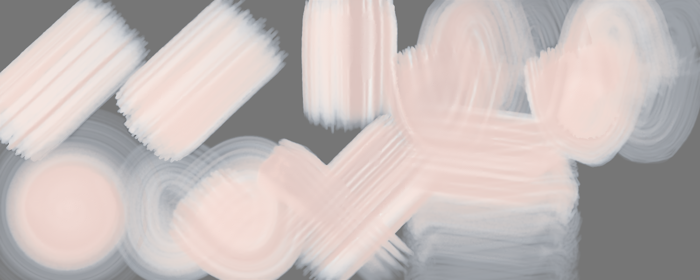

A light paint: laid on a grey sheet (on white it cannot be seen); **dark** = how far it is from the grey either way.

| stroke | covered | width | dark | spread | ms |
|---|---|---|---|---|---|
| light line | 58 % → 57 % | 169.2 px | 0.27 | 0.99 | 1413 |
| heavy line | 59 % → 52 % | 172.6 px | 0.27 | 0.88 | 1408 |
| pressure swell | 49 % → 55 % | 183.8 px | 0.25 | 1.13 | 1003 |
| fast wave | 94 % → 65 % | 109.0 px | 0.22 | 0.69 | 5371 |
| slow wave | 96 % → 57 % | 111.4 px | 0.24 | 0.59 | 7448 |
| spiral | 98 % → 56 % | 64.8 px | 0.22 | 0.57 | 8223 |
| loop | 93 % → 67 % | 120.7 px | 0.23 | 0.72 | 3382 |
| tilted | 44 % → 44 % | 123.8 px | 0.23 | 1.00 | 2724 |
| over the wet one | 81 % → 76 % | 101.8 px | 0.23 | 0.94 | 2796 |
| long, no reload | 100 % → 61 % | 44.8 px | 0.23 | 0.61 | 10178 | quarters: 0.00 → 0.00 → 0.00 → 0.00

Numbers say: light vs heavy: width 169.2 → 172.6 px, dark 0.27 → 0.27; pressure barely changes the width.

## Refs v3 · #02 HW cream strokes
Gouache 1.00 + turpentine 30 % · 102 px · 68.0 s

A light paint: laid on a grey sheet (on white it cannot be seen); **dark** = how far it is from the grey either way.

| stroke | covered | width | dark | spread | ms |
|---|---|---|---|---|---|
| light line | 31 % → 29 % | 88.9 px | 0.34 | 0.95 | 641 |
| heavy line | 32 % → 28 % | 92.8 px | 0.32 | 0.89 | 678 |
| pressure swell | 24 % → 24 % | 91.0 px | 0.33 | 1.01 | 408 |
| fast wave | 68 % → 32 % | 78.4 px | 0.29 | 0.47 | 1253 |
| slow wave | 66 % → 32 % | 76.3 px | 0.31 | 0.49 | 2923 |
| spiral | 75 % → 34 % | 49.3 px | 0.29 | 0.45 | 2744 |
| loop | 59 % → 38 % | 76.7 px | 0.31 | 0.64 | 1273 |
| tilted | 24 % → 24 % | 67.7 px | 0.31 | 1.00 | 708 |
| over the wet one | 51 % → 45 % | 74.2 px | 0.31 | 0.89 | 654 |
| long, no reload | 96 % → 35 % | 42.8 px | 0.29 | 0.37 | 4232 | quarters: 0.00 → 0.00 → 0.00 → 0.00

Numbers say: light vs heavy: width 88.9 → 92.8 px, dark 0.34 → 0.32; pressure barely changes the width; the long stroke does not run out of paint.

## Refs v3 · #03 HW navy contours
Gouache 1.00 + turpentine 30 % · 161 px · 93.6 s

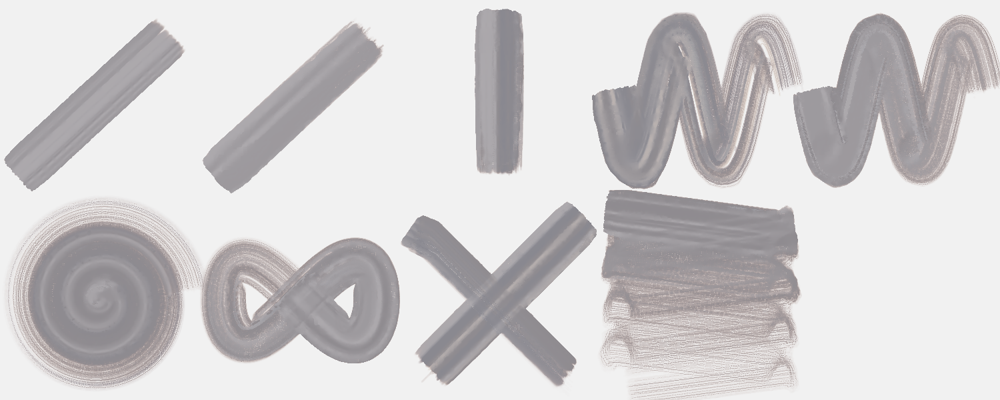

| stroke | covered | width | dark | spread | ms |
|---|---|---|---|---|---|
| light line | 47 % → 46 % | 136.2 px | 0.23 | 0.97 | 1104 |
| heavy line | 49 % → 42 % | 141.4 px | 0.24 | 0.87 | 1100 |
| pressure swell | 38 % → 40 % | 142.1 px | 0.26 | 1.05 | 611 |
| fast wave | 87 % → 54 % | 100.7 px | 0.30 | 0.62 | 3337 |
| slow wave | 89 % → 48 % | 102.4 px | 0.26 | 0.54 | 5282 |
| spiral | 94 % → 44 % | 62.1 px | 0.29 | 0.46 | 5114 |
| loop | 80 % → 55 % | 103.0 px | 0.25 | 0.69 | 2659 |
| tilted | 36 % → 36 % | 101.6 px | 0.26 | 1.00 | 1949 |
| over the wet one | 71 % → 65 % | 97.5 px | 0.26 | 0.91 | 1429 |
| long, no reload | 99 % → 50 % | 44.5 px | 0.27 | 0.50 | 7316 | quarters: 0.27 → 0.27 → 0.20 → 0.07

Numbers say: light vs heavy: width 136.2 → 141.4 px, dark 0.23 → 0.24; pressure barely changes the width.

## Refs v3 · #04 HW grey cloud
Gouache 1.00 + turpentine 30 % · 186 px · 106.8 s

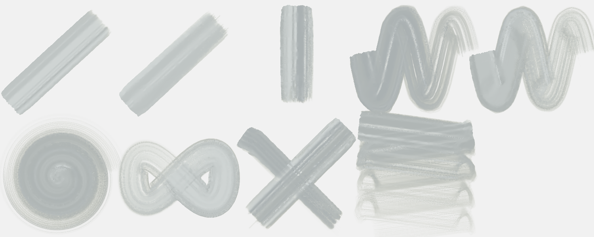

| stroke | covered | width | dark | spread | ms |
|---|---|---|---|---|---|
| light line | 53 % → 51 % | 155.2 px | 0.11 | 0.95 | 1394 |
| heavy line | 55 % → 49 % | 159.0 px | 0.12 | 0.89 | 1212 |
| pressure swell | 44 % → 48 % | 163.6 px | 0.14 | 1.10 | 737 |
| fast wave | 91 % → 62 % | 105.3 px | 0.18 | 0.68 | 4078 |
| slow wave | 94 % → 53 % | 108.3 px | 0.14 | 0.57 | 5907 |
| spiral | 97 % → 51 % | 63.9 px | 0.17 | 0.53 | 6893 |
| loop | 87 % → 61 % | 112.9 px | 0.12 | 0.70 | 4001 |
| tilted | 41 % → 41 % | 113.1 px | 0.17 | 1.00 | 2044 |
| over the wet one | 77 % → 72 % | 101.5 px | 0.17 | 0.93 | 1386 |
| long, no reload | 100 % → 59 % | 44.7 px | 0.15 | 0.59 | 11419 | quarters: 0.16 → 0.14 → 0.10 → 0.04

Numbers say: light vs heavy: width 155.2 → 159.0 px, dark 0.11 → 0.12; pressure barely changes the width.

## Refs v3 · #05 HW green in rust loops
Gouache 1.00 + turpentine 30 % · 208 px · 117.2 s

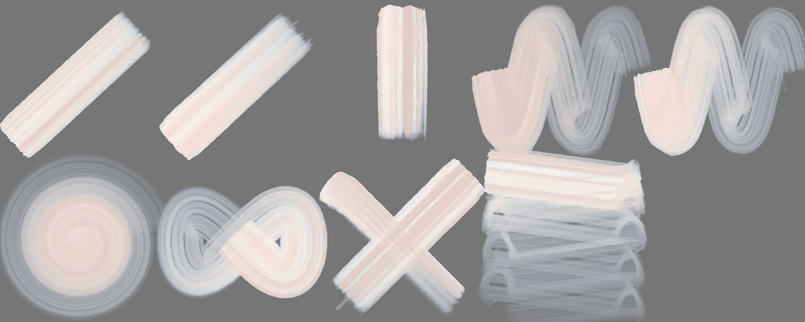

A light paint: laid on a grey sheet (on white it cannot be seen); **dark** = how far it is from the grey either way.

| stroke | covered | width | dark | spread | ms |
|---|---|---|---|---|---|
| light line | 58 % → 57 % | 169.2 px | 0.32 | 0.99 | 1431 |
| heavy line | 59 % → 52 % | 172.6 px | 0.32 | 0.88 | 1338 |
| pressure swell | 49 % → 55 % | 183.8 px | 0.30 | 1.13 | 1038 |
| fast wave | 94 % → 65 % | 109.0 px | 0.27 | 0.69 | 5221 |
| slow wave | 96 % → 57 % | 111.4 px | 0.29 | 0.59 | 7205 |
| spiral | 98 % → 56 % | 64.8 px | 0.27 | 0.57 | 8211 |
| loop | 93 % → 67 % | 120.7 px | 0.28 | 0.72 | 3322 |
| tilted | 44 % → 44 % | 123.8 px | 0.28 | 1.00 | 2446 |
| over the wet one | 81 % → 76 % | 101.8 px | 0.28 | 0.94 | 2129 |
| long, no reload | 100 % → 61 % | 44.8 px | 0.28 | 0.61 | 10000 | quarters: 0.00 → 0.00 → 0.00 → 0.00

Numbers say: light vs heavy: width 169.2 → 172.6 px, dark 0.32 → 0.32; pressure barely changes the width.

## Refs v3 · #06 HW scrubbed grey
Gouache 1.00 + turpentine 30 % · 186 px · 106.6 s

| stroke | covered | width | dark | spread | ms |
|---|---|---|---|---|---|
| light line | 53 % → 51 % | 155.2 px | 0.11 | 0.95 | 1390 |
| heavy line | 55 % → 49 % | 159.0 px | 0.12 | 0.89 | 1227 |
| pressure swell | 44 % → 48 % | 163.6 px | 0.14 | 1.10 | 749 |
| fast wave | 91 % → 62 % | 105.3 px | 0.18 | 0.68 | 4002 |
| slow wave | 94 % → 53 % | 108.3 px | 0.14 | 0.57 | 6029 |
| spiral | 97 % → 51 % | 63.9 px | 0.17 | 0.53 | 6707 |
| loop | 87 % → 61 % | 112.9 px | 0.12 | 0.70 | 3767 |
| tilted | 41 % → 41 % | 113.1 px | 0.17 | 1.00 | 1857 |
| over the wet one | 77 % → 72 % | 101.5 px | 0.17 | 0.93 | 1322 |
| long, no reload | 100 % → 59 % | 44.7 px | 0.15 | 0.59 | 10950 | quarters: 0.16 → 0.14 → 0.10 → 0.04

Numbers say: light vs heavy: width 155.2 → 159.0 px, dark 0.11 → 0.12; pressure barely changes the width.

## Refs v3 · #07 HW blue L and zigzag
Gouache 1.00 + turpentine 30 % · 208 px · 115.8 s

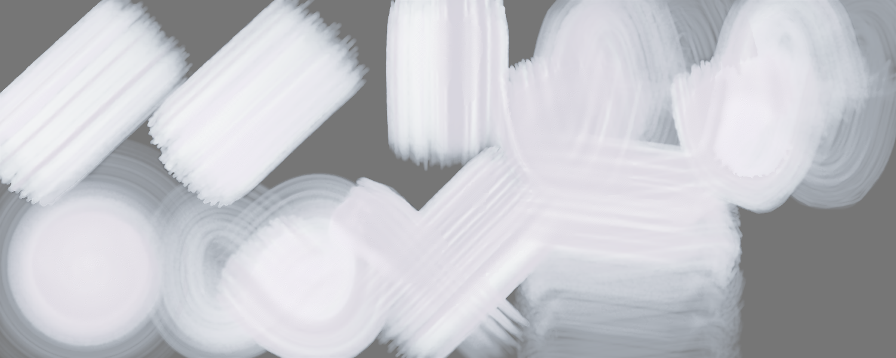

A light paint: laid on a grey sheet (on white it cannot be seen); **dark** = how far it is from the grey either way.

| stroke | covered | width | dark | spread | ms |
|---|---|---|---|---|---|
| light line | 58 % → 57 % | 169.2 px | 0.34 | 0.99 | 1434 |
| heavy line | 59 % → 52 % | 172.6 px | 0.34 | 0.88 | 1270 |
| pressure swell | 49 % → 55 % | 183.8 px | 0.32 | 1.13 | 1082 |
| fast wave | 94 % → 65 % | 109.0 px | 0.30 | 0.69 | 5185 |
| slow wave | 96 % → 57 % | 111.4 px | 0.32 | 0.59 | 7180 |
| spiral | 98 % → 56 % | 64.8 px | 0.30 | 0.57 | 7786 |
| loop | 93 % → 67 % | 120.7 px | 0.30 | 0.72 | 3357 |
| tilted | 44 % → 44 % | 123.8 px | 0.31 | 1.00 | 2317 |
| over the wet one | 81 % → 76 % | 101.8 px | 0.31 | 0.94 | 2117 |
| long, no reload | 100 % → 61 % | 44.8 px | 0.30 | 0.61 | 10151 | quarters: 0.00 → 0.00 → 0.00 → 0.00

Numbers say: light vs heavy: width 169.2 → 172.6 px, dark 0.34 → 0.34; pressure barely changes the width.

## Refs v3 · #08 HW lilac crown basket
Gouache 1.00 + turpentine 30 % · 72 px · 54.9 s

| stroke | covered | width | dark | spread | ms |
|---|---|---|---|---|---|
| light line | 22 % → 20 % | 64.1 px | 0.13 | 0.90 | 434 |
| heavy line | 22 % → 21 % | 65.1 px | 0.12 | 0.93 | 398 |
| pressure swell | 17 % → 17 % | 65.4 px | 0.16 | 0.98 | 265 |
| fast wave | 53 % → 23 % | 60.9 px | 0.18 | 0.43 | 846 |
| slow wave | 52 % → 25 % | 59.7 px | 0.16 | 0.47 | 1966 |
| spiral | 67 % → 27 % | 44.2 px | 0.17 | 0.40 | 2258 |
| loop | 46 % → 29 % | 59.9 px | 0.13 | 0.62 | 874 |
| tilted | 18 % → 18 % | 51.0 px | 0.18 | 1.00 | 437 |
| over the wet one | 39 % → 34 % | 56.9 px | 0.18 | 0.88 | 417 |
| long, no reload | 88 % → 26 % | 39.4 px | 0.16 | 0.29 | 2153 | quarters: 0.14 → 0.08 → 0.02 → 0.00

Numbers say: light vs heavy: width 64.1 → 65.1 px, dark 0.13 → 0.12; pressure barely changes the width.

## Refs v3 · #09 HW white loops
Gouache 1.00 + turpentine 30 % · 208 px · 116.4 s

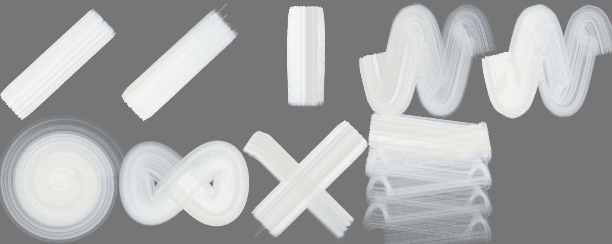

A light paint: laid on a grey sheet (on white it cannot be seen); **dark** = how far it is from the grey either way.

| stroke | covered | width | dark | spread | ms |
|---|---|---|---|---|---|
| light line | 58 % → 57 % | 169.2 px | 0.34 | 0.99 | 1448 |
| heavy line | 59 % → 52 % | 172.6 px | 0.34 | 0.88 | 1315 |
| pressure swell | 49 % → 55 % | 183.8 px | 0.32 | 1.13 | 854 |
| fast wave | 94 % → 65 % | 109.0 px | 0.29 | 0.69 | 5230 |
| slow wave | 96 % → 57 % | 111.4 px | 0.31 | 0.59 | 6865 |
| spiral | 98 % → 56 % | 64.8 px | 0.29 | 0.57 | 8241 |
| loop | 93 % → 67 % | 120.7 px | 0.30 | 0.72 | 3412 |
| tilted | 44 % → 44 % | 123.8 px | 0.30 | 1.00 | 2469 |
| over the wet one | 81 % → 76 % | 101.8 px | 0.30 | 0.94 | 2040 |
| long, no reload | 100 % → 61 % | 44.8 px | 0.29 | 0.61 | 9843 | quarters: 0.00 → 0.00 → 0.00 → 0.00

Numbers say: light vs heavy: width 169.2 → 172.6 px, dark 0.34 → 0.34; pressure barely changes the width.

## Refs v3 · #10 HW maroon loops
Gouache 1.00 + turpentine 30 % · 208 px · 116.4 s

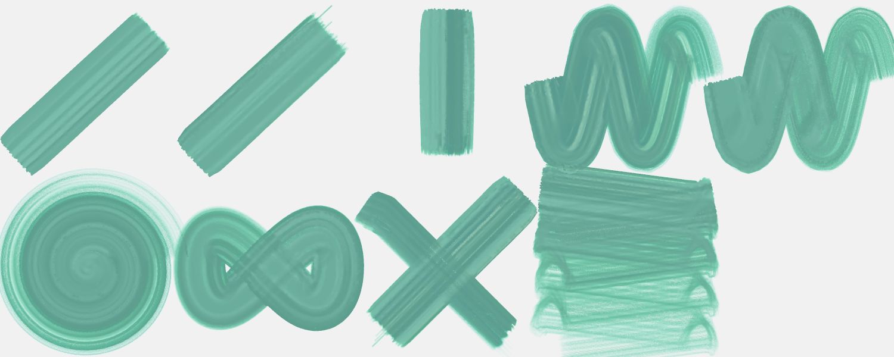

| stroke | covered | width | dark | spread | ms |
|---|---|---|---|---|---|
| light line | 58 % → 57 % | 169.2 px | 0.20 | 0.99 | 1423 |
| heavy line | 59 % → 52 % | 172.6 px | 0.20 | 0.88 | 1394 |
| pressure swell | 49 % → 55 % | 183.8 px | 0.22 | 1.13 | 1093 |
| fast wave | 94 % → 65 % | 109.0 px | 0.25 | 0.69 | 5454 |
| slow wave | 96 % → 57 % | 111.4 px | 0.22 | 0.59 | 7351 |
| spiral | 98 % → 56 % | 64.8 px | 0.24 | 0.57 | 8148 |
| loop | 93 % → 67 % | 120.7 px | 0.23 | 0.72 | 3377 |
| tilted | 44 % → 44 % | 123.8 px | 0.24 | 1.00 | 2579 |
| over the wet one | 81 % → 76 % | 101.8 px | 0.24 | 0.94 | 2936 |
| long, no reload | 100 % → 61 % | 44.8 px | 0.22 | 0.61 | 10440 | quarters: 0.22 → 0.22 → 0.18 → 0.08

Numbers say: light vs heavy: width 169.2 → 172.6 px, dark 0.20 → 0.20; pressure barely changes the width.

## Refs v3 · #11 HW purple balls
Gouache 1.00 + turpentine 30 % · 208 px · 118.4 s

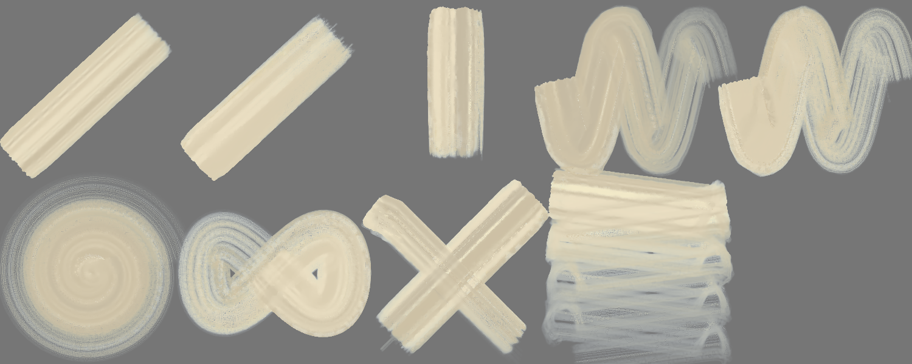

A light paint: laid on a grey sheet (on white it cannot be seen); **dark** = how far it is from the grey either way.

| stroke | covered | width | dark | spread | ms |
|---|---|---|---|---|---|
| light line | 58 % → 57 % | 169.2 px | 0.27 | 0.99 | 1128 |
| heavy line | 59 % → 52 % | 172.6 px | 0.26 | 0.88 | 1526 |
| pressure swell | 49 % → 55 % | 183.8 px | 0.25 | 1.13 | 1166 |
| fast wave | 94 % → 65 % | 109.0 px | 0.21 | 0.69 | 6020 |
| slow wave | 96 % → 57 % | 111.4 px | 0.24 | 0.59 | 7908 |
| spiral | 98 % → 56 % | 64.8 px | 0.22 | 0.57 | 8249 |
| loop | 93 % → 67 % | 120.7 px | 0.22 | 0.72 | 4361 |
| tilted | 44 % → 44 % | 123.8 px | 0.22 | 1.00 | 2879 |
| over the wet one | 81 % → 76 % | 101.8 px | 0.22 | 0.94 | 2013 |
| long, no reload | 100 % → 61 % | 44.8 px | 0.23 | 0.61 | 10879 | quarters: 0.00 → 0.00 → 0.00 → 0.00

Numbers say: light vs heavy: width 169.2 → 172.6 px, dark 0.27 → 0.26; pressure barely changes the width.

## Refs v3 · #12 HW black-olive cage
Gouache 1.00 + turpentine 30 % · 72 px · 54.9 s

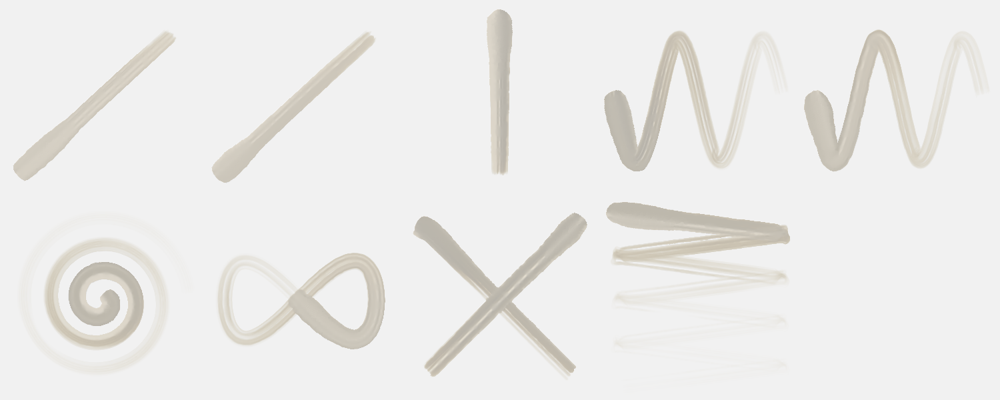

| stroke | covered | width | dark | spread | ms |
|---|---|---|---|---|---|
| light line | 22 % → 20 % | 64.1 px | 0.13 | 0.90 | 255 |
| heavy line | 22 % → 21 % | 65.1 px | 0.12 | 0.93 | 387 |
| pressure swell | 17 % → 17 % | 65.4 px | 0.16 | 0.98 | 342 |
| fast wave | 53 % → 23 % | 60.9 px | 0.18 | 0.43 | 1045 |
| slow wave | 52 % → 25 % | 59.7 px | 0.16 | 0.47 | 1651 |
| spiral | 67 % → 27 % | 44.2 px | 0.17 | 0.40 | 2231 |
| loop | 46 % → 29 % | 59.9 px | 0.13 | 0.62 | 815 |
| tilted | 18 % → 18 % | 51.0 px | 0.18 | 1.00 | 573 |
| over the wet one | 39 % → 34 % | 56.9 px | 0.18 | 0.88 | 410 |
| long, no reload | 88 % → 26 % | 39.4 px | 0.16 | 0.29 | 2229 | quarters: 0.14 → 0.08 → 0.02 → 0.00

Numbers say: light vs heavy: width 64.1 → 65.1 px, dark 0.13 → 0.12; pressure barely changes the width.

## Refs v3 · #13 HW blue streaky form
Gouache 1.00 + turpentine 30 % · 208 px · 115.1 s

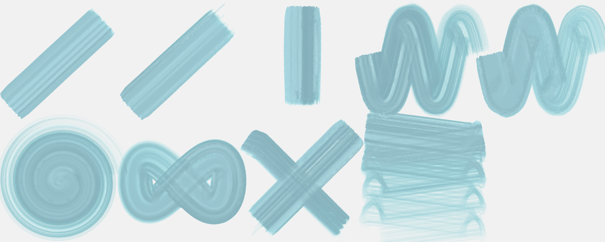

| stroke | covered | width | dark | spread | ms |
|---|---|---|---|---|---|
| light line | 58 % → 57 % | 169.2 px | 0.12 | 0.99 | 1492 |
| heavy line | 59 % → 52 % | 172.6 px | 0.13 | 0.88 | 1531 |
| pressure swell | 49 % → 55 % | 183.8 px | 0.15 | 1.13 | 1278 |
| fast wave | 94 % → 65 % | 109.0 px | 0.18 | 0.69 | 4591 |
| slow wave | 96 % → 57 % | 111.4 px | 0.15 | 0.59 | 7792 |
| spiral | 98 % → 56 % | 64.8 px | 0.17 | 0.57 | 7926 |
| loop | 93 % → 67 % | 120.7 px | 0.16 | 0.72 | 5272 |
| tilted | 44 % → 44 % | 123.8 px | 0.17 | 1.00 | 2105 |
| over the wet one | 81 % → 76 % | 101.8 px | 0.17 | 0.94 | 1708 |
| long, no reload | 100 % → 61 % | 44.8 px | 0.14 | 0.61 | 13138 | quarters: 0.15 → 0.14 → 0.11 → 0.04

Numbers say: light vs heavy: width 169.2 → 172.6 px, dark 0.12 → 0.13; pressure barely changes the width.

## Refs v3 · #14 HW olive totem
Gouache 1.00 + turpentine 30 % · 114 px · 71.9 s

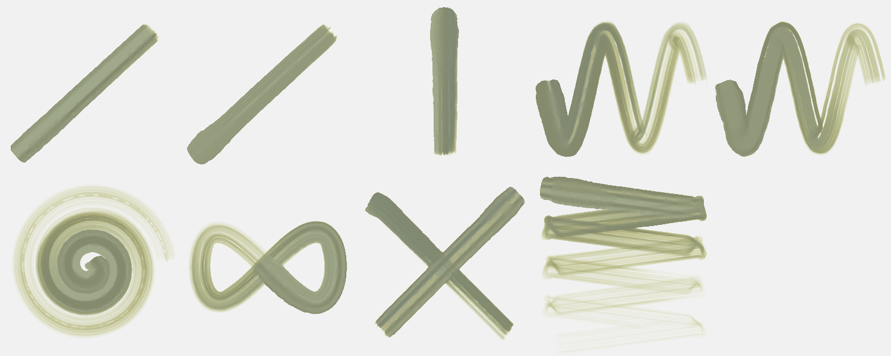

| stroke | covered | width | dark | spread | ms |
|---|---|---|---|---|---|
| light line | 34 % → 32 % | 99.5 px | 0.25 | 0.95 | 557 |
| heavy line | 36 % → 32 % | 103.1 px | 0.27 | 0.89 | 671 |
| pressure swell | 27 % → 27 % | 101.6 px | 0.29 | 1.00 | 544 |
| fast wave | 72 % → 36 % | 83.7 px | 0.32 | 0.50 | 1828 |
| slow wave | 71 % → 36 % | 81.9 px | 0.30 | 0.51 | 2802 |
| spiral | 83 % → 36 % | 54.5 px | 0.32 | 0.44 | 2684 |
| loop | 63 % → 41 % | 81.8 px | 0.26 | 0.65 | 1630 |
| tilted | 27 % → 27 % | 75.4 px | 0.32 | 1.00 | 1034 |
| over the wet one | 56 % → 50 % | 80.6 px | 0.32 | 0.90 | 1002 |
| long, no reload | 97 % → 40 % | 43.5 px | 0.28 | 0.42 | 4739 | quarters: 0.27 → 0.25 → 0.12 → 0.03

Numbers say: light vs heavy: width 99.5 → 103.1 px, dark 0.25 → 0.27; pressure barely changes the width.

## Refs v3 · #15 Ultramarine script
Ink 0.98 · 78 px · 50.6 s

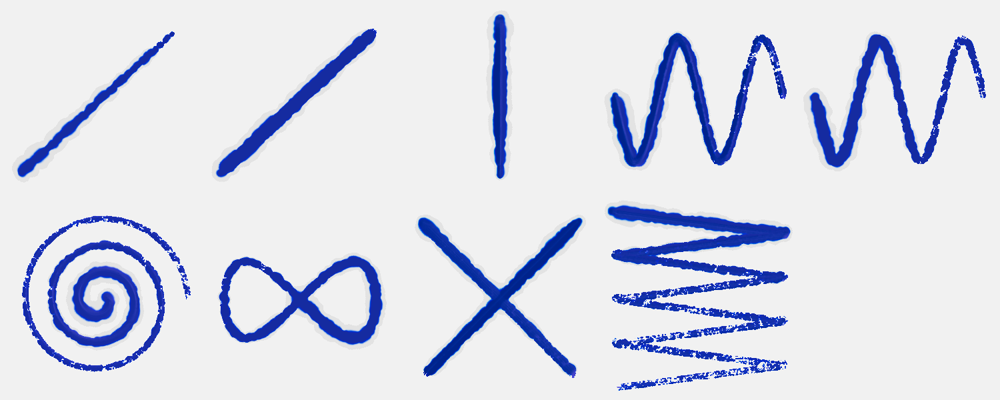

| stroke | covered | width | dark | spread | ms |
|---|---|---|---|---|---|
| light line | 8 % → 10 % | 23.0 px | 0.64 | 1.29 | 130 |
| heavy line | 24 % → 25 % | 69.9 px | 0.69 | 1.04 | 629 |
| pressure swell | 13 % → 15 % | 50.4 px | 0.70 | 1.09 | 205 |
| fast wave | 47 % → 49 % | 54.1 px | 0.73 | 1.04 | 795 |
| slow wave | 43 % → 46 % | 49.2 px | 0.69 | 1.07 | 942 |
| spiral | 64 % → 65 % | 42.2 px | 0.68 | 1.01 | 981 |
| loop | 37 % → 39 % | 47.5 px | 0.69 | 1.06 | 443 |
| tilted | 22 % → 22 % | 61.4 px | 0.72 | 1.00 | 316 |
| over the wet one | 38 % → 41 % | 45.9 px | 0.72 | 1.06 | 227 |
| long, no reload | 86 % → 87 % | 38.6 px | 0.67 | 1.01 | 1805 | quarters: 0.64 → 0.64 → 0.62 → 0.59

Numbers say: light vs heavy: width 23.0 → 69.9 px, dark 0.64 → 0.69; the long stroke does not run out of paint.

## Refs v3 · #16 Shrigley strokes
Watercolour 1.00 + water 30 % · 128 px · 58.1 s

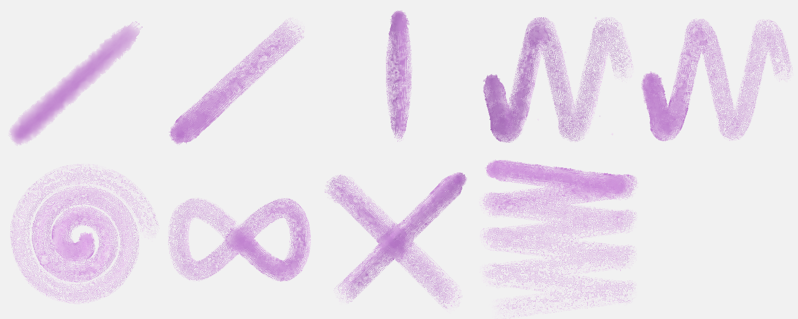

| stroke | covered | width | dark | spread | ms |
|---|---|---|---|---|---|
| light line | 17 % → 23 % | 48.7 px | 0.30 | 1.37 | 182 |
| heavy line | 31 % → 34 % | 90.1 px | 0.31 | 1.10 | 608 |
| pressure swell | 19 % → 23 % | 71.2 px | 0.35 | 1.21 | 289 |
| fast wave | 63 % → 67 % | 73.1 px | 0.34 | 1.06 | 1076 |
| slow wave | 59 % → 62 % | 68.6 px | 0.30 | 1.05 | 1514 |
| spiral | 75 % → 75 % | 49.2 px | 0.26 | 1.00 | 2142 |
| loop | 52 % → 54 % | 66.9 px | 0.30 | 1.05 | 1008 |
| tilted | 30 % → 30 % | 83.3 px | 0.31 | 1.01 | 801 |
| over the wet one | 51 % → 57 % | 59.8 px | 0.31 | 1.12 | 439 |
| long, no reload | 95 % → 96 % | 42.6 px | 0.24 | 1.01 | 3236 | quarters: 0.34 → 0.28 → 0.20 → 0.15

Numbers say: light vs heavy: width 48.7 → 90.1 px, dark 0.30 → 0.31.

## Refs v3 · #17 Krovostok dry brush
Ink 0.93 · Gouache 0.07 · 106 px · 82.0 s

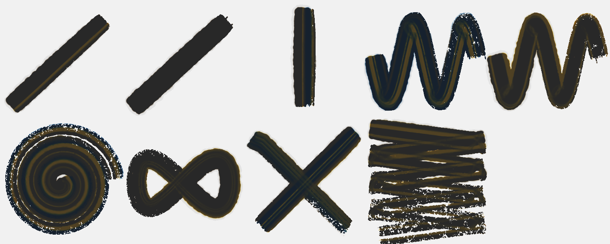

| stroke | covered | width | dark | spread | ms |
|---|---|---|---|---|---|
| light line | 31 % → 33 % | 91.1 px | 0.75 | 1.05 | 560 |
| heavy line | 35 % → 36 % | 101.7 px | 0.76 | 1.02 | 666 |
| pressure swell | 26 % → 29 % | 95.8 px | 0.76 | 1.14 | 418 |
| fast wave | 71 % → 76 % | 82.3 px | 0.78 | 1.07 | 1323 |
| slow wave | 68 % → 67 % | 78.4 px | 0.76 | 0.99 | 2582 |
| spiral | 81 % → 78 % | 53.1 px | 0.75 | 0.97 | 2562 |
| loop | 62 % → 63 % | 80.9 px | 0.76 | 1.02 | 1630 |
| tilted | 26 % → 26 % | 73.4 px | 0.76 | 1.01 | 671 |
| over the wet one | 54 % → 57 % | 76.9 px | 0.76 | 1.05 | 597 |
| long, no reload | 93 % → 95 % | 41.6 px | 0.72 | 1.02 | 4663 | quarters: 0.73 → 0.73 → 0.71 → 0.66

Numbers say: light vs heavy: width 91.1 → 101.7 px, dark 0.75 → 0.76; the long stroke does not run out of paint.

## Refs v3 · #18 Twombly blue sticks
Wax 1.00 · 38 px · 14.0 s

| stroke | covered | width | dark | spread | ms |
|---|---|---|---|---|---|
| light line | 7 % → 7 % | 20.3 px | 0.24 | 1.00 | 140 |
| heavy line | 11 % → 11 % | 33.0 px | 0.25 | 1.00 | 161 |
| pressure swell | 8 % → 8 % | 29.9 px | 0.24 | 1.00 | 65 |
| fast wave | 26 % → 26 % | 29.6 px | 0.25 | 1.00 | 213 |
| slow wave | 24 % → 24 % | 27.9 px | 0.25 | 1.00 | 502 |
| spiral | 39 % → 39 % | 25.7 px | 0.25 | 1.00 | 458 |
| loop | 20 % → 20 % | 25.4 px | 0.24 | 1.00 | 213 |
| tilted | 6 % → 6 % | 17.8 px | 0.24 | 1.00 | 148 |
| over the wet one | 16 % → 16 % | 26.8 px | 0.24 | 1.00 | 82 |
| long, no reload | 47 % → 47 % | 20.9 px | 0.25 | 1.00 | 624 | quarters: 0.13 → 0.13 → 0.13 → 0.13

Numbers say: light vs heavy: width 20.3 → 33.0 px, dark 0.24 → 0.25; the long stroke does not run out of paint.

## Refs v3 · #19 Guston charcoal hand
Charcoal 1.00 · 121 px · 24.4 s

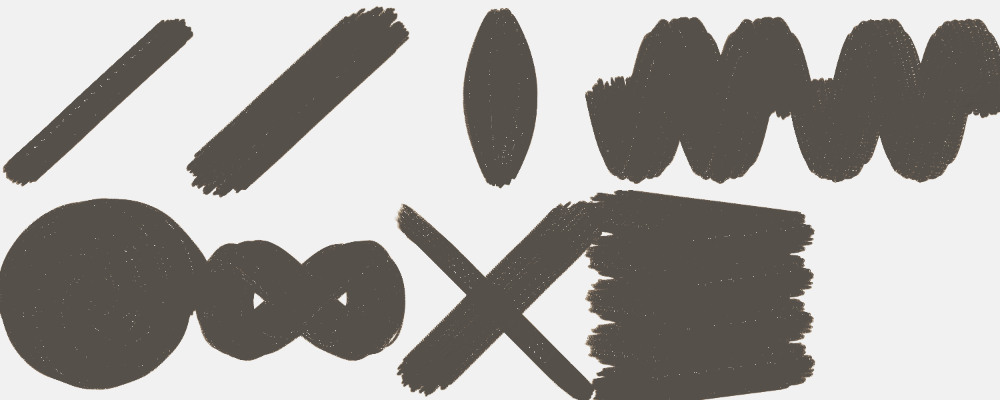

| stroke | covered | width | dark | spread | ms |
|---|---|---|---|---|---|
| light line | 19 % → 20 % | 56.4 px | 0.62 | 1.04 | 257 |
| heavy line | 37 % → 37 % | 106.6 px | 0.62 | 1.00 | 378 |
| pressure swell | 26 % → 27 % | 95.9 px | 0.62 | 1.06 | 359 |
| fast wave | 64 % → 66 % | 73.5 px | 0.62 | 1.03 | 1036 |
| slow wave | 62 % → 62 % | 71.6 px | 0.62 | 1.00 | 2279 |
| spiral | 76 % → 76 % | 50.4 px | 0.62 | 1.00 | 2466 |
| loop | 51 % → 52 % | 66.7 px | 0.62 | 1.00 | 1012 |
| tilted | 17 % → 17 % | 48.5 px | 0.61 | 1.00 | 691 |
| over the wet one | 47 % → 50 % | 81.5 px | 0.61 | 1.07 | 639 |
| long, no reload | 97 % → 97 % | 43.3 px | 0.63 | 1.00 | 4199 | quarters: 0.62 → 0.62 → 0.62 → 0.62

Numbers say: light vs heavy: width 56.4 → 106.6 px, dark 0.62 → 0.62; the long stroke does not run out of paint.

## Refs v3 · #20 Orange crayon
Wax 1.00 · 96 px · 21.5 s

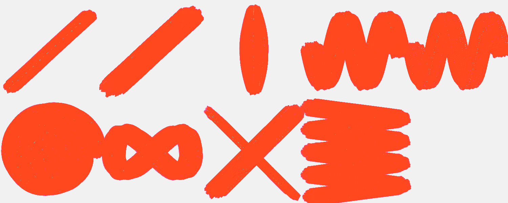

| stroke | covered | width | dark | spread | ms |
|---|---|---|---|---|---|
| light line | 17 % → 17 % | 49.9 px | 0.52 | 1.01 | 265 |
| heavy line | 29 % → 29 % | 84.4 px | 0.52 | 1.00 | 314 |
| pressure swell | 20 % → 21 % | 75.0 px | 0.52 | 1.03 | 282 |
| fast wave | 55 % → 55 % | 63.1 px | 0.52 | 1.01 | 798 |
| slow wave | 53 % → 53 % | 60.9 px | 0.52 | 1.00 | 1514 |
| spiral | 71 % → 71 % | 46.6 px | 0.52 | 1.00 | 1773 |
| loop | 44 % → 44 % | 56.9 px | 0.52 | 1.00 | 1238 |
| tilted | 12 % → 12 % | 34.8 px | 0.52 | 1.00 | 561 |
| over the wet one | 36 % → 37 % | 65.1 px | 0.52 | 1.03 | 366 |
| long, no reload | 89 % → 89 % | 39.7 px | 0.52 | 1.00 | 2611 | quarters: 0.49 → 0.48 → 0.48 → 0.49

Numbers say: light vs heavy: width 49.9 → 84.4 px, dark 0.52 → 0.52; the long stroke does not run out of paint.

## Refs v3 · #21 Gritty dog contours
Gouache 1.00 + water 15 % · 155 px · 91.5 s

| stroke | covered | width | dark | spread | ms |
|---|---|---|---|---|---|
| light line | 45 % → 44 % | 131.6 px | 0.33 | 0.98 | 732 |
| heavy line | 48 % → 43 % | 138.4 px | 0.33 | 0.91 | 1408 |
| pressure swell | 37 % → 41 % | 138.5 px | 0.33 | 1.11 | 755 |
| fast wave | 81 % → 76 % | 93.2 px | 0.34 | 0.94 | 3786 |
| slow wave | 85 % → 66 % | 97.8 px | 0.33 | 0.78 | 3995 |
| spiral | 85 % → 63 % | 56.1 px | 0.33 | 0.74 | 5161 |
| loop | 76 % → 70 % | 98.0 px | 0.33 | 0.92 | 2561 |
| tilted | 35 % → 35 % | 98.1 px | 0.34 | 1.01 | 1366 |
| over the wet one | 70 % → 67 % | 97.9 px | 0.34 | 0.96 | 1164 |
| long, no reload | 93 % → 77 % | 41.7 px | 0.32 | 0.82 | 7853 | quarters: 0.32 → 0.32 → 0.31 → 0.27

Numbers say: light vs heavy: width 131.6 → 138.4 px, dark 0.33 → 0.33; pressure barely changes the width.

## Refs v3 · #22 Wasilewski brush poster
Ink 0.98 · 128 px · 72.8 s

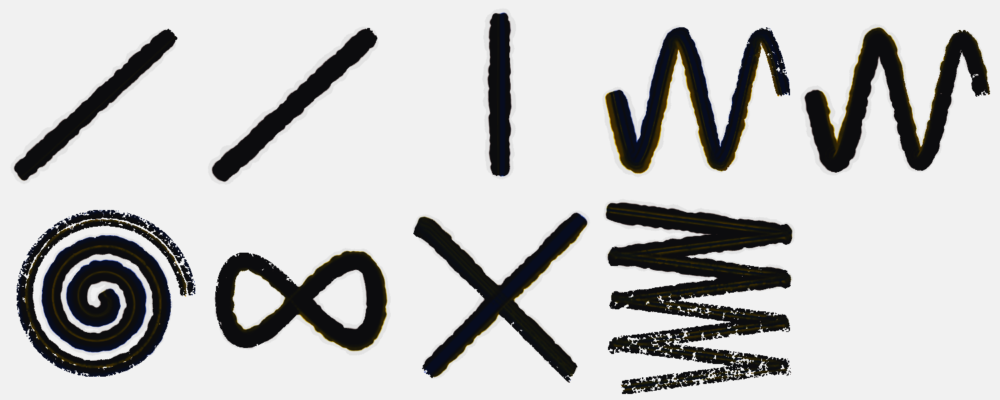

| stroke | covered | width | dark | spread | ms |
|---|---|---|---|---|---|
| light line | 37 % → 42 % | 107.7 px | 0.87 | 1.14 | 223 |
| heavy line | 42 % → 42 % | 122.5 px | 0.88 | 1.00 | 964 |
| pressure swell | 30 % → 35 % | 114.1 px | 0.87 | 1.16 | 531 |
| fast wave | 80 % → 86 % | 92.5 px | 0.87 | 1.08 | 1598 |
| slow wave | 77 % → 78 % | 88.9 px | 0.88 | 1.02 | 2824 |
| spiral | 88 % → 89 % | 57.8 px | 0.85 | 1.02 | 3740 |
| loop | 69 % → 70 % | 89.9 px | 0.87 | 1.01 | 1711 |
| tilted | 32 % → 33 % | 90.1 px | 0.86 | 1.01 | 1104 |
| over the wet one | 63 % → 65 % | 87.0 px | 0.86 | 1.03 | 835 |
| long, no reload | 94 % → 97 % | 42.1 px | 0.88 | 1.04 | 4455 | quarters: 0.88 → 0.88 → 0.87 → 0.83

Numbers say: light vs heavy: width 107.7 → 122.5 px, dark 0.87 → 0.88; the long stroke does not run out of paint.

## Refs v3 · #23 Report dry white mask
Ink 0.93 · Gouache 0.07 · 179 px · 108.9 s

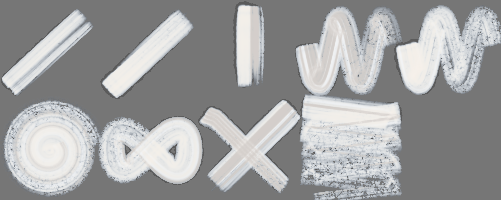

A light paint: laid on a grey sheet (on white it cannot be seen); **dark** = how far it is from the grey either way.

| stroke | covered | width | dark | spread | ms |
|---|---|---|---|---|---|
| light line | 52 % → 59 % | 149.6 px | 0.37 | 1.14 | 938 |
| heavy line | 55 % → 52 % | 158.4 px | 0.40 | 0.95 | 1818 |
| pressure swell | 42 % → 51 % | 156.7 px | 0.38 | 1.21 | 1317 |
| fast wave | 90 % → 91 % | 104.4 px | 0.36 | 1.01 | 3700 |
| slow wave | 90 % → 89 % | 104.2 px | 0.39 | 0.99 | 5458 |
| spiral | 96 % → 96 % | 63.1 px | 0.39 | 1.00 | 6717 |
| loop | 86 % → 86 % | 111.6 px | 0.40 | 1.00 | 2537 |
| tilted | 40 % → 40 % | 111.6 px | 0.37 | 1.01 | 1900 |
| over the wet one | 77 % → 78 % | 102.3 px | 0.37 | 1.01 | 886 |
| long, no reload | 97 % → 97 % | 43.5 px | 0.39 | 1.00 | 6552 | quarters: 0.00 → 0.00 → 0.00 → 0.00

Numbers say: light vs heavy: width 149.6 → 158.4 px, dark 0.37 → 0.40; pressure barely changes the width.

## Refs v3 · #24 Picasso flat oil
Gouache 1.00 + turpentine 20 % · 149 px · 87.2 s

| stroke | covered | width | dark | spread | ms |
|---|---|---|---|---|---|
| light line | 46 % → 41 % | 134.6 px | 0.09 | 0.89 | 1007 |
| heavy line | 48 % → 41 % | 137.9 px | 0.10 | 0.87 | 1341 |
| pressure swell | 37 % → 40 % | 139.3 px | 0.12 | 1.09 | 808 |
| fast wave | 86 % → 51 % | 98.9 px | 0.17 | 0.60 | 2696 |
| slow wave | 87 % → 47 % | 99.9 px | 0.12 | 0.54 | 4778 |
| spiral | 92 % → 41 % | 60.7 px | 0.16 | 0.45 | 6571 |
| loop | 77 % → 52 % | 99.7 px | 0.12 | 0.68 | 2783 |
| tilted | 35 % → 35 % | 98.4 px | 0.15 | 1.00 | 1559 |
| over the wet one | 71 % → 64 % | 100.4 px | 0.15 | 0.90 | 934 |
| long, no reload | 99 % → 48 % | 44.3 px | 0.15 | 0.49 | 6184 | quarters: 0.14 → 0.14 → 0.07 → 0.01

Numbers say: light vs heavy: width 134.6 → 137.9 px, dark 0.09 → 0.10; pressure barely changes the width.

## Refs v3 · #25 Yellow heavy stroke
Impasto 1.00 · 544 px · 207.6 s

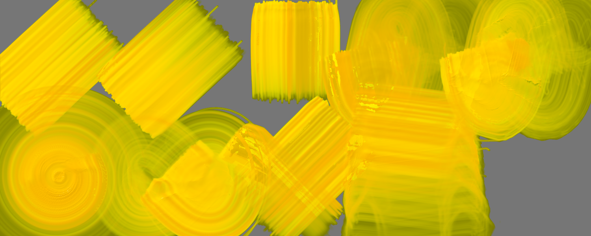

A light paint: laid on a grey sheet (on white it cannot be seen); **dark** = how far it is from the grey either way.

| stroke | covered | width | dark | spread | ms |
|---|---|---|---|---|---|
| light line | 93 % → 95 % | 270.9 px | 0.22 | 1.02 | 6350 |
| heavy line | 92 % → 87 % | 266.6 px | 0.21 | 0.94 | 8270 |
| pressure swell | 86 % → 99 % | 322.6 px | 0.19 | 1.16 | 4806 |
| fast wave | 100 % → 100 % | 115.5 px | 0.18 | 1.00 | 21234 |
| slow wave | 99 % → 81 % | 114.8 px | 0.19 | 0.82 | 37998 |
| spiral | 100 % → 100 % | 66.0 px | 0.18 | 1.00 | 28132 |
| loop | 100 % → 100 % | 129.5 px | 0.20 | 1.00 | 16292 |
| tilted | 89 % → 89 % | 249.7 px | 0.17 | 1.00 | 8776 |
| over the wet one | 100 % → 100 % | 29.4 px | 0.17 | 1.00 | 6205 |
| long, no reload | 100 % → 98 % | 44.8 px | 0.18 | 0.98 | 39092 | quarters: 0.00 → 0.00 → 0.00 → 0.00

Numbers say: light vs heavy: width 270.9 → 266.6 px, dark 0.22 → 0.21; pressure barely changes the width; the long stroke does not run out of paint.

## Refs v3 · #26 Ink caricature
Ink 0.98 · 128 px · 56.6 s

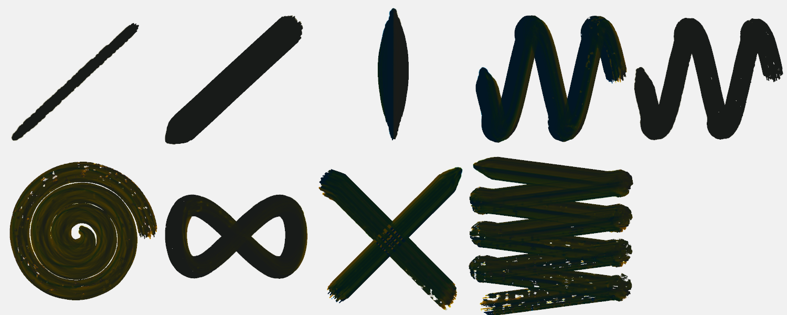

| stroke | covered | width | dark | spread | ms |
|---|---|---|---|---|---|
| light line | 13 % → 16 % | 39.1 px | 0.81 | 1.16 | 159 |
| heavy line | 37 % → 37 % | 106.6 px | 0.83 | 1.01 | 733 |
| pressure swell | 21 % → 22 % | 78.5 px | 0.84 | 1.06 | 332 |
| fast wave | 67 % → 70 % | 77.7 px | 0.85 | 1.04 | 1097 |
| slow wave | 62 % → 63 % | 71.3 px | 0.83 | 1.02 | 1320 |
| spiral | 76 % → 76 % | 49.9 px | 0.79 | 1.01 | 1594 |
| loop | 53 % → 55 % | 69.2 px | 0.82 | 1.03 | 1120 |
| tilted | 31 % → 31 % | 86.7 px | 0.82 | 1.01 | 743 |
| over the wet one | 54 % → 59 % | 64.9 px | 0.82 | 1.08 | 777 |
| long, no reload | 98 % → 98 % | 43.7 px | 0.83 | 1.00 | 5034 | quarters: 0.82 → 0.83 → 0.83 → 0.81

Numbers say: light vs heavy: width 39.1 → 106.6 px, dark 0.81 → 0.83; the long stroke does not run out of paint.

## Refs v3 · #27 Orange impasto swatch
Impasto 1.00 · 160 px · 50.0 s

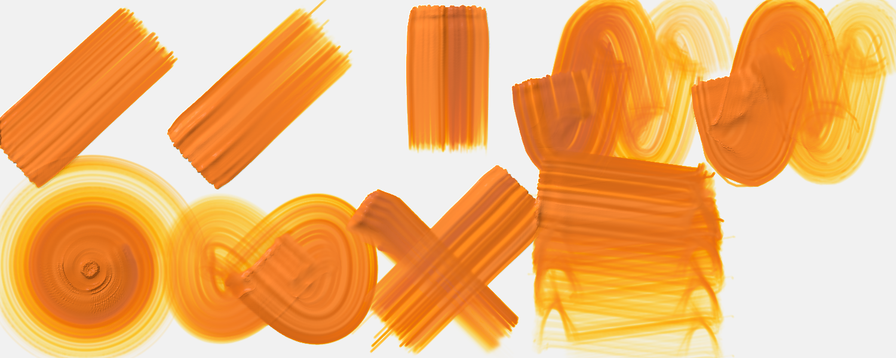

| stroke | covered | width | dark | spread | ms |
|---|---|---|---|---|---|
| light line | 46 % → 43 % | 133.4 px | 0.27 | 0.93 | 995 |
| heavy line | 46 % → 30 % | 134.8 px | 0.28 | 0.65 | 779 |
| pressure swell | 36 % → 35 % | 136.3 px | 0.30 | 0.97 | 530 |
| fast wave | 84 % → 38 % | 97.6 px | 0.34 | 0.46 | 2139 |
| slow wave | 85 % → 33 % | 98.3 px | 0.30 | 0.39 | 3727 |
| spiral | 89 % → 32 % | 58.7 px | 0.34 | 0.36 | 4501 |
| loop | 78 % → 38 % | 100.7 px | 0.29 | 0.49 | 3444 |
| tilted | 34 % → 34 % | 95.5 px | 0.31 | 1.00 | 2238 |
| over the wet one | 69 % → 55 % | 97.6 px | 0.31 | 0.79 | 1140 |
| long, no reload | 95 % → 41 % | 42.4 px | 0.30 | 0.44 | 5959 | quarters: 0.29 → 0.28 → 0.12 → 0.03

Numbers say: light vs heavy: width 133.4 → 134.8 px, dark 0.27 → 0.28; pressure barely changes the width.

## Refs v3 · #28 Miles Davis lines
Ink 0.98 · 36 px · 37.1 s

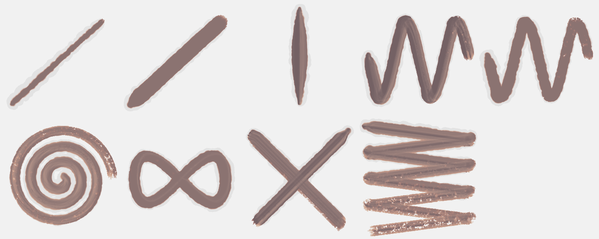

| stroke | covered | width | dark | spread | ms |
|---|---|---|---|---|---|
| light line | 3 % → 7 % | 10.1 px | 0.36 | 2.00 | 37 |
| heavy line | 13 % → 15 % | 38.9 px | 0.44 | 1.11 | 144 |
| pressure swell | 7 % → 9 % | 26.3 px | 0.44 | 1.25 | 80 |
| fast wave | 26 % → 30 % | 29.6 px | 0.46 | 1.16 | 257 |
| slow wave | 22 % → 27 % | 25.6 px | 0.43 | 1.24 | 311 |
| spiral | 37 % → 43 % | 24.4 px | 0.38 | 1.17 | 349 |
| loop | 20 % → 24 % | 25.5 px | 0.42 | 1.21 | 204 |
| tilted | 13 % → 13 % | 37.2 px | 0.44 | 1.00 | 122 |
| over the wet one | 22 % → 25 % | 25.4 px | 0.44 | 1.10 | 99 |
| long, no reload | 52 % → 57 % | 23.3 px | 0.39 | 1.09 | 913 | quarters: 0.29 → 0.27 → 0.24 → 0.20

Numbers say: light vs heavy: width 10.1 → 38.9 px, dark 0.36 → 0.44; wet paint spreads well beyond the stroke.

## Refs v3 · #29 Shrigley asterisk
Watercolour 1.00 + water 50 % · 128 px · 70.8 s

| stroke | covered | width | dark | spread | ms |
|---|---|---|---|---|---|
| light line | 38 % → 45 % | 108.9 px | 0.57 | 1.21 | 301 |
| heavy line | 60 % → 60 % | 175.4 px | 0.57 | 1.00 | 798 |
| pressure swell | 42 % → 50 % | 158.6 px | 0.58 | 1.18 | 551 |
| fast wave | 88 % → 94 % | 102.1 px | 0.60 | 1.07 | 1578 |
| slow wave | 87 % → 87 % | 100.2 px | 0.57 | 1.01 | 4224 |
| spiral | 92 % → 92 % | 60.5 px | 0.56 | 1.01 | 3387 |
| loop | 81 % → 82 % | 105.0 px | 0.57 | 1.01 | 1558 |
| tilted | 41 % → 41 % | 113.2 px | 0.57 | 1.00 | 739 |
| over the wet one | 80 % → 85 % | 110.3 px | 0.57 | 1.06 | 573 |
| long, no reload | 96 % → 97 % | 43.0 px | 0.56 | 1.01 | 4426 | quarters: 0.57 → 0.56 → 0.55 → 0.51

Numbers say: light vs heavy: width 108.9 → 175.4 px, dark 0.57 → 0.57; the long stroke does not run out of paint.

## Refs v3 · #30 Red gouache face
Gouache 1.00 + water 15 % · 153 px · 81.2 s

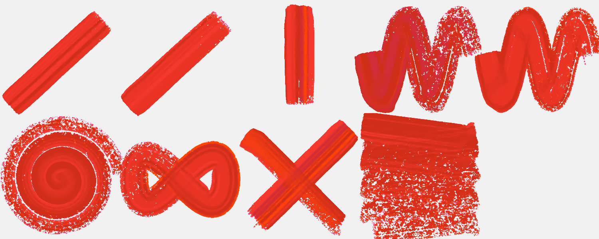

| stroke | covered | width | dark | spread | ms |
|---|---|---|---|---|---|
| light line | 44 % → 43 % | 128.7 px | 0.44 | 0.98 | 492 |
| heavy line | 47 % → 43 % | 136.0 px | 0.44 | 0.91 | 1056 |
| pressure swell | 36 % → 39 % | 135.8 px | 0.44 | 1.09 | 851 |
| fast wave | 79 % → 74 % | 91.4 px | 0.44 | 0.93 | 3149 |
| slow wave | 83 % → 64 % | 96.1 px | 0.43 | 0.77 | 3532 |
| spiral | 86 % → 65 % | 57.0 px | 0.41 | 0.75 | 3662 |
| loop | 74 % → 68 % | 96.5 px | 0.44 | 0.92 | 1819 |
| tilted | 34 % → 34 % | 95.4 px | 0.44 | 1.00 | 1562 |
| over the wet one | 69 % → 66 % | 97.8 px | 0.44 | 0.96 | 1975 |
| long, no reload | 92 % → 74 % | 41.4 px | 0.40 | 0.81 | 6235 | quarters: 0.40 → 0.40 → 0.38 → 0.32

Numbers say: light vs heavy: width 128.7 → 136.0 px, dark 0.44 → 0.44; pressure barely changes the width.

## Refs v3 · #31 Warhol blotted line
Ink 0.98 · 50 px · 41.0 s

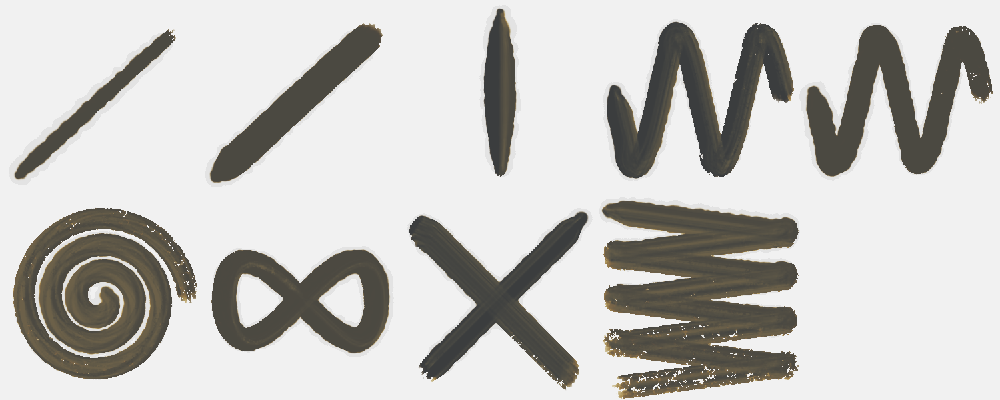

| stroke | covered | width | dark | spread | ms |
|---|---|---|---|---|---|
| light line | 6 % → 9 % | 18.4 px | 0.57 | 1.42 | 137 |
| heavy line | 16 % → 17 % | 46.3 px | 0.63 | 1.08 | 356 |
| pressure swell | 9 % → 11 % | 34.2 px | 0.63 | 1.15 | 228 |
| fast wave | 33 % → 35 % | 37.8 px | 0.65 | 1.07 | 542 |
| slow wave | 29 % → 33 % | 33.9 px | 0.63 | 1.12 | 480 |
| spiral | 49 % → 53 % | 32.1 px | 0.59 | 1.08 | 472 |
| loop | 26 % → 28 % | 33.3 px | 0.62 | 1.11 | 301 |
| tilted | 16 % → 17 % | 46.0 px | 0.65 | 1.00 | 190 |
| over the wet one | 28 % → 29 % | 31.6 px | 0.65 | 1.06 | 161 |
| long, no reload | 65 % → 68 % | 29.2 px | 0.61 | 1.05 | 856 | quarters: 0.48 → 0.47 → 0.45 → 0.41

Numbers say: light vs heavy: width 18.4 → 46.3 px, dark 0.57 → 0.63.

## Refs v3 · #32 Thick orange swipes
Impasto 1.00 · 153 px · 48.7 s

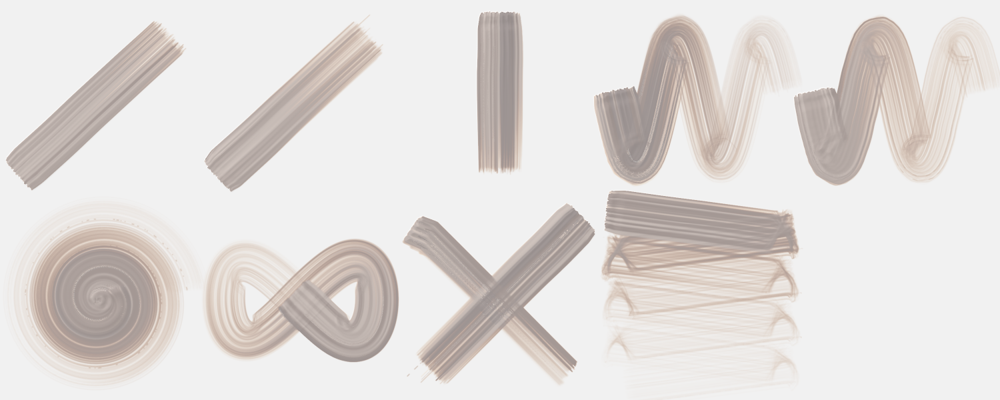

| stroke | covered | width | dark | spread | ms |
|---|---|---|---|---|---|
| light line | 45 % → 41 % | 129.9 px | 0.20 | 0.92 | 653 |
| heavy line | 45 % → 30 % | 130.6 px | 0.20 | 0.67 | 844 |
| pressure swell | 35 % → 33 % | 132.4 px | 0.24 | 0.94 | 565 |
| fast wave | 83 % → 36 % | 95.8 px | 0.27 | 0.43 | 1909 |
| slow wave | 83 % → 30 % | 95.6 px | 0.22 | 0.36 | 3777 |
| spiral | 88 % → 31 % | 57.8 px | 0.28 | 0.36 | 4428 |
| loop | 75 % → 37 % | 97.6 px | 0.21 | 0.49 | 3564 |
| tilted | 33 % → 33 % | 91.6 px | 0.25 | 1.00 | 1675 |
| over the wet one | 68 % → 53 % | 97.0 px | 0.25 | 0.78 | 1056 |
| long, no reload | 93 % → 40 % | 41.9 px | 0.25 | 0.42 | 7200 | quarters: 0.26 → 0.19 → 0.04 → 0.00

Numbers say: light vs heavy: width 129.9 → 130.6 px, dark 0.20 → 0.20; pressure barely changes the width.

## Refs v3 · #33 Red wet-in-wet flames
Watercolour 1.00 + water 60 % · 192 px · 89.8 s

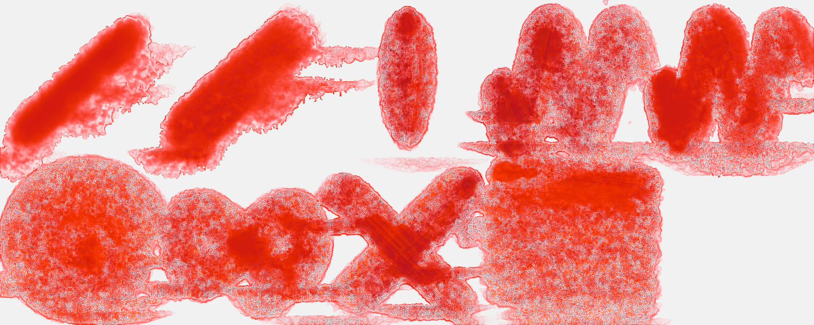

| stroke | covered | width | dark | spread | ms |
|---|---|---|---|---|---|
| light line | 46 % → 70 % | 134.6 px | 0.53 | 1.51 | 598 |
| heavy line | 76 % → 85 % | 219.9 px | 0.58 | 1.12 | 1272 |
| pressure swell | 60 % → 82 % | 224.9 px | 0.55 | 1.36 | 776 |
| fast wave | 94 % → 98 % | 109.2 px | 0.69 | 1.04 | 3262 |
| slow wave | 97 % → 99 % | 111.6 px | 0.64 | 1.02 | 8166 |
| spiral | 99 % → 100 % | 65.2 px | 0.65 | 1.01 | 5501 |
| loop | 100 % → 100 % | 129.0 px | 0.66 | 1.00 | 3290 |
| tilted | 71 % → 72 % | 199.0 px | 0.64 | 1.01 | 1432 |
| over the wet one | 92 % → 99 % | 57.0 px | 0.64 | 1.08 | 1149 |
| long, no reload | 98 % → 100 % | 43.9 px | 0.64 | 1.02 | 7096 | quarters: 0.69 → 0.68 → 0.67 → 0.58

Numbers say: light vs heavy: width 134.6 → 219.9 px, dark 0.53 → 0.58; wet paint spreads well beyond the stroke.

## Refs v3 · #34 Magenta oil patches
Gouache 1.00 + turpentine 20 % · 181 px · 90.7 s

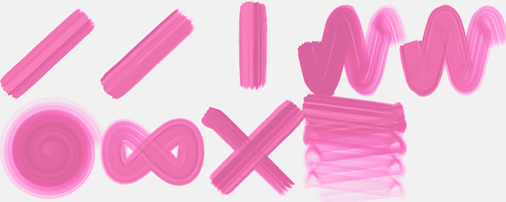

| stroke | covered | width | dark | spread | ms |
|---|---|---|---|---|---|
| light line | 55 % → 51 % | 160.6 px | 0.21 | 0.92 | 1048 |
| heavy line | 56 % → 50 % | 162.4 px | 0.21 | 0.89 | 1386 |
| pressure swell | 45 % → 51 % | 170.4 px | 0.24 | 1.12 | 1742 |
| fast wave | 92 % → 60 % | 105.9 px | 0.27 | 0.66 | 4056 |
| slow wave | 94 % → 54 % | 108.6 px | 0.25 | 0.57 | 8059 |
| spiral | 96 % → 48 % | 63.2 px | 0.28 | 0.50 | 5705 |
| loop | 87 % → 59 % | 112.9 px | 0.22 | 0.68 | 2451 |
| tilted | 42 % → 42 % | 116.2 px | 0.25 | 1.00 | 1919 |
| over the wet one | 80 % → 73 % | 106.1 px | 0.25 | 0.92 | 1419 |
| long, no reload | 100 % → 55 % | 44.7 px | 0.25 | 0.56 | 7991 | quarters: 0.24 → 0.25 → 0.23 → 0.13

Numbers say: light vs heavy: width 160.6 → 162.4 px, dark 0.21 → 0.21; pressure barely changes the width.

## Refs v3 · #35 Red band with runs
Watercolour 1.00 + water 70 % · 352 px · 154.0 s

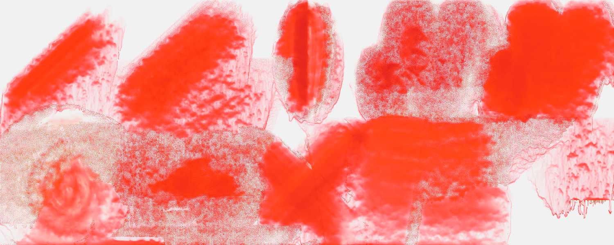

| stroke | covered | width | dark | spread | ms |
|---|---|---|---|---|---|
| light line | 74 % → 86 % | 215.6 px | 0.46 | 1.16 | 3978 |
| heavy line | 95 % → 95 % | 276.9 px | 0.51 | 1.00 | 4403 |
| pressure swell | 94 % → 99 % | 353.0 px | 0.46 | 1.05 | 4026 |
| fast wave | 100 % → 100 % | 115.5 px | 0.59 | 1.00 | 9546 |
| slow wave | 100 % → 100 % | 115.4 px | 0.58 | 1.00 | 15472 |
| spiral | 100 % → 100 % | 66.0 px | 0.42 | 1.00 | 13853 |
| loop | 100 % → 100 % | 129.5 px | 0.58 | 1.00 | 7181 |
| tilted | 100 % → 100 % | 278.9 px | 0.55 | 1.00 | 5243 |
| over the wet one | 100 % → 100 % | 0.2 px | 0.55 | 1.00 | 3647 |
| long, no reload | 100 % → 100 % | 44.8 px | 0.55 | 1.00 | 20712 | quarters: 0.57 → 0.57 → 0.56 → 0.50

Numbers say: light vs heavy: width 215.6 → 276.9 px, dark 0.46 → 0.51; the long stroke does not run out of paint.

## Refs v3 · #36 Magenta letters flat
Gouache 1.00 + water 15 % · 128 px · 69.0 s

| stroke | covered | width | dark | spread | ms |
|---|---|---|---|---|---|
| light line | 37 % → 37 % | 108.6 px | 0.36 | 0.98 | 980 |
| heavy line | 41 % → 37 % | 119.4 px | 0.36 | 0.90 | 1051 |
| pressure swell | 30 % → 32 % | 111.8 px | 0.36 | 1.08 | 698 |
| fast wave | 72 % → 63 % | 83.2 px | 0.37 | 0.88 | 1774 |
| slow wave | 75 % → 58 % | 86.3 px | 0.35 | 0.78 | 4034 |
| spiral | 80 % → 58 % | 52.8 px | 0.33 | 0.72 | 2935 |
| loop | 67 % → 62 % | 87.3 px | 0.35 | 0.92 | 1254 |
| tilted | 30 % → 30 % | 83.0 px | 0.36 | 1.01 | 1396 |
| over the wet one | 61 % → 58 % | 87.5 px | 0.36 | 0.94 | 561 |
| long, no reload | 90 % → 67 % | 40.1 px | 0.34 | 0.75 | 3906 | quarters: 0.34 → 0.34 → 0.31 → 0.26

Numbers say: light vs heavy: width 108.6 → 119.4 px, dark 0.36 → 0.36; pressure barely changes the width.

## Refs v3 · #37 Oil still life
Gouache 1.00 + turpentine 20 % · 57 px · 40.6 s

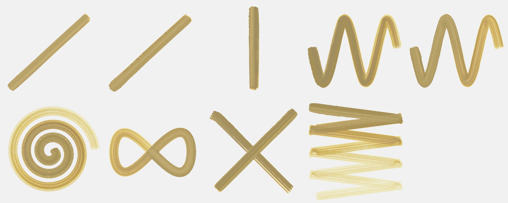

| stroke | covered | width | dark | spread | ms |
|---|---|---|---|---|---|
| light line | 18 % → 16 % | 52.5 px | 0.29 | 0.90 | 275 |
| heavy line | 19 % → 18 % | 56.4 px | 0.30 | 0.93 | 188 |
| pressure swell | 15 % → 14 % | 55.5 px | 0.33 | 0.93 | 147 |
| fast wave | 45 % → 18 % | 51.8 px | 0.37 | 0.40 | 527 |
| slow wave | 45 % → 21 % | 52.3 px | 0.32 | 0.46 | 1272 |
| spiral | 65 % → 24 % | 43.1 px | 0.34 | 0.36 | 939 |
| loop | 38 % → 20 % | 49.5 px | 0.30 | 0.51 | 513 |
| tilted | 15 % → 15 % | 42.6 px | 0.35 | 1.00 | 392 |
| over the wet one | 33 % → 29 % | 48.9 px | 0.35 | 0.88 | 282 |
| long, no reload | 78 % → 19 % | 35.0 px | 0.33 | 0.24 | 1718 | quarters: 0.29 → 0.15 → 0.05 → 0.01

Numbers say: light vs heavy: width 52.5 → 56.4 px, dark 0.29 → 0.30; pressure barely changes the width.

## Refs v3 · #38 Sanguine drawing
Charcoal 0.50 · Pastel 0.50 · 24 px · 10.4 s

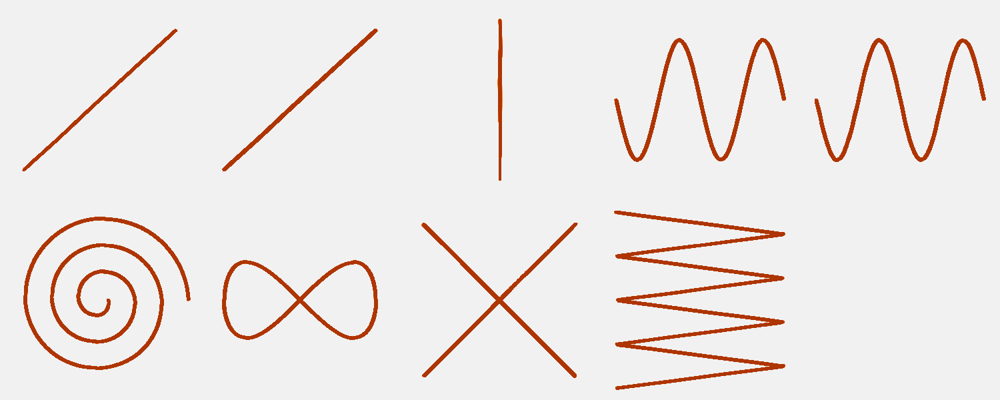

| stroke | covered | width | dark | spread | ms |
|---|---|---|---|---|---|
| light line | 5 % → 5 % | 13.8 px | 0.29 | 1.00 | 37 |
| heavy line | 7 % → 7 % | 19.5 px | 0.30 | 1.00 | 35 |
| pressure swell | 5 % → 5 % | 19.4 px | 0.29 | 1.00 | 23 |
| fast wave | 17 % → 17 % | 19.2 px | 0.30 | 1.00 | 97 |
| slow wave | 16 % → 16 % | 18.5 px | 0.30 | 1.00 | 192 |
| spiral | 26 % → 26 % | 17.2 px | 0.30 | 1.00 | 193 |
| loop | 13 % → 13 % | 17.0 px | 0.30 | 1.00 | 89 |
| tilted | 5 % → 5 % | 14.3 px | 0.29 | 1.00 | 66 |
| over the wet one | 12 % → 12 % | 18.0 px | 0.29 | 1.00 | 62 |
| long, no reload | 32 % → 32 % | 14.2 px | 0.30 | 1.00 | 402 | quarters: 0.11 → 0.11 → 0.11 → 0.11

Numbers say: light vs heavy: width 13.8 → 19.5 px, dark 0.29 → 0.30; the long stroke does not run out of paint.

## Refs v3 · #39 Thick impasto weave
Impasto 1.00 · 192 px · 52.9 s

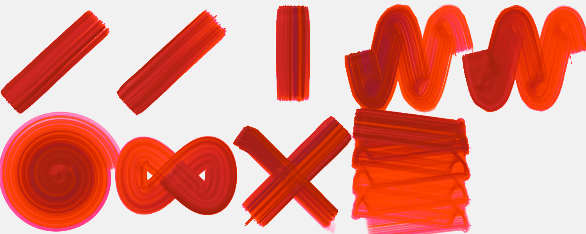

| stroke | covered | width | dark | spread | ms |
|---|---|---|---|---|---|
| light line | 54 % → 50 % | 155.9 px | 0.34 | 0.93 | 954 |
| heavy line | 54 % → 36 % | 157.2 px | 0.34 | 0.67 | 1155 |
| pressure swell | 44 % → 45 % | 163.7 px | 0.36 | 1.03 | 916 |
| fast wave | 92 % → 46 % | 105.7 px | 0.37 | 0.50 | 2885 |
| slow wave | 92 % → 37 % | 106.8 px | 0.35 | 0.40 | 5354 |
| spiral | 94 % → 39 % | 61.9 px | 0.37 | 0.42 | 6011 |
| loop | 87 % → 46 % | 113.3 px | 0.35 | 0.53 | 2721 |
| tilted | 40 % → 40 % | 110.6 px | 0.36 | 1.00 | 1628 |
| over the wet one | 77 % → 64 % | 103.3 px | 0.36 | 0.84 | 1251 |
| long, no reload | 98 % → 47 % | 44.1 px | 0.36 | 0.48 | 7531 | quarters: 0.36 → 0.35 → 0.27 → 0.22

Numbers say: light vs heavy: width 155.9 → 157.2 px, dark 0.34 → 0.34; pressure barely changes the width.

## Refs v3 · #40 Watercolour blooms
Watercolour 1.00 + water 55 % · 224 px · 87.9 s

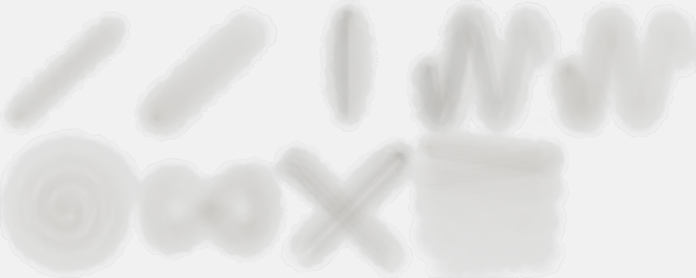

| stroke | covered | width | dark | spread | ms |
|---|---|---|---|---|---|
| light line | 55 % → 79 % | 159.4 px | 0.08 | 1.43 | 821 |
| heavy line | 79 % → 84 % | 228.5 px | 0.09 | 1.07 | 1618 |
| pressure swell | 67 % → 86 % | 252.4 px | 0.10 | 1.28 | 1114 |
| fast wave | 97 % → 100 % | 111.8 px | 0.14 | 1.03 | 3754 |
| slow wave | 97 % → 99 % | 112.4 px | 0.11 | 1.02 | 6992 |
| spiral | 99 % → 100 % | 65.4 px | 0.10 | 1.01 | 5327 |
| loop | 98 % → 100 % | 127.4 px | 0.10 | 1.01 | 2709 |
| tilted | 60 % → 60 % | 166.7 px | 0.12 | 1.01 | 1870 |
| over the wet one | 94 % → 99 % | 96.3 px | 0.12 | 1.05 | 1256 |
| long, no reload | 99 % → 100 % | 44.3 px | 0.11 | 1.01 | 9732 | quarters: 0.14 → 0.13 → 0.10 → 0.08

Numbers say: light vs heavy: width 159.4 → 228.5 px, dark 0.08 → 0.09.

## Refs v3 · #41 Coloured pencil
Charcoal 0.50 · Pastel 0.50 · 24 px · 10.7 s

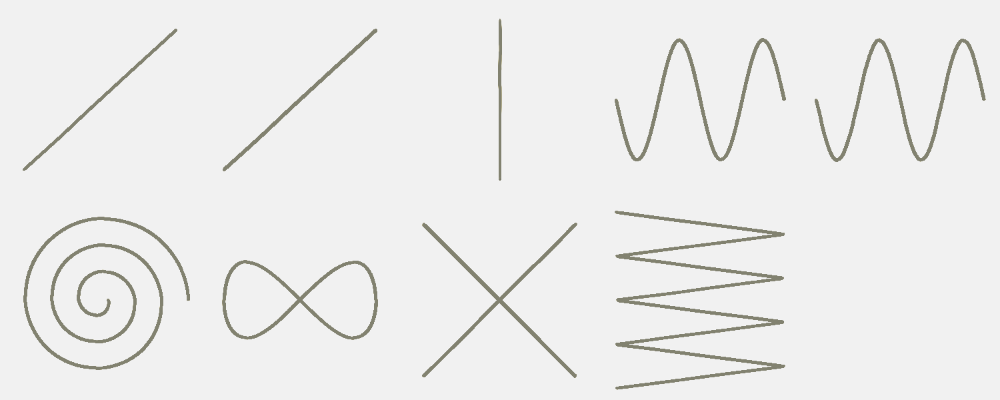

A light paint: laid on a grey sheet (on white it cannot be seen); **dark** = how far it is from the grey either way.

| stroke | covered | width | dark | spread | ms |
|---|---|---|---|---|---|
| light line | 5 % → 5 % | 13.8 px | 0.37 | 1.00 | 42 |
| heavy line | 7 % → 7 % | 19.5 px | 0.38 | 1.00 | 60 |
| pressure swell | 5 % → 5 % | 19.4 px | 0.36 | 1.00 | 49 |
| fast wave | 17 % → 17 % | 19.2 px | 0.38 | 1.00 | 97 |
| slow wave | 16 % → 16 % | 18.5 px | 0.38 | 1.00 | 184 |
| spiral | 26 % → 26 % | 17.2 px | 0.38 | 1.00 | 155 |
| loop | 13 % → 13 % | 17.0 px | 0.38 | 1.00 | 79 |
| tilted | 5 % → 5 % | 14.3 px | 0.37 | 1.00 | 56 |
| over the wet one | 12 % → 12 % | 18.0 px | 0.37 | 1.00 | 36 |
| long, no reload | 32 % → 32 % | 14.2 px | 0.38 | 1.00 | 239 | quarters: 0.00 → 0.00 → 0.00 → 0.00

Numbers say: light vs heavy: width 13.8 → 19.5 px, dark 0.37 → 0.38; the long stroke does not run out of paint.

## Refs v3 · #42 Pink shaggy pastel
Pastel 1.00 · 76 px · 15.0 s

A light paint: laid on a grey sheet (on white it cannot be seen); **dark** = how far it is from the grey either way.

| stroke | covered | width | dark | spread | ms |
|---|---|---|---|---|---|
| light line | 14 % → 14 % | 39.8 px | 0.32 | 1.00 | 296 |
| heavy line | 23 % → 23 % | 66.6 px | 0.32 | 1.00 | 306 |
| pressure swell | 16 % → 16 % | 59.6 px | 0.32 | 1.01 | 291 |
| fast wave | 47 % → 47 % | 53.8 px | 0.32 | 1.00 | 656 |
| slow wave | 45 % → 45 % | 51.4 px | 0.32 | 1.00 | 1098 |
| spiral | 65 % → 65 % | 43.1 px | 0.33 | 1.00 | 936 |
| loop | 36 % → 36 % | 47.1 px | 0.32 | 1.00 | 499 |
| tilted | 10 % → 10 % | 27.8 px | 0.32 | 1.00 | 327 |
| over the wet one | 29 % → 29 % | 52.3 px | 0.32 | 1.01 | 262 |
| long, no reload | 78 % → 78 % | 35.2 px | 0.32 | 1.00 | 1461 | quarters: 0.00 → 0.00 → 0.00 → 0.00

Numbers say: light vs heavy: width 39.8 → 66.6 px, dark 0.32 → 0.32; the long stroke does not run out of paint.

## Refs v3 · #43 Dragged black blocks
Ink 0.93 · Gouache 0.07 · 224 px · 106.9 s

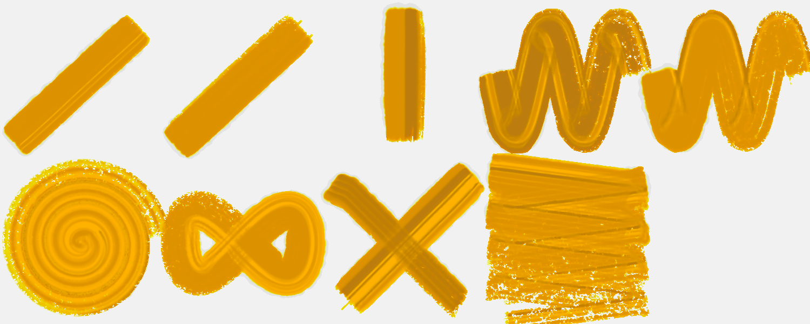

| stroke | covered | width | dark | spread | ms |
|---|---|---|---|---|---|
| light line | 62 % → 73 % | 179.7 px | 0.85 | 1.18 | 829 |
| heavy line | 67 % → 67 % | 193.5 px | 0.85 | 1.00 | 1694 |
| pressure swell | 54 % → 66 % | 200.9 px | 0.84 | 1.24 | 1049 |
| fast wave | 96 % → 98 % | 111.2 px | 0.85 | 1.02 | 3867 |
| slow wave | 96 % → 97 % | 111.2 px | 0.85 | 1.01 | 5543 |
| spiral | 98 % → 99 % | 64.9 px | 0.84 | 1.00 | 6765 |
| loop | 97 % → 97 % | 125.6 px | 0.85 | 1.00 | 2919 |
| tilted | 48 % → 48 % | 133.7 px | 0.84 | 1.01 | 1589 |
| over the wet one | 85 % → 88 % | 102.8 px | 0.84 | 1.03 | 1365 |
| long, no reload | 98 % → 99 % | 44.1 px | 0.81 | 1.01 | 9431 | quarters: 0.81 → 0.81 → 0.81 → 0.80

Numbers say: light vs heavy: width 179.7 → 193.5 px, dark 0.85 → 0.85; pressure barely changes the width; the long stroke does not run out of paint.

## Refs v3 · #44 Blue looping ribbon
Oil 0.52 · Gouache 0.48 + turpentine 10 % · 128 px · 60.4 s

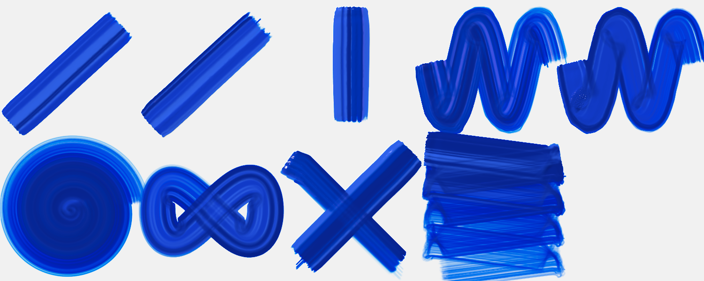

| stroke | covered | width | dark | spread | ms |
|---|---|---|---|---|---|
| light line | 38 % → 37 % | 110.4 px | 0.37 | 0.98 | 492 |
| heavy line | 40 % → 37 % | 115.0 px | 0.37 | 0.94 | 533 |
| pressure swell | 30 % → 32 % | 114.4 px | 0.38 | 1.06 | 398 |
| fast wave | 78 % → 56 % | 90.3 px | 0.41 | 0.71 | 1661 |
| slow wave | 78 % → 52 % | 90.1 px | 0.40 | 0.67 | 2721 |
| spiral | 88 % → 51 % | 58.3 px | 0.43 | 0.57 | 2627 |
| loop | 69 % → 61 % | 89.3 px | 0.38 | 0.88 | 1688 |
| tilted | 30 % → 30 % | 84.9 px | 0.41 | 1.00 | 1099 |
| over the wet one | 61 % → 58 % | 86.7 px | 0.41 | 0.94 | 856 |
| long, no reload | 98 % → 51 % | 44.1 px | 0.43 | 0.52 | 4097 | quarters: 0.43 → 0.42 → 0.35 → 0.19

Numbers say: light vs heavy: width 110.4 → 115.0 px, dark 0.37 → 0.37; pressure barely changes the width.

## Refs v3 · #45 Pastel pepper
Pastel 1.00 · 128 px · 20.2 s

| stroke | covered | width | dark | spread | ms |
|---|---|---|---|---|---|
| light line | 23 % → 25 % | 68.1 px | 0.56 | 1.05 | 310 |
| heavy line | 39 % → 39 % | 113.3 px | 0.56 | 1.00 | 520 |
| pressure swell | 28 % → 30 % | 104.1 px | 0.56 | 1.08 | 329 |
| fast wave | 65 % → 68 % | 75.4 px | 0.56 | 1.04 | 977 |
| slow wave | 64 % → 64 % | 73.7 px | 0.56 | 1.00 | 1762 |
| spiral | 79 % → 79 % | 52.0 px | 0.56 | 1.00 | 1612 |
| loop | 54 % → 54 % | 69.4 px | 0.56 | 1.00 | 971 |
| tilted | 16 % → 16 % | 45.8 px | 0.55 | 1.00 | 605 |
| over the wet one | 47 % → 51 % | 86.8 px | 0.55 | 1.07 | 796 |
| long, no reload | 97 % → 97 % | 43.5 px | 0.56 | 1.00 | 3042 | quarters: 0.56 → 0.56 → 0.56 → 0.56

Numbers say: light vs heavy: width 68.1 → 113.3 px, dark 0.56 → 0.56; the long stroke does not run out of paint.

## Refs v3 · #46 Ink lips on wet paper
Watercolour 1.00 + water 65 % · 112 px · 57.7 s

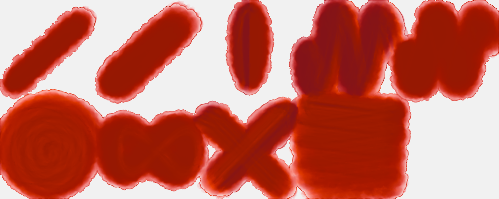

| stroke | covered | width | dark | spread | ms |
|---|---|---|---|---|---|
| light line | 24 % → 44 % | 70.9 px | 0.61 | 1.82 | 207 |
| heavy line | 44 % → 53 % | 128.3 px | 0.65 | 1.20 | 432 |
| pressure swell | 28 % → 42 % | 105.4 px | 0.65 | 1.51 | 331 |
| fast wave | 76 % → 91 % | 87.5 px | 0.71 | 1.20 | 1306 |
| slow wave | 74 % → 86 % | 85.6 px | 0.69 | 1.16 | 2303 |
| spiral | 85 % → 91 % | 56.0 px | 0.69 | 1.07 | 2123 |
| loop | 65 % → 74 % | 83.9 px | 0.69 | 1.15 | 989 |
| tilted | 34 % → 35 % | 95.1 px | 0.65 | 1.02 | 587 |
| over the wet one | 67 % → 86 % | 91.6 px | 0.65 | 1.29 | 417 |
| long, no reload | 97 % → 100 % | 43.6 px | 0.72 | 1.02 | 2841 | quarters: 0.74 → 0.74 → 0.74 → 0.70

Numbers say: light vs heavy: width 70.9 → 128.3 px, dark 0.61 → 0.65; the long stroke does not run out of paint; wet paint spreads well beyond the stroke.

## Refs v3 · #47 Pink knife slabs
Gouache 1.00 + water 15 % · 480 px · 191.0 s

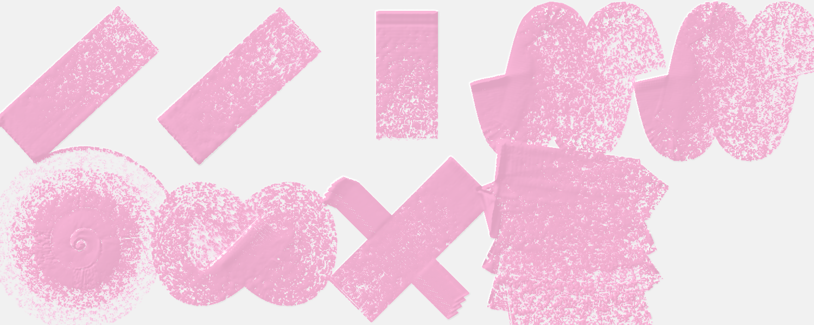

A light paint: laid on a grey sheet (on white it cannot be seen); **dark** = how far it is from the grey either way.

| stroke | covered | width | dark | spread | ms |
|---|---|---|---|---|---|
| light line | 94 % → 94 % | 273.2 px | 0.33 | 1.00 | 3245 |
| heavy line | 95 % → 96 % | 274.6 px | 0.34 | 1.01 | 5424 |
| pressure swell | 88 % → 100 % | 328.6 px | 0.31 | 1.14 | 3296 |
| fast wave | 99 % → 100 % | 114.7 px | 0.30 | 1.01 | 11850 |
| slow wave | 100 % → 100 % | 115.5 px | 0.33 | 1.00 | 20205 |
| spiral | 100 % → 100 % | 66.0 px | 0.34 | 1.00 | 18894 |
| loop | 100 % → 100 % | 129.5 px | 0.33 | 1.00 | 12078 |
| tilted | 83 % → 83 % | 230.8 px | 0.30 | 1.00 | 7580 |
| over the wet one | 100 % → 100 % | 47.6 px | 0.30 | 1.00 | 5657 |
| long, no reload | 100 % → 100 % | 44.8 px | 0.32 | 1.00 | 30702 | quarters: 0.00 → 0.00 → 0.00 → 0.00

Numbers say: light vs heavy: width 273.2 → 274.6 px, dark 0.33 → 0.34; pressure barely changes the width.

## Refs v3 · #48 Black bands with drips
Watercolour 1.00 + water 35 % · 224 px · 80.6 s

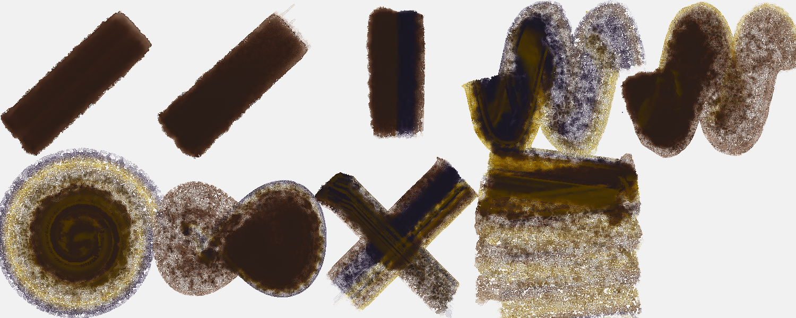

| stroke | covered | width | dark | spread | ms |
|---|---|---|---|---|---|
| light line | 60 % → 70 % | 173.5 px | 0.74 | 1.17 | 768 |
| heavy line | 62 % → 64 % | 178.7 px | 0.77 | 1.04 | 1086 |
| pressure swell | 49 % → 66 % | 183.3 px | 0.76 | 1.34 | 760 |
| fast wave | 92 % → 98 % | 106.6 px | 0.79 | 1.06 | 2955 |
| slow wave | 92 % → 97 % | 106.0 px | 0.72 | 1.06 | 4632 |
| spiral | 93 % → 97 % | 61.6 px | 0.70 | 1.04 | 5341 |
| loop | 94 % → 97 % | 121.7 px | 0.73 | 1.03 | 2832 |
| tilted | 45 % → 47 % | 125.4 px | 0.77 | 1.05 | 1713 |
| over the wet one | 81 % → 87 % | 101.5 px | 0.77 | 1.06 | 1132 |
| long, no reload | 90 % → 98 % | 40.2 px | 0.73 | 1.10 | 8067 | quarters: 0.80 → 0.79 → 0.74 → 0.59

Numbers say: light vs heavy: width 173.5 → 178.7 px, dark 0.74 → 0.77; pressure barely changes the width.

## Refs v3 · #49 Magenta letters round
Ink 0.98 · 128 px · 47.6 s

| stroke | covered | width | dark | spread | ms |
|---|---|---|---|---|---|
| light line | 15 % → 17 % | 42.3 px | 0.48 | 1.15 | 125 |
| heavy line | 36 % → 36 % | 104.2 px | 0.50 | 1.01 | 566 |
| pressure swell | 21 % → 22 % | 78.6 px | 0.52 | 1.06 | 319 |
| fast wave | 67 % → 70 % | 77.5 px | 0.54 | 1.04 | 995 |
| slow wave | 62 % → 63 % | 71.6 px | 0.50 | 1.02 | 1334 |
| spiral | 76 % → 76 % | 50.1 px | 0.45 | 1.01 | 1481 |
| loop | 53 % → 55 % | 69.2 px | 0.49 | 1.03 | 728 |
| tilted | 31 % → 31 % | 86.8 px | 0.51 | 1.01 | 528 |
| over the wet one | 54 % → 59 % | 64.7 px | 0.51 | 1.08 | 410 |
| long, no reload | 98 % → 98 % | 43.8 px | 0.50 | 1.00 | 2682 | quarters: 0.50 → 0.50 → 0.50 → 0.48

Numbers say: light vs heavy: width 42.3 → 104.2 px, dark 0.48 → 0.50; the long stroke does not run out of paint.

## Refs v3 · #50 Swipes on seaside
Gouache 1.00 + water 15 % · 160 px · 73.7 s

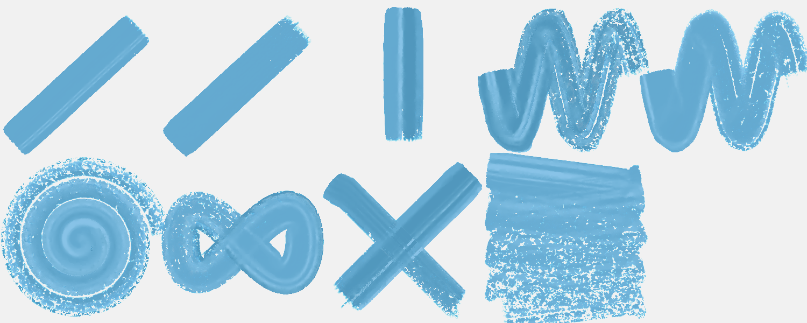

| stroke | covered | width | dark | spread | ms |
|---|---|---|---|---|---|
| light line | 46 % → 46 % | 134.7 px | 0.28 | 0.98 | 547 |
| heavy line | 49 % → 44 % | 141.0 px | 0.28 | 0.91 | 808 |
| pressure swell | 38 % → 42 % | 141.5 px | 0.30 | 1.12 | 589 |
| fast wave | 82 % → 76 % | 94.5 px | 0.30 | 0.93 | 2054 |
| slow wave | 85 % → 67 % | 98.4 px | 0.27 | 0.78 | 3258 |
| spiral | 86 % → 65 % | 56.7 px | 0.26 | 0.76 | 3449 |
| loop | 77 % → 72 % | 99.5 px | 0.28 | 0.93 | 2237 |
| tilted | 36 % → 36 % | 99.4 px | 0.31 | 1.00 | 1029 |
| over the wet one | 71 % → 68 % | 99.8 px | 0.31 | 0.96 | 934 |
| long, no reload | 93 % → 77 % | 41.8 px | 0.24 | 0.83 | 4995 | quarters: 0.25 → 0.24 → 0.23 → 0.18

Numbers say: light vs heavy: width 134.7 → 141.0 px, dark 0.28 → 0.28; pressure barely changes the width.

## Refs v3 · #01 HW peach cloud — own sheet
own sheet 1600 × 2190 · Gouache 1.00 + turpentine 30 % · 208 px · 314.6 s

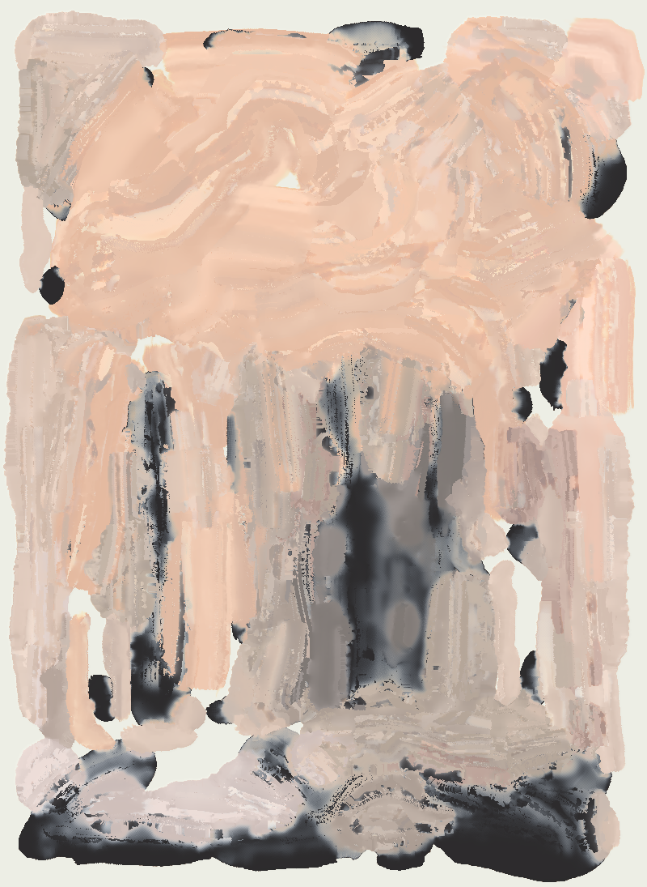

| stroke | covered | width | dark | spread | ms |
|---|---|---|---|---|---|
| stroke 1 | 7 % → 0 % | 204.1 px | 0.00 | 0.00 | 747 |
| stroke 2 | 4 % → 1 % | 198.2 px | 0.33 | 0.34 | 699 |
| stroke 3 | 14 % → 1 % | 283.4 px | 0.33 | 0.08 | 2314 |
| stroke 4 | 17 % → 2 % | 452.4 px | 0.32 | 0.12 | 1927 |
| stroke 5 | 25 % → 1 % | 1051.0 px | 0.34 | 0.04 | 782 |
| stroke 6 | 20 % → 2 % | 581.2 px | 0.32 | 0.10 | 1841 |
| stroke 7 | 22 % → 2 % | 606.8 px | 0.32 | 0.07 | 2043 |
| stroke 8 | 23 % → 2 % | 589.1 px | 0.32 | 0.07 | 2647 |
| stroke 9 | 25 % → 1 % | 624.0 px | 0.32 | 0.05 | 3208 |
| stroke 10 | 29 % → 1 % | 560.8 px | 0.31 | 0.04 | 3505 |
| stroke 11 | 37 % → 1 % | 616.3 px | 0.32 | 0.03 | 4379 |
| stroke 12 | 44 % → 0 % | 767.3 px | 0.32 | 0.01 | 3282 |
| stroke 13 | 54 % → 0 % | 1208.6 px | 0.32 | 0.01 | 1795 |
| stroke 14 | 52 % → 0 % | 2063.5 px | 0.32 | 0.01 | 709 |
| stroke 15 | 59 % → 0 % | 2559.1 px | 0.00 | 0.00 | 577 |
| stroke 16 | 62 % → 0 % | 1714.8 px | 0.32 | 0.01 | 1459 |
| stroke 17 | 2 % → 2 % | 37.8 px | 0.31 | 0.95 | 275 |
| stroke 18 | 5 % → 0 % | 66.1 px | 0.00 | 0.00 | 403 |
| stroke 19 | 6 % → 0 % | 93.7 px | 0.00 | 0.00 | 481 |
| stroke 20 | 8 % → 0 % | 165.5 px | 0.00 | 0.00 | 232 |
| stroke 21 | 9 % → 0 % | 270.3 px | 0.00 | 0.00 | 168 |
| stroke 22 | 9 % → 0 % | 422.3 px | 0.00 | 0.00 | 75 |
| stroke 23 | 10 % → 0 % | 545.5 px | 0.00 | 0.00 | 70 |
| stroke 24 | 10 % → 0 % | 1143.8 px | 0.32 | 0.01 | 28 |
| stroke 25 | 2 % → 0 % | 68.2 px | 0.00 | 0.00 | 104 |
| stroke 26 | 4 % → 0 % | 80.6 px | 0.00 | 0.00 | 219 |
| stroke 27 | 5 % → 0 % | 221.9 px | 0.00 | 0.00 | 117 |
| stroke 28 | 2 % → 1 % | 315.9 px | 0.34 | 0.57 | 35 |
| stroke 29 | 5 % → 1 % | 275.6 px | 0.34 | 0.16 | 126 |
| stroke 30 | 6 % → 0 % | 445.2 px | 0.33 | 0.08 | 88 |
| stroke 31 | 6 % → 0 % | 500.4 px | 0.32 | 0.03 | 73 |
| stroke 32 | 7 % → 0 % | 523.6 px | 0.30 | 0.01 | 84 |
| stroke 33 | 7 % → 1 % | 286.4 px | 0.33 | 0.07 | 282 |
| stroke 34 | 8 % → 1 % | 270.1 px | 0.33 | 0.07 | 268 |
| stroke 35 | 10 % → 0 % | 1020.3 px | 0.00 | 0.00 | 79 |
| stroke 36 | 8 % → 1 % | 348.8 px | 0.34 | 0.10 | 265 |
| stroke 37 | 9 % → 1 % | 278.2 px | 0.34 | 0.06 | 335 |
| stroke 38 | 11 % → 0 % | 365.3 px | 0.32 | 0.01 | 254 |
| stroke 39 | 12 % → 0 % | 426.9 px | 0.00 | 0.00 | 196 |
| stroke 40 | 13 % → 0 % | 413.3 px | 0.28 | 0.00 | 275 |
| stroke 41 | 15 % → 0 % | 662.5 px | 0.00 | 0.00 | 156 |
| stroke 42 | 16 % → 0 % | 888.7 px | 0.00 | 0.00 | 110 |
| stroke 43 | 17 % → 0 % | 726.4 px | 0.00 | 0.00 | 146 |
| stroke 44 | 17 % → 0 % | 853.2 px | 0.00 | 0.00 | 160 |
| stroke 45 | 18 % → 0 % | 1270.0 px | 0.00 | 0.00 | 108 |
| stroke 46 | 18 % → 0 % | 1529.0 px | 0.00 | 0.00 | 83 |
| stroke 47 | 18 % → 0 % | 2529.5 px | 0.00 | 0.00 | 47 |
| stroke 48 | 29 % → 0 % | 964.3 px | 0.00 | 0.00 | 113 |
| stroke 49 | 29 % → 0 % | 929.9 px | 0.00 | 0.00 | 115 |
| stroke 50 | 33 % → 0 % | 3507.1 px | 0.00 | 0.00 | 27 |
| stroke 51 | 1 % → 2 % | 74.9 px | 0.31 | 2.51 | 45 |
| stroke 52 | 1 % → 2 % | 89.9 px | 0.31 | 1.41 | 109 |
| stroke 53 | 2 % → 2 % | 175.8 px | 0.31 | 1.30 | 47 |
| stroke 54 | 14 % → 2 % | 2040.6 px | 0.33 | 0.15 | 41 |
| stroke 55 | 13 % → 2 % | 1843.6 px | 0.33 | 0.16 | 29 |
| stroke 56 | 11 % → 2 % | 1669.8 px | 0.33 | 0.18 | 32 |
| stroke 57 | 10 % → 2 % | 1479.3 px | 0.33 | 0.19 | 27 |
| stroke 58 | 9 % → 2 % | 1364.7 px | 0.33 | 0.21 | 27 |
| stroke 59 | 8 % → 2 % | 944.2 px | 0.33 | 0.22 | 54 |
| stroke 60 | 7 % → 2 % | 765.0 px | 0.33 | 0.26 | 49 |
| stroke 61 | 2 % → 3 % | 242.7 px | 0.31 | 1.38 | 54 |
| stroke 62 | 4 % → 3 % | 134.2 px | 0.31 | 0.83 | 209 |
| stroke 63 | 5 % → 4 % | 667.4 px | 0.31 | 0.71 | 26 |
| stroke 64 | 5 % → 2 % | 368.6 px | 0.31 | 0.40 | 75 |
| stroke 65 | 7 % → 2 % | 172.9 px | 0.31 | 0.23 | 331 |
| stroke 66 | 9 % → 1 % | 604.9 px | 0.32 | 0.07 | 82 |
| stroke 67 | 10 % → 0 % | 144.6 px | 0.32 | 0.04 | 495 |
| stroke 68 | 13 % → 1 % | 539.8 px | 0.32 | 0.05 | 113 |
| stroke 69 | 13 % → 0 % | 155.9 px | 0.32 | 0.03 | 693 |
| stroke 70 | 17 % → 0 % | 197.2 px | 0.32 | 0.02 | 1036 |
| stroke 71 | 10 % → 2 % | 457.8 px | 0.31 | 0.25 | 178 |
| stroke 72 | 9 % → 2 % | 640.1 px | 0.31 | 0.25 | 123 |
| stroke 73 | 6 % → 2 % | 154.3 px | 0.33 | 0.27 | 216 |
| stroke 74 | 9 % → 1 % | 94.6 px | 0.33 | 0.15 | 839 |
| stroke 75 | 12 % → 1 % | 166.2 px | 0.33 | 0.11 | 547 |
| stroke 76 | 10 % → 0 % | 824.0 px | 0.00 | 0.00 | 54 |
| stroke 77 | 13 % → 2 % | 1609.7 px | 0.31 | 0.19 | 43 |
| stroke 78 | 16 % → 2 % | 543.9 px | 0.31 | 0.13 | 255 |
| stroke 79 | 19 % → 2 % | 915.0 px | 0.31 | 0.13 | 160 |
| stroke 80 | 0 % → 0 % | 75.6 px | 0.00 | 0.00 | 30 |
| stroke 81 | 1 % → 0 % | 99.8 px | 0.00 | 0.00 | 53 |
| stroke 82 | 7 % → 0 % | 244.1 px | 0.00 | 0.00 | 117 |
| stroke 83 | 8 % → 0 % | 556.4 px | 0.00 | 0.00 | 47 |
| stroke 84 | 9 % → 0 % | 870.3 px | 0.00 | 0.00 | 41 |
| stroke 85 | 7 % → 0 % | 178.5 px | 0.00 | 0.00 | 207 |
| stroke 86 | 9 % → 0 % | 208.9 px | 0.00 | 0.00 | 254 |
| stroke 87 | 13 % → 0 % | 603.0 px | 0.00 | 0.00 | 80 |
| stroke 88 | 10 % → 0 % | 374.8 px | 0.00 | 0.00 | 162 |
| stroke 89 | 13 % → 0 % | 1839.5 px | 0.00 | 0.00 | 20 |
| stroke 90 | 15 % → 0 % | 1650.3 px | 0.00 | 0.00 | 25 |
| stroke 91 | 8 % → 0 % | 873.6 px | 0.00 | 0.00 | 45 |
| stroke 92 | 0 % → 0 % | 45.6 px | 0.32 | 0.79 | 42 |
| stroke 93 | 2 % → 1 % | 54.2 px | 0.32 | 0.23 | 157 |
| stroke 94 | 1 % → 1 % | 49.0 px | 0.34 | 1.09 | 79 |
| stroke 95 | 1 % → 3 % | 74.7 px | 0.32 | 2.02 | 101 |
| stroke 96 | 2 % → 3 % | 130.0 px | 0.31 | 1.73 | 47 |
| stroke 97 | 1 % → 2 % | 172.5 px | 0.33 | 1.29 | 19 |
| stroke 98 | 3 % → 2 % | 88.9 px | 0.33 | 0.67 | 142 |
| stroke 99 | 2 % → 1 % | 193.0 px | 0.33 | 0.69 | 38 |
| stroke 100 | 1 % → 3 % | 102.1 px | 0.31 | 3.09 | 38 |
| stroke 101 | 3 % → 1 % | 85.0 px | 0.32 | 0.17 | 215 |
| stroke 102 | 6 % → 0 % | 128.1 px | 0.32 | 0.06 | 235 |
| stroke 103 | 2 % → 1 % | 55.5 px | 0.31 | 0.84 | 135 |
| stroke 104 | 2 % → 0 % | 268.7 px | 0.32 | 0.03 | 34 |
| stroke 105 | 3 % → 0 % | 147.5 px | 0.00 | 0.00 | 100 |
| stroke 106 | 4 % → 0 % | 294.4 px | 0.23 | 0.00 | 49 |
| stroke 107 | 6 % → 0 % | 278.0 px | 0.00 | 0.00 | 28 |
| stroke 108 | 1 % → 1 % | 73.9 px | 0.32 | 0.41 | 89 |
| stroke 109 | 2 % → 1 % | 254.7 px | 0.32 | 0.28 | 30 |
| stroke 110 | 4 % → 1 % | 119.0 px | 0.32 | 0.16 | 154 |
| stroke 111 | 5 % → 1 % | 160.5 px | 0.32 | 0.12 | 152 |
| stroke 112 | 7 % → 1 % | 194.4 px | 0.32 | 0.10 | 154 |
| stroke 113 | 9 % → 1 % | 308.9 px | 0.32 | 0.06 | 142 |
| stroke 114 | 11 % → 0 % | 911.8 px | 0.00 | 0.00 | 46 |
| stroke 115 | 13 % → 0 % | 999.5 px | 0.00 | 0.00 | 40 |
| stroke 116 | 1 % → 2 % | 90.4 px | 0.33 | 3.02 | 33 |
| stroke 117 | 1 % → 2 % | 152.0 px | 0.33 | 1.95 | 36 |
| stroke 118 | 1 % → 2 % | 125.2 px | 0.33 | 1.69 | 72 |
| stroke 119 | 2 % → 3 % | 113.1 px | 0.32 | 1.32 | 152 |
| stroke 120 | 4 % → 3 % | 108.0 px | 0.32 | 0.81 | 327 |
| stroke 121 | 5 % → 3 % | 345.6 px | 0.32 | 0.64 | 104 |
| stroke 122 | 6 % → 2 % | 1006.3 px | 0.31 | 0.41 | 36 |
| stroke 123 | 7 % → 3 % | 519.4 px | 0.31 | 0.43 | 78 |
| stroke 124 | 7 % → 3 % | 480.7 px | 0.31 | 0.38 | 124 |
| stroke 125 | 8 % → 2 % | 222.8 px | 0.31 | 0.29 | 309 |
| stroke 126 | 4 % → 2 % | 531.6 px | 0.31 | 0.43 | 39 |
| stroke 127 | 9 % → 2 % | 266.1 px | 0.31 | 0.24 | 320 |
| stroke 128 | 4 % → 1 % | 272.2 px | 0.31 | 0.29 | 102 |
| stroke 129 | 10 % → 2 % | 219.8 px | 0.31 | 0.18 | 526 |
| stroke 130 | 9 % → 2 % | 330.5 px | 0.31 | 0.21 | 198 |
| stroke 131 | 14 % → 2 % | 456.2 px | 0.31 | 0.15 | 277 |
| stroke 132 | 15 % → 2 % | 740.5 px | 0.31 | 0.15 | 177 |
| stroke 133 | 7 % → 1 % | 493.1 px | 0.31 | 0.12 | 101 |
| stroke 134 | 6 % → 0 % | 1205.9 px | 0.32 | 0.04 | 30 |
| stroke 135 | 8 % → 2 % | 341.6 px | 0.33 | 0.22 | 143 |
| stroke 136 | 8 % → 2 % | 383.6 px | 0.33 | 0.20 | 134 |
| stroke 137 | 9 % → 2 % | 532.3 px | 0.33 | 0.18 | 121 |
| stroke 138 | 9 % → 2 % | 194.7 px | 0.33 | 0.21 | 244 |
| stroke 139 | 9 % → 1 % | 265.1 px | 0.32 | 0.07 | 184 |
| stroke 140 | 12 % → 1 % | 174.5 px | 0.33 | 0.11 | 602 |
| stroke 141 | 14 % → 2 % | 426.4 px | 0.31 | 0.16 | 238 |
| stroke 142 | 16 % → 2 % | 1113.5 px | 0.31 | 0.15 | 96 |
| stroke 143 | 14 % → 2 % | 319.0 px | 0.31 | 0.15 | 395 |
| stroke 144 | 16 % → 3 % | 1026.6 px | 0.31 | 0.17 | 93 |
| stroke 145 | 16 % → 0 % | 2972.8 px | 0.32 | 0.03 | 26 |
| stroke 146 | 15 % → 0 % | 2812.6 px | 0.32 | 0.01 | 26 |
| stroke 147 | 14 % → 0 % | 2642.1 px | 0.31 | 0.00 | 31 |
| stroke 148 | 13 % → 0 % | 1734.0 px | 0.00 | 0.00 | 46 |
| stroke 149 | 12 % → 0 % | 895.9 px | 0.00 | 0.00 | 83 |
| stroke 150 | 11 % → 0 % | 2258.2 px | 0.00 | 0.00 | 32 |
| stroke 151 | 11 % → 0 % | 1318.9 px | 0.00 | 0.00 | 30 |
| stroke 152 | 11 % → 0 % | 1309.7 px | 0.00 | 0.00 | 36 |
| stroke 153 | 10 % → 0 % | 1768.9 px | 0.00 | 0.00 | 38 |
| stroke 154 | 9 % → 0 % | 1637.4 px | 0.00 | 0.00 | 30 |
| stroke 155 | 11 % → 0 % | 1087.3 px | 0.00 | 0.00 | 56 |
| stroke 156 | 13 % → 0 % | 326.7 px | 0.00 | 0.00 | 332 |
| stroke 157 | 16 % → 0 % | 389.8 px | 0.32 | 0.00 | 383 |
| stroke 158 | 17 % → 0 % | 392.4 px | 0.33 | 0.00 | 386 |
| stroke 159 | 17 % → 0 % | 447.8 px | 0.00 | 0.00 | 372 |
| stroke 160 | 17 % → 0 % | 779.1 px | 0.00 | 0.00 | 159 |
| stroke 161 | 17 % → 0 % | 704.1 px | 0.00 | 0.00 | 201 |
| stroke 162 | 24 % → 0 % | 914.2 px | 0.00 | 0.00 | 134 |
| stroke 163 | 24 % → 0 % | 1393.4 px | 0.00 | 0.00 | 88 |
| stroke 164 | 24 % → 0 % | 1143.3 px | 0.00 | 0.00 | 126 |
| stroke 165 | 1 % → 3 % | 39.5 px | 0.31 | 2.01 | 148 |
| stroke 166 | 0 % → 3 % | 50.9 px | 0.31 | 6.36 | 39 |
| stroke 167 | 2 % → 3 % | 242.1 px | 0.31 | 1.59 | 18 |
| stroke 168 | 3 % → 3 % | 127.8 px | 0.31 | 1.13 | 76 |
| stroke 169 | 1 % → 1 % | 57.2 px | 0.33 | 0.91 | 123 |
| stroke 170 | 2 % → 1 % | 219.0 px | 0.33 | 0.71 | 23 |
| stroke 171 | 3 % → 0 % | 53.0 px | 0.30 | 0.03 | 194 |
| stroke 172 | 2 % → 0 % | 44.5 px | 0.00 | 0.00 | 85 |
| stroke 173 | 1 % → 1 % | 53.8 px | 0.33 | 1.02 | 146 |
| stroke 174 | 2 % → 1 % | 70.1 px | 0.33 | 0.58 | 197 |
| stroke 175 | 3 % → 1 % | 125.6 px | 0.33 | 0.47 | 155 |
| stroke 176 | 4 % → 2 % | 672.0 px | 0.33 | 0.46 | 24 |
| stroke 177 | 4 % → 2 % | 654.3 px | 0.33 | 0.41 | 27 |
| stroke 178 | 4 % → 2 % | 751.3 px | 0.33 | 0.38 | 22 |
| stroke 179 | 5 % → 1 % | 308.0 px | 0.33 | 0.31 | 75 |
| stroke 180 | 5 % → 2 % | 224.5 px | 0.33 | 0.31 | 134 |
| stroke 181 | 6 % → 3 % | 544.5 px | 0.32 | 0.45 | 60 |
| stroke 182 | 7 % → 4 % | 861.2 px | 0.32 | 0.56 | 29 |
| stroke 183 | 7 % → 3 % | 196.1 px | 0.32 | 0.45 | 217 |
| stroke 184 | 7 % → 2 % | 149.2 px | 0.32 | 0.34 | 382 |
| stroke 185 | 11 % → 3 % | 1349.7 px | 0.31 | 0.28 | 38 |
| stroke 186 | 9 % → 2 % | 258.0 px | 0.32 | 0.25 | 237 |
| stroke 187 | 13 % → 3 % | 1045.2 px | 0.31 | 0.21 | 57 |
| stroke 188 | 10 % → 1 % | 409.2 px | 0.31 | 0.14 | 145 |
| stroke 189 | 12 % → 2 % | 282.7 px | 0.31 | 0.17 | 358 |
| stroke 190 | 12 % → 2 % | 287.8 px | 0.31 | 0.15 | 342 |
| stroke 191 | 15 % → 2 % | 417.7 px | 0.31 | 0.15 | 268 |
| stroke 192 | 18 % → 3 % | 2307.9 px | 0.31 | 0.16 | 45 |
| stroke 193 | 14 % → 1 % | 812.9 px | 0.31 | 0.07 | 105 |
| stroke 194 | 13 % → 0 % | 2147.8 px | 0.32 | 0.02 | 28 |
| stroke 195 | 5 % → 0 % | 261.5 px | 0.00 | 0.00 | 68 |
| stroke 196 | 6 % → 0 % | 197.9 px | 0.00 | 0.00 | 119 |
| stroke 197 | 7 % → 0 % | 206.3 px | 0.00 | 0.00 | 128 |
| stroke 198 | 13 % → 0 % | 268.4 px | 0.00 | 0.00 | 217 |
| stroke 199 | 14 % → 0 % | 257.0 px | 0.00 | 0.00 | 213 |
| stroke 200 | 15 % → 0 % | 288.9 px | 0.00 | 0.00 | 203 |
| stroke 201 | 13 % → 0 % | 343.8 px | 0.00 | 0.00 | 118 |
| stroke 202 | 15 % → 0 % | 453.5 px | 0.00 | 0.00 | 137 |
| stroke 203 | 16 % → 0 % | 747.1 px | 0.00 | 0.00 | 58 |
| stroke 204 | 17 % → 0 % | 965.7 px | 0.00 | 0.00 | 35 |
| stroke 205 | 18 % → 0 % | 945.1 px | 0.00 | 0.00 | 48 |
| stroke 206 | 20 % → 0 % | 1032.2 px | 0.00 | 0.00 | 46 |
| stroke 207 | 2 % → 0 % | 41.6 px | 0.00 | 0.00 | 168 |
| stroke 208 | 3 % → 1 % | 106.4 px | 0.32 | 0.18 | 110 |
| stroke 209 | 3 % → 0 % | 101.4 px | 0.32 | 0.14 | 152 |
| stroke 210 | 1 % → 2 % | 51.4 px | 0.33 | 2.79 | 48 |
| stroke 211 | 1 % → 3 % | 44.1 px | 0.31 | 4.25 | 66 |
| stroke 212 | 2 % → 2 % | 175.7 px | 0.33 | 0.93 | 36 |
| stroke 213 | 1 % → 3 % | 42.5 px | 0.31 | 3.22 | 60 |
| stroke 214 | 2 % → 2 % | 138.6 px | 0.33 | 0.85 | 83 |
| stroke 215 | 3 % → 1 % | 85.2 px | 0.33 | 0.44 | 190 |
| stroke 216 | 1 % → 2 % | 100.5 px | 0.31 | 1.96 | 25 |
| stroke 217 | 4 % → 0 % | 200.2 px | 0.00 | 0.00 | 86 |
| stroke 218 | 4 % → 0 % | 237.2 px | 0.00 | 0.00 | 66 |
| stroke 219 | 2 % → 1 % | 135.8 px | 0.31 | 0.39 | 56 |
| stroke 220 | 2 % → 0 % | 106.4 px | 0.31 | 0.19 | 98 |
| stroke 221 | 3 % → 0 % | 307.4 px | 0.32 | 0.05 | 29 |
| stroke 222 | 4 % → 0 % | 177.3 px | 0.00 | 0.00 | 66 |
| stroke 223 | 4 % → 0 % | 313.3 px | 0.00 | 0.00 | 28 |
| stroke 224 | 2 % → 0 % | 78.3 px | 0.00 | 0.00 | 86 |
| stroke 225 | 3 % → 0 % | 114.8 px | 0.00 | 0.00 | 126 |
| stroke 226 | 3 % → 0 % | 270.6 px | 0.00 | 0.00 | 54 |
| stroke 227 | 2 % → 0 % | 80.6 px | 0.30 | 0.06 | 108 |
| stroke 228 | 3 % → 1 % | 93.3 px | 0.33 | 0.17 | 211 |
| stroke 229 | 5 % → 0 % | 279.2 px | 0.00 | 0.00 | 94 |
| stroke 230 | 5 % → 1 % | 195.7 px | 0.34 | 0.19 | 161 |
| stroke 231 | 2 % → 2 % | 73.9 px | 0.31 | 1.17 | 334 |
| stroke 232 | 5 % → 2 % | 83.4 px | 0.31 | 0.33 | 983 |
| stroke 233 | 7 % → 2 % | 111.2 px | 0.31 | 0.23 | 895 |
| stroke 234 | 9 % → 2 % | 142.3 px | 0.31 | 0.18 | 1168 |
| stroke 235 | 15 % → 3 % | 1875.7 px | 0.31 | 0.20 | 102 |
| stroke 236 | 8 % → 2 % | 193.1 px | 0.31 | 0.19 | 1185 |
| stroke 237 | 8 % → 2 % | 143.6 px | 0.31 | 0.21 | 1532 |
| stroke 238 | 8 % → 2 % | 140.9 px | 0.31 | 0.19 | 2805 |
| stroke 239 | 11 % → 2 % | 282.1 px | 0.31 | 0.20 | 997 |
| stroke 240 | 15 % → 1 % | 425.2 px | 0.33 | 0.08 | 1103 |
| stroke 241 | 16 % → 1 % | 438.8 px | 0.33 | 0.05 | 557 |
| stroke 242 | 17 % → 1 % | 361.9 px | 0.33 | 0.08 | 1109 |
| stroke 243 | 19 % → 2 % | 425.2 px | 0.32 | 0.12 | 822 |
| stroke 244 | 22 % → 1 % | 2600.2 px | 0.31 | 0.05 | 118 |
| stroke 245 | 13 % → 0 % | 1462.5 px | 0.00 | 0.00 | 50 |
| stroke 246 | 20 % → 0 % | 2208.4 px | 0.00 | 0.00 | 59 |
| stroke 247 | 14 % → 0 % | 1138.8 px | 0.00 | 0.00 | 152 |
| stroke 248 | 14 % → 0 % | 792.3 px | 0.00 | 0.00 | 360 |
| stroke 249 | 21 % → 0 % | 1453.2 px | 0.00 | 0.00 | 204 |
| stroke 250 | 17 % → 0 % | 1081.1 px | 0.00 | 0.00 | 107 |
| stroke 251 | 16 % → 0 % | 589.8 px | 0.00 | 0.00 | 276 |
| stroke 252 | 9 % → 0 % | 803.0 px | 0.00 | 0.00 | 120 |
| stroke 253 | 23 % → 0 % | 2321.5 px | 0.00 | 0.00 | 113 |
| stroke 254 | 20 % → 0 % | 1914.8 px | 0.00 | 0.00 | 104 |
| stroke 255 | 18 % → 0 % | 615.4 px | 0.00 | 0.00 | 356 |
| stroke 256 | 10 % → 0 % | 645.8 px | 0.00 | 0.00 | 90 |
| stroke 257 | 23 % → 0 % | 946.4 px | 0.00 | 0.00 | 394 |
| stroke 258 | 21 % → 0 % | 551.8 px | 0.00 | 0.00 | 243 |
| stroke 259 | 10 % → 0 % | 808.6 px | 0.00 | 0.00 | 70 |
| stroke 260 | 24 % → 0 % | 1159.6 px | 0.00 | 0.00 | 189 |
| stroke 261 | 22 % → 0 % | 481.9 px | 0.00 | 0.00 | 368 |
| stroke 262 | 24 % → 0 % | 1370.5 px | 0.00 | 0.00 | 96 |
| stroke 263 | 26 % → 0 % | 404.5 px | 0.00 | 0.00 | 316 |
| stroke 264 | 28 % → 0 % | 565.4 px | 0.00 | 0.00 | 414 |
| stroke 265 | 9 % → 0 % | 574.8 px | 0.00 | 0.00 | 67 |
| stroke 266 | 29 % → 0 % | 674.7 px | 0.00 | 0.00 | 318 |
| stroke 267 | 31 % → 0 % | 337.7 px | 0.00 | 0.00 | 584 |
| stroke 268 | 29 % → 0 % | 389.5 px | 0.00 | 0.00 | 397 |
| stroke 269 | 25 % → 0 % | 533.2 px | 0.00 | 0.00 | 256 |
| stroke 270 | 0 % → 1 % | 34.5 px | 0.32 | 1.51 | 45 |
| stroke 271 | 1 % → 2 % | 47.7 px | 0.33 | 1.75 | 121 |
| stroke 272 | 2 % → 2 % | 47.5 px | 0.31 | 1.02 | 614 |
| stroke 273 | 1 % → 2 % | 132.8 px | 0.33 | 1.08 | 61 |

Numbers say: wet paint spreads well beyond the stroke.

## Refs v3 · #02 HW cream strokes — own sheet
own sheet 1600 × 1300 · Gouache 1.00 + turpentine 30 % · 102 px · 122.5 s

| stroke | covered | width | dark | spread | ms |
|---|---|---|---|---|---|
| stroke 1 | 10 % → 0 % | 94.3 px | 0.00 | 0.00 | 313 |
| stroke 2 | 14 % → 0 % | 186.5 px | 0.00 | 0.00 | 211 |
| stroke 3 | 8 % → 0 % | 94.8 px | 0.00 | 0.00 | 198 |
| stroke 4 | 10 % → 0 % | 177.9 px | 0.00 | 0.00 | 185 |
| stroke 5 | 13 % → 0 % | 274.6 px | 0.00 | 0.00 | 120 |
| stroke 6 | 15 % → 0 % | 328.2 px | 0.00 | 0.00 | 124 |
| stroke 7 | 19 % → 0 % | 331.5 px | 0.00 | 0.00 | 175 |
| stroke 8 | 20 % → 0 % | 509.4 px | 0.00 | 0.00 | 173 |
| stroke 9 | 20 % → 0 % | 398.4 px | 0.00 | 0.00 | 116 |
| stroke 10 | 19 % → 0 % | 375.0 px | 0.00 | 0.00 | 109 |
| stroke 11 | 19 % → 0 % | 173.2 px | 0.00 | 0.00 | 343 |
| stroke 12 | 27 % → 0 % | 426.6 px | 0.00 | 0.00 | 112 |
| stroke 13 | 14 % → 0 % | 484.5 px | 0.00 | 0.00 | 55 |
| stroke 14 | 31 % → 0 % | 744.3 px | 0.00 | 0.00 | 69 |
| stroke 15 | 7 % → 0 % | 134.3 px | 0.00 | 0.00 | 150 |
| stroke 16 | 19 % → 0 % | 124.7 px | 0.00 | 0.00 | 951 |
| stroke 17 | 19 % → 0 % | 411.8 px | 0.00 | 0.00 | 150 |
| stroke 18 | 15 % → 0 % | 100.6 px | 0.00 | 0.00 | 908 |
| stroke 19 | 21 % → 0 % | 120.0 px | 0.00 | 0.00 | 1042 |
| stroke 20 | 32 % → 0 % | 286.4 px | 0.00 | 0.00 | 480 |
| stroke 21 | 38 % → 0 % | 409.1 px | 0.57 | 0.00 | 463 |
| stroke 22 | 12 % → 1 % | 93.0 px | 0.59 | 0.08 | 582 |
| stroke 23 | 23 % → 7 % | 149.4 px | 0.59 | 0.30 | 996 |
| stroke 24 | 30 % → 12 % | 168.9 px | 0.60 | 0.40 | 1242 |
| stroke 25 | 35 % → 16 % | 195.3 px | 0.60 | 0.47 | 1450 |
| stroke 26 | 44 % → 19 % | 741.9 px | 0.59 | 0.43 | 205 |
| stroke 27 | 24 % → 45 % | 813.0 px | 0.60 | 1.87 | 70 |
| stroke 28 | 26 % → 16 % | 314.0 px | 0.60 | 0.62 | 335 |
| stroke 29 | 23 % → 21 % | 239.7 px | 0.60 | 0.89 | 398 |
| stroke 30 | 10 % → 0 % | 255.7 px | 0.00 | 0.00 | 69 |
| stroke 31 | 27 % → 11 % | 228.4 px | 0.60 | 0.40 | 459 |
| stroke 32 | 29 % → 13 % | 254.5 px | 0.60 | 0.44 | 467 |
| stroke 33 | 1 % → 0 % | 34.5 px | 0.00 | 0.00 | 22 |
| stroke 34 | 4 % → 17 % | 44.7 px | 0.59 | 3.75 | 313 |
| stroke 35 | 2 % → 0 % | 77.3 px | 0.00 | 0.00 | 39 |
| stroke 36 | 4 % → 0 % | 114.3 px | 0.00 | 0.00 | 50 |
| stroke 37 | 7 % → 0 % | 194.7 px | 0.00 | 0.00 | 44 |
| stroke 38 | 4 % → 0 % | 76.8 px | 0.00 | 0.00 | 90 |
| stroke 39 | 2 % → 0 % | 93.5 px | 0.00 | 0.00 | 32 |
| stroke 40 | 14 % → 0 % | 82.1 px | 0.00 | 0.00 | 843 |
| stroke 41 | 19 % → 0 % | 155.4 px | 0.00 | 0.00 | 394 |
| stroke 42 | 22 % → 0 % | 397.5 px | 0.00 | 0.00 | 148 |
| stroke 43 | 16 % → 0 % | 187.4 px | 0.00 | 0.00 | 271 |
| stroke 44 | 20 % → 0 % | 220.4 px | 0.00 | 0.00 | 301 |
| stroke 45 | 29 % → 0 % | 725.9 px | 0.00 | 0.00 | 93 |
| stroke 46 | 24 % → 0 % | 816.6 px | 0.00 | 0.00 | 80 |
| stroke 47 | 15 % → 0 % | 250.2 px | 0.00 | 0.00 | 182 |
| stroke 48 | 26 % → 0 % | 224.3 px | 0.00 | 0.00 | 458 |
| stroke 49 | 28 % → 0 % | 398.2 px | 0.00 | 0.00 | 186 |
| stroke 50 | 28 % → 0 % | 697.1 px | 0.00 | 0.00 | 88 |
| stroke 51 | 30 % → 0 % | 485.4 px | 0.00 | 0.00 | 139 |
| stroke 52 | 27 % → 0 % | 301.8 px | 0.00 | 0.00 | 320 |
| stroke 53 | 32 % → 0 % | 1071.5 px | 0.00 | 0.00 | 43 |
| stroke 54 | 23 % → 0 % | 506.4 px | 0.00 | 0.00 | 82 |
| stroke 55 | 20 % → 0 % | 509.8 px | 0.00 | 0.00 | 113 |
| stroke 56 | 15 % → 0 % | 320.4 px | 0.00 | 0.00 | 127 |
| stroke 57 | 27 % → 0 % | 1230.5 px | 0.00 | 0.00 | 53 |
| stroke 58 | 18 % → 0 % | 211.0 px | 0.00 | 0.00 | 307 |
| stroke 59 | 14 % → 0 % | 597.4 px | 0.00 | 0.00 | 37 |
| stroke 60 | 26 % → 0 % | 672.4 px | 0.00 | 0.00 | 143 |
| stroke 61 | 21 % → 0 % | 327.6 px | 0.00 | 0.00 | 296 |
| stroke 62 | 28 % → 0 % | 698.6 px | 0.00 | 0.00 | 86 |
| stroke 63 | 25 % → 0 % | 381.8 px | 0.00 | 0.00 | 124 |
| stroke 64 | 29 % → 0 % | 1309.5 px | 0.00 | 0.00 | 38 |
| stroke 65 | 3 % → 0 % | 76.9 px | 0.00 | 0.00 | 44 |
| stroke 66 | 13 % → 0 % | 114.3 px | 0.00 | 0.00 | 243 |
| stroke 67 | 16 % → 0 % | 356.1 px | 0.00 | 0.00 | 52 |
| stroke 68 | 17 % → 0 % | 174.9 px | 0.00 | 0.00 | 250 |
| stroke 69 | 18 % → 0 % | 170.2 px | 0.00 | 0.00 | 307 |
| stroke 70 | 15 % → 0 % | 675.2 px | 0.00 | 0.00 | 54 |
| stroke 71 | 10 % → 0 % | 315.1 px | 0.00 | 0.00 | 47 |
| stroke 72 | 5 % → 0 % | 163.1 px | 0.00 | 0.00 | 35 |
| stroke 73 | 10 % → 0 % | 96.3 px | 0.00 | 0.00 | 334 |
| stroke 74 | 12 % → 0 % | 178.7 px | 0.00 | 0.00 | 182 |
| stroke 75 | 14 % → 1 % | 253.4 px | 0.59 | 0.05 | 135 |
| stroke 76 | 16 % → 0 % | 547.4 px | 0.59 | 0.02 | 73 |
| stroke 77 | 17 % → 9 % | 134.0 px | 0.60 | 0.54 | 546 |
| stroke 78 | 29 % → 0 % | 1085.9 px | 0.00 | 0.00 | 53 |
| stroke 79 | 23 % → 13 % | 141.1 px | 0.60 | 0.58 | 844 |
| stroke 80 | 16 % → 29 % | 345.4 px | 0.60 | 1.85 | 105 |
| stroke 81 | 33 % → 4 % | 425.0 px | 0.61 | 0.12 | 219 |
| stroke 82 | 17 % → 37 % | 414.7 px | 0.60 | 2.25 | 78 |
| stroke 83 | 33 % → 5 % | 451.6 px | 0.60 | 0.14 | 161 |
| stroke 84 | 21 % → 40 % | 452.1 px | 0.60 | 1.91 | 110 |
| stroke 85 | 2 % → 0 % | 41.2 px | 0.00 | 0.00 | 80 |
| stroke 86 | 5 % → 0 % | 44.8 px | 0.00 | 0.00 | 247 |
| stroke 87 | 4 % → 31 % | 58.7 px | 0.59 | 7.44 | 125 |
| stroke 88 | 1 % → 0 % | 41.2 px | 0.00 | 0.00 | 35 |
| stroke 89 | 4 % → 0 % | 72.6 px | 0.00 | 0.00 | 97 |
| stroke 90 | 8 % → 0 % | 86.0 px | 0.00 | 0.00 | 214 |
| stroke 91 | 10 % → 0 % | 159.9 px | 0.00 | 0.00 | 143 |
| stroke 92 | 7 % → 0 % | 340.9 px | 0.00 | 0.00 | 48 |
| stroke 93 | 14 % → 0 % | 97.5 px | 0.00 | 0.00 | 614 |
| stroke 94 | 19 % → 0 % | 140.4 px | 0.00 | 0.00 | 641 |
| stroke 95 | 32 % → 0 % | 365.4 px | 0.00 | 0.00 | 252 |
| stroke 96 | 28 % → 0 % | 188.4 px | 0.00 | 0.00 | 644 |
| stroke 97 | 29 % → 0 % | 223.6 px | 0.00 | 0.00 | 386 |
| stroke 98 | 30 % → 0 % | 202.5 px | 0.00 | 0.00 | 490 |
| stroke 99 | 31 % → 0 % | 206.8 px | 0.00 | 0.00 | 521 |
| stroke 100 | 34 % → 0 % | 384.7 px | 0.00 | 0.00 | 210 |
| stroke 101 | 35 % → 0 % | 621.3 px | 0.00 | 0.00 | 108 |
| stroke 102 | 4 % → 0 % | 75.8 px | 0.00 | 0.00 | 118 |
| stroke 103 | 7 % → 0 % | 109.2 px | 0.00 | 0.00 | 124 |
| stroke 104 | 9 % → 0 % | 391.0 px | 0.00 | 0.00 | 32 |
| stroke 105 | 2 % → 0 % | 40.1 px | 0.00 | 0.00 | 48 |
| stroke 106 | 3 % → 0 % | 85.2 px | 0.00 | 0.00 | 28 |
| stroke 107 | 4 % → 0 % | 79.5 px | 0.00 | 0.00 | 57 |
| stroke 108 | 3 % → 0 % | 49.3 px | 0.00 | 0.00 | 92 |
| stroke 109 | 5 % → 0 % | 160.1 px | 0.00 | 0.00 | 33 |
| stroke 110 | 5 % → 0 % | 53.7 px | 0.57 | 0.09 | 209 |
| stroke 111 | 4 % → 0 % | 43.5 px | 0.00 | 0.00 | 115 |
| stroke 112 | 7 % → 6 % | 80.2 px | 0.59 | 0.92 | 157 |
| stroke 113 | 11 % → 31 % | 33.2 px | 0.59 | 2.76 | 1058 |
| stroke 114 | 5 % → 0 % | 78.0 px | 0.00 | 0.00 | 169 |
| stroke 115 | 8 % → 0 % | 110.5 px | 0.00 | 0.00 | 200 |
| stroke 116 | 11 % → 0 % | 140.6 px | 0.00 | 0.00 | 279 |
| stroke 117 | 15 % → 0 % | 322.4 px | 0.00 | 0.00 | 120 |
| stroke 118 | 15 % → 0 % | 315.7 px | 0.00 | 0.00 | 121 |
| stroke 119 | 16 % → 0 % | 135.3 px | 0.00 | 0.00 | 599 |
| stroke 120 | 18 % → 0 % | 147.5 px | 0.00 | 0.00 | 619 |
| stroke 121 | 24 % → 0 % | 237.3 px | 0.00 | 0.00 | 361 |
| stroke 122 | 25 % → 0 % | 819.9 px | 0.00 | 0.00 | 50 |
| stroke 123 | 23 % → 0 % | 177.8 px | 0.00 | 0.00 | 576 |
| stroke 124 | 26 % → 0 % | 200.4 px | 0.00 | 0.00 | 541 |
| stroke 125 | 30 % → 0 % | 208.9 px | 0.00 | 0.00 | 669 |
| stroke 126 | 31 % → 0 % | 223.7 px | 0.57 | 0.01 | 509 |
| stroke 127 | 28 % → 3 % | 228.3 px | 0.59 | 0.12 | 463 |
| stroke 128 | 23 % → 9 % | 241.0 px | 0.59 | 0.37 | 319 |
| stroke 129 | 6 % → 0 % | 44.2 px | 0.00 | 0.00 | 224 |
| stroke 130 | 6 % → 0 % | 90.8 px | 0.00 | 0.00 | 79 |
| stroke 131 | 3 % → 0 % | 41.5 px | 0.00 | 0.00 | 173 |
| stroke 132 | 3 % → 0 % | 42.0 px | 0.00 | 0.00 | 83 |
| stroke 133 | 21 % → 45 % | 179.1 px | 0.59 | 2.12 | 1459 |
| stroke 134 | 33 % → 46 % | 245.2 px | 0.59 | 1.38 | 2000 |
| stroke 135 | 50 % → 48 % | 279.8 px | 0.59 | 0.95 | 2327 |

Numbers say: wet paint spreads well beyond the stroke.

## Refs v3 · #03 HW navy contours — own sheet
own sheet 1600 × 1200 · Gouache 1.00 + turpentine 30 % · 161 px · 112.7 s

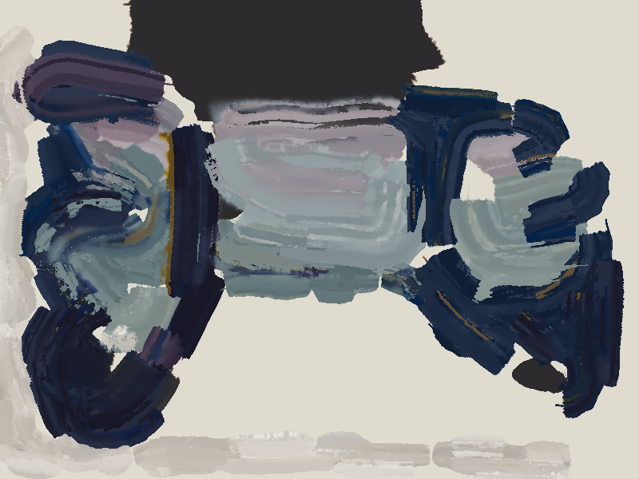

| stroke | covered | width | dark | spread | ms |
|---|---|---|---|---|---|
| stroke 1 | 4 % → 0 % | 159.0 px | 0.00 | 0.00 | 324 |
| stroke 2 | 11 % → 0 % | 186.7 px | 0.00 | 0.00 | 1070 |
| stroke 3 | 16 % → 0 % | 252.0 px | 0.00 | 0.00 | 1152 |
| stroke 4 | 20 % → 0 % | 321.1 px | 0.00 | 0.00 | 1202 |
| stroke 5 | 25 % → 0 % | 435.2 px | 0.00 | 0.00 | 1034 |
| stroke 6 | 29 % → 0 % | 466.0 px | 0.00 | 0.00 | 982 |
| stroke 7 | 32 % → 0 % | 581.6 px | 0.39 | 0.00 | 1255 |
| stroke 8 | 19 % → 0 % | 730.6 px | 0.00 | 0.00 | 285 |
| stroke 9 | 28 % → 0 % | 553.3 px | 0.00 | 0.00 | 789 |
| stroke 10 | 30 % → 0 % | 1228.3 px | 0.00 | 0.00 | 362 |
| stroke 11 | 28 % → 1 % | 718.7 px | 0.38 | 0.04 | 462 |
| stroke 12 | 2 % → 0 % | 60.7 px | 0.00 | 0.00 | 24 |
| stroke 13 | 3 % → 0 % | 103.3 px | 0.00 | 0.00 | 48 |
| stroke 14 | 3 % → 0 % | 149.3 px | 0.00 | 0.00 | 26 |
| stroke 15 | 4 % → 0 % | 144.8 px | 0.00 | 0.00 | 36 |
| stroke 16 | 5 % → 0 % | 270.6 px | 0.00 | 0.00 | 21 |
| stroke 17 | 6 % → 0 % | 281.7 px | 0.00 | 0.00 | 31 |
| stroke 18 | 6 % → 0 % | 350.9 px | 0.00 | 0.00 | 28 |
| stroke 19 | 7 % → 0 % | 270.6 px | 0.00 | 0.00 | 35 |
| stroke 20 | 7 % → 0 % | 306.2 px | 0.00 | 0.00 | 37 |
| stroke 21 | 8 % → 0 % | 469.5 px | 0.00 | 0.00 | 31 |
| stroke 22 | 8 % → 0 % | 433.2 px | 0.00 | 0.00 | 41 |
| stroke 23 | 9 % → 0 % | 522.6 px | 0.00 | 0.00 | 44 |
| stroke 24 | 9 % → 0 % | 558.3 px | 0.00 | 0.00 | 40 |
| stroke 25 | 10 % → 0 % | 554.4 px | 0.00 | 0.00 | 29 |
| stroke 26 | 10 % → 0 % | 608.3 px | 0.00 | 0.00 | 23 |
| stroke 27 | 10 % → 0 % | 506.4 px | 0.00 | 0.00 | 29 |
| stroke 28 | 9 % → 0 % | 577.9 px | 0.00 | 0.00 | 20 |
| stroke 29 | 9 % → 0 % | 539.9 px | 0.00 | 0.00 | 23 |
| stroke 30 | 7 % → 0 % | 427.2 px | 0.00 | 0.00 | 27 |
| stroke 31 | 7 % → 0 % | 293.9 px | 0.00 | 0.00 | 52 |
| stroke 32 | 7 % → 0 % | 430.3 px | 0.00 | 0.00 | 25 |
| stroke 33 | 7 % → 0 % | 438.3 px | 0.00 | 0.00 | 28 |
| stroke 34 | 7 % → 0 % | 404.6 px | 0.00 | 0.00 | 40 |
| stroke 35 | 7 % → 0 % | 388.7 px | 0.00 | 0.00 | 77 |
| stroke 36 | 7 % → 0 % | 403.1 px | 0.00 | 0.00 | 35 |
| stroke 37 | 7 % → 0 % | 436.5 px | 0.00 | 0.00 | 44 |
| stroke 38 | 7 % → 0 % | 411.8 px | 0.00 | 0.00 | 40 |
| stroke 39 | 7 % → 0 % | 420.2 px | 0.00 | 0.00 | 21 |
| stroke 40 | 7 % → 0 % | 325.1 px | 0.00 | 0.00 | 41 |
| stroke 41 | 8 % → 0 % | 496.0 px | 0.00 | 0.00 | 43 |
| stroke 42 | 9 % → 0 % | 504.3 px | 0.00 | 0.00 | 27 |
| stroke 43 | 9 % → 0 % | 382.7 px | 0.00 | 0.00 | 40 |
| stroke 44 | 11 % → 0 % | 425.5 px | 0.00 | 0.00 | 36 |
| stroke 45 | 11 % → 0 % | 417.0 px | 0.00 | 0.00 | 44 |
| stroke 46 | 12 % → 0 % | 629.1 px | 0.00 | 0.00 | 23 |
| stroke 47 | 13 % → 0 % | 614.7 px | 0.00 | 0.00 | 30 |
| stroke 48 | 13 % → 0 % | 638.9 px | 0.00 | 0.00 | 20 |
| stroke 49 | 14 % → 0 % | 627.4 px | 0.00 | 0.00 | 22 |
| stroke 50 | 14 % → 0 % | 569.0 px | 0.00 | 0.00 | 33 |
| stroke 51 | 15 % → 0 % | 594.7 px | 0.00 | 0.00 | 25 |
| stroke 52 | 15 % → 0 % | 217.7 px | 0.00 | 0.00 | 97 |
| stroke 53 | 12 % → 0 % | 781.4 px | 0.00 | 0.00 | 29 |
| stroke 54 | 14 % → 1 % | 64.0 px | 0.38 | 0.06 | 1342 |
| stroke 55 | 20 % → 1 % | 88.5 px | 0.38 | 0.05 | 1106 |
| stroke 56 | 16 % → 2 % | 205.1 px | 0.38 | 0.14 | 145 |
| stroke 57 | 1 % → 0 % | 59.2 px | 0.00 | 0.00 | 42 |
| stroke 58 | 5 % → 0 % | 85.7 px | 0.00 | 0.00 | 171 |
| stroke 59 | 8 % → 0 % | 106.8 px | 0.00 | 0.00 | 346 |
| stroke 60 | 11 % → 0 % | 136.0 px | 0.00 | 0.00 | 551 |
| stroke 61 | 13 % → 0 % | 174.8 px | 0.00 | 0.00 | 623 |
| stroke 62 | 13 % → 0 % | 1005.3 px | 0.00 | 0.00 | 118 |
| stroke 63 | 13 % → 0 % | 1059.2 px | 0.00 | 0.00 | 113 |
| stroke 64 | 14 % → 0 % | 1108.5 px | 0.00 | 0.00 | 90 |
| stroke 65 | 14 % → 0 % | 1117.0 px | 0.00 | 0.00 | 129 |
| stroke 66 | 15 % → 0 % | 1168.0 px | 0.00 | 0.00 | 89 |
| stroke 67 | 15 % → 0 % | 1151.7 px | 0.00 | 0.00 | 93 |
| stroke 68 | 14 % → 0 % | 1109.8 px | 0.00 | 0.00 | 78 |
| stroke 69 | 12 % → 0 % | 976.0 px | 0.00 | 0.00 | 85 |
| stroke 70 | 11 % → 0 % | 867.0 px | 0.00 | 0.00 | 104 |
| stroke 71 | 9 % → 0 % | 693.2 px | 0.00 | 0.00 | 54 |
| stroke 72 | 8 % → 0 % | 482.7 px | 0.00 | 0.00 | 73 |
| stroke 73 | 8 % → 0 % | 480.6 px | 0.00 | 0.00 | 88 |
| stroke 74 | 8 % → 0 % | 475.4 px | 0.00 | 0.00 | 112 |
| stroke 75 | 6 % → 0 % | 495.5 px | 0.00 | 0.00 | 53 |
| stroke 76 | 5 % → 0 % | 82.3 px | 0.00 | 0.00 | 331 |
| stroke 77 | 7 % → 0 % | 120.8 px | 0.00 | 0.00 | 413 |
| stroke 78 | 9 % → 0 % | 448.3 px | 0.00 | 0.00 | 138 |
| stroke 79 | 10 % → 0 % | 497.9 px | 0.00 | 0.00 | 151 |
| stroke 80 | 11 % → 0 % | 545.7 px | 0.00 | 0.00 | 138 |
| stroke 81 | 15 % → 0 % | 1055.9 px | 0.00 | 0.00 | 70 |
| stroke 82 | 14 % → 0 % | 776.9 px | 0.00 | 0.00 | 125 |
| stroke 83 | 15 % → 0 % | 1109.7 px | 0.00 | 0.00 | 76 |
| stroke 84 | 15 % → 0 % | 1205.8 px | 0.00 | 0.00 | 74 |
| stroke 85 | 16 % → 0 % | 854.7 px | 0.00 | 0.00 | 58 |
| stroke 86 | 16 % → 0 % | 1232.3 px | 0.00 | 0.00 | 142 |
| stroke 87 | 24 % → 0 % | 576.4 px | 0.00 | 0.00 | 211 |
| stroke 88 | 18 % → 0 % | 1071.8 px | 0.39 | 0.00 | 92 |
| stroke 89 | 23 % → 0 % | 957.3 px | 0.39 | 0.00 | 133 |
| stroke 90 | 22 % → 0 % | 895.5 px | 0.40 | 0.00 | 96 |
| stroke 91 | 17 % → 1 % | 837.1 px | 0.39 | 0.04 | 144 |
| stroke 92 | 16 % → 1 % | 666.6 px | 0.38 | 0.07 | 202 |
| stroke 93 | 15 % → 1 % | 766.4 px | 0.38 | 0.08 | 151 |
| stroke 94 | 17 % → 2 % | 845.8 px | 0.38 | 0.11 | 58 |
| stroke 95 | 17 % → 1 % | 837.6 px | 0.38 | 0.07 | 104 |
| stroke 96 | 25 % → 1 % | 558.2 px | 0.38 | 0.06 | 211 |
| stroke 97 | 21 % → 1 % | 270.0 px | 0.38 | 0.05 | 607 |
| stroke 98 | 23 % → 1 % | 303.4 px | 0.38 | 0.05 | 503 |
| stroke 99 | 24 % → 1 % | 982.1 px | 0.38 | 0.05 | 132 |
| stroke 100 | 32 % → 1 % | 636.9 px | 0.38 | 0.05 | 293 |
| stroke 101 | 26 % → 1 % | 2085.1 px | 0.38 | 0.05 | 63 |
| stroke 102 | 34 % → 2 % | 806.1 px | 0.38 | 0.04 | 222 |
| stroke 103 | 34 % → 2 % | 1370.3 px | 0.38 | 0.05 | 88 |
| stroke 104 | 34 % → 2 % | 1637.9 px | 0.38 | 0.06 | 68 |
| stroke 105 | 35 % → 2 % | 647.2 px | 0.38 | 0.05 | 211 |
| stroke 106 | 39 % → 2 % | 940.2 px | 0.38 | 0.05 | 132 |
| stroke 107 | 32 % → 0 % | 1866.5 px | 0.00 | 0.00 | 53 |
| stroke 108 | 29 % → 0 % | 677.2 px | 0.00 | 0.00 | 211 |
| stroke 109 | 29 % → 0 % | 514.9 px | 0.00 | 0.00 | 325 |
| stroke 110 | 31 % → 0 % | 1247.3 px | 0.00 | 0.00 | 94 |
| stroke 111 | 21 % → 0 % | 1247.0 px | 0.00 | 0.00 | 56 |
| stroke 112 | 20 % → 0 % | 635.9 px | 0.00 | 0.00 | 154 |
| stroke 113 | 20 % → 0 % | 701.3 px | 0.00 | 0.00 | 102 |
| stroke 114 | 15 % → 0 % | 801.0 px | 0.00 | 0.00 | 73 |
| stroke 115 | 14 % → 0 % | 241.9 px | 0.00 | 0.00 | 182 |
| stroke 116 | 5 % → 0 % | 74.5 px | 0.00 | 0.00 | 408 |
| stroke 117 | 8 % → 0 % | 328.4 px | 0.00 | 0.00 | 110 |
| stroke 118 | 7 % → 0 % | 260.4 px | 0.00 | 0.00 | 148 |
| stroke 119 | 9 % → 0 % | 567.7 px | 0.00 | 0.00 | 74 |
| stroke 120 | 10 % → 0 % | 612.2 px | 0.00 | 0.00 | 55 |
| stroke 121 | 10 % → 0 % | 423.2 px | 0.00 | 0.00 | 119 |
| stroke 122 | 11 % → 0 % | 320.0 px | 0.00 | 0.00 | 270 |
| stroke 123 | 11 % → 0 % | 474.5 px | 0.00 | 0.00 | 151 |
| stroke 124 | 13 % → 0 % | 614.3 px | 0.00 | 0.00 | 127 |
| stroke 125 | 13 % → 0 % | 550.6 px | 0.00 | 0.00 | 151 |
| stroke 126 | 17 % → 0 % | 278.5 px | 0.00 | 0.00 | 383 |
| stroke 127 | 18 % → 0 % | 289.3 px | 0.00 | 0.00 | 510 |
| stroke 128 | 19 % → 0 % | 291.5 px | 0.00 | 0.00 | 459 |
| stroke 129 | 19 % → 0 % | 311.9 px | 0.00 | 0.00 | 310 |
| stroke 130 | 19 % → 0 % | 334.6 px | 0.00 | 0.00 | 334 |
| stroke 131 | 23 % → 0 % | 588.8 px | 0.00 | 0.00 | 182 |
| stroke 132 | 24 % → 0 % | 1093.3 px | 0.00 | 0.00 | 111 |
| stroke 133 | 22 % → 0 % | 1776.4 px | 0.00 | 0.00 | 79 |
| stroke 134 | 20 % → 0 % | 1003.3 px | 0.00 | 0.00 | 177 |
| stroke 135 | 18 % → 0 % | 356.1 px | 0.00 | 0.00 | 398 |
| stroke 136 | 5 % → 0 % | 376.5 px | 0.39 | 0.08 | 448 |
| stroke 137 | 18 % → 0 % | 271.7 px | 0.39 | 0.02 | 553 |
| stroke 138 | 1 % → 0 % | 42.2 px | 0.00 | 0.00 | 41 |
| stroke 139 | 2 % → 0 % | 60.0 px | 0.00 | 0.00 | 92 |
| stroke 140 | 1 % → 0 % | 79.5 px | 0.00 | 0.00 | 18 |
| stroke 141 | 2 % → 0 % | 194.6 px | 0.00 | 0.00 | 36 |
| stroke 142 | 2 % → 0 % | 97.1 px | 0.00 | 0.00 | 25 |
| stroke 143 | 2 % → 0 % | 142.9 px | 0.00 | 0.00 | 49 |
| stroke 144 | 3 % → 0 % | 125.8 px | 0.00 | 0.00 | 75 |
| stroke 145 | 4 % → 1 % | 121.6 px | 0.38 | 0.36 | 64 |
| stroke 146 | 4 % → 1 % | 321.2 px | 0.38 | 0.31 | 44 |
| stroke 147 | 20 % → 0 % | 147.6 px | 0.00 | 0.00 | 2044 |
| stroke 148 | 26 % → 0 % | 263.4 px | 0.00 | 0.00 | 1546 |
| stroke 149 | 30 % → 0 % | 348.7 px | 0.00 | 0.00 | 1478 |
| stroke 150 | 33 % → 0 % | 464.9 px | 0.00 | 0.00 | 1426 |
| stroke 151 | 8 % → 0 % | 179.6 px | 0.00 | 0.00 | 435 |
| stroke 152 | 12 % → 0 % | 243.0 px | 0.00 | 0.00 | 520 |
| stroke 153 | 1 % → 2 % | 47.4 px | 0.38 | 1.14 | 78 |

## Refs v3 · #04 HW grey cloud — own sheet
own sheet 1600 × 1270 · Gouache 1.00 + turpentine 30 % · 186 px · 126.2 s

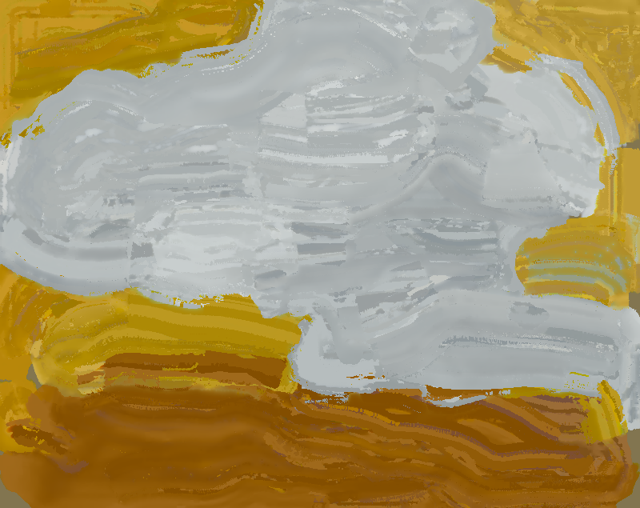

| stroke | covered | width | dark | spread | ms |
|---|---|---|---|---|---|
| stroke 1 | 12 % → 1 % | 127.0 px | 0.20 | 0.05 | 1374 |
| stroke 2 | 17 % → 1 % | 200.1 px | 0.20 | 0.03 | 1795 |
| stroke 3 | 23 % → 0 % | 303.2 px | 0.20 | 0.02 | 1976 |
| stroke 4 | 28 % → 0 % | 591.5 px | 0.00 | 0.00 | 766 |
| stroke 5 | 15 % → 1 % | 564.3 px | 0.20 | 0.05 | 381 |
| stroke 6 | 31 % → 0 % | 405.9 px | 0.20 | 0.01 | 2283 |
| stroke 7 | 36 % → 0 % | 643.8 px | 0.00 | 0.00 | 1010 |
| stroke 8 | 38 % → 0 % | 400.7 px | 0.20 | 0.01 | 3220 |
| stroke 9 | 31 % → 0 % | 985.3 px | 0.00 | 0.00 | 492 |
| stroke 10 | 41 % → 0 % | 465.1 px | 0.20 | 0.01 | 3059 |
| stroke 11 | 33 % → 0 % | 958.4 px | 0.00 | 0.00 | 662 |
| stroke 12 | 38 % → 0 % | 913.4 px | 0.00 | 0.00 | 559 |
| stroke 13 | 45 % → 0 % | 2162.9 px | 0.00 | 0.00 | 526 |
| stroke 14 | 43 % → 0 % | 830.0 px | 0.00 | 0.00 | 1025 |
| stroke 15 | 49 % → 0 % | 1722.7 px | 0.00 | 0.00 | 725 |
| stroke 16 | 41 % → 0 % | 759.3 px | 0.00 | 0.00 | 1858 |
| stroke 17 | 45 % → 0 % | 1265.5 px | 0.00 | 0.00 | 1334 |
| stroke 18 | 1 % → 0 % | 39.7 px | 0.00 | 0.00 | 76 |
| stroke 19 | 2 % → 0 % | 70.6 px | 0.00 | 0.00 | 102 |
| stroke 20 | 3 % → 0 % | 91.8 px | 0.00 | 0.00 | 38 |
| stroke 21 | 3 % → 0 % | 145.9 px | 0.00 | 0.00 | 227 |
| stroke 22 | 6 % → 0 % | 198.7 px | 0.00 | 0.00 | 537 |
| stroke 23 | 8 % → 0 % | 300.8 px | 0.00 | 0.00 | 371 |
| stroke 24 | 11 % → 0 % | 242.3 px | 0.00 | 0.00 | 623 |
| stroke 25 | 12 % → 0 % | 330.3 px | 0.00 | 0.00 | 594 |
| stroke 26 | 17 % → 0 % | 256.9 px | 0.00 | 0.00 | 1235 |
| stroke 27 | 20 % → 0 % | 552.3 px | 0.00 | 0.00 | 757 |
| stroke 28 | 28 % → 0 % | 1286.5 px | 0.00 | 0.00 | 306 |
| stroke 29 | 22 % → 0 % | 473.8 px | 0.00 | 0.00 | 941 |
| stroke 30 | 22 % → 0 % | 348.1 px | 0.00 | 0.00 | 2107 |
| stroke 31 | 28 % → 0 % | 816.1 px | 0.00 | 0.00 | 658 |
| stroke 32 | 33 % → 0 % | 1058.1 px | 0.00 | 0.00 | 609 |
| stroke 33 | 32 % → 0 % | 1216.5 px | 0.00 | 0.00 | 418 |
| stroke 34 | 31 % → 0 % | 380.7 px | 0.00 | 0.00 | 1696 |
| stroke 35 | 33 % → 0 % | 371.4 px | 0.00 | 0.00 | 1623 |
| stroke 36 | 36 % → 0 % | 390.7 px | 0.00 | 0.00 | 1727 |
| stroke 37 | 20 % → 0 % | 542.6 px | 0.00 | 0.00 | 645 |
| stroke 38 | 13 % → 0 % | 653.9 px | 0.00 | 0.00 | 225 |
| stroke 39 | 15 % → 0 % | 542.3 px | 0.00 | 0.00 | 347 |
| stroke 40 | 15 % → 0 % | 522.4 px | 0.00 | 0.00 | 178 |
| stroke 41 | 19 % → 0 % | 650.9 px | 0.00 | 0.00 | 384 |
| stroke 42 | 22 % → 0 % | 488.6 px | 0.00 | 0.00 | 676 |
| stroke 43 | 1 % → 1 % | 52.2 px | 0.20 | 0.83 | 69 |
| stroke 44 | 1 % → 0 % | 43.0 px | 0.00 | 0.00 | 95 |
| stroke 45 | 9 % → 1 % | 92.1 px | 0.20 | 0.13 | 481 |
| stroke 46 | 11 % → 1 % | 222.1 px | 0.20 | 0.08 | 302 |
| stroke 47 | 18 % → 1 % | 137.3 px | 0.20 | 0.04 | 1198 |
| stroke 48 | 23 % → 1 % | 194.3 px | 0.20 | 0.03 | 1403 |
| stroke 49 | 34 % → 1 % | 937.2 px | 0.20 | 0.04 | 201 |
| stroke 50 | 34 % → 1 % | 864.3 px | 0.20 | 0.03 | 245 |
| stroke 51 | 33 % → 1 % | 1242.4 px | 0.20 | 0.03 | 188 |
| stroke 52 | 11 % → 0 % | 91.1 px | 0.00 | 0.00 | 813 |
| stroke 53 | 11 % → 0 % | 466.5 px | 0.00 | 0.00 | 162 |
| stroke 54 | 18 % → 0 % | 245.2 px | 0.00 | 0.00 | 429 |
| stroke 55 | 15 % → 0 % | 567.7 px | 0.00 | 0.00 | 179 |
| stroke 56 | 24 % → 0 % | 463.0 px | 0.00 | 0.00 | 264 |
| stroke 57 | 25 % → 0 % | 584.1 px | 0.00 | 0.00 | 227 |
| stroke 58 | 26 % → 0 % | 772.7 px | 0.00 | 0.00 | 205 |
| stroke 59 | 7 % → 0 % | 144.4 px | 0.00 | 0.00 | 789 |
| stroke 60 | 9 % → 0 % | 170.6 px | 0.00 | 0.00 | 868 |
| stroke 61 | 11 % → 0 % | 225.9 px | 0.00 | 0.00 | 422 |
| stroke 62 | 17 % → 0 % | 651.5 px | 0.00 | 0.00 | 156 |
| stroke 63 | 6 % → 0 % | 116.5 px | 0.00 | 0.00 | 467 |
| stroke 64 | 11 % → 0 % | 482.6 px | 0.00 | 0.00 | 121 |
| stroke 65 | 10 % → 0 % | 167.8 px | 0.00 | 0.00 | 1077 |
| stroke 66 | 14 % → 0 % | 196.1 px | 0.00 | 0.00 | 1064 |
| stroke 67 | 18 % → 0 % | 258.5 px | 0.00 | 0.00 | 1011 |
| stroke 68 | 30 % → 0 % | 994.0 px | 0.00 | 0.00 | 244 |
| stroke 69 | 22 % → 0 % | 512.1 px | 0.00 | 0.00 | 555 |
| stroke 70 | 44 % → 0 % | 1070.7 px | 0.00 | 0.00 | 190 |
| stroke 71 | 15 % → 0 % | 389.1 px | 0.00 | 0.00 | 286 |
| stroke 72 | 19 % → 0 % | 639.3 px | 0.00 | 0.00 | 120 |
| stroke 73 | 14 % → 0 % | 180.0 px | 0.00 | 0.00 | 2056 |
| stroke 74 | 25 % → 0 % | 229.7 px | 0.00 | 0.00 | 3432 |
| stroke 75 | 25 % → 0 % | 372.4 px | 0.00 | 0.00 | 1147 |
| stroke 76 | 48 % → 0 % | 273.5 px | 0.00 | 0.00 | 5208 |
| stroke 77 | 72 % → 0 % | 358.7 px | 0.00 | 0.00 | 4625 |
| stroke 78 | 1 % → 1 % | 37.7 px | 0.20 | 1.16 | 44 |

## Refs v3 · #05 HW green in rust loops — own sheet
own sheet 1600 × 2090 · Gouache 1.00 + turpentine 30 % · 208 px · 263.9 s

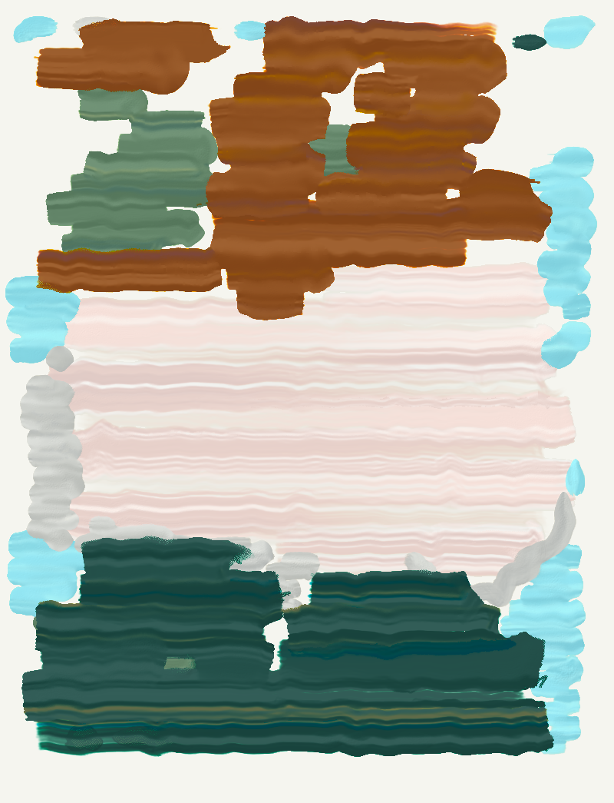

| stroke | covered | width | dark | spread | ms |
|---|---|---|---|---|---|
| stroke 1 | 11 % → 33 % | 179.9 px | 0.37 | 3.09 | 2684 |
| stroke 2 | 19 % → 24 % | 211.0 px | 0.37 | 1.25 | 4628 |
| stroke 3 | 27 % → 19 % | 289.2 px | 0.37 | 0.72 | 5331 |
| stroke 4 | 35 % → 14 % | 369.4 px | 0.37 | 0.40 | 5481 |
| stroke 5 | 43 % → 9 % | 452.8 px | 0.38 | 0.22 | 6911 |
| stroke 6 | 48 % → 3 % | 515.0 px | 0.39 | 0.07 | 5984 |
| stroke 7 | 49 % → 0 % | 534.1 px | 0.00 | 0.00 | 5194 |
| stroke 8 | 49 % → 0 % | 519.3 px | 0.00 | 0.00 | 5581 |
| stroke 9 | 48 % → 0 % | 579.5 px | 0.00 | 0.00 | 4650 |
| stroke 10 | 53 % → 0 % | 1677.2 px | 0.00 | 0.00 | 1030 |
| stroke 11 | 51 % → 0 % | 1511.2 px | 0.00 | 0.00 | 1081 |
| stroke 12 | 3 % → 38 % | 123.7 px | 0.37 | 15.05 | 137 |
| stroke 13 | 4 % → 42 % | 159.7 px | 0.37 | 9.95 | 262 |
| stroke 14 | 6 % → 40 % | 363.5 px | 0.37 | 6.72 | 152 |
| stroke 15 | 2 % → 70 % | 122.9 px | 0.37 | 42.76 | 147 |
| stroke 16 | 2 % → 66 % | 180.6 px | 0.37 | 28.44 | 195 |
| stroke 17 | 9 % → 52 % | 470.2 px | 0.37 | 5.74 | 258 |
| stroke 18 | 11 % → 50 % | 366.6 px | 0.37 | 4.78 | 558 |
| stroke 19 | 12 % → 48 % | 354.9 px | 0.37 | 3.85 | 570 |
| stroke 20 | 15 % → 47 % | 341.5 px | 0.37 | 3.04 | 923 |
| stroke 21 | 18 % → 42 % | 451.2 px | 0.37 | 2.38 | 892 |
| stroke 22 | 20 % → 39 % | 464.2 px | 0.37 | 1.89 | 748 |
| stroke 23 | 22 % → 34 % | 544.0 px | 0.37 | 1.55 | 632 |
| stroke 24 | 23 % → 28 % | 1088.4 px | 0.37 | 1.22 | 291 |
| stroke 25 | 1 % → 0 % | 117.5 px | 0.00 | 0.00 | 151 |
| stroke 26 | 1 % → 0 % | 46.3 px | 0.00 | 0.00 | 37 |
| stroke 27 | 2 % → 0 % | 91.1 px | 0.00 | 0.00 | 52 |
| stroke 28 | 3 % → 0 % | 68.4 px | 0.00 | 0.00 | 135 |
| stroke 29 | 1 % → 0 % | 41.1 px | 0.00 | 0.00 | 42 |
| stroke 30 | 3 % → 0 % | 215.6 px | 0.00 | 0.00 | 31 |
| stroke 31 | 3 % → 0 % | 217.5 px | 0.00 | 0.00 | 30 |
| stroke 32 | 3 % → 46 % | 102.2 px | 0.37 | 15.81 | 100 |
| stroke 33 | 3 % → 43 % | 235.3 px | 0.37 | 13.93 | 51 |
| stroke 34 | 4 % → 43 % | 241.2 px | 0.37 | 10.80 | 114 |
| stroke 35 | 5 % → 44 % | 241.9 px | 0.37 | 9.35 | 114 |
| stroke 36 | 5 % → 42 % | 302.9 px | 0.37 | 8.52 | 85 |
| stroke 37 | 5 % → 40 % | 307.5 px | 0.37 | 8.11 | 88 |
| stroke 38 | 6 % → 38 % | 348.0 px | 0.37 | 6.89 | 90 |
| stroke 39 | 6 % → 35 % | 522.4 px | 0.37 | 5.45 | 61 |
| stroke 40 | 7 % → 33 % | 580.1 px | 0.37 | 4.64 | 53 |
| stroke 41 | 8 % → 31 % | 623.1 px | 0.36 | 4.02 | 60 |
| stroke 42 | 9 % → 29 % | 674.9 px | 0.36 | 3.44 | 68 |
| stroke 43 | 9 % → 28 % | 747.1 px | 0.36 | 2.99 | 66 |
| stroke 44 | 10 % → 26 % | 802.9 px | 0.36 | 2.59 | 75 |
| stroke 45 | 9 % → 18 % | 709.7 px | 0.36 | 1.99 | 56 |
| stroke 46 | 2 % → 16 % | 88.5 px | 0.38 | 7.50 | 124 |
| stroke 47 | 4 % → 17 % | 129.6 px | 0.38 | 4.70 | 151 |
| stroke 48 | 5 % → 15 % | 194.3 px | 0.38 | 3.25 | 135 |
| stroke 49 | 6 % → 14 % | 271.4 px | 0.38 | 2.52 | 113 |
| stroke 50 | 7 % → 14 % | 395.0 px | 0.38 | 2.03 | 86 |
| stroke 51 | 8 % → 14 % | 585.2 px | 0.38 | 1.77 | 61 |
| stroke 52 | 2 % → 0 % | 89.1 px | 0.00 | 0.00 | 87 |
| stroke 53 | 4 % → 0 % | 110.1 px | 0.00 | 0.00 | 179 |
| stroke 54 | 5 % → 0 % | 166.1 px | 0.00 | 0.00 | 190 |
| stroke 55 | 6 % → 0 % | 226.6 px | 0.00 | 0.00 | 161 |
| stroke 56 | 8 % → 0 % | 304.8 px | 0.00 | 0.00 | 130 |
| stroke 57 | 9 % → 0 % | 655.2 px | 0.00 | 0.00 | 65 |
| stroke 58 | 2 % → 0 % | 88.7 px | 0.00 | 0.00 | 100 |
| stroke 59 | 3 % → 0 % | 139.1 px | 0.00 | 0.00 | 109 |
| stroke 60 | 4 % → 0 % | 185.6 px | 0.00 | 0.00 | 111 |
| stroke 61 | 4 % → 0 % | 197.4 px | 0.00 | 0.00 | 138 |
| stroke 62 | 6 % → 0 % | 203.6 px | 0.00 | 0.00 | 164 |
| stroke 63 | 7 % → 0 % | 277.7 px | 0.00 | 0.00 | 149 |
| stroke 64 | 8 % → 0 % | 434.7 px | 0.00 | 0.00 | 99 |
| stroke 65 | 10 % → 0 % | 552.1 px | 0.00 | 0.00 | 112 |
| stroke 66 | 11 % → 0 % | 634.3 px | 0.00 | 0.00 | 91 |
| stroke 67 | 13 % → 0 % | 652.3 px | 0.00 | 0.00 | 117 |
| stroke 68 | 14 % → 0 % | 975.0 px | 0.00 | 0.00 | 65 |
| stroke 69 | 16 % → 0 % | 952.8 px | 0.00 | 0.00 | 70 |
| stroke 70 | 17 % → 0 % | 1046.6 px | 0.00 | 0.00 | 67 |
| stroke 71 | 17 % → 0 % | 972.9 px | 0.00 | 0.00 | 68 |
| stroke 72 | 2 % → 31 % | 45.8 px | 0.37 | 20.17 | 51 |
| stroke 73 | 1 % → 64 % | 42.4 px | 0.37 | 86.17 | 37 |
| stroke 74 | 1 % → 0 % | 42.4 px | 0.00 | 0.00 | 37 |
| stroke 75 | 1 % → 15 % | 55.2 px | 0.38 | 28.48 | 36 |
| stroke 76 | 1 % → 15 % | 101.7 px | 0.38 | 17.41 | 26 |
| stroke 77 | 1 % → 14 % | 156.2 px | 0.38 | 10.20 | 23 |
| stroke 78 | 2 % → 14 % | 155.9 px | 0.38 | 7.47 | 38 |
| stroke 79 | 3 % → 14 % | 149.9 px | 0.38 | 5.54 | 50 |
| stroke 80 | 3 % → 14 % | 177.6 px | 0.38 | 4.60 | 69 |
| stroke 81 | 3 % → 12 % | 212.3 px | 0.39 | 3.49 | 52 |
| stroke 82 | 4 % → 10 % | 232.6 px | 0.40 | 2.53 | 71 |
| stroke 83 | 4 % → 8 % | 359.9 px | 0.40 | 1.83 | 41 |
| stroke 84 | 5 % → 6 % | 288.8 px | 0.40 | 1.25 | 64 |
| stroke 85 | 5 % → 3 % | 319.2 px | 0.39 | 0.65 | 48 |
| stroke 86 | 6 % → 1 % | 355.8 px | 0.40 | 0.21 | 63 |
| stroke 87 | 6 % → 0 % | 522.9 px | 0.00 | 0.00 | 41 |
| stroke 88 | 6 % → 0 % | 515.7 px | 0.00 | 0.00 | 38 |
| stroke 89 | 7 % → 0 % | 595.3 px | 0.00 | 0.00 | 40 |
| stroke 90 | 7 % → 0 % | 454.6 px | 0.00 | 0.00 | 52 |
| stroke 91 | 8 % → 0 % | 635.4 px | 0.00 | 0.00 | 41 |
| stroke 92 | 8 % → 0 % | 688.0 px | 0.00 | 0.00 | 43 |
| stroke 93 | 9 % → 0 % | 539.4 px | 0.00 | 0.00 | 46 |
| stroke 94 | 9 % → 0 % | 549.4 px | 0.00 | 0.00 | 69 |
| stroke 95 | 9 % → 0 % | 743.5 px | 0.00 | 0.00 | 38 |
| stroke 96 | 9 % → 0 % | 1021.5 px | 0.00 | 0.00 | 35 |
| stroke 97 | 8 % → 0 % | 1128.6 px | 0.00 | 0.00 | 24 |
| stroke 98 | 8 % → 0 % | 346.9 px | 0.00 | 0.00 | 109 |
| stroke 99 | 8 % → 0 % | 176.5 px | 0.00 | 0.00 | 270 |
| stroke 100 | 4 % → 0 % | 403.6 px | 0.00 | 0.00 | 67 |
| stroke 101 | 4 % → 0 % | 405.4 px | 0.00 | 0.00 | 61 |
| stroke 102 | 4 % → 0 % | 343.8 px | 0.00 | 0.00 | 57 |
| stroke 103 | 4 % → 0 % | 328.2 px | 0.00 | 0.00 | 77 |
| stroke 104 | 5 % → 0 % | 482.2 px | 0.00 | 0.00 | 56 |
| stroke 105 | 5 % → 0 % | 680.2 px | 0.00 | 0.00 | 46 |
| stroke 106 | 5 % → 0 % | 1011.4 px | 0.00 | 0.00 | 24 |
| stroke 107 | 6 % → 0 % | 1087.6 px | 0.00 | 0.00 | 22 |
| stroke 108 | 1 % → 39 % | 41.7 px | 0.37 | 32.66 | 47 |
| stroke 109 | 2 % → 0 % | 44.3 px | 0.00 | 0.00 | 319 |
| stroke 110 | 3 % → 0 % | 244.9 px | 0.00 | 0.00 | 55 |
| stroke 111 | 8 % → 0 % | 183.5 px | 0.00 | 0.00 | 1186 |
| stroke 112 | 13 % → 0 % | 246.5 px | 0.00 | 0.00 | 2061 |
| stroke 113 | 15 % → 0 % | 390.5 px | 0.00 | 0.00 | 1512 |
| stroke 114 | 24 % → 0 % | 408.5 px | 0.00 | 0.00 | 2288 |
| stroke 115 | 22 % → 0 % | 437.4 px | 0.00 | 0.00 | 1730 |
| stroke 116 | 31 % → 0 % | 797.8 px | 0.00 | 0.00 | 990 |
| stroke 117 | 33 % → 0 % | 469.5 px | 0.00 | 0.00 | 3071 |
| stroke 118 | 45 % → 0 % | 800.3 px | 0.00 | 0.00 | 1345 |
| stroke 119 | 45 % → 0 % | 570.1 px | 0.00 | 0.00 | 3144 |
| stroke 120 | 58 % → 0 % | 461.7 px | 0.00 | 0.00 | 5149 |
| stroke 121 | 1 % → 54 % | 31.7 px | 0.37 | 88.43 | 27 |
| stroke 122 | 9 % → 49 % | 144.8 px | 0.37 | 5.52 | 768 |
| stroke 123 | 17 % → 57 % | 200.0 px | 0.37 | 3.39 | 1289 |
| stroke 124 | 20 % → 45 % | 283.9 px | 0.37 | 2.29 | 852 |
| stroke 125 | 24 % → 69 % | 727.2 px | 0.36 | 2.88 | 455 |
| stroke 126 | 19 % → 63 % | 371.8 px | 0.36 | 3.33 | 722 |
| stroke 127 | 22 % → 47 % | 1143.6 px | 0.37 | 2.09 | 291 |
| stroke 128 | 30 % → 67 % | 860.3 px | 0.37 | 2.22 | 642 |
| stroke 129 | 24 % → 64 % | 548.8 px | 0.37 | 2.68 | 764 |
| stroke 130 | 32 % → 66 % | 872.4 px | 0.37 | 2.03 | 753 |
| stroke 131 | 26 % → 62 % | 1365.7 px | 0.37 | 2.39 | 344 |
| stroke 132 | 33 % → 66 % | 1073.5 px | 0.37 | 2.01 | 637 |
| stroke 133 | 29 % → 60 % | 935.9 px | 0.37 | 2.04 | 574 |
| stroke 134 | 36 % → 62 % | 1526.3 px | 0.37 | 1.74 | 547 |
| stroke 135 | 31 % → 55 % | 1059.4 px | 0.37 | 1.80 | 615 |
| stroke 136 | 29 % → 49 % | 1480.7 px | 0.37 | 1.67 | 344 |
| stroke 137 | 38 % → 61 % | 1655.2 px | 0.37 | 1.61 | 502 |
| stroke 138 | 36 % → 54 % | 1197.9 px | 0.37 | 1.51 | 609 |
| stroke 139 | 34 % → 48 % | 1807.1 px | 0.36 | 1.42 | 355 |
| stroke 140 | 34 % → 46 % | 503.6 px | 0.37 | 1.34 | 2191 |
| stroke 141 | 34 % → 41 % | 494.3 px | 0.37 | 1.22 | 2003 |
| stroke 142 | 32 % → 36 % | 622.1 px | 0.37 | 1.12 | 1531 |
| stroke 143 | 35 % → 33 % | 511.4 px | 0.37 | 0.95 | 1882 |

Numbers say: wet paint spreads well beyond the stroke.

## Refs v3 · #06 HW scrubbed grey — own sheet
own sheet 1600 × 1270 · Gouache 1.00 + turpentine 30 % · 186 px · 125.3 s

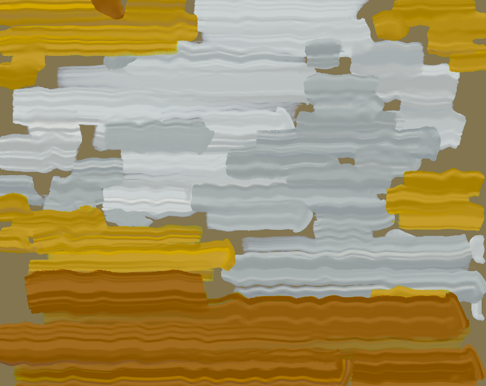

| stroke | covered | width | dark | spread | ms |
|---|---|---|---|---|---|
| stroke 1 | 12 % → 1 % | 126.8 px | 0.20 | 0.05 | 1606 |
| stroke 2 | 17 % → 1 % | 200.1 px | 0.20 | 0.03 | 2149 |
| stroke 3 | 23 % → 0 % | 303.2 px | 0.20 | 0.02 | 1968 |
| stroke 4 | 28 % → 0 % | 590.6 px | 0.00 | 0.00 | 729 |
| stroke 5 | 15 % → 1 % | 564.8 px | 0.20 | 0.05 | 300 |
| stroke 6 | 31 % → 0 % | 405.8 px | 0.20 | 0.01 | 3441 |
| stroke 7 | 36 % → 0 % | 643.7 px | 0.00 | 0.00 | 1418 |
| stroke 8 | 37 % → 0 % | 400.1 px | 0.20 | 0.01 | 3030 |
| stroke 9 | 31 % → 0 % | 985.8 px | 0.00 | 0.00 | 410 |
| stroke 10 | 41 % → 0 % | 464.9 px | 0.20 | 0.01 | 3124 |
| stroke 11 | 33 % → 0 % | 959.1 px | 0.00 | 0.00 | 884 |
| stroke 12 | 38 % → 0 % | 912.7 px | 0.00 | 0.00 | 606 |
| stroke 13 | 45 % → 0 % | 2162.1 px | 0.00 | 0.00 | 494 |
| stroke 14 | 43 % → 0 % | 828.8 px | 0.00 | 0.00 | 1101 |
| stroke 15 | 49 % → 0 % | 1721.2 px | 0.00 | 0.00 | 580 |
| stroke 16 | 41 % → 0 % | 758.5 px | 0.00 | 0.00 | 1791 |
| stroke 17 | 45 % → 0 % | 1264.1 px | 0.00 | 0.00 | 752 |
| stroke 18 | 1 % → 0 % | 39.7 px | 0.00 | 0.00 | 35 |
| stroke 19 | 2 % → 0 % | 70.6 px | 0.00 | 0.00 | 35 |
| stroke 20 | 3 % → 0 % | 91.8 px | 0.00 | 0.00 | 34 |
| stroke 21 | 3 % → 0 % | 145.9 px | 0.00 | 0.00 | 254 |
| stroke 22 | 6 % → 0 % | 198.4 px | 0.00 | 0.00 | 449 |
| stroke 23 | 8 % → 0 % | 300.6 px | 0.00 | 0.00 | 408 |
| stroke 24 | 11 % → 0 % | 241.9 px | 0.00 | 0.00 | 738 |
| stroke 25 | 12 % → 0 % | 330.8 px | 0.00 | 0.00 | 658 |
| stroke 26 | 17 % → 0 % | 256.7 px | 0.00 | 0.00 | 1407 |
| stroke 27 | 20 % → 0 % | 551.7 px | 0.00 | 0.00 | 705 |
| stroke 28 | 28 % → 0 % | 1285.6 px | 0.00 | 0.00 | 300 |
| stroke 29 | 22 % → 0 % | 473.7 px | 0.00 | 0.00 | 910 |
| stroke 30 | 22 % → 0 % | 348.6 px | 0.00 | 0.00 | 1629 |
| stroke 31 | 28 % → 0 % | 816.2 px | 0.00 | 0.00 | 653 |
| stroke 32 | 33 % → 0 % | 1057.8 px | 0.00 | 0.00 | 560 |
| stroke 33 | 32 % → 0 % | 1215.8 px | 0.00 | 0.00 | 510 |
| stroke 34 | 31 % → 0 % | 380.6 px | 0.00 | 0.00 | 2074 |
| stroke 35 | 33 % → 0 % | 371.5 px | 0.00 | 0.00 | 1904 |
| stroke 36 | 36 % → 0 % | 391.5 px | 0.00 | 0.00 | 2485 |
| stroke 37 | 20 % → 0 % | 543.3 px | 0.00 | 0.00 | 552 |
| stroke 38 | 13 % → 0 % | 656.3 px | 0.00 | 0.00 | 224 |
| stroke 39 | 15 % → 0 % | 543.8 px | 0.00 | 0.00 | 477 |
| stroke 40 | 15 % → 0 % | 523.6 px | 0.00 | 0.00 | 227 |
| stroke 41 | 19 % → 0 % | 652.4 px | 0.00 | 0.00 | 372 |
| stroke 42 | 22 % → 0 % | 488.7 px | 0.00 | 0.00 | 576 |
| stroke 43 | 1 % → 1 % | 52.3 px | 0.20 | 0.83 | 62 |
| stroke 44 | 1 % → 0 % | 43.0 px | 0.00 | 0.00 | 100 |
| stroke 45 | 9 % → 1 % | 92.4 px | 0.20 | 0.13 | 434 |
| stroke 46 | 11 % → 1 % | 223.1 px | 0.20 | 0.08 | 280 |
| stroke 47 | 18 % → 1 % | 137.5 px | 0.20 | 0.04 | 1083 |
| stroke 48 | 23 % → 1 % | 194.6 px | 0.20 | 0.03 | 989 |
| stroke 49 | 34 % → 1 % | 938.6 px | 0.20 | 0.04 | 162 |
| stroke 50 | 34 % → 1 % | 865.3 px | 0.20 | 0.03 | 211 |
| stroke 51 | 33 % → 1 % | 1243.5 px | 0.20 | 0.03 | 163 |
| stroke 52 | 11 % → 0 % | 91.5 px | 0.00 | 0.00 | 540 |
| stroke 53 | 11 % → 0 % | 467.2 px | 0.00 | 0.00 | 127 |
| stroke 54 | 18 % → 0 % | 245.2 px | 0.00 | 0.00 | 374 |
| stroke 55 | 15 % → 0 % | 568.2 px | 0.00 | 0.00 | 176 |
| stroke 56 | 24 % → 0 % | 463.7 px | 0.00 | 0.00 | 251 |
| stroke 57 | 25 % → 0 % | 584.5 px | 0.00 | 0.00 | 226 |
| stroke 58 | 26 % → 0 % | 773.1 px | 0.00 | 0.00 | 183 |
| stroke 59 | 7 % → 0 % | 145.0 px | 0.00 | 0.00 | 432 |
| stroke 60 | 9 % → 0 % | 170.6 px | 0.00 | 0.00 | 458 |
| stroke 61 | 11 % → 0 % | 226.3 px | 0.00 | 0.00 | 438 |
| stroke 62 | 17 % → 0 % | 651.8 px | 0.00 | 0.00 | 151 |
| stroke 63 | 6 % → 0 % | 116.6 px | 0.00 | 0.00 | 492 |
| stroke 64 | 11 % → 0 % | 484.5 px | 0.00 | 0.00 | 115 |
| stroke 65 | 11 % → 0 % | 168.9 px | 0.00 | 0.00 | 888 |
| stroke 66 | 14 % → 0 % | 196.8 px | 0.00 | 0.00 | 1114 |
| stroke 67 | 18 % → 0 % | 258.6 px | 0.00 | 0.00 | 1057 |
| stroke 68 | 30 % → 0 % | 994.3 px | 0.00 | 0.00 | 255 |
| stroke 69 | 22 % → 0 % | 512.7 px | 0.00 | 0.00 | 596 |
| stroke 70 | 44 % → 0 % | 1071.5 px | 0.00 | 0.00 | 195 |
| stroke 71 | 15 % → 0 % | 389.1 px | 0.00 | 0.00 | 306 |
| stroke 72 | 19 % → 0 % | 639.3 px | 0.00 | 0.00 | 120 |
| stroke 73 | 14 % → 0 % | 180.1 px | 0.00 | 0.00 | 2045 |
| stroke 74 | 25 % → 0 % | 229.0 px | 0.00 | 0.00 | 3336 |
| stroke 75 | 25 % → 0 % | 372.0 px | 0.00 | 0.00 | 1185 |
| stroke 76 | 48 % → 0 % | 273.9 px | 0.00 | 0.00 | 5133 |
| stroke 77 | 72 % → 0 % | 358.4 px | 0.00 | 0.00 | 4498 |
| stroke 78 | 1 % → 1 % | 37.6 px | 0.20 | 1.15 | 40 |

## Refs v3 · #07 HW blue L and zigzag — own sheet
own sheet 1600 × 2130 · Gouache 1.00 + turpentine 30 % · 208 px · 162.7 s

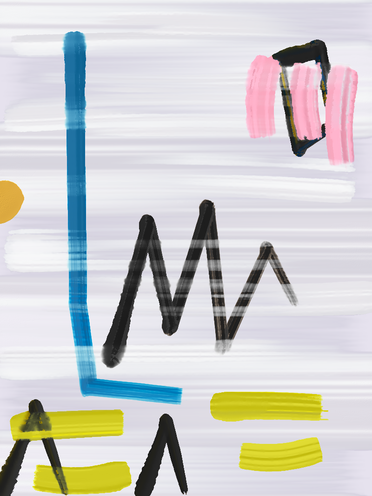

| stroke | covered | width | dark | spread | ms |
|---|---|---|---|---|---|
| stroke 1 | 5 % → 1 % | 197.6 px | 0.38 | 0.17 | 696 |
| stroke 2 | 9 % → 1 % | 364.3 px | 0.38 | 0.08 | 587 |
| stroke 3 | 10 % → 0 % | 182.0 px | 0.00 | 0.00 | 2308 |
| stroke 4 | 13 % → 0 % | 315.0 px | 0.38 | 0.04 | 2646 |
| stroke 5 | 15 % → 2 % | 279.0 px | 0.39 | 0.11 | 1454 |
| stroke 6 | 30 % → 1 % | 329.0 px | 0.39 | 0.03 | 4287 |
| stroke 7 | 30 % → 3 % | 822.1 px | 0.39 | 0.09 | 719 |
| stroke 8 | 44 % → 0 % | 854.5 px | 0.00 | 0.00 | 996 |
| stroke 9 | 43 % → 1 % | 576.7 px | 0.39 | 0.03 | 3490 |
| stroke 10 | 59 % → 0 % | 1402.7 px | 0.00 | 0.00 | 621 |
| stroke 11 | 56 % → 1 % | 656.5 px | 0.39 | 0.02 | 3088 |
| stroke 12 | 74 % → 1 % | 506.2 px | 0.39 | 0.02 | 4848 |
| stroke 13 | 82 % → 2 % | 612.2 px | 0.39 | 0.02 | 3419 |
| stroke 14 | 1 % → 1 % | 37.2 px | 0.38 | 2.22 | 26 |
| stroke 15 | 5 % → 0 % | 174.1 px | 0.00 | 0.00 | 548 |
| stroke 16 | 11 % → 0 % | 226.0 px | 0.00 | 0.00 | 1459 |
| stroke 17 | 15 % → 0 % | 301.1 px | 0.00 | 0.00 | 1312 |
| stroke 18 | 20 % → 0 % | 416.2 px | 0.00 | 0.00 | 1178 |
| stroke 19 | 23 % → 0 % | 472.6 px | 0.39 | 0.01 | 1281 |
| stroke 20 | 27 % → 1 % | 566.9 px | 0.38 | 0.03 | 1617 |
| stroke 21 | 28 % → 1 % | 615.4 px | 0.38 | 0.03 | 914 |
| stroke 22 | 28 % → 1 % | 748.4 px | 0.38 | 0.04 | 1063 |
| stroke 23 | 3 % → 1 % | 128.8 px | 0.38 | 0.42 | 161 |
| stroke 24 | 5 % → 1 % | 151.9 px | 0.38 | 0.19 | 314 |
| stroke 25 | 8 % → 1 % | 159.5 px | 0.38 | 0.10 | 570 |
| stroke 26 | 11 % → 1 % | 213.8 px | 0.38 | 0.07 | 546 |
| stroke 27 | 2 % → 0 % | 128.6 px | 0.00 | 0.00 | 280 |
| stroke 28 | 5 % → 1 % | 137.6 px | 0.39 | 0.12 | 711 |
| stroke 29 | 8 % → 1 % | 195.8 px | 0.39 | 0.16 | 824 |
| stroke 30 | 1 % → 0 % | 82.2 px | 0.00 | 0.00 | 47 |
| stroke 31 | 1 % → 0 % | 104.3 px | 0.00 | 0.00 | 77 |
| stroke 32 | 2 % → 0 % | 166.1 px | 0.00 | 0.00 | 68 |
| stroke 33 | 3 % → 0 % | 206.0 px | 0.00 | 0.00 | 84 |
| stroke 34 | 3 % → 0 % | 342.8 px | 0.00 | 0.00 | 46 |
| stroke 35 | 3 % → 0 % | 423.6 px | 0.00 | 0.00 | 46 |
| stroke 36 | 4 % → 0 % | 338.0 px | 0.00 | 0.00 | 70 |
| stroke 37 | 4 % → 0 % | 400.5 px | 0.00 | 0.00 | 83 |
| stroke 38 | 5 % → 0 % | 426.5 px | 0.00 | 0.00 | 79 |
| stroke 39 | 6 % → 0 % | 404.5 px | 0.00 | 0.00 | 91 |
| stroke 40 | 6 % → 0 % | 450.7 px | 0.00 | 0.00 | 97 |
| stroke 41 | 7 % → 0 % | 405.4 px | 0.00 | 0.00 | 123 |
| stroke 42 | 7 % → 0 % | 426.2 px | 0.00 | 0.00 | 117 |
| stroke 43 | 7 % → 0 % | 442.4 px | 0.00 | 0.00 | 135 |
| stroke 44 | 7 % → 0 % | 437.8 px | 0.00 | 0.00 | 138 |
| stroke 45 | 8 % → 0 % | 321.1 px | 0.00 | 0.00 | 190 |
| stroke 46 | 8 % → 0 % | 383.7 px | 0.00 | 0.00 | 156 |
| stroke 47 | 5 % → 0 % | 116.6 px | 0.00 | 0.00 | 380 |
| stroke 48 | 5 % → 0 % | 368.5 px | 0.00 | 0.00 | 160 |
| stroke 49 | 8 % → 0 % | 423.5 px | 0.00 | 0.00 | 151 |
| stroke 50 | 7 % → 0 % | 619.0 px | 0.00 | 0.00 | 137 |
| stroke 51 | 11 % → 0 % | 439.1 px | 0.00 | 0.00 | 237 |
| stroke 52 | 12 % → 0 % | 443.7 px | 0.00 | 0.00 | 291 |
| stroke 53 | 15 % → 0 % | 422.5 px | 0.00 | 0.00 | 363 |
| stroke 54 | 16 % → 0 % | 351.2 px | 0.00 | 0.00 | 515 |
| stroke 55 | 18 % → 0 % | 430.2 px | 0.00 | 0.00 | 507 |
| stroke 56 | 21 % → 0 % | 520.3 px | 0.00 | 0.00 | 471 |
| stroke 57 | 23 % → 0 % | 557.8 px | 0.00 | 0.00 | 455 |
| stroke 58 | 24 % → 0 % | 662.2 px | 0.00 | 0.00 | 379 |
| stroke 59 | 24 % → 0 % | 593.9 px | 0.00 | 0.00 | 455 |
| stroke 60 | 23 % → 0 % | 574.6 px | 0.00 | 0.00 | 493 |
| stroke 61 | 24 % → 0 % | 542.1 px | 0.00 | 0.00 | 480 |
| stroke 62 | 18 % → 0 % | 1205.9 px | 0.00 | 0.00 | 183 |
| stroke 63 | 19 % → 0 % | 459.0 px | 0.00 | 0.00 | 588 |
| stroke 64 | 20 % → 0 % | 443.4 px | 0.00 | 0.00 | 645 |
| stroke 65 | 2 % → 0 % | 235.8 px | 0.00 | 0.00 | 139 |
| stroke 66 | 5 % → 0 % | 301.5 px | 0.00 | 0.00 | 214 |
| stroke 67 | 6 % → 0 % | 354.5 px | 0.00 | 0.00 | 264 |
| stroke 68 | 8 % → 0 % | 409.4 px | 0.00 | 0.00 | 330 |
| stroke 69 | 10 % → 0 % | 798.3 px | 0.00 | 0.00 | 167 |
| stroke 70 | 12 % → 0 % | 931.5 px | 0.00 | 0.00 | 147 |
| stroke 71 | 12 % → 0 % | 980.7 px | 0.00 | 0.00 | 175 |
| stroke 72 | 15 % → 0 % | 804.2 px | 0.00 | 0.00 | 261 |
| stroke 73 | 15 % → 0 % | 994.2 px | 0.00 | 0.00 | 187 |
| stroke 74 | 16 % → 0 % | 747.9 px | 0.00 | 0.00 | 332 |
| stroke 75 | 15 % → 0 % | 671.2 px | 0.00 | 0.00 | 347 |
| stroke 76 | 15 % → 0 % | 1360.1 px | 0.00 | 0.00 | 139 |
| stroke 77 | 15 % → 0 % | 818.4 px | 0.00 | 0.00 | 287 |
| stroke 78 | 15 % → 0 % | 1409.6 px | 0.00 | 0.00 | 143 |
| stroke 79 | 2 % → 0 % | 99.4 px | 0.00 | 0.00 | 157 |
| stroke 80 | 3 % → 0 % | 136.3 px | 0.00 | 0.00 | 276 |
| stroke 81 | 4 % → 0 % | 207.9 px | 0.00 | 0.00 | 217 |
| stroke 82 | 5 % → 0 % | 262.6 px | 0.00 | 0.00 | 193 |
| stroke 83 | 6 % → 0 % | 315.4 px | 0.00 | 0.00 | 216 |
| stroke 84 | 7 % → 0 % | 368.5 px | 0.00 | 0.00 | 227 |
| stroke 85 | 8 % → 0 % | 425.8 px | 0.00 | 0.00 | 194 |
| stroke 86 | 10 % → 0 % | 481.2 px | 0.00 | 0.00 | 207 |
| stroke 87 | 10 % → 0 % | 724.9 px | 0.00 | 0.00 | 165 |
| stroke 88 | 11 % → 0 % | 759.3 px | 0.00 | 0.00 | 137 |
| stroke 89 | 11 % → 0 % | 804.5 px | 0.00 | 0.00 | 132 |
| stroke 90 | 11 % → 0 % | 969.6 px | 0.00 | 0.00 | 100 |
| stroke 91 | 7 % → 1 % | 563.9 px | 0.38 | 0.11 | 98 |
| stroke 92 | 6 % → 1 % | 540.9 px | 0.38 | 0.12 | 113 |
| stroke 93 | 6 % → 1 % | 453.1 px | 0.38 | 0.12 | 127 |
| stroke 94 | 6 % → 1 % | 321.7 px | 0.38 | 0.12 | 223 |
| stroke 95 | 7 % → 1 % | 336.5 px | 0.38 | 0.11 | 198 |
| stroke 96 | 7 % → 1 % | 399.1 px | 0.38 | 0.11 | 185 |
| stroke 97 | 8 % → 1 % | 612.5 px | 0.38 | 0.11 | 110 |
| stroke 98 | 8 % → 1 % | 629.5 px | 0.38 | 0.10 | 125 |
| stroke 99 | 9 % → 1 % | 672.4 px | 0.38 | 0.09 | 130 |
| stroke 100 | 10 % → 1 % | 781.3 px | 0.38 | 0.08 | 120 |
| stroke 101 | 10 % → 1 % | 658.5 px | 0.38 | 0.08 | 145 |
| stroke 102 | 10 % → 1 % | 655.6 px | 0.38 | 0.08 | 146 |
| stroke 103 | 10 % → 1 % | 650.2 px | 0.38 | 0.08 | 138 |
| stroke 104 | 10 % → 1 % | 487.2 px | 0.38 | 0.08 | 186 |
| stroke 105 | 9 % → 1 % | 436.3 px | 0.38 | 0.08 | 229 |
| stroke 106 | 10 % → 1 % | 394.2 px | 0.38 | 0.07 | 336 |
| stroke 107 | 10 % → 1 % | 452.6 px | 0.38 | 0.06 | 270 |
| stroke 108 | 10 % → 0 % | 1028.5 px | 0.00 | 0.00 | 103 |
| stroke 109 | 1 % → 0 % | 28.8 px | 0.00 | 0.00 | 72 |
| stroke 110 | 1 % → 0 % | 109.6 px | 0.00 | 0.00 | 22 |
| stroke 111 | 6 % → 2 % | 123.8 px | 0.39 | 0.33 | 554 |
| stroke 112 | 10 % → 2 % | 177.6 px | 0.39 | 0.22 | 639 |
| stroke 113 | 14 % → 2 % | 249.2 px | 0.39 | 0.16 | 680 |
| stroke 114 | 19 % → 2 % | 292.9 px | 0.39 | 0.13 | 780 |
| stroke 115 | 4 % → 0 % | 133.9 px | 0.00 | 0.00 | 163 |
| stroke 116 | 6 % → 0 % | 149.2 px | 0.00 | 0.00 | 227 |
| stroke 117 | 1 % → 1 % | 35.4 px | 0.38 | 1.24 | 51 |
| stroke 118 | 3 % → 4 % | 31.0 px | 0.39 | 1.22 | 179 |

Numbers say: wet paint spreads well beyond the stroke.

## Refs v3 · #08 HW lilac crown basket — own sheet
own sheet 1600 × 2300 · Gouache 1.00 + turpentine 30 % · 72 px · 370.9 s

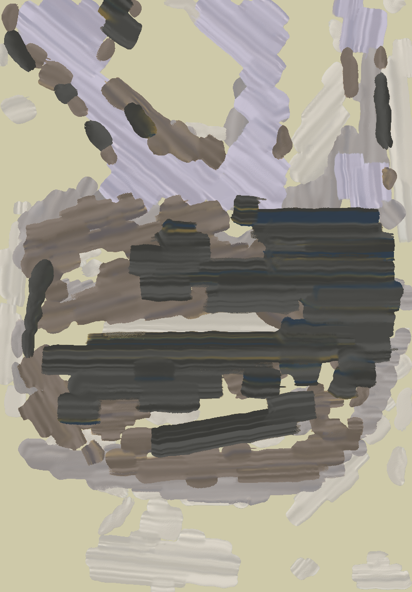

| stroke | covered | width | dark | spread | ms |
|---|---|---|---|---|---|
| stroke 1 | 11 % → 7 % | 66.8 px | 0.30 | 0.63 | 264 |
| stroke 2 | 21 % → 7 % | 73.0 px | 0.30 | 0.31 | 510 |
| stroke 3 | 28 % → 5 % | 91.1 px | 0.30 | 0.17 | 1088 |
| stroke 4 | 7 % → 0 % | 68.1 px | 0.32 | 0.01 | 285 |
| stroke 5 | 10 % → 0 % | 96.9 px | 0.00 | 0.00 | 232 |
| stroke 6 | 13 % → 0 % | 114.9 px | 0.32 | 0.01 | 259 |
| stroke 7 | 20 % → 1 % | 196.3 px | 0.31 | 0.04 | 165 |
| stroke 8 | 27 % → 0 % | 513.3 px | 0.00 | 0.00 | 57 |
| stroke 9 | 22 % → 0 % | 210.4 px | 0.32 | 0.00 | 202 |
| stroke 10 | 22 % → 0 % | 192.3 px | 0.32 | 0.01 | 250 |
| stroke 11 | 23 % → 1 % | 227.9 px | 0.31 | 0.05 | 188 |
| stroke 12 | 21 % → 0 % | 314.3 px | 0.32 | 0.00 | 99 |
| stroke 13 | 7 % → 3 % | 70.9 px | 0.29 | 0.36 | 69 |
| stroke 14 | 10 % → 5 % | 104.3 px | 0.30 | 0.46 | 79 |
| stroke 15 | 8 % → 2 % | 69.0 px | 0.32 | 0.23 | 99 |
| stroke 16 | 4 % → 0 % | 73.8 px | 0.00 | 0.00 | 83 |
| stroke 17 | 17 % → 11 % | 75.3 px | 0.31 | 0.62 | 335 |
| stroke 18 | 15 % → 17 % | 173.8 px | 0.32 | 1.17 | 51 |
| stroke 19 | 24 % → 8 % | 163.2 px | 0.32 | 0.34 | 122 |
| stroke 20 | 33 % → 13 % | 184.9 px | 0.31 | 0.39 | 185 |
| stroke 21 | 40 % → 14 % | 143.3 px | 0.31 | 0.35 | 267 |
| stroke 22 | 48 % → 10 % | 648.9 px | 0.31 | 0.21 | 24 |
| stroke 23 | 12 % → 0 % | 65.9 px | 0.00 | 0.00 | 383 |
| stroke 24 | 18 % → 0 % | 82.1 px | 0.00 | 0.00 | 603 |
| stroke 25 | 27 % → 0 % | 127.6 px | 0.00 | 0.00 | 420 |
| stroke 26 | 6 % → 0 % | 67.4 px | 0.00 | 0.00 | 132 |
| stroke 27 | 9 % → 0 % | 75.7 px | 0.00 | 0.00 | 413 |
| stroke 28 | 15 % → 0 % | 189.1 px | 0.00 | 0.00 | 103 |
| stroke 29 | 19 % → 0 % | 188.3 px | 0.00 | 0.00 | 174 |
| stroke 30 | 14 % → 0 % | 225.4 px | 0.00 | 0.00 | 55 |
| stroke 31 | 14 % → 0 % | 298.8 px | 0.00 | 0.00 | 30 |
| stroke 32 | 4 % → 0 % | 71.6 px | 0.00 | 0.00 | 52 |
| stroke 33 | 7 % → 0 % | 87.1 px | 0.00 | 0.00 | 108 |
| stroke 34 | 10 % → 0 % | 109.6 px | 0.00 | 0.00 | 128 |
| stroke 35 | 14 % → 0 % | 197.2 px | 0.00 | 0.00 | 70 |
| stroke 36 | 18 % → 0 % | 318.4 px | 0.00 | 0.00 | 52 |
| stroke 37 | 19 % → 0 % | 262.4 px | 0.00 | 0.00 | 76 |
| stroke 38 | 21 % → 0 % | 250.9 px | 0.00 | 0.00 | 107 |
| stroke 39 | 23 % → 0 % | 182.4 px | 0.00 | 0.00 | 222 |
| stroke 40 | 24 % → 0 % | 200.1 px | 0.00 | 0.00 | 226 |
| stroke 41 | 29 % → 0 % | 202.0 px | 0.00 | 0.00 | 292 |
| stroke 42 | 29 % → 0 % | 139.6 px | 0.00 | 0.00 | 631 |
| stroke 43 | 34 % → 0 % | 147.3 px | 0.00 | 0.00 | 816 |
| stroke 44 | 44 % → 0 % | 173.6 px | 0.00 | 0.00 | 536 |
| stroke 45 | 65 % → 0 % | 268.1 px | 0.00 | 0.00 | 352 |
| stroke 46 | 87 % → 0 % | 734.0 px | 0.00 | 0.00 | 84 |
| stroke 47 | 4 % → 0 % | 77.9 px | 0.00 | 0.00 | 37 |
| stroke 48 | 7 % → 0 % | 103.8 px | 0.00 | 0.00 | 48 |
| stroke 49 | 4 % → 0 % | 78.6 px | 0.00 | 0.00 | 27 |
| stroke 50 | 8 % → 0 % | 103.3 px | 0.00 | 0.00 | 48 |
| stroke 51 | 19 % → 0 % | 86.9 px | 0.00 | 0.00 | 175 |
| stroke 52 | 31 % → 0 % | 114.3 px | 0.00 | 0.00 | 289 |
| stroke 53 | 5 % → 0 % | 29.0 px | 0.00 | 0.00 | 94 |
| stroke 54 | 6 % → 0 % | 32.7 px | 0.00 | 0.00 | 24 |
| stroke 55 | 3 % → 0 % | 35.0 px | 0.30 | 0.00 | 40 |
| stroke 56 | 3 % → 12 % | 33.4 px | 0.31 | 4.05 | 20 |
| stroke 57 | 4 % → 2 % | 34.7 px | 0.36 | 0.42 | 70 |
| stroke 58 | 3 % → 2 % | 42.0 px | 0.33 | 0.58 | 48 |
| stroke 59 | 6 % → 1 % | 108.2 px | 0.33 | 0.21 | 29 |
| stroke 60 | 4 % → 0 % | 32.0 px | 0.00 | 0.00 | 29 |
| stroke 61 | 9 % → 0 % | 72.4 px | 0.00 | 0.00 | 55 |
| stroke 62 | 14 % → 0 % | 77.4 px | 0.00 | 0.00 | 74 |
| stroke 63 | 6 % → 0 % | 48.9 px | 0.00 | 0.00 | 153 |
| stroke 64 | 4 % → 0 % | 44.6 px | 0.00 | 0.00 | 60 |
| stroke 65 | 5 % → 0 % | 56.0 px | 0.00 | 0.00 | 86 |
| stroke 66 | 8 % → 0 % | 115.8 px | 0.00 | 0.00 | 50 |
| stroke 67 | 12 % → 0 % | 82.4 px | 0.00 | 0.00 | 100 |
| stroke 68 | 5 % → 0 % | 57.9 px | 0.00 | 0.00 | 65 |
| stroke 69 | 8 % → 0 % | 87.6 px | 0.00 | 0.00 | 64 |
| stroke 70 | 11 % → 0 % | 106.6 px | 0.00 | 0.00 | 112 |
| stroke 71 | 8 % → 0 % | 54.1 px | 0.00 | 0.00 | 148 |
| stroke 72 | 3 % → 4 % | 57.4 px | 0.30 | 1.57 | 29 |
| stroke 73 | 9 % → 7 % | 61.1 px | 0.30 | 0.87 | 130 |
| stroke 74 | 4 % → 0 % | 58.4 px | 0.28 | 0.04 | 34 |
| stroke 75 | 15 % → 5 % | 78.4 px | 0.30 | 0.33 | 289 |
| stroke 76 | 19 % → 5 % | 101.6 px | 0.30 | 0.26 | 283 |
| stroke 77 | 28 % → 10 % | 729.3 px | 0.30 | 0.34 | 24 |
| stroke 78 | 27 % → 8 % | 366.8 px | 0.30 | 0.29 | 68 |
| stroke 79 | 28 % → 6 % | 327.2 px | 0.30 | 0.21 | 67 |
| stroke 80 | 27 % → 2 % | 230.7 px | 0.31 | 0.07 | 127 |
| stroke 81 | 23 % → 0 % | 272.8 px | 0.00 | 0.00 | 82 |
| stroke 82 | 21 % → 0 % | 180.8 px | 0.00 | 0.00 | 109 |
| stroke 83 | 19 % → 0 % | 268.8 px | 0.00 | 0.00 | 52 |
| stroke 84 | 19 % → 0 % | 340.9 px | 0.00 | 0.00 | 38 |
| stroke 85 | 20 % → 0 % | 354.6 px | 0.00 | 0.00 | 38 |
| stroke 86 | 21 % → 0 % | 288.5 px | 0.00 | 0.00 | 51 |
| stroke 87 | 20 % → 0 % | 362.8 px | 0.00 | 0.00 | 36 |
| stroke 88 | 19 % → 0 % | 338.1 px | 0.00 | 0.00 | 35 |
| stroke 89 | 17 % → 0 % | 420.5 px | 0.00 | 0.00 | 23 |
| stroke 90 | 15 % → 0 % | 261.9 px | 0.00 | 0.00 | 36 |
| stroke 91 | 3 % → 0 % | 56.2 px | 0.00 | 0.00 | 30 |
| stroke 92 | 7 % → 0 % | 64.3 px | 0.00 | 0.00 | 103 |
| stroke 93 | 9 % → 0 % | 96.5 px | 0.00 | 0.00 | 82 |
| stroke 94 | 3 % → 0 % | 63.6 px | 0.00 | 0.00 | 29 |
| stroke 95 | 5 % → 0 % | 101.8 px | 0.00 | 0.00 | 41 |
| stroke 96 | 9 % → 0 % | 130.5 px | 0.00 | 0.00 | 52 |
| stroke 97 | 10 % → 0 % | 133.8 px | 0.00 | 0.00 | 70 |
| stroke 98 | 12 % → 0 % | 183.6 px | 0.00 | 0.00 | 61 |
| stroke 99 | 12 % → 0 % | 162.3 px | 0.00 | 0.00 | 71 |
| stroke 100 | 5 % → 9 % | 83.3 px | 0.31 | 1.62 | 43 |
| stroke 101 | 17 % → 0 % | 256.1 px | 0.00 | 0.00 | 53 |
| stroke 102 | 17 % → 6 % | 209.5 px | 0.31 | 0.35 | 97 |
| stroke 103 | 20 % → 3 % | 169.7 px | 0.31 | 0.13 | 127 |
| stroke 104 | 26 % → 0 % | 412.7 px | 0.00 | 0.00 | 38 |
| stroke 105 | 8 % → 0 % | 104.1 px | 0.00 | 0.00 | 41 |
| stroke 106 | 10 % → 0 % | 96.6 px | 0.00 | 0.00 | 71 |
| stroke 107 | 10 % → 0 % | 205.5 px | 0.00 | 0.00 | 25 |
| stroke 108 | 15 % → 0 % | 279.6 px | 0.00 | 0.00 | 38 |
| stroke 109 | 3 % → 0 % | 55.8 px | 0.00 | 0.00 | 34 |
| stroke 110 | 8 % → 0 % | 95.2 px | 0.00 | 0.00 | 87 |
| stroke 111 | 14 % → 0 % | 189.0 px | 0.00 | 0.00 | 68 |
| stroke 112 | 19 % → 0 % | 204.0 px | 0.00 | 0.00 | 115 |
| stroke 113 | 26 % → 0 % | 604.1 px | 0.00 | 0.00 | 29 |
| stroke 114 | 9 % → 0 % | 53.0 px | 0.00 | 0.00 | 203 |
| stroke 115 | 13 % → 0 % | 64.0 px | 0.00 | 0.00 | 334 |
| stroke 116 | 17 % → 0 % | 74.0 px | 0.00 | 0.00 | 476 |
| stroke 117 | 19 % → 0 % | 142.9 px | 0.00 | 0.00 | 157 |
| stroke 118 | 31 % → 0 % | 247.1 px | 0.00 | 0.00 | 115 |
| stroke 119 | 20 % → 0 % | 115.7 px | 0.00 | 0.00 | 244 |
| stroke 120 | 16 % → 0 % | 221.6 px | 0.00 | 0.00 | 54 |
| stroke 121 | 18 % → 0 % | 127.2 px | 0.00 | 0.00 | 152 |
| stroke 122 | 14 % → 0 % | 354.5 px | 0.00 | 0.00 | 22 |
| stroke 123 | 16 % → 0 % | 138.6 px | 0.00 | 0.00 | 109 |
| stroke 124 | 19 % → 0 % | 139.0 px | 0.00 | 0.00 | 165 |
| stroke 125 | 13 % → 0 % | 295.1 px | 0.00 | 0.00 | 25 |
| stroke 126 | 24 % → 0 % | 138.3 px | 0.00 | 0.00 | 194 |
| stroke 127 | 13 % → 0 % | 308.7 px | 0.00 | 0.00 | 19 |
| stroke 128 | 35 % → 0 % | 497.0 px | 0.00 | 0.00 | 65 |
| stroke 129 | 23 % → 0 % | 209.0 px | 0.00 | 0.00 | 101 |
| stroke 130 | 23 % → 0 % | 281.0 px | 0.00 | 0.00 | 56 |
| stroke 131 | 11 % → 0 % | 251.4 px | 0.00 | 0.00 | 32 |
| stroke 132 | 11 % → 0 % | 259.8 px | 0.00 | 0.00 | 25 |
| stroke 133 | 10 % → 0 % | 181.3 px | 0.00 | 0.00 | 37 |
| stroke 134 | 11 % → 0 % | 193.1 px | 0.00 | 0.00 | 36 |
| stroke 135 | 10 % → 0 % | 238.2 px | 0.00 | 0.00 | 31 |
| stroke 136 | 12 % → 0 % | 196.1 px | 0.00 | 0.00 | 40 |
| stroke 137 | 13 % → 0 % | 289.4 px | 0.00 | 0.00 | 33 |
| stroke 138 | 15 % → 0 % | 238.3 px | 0.00 | 0.00 | 32 |
| stroke 139 | 15 % → 0 % | 308.5 px | 0.00 | 0.00 | 31 |
| stroke 140 | 16 % → 0 % | 242.0 px | 0.00 | 0.00 | 31 |
| stroke 141 | 16 % → 0 % | 245.9 px | 0.00 | 0.00 | 39 |
| stroke 142 | 17 % → 0 % | 320.0 px | 0.00 | 0.00 | 33 |
| stroke 143 | 17 % → 0 % | 233.9 px | 0.00 | 0.00 | 39 |
| stroke 144 | 18 % → 0 % | 331.1 px | 0.00 | 0.00 | 22 |
| stroke 145 | 18 % → 0 % | 285.8 px | 0.00 | 0.00 | 32 |
| stroke 146 | 19 % → 0 % | 312.7 px | 0.00 | 0.00 | 28 |
| stroke 147 | 18 % → 0 % | 290.9 px | 0.00 | 0.00 | 32 |
| stroke 148 | 8 % → 0 % | 117.5 px | 0.00 | 0.00 | 25 |
| stroke 149 | 8 % → 0 % | 129.9 px | 0.00 | 0.00 | 22 |
| stroke 150 | 9 % → 0 % | 138.7 px | 0.00 | 0.00 | 20 |
| stroke 151 | 11 % → 0 % | 162.9 px | 0.00 | 0.00 | 24 |
| stroke 152 | 8 % → 8 % | 75.0 px | 0.31 | 1.05 | 107 |
| stroke 153 | 12 % → 8 % | 110.3 px | 0.31 | 0.68 | 133 |
| stroke 154 | 17 % → 11 % | 313.8 px | 0.31 | 0.66 | 37 |
| stroke 155 | 20 % → 10 % | 362.6 px | 0.31 | 0.52 | 41 |
| stroke 156 | 3 % → 0 % | 48.3 px | 0.29 | 0.16 | 23 |
| stroke 157 | 4 % → 0 % | 45.7 px | 0.00 | 0.00 | 68 |
| stroke 158 | 3 % → 0 % | 68.8 px | 0.00 | 0.00 | 23 |
| stroke 159 | 3 % → 4 % | 38.8 px | 0.36 | 1.33 | 49 |
| stroke 160 | 4 % → 0 % | 41.6 px | 0.00 | 0.00 | 65 |
| stroke 161 | 9 % → 0 % | 71.4 px | 0.00 | 0.00 | 119 |
| stroke 162 | 5 % → 13 % | 39.5 px | 0.32 | 2.60 | 57 |
| stroke 163 | 9 % → 3 % | 67.6 px | 0.32 | 0.30 | 106 |
| stroke 164 | 4 % → 0 % | 42.9 px | 0.00 | 0.00 | 66 |
| stroke 165 | 4 % → 0 % | 41.4 px | 0.00 | 0.00 | 51 |
| stroke 166 | 7 % → 0 % | 87.1 px | 0.00 | 0.00 | 64 |
| stroke 167 | 3 % → 0 % | 42.0 px | 0.00 | 0.00 | 27 |
| stroke 168 | 16 % → 0 % | 122.9 px | 0.00 | 0.00 | 253 |
| stroke 169 | 23 % → 0 % | 148.8 px | 0.00 | 0.00 | 417 |
| stroke 170 | 29 % → 0 % | 176.4 px | 0.00 | 0.00 | 539 |
| stroke 171 | 31 % → 0 % | 203.2 px | 0.00 | 0.00 | 730 |
| stroke 172 | 30 % → 0 % | 361.5 px | 0.00 | 0.00 | 242 |
| stroke 173 | 27 % → 0 % | 318.5 px | 0.00 | 0.00 | 235 |
| stroke 174 | 24 % → 0 % | 267.4 px | 0.00 | 0.00 | 275 |
| stroke 175 | 26 % → 0 % | 318.4 px | 0.00 | 0.00 | 228 |
| stroke 176 | 25 % → 0 % | 335.9 px | 0.00 | 0.00 | 193 |
| stroke 177 | 16 % → 0 % | 119.6 px | 0.21 | 0.00 | 242 |
| stroke 178 | 24 % → 0 % | 264.2 px | 0.00 | 0.00 | 238 |
| stroke 179 | 23 % → 4 % | 145.4 px | 0.31 | 0.17 | 402 |
| stroke 180 | 23 % → 0 % | 210.8 px | 0.00 | 0.00 | 410 |
| stroke 181 | 28 % → 5 % | 170.0 px | 0.30 | 0.18 | 710 |
| stroke 182 | 29 % → 0 % | 255.3 px | 0.00 | 0.00 | 440 |
| stroke 183 | 32 % → 5 % | 203.6 px | 0.31 | 0.15 | 781 |
| stroke 184 | 35 % → 0 % | 539.4 px | 0.00 | 0.00 | 141 |
| stroke 185 | 32 % → 6 % | 217.2 px | 0.32 | 0.20 | 1071 |
| stroke 186 | 33 % → 2 % | 288.6 px | 0.36 | 0.06 | 514 |
| stroke 187 | 27 % → 3 % | 236.6 px | 0.32 | 0.10 | 1336 |
| stroke 188 | 34 % → 4 % | 279.9 px | 0.33 | 0.11 | 821 |
| stroke 189 | 42 % → 5 % | 376.1 px | 0.33 | 0.11 | 458 |
| stroke 190 | 44 % → 2 % | 459.6 px | 0.31 | 0.05 | 310 |
| stroke 191 | 42 % → 0 % | 622.7 px | 0.28 | 0.00 | 169 |
| stroke 192 | 15 % → 1 % | 120.4 px | 0.30 | 0.08 | 233 |
| stroke 193 | 26 % → 1 % | 170.0 px | 0.30 | 0.02 | 313 |
| stroke 194 | 44 % → 0 % | 393.7 px | 0.00 | 0.00 | 122 |
| stroke 195 | 14 % → 2 % | 125.2 px | 0.30 | 0.15 | 226 |
| stroke 196 | 20 % → 3 % | 171.3 px | 0.30 | 0.15 | 333 |
| stroke 197 | 27 % → 3 % | 234.3 px | 0.31 | 0.11 | 369 |
| stroke 198 | 5 % → 9 % | 71.3 px | 0.30 | 1.82 | 69 |
| stroke 199 | 9 % → 8 % | 123.6 px | 0.30 | 0.84 | 78 |
| stroke 200 | 12 % → 8 % | 180.6 px | 0.30 | 0.69 | 97 |
| stroke 201 | 4 % → 0 % | 71.4 px | 0.00 | 0.00 | 52 |
| stroke 202 | 7 % → 0 % | 87.8 px | 0.00 | 0.00 | 120 |
| stroke 203 | 11 % → 3 % | 121.4 px | 0.35 | 0.25 | 145 |
| stroke 204 | 11 % → 4 % | 94.5 px | 0.33 | 0.32 | 440 |
| stroke 205 | 16 % → 10 % | 246.3 px | 0.33 | 0.59 | 95 |
| stroke 206 | 27 % → 7 % | 635.1 px | 0.35 | 0.24 | 64 |
| stroke 207 | 27 % → 7 % | 640.1 px | 0.35 | 0.25 | 68 |
| stroke 208 | 6 % → 0 % | 67.7 px | 0.00 | 0.00 | 98 |
| stroke 209 | 12 % → 0 % | 93.4 px | 0.00 | 0.00 | 393 |
| stroke 210 | 16 % → 0 % | 111.9 px | 0.00 | 0.00 | 703 |
| stroke 211 | 16 % → 5 % | 125.6 px | 0.32 | 0.29 | 427 |
| stroke 212 | 10 % → 10 % | 153.5 px | 0.32 | 1.00 | 184 |
| stroke 213 | 3 % → 0 % | 79.6 px | 0.00 | 0.00 | 31 |
| stroke 214 | 19 % → 7 % | 133.3 px | 0.31 | 0.35 | 1084 |
| stroke 215 | 11 % → 0 % | 82.3 px | 0.00 | 0.00 | 463 |
| stroke 216 | 31 % → 3 % | 226.0 px | 0.32 | 0.11 | 3311 |
| stroke 217 | 21 % → 14 % | 519.4 px | 0.31 | 0.64 | 74 |
| stroke 218 | 18 % → 0 % | 256.4 px | 0.00 | 0.00 | 106 |
| stroke 219 | 20 % → 0 % | 185.5 px | 0.00 | 0.00 | 152 |
| stroke 220 | 39 % → 0 % | 400.5 px | 0.00 | 0.00 | 266 |
| stroke 221 | 26 % → 0 % | 465.2 px | 0.00 | 0.00 | 143 |
| stroke 222 | 18 % → 0 % | 268.1 px | 0.00 | 0.00 | 127 |
| stroke 223 | 40 % → 0 % | 415.3 px | 0.00 | 0.00 | 234 |
| stroke 224 | 26 % → 11 % | 488.6 px | 0.31 | 0.43 | 58 |
| stroke 225 | 20 % → 0 % | 296.0 px | 0.00 | 0.00 | 88 |
| stroke 226 | 36 % → 0 % | 444.5 px | 0.00 | 0.00 | 125 |
| stroke 227 | 21 % → 0 % | 380.0 px | 0.00 | 0.00 | 100 |
| stroke 228 | 20 % → 0 % | 362.2 px | 0.00 | 0.00 | 70 |
| stroke 229 | 18 % → 8 % | 413.8 px | 0.31 | 0.47 | 92 |
| stroke 230 | 24 % → 0 % | 225.0 px | 0.00 | 0.00 | 184 |
| stroke 231 | 21 % → 0 % | 219.9 px | 0.00 | 0.00 | 142 |
| stroke 232 | 20 % → 6 % | 251.3 px | 0.31 | 0.30 | 159 |
| stroke 233 | 23 % → 9 % | 467.6 px | 0.31 | 0.41 | 77 |
| stroke 234 | 26 % → 0 % | 175.1 px | 0.00 | 0.00 | 657 |
| stroke 235 | 26 % → 4 % | 206.2 px | 0.31 | 0.17 | 384 |
| stroke 236 | 34 % → 0 % | 263.5 px | 0.00 | 0.00 | 252 |
| stroke 237 | 32 % → 2 % | 214.8 px | 0.31 | 0.07 | 664 |
| stroke 238 | 39 % → 0 % | 493.2 px | 0.00 | 0.00 | 143 |
| stroke 239 | 39 % → 2 % | 429.8 px | 0.31 | 0.05 | 194 |
| stroke 240 | 32 % → 4 % | 553.6 px | 0.31 | 0.13 | 93 |
| stroke 241 | 40 % → 0 % | 722.4 px | 0.00 | 0.00 | 65 |
| stroke 242 | 35 % → 0 % | 919.2 px | 0.00 | 0.00 | 38 |
| stroke 243 | 36 % → 2 % | 282.3 px | 0.31 | 0.05 | 192 |
| stroke 244 | 41 % → 0 % | 324.4 px | 0.00 | 0.00 | 257 |
| stroke 245 | 40 % → 1 % | 363.9 px | 0.31 | 0.02 | 145 |
| stroke 246 | 42 % → 0 % | 1045.3 px | 0.00 | 0.00 | 53 |
| stroke 247 | 47 % → 0 % | 399.0 px | 0.00 | 0.00 | 245 |
| stroke 248 | 49 % → 0 % | 895.0 px | 0.00 | 0.00 | 50 |
| stroke 249 | 5 % → 0 % | 132.0 px | 0.00 | 0.00 | 30 |
| stroke 250 | 8 % → 0 % | 102.5 px | 0.00 | 0.00 | 79 |
| stroke 251 | 10 % → 0 % | 106.8 px | 0.00 | 0.00 | 115 |
| stroke 252 | 13 % → 0 % | 142.0 px | 0.00 | 0.00 | 215 |
| stroke 253 | 17 % → 0 % | 199.5 px | 0.00 | 0.00 | 167 |
| stroke 254 | 3 % → 0 % | 73.3 px | 0.00 | 0.00 | 52 |
| stroke 255 | 14 % → 6 % | 360.9 px | 0.32 | 0.44 | 32 |
| stroke 256 | 8 % → 0 % | 204.2 px | 0.34 | 0.05 | 39 |
| stroke 257 | 16 % → 3 % | 137.8 px | 0.32 | 0.21 | 314 |
| stroke 258 | 5 % → 0 % | 85.2 px | 0.00 | 0.00 | 55 |
| stroke 259 | 20 % → 4 % | 219.4 px | 0.32 | 0.18 | 129 |
| stroke 260 | 19 % → 0 % | 166.1 px | 0.00 | 0.00 | 238 |
| stroke 261 | 31 % → 5 % | 390.8 px | 0.32 | 0.16 | 86 |
| stroke 262 | 28 % → 0 % | 276.9 px | 0.00 | 0.00 | 161 |
| stroke 263 | 34 % → 0 % | 394.1 px | 0.00 | 0.00 | 122 |
| stroke 264 | 37 % → 0 % | 367.4 px | 0.00 | 0.00 | 185 |
| stroke 265 | 42 % → 0 % | 974.4 px | 0.00 | 0.00 | 36 |
| stroke 266 | 3 % → 0 % | 82.6 px | 0.00 | 0.00 | 32 |
| stroke 267 | 9 % → 0 % | 74.6 px | 0.00 | 0.00 | 208 |
| stroke 268 | 15 % → 0 % | 159.2 px | 0.00 | 0.00 | 166 |
| stroke 269 | 20 % → 0 % | 281.8 px | 0.00 | 0.00 | 113 |
| stroke 270 | 11 % → 0 % | 66.4 px | 0.00 | 0.00 | 426 |
| stroke 271 | 8 % → 0 % | 94.1 px | 0.00 | 0.00 | 129 |
| stroke 272 | 17 % → 0 % | 81.7 px | 0.00 | 0.00 | 817 |
| stroke 273 | 25 % → 0 % | 111.2 px | 0.00 | 0.00 | 888 |
| stroke 274 | 27 % → 0 % | 234.5 px | 0.00 | 0.00 | 129 |
| stroke 275 | 40 % → 0 % | 557.3 px | 0.00 | 0.00 | 76 |
| stroke 276 | 40 % → 0 % | 417.5 px | 0.00 | 0.00 | 102 |
| stroke 277 | 26 % → 0 % | 303.7 px | 0.00 | 0.00 | 100 |
| stroke 278 | 24 % → 0 % | 336.9 px | 0.00 | 0.00 | 99 |
| stroke 279 | 41 % → 0 % | 1022.1 px | 0.00 | 0.00 | 29 |
| stroke 280 | 28 % → 0 % | 668.4 px | 0.00 | 0.00 | 26 |
| stroke 281 | 26 % → 0 % | 377.0 px | 0.00 | 0.00 | 87 |
| stroke 282 | 33 % → 0 % | 393.1 px | 0.00 | 0.00 | 80 |
| stroke 283 | 24 % → 0 % | 612.0 px | 0.00 | 0.00 | 34 |
| stroke 284 | 34 % → 0 % | 405.7 px | 0.00 | 0.00 | 131 |
| stroke 285 | 33 % → 0 % | 343.5 px | 0.00 | 0.00 | 115 |
| stroke 286 | 33 % → 0 % | 781.2 px | 0.00 | 0.00 | 47 |
| stroke 287 | 36 % → 0 % | 639.0 px | 0.00 | 0.00 | 43 |
| stroke 288 | 45 % → 0 % | 466.5 px | 0.00 | 0.00 | 168 |
| stroke 289 | 24 % → 0 % | 348.8 px | 0.00 | 0.00 | 67 |
| stroke 290 | 44 % → 0 % | 316.0 px | 0.00 | 0.00 | 187 |
| stroke 291 | 27 % → 0 % | 219.3 px | 0.00 | 0.00 | 240 |
| stroke 292 | 35 % → 0 % | 330.9 px | 0.00 | 0.00 | 131 |
| stroke 293 | 27 % → 0 % | 707.5 px | 0.00 | 0.00 | 43 |
| stroke 294 | 37 % → 0 % | 320.6 px | 0.00 | 0.00 | 169 |
| stroke 295 | 35 % → 0 % | 472.2 px | 0.00 | 0.00 | 63 |
| stroke 296 | 7 % → 12 % | 38.0 px | 0.30 | 1.63 | 46 |
| stroke 297 | 5 % → 0 % | 33.3 px | 0.00 | 0.00 | 48 |
| stroke 298 | 5 % → 0 % | 94.3 px | 0.29 | 0.02 | 32 |
| stroke 299 | 5 % → 6 % | 42.2 px | 0.30 | 1.20 | 112 |
| stroke 300 | 10 % → 4 % | 159.6 px | 0.30 | 0.42 | 28 |
| stroke 301 | 3 % → 8 % | 49.9 px | 0.30 | 2.35 | 52 |
| stroke 302 | 4 % → 0 % | 47.0 px | 0.00 | 0.00 | 57 |
| stroke 303 | 3 % → 10 % | 54.7 px | 0.33 | 3.42 | 27 |
| stroke 304 | 3 % → 4 % | 43.3 px | 0.30 | 1.19 | 34 |
| stroke 305 | 3 % → 0 % | 40.8 px | 0.00 | 0.00 | 42 |
| stroke 306 | 4 % → 0 % | 49.2 px | 0.00 | 0.00 | 56 |
| stroke 307 | 2 % → 0 % | 40.9 px | 0.00 | 0.00 | 33 |
| stroke 308 | 7 % → 0 % | 77.8 px | 0.00 | 0.00 | 56 |
| stroke 309 | 2 % → 0 % | 43.8 px | 0.00 | 0.00 | 27 |
| stroke 310 | 12 % → 0 % | 110.7 px | 0.00 | 0.00 | 198 |
| stroke 311 | 19 % → 0 % | 168.4 px | 0.00 | 0.00 | 260 |
| stroke 312 | 13 % → 0 % | 123.9 px | 0.00 | 0.00 | 280 |
| stroke 313 | 18 % → 0 % | 126.9 px | 0.00 | 0.00 | 804 |
| stroke 314 | 10 % → 0 % | 137.0 px | 0.00 | 0.00 | 150 |
| stroke 315 | 12 % → 0 % | 123.9 px | 0.00 | 0.00 | 378 |
| stroke 316 | 39 % → 0 % | 178.5 px | 0.00 | 0.00 | 1078 |
| stroke 317 | 17 % → 0 % | 197.6 px | 0.00 | 0.00 | 189 |
| stroke 318 | 27 % → 0 % | 369.1 px | 0.00 | 0.00 | 131 |
| stroke 319 | 53 % → 0 % | 488.3 px | 0.00 | 0.00 | 258 |
| stroke 320 | 23 % → 0 % | 317.6 px | 0.00 | 0.00 | 197 |
| stroke 321 | 41 % → 0 % | 383.5 px | 0.00 | 0.00 | 255 |
| stroke 322 | 52 % → 1 % | 209.6 px | 0.32 | 0.03 | 1547 |
| stroke 323 | 31 % → 0 % | 293.3 px | 0.00 | 0.00 | 191 |
| stroke 324 | 58 % → 0 % | 228.8 px | 0.00 | 0.00 | 1801 |
| stroke 325 | 52 % → 0 % | 319.2 px | 0.00 | 0.00 | 554 |
| stroke 326 | 51 % → 0 % | 299.8 px | 0.00 | 0.00 | 421 |
| stroke 327 | 49 % → 0 % | 257.0 px | 0.00 | 0.00 | 572 |
| stroke 328 | 47 % → 0 % | 237.2 px | 0.00 | 0.00 | 637 |
| stroke 329 | 34 % → 0 % | 194.1 px | 0.00 | 0.00 | 619 |
| stroke 330 | 49 % → 0 % | 206.5 px | 0.00 | 0.00 | 1168 |
| stroke 331 | 25 % → 0 % | 198.7 px | 0.00 | 0.00 | 301 |
| stroke 332 | 52 % → 0 % | 199.2 px | 0.00 | 0.00 | 1861 |
| stroke 333 | 57 % → 0 % | 268.2 px | 0.00 | 0.00 | 963 |
| stroke 334 | 45 % → 0 % | 285.9 px | 0.00 | 0.00 | 467 |
| stroke 335 | 54 % → 0 % | 281.8 px | 0.00 | 0.00 | 670 |
| stroke 336 | 46 % → 0 % | 366.4 px | 0.00 | 0.00 | 336 |
| stroke 337 | 51 % → 0 % | 238.3 px | 0.00 | 0.00 | 918 |
| stroke 338 | 44 % → 0 % | 452.2 px | 0.00 | 0.00 | 248 |
| stroke 339 | 45 % → 0 % | 215.8 px | 0.00 | 0.00 | 899 |
| stroke 340 | 33 % → 0 % | 460.5 px | 0.00 | 0.00 | 161 |
| stroke 341 | 35 % → 0 % | 206.2 px | 0.00 | 0.00 | 991 |
| stroke 342 | 49 % → 0 % | 437.3 px | 0.00 | 0.00 | 267 |
| stroke 343 | 6 % → 9 % | 45.9 px | 0.30 | 1.50 | 99 |
| stroke 344 | 7 % → 7 % | 40.3 px | 0.30 | 1.02 | 152 |
| stroke 345 | 6 % → 8 % | 116.2 px | 0.30 | 1.42 | 18 |
| stroke 346 | 4 % → 7 % | 50.0 px | 0.33 | 1.75 | 89 |
| stroke 347 | 8 % → 9 % | 100.2 px | 0.31 | 1.21 | 64 |
| stroke 348 | 8 % → 8 % | 43.6 px | 0.31 | 1.02 | 264 |

Numbers say: wet paint spreads well beyond the stroke.

## Refs v3 · #09 HW white loops — own sheet
own sheet 1600 × 1280 · Gouache 1.00 + turpentine 30 % · 208 px · 118.5 s

| stroke | covered | width | dark | spread | ms |
|---|---|---|---|---|---|
| stroke 1 | 11 % → 0 % | 141.6 px | 0.00 | 0.00 | 2177 |
| stroke 2 | 7 % → 0 % | 200.1 px | 0.00 | 0.00 | 543 |
| stroke 3 | 21 % → 0 % | 223.6 px | 0.00 | 0.00 | 2725 |
| stroke 4 | 20 % → 0 % | 303.9 px | 0.00 | 0.00 | 1597 |
| stroke 5 | 29 % → 0 % | 328.3 px | 0.00 | 0.00 | 3401 |
| stroke 6 | 38 % → 0 % | 295.5 px | 0.00 | 0.00 | 6527 |
| stroke 7 | 44 % → 0 % | 374.6 px | 0.00 | 0.00 | 5832 |
| stroke 8 | 48 % → 0 % | 448.6 px | 0.00 | 0.00 | 6032 |
| stroke 9 | 54 % → 0 % | 491.3 px | 0.00 | 0.00 | 7026 |
| stroke 10 | 56 % → 0 % | 520.6 px | 0.00 | 0.00 | 6381 |
| stroke 11 | 57 % → 0 % | 531.8 px | 0.74 | 0.01 | 5469 |
| stroke 12 | 56 % → 3 % | 536.6 px | 0.73 | 0.04 | 4838 |
| stroke 13 | 56 % → 6 % | 540.0 px | 0.73 | 0.11 | 4940 |
| stroke 14 | 59 % → 6 % | 558.8 px | 0.73 | 0.11 | 4995 |
| stroke 15 | 63 % → 9 % | 1643.7 px | 0.73 | 0.14 | 1132 |
| stroke 16 | 60 % → 13 % | 1220.9 px | 0.73 | 0.22 | 1183 |
| stroke 17 | 66 % → 11 % | 1406.5 px | 0.73 | 0.16 | 1468 |
| stroke 18 | 1 % → 0 % | 23.9 px | 0.00 | 0.00 | 30 |
| stroke 19 | 1 % → 0 % | 48.3 px | 0.00 | 0.00 | 64 |
| stroke 20 | 2 % → 0 % | 63.8 px | 0.00 | 0.00 | 105 |
| stroke 21 | 3 % → 0 % | 82.2 px | 0.00 | 0.00 | 114 |
| stroke 22 | 3 % → 0 % | 97.6 px | 0.00 | 0.00 | 134 |
| stroke 23 | 4 % → 0 % | 113.4 px | 0.00 | 0.00 | 138 |
| stroke 24 | 5 % → 0 % | 159.8 px | 0.00 | 0.00 | 114 |
| stroke 25 | 5 % → 0 % | 203.0 px | 0.00 | 0.00 | 94 |
| stroke 26 | 6 % → 0 % | 253.4 px | 0.00 | 0.00 | 87 |
| stroke 27 | 0 % → 13 % | 51.2 px | 0.73 | 27.28 | 31 |
| stroke 28 | 1 % → 14 % | 89.6 px | 0.73 | 14.78 | 50 |
| stroke 29 | 1 % → 14 % | 97.7 px | 0.73 | 10.57 | 58 |
| stroke 30 | 2 % → 15 % | 158.6 px | 0.73 | 8.43 | 41 |
| stroke 31 | 4 % → 3 % | 28.8 px | 0.73 | 0.83 | 796 |
| stroke 32 | 8 % → 1 % | 427.5 px | 0.73 | 0.15 | 55 |
| stroke 33 | 5 % → 4 % | 429.0 px | 0.73 | 0.69 | 48 |
| stroke 34 | 2 % → 14 % | 141.0 px | 0.73 | 6.97 | 56 |
| stroke 35 | 3 % → 13 % | 361.1 px | 0.73 | 4.58 | 23 |
| stroke 36 | 7 % → 16 % | 116.8 px | 0.73 | 2.49 | 108 |
| stroke 37 | 5 % → 20 % | 111.6 px | 0.73 | 4.00 | 35 |
| stroke 38 | 1 % → 0 % | 79.8 px | 0.00 | 0.00 | 29 |
| stroke 39 | 1 % → 0 % | 136.5 px | 0.00 | 0.00 | 38 |
| stroke 40 | 2 % → 0 % | 190.4 px | 0.00 | 0.00 | 32 |
| stroke 41 | 2 % → 0 % | 245.9 px | 0.00 | 0.00 | 32 |
| stroke 42 | 3 % → 0 % | 289.3 px | 0.00 | 0.00 | 41 |
| stroke 43 | 3 % → 0 % | 324.1 px | 0.00 | 0.00 | 35 |
| stroke 44 | 4 % → 0 % | 401.9 px | 0.00 | 0.00 | 42 |
| stroke 45 | 5 % → 0 % | 439.7 px | 0.00 | 0.00 | 44 |
| stroke 46 | 5 % → 0 % | 357.9 px | 0.00 | 0.00 | 47 |
| stroke 47 | 6 % → 0 % | 401.5 px | 0.74 | 0.05 | 46 |
| stroke 48 | 6 % → 1 % | 450.5 px | 0.74 | 0.15 | 53 |
| stroke 49 | 7 % → 2 % | 494.9 px | 0.74 | 0.28 | 54 |
| stroke 50 | 8 % → 3 % | 549.7 px | 0.73 | 0.43 | 46 |
| stroke 51 | 8 % → 5 % | 606.8 px | 0.73 | 0.63 | 48 |
| stroke 52 | 9 % → 7 % | 599.3 px | 0.73 | 0.80 | 51 |
| stroke 53 | 9 % → 9 % | 490.6 px | 0.73 | 0.98 | 76 |
| stroke 54 | 9 % → 11 % | 478.6 px | 0.73 | 1.15 | 92 |
| stroke 55 | 10 % → 11 % | 985.0 px | 0.73 | 1.16 | 36 |
| stroke 56 | 1 % → 15 % | 93.2 px | 0.73 | 14.58 | 63 |
| stroke 57 | 2 % → 16 % | 125.5 px | 0.73 | 6.77 | 108 |
| stroke 58 | 5 % → 17 % | 120.5 px | 0.73 | 3.39 | 225 |
| stroke 59 | 8 % → 18 % | 142.8 px | 0.73 | 2.24 | 322 |
| stroke 60 | 11 % → 19 % | 181.2 px | 0.73 | 1.76 | 314 |
| stroke 61 | 12 % → 14 % | 239.4 px | 0.73 | 1.16 | 330 |
| stroke 62 | 15 % → 15 % | 277.9 px | 0.73 | 0.99 | 347 |

Numbers say: wet paint spreads well beyond the stroke.

## Refs v3 · #10 HW maroon loops — own sheet
own sheet 1600 × 2140 · Gouache 1.00 + turpentine 30 % · 208 px · 185.8 s

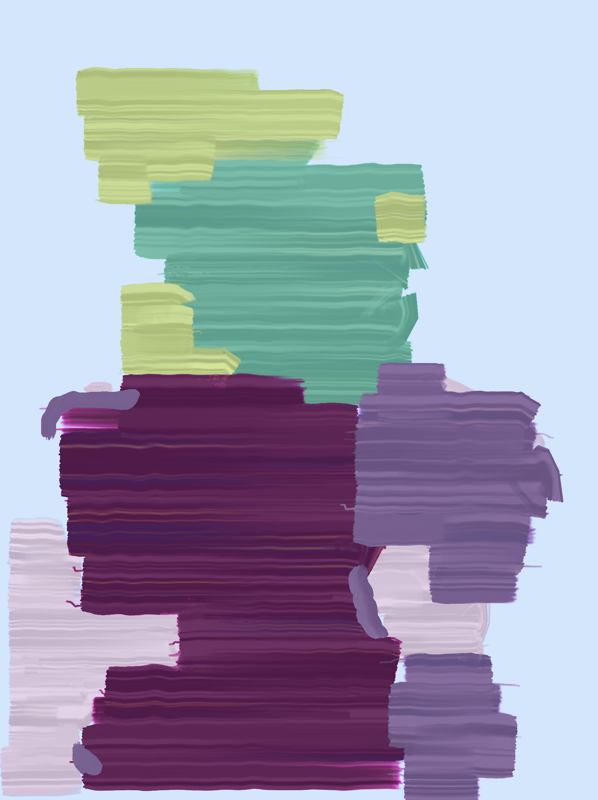

| stroke | covered | width | dark | spread | ms |
|---|---|---|---|---|---|
| stroke 1 | 6 % → 0 % | 190.0 px | 0.00 | 0.00 | 1181 |
| stroke 2 | 12 % → 0 % | 215.2 px | 0.00 | 0.00 | 2513 |
| stroke 3 | 17 % → 0 % | 331.5 px | 0.00 | 0.00 | 2295 |
| stroke 4 | 22 % → 1 % | 424.4 px | 0.22 | 0.04 | 2498 |
| stroke 5 | 26 % → 1 % | 532.2 px | 0.22 | 0.04 | 2345 |
| stroke 6 | 30 % → 1 % | 625.2 px | 0.22 | 0.04 | 2065 |
| stroke 7 | 30 % → 1 % | 685.7 px | 0.22 | 0.04 | 1847 |
| stroke 8 | 30 % → 1 % | 710.1 px | 0.22 | 0.02 | 1714 |
| stroke 9 | 4 % → 3 % | 156.3 px | 0.22 | 0.62 | 323 |
| stroke 10 | 6 % → 1 % | 229.4 px | 0.22 | 0.10 | 318 |
| stroke 11 | 9 % → 0 % | 289.2 px | 0.21 | 0.02 | 387 |
| stroke 12 | 13 % → 0 % | 222.1 px | 0.21 | 0.04 | 1095 |
| stroke 13 | 17 % → 1 % | 290.9 px | 0.21 | 0.04 | 1196 |
| stroke 14 | 22 % → 1 % | 358.3 px | 0.21 | 0.03 | 1283 |
| stroke 15 | 29 % → 1 % | 464.7 px | 0.21 | 0.02 | 1010 |
| stroke 16 | 44 % → 1 % | 1145.9 px | 0.21 | 0.02 | 425 |
| stroke 17 | 51 % → 1 % | 1569.3 px | 0.21 | 0.02 | 282 |
| stroke 18 | 54 % → 1 % | 1151.1 px | 0.21 | 0.02 | 382 |
| stroke 19 | 52 % → 1 % | 825.7 px | 0.21 | 0.03 | 475 |
| stroke 20 | 3 % → 1 % | 151.0 px | 0.22 | 0.43 | 355 |
| stroke 21 | 5 % → 1 % | 246.2 px | 0.22 | 0.26 | 432 |
| stroke 22 | 6 % → 1 % | 360.6 px | 0.22 | 0.21 | 330 |
| stroke 23 | 9 % → 1 % | 326.1 px | 0.22 | 0.13 | 564 |
| stroke 24 | 12 % → 1 % | 394.1 px | 0.22 | 0.11 | 580 |
| stroke 25 | 15 % → 1 % | 666.5 px | 0.22 | 0.10 | 443 |
| stroke 26 | 1 % → 1 % | 30.8 px | 0.22 | 0.48 | 151 |
| stroke 27 | 0 % → 2 % | 37.6 px | 0.22 | 5.97 | 25 |
| stroke 28 | 9 % → 0 % | 136.1 px | 0.00 | 0.00 | 1072 |
| stroke 29 | 12 % → 0 % | 179.6 px | 0.00 | 0.00 | 1472 |
| stroke 30 | 15 % → 0 % | 245.9 px | 0.00 | 0.00 | 1641 |
| stroke 31 | 21 % → 0 % | 582.0 px | 0.00 | 0.00 | 689 |
| stroke 32 | 24 % → 0 % | 1378.5 px | 0.00 | 0.00 | 286 |
| stroke 33 | 9 % → 2 % | 521.8 px | 0.22 | 0.21 | 263 |
| stroke 34 | 6 % → 2 % | 355.6 px | 0.22 | 0.27 | 319 |
| stroke 35 | 6 % → 2 % | 285.9 px | 0.22 | 0.26 | 442 |
| stroke 36 | 8 % → 2 % | 291.0 px | 0.22 | 0.19 | 604 |
| stroke 37 | 10 % → 0 % | 635.8 px | 0.00 | 0.00 | 319 |
| stroke 38 | 8 % → 1 % | 176.9 px | 0.22 | 0.16 | 1587 |
| stroke 39 | 15 % → 2 % | 224.7 px | 0.22 | 0.10 | 2708 |
| stroke 40 | 20 % → 2 % | 306.6 px | 0.22 | 0.09 | 2974 |
| stroke 41 | 26 % → 2 % | 378.7 px | 0.22 | 0.08 | 2992 |
| stroke 42 | 31 % → 2 % | 480.7 px | 0.22 | 0.06 | 3145 |
| stroke 43 | 35 % → 2 % | 566.3 px | 0.22 | 0.05 | 2784 |
| stroke 44 | 36 % → 1 % | 618.2 px | 0.22 | 0.03 | 2686 |
| stroke 45 | 37 % → 1 % | 923.4 px | 0.22 | 0.04 | 1621 |
| stroke 46 | 33 % → 1 % | 737.7 px | 0.22 | 0.04 | 2378 |
| stroke 47 | 34 % → 1 % | 696.6 px | 0.22 | 0.04 | 2236 |
| stroke 48 | 38 % → 2 % | 561.4 px | 0.22 | 0.04 | 2785 |
| stroke 49 | 41 % → 2 % | 449.1 px | 0.22 | 0.04 | 10151 |
| stroke 50 | 48 % → 1 % | 460.4 px | 0.21 | 0.03 | 9881 |
| stroke 51 | 4 % → 0 % | 205.1 px | 0.00 | 0.00 | 878 |
| stroke 52 | 11 % → 0 % | 217.3 px | 0.23 | 0.02 | 2584 |
| stroke 53 | 15 % → 1 % | 293.9 px | 0.22 | 0.05 | 3694 |
| stroke 54 | 21 % → 1 % | 439.4 px | 0.22 | 0.06 | 2503 |
| stroke 55 | 25 % → 1 % | 483.4 px | 0.22 | 0.05 | 3420 |
| stroke 56 | 32 % → 1 % | 1055.3 px | 0.22 | 0.05 | 940 |
| stroke 57 | 31 % → 1 % | 994.9 px | 0.22 | 0.05 | 1131 |
| stroke 58 | 15 % → 2 % | 465.0 px | 0.22 | 0.10 | 1040 |
| stroke 59 | 16 % → 2 % | 358.4 px | 0.22 | 0.10 | 1587 |
| stroke 60 | 20 % → 1 % | 411.9 px | 0.21 | 0.07 | 1042 |
| stroke 61 | 25 % → 1 % | 620.7 px | 0.21 | 0.03 | 773 |
| stroke 62 | 2 % → 2 % | 44.5 px | 0.22 | 1.04 | 220 |
| stroke 63 | 1 % → 1 % | 53.7 px | 0.22 | 1.00 | 207 |
| stroke 64 | 1 % → 1 % | 45.6 px | 0.21 | 1.21 | 45 |

Numbers say: wet paint spreads well beyond the stroke.

## Refs v3 · #11 HW purple balls — own sheet
own sheet 1600 × 1970 · Gouache 1.00 + turpentine 30 % · 208 px · 211.7 s

| stroke | covered | width | dark | spread | ms |
|---|---|---|---|---|---|
| stroke 1 | 13 % → 0 % | 140.2 px | 0.00 | 0.00 | 1467 |
| stroke 2 | 19 % → 0 % | 211.4 px | 0.00 | 0.00 | 2106 |
| stroke 3 | 25 % → 0 % | 247.5 px | 0.00 | 0.00 | 3434 |
| stroke 4 | 31 % → 0 % | 309.9 px | 0.00 | 0.00 | 4050 |
| stroke 5 | 36 % → 0 % | 377.3 px | 0.00 | 0.00 | 4636 |
| stroke 6 | 40 % → 0 % | 448.5 px | 0.00 | 0.00 | 4865 |
| stroke 7 | 45 % → 0 % | 470.7 px | 0.00 | 0.00 | 4625 |
| stroke 8 | 48 % → 0 % | 485.9 px | 0.00 | 0.00 | 4968 |
| stroke 9 | 51 % → 0 % | 484.2 px | 0.00 | 0.00 | 5034 |
| stroke 10 | 53 % → 0 % | 479.2 px | 0.00 | 0.00 | 5187 |
| stroke 11 | 55 % → 0 % | 486.0 px | 0.00 | 0.00 | 5269 |
| stroke 12 | 55 % → 0 % | 572.2 px | 0.00 | 0.00 | 4189 |
| stroke 13 | 55 % → 1 % | 576.5 px | 0.63 | 0.01 | 4205 |
| stroke 14 | 54 % → 3 % | 564.4 px | 0.65 | 0.05 | 4771 |
| stroke 15 | 52 % → 6 % | 777.6 px | 0.65 | 0.11 | 2901 |
| stroke 16 | 49 % → 11 % | 644.7 px | 0.65 | 0.22 | 3635 |
| stroke 17 | 47 % → 22 % | 792.0 px | 0.65 | 0.47 | 2516 |
| stroke 18 | 54 % → 18 % | 1000.6 px | 0.65 | 0.34 | 1929 |
| stroke 19 | 47 % → 30 % | 794.7 px | 0.65 | 0.64 | 3223 |
| stroke 20 | 54 % → 24 % | 917.5 px | 0.65 | 0.45 | 7279 |
| stroke 21 | 42 % → 40 % | 1215.5 px | 0.65 | 0.95 | 4483 |
| stroke 22 | 49 % → 29 % | 831.1 px | 0.65 | 0.60 | 3495 |
| stroke 23 | 44 % → 31 % | 885.1 px | 0.65 | 0.72 | 2025 |
| stroke 24 | 0 % → 23 % | 52.2 px | 0.65 | 74.73 | 36 |
| stroke 25 | 1 % → 24 % | 76.4 px | 0.65 | 39.85 | 34 |
| stroke 26 | 1 % → 26 % | 107.9 px | 0.65 | 32.42 | 45 |
| stroke 27 | 1 % → 28 % | 108.1 px | 0.65 | 24.31 | 56 |
| stroke 28 | 1 % → 30 % | 133.6 px | 0.65 | 21.46 | 78 |
| stroke 29 | 2 % → 31 % | 137.1 px | 0.65 | 17.75 | 116 |
| stroke 30 | 2 % → 33 % | 196.1 px | 0.65 | 16.38 | 117 |
| stroke 31 | 2 % → 36 % | 286.8 px | 0.65 | 16.08 | 70 |
| stroke 32 | 2 % → 38 % | 312.1 px | 0.65 | 15.49 | 41 |
| stroke 33 | 3 % → 41 % | 342.0 px | 0.65 | 15.13 | 65 |
| stroke 34 | 3 % → 43 % | 492.2 px | 0.65 | 14.56 | 26 |
| stroke 35 | 1 % → 0 % | 44.0 px | 0.00 | 0.00 | 41 |
| stroke 36 | 1 % → 12 % | 45.4 px | 0.65 | 10.25 | 144 |
| stroke 37 | 1 % → 39 % | 72.4 px | 0.65 | 36.21 | 38 |
| stroke 38 | 1 % → 34 % | 35.2 px | 0.65 | 53.25 | 162 |
| stroke 39 | 2 % → 45 % | 79.7 px | 0.65 | 29.77 | 42 |
| stroke 40 | 3 % → 73 % | 33.5 px | 0.65 | 22.52 | 182 |
| stroke 41 | 3 % → 86 % | 131.0 px | 0.65 | 27.97 | 27 |
| stroke 42 | 6 % → 43 % | 195.2 px | 0.65 | 7.43 | 1381 |
| stroke 43 | 10 % → 44 % | 248.3 px | 0.65 | 4.66 | 1893 |
| stroke 44 | 18 % → 41 % | 244.8 px | 0.65 | 2.32 | 3547 |
| stroke 45 | 27 % → 42 % | 297.5 px | 0.65 | 1.54 | 4008 |
| stroke 46 | 41 % → 48 % | 360.6 px | 0.65 | 1.18 | 5722 |
| stroke 47 | 55 % → 53 % | 427.2 px | 0.65 | 0.96 | 4261 |
| stroke 48 | 88 % → 83 % | 2490.8 px | 0.65 | 0.94 | 551 |
| stroke 49 | 64 % → 62 % | 945.7 px | 0.65 | 0.97 | 1110 |

Numbers say: wet paint spreads well beyond the stroke.

## Refs v3 · #12 HW black-olive cage — own sheet
own sheet 1600 × 2300 · Gouache 1.00 + turpentine 30 % · 72 px · 377.7 s

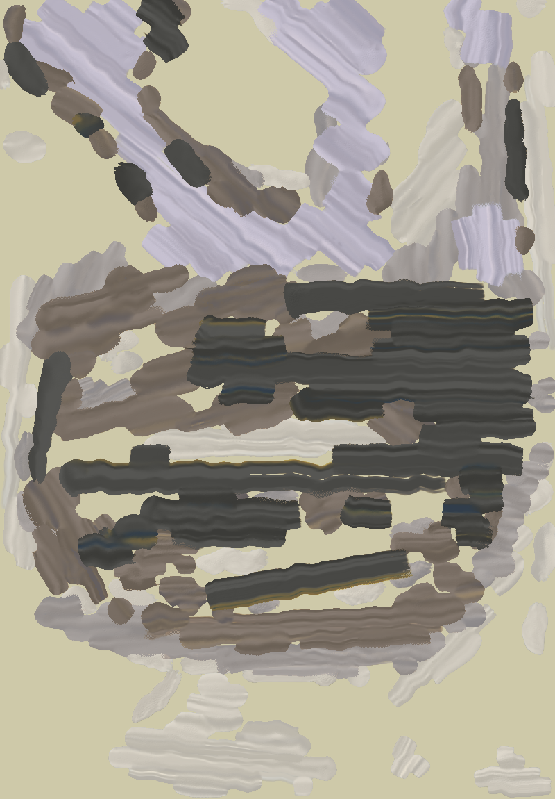

| stroke | covered | width | dark | spread | ms |
|---|---|---|---|---|---|
| stroke 1 | 11 % → 7 % | 66.5 px | 0.30 | 0.64 | 143 |
| stroke 2 | 21 % → 7 % | 73.1 px | 0.30 | 0.31 | 375 |
| stroke 3 | 28 % → 5 % | 91.1 px | 0.30 | 0.17 | 846 |
| stroke 4 | 7 % → 0 % | 67.9 px | 0.32 | 0.01 | 160 |
| stroke 5 | 10 % → 0 % | 96.9 px | 0.00 | 0.00 | 183 |
| stroke 6 | 13 % → 0 % | 115.0 px | 0.32 | 0.01 | 244 |
| stroke 7 | 20 % → 1 % | 196.7 px | 0.31 | 0.04 | 162 |
| stroke 8 | 27 % → 0 % | 513.8 px | 0.00 | 0.00 | 51 |
| stroke 9 | 22 % → 0 % | 210.5 px | 0.32 | 0.00 | 210 |
| stroke 10 | 22 % → 0 % | 192.2 px | 0.32 | 0.01 | 431 |
| stroke 11 | 23 % → 1 % | 227.8 px | 0.31 | 0.05 | 157 |
| stroke 12 | 21 % → 0 % | 315.0 px | 0.32 | 0.00 | 65 |
| stroke 13 | 7 % → 3 % | 71.3 px | 0.29 | 0.36 | 45 |
| stroke 14 | 10 % → 5 % | 104.6 px | 0.30 | 0.46 | 76 |
| stroke 15 | 8 % → 2 % | 68.8 px | 0.32 | 0.24 | 74 |
| stroke 16 | 4 % → 0 % | 73.6 px | 0.00 | 0.00 | 29 |
| stroke 17 | 17 % → 11 % | 75.0 px | 0.31 | 0.62 | 270 |
| stroke 18 | 15 % → 17 % | 174.9 px | 0.32 | 1.16 | 41 |
| stroke 19 | 24 % → 8 % | 163.3 px | 0.32 | 0.34 | 88 |
| stroke 20 | 33 % → 13 % | 184.6 px | 0.31 | 0.39 | 146 |
| stroke 21 | 40 % → 14 % | 143.4 px | 0.31 | 0.35 | 242 |
| stroke 22 | 48 % → 10 % | 646.6 px | 0.31 | 0.21 | 31 |
| stroke 23 | 12 % → 0 % | 65.9 px | 0.00 | 0.00 | 307 |
| stroke 24 | 18 % → 0 % | 82.4 px | 0.00 | 0.00 | 584 |
| stroke 25 | 27 % → 0 % | 128.5 px | 0.00 | 0.00 | 444 |
| stroke 26 | 6 % → 0 % | 67.3 px | 0.00 | 0.00 | 111 |
| stroke 27 | 9 % → 0 % | 75.8 px | 0.00 | 0.00 | 361 |
| stroke 28 | 15 % → 0 % | 188.4 px | 0.00 | 0.00 | 83 |
| stroke 29 | 19 % → 0 % | 188.3 px | 0.00 | 0.00 | 162 |
| stroke 30 | 14 % → 0 % | 224.6 px | 0.00 | 0.00 | 57 |
| stroke 31 | 14 % → 0 % | 298.4 px | 0.00 | 0.00 | 27 |
| stroke 32 | 4 % → 0 % | 73.0 px | 0.00 | 0.00 | 43 |
| stroke 33 | 7 % → 0 % | 88.0 px | 0.00 | 0.00 | 80 |
| stroke 34 | 10 % → 0 % | 109.9 px | 0.00 | 0.00 | 114 |
| stroke 35 | 14 % → 0 % | 197.4 px | 0.00 | 0.00 | 81 |
| stroke 36 | 18 % → 0 % | 318.3 px | 0.00 | 0.00 | 49 |
| stroke 37 | 19 % → 0 % | 262.6 px | 0.00 | 0.00 | 62 |
| stroke 38 | 21 % → 0 % | 251.5 px | 0.00 | 0.00 | 93 |
| stroke 39 | 23 % → 0 % | 183.0 px | 0.00 | 0.00 | 233 |
| stroke 40 | 24 % → 0 % | 199.9 px | 0.00 | 0.00 | 150 |
| stroke 41 | 29 % → 0 % | 202.1 px | 0.00 | 0.00 | 208 |
| stroke 42 | 29 % → 0 % | 139.5 px | 0.00 | 0.00 | 479 |
| stroke 43 | 34 % → 0 % | 147.2 px | 0.00 | 0.00 | 536 |
| stroke 44 | 44 % → 0 % | 173.5 px | 0.00 | 0.00 | 506 |
| stroke 45 | 65 % → 0 % | 268.1 px | 0.00 | 0.00 | 325 |
| stroke 46 | 87 % → 0 % | 734.3 px | 0.00 | 0.00 | 70 |
| stroke 47 | 4 % → 0 % | 78.4 px | 0.00 | 0.00 | 32 |
| stroke 48 | 7 % → 0 % | 103.6 px | 0.00 | 0.00 | 45 |
| stroke 49 | 4 % → 0 % | 78.8 px | 0.00 | 0.00 | 33 |
| stroke 50 | 8 % → 0 % | 102.8 px | 0.00 | 0.00 | 43 |
| stroke 51 | 19 % → 0 % | 87.1 px | 0.00 | 0.00 | 146 |
| stroke 52 | 31 % → 0 % | 114.6 px | 0.00 | 0.00 | 174 |
| stroke 53 | 5 % → 0 % | 29.0 px | 0.00 | 0.00 | 76 |
| stroke 54 | 6 % → 0 % | 32.7 px | 0.00 | 0.00 | 25 |
| stroke 55 | 3 % → 0 % | 35.0 px | 0.30 | 0.00 | 42 |
| stroke 56 | 3 % → 12 % | 33.4 px | 0.31 | 4.05 | 20 |
| stroke 57 | 4 % → 2 % | 34.7 px | 0.36 | 0.43 | 77 |
| stroke 58 | 3 % → 2 % | 42.0 px | 0.33 | 0.59 | 47 |
| stroke 59 | 6 % → 1 % | 109.2 px | 0.33 | 0.21 | 30 |
| stroke 60 | 4 % → 0 % | 32.0 px | 0.00 | 0.00 | 27 |
| stroke 61 | 9 % → 0 % | 72.4 px | 0.00 | 0.00 | 71 |
| stroke 62 | 14 % → 0 % | 77.4 px | 0.00 | 0.00 | 73 |
| stroke 63 | 6 % → 0 % | 48.9 px | 0.00 | 0.00 | 138 |
| stroke 64 | 4 % → 0 % | 44.6 px | 0.00 | 0.00 | 104 |
| stroke 65 | 5 % → 0 % | 55.9 px | 0.00 | 0.00 | 83 |
| stroke 66 | 8 % → 0 % | 115.7 px | 0.00 | 0.00 | 50 |
| stroke 67 | 12 % → 0 % | 82.4 px | 0.00 | 0.00 | 95 |
| stroke 68 | 5 % → 0 % | 58.0 px | 0.00 | 0.00 | 68 |
| stroke 69 | 8 % → 0 % | 87.6 px | 0.00 | 0.00 | 65 |
| stroke 70 | 11 % → 0 % | 106.6 px | 0.00 | 0.00 | 96 |
| stroke 71 | 8 % → 0 % | 54.2 px | 0.00 | 0.00 | 149 |
| stroke 72 | 3 % → 4 % | 57.7 px | 0.30 | 1.56 | 19 |
| stroke 73 | 9 % → 7 % | 60.7 px | 0.30 | 0.87 | 129 |
| stroke 74 | 4 % → 0 % | 58.2 px | 0.28 | 0.04 | 32 |
| stroke 75 | 15 % → 5 % | 78.3 px | 0.30 | 0.33 | 275 |
| stroke 76 | 19 % → 5 % | 101.6 px | 0.30 | 0.26 | 280 |
| stroke 77 | 28 % → 10 % | 728.4 px | 0.30 | 0.35 | 20 |
| stroke 78 | 27 % → 8 % | 366.6 px | 0.30 | 0.29 | 64 |
| stroke 79 | 28 % → 6 % | 326.9 px | 0.30 | 0.21 | 70 |
| stroke 80 | 27 % → 2 % | 230.7 px | 0.31 | 0.07 | 125 |
| stroke 81 | 23 % → 0 % | 272.9 px | 0.00 | 0.00 | 83 |
| stroke 82 | 21 % → 0 % | 180.3 px | 0.00 | 0.00 | 113 |
| stroke 83 | 19 % → 0 % | 268.2 px | 0.00 | 0.00 | 57 |
| stroke 84 | 19 % → 0 % | 340.4 px | 0.00 | 0.00 | 40 |
| stroke 85 | 20 % → 0 % | 354.6 px | 0.00 | 0.00 | 41 |
| stroke 86 | 21 % → 0 % | 288.8 px | 0.00 | 0.00 | 62 |
| stroke 87 | 20 % → 0 % | 363.5 px | 0.00 | 0.00 | 45 |
| stroke 88 | 19 % → 0 % | 338.9 px | 0.00 | 0.00 | 33 |
| stroke 89 | 17 % → 0 % | 421.5 px | 0.00 | 0.00 | 28 |
| stroke 90 | 15 % → 0 % | 263.4 px | 0.00 | 0.00 | 43 |
| stroke 91 | 3 % → 0 % | 56.0 px | 0.00 | 0.00 | 37 |
| stroke 92 | 7 % → 0 % | 64.4 px | 0.00 | 0.00 | 113 |
| stroke 93 | 9 % → 0 % | 96.3 px | 0.00 | 0.00 | 87 |
| stroke 94 | 3 % → 0 % | 63.8 px | 0.00 | 0.00 | 25 |
| stroke 95 | 6 % → 0 % | 102.4 px | 0.00 | 0.00 | 83 |
| stroke 96 | 9 % → 0 % | 130.6 px | 0.00 | 0.00 | 59 |
| stroke 97 | 10 % → 0 % | 133.7 px | 0.00 | 0.00 | 83 |
| stroke 98 | 12 % → 0 % | 183.4 px | 0.00 | 0.00 | 200 |
| stroke 99 | 12 % → 0 % | 162.4 px | 0.00 | 0.00 | 202 |
| stroke 100 | 5 % → 9 % | 83.0 px | 0.31 | 1.63 | 35 |
| stroke 101 | 17 % → 0 % | 256.5 px | 0.00 | 0.00 | 133 |
| stroke 102 | 17 % → 6 % | 210.2 px | 0.31 | 0.35 | 327 |
| stroke 103 | 21 % → 3 % | 169.8 px | 0.31 | 0.13 | 507 |
| stroke 104 | 26 % → 0 % | 413.1 px | 0.00 | 0.00 | 143 |
| stroke 105 | 8 % → 0 % | 103.5 px | 0.00 | 0.00 | 100 |
| stroke 106 | 10 % → 0 % | 96.7 px | 0.00 | 0.00 | 537 |
| stroke 107 | 10 % → 0 % | 205.5 px | 0.00 | 0.00 | 166 |
| stroke 108 | 16 % → 0 % | 280.4 px | 0.00 | 0.00 | 69 |
| stroke 109 | 3 % → 0 % | 56.3 px | 0.00 | 0.00 | 48 |
| stroke 110 | 8 % → 0 % | 95.2 px | 0.00 | 0.00 | 178 |
| stroke 111 | 14 % → 0 % | 189.4 px | 0.00 | 0.00 | 156 |
| stroke 112 | 19 % → 0 % | 204.2 px | 0.00 | 0.00 | 211 |
| stroke 113 | 26 % → 0 % | 603.9 px | 0.00 | 0.00 | 38 |
| stroke 114 | 9 % → 0 % | 52.7 px | 0.00 | 0.00 | 351 |
| stroke 115 | 13 % → 0 % | 64.0 px | 0.00 | 0.00 | 445 |
| stroke 116 | 17 % → 0 % | 73.9 px | 0.00 | 0.00 | 1142 |
| stroke 117 | 19 % → 0 % | 142.8 px | 0.00 | 0.00 | 316 |
| stroke 118 | 31 % → 0 % | 247.8 px | 0.00 | 0.00 | 159 |
| stroke 119 | 20 % → 0 % | 115.6 px | 0.00 | 0.00 | 511 |
| stroke 120 | 16 % → 0 % | 221.6 px | 0.00 | 0.00 | 76 |
| stroke 121 | 18 % → 0 % | 127.1 px | 0.00 | 0.00 | 263 |
| stroke 122 | 14 % → 0 % | 354.4 px | 0.00 | 0.00 | 43 |
| stroke 123 | 16 % → 0 % | 138.3 px | 0.00 | 0.00 | 224 |
| stroke 124 | 19 % → 0 % | 138.7 px | 0.00 | 0.00 | 190 |
| stroke 125 | 13 % → 0 % | 294.9 px | 0.00 | 0.00 | 34 |
| stroke 126 | 23 % → 0 % | 138.1 px | 0.00 | 0.00 | 253 |
| stroke 127 | 13 % → 0 % | 308.5 px | 0.00 | 0.00 | 66 |
| stroke 128 | 35 % → 0 % | 496.7 px | 0.00 | 0.00 | 69 |
| stroke 129 | 23 % → 0 % | 209.3 px | 0.00 | 0.00 | 99 |
| stroke 130 | 23 % → 0 % | 281.6 px | 0.00 | 0.00 | 168 |
| stroke 131 | 11 % → 0 % | 250.2 px | 0.00 | 0.00 | 37 |
| stroke 132 | 11 % → 0 % | 259.1 px | 0.00 | 0.00 | 26 |
| stroke 133 | 10 % → 0 % | 180.3 px | 0.00 | 0.00 | 58 |
| stroke 134 | 11 % → 0 % | 192.8 px | 0.00 | 0.00 | 55 |
| stroke 135 | 10 % → 0 % | 237.5 px | 0.00 | 0.00 | 40 |
| stroke 136 | 12 % → 0 % | 195.6 px | 0.00 | 0.00 | 53 |
| stroke 137 | 13 % → 0 % | 287.6 px | 0.00 | 0.00 | 39 |
| stroke 138 | 15 % → 0 % | 237.8 px | 0.00 | 0.00 | 36 |
| stroke 139 | 15 % → 0 % | 307.5 px | 0.00 | 0.00 | 32 |
| stroke 140 | 16 % → 0 % | 240.9 px | 0.00 | 0.00 | 40 |
| stroke 141 | 16 % → 0 % | 245.0 px | 0.00 | 0.00 | 36 |
| stroke 142 | 17 % → 0 % | 319.1 px | 0.00 | 0.00 | 37 |
| stroke 143 | 17 % → 0 % | 233.1 px | 0.00 | 0.00 | 54 |
| stroke 144 | 18 % → 0 % | 329.6 px | 0.00 | 0.00 | 62 |
| stroke 145 | 18 % → 0 % | 285.2 px | 0.00 | 0.00 | 65 |
| stroke 146 | 19 % → 0 % | 311.8 px | 0.00 | 0.00 | 50 |
| stroke 147 | 18 % → 0 % | 290.5 px | 0.00 | 0.00 | 52 |
| stroke 148 | 8 % → 0 % | 117.8 px | 0.00 | 0.00 | 31 |
| stroke 149 | 8 % → 0 % | 130.4 px | 0.00 | 0.00 | 71 |
| stroke 150 | 9 % → 0 % | 139.1 px | 0.00 | 0.00 | 21 |
| stroke 151 | 11 % → 0 % | 164.0 px | 0.00 | 0.00 | 27 |
| stroke 152 | 8 % → 8 % | 75.7 px | 0.31 | 1.04 | 120 |
| stroke 153 | 12 % → 8 % | 110.7 px | 0.31 | 0.68 | 155 |
| stroke 154 | 17 % → 11 % | 315.0 px | 0.31 | 0.66 | 38 |
| stroke 155 | 20 % → 10 % | 363.8 px | 0.31 | 0.52 | 61 |
| stroke 156 | 3 % → 0 % | 48.3 px | 0.29 | 0.17 | 29 |
| stroke 157 | 4 % → 0 % | 45.7 px | 0.00 | 0.00 | 76 |
| stroke 158 | 3 % → 0 % | 68.9 px | 0.00 | 0.00 | 19 |
| stroke 159 | 3 % → 4 % | 38.7 px | 0.36 | 1.33 | 55 |
| stroke 160 | 4 % → 0 % | 41.6 px | 0.00 | 0.00 | 71 |
| stroke 161 | 9 % → 0 % | 71.4 px | 0.00 | 0.00 | 120 |
| stroke 162 | 5 % → 13 % | 39.6 px | 0.32 | 2.60 | 91 |
| stroke 163 | 9 % → 3 % | 67.6 px | 0.32 | 0.31 | 138 |
| stroke 164 | 4 % → 0 % | 42.8 px | 0.00 | 0.00 | 102 |
| stroke 165 | 4 % → 0 % | 41.5 px | 0.00 | 0.00 | 66 |
| stroke 166 | 7 % → 0 % | 87.2 px | 0.00 | 0.00 | 91 |
| stroke 167 | 3 % → 0 % | 42.0 px | 0.00 | 0.00 | 47 |
| stroke 168 | 15 % → 0 % | 120.1 px | 0.00 | 0.00 | 234 |
| stroke 169 | 23 % → 0 % | 148.4 px | 0.00 | 0.00 | 590 |
| stroke 170 | 29 % → 0 % | 175.9 px | 0.00 | 0.00 | 785 |
| stroke 171 | 31 % → 0 % | 202.8 px | 0.00 | 0.00 | 847 |
| stroke 172 | 30 % → 0 % | 362.1 px | 0.00 | 0.00 | 258 |
| stroke 173 | 27 % → 0 % | 319.0 px | 0.00 | 0.00 | 243 |
| stroke 174 | 24 % → 0 % | 268.2 px | 0.00 | 0.00 | 312 |
| stroke 175 | 26 % → 0 % | 319.2 px | 0.00 | 0.00 | 250 |
| stroke 176 | 25 % → 0 % | 335.7 px | 0.00 | 0.00 | 238 |
| stroke 177 | 16 % → 0 % | 119.4 px | 0.21 | 0.00 | 261 |
| stroke 178 | 24 % → 0 % | 263.9 px | 0.00 | 0.00 | 258 |
| stroke 179 | 22 % → 4 % | 144.9 px | 0.31 | 0.17 | 432 |
| stroke 180 | 23 % → 0 % | 211.1 px | 0.00 | 0.00 | 513 |
| stroke 181 | 28 % → 5 % | 169.8 px | 0.30 | 0.18 | 759 |
| stroke 182 | 29 % → 0 % | 255.4 px | 0.00 | 0.00 | 564 |
| stroke 183 | 32 % → 5 % | 203.4 px | 0.31 | 0.15 | 1144 |
| stroke 184 | 35 % → 0 % | 538.4 px | 0.00 | 0.00 | 138 |
| stroke 185 | 32 % → 6 % | 217.2 px | 0.32 | 0.20 | 1225 |
| stroke 186 | 33 % → 2 % | 288.2 px | 0.36 | 0.06 | 573 |
| stroke 187 | 27 % → 3 % | 237.2 px | 0.32 | 0.10 | 1790 |
| stroke 188 | 34 % → 4 % | 280.0 px | 0.33 | 0.11 | 823 |
| stroke 189 | 42 % → 5 % | 376.2 px | 0.33 | 0.11 | 643 |
| stroke 190 | 44 % → 2 % | 459.8 px | 0.31 | 0.05 | 328 |
| stroke 191 | 41 % → 0 % | 621.5 px | 0.28 | 0.00 | 176 |
| stroke 192 | 15 % → 1 % | 120.2 px | 0.30 | 0.08 | 247 |
| stroke 193 | 26 % → 1 % | 169.9 px | 0.30 | 0.02 | 344 |
| stroke 194 | 44 % → 0 % | 393.4 px | 0.00 | 0.00 | 143 |
| stroke 195 | 14 % → 2 % | 124.4 px | 0.30 | 0.16 | 232 |
| stroke 196 | 20 % → 3 % | 171.7 px | 0.30 | 0.15 | 408 |
| stroke 197 | 27 % → 3 % | 235.0 px | 0.31 | 0.11 | 404 |
| stroke 198 | 5 % → 9 % | 71.9 px | 0.30 | 1.81 | 112 |
| stroke 199 | 9 % → 8 % | 123.5 px | 0.30 | 0.84 | 106 |
| stroke 200 | 12 % → 8 % | 180.3 px | 0.30 | 0.69 | 94 |
| stroke 201 | 4 % → 0 % | 70.6 px | 0.00 | 0.00 | 71 |
| stroke 202 | 6 % → 0 % | 87.0 px | 0.00 | 0.00 | 92 |
| stroke 203 | 11 % → 3 % | 119.8 px | 0.35 | 0.25 | 149 |
| stroke 204 | 11 % → 4 % | 93.7 px | 0.33 | 0.33 | 470 |
| stroke 205 | 16 % → 10 % | 245.1 px | 0.33 | 0.59 | 121 |
| stroke 206 | 27 % → 7 % | 634.6 px | 0.35 | 0.24 | 45 |
| stroke 207 | 27 % → 7 % | 641.3 px | 0.35 | 0.25 | 68 |
| stroke 208 | 6 % → 0 % | 67.3 px | 0.00 | 0.00 | 116 |
| stroke 209 | 12 % → 0 % | 93.6 px | 0.00 | 0.00 | 204 |
| stroke 210 | 16 % → 0 % | 112.0 px | 0.00 | 0.00 | 257 |
| stroke 211 | 16 % → 5 % | 125.3 px | 0.32 | 0.29 | 246 |
| stroke 212 | 10 % → 10 % | 152.1 px | 0.32 | 1.01 | 67 |
| stroke 213 | 3 % → 0 % | 79.5 px | 0.00 | 0.00 | 26 |
| stroke 214 | 19 % → 7 % | 133.3 px | 0.32 | 0.35 | 354 |
| stroke 215 | 11 % → 0 % | 82.5 px | 0.00 | 0.00 | 251 |
| stroke 216 | 31 % → 4 % | 226.2 px | 0.32 | 0.11 | 282 |
| stroke 217 | 21 % → 14 % | 518.7 px | 0.32 | 0.64 | 38 |
| stroke 218 | 18 % → 0 % | 257.0 px | 0.00 | 0.00 | 97 |
| stroke 219 | 20 % → 0 % | 185.3 px | 0.00 | 0.00 | 155 |
| stroke 220 | 39 % → 0 % | 401.1 px | 0.00 | 0.00 | 116 |
| stroke 221 | 26 % → 0 % | 463.6 px | 0.00 | 0.00 | 50 |
| stroke 222 | 18 % → 0 % | 269.0 px | 0.00 | 0.00 | 76 |
| stroke 223 | 40 % → 0 % | 415.6 px | 0.00 | 0.00 | 138 |
| stroke 224 | 26 % → 11 % | 488.0 px | 0.31 | 0.43 | 48 |
| stroke 225 | 20 % → 0 % | 294.3 px | 0.00 | 0.00 | 75 |
| stroke 226 | 36 % → 0 % | 444.3 px | 0.00 | 0.00 | 101 |
| stroke 227 | 21 % → 0 % | 377.2 px | 0.00 | 0.00 | 50 |
| stroke 228 | 20 % → 0 % | 362.7 px | 0.00 | 0.00 | 52 |
| stroke 229 | 18 % → 8 % | 414.3 px | 0.31 | 0.47 | 45 |
| stroke 230 | 24 % → 0 % | 224.9 px | 0.00 | 0.00 | 174 |
| stroke 231 | 21 % → 0 % | 220.0 px | 0.00 | 0.00 | 135 |
| stroke 232 | 20 % → 6 % | 251.7 px | 0.31 | 0.30 | 84 |
| stroke 233 | 23 % → 9 % | 467.5 px | 0.31 | 0.41 | 29 |
| stroke 234 | 26 % → 0 % | 174.5 px | 0.00 | 0.00 | 385 |
| stroke 235 | 26 % → 4 % | 206.1 px | 0.31 | 0.17 | 185 |
| stroke 236 | 34 % → 0 % | 263.0 px | 0.00 | 0.00 | 236 |
| stroke 237 | 32 % → 2 % | 214.4 px | 0.31 | 0.07 | 421 |
| stroke 238 | 39 % → 0 % | 492.4 px | 0.00 | 0.00 | 95 |
| stroke 239 | 39 % → 2 % | 428.9 px | 0.31 | 0.05 | 105 |
| stroke 240 | 32 % → 4 % | 553.5 px | 0.31 | 0.13 | 62 |
| stroke 241 | 40 % → 0 % | 721.6 px | 0.00 | 0.00 | 48 |
| stroke 242 | 35 % → 0 % | 917.6 px | 0.00 | 0.00 | 27 |
| stroke 243 | 36 % → 2 % | 282.3 px | 0.31 | 0.05 | 188 |
| stroke 244 | 41 % → 0 % | 323.9 px | 0.00 | 0.00 | 262 |
| stroke 245 | 40 % → 1 % | 363.7 px | 0.31 | 0.02 | 142 |
| stroke 246 | 42 % → 0 % | 1043.9 px | 0.00 | 0.00 | 37 |
| stroke 247 | 47 % → 0 % | 398.7 px | 0.00 | 0.00 | 203 |
| stroke 248 | 49 % → 0 % | 895.0 px | 0.00 | 0.00 | 56 |
| stroke 249 | 5 % → 0 % | 131.6 px | 0.00 | 0.00 | 27 |
| stroke 250 | 8 % → 0 % | 102.7 px | 0.00 | 0.00 | 78 |
| stroke 251 | 10 % → 0 % | 106.9 px | 0.00 | 0.00 | 126 |
| stroke 252 | 13 % → 0 % | 142.4 px | 0.00 | 0.00 | 123 |
| stroke 253 | 17 % → 0 % | 200.2 px | 0.00 | 0.00 | 115 |
| stroke 254 | 3 % → 0 % | 73.4 px | 0.00 | 0.00 | 37 |
| stroke 255 | 14 % → 6 % | 360.7 px | 0.32 | 0.44 | 30 |
| stroke 256 | 8 % → 0 % | 205.5 px | 0.34 | 0.05 | 44 |
| stroke 257 | 16 % → 3 % | 137.3 px | 0.32 | 0.21 | 203 |
| stroke 258 | 5 % → 0 % | 84.0 px | 0.00 | 0.00 | 57 |
| stroke 259 | 20 % → 4 % | 219.0 px | 0.32 | 0.18 | 114 |
| stroke 260 | 19 % → 0 % | 166.4 px | 0.00 | 0.00 | 213 |
| stroke 261 | 31 % → 5 % | 390.8 px | 0.32 | 0.16 | 95 |
| stroke 262 | 28 % → 0 % | 277.1 px | 0.00 | 0.00 | 160 |
| stroke 263 | 34 % → 0 % | 395.2 px | 0.00 | 0.00 | 114 |
| stroke 264 | 37 % → 0 % | 368.0 px | 0.00 | 0.00 | 123 |
| stroke 265 | 42 % → 0 % | 975.1 px | 0.00 | 0.00 | 34 |
| stroke 266 | 3 % → 0 % | 83.0 px | 0.00 | 0.00 | 29 |
| stroke 267 | 9 % → 0 % | 74.6 px | 0.00 | 0.00 | 421 |
| stroke 268 | 15 % → 0 % | 159.0 px | 0.00 | 0.00 | 106 |
| stroke 269 | 20 % → 0 % | 281.3 px | 0.00 | 0.00 | 83 |
| stroke 270 | 11 % → 0 % | 65.6 px | 0.00 | 0.00 | 334 |
| stroke 271 | 8 % → 0 % | 93.4 px | 0.00 | 0.00 | 100 |
| stroke 272 | 17 % → 0 % | 81.6 px | 0.00 | 0.00 | 679 |
| stroke 273 | 25 % → 0 % | 111.3 px | 0.00 | 0.00 | 836 |
| stroke 274 | 27 % → 0 % | 234.0 px | 0.00 | 0.00 | 171 |
| stroke 275 | 40 % → 0 % | 554.9 px | 0.00 | 0.00 | 78 |
| stroke 276 | 40 % → 0 % | 417.3 px | 0.00 | 0.00 | 106 |
| stroke 277 | 26 % → 0 % | 304.3 px | 0.00 | 0.00 | 89 |
| stroke 278 | 25 % → 0 % | 337.3 px | 0.00 | 0.00 | 72 |
| stroke 279 | 41 % → 0 % | 1022.1 px | 0.00 | 0.00 | 30 |
| stroke 280 | 28 % → 0 % | 667.3 px | 0.00 | 0.00 | 36 |
| stroke 281 | 26 % → 0 % | 377.5 px | 0.00 | 0.00 | 73 |
| stroke 282 | 33 % → 0 % | 392.5 px | 0.00 | 0.00 | 77 |
| stroke 283 | 24 % → 0 % | 611.5 px | 0.00 | 0.00 | 33 |
| stroke 284 | 34 % → 0 % | 404.8 px | 0.00 | 0.00 | 109 |
| stroke 285 | 33 % → 0 % | 343.0 px | 0.00 | 0.00 | 95 |
| stroke 286 | 33 % → 0 % | 779.8 px | 0.00 | 0.00 | 49 |
| stroke 287 | 36 % → 0 % | 639.1 px | 0.00 | 0.00 | 40 |
| stroke 288 | 45 % → 0 % | 466.9 px | 0.00 | 0.00 | 100 |
| stroke 289 | 24 % → 0 % | 348.1 px | 0.00 | 0.00 | 61 |
| stroke 290 | 44 % → 0 % | 316.6 px | 0.00 | 0.00 | 189 |
| stroke 291 | 27 % → 0 % | 218.5 px | 0.00 | 0.00 | 144 |
| stroke 292 | 35 % → 0 % | 331.5 px | 0.00 | 0.00 | 120 |
| stroke 293 | 27 % → 0 % | 705.7 px | 0.00 | 0.00 | 43 |
| stroke 294 | 37 % → 0 % | 321.1 px | 0.00 | 0.00 | 151 |
| stroke 295 | 35 % → 0 % | 473.1 px | 0.00 | 0.00 | 70 |
| stroke 296 | 7 % → 12 % | 37.9 px | 0.30 | 1.63 | 51 |
| stroke 297 | 5 % → 0 % | 33.2 px | 0.00 | 0.00 | 34 |
| stroke 298 | 5 % → 0 % | 94.3 px | 0.29 | 0.02 | 32 |
| stroke 299 | 5 % → 6 % | 42.2 px | 0.30 | 1.20 | 90 |
| stroke 300 | 10 % → 4 % | 159.5 px | 0.30 | 0.42 | 27 |
| stroke 301 | 3 % → 8 % | 50.0 px | 0.30 | 2.35 | 46 |
| stroke 302 | 4 % → 0 % | 47.0 px | 0.00 | 0.00 | 59 |
| stroke 303 | 3 % → 10 % | 54.6 px | 0.33 | 3.43 | 28 |
| stroke 304 | 3 % → 4 % | 43.3 px | 0.30 | 1.19 | 43 |
| stroke 305 | 3 % → 0 % | 40.8 px | 0.00 | 0.00 | 47 |
| stroke 306 | 4 % → 0 % | 49.1 px | 0.00 | 0.00 | 62 |
| stroke 307 | 2 % → 0 % | 40.9 px | 0.00 | 0.00 | 31 |
| stroke 308 | 7 % → 0 % | 77.8 px | 0.00 | 0.00 | 64 |
| stroke 309 | 2 % → 0 % | 43.8 px | 0.00 | 0.00 | 24 |
| stroke 310 | 12 % → 0 % | 110.5 px | 0.00 | 0.00 | 128 |
| stroke 311 | 19 % → 0 % | 168.9 px | 0.00 | 0.00 | 216 |
| stroke 312 | 13 % → 0 % | 123.8 px | 0.00 | 0.00 | 225 |
| stroke 313 | 18 % → 0 % | 127.1 px | 0.00 | 0.00 | 402 |
| stroke 314 | 10 % → 0 % | 141.4 px | 0.00 | 0.00 | 137 |
| stroke 315 | 12 % → 0 % | 122.9 px | 0.00 | 0.00 | 215 |
| stroke 316 | 39 % → 0 % | 178.3 px | 0.00 | 0.00 | 1335 |
| stroke 317 | 17 % → 0 % | 200.1 px | 0.00 | 0.00 | 191 |
| stroke 318 | 27 % → 0 % | 370.4 px | 0.00 | 0.00 | 141 |
| stroke 319 | 53 % → 0 % | 488.9 px | 0.00 | 0.00 | 311 |
| stroke 320 | 23 % → 0 % | 320.1 px | 0.00 | 0.00 | 235 |
| stroke 321 | 41 % → 0 % | 383.8 px | 0.00 | 0.00 | 292 |
| stroke 322 | 52 % → 1 % | 209.1 px | 0.32 | 0.03 | 2029 |
| stroke 323 | 31 % → 0 % | 293.4 px | 0.00 | 0.00 | 335 |
| stroke 324 | 59 % → 0 % | 230.3 px | 0.00 | 0.00 | 2027 |
| stroke 325 | 52 % → 0 % | 318.7 px | 0.00 | 0.00 | 542 |
| stroke 326 | 51 % → 0 % | 299.5 px | 0.00 | 0.00 | 447 |
| stroke 327 | 49 % → 0 % | 257.1 px | 0.00 | 0.00 | 633 |
| stroke 328 | 47 % → 0 % | 237.1 px | 0.00 | 0.00 | 611 |
| stroke 329 | 35 % → 0 % | 194.6 px | 0.00 | 0.00 | 685 |
| stroke 330 | 49 % → 0 % | 206.7 px | 0.00 | 0.00 | 1198 |
| stroke 331 | 25 % → 0 % | 199.4 px | 0.00 | 0.00 | 282 |
| stroke 332 | 52 % → 0 % | 199.3 px | 0.00 | 0.00 | 1782 |
| stroke 333 | 57 % → 0 % | 268.7 px | 0.00 | 0.00 | 944 |
| stroke 334 | 45 % → 0 % | 286.4 px | 0.00 | 0.00 | 482 |
| stroke 335 | 54 % → 0 % | 282.1 px | 0.00 | 0.00 | 667 |
| stroke 336 | 46 % → 0 % | 366.6 px | 0.00 | 0.00 | 323 |
| stroke 337 | 51 % → 0 % | 238.1 px | 0.00 | 0.00 | 841 |
| stroke 338 | 44 % → 0 % | 452.1 px | 0.00 | 0.00 | 243 |
| stroke 339 | 45 % → 0 % | 214.6 px | 0.00 | 0.00 | 862 |
| stroke 340 | 33 % → 0 % | 458.7 px | 0.00 | 0.00 | 244 |
| stroke 341 | 35 % → 0 % | 205.4 px | 0.00 | 0.00 | 1158 |
| stroke 342 | 49 % → 0 % | 436.9 px | 0.00 | 0.00 | 335 |
| stroke 343 | 6 % → 9 % | 45.8 px | 0.30 | 1.51 | 164 |
| stroke 344 | 7 % → 7 % | 40.3 px | 0.30 | 1.02 | 210 |
| stroke 345 | 6 % → 8 % | 116.2 px | 0.30 | 1.42 | 30 |
| stroke 346 | 4 % → 7 % | 50.0 px | 0.33 | 1.75 | 100 |
| stroke 347 | 8 % → 9 % | 100.2 px | 0.31 | 1.22 | 53 |
| stroke 348 | 8 % → 8 % | 43.6 px | 0.32 | 1.03 | 259 |

Numbers say: wet paint spreads well beyond the stroke.

## Refs v3 · #13 HW blue streaky form — own sheet
own sheet 1600 × 2040 · Gouache 1.00 + turpentine 30 % · 208 px · 338.7 s

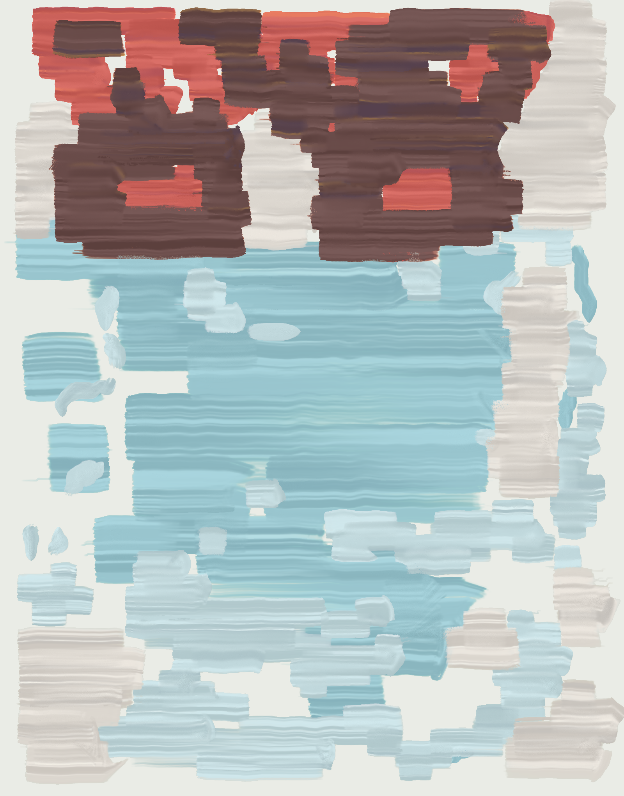

| stroke | covered | width | dark | spread | ms |
|---|---|---|---|---|---|
| stroke 1 | 7 % → 29 % | 192.5 px | 0.47 | 4.19 | 952 |
| stroke 2 | 11 % → 33 % | 321.9 px | 0.47 | 3.05 | 968 |
| stroke 3 | 16 % → 26 % | 436.8 px | 0.47 | 1.64 | 1033 |
| stroke 4 | 17 % → 30 % | 417.6 px | 0.47 | 1.78 | 1528 |
| stroke 5 | 12 % → 23 % | 527.3 px | 0.47 | 1.81 | 591 |
| stroke 6 | 25 % → 20 % | 1328.5 px | 0.47 | 0.80 | 473 |
| stroke 7 | 24 % → 20 % | 428.0 px | 0.47 | 0.86 | 2554 |
| stroke 8 | 33 % → 16 % | 853.4 px | 0.47 | 0.48 | 1247 |
| stroke 9 | 31 % → 13 % | 619.2 px | 0.47 | 0.43 | 2014 |
| stroke 10 | 40 % → 11 % | 1300.0 px | 0.47 | 0.27 | 558 |
| stroke 11 | 38 % → 10 % | 623.4 px | 0.46 | 0.26 | 2769 |
| stroke 12 | 41 % → 4 % | 697.5 px | 0.47 | 0.10 | 2493 |
| stroke 13 | 41 % → 0 % | 613.9 px | 0.00 | 0.00 | 2984 |
| stroke 14 | 37 % → 0 % | 1495.6 px | 0.00 | 0.00 | 443 |
| stroke 15 | 41 % → 0 % | 649.4 px | 0.00 | 0.00 | 2912 |
| stroke 16 | 44 % → 0 % | 1553.1 px | 0.00 | 0.00 | 858 |
| stroke 17 | 44 % → 0 % | 890.6 px | 0.00 | 0.00 | 1948 |
| stroke 18 | 42 % → 0 % | 1652.1 px | 0.00 | 0.00 | 768 |
| stroke 19 | 37 % → 0 % | 1382.0 px | 0.00 | 0.00 | 642 |
| stroke 20 | 46 % → 0 % | 1394.4 px | 0.00 | 0.00 | 1233 |
| stroke 21 | 38 % → 0 % | 788.1 px | 0.00 | 0.00 | 2062 |
| stroke 22 | 31 % → 0 % | 1296.2 px | 0.00 | 0.00 | 708 |
| stroke 23 | 34 % → 0 % | 910.1 px | 0.00 | 0.00 | 1459 |
| stroke 24 | 33 % → 0 % | 1329.6 px | 0.00 | 0.00 | 590 |
| stroke 25 | 1 % → 17 % | 37.2 px | 0.47 | 13.52 | 83 |
| stroke 26 | 2 % → 3 % | 115.7 px | 0.47 | 1.37 | 45 |
| stroke 27 | 0 % → 0 % | 34.8 px | 0.00 | 0.00 | 20 |
| stroke 28 | 1 % → 30 % | 77.4 px | 0.47 | 22.42 | 77 |
| stroke 29 | 3 % → 31 % | 91.3 px | 0.47 | 12.19 | 180 |
| stroke 30 | 3 % → 31 % | 282.4 px | 0.47 | 9.27 | 72 |
| stroke 31 | 5 % → 23 % | 454.4 px | 0.47 | 4.62 | 43 |
| stroke 32 | 7 % → 9 % | 539.9 px | 0.46 | 1.39 | 55 |
| stroke 33 | 7 % → 8 % | 562.9 px | 0.46 | 1.15 | 55 |
| stroke 34 | 8 % → 7 % | 648.3 px | 0.46 | 0.90 | 56 |
| stroke 35 | 9 % → 6 % | 504.4 px | 0.46 | 0.71 | 93 |
| stroke 36 | 8 % → 4 % | 641.2 px | 0.47 | 0.48 | 66 |
| stroke 37 | 5 % → 0 % | 399.8 px | 0.43 | 0.03 | 66 |
| stroke 38 | 6 % → 0 % | 336.2 px | 0.00 | 0.00 | 79 |
| stroke 39 | 6 % → 0 % | 541.7 px | 0.00 | 0.00 | 50 |
| stroke 40 | 7 % → 0 % | 557.9 px | 0.00 | 0.00 | 55 |
| stroke 41 | 7 % → 0 % | 600.6 px | 0.00 | 0.00 | 54 |
| stroke 42 | 9 % → 0 % | 414.2 px | 0.00 | 0.00 | 101 |
| stroke 43 | 9 % → 0 % | 540.3 px | 0.00 | 0.00 | 84 |
| stroke 44 | 7 % → 0 % | 485.8 px | 0.00 | 0.00 | 103 |
| stroke 45 | 10 % → 0 % | 509.1 px | 0.00 | 0.00 | 121 |
| stroke 46 | 3 % → 0 % | 167.1 px | 0.00 | 0.00 | 373 |
| stroke 47 | 10 % → 0 % | 530.6 px | 0.00 | 0.00 | 522 |
| stroke 48 | 13 % → 0 % | 1035.0 px | 0.00 | 0.00 | 102 |
| stroke 49 | 6 % → 0 % | 303.3 px | 0.00 | 0.00 | 315 |
| stroke 50 | 12 % → 0 % | 329.5 px | 0.00 | 0.00 | 978 |
| stroke 51 | 7 % → 0 % | 651.2 px | 0.00 | 0.00 | 303 |
| stroke 52 | 12 % → 0 % | 433.0 px | 0.00 | 0.00 | 806 |
| stroke 53 | 17 % → 0 % | 989.5 px | 0.00 | 0.00 | 1598 |
| stroke 54 | 13 % → 0 % | 686.2 px | 0.00 | 0.00 | 556 |
| stroke 55 | 19 % → 0 % | 1606.5 px | 0.00 | 0.00 | 95 |
| stroke 56 | 6 % → 26 % | 816.0 px | 0.47 | 4.07 | 104 |
| stroke 57 | 7 % → 24 % | 695.7 px | 0.47 | 3.32 | 198 |
| stroke 58 | 9 % → 20 % | 841.4 px | 0.47 | 2.32 | 108 |
| stroke 59 | 1 % → 29 % | 83.3 px | 0.47 | 44.95 | 104 |
| stroke 60 | 1 % → 25 % | 98.7 px | 0.47 | 19.84 | 189 |
| stroke 61 | 2 % → 23 % | 198.9 px | 0.47 | 14.54 | 81 |
| stroke 62 | 2 % → 21 % | 216.5 px | 0.47 | 9.29 | 188 |
| stroke 63 | 5 % → 0 % | 508.5 px | 0.00 | 0.00 | 101 |
| stroke 64 | 4 % → 0 % | 484.6 px | 0.00 | 0.00 | 73 |
| stroke 65 | 4 % → 0 % | 209.5 px | 0.00 | 0.00 | 389 |
| stroke 66 | 4 % → 0 % | 268.1 px | 0.00 | 0.00 | 221 |
| stroke 67 | 6 % → 0 % | 282.6 px | 0.00 | 0.00 | 259 |
| stroke 68 | 7 % → 0 % | 290.3 px | 0.00 | 0.00 | 254 |
| stroke 69 | 11 % → 0 % | 249.7 px | 0.00 | 0.00 | 887 |
| stroke 70 | 16 % → 0 % | 1488.3 px | 0.00 | 0.00 | 167 |
| stroke 71 | 14 % → 0 % | 303.7 px | 0.00 | 0.00 | 849 |
| stroke 72 | 18 % → 0 % | 1240.4 px | 0.00 | 0.00 | 137 |
| stroke 73 | 18 % → 0 % | 1765.0 px | 0.00 | 0.00 | 55 |
| stroke 74 | 15 % → 0 % | 387.0 px | 0.00 | 0.00 | 819 |
| stroke 75 | 19 % → 0 % | 1308.4 px | 0.00 | 0.00 | 80 |
| stroke 76 | 18 % → 0 % | 450.0 px | 0.00 | 0.00 | 541 |
| stroke 77 | 23 % → 0 % | 2707.6 px | 0.00 | 0.00 | 73 |
| stroke 78 | 20 % → 0 % | 1337.6 px | 0.00 | 0.00 | 72 |
| stroke 79 | 20 % → 0 % | 888.4 px | 0.00 | 0.00 | 196 |
| stroke 80 | 27 % → 0 % | 946.7 px | 0.00 | 0.00 | 326 |
| stroke 81 | 23 % → 0 % | 1032.3 px | 0.00 | 0.00 | 126 |
| stroke 82 | 22 % → 0 % | 2343.9 px | 0.00 | 0.00 | 78 |
| stroke 83 | 30 % → 0 % | 1154.6 px | 0.00 | 0.00 | 288 |
| stroke 84 | 25 % → 0 % | 873.7 px | 0.00 | 0.00 | 209 |
| stroke 85 | 22 % → 0 % | 1704.3 px | 0.00 | 0.00 | 100 |
| stroke 86 | 31 % → 0 % | 3400.0 px | 0.00 | 0.00 | 61 |
| stroke 87 | 24 % → 0 % | 1022.1 px | 0.00 | 0.00 | 128 |
| stroke 88 | 26 % → 0 % | 852.0 px | 0.00 | 0.00 | 207 |
| stroke 89 | 23 % → 0 % | 1113.7 px | 0.00 | 0.00 | 96 |
| stroke 90 | 27 % → 0 % | 834.6 px | 0.00 | 0.00 | 296 |
| stroke 91 | 21 % → 0 % | 1017.7 px | 0.00 | 0.00 | 157 |
| stroke 92 | 29 % → 0 % | 948.2 px | 0.00 | 0.00 | 153 |
| stroke 93 | 31 % → 0 % | 1341.2 px | 0.00 | 0.00 | 161 |
| stroke 94 | 23 % → 0 % | 1094.2 px | 0.00 | 0.00 | 126 |
| stroke 95 | 33 % → 0 % | 635.6 px | 0.00 | 0.00 | 377 |
| stroke 96 | 37 % → 0 % | 697.3 px | 0.00 | 0.00 | 340 |
| stroke 97 | 26 % → 0 % | 1022.9 px | 0.00 | 0.00 | 135 |
| stroke 98 | 35 % → 0 % | 410.8 px | 0.00 | 0.00 | 676 |
| stroke 99 | 39 % → 0 % | 2404.4 px | 0.00 | 0.00 | 130 |
| stroke 100 | 32 % → 0 % | 876.6 px | 0.00 | 0.00 | 220 |
| stroke 101 | 41 % → 0 % | 520.3 px | 0.00 | 0.00 | 652 |
| stroke 102 | 41 % → 0 % | 1521.6 px | 0.00 | 0.00 | 165 |
| stroke 103 | 48 % → 0 % | 864.6 px | 0.00 | 0.00 | 479 |
| stroke 104 | 45 % → 0 % | 2523.1 px | 0.00 | 0.00 | 87 |
| stroke 105 | 24 % → 0 % | 2081.9 px | 0.00 | 0.00 | 65 |
| stroke 106 | 28 % → 0 % | 1061.0 px | 0.00 | 0.00 | 176 |
| stroke 107 | 32 % → 0 % | 1224.2 px | 0.00 | 0.00 | 202 |
| stroke 108 | 32 % → 0 % | 1954.5 px | 0.00 | 0.00 | 119 |
| stroke 109 | 1 % → 22 % | 45.7 px | 0.47 | 25.77 | 112 |
| stroke 110 | 1 % → 22 % | 47.7 px | 0.48 | 30.49 | 77 |
| stroke 111 | 1 % → 18 % | 87.0 px | 0.47 | 15.02 | 61 |
| stroke 112 | 2 % → 13 % | 149.8 px | 0.47 | 7.22 | 48 |
| stroke 113 | 3 % → 8 % | 103.5 px | 0.47 | 2.77 | 101 |
| stroke 114 | 1 % → 0 % | 158.9 px | 0.00 | 0.00 | 26 |
| stroke 115 | 3 % → 0 % | 175.7 px | 0.00 | 0.00 | 84 |
| stroke 116 | 3 % → 0 % | 218.2 px | 0.00 | 0.00 | 35 |
| stroke 117 | 4 % → 0 % | 339.4 px | 0.00 | 0.00 | 24 |
| stroke 118 | 4 % → 46 % | 124.5 px | 0.47 | 10.46 | 182 |
| stroke 119 | 6 % → 45 % | 190.2 px | 0.47 | 7.22 | 283 |
| stroke 120 | 8 % → 46 % | 237.2 px | 0.47 | 5.44 | 307 |
| stroke 121 | 10 % → 47 % | 265.2 px | 0.47 | 4.94 | 246 |
| stroke 122 | 11 % → 48 % | 298.9 px | 0.47 | 4.25 | 299 |
| stroke 123 | 12 % → 46 % | 305.5 px | 0.47 | 3.73 | 332 |
| stroke 124 | 14 % → 44 % | 348.1 px | 0.47 | 3.17 | 403 |
| stroke 125 | 15 % → 43 % | 350.7 px | 0.47 | 2.86 | 545 |
| stroke 126 | 17 % → 41 % | 425.4 px | 0.47 | 2.44 | 499 |
| stroke 127 | 19 % → 36 % | 590.9 px | 0.47 | 1.91 | 337 |
| stroke 128 | 20 % → 32 % | 621.3 px | 0.47 | 1.64 | 454 |
| stroke 129 | 3 % → 42 % | 121.4 px | 0.47 | 15.13 | 186 |
| stroke 130 | 5 % → 42 % | 152.2 px | 0.48 | 8.63 | 297 |
| stroke 131 | 6 % → 36 % | 346.6 px | 0.47 | 5.82 | 163 |
| stroke 132 | 7 % → 36 % | 427.8 px | 0.47 | 4.86 | 161 |
| stroke 133 | 9 % → 33 % | 511.7 px | 0.47 | 3.87 | 124 |
| stroke 134 | 10 % → 31 % | 576.3 px | 0.47 | 3.15 | 132 |
| stroke 135 | 2 % → 57 % | 123.0 px | 0.47 | 33.26 | 294 |
| stroke 136 | 3 % → 54 % | 154.1 px | 0.47 | 16.08 | 403 |
| stroke 137 | 5 % → 52 % | 197.5 px | 0.47 | 10.67 | 515 |
| stroke 138 | 6 % → 50 % | 313.3 px | 0.47 | 8.12 | 259 |
| stroke 139 | 7 % → 46 % | 374.6 px | 0.47 | 6.42 | 312 |
| stroke 140 | 8 % → 43 % | 442.5 px | 0.47 | 5.07 | 274 |
| stroke 141 | 14 % → 19 % | 792.7 px | 0.47 | 1.39 | 154 |
| stroke 142 | 13 % → 17 % | 658.2 px | 0.47 | 1.24 | 275 |
| stroke 143 | 12 % → 13 % | 605.9 px | 0.47 | 1.10 | 231 |
| stroke 144 | 11 % → 11 % | 660.8 px | 0.46 | 0.93 | 174 |
| stroke 145 | 10 % → 9 % | 503.2 px | 0.46 | 0.85 | 212 |
| stroke 146 | 10 % → 6 % | 499.6 px | 0.47 | 0.59 | 223 |
| stroke 147 | 10 % → 3 % | 601.7 px | 0.45 | 0.26 | 186 |
| stroke 148 | 11 % → 0 % | 580.2 px | 0.44 | 0.04 | 270 |
| stroke 149 | 12 % → 0 % | 628.8 px | 0.00 | 0.00 | 251 |
| stroke 150 | 12 % → 0 % | 569.7 px | 0.00 | 0.00 | 237 |
| stroke 151 | 13 % → 0 % | 560.6 px | 0.00 | 0.00 | 313 |
| stroke 152 | 9 % → 0 % | 453.9 px | 0.00 | 0.00 | 195 |
| stroke 153 | 9 % → 0 % | 370.0 px | 0.00 | 0.00 | 400 |
| stroke 154 | 9 % → 0 % | 507.7 px | 0.00 | 0.00 | 148 |
| stroke 155 | 10 % → 0 % | 460.9 px | 0.00 | 0.00 | 147 |
| stroke 156 | 13 % → 0 % | 314.7 px | 0.00 | 0.00 | 389 |
| stroke 157 | 17 % → 0 % | 302.3 px | 0.00 | 0.00 | 392 |
| stroke 158 | 19 % → 0 % | 306.9 px | 0.00 | 0.00 | 522 |
| stroke 159 | 16 % → 0 % | 1078.0 px | 0.00 | 0.00 | 214 |
| stroke 160 | 16 % → 0 % | 637.7 px | 0.00 | 0.00 | 353 |
| stroke 161 | 5 % → 0 % | 116.1 px | 0.00 | 0.00 | 430 |
| stroke 162 | 8 % → 0 % | 178.2 px | 0.00 | 0.00 | 446 |
| stroke 163 | 12 % → 0 % | 222.4 px | 0.00 | 0.00 | 569 |
| stroke 164 | 16 % → 0 % | 337.4 px | 0.00 | 0.00 | 386 |
| stroke 165 | 21 % → 0 % | 517.0 px | 0.00 | 0.00 | 313 |
| stroke 166 | 26 % → 0 % | 573.1 px | 0.00 | 0.00 | 353 |
| stroke 167 | 30 % → 0 % | 525.1 px | 0.00 | 0.00 | 410 |
| stroke 168 | 6 % → 46 % | 69.1 px | 0.48 | 7.81 | 326 |
| stroke 169 | 10 % → 40 % | 453.5 px | 0.48 | 4.17 | 48 |
| stroke 170 | 8 % → 47 % | 212.4 px | 0.48 | 6.19 | 147 |
| stroke 171 | 12 % → 45 % | 325.2 px | 0.48 | 3.83 | 123 |
| stroke 172 | 9 % → 48 % | 253.8 px | 0.48 | 5.30 | 175 |
| stroke 173 | 14 % → 46 % | 419.0 px | 0.48 | 3.36 | 132 |
| stroke 174 | 11 % → 52 % | 226.4 px | 0.47 | 4.68 | 285 |
| stroke 175 | 18 % → 48 % | 553.0 px | 0.48 | 2.71 | 126 |
| stroke 176 | 15 % → 46 % | 1153.4 px | 0.48 | 3.15 | 49 |
| stroke 177 | 14 % → 53 % | 946.0 px | 0.47 | 3.94 | 79 |
| stroke 178 | 18 % → 48 % | 634.5 px | 0.48 | 2.61 | 130 |
| stroke 179 | 16 % → 47 % | 1371.4 px | 0.48 | 2.95 | 56 |
| stroke 180 | 15 % → 55 % | 1414.0 px | 0.47 | 3.66 | 47 |
| stroke 181 | 20 % → 49 % | 848.1 px | 0.48 | 2.47 | 105 |
| stroke 182 | 16 % → 48 % | 2069.8 px | 0.48 | 2.93 | 30 |
| stroke 183 | 15 % → 58 % | 1141.0 px | 0.47 | 3.76 | 80 |
| stroke 184 | 20 % → 46 % | 822.4 px | 0.48 | 2.30 | 123 |
| stroke 185 | 17 % → 47 % | 2396.9 px | 0.48 | 2.70 | 30 |
| stroke 186 | 16 % → 59 % | 872.0 px | 0.47 | 3.61 | 109 |
| stroke 187 | 22 % → 44 % | 1107.3 px | 0.48 | 2.00 | 87 |
| stroke 188 | 18 % → 46 % | 2804.4 px | 0.47 | 2.48 | 30 |
| stroke 189 | 17 % → 58 % | 1315.4 px | 0.47 | 3.38 | 87 |
| stroke 190 | 23 % → 43 % | 2910.6 px | 0.48 | 1.89 | 42 |
| stroke 191 | 17 % → 62 % | 299.4 px | 0.48 | 3.57 | 304 |
| stroke 192 | 20 % → 65 % | 570.0 px | 0.48 | 3.30 | 168 |
| stroke 193 | 12 % → 67 % | 1287.7 px | 0.47 | 5.67 | 42 |
| stroke 194 | 22 % → 64 % | 615.8 px | 0.47 | 2.91 | 185 |
| stroke 195 | 25 % → 63 % | 2128.0 px | 0.47 | 2.58 | 53 |
| stroke 196 | 23 % → 64 % | 2964.0 px | 0.47 | 2.77 | 36 |
| stroke 197 | 17 % → 67 % | 2210.7 px | 0.47 | 3.94 | 29 |
| stroke 198 | 16 % → 68 % | 1458.9 px | 0.47 | 4.30 | 48 |
| stroke 199 | 14 % → 68 % | 1960.0 px | 0.47 | 4.76 | 33 |
| stroke 200 | 8 % → 53 % | 480.7 px | 0.47 | 6.25 | 62 |
| stroke 201 | 9 % → 53 % | 429.1 px | 0.47 | 5.88 | 86 |
| stroke 202 | 10 % → 53 % | 491.6 px | 0.47 | 5.40 | 83 |
| stroke 203 | 10 % → 53 % | 655.4 px | 0.47 | 5.37 | 85 |
| stroke 204 | 10 % → 52 % | 912.2 px | 0.47 | 5.24 | 48 |
| stroke 205 | 11 % → 42 % | 855.5 px | 0.47 | 3.90 | 127 |
| stroke 206 | 12 % → 42 % | 673.2 px | 0.47 | 3.62 | 125 |
| stroke 207 | 11 % → 39 % | 521.4 px | 0.47 | 3.59 | 177 |
| stroke 208 | 11 % → 37 % | 434.9 px | 0.47 | 3.43 | 198 |
| stroke 209 | 11 % → 36 % | 464.3 px | 0.47 | 3.37 | 251 |
| stroke 210 | 23 % → 42 % | 4208.8 px | 0.47 | 1.86 | 34 |
| stroke 211 | 22 % → 40 % | 777.4 px | 0.47 | 1.86 | 218 |
| stroke 212 | 20 % → 38 % | 783.0 px | 0.47 | 1.88 | 209 |
| stroke 213 | 19 % → 37 % | 733.0 px | 0.47 | 1.95 | 194 |
| stroke 214 | 17 % → 34 % | 812.1 px | 0.47 | 2.02 | 186 |
| stroke 215 | 1 % → 51 % | 42.1 px | 0.47 | 35.98 | 83 |
| stroke 216 | 2 % → 49 % | 84.2 px | 0.47 | 20.30 | 70 |
| stroke 217 | 1 % → 55 % | 66.0 px | 0.47 | 45.01 | 99 |
| stroke 218 | 1 % → 32 % | 134.1 px | 0.47 | 21.93 | 56 |
| stroke 219 | 4 % → 57 % | 98.0 px | 0.48 | 14.83 | 265 |
| stroke 220 | 8 % → 53 % | 114.5 px | 0.47 | 6.66 | 441 |
| stroke 221 | 6 % → 59 % | 295.0 px | 0.48 | 9.91 | 162 |
| stroke 222 | 12 % → 53 % | 247.0 px | 0.47 | 4.34 | 449 |
| stroke 223 | 14 % → 53 % | 424.4 px | 0.47 | 3.68 | 218 |
| stroke 224 | 14 % → 64 % | 1106.9 px | 0.47 | 4.69 | 112 |
| stroke 225 | 17 % → 60 % | 552.9 px | 0.47 | 3.52 | 267 |
| stroke 226 | 17 % → 52 % | 1212.4 px | 0.47 | 3.07 | 77 |
| stroke 227 | 12 % → 63 % | 687.4 px | 0.47 | 5.16 | 150 |
| stroke 228 | 17 % → 65 % | 978.0 px | 0.47 | 3.87 | 139 |
| stroke 229 | 20 % → 59 % | 701.8 px | 0.47 | 2.94 | 254 |
| stroke 230 | 19 % → 53 % | 1418.6 px | 0.47 | 2.85 | 82 |
| stroke 231 | 17 % → 66 % | 476.0 px | 0.47 | 3.83 | 436 |
| stroke 232 | 22 % → 54 % | 695.0 px | 0.47 | 2.48 | 329 |
| stroke 233 | 21 % → 53 % | 1761.6 px | 0.47 | 2.55 | 84 |
| stroke 234 | 22 % → 64 % | 740.6 px | 0.47 | 2.89 | 344 |
| stroke 235 | 25 % → 51 % | 973.3 px | 0.47 | 2.08 | 248 |
| stroke 236 | 24 % → 51 % | 1271.1 px | 0.47 | 2.18 | 171 |
| stroke 237 | 23 % → 60 % | 1884.5 px | 0.47 | 2.59 | 116 |
| stroke 238 | 26 % → 48 % | 510.5 px | 0.47 | 1.88 | 584 |
| stroke 239 | 26 % → 57 % | 3033.7 px | 0.47 | 2.14 | 81 |
| stroke 240 | 27 % → 46 % | 707.0 px | 0.47 | 1.68 | 466 |
| stroke 241 | 26 % → 44 % | 604.4 px | 0.47 | 1.66 | 620 |
| stroke 242 | 32 % → 50 % | 2083.3 px | 0.47 | 1.56 | 193 |
| stroke 243 | 30 % → 41 % | 1838.9 px | 0.47 | 1.36 | 191 |
| stroke 244 | 32 % → 49 % | 1864.6 px | 0.47 | 1.53 | 197 |
| stroke 245 | 31 % → 41 % | 1800.6 px | 0.47 | 1.30 | 195 |
| stroke 246 | 30 % → 46 % | 1729.7 px | 0.47 | 1.55 | 208 |
| stroke 247 | 31 % → 39 % | 2078.7 px | 0.47 | 1.26 | 137 |
| stroke 248 | 29 % → 44 % | 1918.8 px | 0.47 | 1.53 | 171 |
| stroke 249 | 30 % → 35 % | 1543.8 px | 0.47 | 1.18 | 165 |
| stroke 250 | 24 % → 33 % | 585.7 px | 0.47 | 1.34 | 626 |
| stroke 251 | 24 % → 31 % | 777.3 px | 0.47 | 1.28 | 466 |
| stroke 252 | 17 % → 43 % | 396.8 px | 0.48 | 2.61 | 256 |
| stroke 253 | 16 % → 47 % | 1269.7 px | 0.48 | 3.02 | 85 |
| stroke 254 | 17 % → 46 % | 1507.9 px | 0.48 | 2.75 | 84 |
| stroke 255 | 18 % → 43 % | 1244.2 px | 0.48 | 2.42 | 118 |
| stroke 256 | 29 % → 51 % | 3337.9 px | 0.47 | 1.76 | 59 |
| stroke 257 | 32 % → 47 % | 656.9 px | 0.47 | 1.47 | 567 |
| stroke 258 | 33 % → 45 % | 728.9 px | 0.47 | 1.38 | 657 |
| stroke 259 | 27 % → 39 % | 672.8 px | 0.47 | 1.41 | 406 |
| stroke 260 | 37 % → 47 % | 3580.9 px | 0.47 | 1.27 | 102 |
| stroke 261 | 25 % → 37 % | 1194.4 px | 0.48 | 1.51 | 182 |
| stroke 262 | 39 % → 48 % | 4840.4 px | 0.47 | 1.24 | 71 |
| stroke 263 | 24 % → 35 % | 1059.0 px | 0.48 | 1.43 | 182 |
| stroke 264 | 39 % → 46 % | 3631.9 px | 0.47 | 1.19 | 104 |
| stroke 265 | 24 % → 32 % | 1035.9 px | 0.47 | 1.35 | 201 |
| stroke 266 | 37 % → 43 % | 2963.5 px | 0.47 | 1.15 | 134 |
| stroke 267 | 35 % → 36 % | 660.9 px | 0.47 | 1.05 | 726 |
| stroke 268 | 34 % → 34 % | 733.6 px | 0.47 | 0.99 | 886 |

Numbers say: wet paint spreads well beyond the stroke.

## Refs v3 · #14 HW olive totem — own sheet
own sheet 1600 × 2080 · Gouache 1.00 + turpentine 30 % · 114 px · 247.4 s

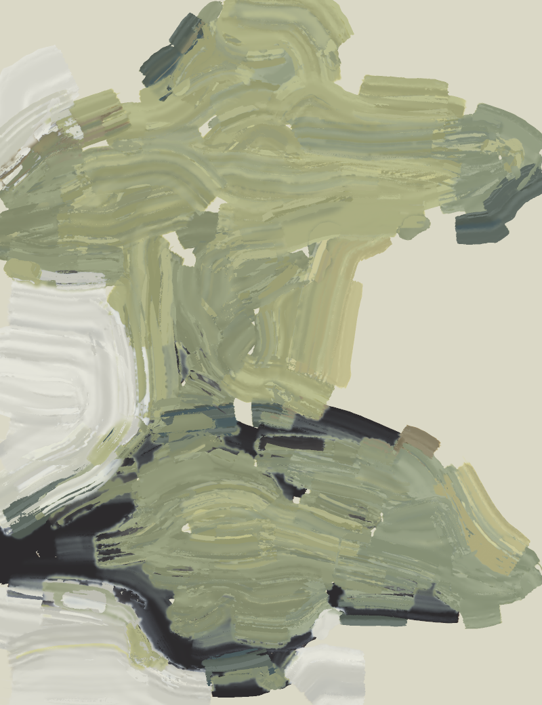

| stroke | covered | width | dark | spread | ms |
|---|---|---|---|---|---|
| stroke 1 | 4 % → 0 % | 116.1 px | 0.00 | 0.00 | 120 |
| stroke 2 | 7 % → 0 % | 104.8 px | 0.00 | 0.00 | 215 |
| stroke 3 | 10 % → 0 % | 206.7 px | 0.00 | 0.00 | 180 |
| stroke 4 | 16 % → 0 % | 274.4 px | 0.00 | 0.00 | 201 |
| stroke 5 | 5 % → 0 % | 119.6 px | 0.00 | 0.00 | 120 |
| stroke 6 | 9 % → 0 % | 141.6 px | 0.00 | 0.00 | 191 |
| stroke 7 | 14 % → 0 % | 159.1 px | 0.00 | 0.00 | 286 |
| stroke 8 | 22 % → 0 % | 227.1 px | 0.20 | 0.02 | 306 |
| stroke 9 | 28 % → 3 % | 329.8 px | 0.21 | 0.10 | 310 |
| stroke 10 | 31 % → 3 % | 356.1 px | 0.21 | 0.09 | 246 |
| stroke 11 | 32 % → 3 % | 342.1 px | 0.21 | 0.09 | 276 |
| stroke 12 | 28 % → 2 % | 231.0 px | 0.21 | 0.07 | 481 |
| stroke 13 | 27 % → 2 % | 302.6 px | 0.21 | 0.07 | 458 |
| stroke 14 | 19 % → 0 % | 331.9 px | 0.00 | 0.00 | 208 |
| stroke 15 | 19 % → 0 % | 352.4 px | 0.00 | 0.00 | 204 |
| stroke 16 | 14 % → 0 % | 211.0 px | 0.21 | 0.03 | 336 |
| stroke 17 | 18 % → 1 % | 308.9 px | 0.21 | 0.03 | 283 |
| stroke 18 | 16 % → 0 % | 243.7 px | 0.00 | 0.00 | 305 |
| stroke 19 | 26 % → 1 % | 669.9 px | 0.21 | 0.03 | 135 |
| stroke 20 | 21 % → 0 % | 380.8 px | 0.00 | 0.00 | 233 |
| stroke 21 | 29 % → 0 % | 870.1 px | 0.00 | 0.00 | 136 |
| stroke 22 | 32 % → 0 % | 824.2 px | 0.00 | 0.00 | 151 |
| stroke 23 | 32 % → 0 % | 840.9 px | 0.00 | 0.00 | 137 |
| stroke 24 | 30 % → 0 % | 374.7 px | 0.00 | 0.00 | 463 |
| stroke 25 | 33 % → 0 % | 744.9 px | 0.00 | 0.00 | 182 |
| stroke 26 | 33 % → 0 % | 1044.8 px | 0.00 | 0.00 | 112 |
| stroke 27 | 29 % → 0 % | 661.5 px | 0.00 | 0.00 | 210 |
| stroke 28 | 19 % → 0 % | 344.7 px | 0.00 | 0.00 | 229 |
| stroke 29 | 17 % → 0 % | 237.1 px | 0.00 | 0.00 | 361 |
| stroke 30 | 17 % → 0 % | 314.3 px | 0.00 | 0.00 | 247 |
| stroke 31 | 19 % → 1 % | 277.7 px | 0.26 | 0.08 | 291 |
| stroke 32 | 12 % → 2 % | 321.7 px | 0.26 | 0.15 | 130 |
| stroke 33 | 12 % → 2 % | 261.5 px | 0.26 | 0.15 | 194 |
| stroke 34 | 25 % → 0 % | 290.1 px | 0.00 | 0.00 | 461 |
| stroke 35 | 23 % → 1 % | 282.7 px | 0.26 | 0.06 | 464 |
| stroke 36 | 16 % → 2 % | 407.5 px | 0.26 | 0.11 | 162 |
| stroke 37 | 26 % → 0 % | 233.6 px | 0.00 | 0.00 | 1093 |
| stroke 38 | 25 % → 1 % | 251.3 px | 0.26 | 0.04 | 687 |
| stroke 39 | 32 % → 0 % | 381.5 px | 0.00 | 0.00 | 502 |
| stroke 40 | 31 % → 1 % | 295.1 px | 0.26 | 0.03 | 753 |
| stroke 41 | 44 % → 2 % | 977.3 px | 0.26 | 0.04 | 206 |
| stroke 42 | 35 % → 1 % | 475.7 px | 0.26 | 0.04 | 366 |
| stroke 43 | 33 % → 0 % | 732.8 px | 0.00 | 0.00 | 185 |
| stroke 44 | 45 % → 2 % | 905.4 px | 0.26 | 0.04 | 238 |
| stroke 45 | 37 % → 1 % | 502.7 px | 0.26 | 0.04 | 366 |
| stroke 46 | 30 % → 0 % | 453.3 px | 0.00 | 0.00 | 326 |
| stroke 47 | 38 % → 1 % | 392.4 px | 0.26 | 0.04 | 629 |
| stroke 48 | 40 % → 1 % | 242.4 px | 0.26 | 0.02 | 1825 |
| stroke 49 | 44 % → 1 % | 360.9 px | 0.26 | 0.02 | 1069 |
| stroke 50 | 49 % → 1 % | 381.0 px | 0.26 | 0.03 | 676 |
| stroke 51 | 43 % → 1 % | 400.3 px | 0.26 | 0.02 | 797 |
| stroke 52 | 50 % → 1 % | 375.6 px | 0.26 | 0.02 | 1431 |
| stroke 53 | 34 % → 0 % | 681.9 px | 0.00 | 0.00 | 439 |
| stroke 54 | 49 % → 0 % | 760.7 px | 0.26 | 0.01 | 1016 |
| stroke 55 | 46 % → 0 % | 756.2 px | 0.27 | 0.00 | 626 |
| stroke 56 | 48 % → 0 % | 868.9 px | 0.00 | 0.00 | 2705 |
| stroke 57 | 42 % → 0 % | 896.7 px | 0.00 | 0.00 | 248 |
| stroke 58 | 4 % → 0 % | 39.1 px | 0.00 | 0.00 | 309 |
| stroke 59 | 1 % → 0 % | 37.7 px | 0.00 | 0.00 | 58 |
| stroke 60 | 4 % → 0 % | 99.7 px | 0.00 | 0.00 | 81 |
| stroke 61 | 3 % → 0 % | 116.4 px | 0.00 | 0.00 | 76 |
| stroke 62 | 4 % → 2 % | 89.4 px | 0.21 | 0.44 | 141 |
| stroke 63 | 1 % → 0 % | 42.4 px | 0.00 | 0.00 | 58 |
| stroke 64 | 3 % → 0 % | 51.9 px | 0.00 | 0.00 | 168 |
| stroke 65 | 1 % → 0 % | 36.8 px | 0.00 | 0.00 | 38 |
| stroke 66 | 2 % → 0 % | 46.2 px | 0.00 | 0.00 | 71 |
| stroke 67 | 2 % → 0 % | 45.1 px | 0.00 | 0.00 | 27 |
| stroke 68 | 16 % → 0 % | 112.2 px | 0.00 | 0.00 | 795 |
| stroke 69 | 20 % → 0 % | 377.4 px | 0.00 | 0.00 | 406 |
| stroke 70 | 25 % → 0 % | 329.0 px | 0.00 | 0.00 | 814 |
| stroke 71 | 28 % → 0 % | 382.4 px | 0.00 | 0.00 | 653 |
| stroke 72 | 27 % → 0 % | 515.6 px | 0.00 | 0.00 | 451 |
| stroke 73 | 28 % → 0 % | 378.3 px | 0.00 | 0.00 | 980 |
| stroke 74 | 35 % → 0 % | 629.6 px | 0.00 | 0.00 | 683 |
| stroke 75 | 29 % → 0 % | 289.3 px | 0.00 | 0.00 | 1555 |
| stroke 76 | 34 % → 0 % | 284.1 px | 0.00 | 0.00 | 2007 |
| stroke 77 | 32 % → 0 % | 333.5 px | 0.00 | 0.00 | 1189 |
| stroke 78 | 39 % → 0 % | 306.2 px | 0.00 | 0.00 | 2209 |
| stroke 79 | 47 % → 0 % | 347.4 px | 0.00 | 0.00 | 1996 |
| stroke 80 | 46 % → 0 % | 305.4 px | 0.00 | 0.00 | 2968 |
| stroke 81 | 37 % → 0 % | 816.0 px | 0.00 | 0.00 | 295 |
| stroke 82 | 53 % → 0 % | 386.7 px | 0.00 | 0.00 | 2754 |
| stroke 83 | 35 % → 2 % | 594.3 px | 0.21 | 0.06 | 445 |
| stroke 84 | 56 % → 1 % | 926.2 px | 0.21 | 0.03 | 562 |
| stroke 85 | 53 % → 0 % | 448.2 px | 0.00 | 0.00 | 1551 |
| stroke 86 | 45 % → 1 % | 451.8 px | 0.21 | 0.03 | 1012 |
| stroke 87 | 58 % → 0 % | 755.4 px | 0.00 | 0.00 | 649 |
| stroke 88 | 52 % → 0 % | 927.9 px | 0.00 | 0.00 | 756 |
| stroke 89 | 45 % → 2 % | 1017.0 px | 0.21 | 0.04 | 353 |
| stroke 90 | 52 % → 0 % | 936.5 px | 0.00 | 0.00 | 422 |
| stroke 91 | 29 % → 2 % | 761.8 px | 0.21 | 0.07 | 228 |
| stroke 92 | 35 % → 0 % | 581.7 px | 0.00 | 0.00 | 511 |
| stroke 93 | 20 % → 0 % | 411.0 px | 0.00 | 0.00 | 340 |
| stroke 94 | 20 % → 0 % | 362.7 px | 0.00 | 0.00 | 503 |
| stroke 95 | 21 % → 0 % | 467.9 px | 0.00 | 0.00 | 367 |
| stroke 96 | 20 % → 0 % | 290.8 px | 0.00 | 0.00 | 596 |
| stroke 97 | 10 % → 0 % | 147.6 px | 0.00 | 0.00 | 485 |
| stroke 98 | 17 % → 1 % | 178.7 px | 0.26 | 0.07 | 952 |
| stroke 99 | 28 % → 0 % | 624.2 px | 0.00 | 0.00 | 319 |
| stroke 100 | 22 % → 2 % | 477.5 px | 0.26 | 0.08 | 387 |
| stroke 101 | 3 % → 0 % | 45.9 px | 0.00 | 0.00 | 97 |
| stroke 102 | 3 % → 3 % | 55.0 px | 0.21 | 1.05 | 87 |
| stroke 103 | 3 % → 0 % | 49.0 px | 0.00 | 0.00 | 102 |
| stroke 104 | 17 % → 0 % | 189.3 px | 0.00 | 0.00 | 606 |
| stroke 105 | 29 % → 0 % | 340.9 px | 0.00 | 0.00 | 597 |
| stroke 106 | 20 % → 2 % | 174.0 px | 0.21 | 0.11 | 1197 |
| stroke 107 | 32 % → 2 % | 256.0 px | 0.21 | 0.06 | 1576 |
| stroke 108 | 41 % → 2 % | 316.4 px | 0.21 | 0.05 | 1687 |
| stroke 109 | 44 % → 0 % | 341.7 px | 0.00 | 0.00 | 1445 |
| stroke 110 | 44 % → 0 % | 344.0 px | 0.00 | 0.00 | 1649 |
| stroke 111 | 45 % → 0 % | 353.7 px | 0.00 | 0.00 | 1528 |
| stroke 112 | 49 % → 0 % | 424.8 px | 0.00 | 0.00 | 1020 |
| stroke 113 | 55 % → 0 % | 711.2 px | 0.00 | 0.00 | 754 |
| stroke 114 | 22 % → 0 % | 176.0 px | 0.00 | 0.00 | 1305 |
| stroke 115 | 37 % → 0 % | 266.7 px | 0.00 | 0.00 | 1304 |
| stroke 116 | 56 % → 0 % | 300.0 px | 0.00 | 0.00 | 2031 |
| stroke 117 | 65 % → 0 % | 262.8 px | 0.00 | 0.00 | 1944 |
| stroke 118 | 16 % → 0 % | 193.2 px | 0.00 | 0.00 | 788 |
| stroke 119 | 1 % → 0 % | 36.6 px | 0.00 | 0.00 | 48 |
| stroke 120 | 4 % → 0 % | 107.7 px | 0.00 | 0.00 | 114 |
| stroke 121 | 5 % → 0 % | 209.6 px | 0.00 | 0.00 | 70 |
| stroke 122 | 6 % → 0 % | 97.7 px | 0.00 | 0.00 | 137 |
| stroke 123 | 9 % → 0 % | 254.7 px | 0.00 | 0.00 | 108 |
| stroke 124 | 11 % → 0 % | 303.5 px | 0.00 | 0.00 | 92 |
| stroke 125 | 3 % → 0 % | 104.9 px | 0.21 | 0.10 | 72 |
| stroke 126 | 4 % → 0 % | 153.9 px | 0.21 | 0.00 | 94 |
| stroke 127 | 6 % → 0 % | 260.0 px | 0.00 | 0.00 | 62 |
| stroke 128 | 8 % → 0 % | 243.3 px | 0.00 | 0.00 | 116 |
| stroke 129 | 12 % → 0 % | 145.6 px | 0.00 | 0.00 | 370 |
| stroke 130 | 18 % → 0 % | 210.0 px | 0.00 | 0.00 | 392 |
| stroke 131 | 18 % → 0 % | 218.8 px | 0.25 | 0.01 | 407 |
| stroke 132 | 17 % → 0 % | 280.7 px | 0.00 | 0.00 | 262 |
| stroke 133 | 31 % → 0 % | 980.0 px | 0.00 | 0.00 | 121 |
| stroke 134 | 24 % → 1 % | 347.3 px | 0.25 | 0.05 | 300 |
| stroke 135 | 18 % → 1 % | 401.3 px | 0.25 | 0.07 | 178 |
| stroke 136 | 18 % → 0 % | 373.8 px | 0.00 | 0.00 | 197 |
| stroke 137 | 18 % → 0 % | 326.1 px | 0.00 | 0.00 | 279 |
| stroke 138 | 18 % → 0 % | 481.4 px | 0.00 | 0.00 | 97 |
| stroke 139 | 17 % → 0 % | 405.5 px | 0.00 | 0.00 | 99 |
| stroke 140 | 26 % → 0 % | 796.0 px | 0.00 | 0.00 | 109 |
| stroke 141 | 22 % → 0 % | 413.5 px | 0.00 | 0.00 | 154 |
| stroke 142 | 27 % → 0 % | 406.5 px | 0.00 | 0.00 | 277 |
| stroke 143 | 29 % → 0 % | 215.3 px | 0.00 | 0.00 | 694 |
| stroke 144 | 33 % → 0 % | 250.6 px | 0.00 | 0.00 | 535 |
| stroke 145 | 38 % → 0 % | 311.9 px | 0.00 | 0.00 | 512 |
| stroke 146 | 47 % → 0 % | 788.3 px | 0.00 | 0.00 | 125 |
| stroke 147 | 35 % → 0 % | 485.4 px | 0.00 | 0.00 | 323 |
| stroke 148 | 38 % → 0 % | 282.7 px | 0.00 | 0.00 | 571 |
| stroke 149 | 36 % → 0 % | 245.4 px | 0.00 | 0.00 | 717 |
| stroke 150 | 34 % → 0 % | 565.7 px | 0.00 | 0.00 | 234 |
| stroke 151 | 27 % → 0 % | 862.9 px | 0.00 | 0.00 | 107 |
| stroke 152 | 12 % → 0 % | 315.5 px | 0.00 | 0.00 | 118 |
| stroke 153 | 24 % → 0 % | 311.9 px | 0.00 | 0.00 | 369 |
| stroke 154 | 25 % → 0 % | 221.1 px | 0.00 | 0.00 | 637 |
| stroke 155 | 31 % → 0 % | 271.5 px | 0.00 | 0.00 | 516 |
| stroke 156 | 36 % → 0 % | 293.1 px | 0.00 | 0.00 | 505 |
| stroke 157 | 46 % → 0 % | 406.6 px | 0.00 | 0.00 | 349 |
| stroke 158 | 32 % → 2 % | 831.6 px | 0.25 | 0.05 | 117 |
| stroke 159 | 31 % → 2 % | 825.8 px | 0.26 | 0.06 | 126 |
| stroke 160 | 13 % → 1 % | 158.8 px | 0.26 | 0.07 | 438 |
| stroke 161 | 18 % → 0 % | 187.9 px | 0.27 | 0.00 | 588 |
| stroke 162 | 2 % → 2 % | 38.9 px | 0.21 | 1.12 | 72 |
| stroke 163 | 1 % → 2 % | 42.3 px | 0.26 | 1.15 | 57 |

## Refs v3 · #15 Ultramarine script — own sheet
own sheet 1600 × 2844 · Ink 0.98 · 78 px · 422.2 s

| stroke | covered | width | dark | spread | ms |
|---|---|---|---|---|---|
| stroke 1 | 3 % → 31 % | 31.7 px | 0.69 | 11.69 | 43 |
| stroke 2 | 4 % → 33 % | 45.5 px | 0.70 | 7.95 | 21 |
| stroke 3 | 11 % → 34 % | 46.2 px | 0.70 | 3.13 | 77 |
| stroke 4 | 14 % → 32 % | 149.7 px | 0.70 | 2.24 | 31 |
| stroke 5 | 16 % → 29 % | 391.8 px | 0.69 | 1.79 | 12 |
| stroke 6 | 18 % → 29 % | 437.1 px | 0.70 | 1.67 | 15 |
| stroke 7 | 17 % → 27 % | 179.7 px | 0.69 | 1.58 | 38 |
| stroke 8 | 26 % → 34 % | 465.8 px | 0.70 | 1.28 | 16 |
| stroke 9 | 3 % → 26 % | 32.8 px | 0.70 | 9.06 | 26 |
| stroke 10 | 5 % → 33 % | 56.5 px | 0.69 | 6.27 | 32 |
| stroke 11 | 5 % → 24 % | 124.6 px | 0.70 | 5.02 | 14 |
| stroke 12 | 9 % → 25 % | 59.9 px | 0.69 | 2.83 | 82 |
| stroke 13 | 13 % → 26 % | 180.0 px | 0.69 | 1.94 | 37 |
| stroke 14 | 17 % → 26 % | 212.9 px | 0.69 | 1.51 | 42 |
| stroke 15 | 19 % → 27 % | 184.6 px | 0.69 | 1.46 | 53 |
| stroke 16 | 11 % → 33 % | 176.3 px | 0.69 | 3.17 | 28 |
| stroke 17 | 4 % → 40 % | 41.3 px | 0.69 | 9.17 | 21 |
| stroke 18 | 11 % → 38 % | 92.6 px | 0.69 | 3.55 | 36 |
| stroke 19 | 14 % → 31 % | 168.9 px | 0.69 | 2.12 | 30 |
| stroke 20 | 17 % → 35 % | 434.0 px | 0.69 | 2.05 | 10 |
| stroke 21 | 18 % → 33 % | 446.4 px | 0.68 | 1.76 | 14 |
| stroke 22 | 21 % → 35 % | 117.0 px | 0.68 | 1.65 | 94 |
| stroke 23 | 33 % → 38 % | 678.3 px | 0.69 | 1.14 | 18 |
| stroke 24 | 2 % → 25 % | 37.1 px | 0.68 | 12.96 | 13 |
| stroke 25 | 2 % → 39 % | 65.9 px | 0.69 | 18.76 | 13 |
| stroke 26 | 4 % → 50 % | 40.5 px | 0.69 | 11.20 | 30 |
| stroke 27 | 4 % → 35 % | 89.2 px | 0.69 | 8.86 | 21 |
| stroke 28 | 24 % → 46 % | 127.5 px | 0.70 | 1.89 | 60 |
| stroke 29 | 4 % → 39 % | 67.4 px | 0.68 | 8.86 | 21 |
| stroke 30 | 8 % → 31 % | 80.8 px | 0.68 | 4.06 | 40 |
| stroke 31 | 9 % → 35 % | 161.0 px | 0.68 | 3.72 | 23 |
| stroke 32 | 13 % → 33 % | 221.8 px | 0.68 | 2.43 | 23 |
| stroke 33 | 9 % → 28 % | 132.1 px | 0.68 | 3.24 | 23 |
| stroke 34 | 7 % → 28 % | 87.2 px | 0.68 | 4.24 | 36 |
| stroke 35 | 14 % → 32 % | 256.0 px | 0.68 | 2.32 | 23 |
| stroke 36 | 9 % → 29 % | 83.8 px | 0.68 | 3.37 | 45 |
| stroke 37 | 16 % → 47 % | 177.0 px | 0.69 | 2.89 | 33 |
| stroke 38 | 13 % → 28 % | 122.0 px | 0.68 | 2.16 | 61 |
| stroke 39 | 23 % → 41 % | 248.5 px | 0.68 | 1.76 | 40 |
| stroke 40 | 26 % → 42 % | 359.6 px | 0.68 | 1.63 | 33 |
| stroke 41 | 28 % → 42 % | 891.6 px | 0.69 | 1.46 | 19 |
| stroke 42 | 25 % → 38 % | 918.8 px | 0.68 | 1.52 | 5 |
| stroke 43 | 22 % → 37 % | 239.6 px | 0.68 | 1.70 | 41 |
| stroke 44 | 21 % → 37 % | 231.5 px | 0.69 | 1.79 | 48 |
| stroke 45 | 18 % → 32 % | 421.9 px | 0.68 | 1.84 | 16 |
| stroke 46 | 24 % → 46 % | 424.1 px | 0.69 | 1.91 | 21 |
| stroke 47 | 29 % → 40 % | 185.7 px | 0.69 | 1.37 | 64 |
| stroke 48 | 24 % → 34 % | 588.2 px | 0.68 | 1.41 | 14 |
| stroke 49 | 26 % → 35 % | 553.1 px | 0.68 | 1.35 | 19 |
| stroke 50 | 26 % → 32 % | 606.8 px | 0.68 | 1.22 | 19 |
| stroke 51 | 31 % → 38 % | 326.6 px | 0.68 | 1.24 | 36 |
| stroke 52 | 14 % → 41 % | 361.2 px | 0.69 | 2.82 | 15 |
| stroke 53 | 6 % → 35 % | 214.4 px | 0.67 | 6.05 | 5 |
| stroke 54 | 5 % → 42 % | 54.6 px | 0.68 | 8.78 | 63 |
| stroke 55 | 4 % → 43 % | 57.6 px | 0.69 | 10.63 | 31 |
| stroke 56 | 8 % → 34 % | 71.4 px | 0.67 | 4.51 | 34 |
| stroke 57 | 11 % → 34 % | 164.5 px | 0.69 | 3.06 | 54 |
| stroke 58 | 10 % → 46 % | 142.6 px | 0.68 | 4.84 | 29 |
| stroke 59 | 22 % → 46 % | 385.4 px | 0.69 | 2.10 | 25 |
| stroke 60 | 10 % → 36 % | 151.0 px | 0.69 | 3.44 | 28 |
| stroke 61 | 10 % → 31 % | 120.5 px | 0.68 | 3.16 | 30 |
| stroke 62 | 26 % → 45 % | 594.6 px | 0.69 | 1.70 | 17 |
| stroke 63 | 14 % → 41 % | 305.9 px | 0.68 | 2.93 | 19 |
| stroke 64 | 14 % → 44 % | 197.1 px | 0.68 | 3.13 | 23 |
| stroke 65 | 23 % → 43 % | 184.7 px | 0.69 | 1.90 | 72 |
| stroke 66 | 10 % → 43 % | 243.9 px | 0.69 | 4.34 | 15 |
| stroke 67 | 17 % → 40 % | 195.8 px | 0.69 | 2.35 | 49 |
| stroke 68 | 25 % → 39 % | 394.3 px | 0.69 | 1.57 | 30 |
| stroke 69 | 30 % → 37 % | 463.3 px | 0.69 | 1.22 | 54 |
| stroke 70 | 14 % → 38 % | 424.5 px | 0.67 | 2.71 | 7 |
| stroke 71 | 24 % → 37 % | 594.3 px | 0.69 | 1.53 | 17 |
| stroke 72 | 17 % → 42 % | 196.1 px | 0.67 | 2.42 | 37 |
| stroke 73 | 22 % → 36 % | 653.7 px | 0.68 | 1.64 | 14 |
| stroke 74 | 21 % → 43 % | 202.6 px | 0.68 | 2.08 | 70 |
| stroke 75 | 22 % → 45 % | 382.0 px | 0.68 | 2.04 | 39 |
| stroke 76 | 32 % → 39 % | 220.1 px | 0.68 | 1.23 | 70 |
| stroke 77 | 28 % → 34 % | 296.4 px | 0.69 | 1.20 | 75 |
| stroke 78 | 24 % → 34 % | 214.1 px | 0.68 | 1.39 | 53 |
| stroke 79 | 29 % → 39 % | 313.4 px | 0.68 | 1.34 | 36 |
| stroke 80 | 26 % → 40 % | 457.0 px | 0.68 | 1.55 | 20 |
| stroke 81 | 28 % → 38 % | 299.8 px | 0.68 | 1.35 | 34 |
| stroke 82 | 23 % → 46 % | 166.1 px | 0.69 | 1.99 | 85 |
| stroke 83 | 33 % → 38 % | 615.8 px | 0.69 | 1.13 | 25 |
| stroke 84 | 34 % → 38 % | 1191.5 px | 0.67 | 1.11 | 8 |
| stroke 85 | 28 % → 52 % | 402.7 px | 0.69 | 1.87 | 29 |
| stroke 86 | 29 % → 44 % | 401.9 px | 0.68 | 1.50 | 38 |
| stroke 87 | 16 % → 40 % | 165.4 px | 0.68 | 2.52 | 46 |
| stroke 88 | 15 % → 40 % | 446.5 px | 0.68 | 2.58 | 16 |
| stroke 89 | 21 % → 39 % | 149.2 px | 0.68 | 1.89 | 104 |
| stroke 90 | 25 % → 41 % | 377.5 px | 0.68 | 1.69 | 27 |
| stroke 91 | 33 % → 40 % | 567.8 px | 0.68 | 1.22 | 37 |
| stroke 92 | 26 % → 54 % | 425.5 px | 0.70 | 2.03 | 16 |
| stroke 93 | 7 % → 50 % | 72.4 px | 0.70 | 7.58 | 26 |
| stroke 94 | 21 % → 51 % | 249.9 px | 0.70 | 2.46 | 54 |
| stroke 95 | 30 % → 54 % | 426.5 px | 0.70 | 1.77 | 13 |
| stroke 96 | 24 % → 47 % | 729.2 px | 0.70 | 1.94 | 11 |
| stroke 97 | 17 % → 40 % | 219.8 px | 0.70 | 2.34 | 29 |
| stroke 98 | 27 % → 45 % | 584.3 px | 0.70 | 1.63 | 21 |
| stroke 99 | 25 % → 42 % | 264.2 px | 0.70 | 1.64 | 42 |
| stroke 100 | 42 % → 51 % | 447.0 px | 0.70 | 1.19 | 40 |
| stroke 101 | 13 % → 37 % | 211.5 px | 0.70 | 2.88 | 52 |
| stroke 102 | 10 % → 38 % | 151.9 px | 0.70 | 3.70 | 48 |
| stroke 103 | 12 % → 34 % | 277.4 px | 0.69 | 2.91 | 13 |
| stroke 104 | 27 % → 44 % | 374.2 px | 0.70 | 1.65 | 48 |
| stroke 105 | 19 % → 44 % | 382.9 px | 0.70 | 2.39 | 16 |
| stroke 106 | 15 % → 50 % | 309.6 px | 0.70 | 3.41 | 34 |
| stroke 107 | 14 % → 34 % | 148.9 px | 0.70 | 2.47 | 31 |
| stroke 108 | 27 % → 43 % | 439.5 px | 0.70 | 1.61 | 25 |
| stroke 109 | 23 % → 39 % | 204.7 px | 0.70 | 1.71 | 56 |
| stroke 110 | 25 % → 48 % | 684.5 px | 0.70 | 1.91 | 19 |
| stroke 111 | 28 % → 40 % | 848.4 px | 0.70 | 1.42 | 20 |
| stroke 112 | 31 % → 40 % | 1035.8 px | 0.70 | 1.29 | 26 |
| stroke 113 | 29 % → 41 % | 744.0 px | 0.70 | 1.41 | 74 |
| stroke 114 | 34 % → 37 % | 1006.3 px | 0.70 | 1.09 | 34 |
| stroke 115 | 30 % → 36 % | 526.7 px | 0.70 | 1.21 | 84 |
| stroke 116 | 3 % → 43 % | 40.0 px | 0.68 | 12.98 | 160 |
| stroke 117 | 26 % → 50 % | 293.3 px | 0.69 | 1.95 | 159 |
| stroke 118 | 27 % → 47 % | 878.1 px | 0.69 | 1.77 | 97 |
| stroke 119 | 23 % → 54 % | 608.7 px | 0.69 | 2.35 | 43 |
| stroke 120 | 5 % → 39 % | 146.2 px | 0.69 | 8.36 | 58 |
| stroke 121 | 7 % → 46 % | 63.0 px | 0.69 | 6.94 | 1816 |
| stroke 122 | 11 % → 29 % | 74.0 px | 0.69 | 2.66 | 247 |
| stroke 123 | 15 % → 47 % | 187.9 px | 0.69 | 3.21 | 88 |
| stroke 124 | 14 % → 43 % | 196.7 px | 0.68 | 3.06 | 84 |
| stroke 125 | 4 % → 43 % | 56.0 px | 0.68 | 11.81 | 34 |
| stroke 126 | 8 % → 42 % | 102.9 px | 0.69 | 5.11 | 99 |
| stroke 127 | 15 % → 50 % | 129.6 px | 0.68 | 3.21 | 99 |
| stroke 128 | 11 % → 47 % | 146.9 px | 0.68 | 4.31 | 55 |
| stroke 129 | 26 % → 48 % | 546.8 px | 0.68 | 1.83 | 28 |
| stroke 130 | 17 % → 43 % | 210.8 px | 0.69 | 2.58 | 94 |
| stroke 131 | 23 % → 50 % | 251.2 px | 0.69 | 2.21 | 92 |
| stroke 132 | 28 % → 45 % | 407.8 px | 0.69 | 1.63 | 93 |
| stroke 133 | 20 % → 41 % | 155.9 px | 0.68 | 2.12 | 190 |
| stroke 134 | 20 % → 42 % | 237.8 px | 0.69 | 2.03 | 51 |
| stroke 135 | 17 % → 44 % | 529.2 px | 0.69 | 2.61 | 9 |
| stroke 136 | 29 % → 47 % | 293.8 px | 0.69 | 1.59 | 89 |
| stroke 137 | 37 % → 47 % | 1301.3 px | 0.69 | 1.26 | 16 |
| stroke 138 | 27 % → 47 % | 437.2 px | 0.68 | 1.75 | 48 |
| stroke 139 | 30 % → 44 % | 436.7 px | 0.68 | 1.45 | 46 |
| stroke 140 | 32 % → 50 % | 819.0 px | 0.69 | 1.56 | 19 |
| stroke 141 | 33 % → 52 % | 715.0 px | 0.69 | 1.55 | 50 |
| stroke 142 | 30 % → 42 % | 309.7 px | 0.69 | 1.41 | 119 |
| stroke 143 | 33 % → 49 % | 858.1 px | 0.69 | 1.51 | 12 |
| stroke 144 | 37 % → 49 % | 495.7 px | 0.69 | 1.33 | 48 |
| stroke 145 | 39 % → 48 % | 548.3 px | 0.69 | 1.22 | 76 |
| stroke 146 | 40 % → 47 % | 592.9 px | 0.69 | 1.17 | 88 |
| stroke 147 | 44 % → 46 % | 351.0 px | 0.69 | 1.05 | 74 |
| stroke 148 | 32 % → 38 % | 1194.4 px | 0.69 | 1.18 | 10 |
| stroke 149 | 5 % → 34 % | 104.3 px | 0.69 | 6.64 | 25 |
| stroke 150 | 13 % → 38 % | 175.6 px | 0.69 | 3.01 | 60 |
| stroke 151 | 7 % → 44 % | 79.8 px | 0.70 | 5.94 | 44 |
| stroke 152 | 17 % → 38 % | 206.4 px | 0.69 | 2.23 | 42 |
| stroke 153 | 39 % → 48 % | 442.0 px | 0.70 | 1.23 | 62 |
| stroke 154 | 30 % → 45 % | 144.3 px | 0.70 | 1.52 | 95 |
| stroke 155 | 42 % → 51 % | 964.7 px | 0.70 | 1.22 | 22 |
| stroke 156 | 19 % → 37 % | 326.5 px | 0.69 | 1.96 | 29 |
| stroke 157 | 20 % → 40 % | 235.7 px | 0.69 | 2.06 | 44 |
| stroke 158 | 21 % → 40 % | 319.2 px | 0.69 | 1.92 | 38 |
| stroke 159 | 32 % → 39 % | 281.1 px | 0.69 | 1.23 | 54 |
| stroke 160 | 24 % → 37 % | 252.3 px | 0.69 | 1.50 | 54 |
| stroke 161 | 28 % → 37 % | 248.8 px | 0.69 | 1.32 | 77 |
| stroke 162 | 7 % → 39 % | 115.6 px | 0.69 | 5.60 | 22 |
| stroke 163 | 2 % → 45 % | 34.1 px | 0.68 | 27.36 | 24 |
| stroke 164 | 15 % → 42 % | 243.4 px | 0.69 | 2.84 | 36 |
| stroke 165 | 15 % → 41 % | 249.7 px | 0.69 | 2.71 | 20 |
| stroke 166 | 41 % → 49 % | 488.6 px | 0.69 | 1.20 | 32 |
| stroke 167 | 20 % → 46 % | 521.5 px | 0.68 | 2.24 | 17 |
| stroke 168 | 3 % → 53 % | 86.8 px | 0.68 | 17.75 | 11 |
| stroke 169 | 3 % → 59 % | 28.4 px | 0.68 | 20.98 | 22 |
| stroke 170 | 4 % → 46 % | 63.7 px | 0.68 | 12.93 | 17 |
| stroke 171 | 7 % → 44 % | 105.9 px | 0.67 | 5.97 | 23 |
| stroke 172 | 40 % → 47 % | 729.5 px | 0.69 | 1.18 | 20 |
| stroke 173 | 7 % → 46 % | 63.0 px | 0.68 | 6.67 | 73 |
| stroke 174 | 15 % → 54 % | 143.8 px | 0.68 | 3.62 | 30 |
| stroke 175 | 6 % → 40 % | 101.7 px | 0.68 | 7.20 | 36 |
| stroke 176 | 7 % → 41 % | 110.7 px | 0.68 | 5.61 | 33 |
| stroke 177 | 12 % → 45 % | 168.2 px | 0.68 | 3.72 | 34 |
| stroke 178 | 26 % → 45 % | 168.2 px | 0.68 | 1.71 | 77 |
| stroke 179 | 14 % → 43 % | 209.6 px | 0.67 | 3.00 | 39 |
| stroke 180 | 17 % → 40 % | 306.9 px | 0.68 | 2.32 | 21 |
| stroke 181 | 25 % → 38 % | 481.2 px | 0.67 | 1.50 | 29 |
| stroke 182 | 21 % → 40 % | 339.8 px | 0.69 | 1.88 | 24 |
| stroke 183 | 12 % → 50 % | 344.7 px | 0.67 | 4.09 | 9 |
| stroke 184 | 17 % → 46 % | 289.7 px | 0.68 | 2.69 | 22 |
| stroke 185 | 23 % → 39 % | 525.8 px | 0.69 | 1.71 | 15 |
| stroke 186 | 28 % → 52 % | 146.4 px | 0.67 | 1.86 | 35 |
| stroke 187 | 17 % → 39 % | 364.8 px | 0.68 | 2.34 | 14 |
| stroke 188 | 33 % → 42 % | 277.3 px | 0.68 | 1.28 | 67 |
| stroke 189 | 23 % → 51 % | 87.7 px | 0.68 | 2.28 | 257 |
| stroke 190 | 33 % → 43 % | 480.1 px | 0.69 | 1.30 | 48 |
| stroke 191 | 22 % → 41 % | 321.6 px | 0.67 | 1.82 | 31 |
| stroke 192 | 28 % → 45 % | 403.1 px | 0.68 | 1.61 | 42 |
| stroke 193 | 36 % → 41 % | 657.4 px | 0.69 | 1.15 | 23 |
| stroke 194 | 27 % → 46 % | 326.5 px | 0.68 | 1.73 | 36 |
| stroke 195 | 33 % → 44 % | 467.4 px | 0.68 | 1.35 | 32 |
| stroke 196 | 35 % → 44 % | 295.2 px | 0.67 | 1.25 | 48 |
| stroke 197 | 31 % → 37 % | 116.6 px | 0.69 | 1.21 | 153 |
| stroke 198 | 20 % → 43 % | 187.9 px | 0.68 | 2.15 | 39 |
| stroke 199 | 24 % → 38 % | 591.4 px | 0.68 | 1.62 | 21 |
| stroke 200 | 30 % → 39 % | 288.3 px | 0.67 | 1.29 | 49 |
| stroke 201 | 28 % → 36 % | 397.3 px | 0.68 | 1.31 | 37 |
| stroke 202 | 35 % → 42 % | 488.2 px | 0.69 | 1.23 | 42 |
| stroke 203 | 33 % → 39 % | 736.4 px | 0.68 | 1.18 | 15 |
| stroke 204 | 39 % → 42 % | 390.8 px | 0.69 | 1.08 | 20 |
| stroke 205 | 2 % → 33 % | 51.9 px | 0.68 | 16.07 | 13 |
| stroke 206 | 23 % → 47 % | 208.8 px | 0.68 | 2.05 | 51 |
| stroke 207 | 16 % → 45 % | 243.5 px | 0.69 | 2.75 | 25 |
| stroke 208 | 2 % → 48 % | 31.7 px | 0.67 | 20.35 | 13 |
| stroke 209 | 10 % → 34 % | 79.4 px | 0.68 | 3.51 | 32 |
| stroke 210 | 8 % → 42 % | 101.7 px | 0.68 | 5.03 | 28 |
| stroke 211 | 8 % → 44 % | 146.7 px | 0.69 | 5.78 | 22 |
| stroke 212 | 15 % → 48 % | 76.0 px | 0.69 | 3.26 | 91 |
| stroke 213 | 22 % → 50 % | 172.6 px | 0.68 | 2.24 | 51 |
| stroke 214 | 18 % → 42 % | 567.8 px | 0.68 | 2.34 | 9 |
| stroke 215 | 25 % → 46 % | 682.8 px | 0.68 | 1.89 | 11 |
| stroke 216 | 19 % → 44 % | 237.9 px | 0.69 | 2.26 | 29 |
| stroke 217 | 30 % → 49 % | 511.1 px | 0.68 | 1.65 | 25 |
| stroke 218 | 35 % → 46 % | 305.5 px | 0.69 | 1.34 | 61 |
| stroke 219 | 30 % → 45 % | 485.0 px | 0.68 | 1.51 | 26 |
| stroke 220 | 35 % → 46 % | 1054.1 px | 0.68 | 1.29 | 10 |
| stroke 221 | 33 % → 45 % | 442.5 px | 0.68 | 1.37 | 44 |
| stroke 222 | 39 % → 43 % | 595.0 px | 0.68 | 1.11 | 27 |
| stroke 223 | 37 % → 50 % | 574.3 px | 0.69 | 1.33 | 27 |
| stroke 224 | 13 % → 35 % | 182.4 px | 0.69 | 2.69 | 30 |
| stroke 225 | 15 % → 40 % | 238.6 px | 0.69 | 2.59 | 38 |
| stroke 226 | 28 % → 41 % | 247.2 px | 0.68 | 1.44 | 110 |
| stroke 227 | 24 % → 41 % | 401.0 px | 0.69 | 1.74 | 24 |
| stroke 228 | 11 % → 36 % | 263.8 px | 0.69 | 3.35 | 16 |
| stroke 229 | 24 % → 36 % | 263.8 px | 0.68 | 1.48 | 43 |
| stroke 230 | 24 % → 43 % | 168.4 px | 0.69 | 1.79 | 174 |
| stroke 231 | 18 % → 38 % | 281.7 px | 0.68 | 2.19 | 37 |
| stroke 232 | 23 % → 40 % | 530.4 px | 0.68 | 1.74 | 29 |
| stroke 233 | 28 % → 41 % | 241.7 px | 0.68 | 1.46 | 62 |
| stroke 234 | 24 % → 50 % | 513.0 px | 0.69 | 2.14 | 19 |
| stroke 235 | 10 % → 32 % | 135.0 px | 0.68 | 3.08 | 47 |
| stroke 236 | 26 % → 46 % | 399.3 px | 0.69 | 1.75 | 33 |
| stroke 237 | 27 % → 42 % | 230.7 px | 0.68 | 1.57 | 64 |
| stroke 238 | 22 % → 35 % | 158.4 px | 0.68 | 1.59 | 82 |
| stroke 239 | 25 % → 37 % | 445.4 px | 0.69 | 1.52 | 25 |
| stroke 240 | 20 % → 35 % | 325.5 px | 0.69 | 1.70 | 37 |
| stroke 241 | 28 % → 37 % | 210.2 px | 0.69 | 1.31 | 57 |
| stroke 242 | 2 % → 39 % | 34.1 px | 0.68 | 18.88 | 22 |
| stroke 243 | 6 % → 41 % | 44.1 px | 0.69 | 7.22 | 70 |
| stroke 244 | 16 % → 48 % | 378.6 px | 0.68 | 2.98 | 21 |
| stroke 245 | 1 % → 25 % | 32.5 px | 0.68 | 19.61 | 12 |
| stroke 246 | 4 % → 33 % | 49.1 px | 0.69 | 7.82 | 35 |
| stroke 247 | 9 % → 31 % | 89.5 px | 0.68 | 3.41 | 41 |
| stroke 248 | 8 % → 23 % | 142.9 px | 0.68 | 2.76 | 26 |
| stroke 249 | 7 % → 27 % | 114.7 px | 0.67 | 3.80 | 37 |
| stroke 250 | 14 % → 48 % | 249.2 px | 0.69 | 3.50 | 71 |
| stroke 251 | 8 % → 36 % | 137.0 px | 0.68 | 4.68 | 21 |
| stroke 252 | 11 % → 51 % | 257.9 px | 0.68 | 4.64 | 20 |
| stroke 253 | 9 % → 54 % | 264.0 px | 0.68 | 6.14 | 25 |
| stroke 254 | 12 % → 45 % | 157.2 px | 0.68 | 3.83 | 41 |
| stroke 255 | 20 % → 40 % | 471.7 px | 0.68 | 1.98 | 15 |
| stroke 256 | 16 % → 39 % | 325.8 px | 0.68 | 2.44 | 37 |
| stroke 257 | 20 % → 41 % | 573.0 px | 0.68 | 2.03 | 15 |
| stroke 258 | 36 % → 48 % | 454.1 px | 0.68 | 1.36 | 38 |
| stroke 259 | 15 % → 52 % | 392.7 px | 0.68 | 3.39 | 11 |
| stroke 260 | 29 % → 46 % | 229.3 px | 0.68 | 1.62 | 53 |
| stroke 261 | 18 % → 45 % | 162.2 px | 0.69 | 2.55 | 49 |
| stroke 262 | 17 % → 42 % | 517.6 px | 0.69 | 2.43 | 18 |
| stroke 263 | 18 % → 41 % | 298.8 px | 0.68 | 2.27 | 35 |
| stroke 264 | 23 % → 43 % | 552.5 px | 0.68 | 1.90 | 12 |
| stroke 265 | 20 % → 36 % | 612.6 px | 0.69 | 1.78 | 9 |
| stroke 266 | 13 % → 23 % | 341.3 px | 0.68 | 1.75 | 13 |
| stroke 267 | 13 % → 24 % | 152.2 px | 0.68 | 1.88 | 36 |
| stroke 268 | 20 % → 40 % | 364.5 px | 0.68 | 1.98 | 22 |
| stroke 269 | 28 % → 48 % | 277.2 px | 0.68 | 1.73 | 60 |
| stroke 270 | 18 % → 25 % | 518.9 px | 0.68 | 1.36 | 16 |
| stroke 271 | 28 % → 41 % | 398.3 px | 0.69 | 1.49 | 29 |
| stroke 272 | 38 % → 50 % | 738.0 px | 0.69 | 1.32 | 20 |
| stroke 273 | 22 % → 36 % | 251.6 px | 0.68 | 1.64 | 30 |
| stroke 274 | 25 % → 27 % | 412.7 px | 0.67 | 1.09 | 22 |
| stroke 275 | 32 % → 42 % | 347.6 px | 0.68 | 1.32 | 66 |
| stroke 276 | 34 % → 42 % | 1057.4 px | 0.69 | 1.26 | 9 |
| stroke 277 | 28 % → 37 % | 463.0 px | 0.68 | 1.29 | 29 |
| stroke 278 | 39 % → 46 % | 511.9 px | 0.68 | 1.19 | 32 |
| stroke 279 | 26 % → 38 % | 580.1 px | 0.69 | 1.44 | 19 |
| stroke 280 | 32 % → 40 % | 987.8 px | 0.69 | 1.26 | 17 |
| stroke 281 | 40 % → 43 % | 686.8 px | 0.68 | 1.07 | 26 |
| stroke 282 | 38 % → 40 % | 283.2 px | 0.68 | 1.05 | 64 |
| stroke 283 | 28 % → 42 % | 157.4 px | 0.67 | 1.51 | 69 |
| stroke 284 | 12 % → 32 % | 109.6 px | 0.66 | 2.74 | 23 |
| stroke 285 | 10 % → 27 % | 110.6 px | 0.67 | 2.74 | 37 |
| stroke 286 | 16 % → 26 % | 209.9 px | 0.66 | 1.62 | 21 |
| stroke 287 | 31 % → 36 % | 279.4 px | 0.67 | 1.15 | 44 |
| stroke 288 | 33 % → 37 % | 429.4 px | 0.66 | 1.11 | 19 |
| stroke 289 | 24 % → 40 % | 410.4 px | 0.69 | 1.63 | 28 |
| stroke 290 | 14 % → 41 % | 156.9 px | 0.70 | 2.88 | 31 |
| stroke 291 | 34 % → 50 % | 311.0 px | 0.69 | 1.46 | 29 |
| stroke 292 | 23 % → 46 % | 326.2 px | 0.70 | 2.01 | 15 |
| stroke 293 | 34 % → 46 % | 178.1 px | 0.69 | 1.34 | 93 |
| stroke 294 | 29 % → 40 % | 379.4 px | 0.70 | 1.39 | 55 |
| stroke 295 | 8 % → 23 % | 143.4 px | 0.69 | 2.89 | 24 |
| stroke 296 | 24 % → 26 % | 129.6 px | 0.69 | 1.11 | 156 |
| stroke 297 | 24 % → 56 % | 172.4 px | 0.70 | 2.39 | 33 |
| stroke 298 | 3 % → 29 % | 50.5 px | 0.68 | 8.54 | 41 |
| stroke 299 | 3 % → 21 % | 31.0 px | 0.68 | 8.10 | 22 |
| stroke 300 | 6 % → 23 % | 122.2 px | 0.68 | 3.81 | 16 |
| stroke 301 | 8 % → 20 % | 84.7 px | 0.68 | 2.60 | 19 |
| stroke 302 | 16 % → 34 % | 93.2 px | 0.68 | 2.19 | 98 |
| stroke 303 | 15 % → 29 % | 233.4 px | 0.68 | 1.89 | 24 |
| stroke 304 | 12 % → 25 % | 198.5 px | 0.68 | 2.16 | 21 |
| stroke 305 | 20 % → 34 % | 377.9 px | 0.68 | 1.73 | 18 |
| stroke 306 | 19 % → 32 % | 315.5 px | 0.68 | 1.66 | 22 |
| stroke 307 | 11 % → 22 % | 169.7 px | 0.68 | 1.95 | 20 |
| stroke 308 | 18 % → 28 % | 318.3 px | 0.68 | 1.56 | 19 |
| stroke 309 | 18 % → 27 % | 285.7 px | 0.68 | 1.49 | 35 |
| stroke 310 | 17 % → 19 % | 178.5 px | 0.68 | 1.16 | 29 |
| stroke 311 | 12 % → 31 % | 124.3 px | 0.68 | 2.68 | 39 |
| stroke 312 | 2 % → 24 % | 42.1 px | 0.69 | 12.35 | 17 |
| stroke 313 | 15 % → 34 % | 229.1 px | 0.68 | 2.30 | 26 |
| stroke 314 | 23 % → 34 % | 534.1 px | 0.68 | 1.45 | 15 |
| stroke 315 | 13 % → 33 % | 298.6 px | 0.68 | 2.61 | 18 |
| stroke 316 | 23 % → 33 % | 317.9 px | 0.68 | 1.43 | 33 |
| stroke 317 | 26 % → 35 % | 864.5 px | 0.69 | 1.33 | 15 |
| stroke 318 | 19 % → 30 % | 290.4 px | 0.68 | 1.56 | 24 |
| stroke 319 | 25 % → 30 % | 905.9 px | 0.68 | 1.22 | 6 |
| stroke 320 | 20 % → 30 % | 334.7 px | 0.69 | 1.51 | 27 |
| stroke 321 | 7 % → 31 % | 113.9 px | 0.68 | 4.18 | 26 |
| stroke 322 | 15 % → 45 % | 266.7 px | 0.69 | 2.98 | 21 |
| stroke 323 | 7 % → 41 % | 84.4 px | 0.68 | 6.26 | 32 |
| stroke 324 | 24 % → 43 % | 93.7 px | 0.69 | 1.82 | 109 |
| stroke 325 | 28 % → 46 % | 367.9 px | 0.69 | 1.63 | 25 |
| stroke 326 | 26 % → 39 % | 393.5 px | 0.69 | 1.49 | 21 |
| stroke 327 | 17 % → 38 % | 135.4 px | 0.68 | 2.21 | 48 |
| stroke 328 | 22 % → 36 % | 164.4 px | 0.68 | 1.60 | 59 |
| stroke 329 | 27 % → 39 % | 313.2 px | 0.69 | 1.43 | 28 |
| stroke 330 | 18 % → 39 % | 100.2 px | 0.68 | 2.21 | 103 |
| stroke 331 | 33 % → 41 % | 686.3 px | 0.69 | 1.22 | 18 |
| stroke 332 | 32 % → 38 % | 406.8 px | 0.68 | 1.16 | 35 |
| stroke 333 | 5 % → 41 % | 73.4 px | 0.68 | 7.96 | 39 |
| stroke 334 | 6 % → 44 % | 95.8 px | 0.69 | 7.66 | 25 |
| stroke 335 | 8 % → 50 % | 129.9 px | 0.69 | 5.89 | 41 |
| stroke 336 | 2 % → 37 % | 29.7 px | 0.68 | 15.76 | 30 |
| stroke 337 | 6 % → 43 % | 73.7 px | 0.68 | 7.32 | 33 |
| stroke 338 | 11 % → 42 % | 279.0 px | 0.68 | 3.72 | 17 |
| stroke 339 | 23 % → 44 % | 370.3 px | 0.69 | 1.93 | 36 |
| stroke 340 | 13 % → 58 % | 189.4 px | 0.69 | 4.63 | 44 |
| stroke 341 | 27 % → 43 % | 312.1 px | 0.68 | 1.57 | 73 |
| stroke 342 | 8 % → 49 % | 168.1 px | 0.69 | 6.05 | 21 |
| stroke 343 | 19 % → 50 % | 299.4 px | 0.69 | 2.65 | 32 |
| stroke 344 | 22 % → 53 % | 698.3 px | 0.69 | 2.38 | 12 |
| stroke 345 | 19 % → 49 % | 316.5 px | 0.68 | 2.58 | 30 |
| stroke 346 | 27 % → 51 % | 751.5 px | 0.69 | 1.87 | 16 |
| stroke 347 | 29 % → 43 % | 185.9 px | 0.68 | 1.50 | 77 |
| stroke 348 | 35 % → 44 % | 424.7 px | 0.69 | 1.27 | 48 |
| stroke 349 | 37 % → 44 % | 443.5 px | 0.69 | 1.19 | 33 |
| stroke 350 | 35 % → 46 % | 601.4 px | 0.68 | 1.32 | 24 |
| stroke 351 | 32 % → 44 % | 540.4 px | 0.68 | 1.36 | 25 |
| stroke 352 | 33 % → 48 % | 1095.4 px | 0.69 | 1.45 | 9 |
| stroke 353 | 27 % → 36 % | 466.3 px | 0.68 | 1.34 | 38 |
| stroke 354 | 11 % → 38 % | 130.8 px | 0.68 | 3.53 | 33 |
| stroke 355 | 21 % → 40 % | 348.4 px | 0.68 | 1.89 | 33 |
| stroke 356 | 5 % → 24 % | 47.1 px | 0.69 | 4.71 | 35 |
| stroke 357 | 18 % → 39 % | 148.2 px | 0.68 | 2.14 | 107 |
| stroke 358 | 8 % → 32 % | 74.5 px | 0.68 | 4.19 | 46 |
| stroke 359 | 12 % → 29 % | 174.7 px | 0.68 | 2.40 | 37 |
| stroke 360 | 17 % → 40 % | 399.7 px | 0.68 | 2.29 | 14 |
| stroke 361 | 21 % → 39 % | 721.8 px | 0.69 | 1.91 | 11 |
| stroke 362 | 19 % → 36 % | 258.8 px | 0.68 | 1.91 | 26 |
| stroke 363 | 18 % → 34 % | 553.9 px | 0.68 | 1.84 | 18 |
| stroke 364 | 25 % → 40 % | 377.3 px | 0.68 | 1.61 | 32 |
| stroke 365 | 22 % → 28 % | 500.2 px | 0.69 | 1.27 | 12 |
| stroke 366 | 30 % → 35 % | 416.9 px | 0.69 | 1.18 | 27 |
| stroke 367 | 16 % → 50 % | 90.7 px | 0.68 | 3.25 | 30 |
| stroke 368 | 5 % → 60 % | 39.3 px | 0.69 | 11.73 | 23 |
| stroke 369 | 16 % → 43 % | 163.7 px | 0.68 | 2.72 | 22 |
| stroke 370 | 8 % → 43 % | 143.7 px | 0.68 | 5.29 | 16 |
| stroke 371 | 10 % → 36 % | 319.7 px | 0.67 | 3.71 | 10 |
| stroke 372 | 11 % → 42 % | 207.6 px | 0.68 | 3.79 | 18 |
| stroke 373 | 17 % → 38 % | 136.4 px | 0.68 | 2.21 | 60 |
| stroke 374 | 23 % → 44 % | 255.8 px | 0.68 | 1.87 | 26 |
| stroke 375 | 17 % → 36 % | 280.9 px | 0.67 | 2.15 | 38 |
| stroke 376 | 30 % → 44 % | 531.8 px | 0.68 | 1.47 | 13 |
| stroke 377 | 23 % → 36 % | 151.5 px | 0.67 | 1.54 | 167 |
| stroke 378 | 6 % → 35 % | 62.3 px | 0.67 | 6.10 | 34 |
| stroke 379 | 24 % → 43 % | 194.6 px | 0.68 | 1.77 | 161 |
| stroke 380 | 11 % → 40 % | 131.9 px | 0.67 | 3.59 | 35 |
| stroke 381 | 10 % → 36 % | 81.7 px | 0.67 | 3.44 | 47 |
| stroke 382 | 26 % → 38 % | 174.1 px | 0.68 | 1.47 | 86 |
| stroke 383 | 23 % → 40 % | 283.6 px | 0.67 | 1.75 | 38 |
| stroke 384 | 28 % → 41 % | 352.5 px | 0.67 | 1.45 | 47 |
| stroke 385 | 5 % → 54 % | 38.9 px | 0.69 | 11.75 | 20 |
| stroke 386 | 12 % → 37 % | 101.4 px | 0.68 | 3.00 | 122 |
| stroke 387 | 4 % → 42 % | 56.9 px | 0.69 | 11.19 | 21 |
| stroke 388 | 34 % → 54 % | 131.3 px | 0.68 | 1.59 | 65 |
| stroke 389 | 19 % → 44 % | 157.0 px | 0.69 | 2.27 | 49 |
| stroke 390 | 7 % → 48 % | 221.6 px | 0.69 | 6.72 | 18 |
| stroke 391 | 26 % → 48 % | 172.0 px | 0.69 | 1.87 | 84 |
| stroke 392 | 21 % → 44 % | 129.4 px | 0.68 | 2.10 | 70 |
| stroke 393 | 24 % → 43 % | 251.3 px | 0.69 | 1.78 | 67 |
| stroke 394 | 29 % → 49 % | 315.8 px | 0.69 | 1.66 | 51 |
| stroke 395 | 18 % → 37 % | 113.8 px | 0.68 | 2.03 | 84 |
| stroke 396 | 32 % → 47 % | 509.9 px | 0.69 | 1.48 | 34 |
| stroke 397 | 36 % → 45 % | 1261.9 px | 0.69 | 1.23 | 7 |
| stroke 398 | 21 % → 36 % | 757.6 px | 0.68 | 1.75 | 10 |
| stroke 399 | 28 % → 46 % | 475.7 px | 0.69 | 1.62 | 23 |
| stroke 400 | 42 % → 50 % | 339.6 px | 0.69 | 1.19 | 67 |
| stroke 401 | 38 % → 46 % | 222.7 px | 0.69 | 1.20 | 64 |
| stroke 402 | 35 % → 45 % | 601.5 px | 0.69 | 1.27 | 35 |
| stroke 403 | 40 % → 44 % | 476.8 px | 0.69 | 1.10 | 58 |
| stroke 404 | 54 % → 57 % | 1990.8 px | 0.69 | 1.06 | 5 |
| stroke 405 | 10 % → 33 % | 157.8 px | 0.68 | 3.39 | 23 |
| stroke 406 | 24 % → 35 % | 143.7 px | 0.68 | 1.46 | 143 |
| stroke 407 | 29 % → 41 % | 275.2 px | 0.68 | 1.40 | 72 |
| stroke 408 | 30 % → 41 % | 150.0 px | 0.68 | 1.34 | 70 |
| stroke 409 | 34 % → 40 % | 193.1 px | 0.69 | 1.16 | 36 |
| stroke 410 | 47 % → 51 % | 588.3 px | 0.69 | 1.09 | 10 |
| stroke 411 | 20 % → 36 % | 245.4 px | 0.68 | 1.83 | 25 |
| stroke 412 | 25 % → 38 % | 332.6 px | 0.68 | 1.53 | 14 |
| stroke 413 | 29 % → 37 % | 391.7 px | 0.68 | 1.26 | 18 |
| stroke 414 | 27 % → 35 % | 362.1 px | 0.68 | 1.32 | 22 |
| stroke 415 | 31 % → 37 % | 596.3 px | 0.68 | 1.21 | 14 |
| stroke 416 | 31 % → 36 % | 423.1 px | 0.69 | 1.16 | 13 |
| stroke 417 | 33 % → 39 % | 380.3 px | 0.69 | 1.17 | 18 |
| stroke 418 | 33 % → 35 % | 343.2 px | 0.68 | 1.07 | 33 |
| stroke 419 | 39 % → 43 % | 589.1 px | 0.68 | 1.08 | 9 |
| stroke 420 | 33 % → 35 % | 210.6 px | 0.69 | 1.07 | 20 |

Numbers say: wet paint spreads well beyond the stroke.

## Refs v3 · #16 Shrigley strokes — own sheet
own sheet 1600 × 2000 · Watercolour 1.00 + water 30 % · 128 px · 112.7 s

| stroke | covered | width | dark | spread | ms |
|---|---|---|---|---|---|
| stroke 1 | 6 % → 13 % | 61.8 px | 0.35 | 2.41 | 220 |
| stroke 2 | 4 % → 4 % | 92.4 px | 0.35 | 1.03 | 76 |
| stroke 3 | 6 % → 6 % | 151.7 px | 0.33 | 0.87 | 127 |
| stroke 4 | 9 % → 14 % | 81.6 px | 0.34 | 1.44 | 528 |
| stroke 5 | 3 % → 3 % | 55.4 px | 0.33 | 1.22 | 46 |
| stroke 6 | 7 % → 12 % | 219.3 px | 0.34 | 1.69 | 73 |
| stroke 7 | 7 % → 5 % | 95.8 px | 0.34 | 0.78 | 691 |
| stroke 8 | 13 % → 9 % | 199.8 px | 0.33 | 0.68 | 317 |
| stroke 9 | 17 % → 6 % | 571.6 px | 0.32 | 0.39 | 111 |
| stroke 10 | 12 % → 10 % | 131.3 px | 0.32 | 0.77 | 658 |
| stroke 11 | 9 % → 16 % | 152.3 px | 0.31 | 1.70 | 274 |
| stroke 12 | 13 % → 4 % | 133.6 px | 0.28 | 0.26 | 454 |
| stroke 13 | 7 % → 5 % | 73.0 px | 0.27 | 0.70 | 663 |
| stroke 14 | 7 % → 12 % | 142.7 px | 0.31 | 1.61 | 280 |
| stroke 15 | 22 % → 6 % | 214.0 px | 0.27 | 0.29 | 672 |
| stroke 16 | 11 % → 12 % | 155.3 px | 0.30 | 1.06 | 576 |
| stroke 17 | 25 % → 11 % | 439.4 px | 0.31 | 0.44 | 889 |
| stroke 18 | 10 % → 10 % | 235.4 px | 0.31 | 0.98 | 172 |
| stroke 19 | 9 % → 12 % | 81.1 px | 0.31 | 1.26 | 2553 |
| stroke 20 | 14 % → 15 % | 282.4 px | 0.31 | 1.08 | 959 |
| stroke 21 | 15 % → 18 % | 350.0 px | 0.30 | 1.19 | 379 |
| stroke 22 | 12 % → 11 % | 124.5 px | 0.25 | 0.88 | 1683 |
| stroke 23 | 20 % → 14 % | 211.6 px | 0.29 | 0.71 | 4723 |
| stroke 24 | 15 % → 8 % | 184.1 px | 0.33 | 0.53 | 313 |
| stroke 25 | 7 % → 12 % | 56.0 px | 0.34 | 1.70 | 515 |
| stroke 26 | 13 % → 13 % | 147.1 px | 0.33 | 0.96 | 265 |
| stroke 27 | 7 % → 7 % | 79.7 px | 0.33 | 0.90 | 972 |
| stroke 28 | 13 % → 6 % | 198.2 px | 0.33 | 0.44 | 129 |
| stroke 29 | 18 % → 7 % | 311.0 px | 0.33 | 0.37 | 178 |
| stroke 30 | 6 % → 13 % | 336.5 px | 0.34 | 2.34 | 40 |
| stroke 31 | 8 % → 9 % | 178.3 px | 0.34 | 1.07 | 227 |
| stroke 32 | 6 % → 7 % | 302.5 px | 0.34 | 1.13 | 57 |
| stroke 33 | 10 % → 6 % | 144.5 px | 0.34 | 0.59 | 397 |
| stroke 34 | 9 % → 6 % | 143.2 px | 0.33 | 0.59 | 163 |
| stroke 35 | 22 % → 5 % | 293.1 px | 0.33 | 0.21 | 227 |
| stroke 36 | 14 % → 6 % | 299.2 px | 0.33 | 0.43 | 290 |
| stroke 37 | 11 % → 3 % | 156.0 px | 0.29 | 0.24 | 348 |
| stroke 38 | 17 % → 2 % | 184.9 px | 0.29 | 0.14 | 260 |
| stroke 39 | 22 % → 9 % | 390.4 px | 0.30 | 0.40 | 275 |
| stroke 40 | 16 % → 8 % | 352.8 px | 0.31 | 0.51 | 261 |
| stroke 41 | 10 % → 12 % | 167.6 px | 0.32 | 1.31 | 416 |
| stroke 42 | 10 % → 13 % | 294.9 px | 0.31 | 1.26 | 77 |
| stroke 43 | 7 % → 10 % | 76.6 px | 0.30 | 1.40 | 454 |
| stroke 44 | 6 % → 11 % | 87.4 px | 0.30 | 2.00 | 254 |
| stroke 45 | 14 % → 9 % | 367.6 px | 0.31 | 0.66 | 109 |
| stroke 46 | 10 % → 10 % | 201.5 px | 0.30 | 1.00 | 175 |
| stroke 47 | 14 % → 6 % | 686.7 px | 0.34 | 0.45 | 58 |
| stroke 48 | 12 % → 7 % | 277.9 px | 0.32 | 0.62 | 276 |
| stroke 49 | 17 % → 6 % | 363.8 px | 0.33 | 0.34 | 202 |
| stroke 50 | 18 % → 7 % | 297.8 px | 0.31 | 0.39 | 838 |
| stroke 51 | 5 % → 9 % | 128.3 px | 0.30 | 1.94 | 171 |
| stroke 52 | 5 % → 0 % | 120.3 px | 0.00 | 0.00 | 135 |
| stroke 53 | 6 % → 0 % | 366.2 px | 0.00 | 0.00 | 29 |
| stroke 54 | 4 % → 9 % | 73.6 px | 0.29 | 2.42 | 142 |
| stroke 55 | 5 % → 15 % | 257.3 px | 0.29 | 3.05 | 33 |
| stroke 56 | 10 % → 5 % | 111.7 px | 0.35 | 0.45 | 766 |
| stroke 57 | 17 % → 10 % | 191.1 px | 0.33 | 0.57 | 143 |
| stroke 58 | 5 % → 10 % | 181.7 px | 0.28 | 1.93 | 40 |
| stroke 59 | 3 % → 19 % | 107.1 px | 0.22 | 6.02 | 60 |
| stroke 60 | 16 % → 11 % | 107.8 px | 0.30 | 0.71 | 236 |
| stroke 61 | 2 % → 5 % | 108.2 px | 0.30 | 3.20 | 39 |
| stroke 62 | 8 % → 9 % | 87.5 px | 0.33 | 1.06 | 1178 |
| stroke 63 | 12 % → 5 % | 86.1 px | 0.34 | 0.39 | 545 |
| stroke 64 | 15 % → 8 % | 263.6 px | 0.32 | 0.52 | 127 |
| stroke 65 | 18 % → 8 % | 148.5 px | 0.35 | 0.45 | 671 |
| stroke 66 | 5 % → 1 % | 314.1 px | 0.31 | 0.22 | 39 |
| stroke 67 | 9 % → 2 % | 129.1 px | 0.33 | 0.25 | 462 |
| stroke 68 | 15 % → 1 % | 640.7 px | 0.34 | 0.04 | 83 |
| stroke 69 | 11 % → 8 % | 137.4 px | 0.31 | 0.71 | 262 |
| stroke 70 | 7 % → 6 % | 76.3 px | 0.30 | 0.80 | 411 |
| stroke 71 | 12 % → 4 % | 108.6 px | 0.31 | 0.34 | 968 |
| stroke 72 | 10 % → 7 % | 411.6 px | 0.32 | 0.70 | 95 |
| stroke 73 | 12 % → 9 % | 330.8 px | 0.30 | 0.76 | 96 |
| stroke 74 | 18 % → 7 % | 286.8 px | 0.24 | 0.37 | 293 |
| stroke 75 | 5 % → 16 % | 80.6 px | 0.31 | 3.47 | 267 |
| stroke 76 | 9 % → 16 % | 115.2 px | 0.32 | 1.76 | 184 |
| stroke 77 | 12 % → 17 % | 155.8 px | 0.26 | 1.44 | 421 |
| stroke 78 | 8 % → 11 % | 65.8 px | 0.34 | 1.39 | 645 |
| stroke 79 | 2 % → 8 % | 58.6 px | 0.32 | 3.44 | 61 |
| stroke 80 | 5 % → 8 % | 110.9 px | 0.33 | 1.52 | 284 |
| stroke 81 | 2 % → 8 % | 58.0 px | 0.33 | 3.09 | 67 |
| stroke 82 | 8 % → 9 % | 202.7 px | 0.33 | 1.12 | 143 |
| stroke 83 | 6 % → 6 % | 101.4 px | 0.33 | 1.12 | 100 |
| stroke 84 | 2 % → 2 % | 83.1 px | 0.28 | 1.08 | 56 |
| stroke 85 | 5 % → 10 % | 77.1 px | 0.31 | 2.12 | 325 |
| stroke 86 | 3 % → 10 % | 182.3 px | 0.28 | 3.27 | 25 |
| stroke 87 | 9 % → 14 % | 372.5 px | 0.31 | 1.50 | 95 |
| stroke 88 | 11 % → 11 % | 222.1 px | 0.31 | 1.04 | 243 |
| stroke 89 | 6 % → 8 % | 72.5 px | 0.30 | 1.48 | 439 |
| stroke 90 | 4 % → 13 % | 269.1 px | 0.29 | 2.89 | 33 |
| stroke 91 | 4 % → 11 % | 197.1 px | 0.29 | 3.13 | 33 |
| stroke 92 | 9 % → 9 % | 88.8 px | 0.25 | 1.07 | 854 |
| stroke 93 | 11 % → 11 % | 96.5 px | 0.32 | 1.05 | 289 |
| stroke 94 | 9 % → 10 % | 70.9 px | 0.30 | 1.04 | 233 |

Numbers say: wet paint spreads well beyond the stroke.

## Refs v3 · #17 Krovostok dry brush — own sheet
own sheet 1600 × 1440 · Ink 0.93 · Gouache 0.07 · 106 px · 102.5 s

| stroke | covered | width | dark | spread | ms |
|---|---|---|---|---|---|
| stroke 1 | 9 % → 49 % | 99.2 px | 0.81 | 5.46 | 392 |
| stroke 2 | 14 % → 44 % | 130.1 px | 0.81 | 3.22 | 630 |
| stroke 3 | 19 % → 47 % | 167.7 px | 0.81 | 2.51 | 753 |
| stroke 4 | 24 % → 52 % | 208.8 px | 0.81 | 2.13 | 1441 |
| stroke 5 | 37 % → 69 % | 453.2 px | 0.81 | 1.88 | 423 |
| stroke 6 | 36 % → 69 % | 501.6 px | 0.81 | 1.90 | 361 |
| stroke 7 | 33 % → 61 % | 305.3 px | 0.81 | 1.84 | 742 |
| stroke 8 | 40 % → 64 % | 657.2 px | 0.81 | 1.61 | 255 |
| stroke 9 | 44 % → 76 % | 557.2 px | 0.81 | 1.74 | 449 |
| stroke 10 | 36 % → 55 % | 910.2 px | 0.81 | 1.52 | 239 |
| stroke 11 | 44 % → 73 % | 507.6 px | 0.81 | 1.66 | 568 |
| stroke 12 | 36 % → 52 % | 350.8 px | 0.80 | 1.47 | 863 |
| stroke 13 | 23 % → 58 % | 365.8 px | 0.80 | 2.51 | 329 |
| stroke 14 | 27 % → 28 % | 715.8 px | 0.80 | 1.04 | 140 |
| stroke 15 | 45 % → 65 % | 686.6 px | 0.80 | 1.45 | 244 |
| stroke 16 | 4 % → 30 % | 111.8 px | 0.79 | 7.93 | 92 |
| stroke 17 | 37 % → 67 % | 927.5 px | 0.80 | 1.80 | 156 |
| stroke 18 | 31 % → 68 % | 375.9 px | 0.80 | 2.24 | 320 |
| stroke 19 | 12 % → 39 % | 237.9 px | 0.80 | 3.29 | 121 |
| stroke 20 | 38 % → 72 % | 578.0 px | 0.80 | 1.90 | 258 |
| stroke 21 | 32 % → 71 % | 491.4 px | 0.80 | 2.20 | 320 |
| stroke 22 | 23 % → 48 % | 407.8 px | 0.80 | 2.09 | 221 |
| stroke 23 | 37 % → 65 % | 318.7 px | 0.80 | 1.75 | 1154 |
| stroke 24 | 39 % → 69 % | 344.5 px | 0.80 | 1.76 | 795 |
| stroke 25 | 4 % → 30 % | 131.0 px | 0.80 | 6.98 | 105 |
| stroke 26 | 40 % → 73 % | 392.0 px | 0.80 | 1.82 | 810 |
| stroke 27 | 8 % → 38 % | 138.3 px | 0.81 | 4.82 | 215 |
| stroke 28 | 36 % → 64 % | 327.7 px | 0.80 | 1.75 | 945 |
| stroke 29 | 11 % → 49 % | 172.5 px | 0.81 | 4.36 | 357 |
| stroke 30 | 34 % → 63 % | 335.4 px | 0.80 | 1.87 | 741 |
| stroke 31 | 48 % → 64 % | 472.4 px | 0.80 | 1.34 | 621 |
| stroke 32 | 31 % → 58 % | 303.9 px | 0.80 | 1.91 | 781 |
| stroke 33 | 45 % → 56 % | 416.4 px | 0.80 | 1.24 | 942 |
| stroke 34 | 31 % → 58 % | 315.4 px | 0.80 | 1.86 | 739 |
| stroke 35 | 48 % → 59 % | 1198.6 px | 0.80 | 1.23 | 203 |
| stroke 36 | 39 % → 45 % | 828.3 px | 0.80 | 1.15 | 144 |
| stroke 37 | 34 % → 59 % | 311.0 px | 0.81 | 1.72 | 744 |
| stroke 38 | 45 % → 52 % | 809.2 px | 0.80 | 1.14 | 165 |
| stroke 39 | 37 % → 38 % | 840.6 px | 0.80 | 1.01 | 184 |
| stroke 40 | 37 % → 57 % | 322.5 px | 0.81 | 1.57 | 1016 |
| stroke 41 | 42 % → 73 % | 1055.6 px | 0.81 | 1.75 | 108 |
| stroke 42 | 43 % → 67 % | 628.1 px | 0.81 | 1.55 | 350 |
| stroke 43 | 38 % → 59 % | 551.2 px | 0.81 | 1.56 | 330 |
| stroke 44 | 40 % → 58 % | 609.1 px | 0.80 | 1.47 | 344 |
| stroke 45 | 34 % → 40 % | 315.7 px | 0.80 | 1.19 | 993 |
| stroke 46 | 39 % → 41 % | 369.8 px | 0.80 | 1.06 | 759 |
| stroke 47 | 50 % → 50 % | 715.4 px | 0.80 | 1.01 | 311 |

Numbers say: wet paint spreads well beyond the stroke.

## Refs v3 · #18 Twombly blue sticks — own sheet
own sheet 1600 × 1578 · Wax 1.00 · 38 px · 60.3 s

| stroke | covered | width | dark | spread | ms |
|---|---|---|---|---|---|
| stroke 1 | 4 % → 26 % | 38.4 px | 0.34 | 7.25 | 27 |
| stroke 2 | 6 % → 6 % | 62.6 px | 0.32 | 1.03 | 4 |
| stroke 3 | 6 % → 21 % | 30.0 px | 0.35 | 3.53 | 33 |
| stroke 4 | 12 % → 5 % | 49.4 px | 0.32 | 0.45 | 41 |
| stroke 5 | 9 % → 12 % | 67.1 px | 0.34 | 1.39 | 11 |
| stroke 6 | 12 % → 14 % | 121.5 px | 0.34 | 1.10 | 19 |
| stroke 7 | 14 % → 22 % | 85.9 px | 0.35 | 1.54 | 18 |
| stroke 8 | 17 % → 8 % | 136.6 px | 0.34 | 0.49 | 13 |
| stroke 9 | 9 % → 34 % | 70.3 px | 0.35 | 3.69 | 7 |
| stroke 10 | 14 % → 40 % | 151.2 px | 0.35 | 2.76 | 5 |
| stroke 11 | 18 % → 42 % | 95.6 px | 0.35 | 2.30 | 22 |
| stroke 12 | 17 % → 31 % | 55.4 px | 0.35 | 1.85 | 45 |
| stroke 13 | 5 % → 0 % | 34.5 px | 0.00 | 0.00 | 7 |
| stroke 14 | 25 % → 31 % | 240.3 px | 0.35 | 1.23 | 11 |
| stroke 15 | 20 % → 15 % | 163.6 px | 0.35 | 0.73 | 13 |
| stroke 16 | 18 % → 46 % | 184.9 px | 0.35 | 2.53 | 16 |
| stroke 17 | 31 % → 17 % | 234.9 px | 0.34 | 0.55 | 9 |
| stroke 18 | 9 % → 0 % | 57.8 px | 0.00 | 0.00 | 20 |
| stroke 19 | 4 % → 0 % | 41.6 px | 0.00 | 0.00 | 5 |
| stroke 20 | 20 % → 21 % | 86.9 px | 0.35 | 1.03 | 26 |
| stroke 21 | 18 % → 0 % | 91.3 px | 0.00 | 0.00 | 20 |
| stroke 22 | 9 % → 0 % | 42.2 px | 0.00 | 0.00 | 17 |
| stroke 23 | 12 % → 37 % | 119.1 px | 0.34 | 3.19 | 5 |
| stroke 24 | 26 % → 19 % | 273.6 px | 0.34 | 0.72 | 9 |
| stroke 25 | 29 % → 4 % | 210.6 px | 0.34 | 0.13 | 12 |
| stroke 26 | 14 % → 0 % | 148.6 px | 0.00 | 0.00 | 7 |
| stroke 27 | 16 % → 1 % | 72.1 px | 0.31 | 0.05 | 22 |
| stroke 28 | 23 % → 18 % | 116.8 px | 0.35 | 0.79 | 16 |
| stroke 29 | 8 % → 4 % | 50.2 px | 0.33 | 0.50 | 18 |
| stroke 30 | 15 % → 0 % | 86.7 px | 0.00 | 0.00 | 17 |
| stroke 31 | 8 % → 0 % | 82.0 px | 0.00 | 0.00 | 25 |
| stroke 32 | 17 % → 0 % | 69.1 px | 0.00 | 0.00 | 39 |
| stroke 33 | 7 % → 0 % | 77.1 px | 0.00 | 0.00 | 7 |
| stroke 34 | 19 % → 6 % | 63.9 px | 0.33 | 0.32 | 43 |
| stroke 35 | 20 % → 0 % | 119.5 px | 0.00 | 0.00 | 26 |
| stroke 36 | 11 % → 0 % | 97.5 px | 0.00 | 0.00 | 9 |
| stroke 37 | 25 % → 7 % | 96.9 px | 0.33 | 0.29 | 35 |
| stroke 38 | 26 % → 0 % | 249.5 px | 0.00 | 0.00 | 9 |
| stroke 39 | 18 % → 0 % | 191.2 px | 0.00 | 0.00 | 5 |
| stroke 40 | 12 % → 0 % | 102.5 px | 0.00 | 0.00 | 5 |
| stroke 41 | 21 % → 7 % | 84.1 px | 0.33 | 0.34 | 25 |
| stroke 42 | 35 % → 0 % | 258.8 px | 0.00 | 0.00 | 8 |
| stroke 43 | 25 % → 0 % | 104.2 px | 0.00 | 0.00 | 23 |
| stroke 44 | 12 % → 0 % | 123.1 px | 0.00 | 0.00 | 5 |
| stroke 45 | 27 % → 0 % | 284.7 px | 0.01 | 0.00 | 8 |
| stroke 46 | 19 % → 0 % | 190.0 px | 0.00 | 0.00 | 11 |
| stroke 47 | 11 % → 0 % | 110.4 px | 0.28 | 0.04 | 9 |
| stroke 48 | 17 % → 1 % | 68.0 px | 0.32 | 0.09 | 46 |
| stroke 49 | 21 % → 0 % | 125.5 px | 0.00 | 0.00 | 18 |
| stroke 50 | 11 % → 7 % | 113.7 px | 0.35 | 0.66 | 6 |
| stroke 51 | 4 % → 0 % | 37.1 px | 0.00 | 0.00 | 8 |
| stroke 52 | 13 % → 0 % | 56.1 px | 0.00 | 0.00 | 35 |
| stroke 53 | 12 % → 6 % | 30.2 px | 0.35 | 0.52 | 135 |
| stroke 54 | 15 % → 9 % | 48.1 px | 0.34 | 0.64 | 56 |
| stroke 55 | 11 % → 0 % | 49.2 px | 0.00 | 0.00 | 22 |
| stroke 56 | 17 % → 0 % | 79.2 px | 0.00 | 0.00 | 79 |
| stroke 57 | 22 % → 5 % | 55.0 px | 0.35 | 0.24 | 233 |
| stroke 58 | 21 % → 10 % | 100.3 px | 0.34 | 0.49 | 28 |
| stroke 59 | 24 % → 3 % | 63.9 px | 0.35 | 0.12 | 426 |
| stroke 60 | 31 % → 3 % | 83.4 px | 0.35 | 0.09 | 350 |
| stroke 61 | 39 % → 2 % | 101.0 px | 0.35 | 0.04 | 225 |
| stroke 62 | 39 % → 0 % | 98.7 px | 0.00 | 0.00 | 153 |
| stroke 63 | 19 % → 0 % | 21.3 px | 0.00 | 0.00 | 288 |
| stroke 64 | 30 % → 0 % | 71.7 px | 0.00 | 0.00 | 32 |
| stroke 65 | 29 % → 0 % | 246.0 px | 0.00 | 0.00 | 6 |
| stroke 66 | 29 % → 0 % | 38.2 px | 0.00 | 0.00 | 237 |
| stroke 67 | 11 % → 0 % | 40.0 px | 0.00 | 0.00 | 56 |
| stroke 68 | 7 % → 3 % | 46.5 px | 0.33 | 0.44 | 32 |
| stroke 69 | 5 % → 50 % | 44.4 px | 0.35 | 9.44 | 19 |
| stroke 70 | 6 % → 21 % | 53.0 px | 0.35 | 3.31 | 22 |
| stroke 71 | 9 % → 47 % | 49.2 px | 0.35 | 5.00 | 38 |
| stroke 72 | 5 % → 0 % | 44.9 px | 0.00 | 0.00 | 18 |
| stroke 73 | 7 % → 6 % | 58.1 px | 0.34 | 0.83 | 24 |
| stroke 74 | 7 % → 4 % | 48.5 px | 0.35 | 0.60 | 70 |
| stroke 75 | 8 % → 7 % | 43.0 px | 0.34 | 0.84 | 72 |
| stroke 76 | 18 % → 0 % | 153.9 px | 0.00 | 0.00 | 38 |
| stroke 77 | 19 % → 40 % | 108.4 px | 0.35 | 2.11 | 56 |
| stroke 78 | 16 % → 45 % | 77.1 px | 0.35 | 2.80 | 58 |
| stroke 79 | 6 % → 28 % | 40.4 px | 0.35 | 4.64 | 26 |
| stroke 80 | 8 % → 19 % | 73.0 px | 0.34 | 2.28 | 27 |
| stroke 81 | 12 % → 0 % | 93.9 px | 0.00 | 0.00 | 16 |
| stroke 82 | 8 % → 14 % | 50.2 px | 0.35 | 1.71 | 31 |
| stroke 83 | 16 % → 29 % | 135.2 px | 0.35 | 1.82 | 22 |
| stroke 84 | 13 % → 35 % | 64.9 px | 0.35 | 2.73 | 48 |
| stroke 85 | 18 % → 0 % | 127.7 px | 0.00 | 0.00 | 35 |
| stroke 86 | 27 % → 48 % | 186.0 px | 0.35 | 1.81 | 38 |
| stroke 87 | 17 % → 33 % | 142.0 px | 0.35 | 1.89 | 20 |
| stroke 88 | 20 % → 10 % | 116.7 px | 0.35 | 0.50 | 35 |
| stroke 89 | 17 % → 33 % | 104.4 px | 0.35 | 1.95 | 43 |
| stroke 90 | 24 % → 17 % | 204.2 px | 0.35 | 0.71 | 17 |
| stroke 91 | 25 % → 0 % | 129.4 px | 0.00 | 0.00 | 50 |
| stroke 92 | 25 % → 11 % | 107.8 px | 0.35 | 0.44 | 71 |
| stroke 93 | 6 % → 0 % | 41.3 px | 0.00 | 0.00 | 29 |
| stroke 94 | 20 % → 25 % | 102.1 px | 0.35 | 1.28 | 40 |
| stroke 95 | 15 % → 17 % | 94.6 px | 0.34 | 1.14 | 30 |
| stroke 96 | 26 % → 22 % | 195.4 px | 0.35 | 0.86 | 23 |
| stroke 97 | 19 % → 12 % | 162.6 px | 0.34 | 0.60 | 53 |
| stroke 98 | 23 % → 22 % | 123.3 px | 0.35 | 0.94 | 34 |
| stroke 99 | 13 % → 12 % | 107.8 px | 0.35 | 0.92 | 26 |
| stroke 100 | 40 % → 27 % | 342.3 px | 0.35 | 0.68 | 25 |
| stroke 101 | 37 % → 22 % | 289.2 px | 0.35 | 0.61 | 26 |
| stroke 102 | 38 % → 29 % | 262.6 px | 0.35 | 0.78 | 36 |
| stroke 103 | 29 % → 19 % | 181.2 px | 0.35 | 0.65 | 43 |
| stroke 104 | 37 % → 36 % | 178.8 px | 0.35 | 0.99 | 49 |
| stroke 105 | 36 % → 28 % | 247.7 px | 0.35 | 0.79 | 33 |
| stroke 106 | 37 % → 39 % | 258.3 px | 0.35 | 1.05 | 23 |
| stroke 107 | 16 % → 12 % | 129.0 px | 0.34 | 0.76 | 33 |
| stroke 108 | 30 % → 16 % | 241.9 px | 0.35 | 0.55 | 40 |
| stroke 109 | 36 % → 6 % | 281.8 px | 0.35 | 0.17 | 28 |
| stroke 110 | 41 % → 21 % | 225.2 px | 0.35 | 0.53 | 44 |
| stroke 111 | 27 % → 16 % | 172.8 px | 0.34 | 0.59 | 30 |
| stroke 112 | 11 % → 38 % | 73.5 px | 0.35 | 3.33 | 31 |
| stroke 113 | 36 % → 3 % | 293.1 px | 0.32 | 0.09 | 25 |
| stroke 114 | 33 % → 6 % | 148.9 px | 0.34 | 0.18 | 46 |
| stroke 115 | 37 % → 14 % | 310.2 px | 0.35 | 0.39 | 27 |
| stroke 116 | 45 % → 40 % | 378.7 px | 0.35 | 0.89 | 24 |
| stroke 117 | 53 % → 35 % | 342.2 px | 0.35 | 0.65 | 33 |
| stroke 118 | 45 % → 12 % | 358.5 px | 0.34 | 0.26 | 42 |
| stroke 119 | 29 % → 28 % | 212.8 px | 0.35 | 0.94 | 24 |
| stroke 120 | 29 % → 31 % | 167.0 px | 0.35 | 1.07 | 39 |
| stroke 121 | 52 % → 44 % | 384.3 px | 0.35 | 0.85 | 27 |
| stroke 122 | 11 % → 0 % | 36.4 px | 0.00 | 0.00 | 129 |
| stroke 123 | 7 % → 0 % | 46.8 px | 0.00 | 0.00 | 35 |
| stroke 124 | 17 % → 0 % | 102.8 px | 0.00 | 0.00 | 40 |
| stroke 125 | 15 % → 0 % | 75.4 px | 0.00 | 0.00 | 78 |
| stroke 126 | 8 % → 0 % | 43.3 px | 0.00 | 0.00 | 36 |
| stroke 127 | 29 % → 0 % | 191.1 px | 0.00 | 0.00 | 36 |
| stroke 128 | 11 % → 18 % | 39.1 px | 0.35 | 1.69 | 89 |
| stroke 129 | 12 % → 40 % | 29.5 px | 0.35 | 3.42 | 271 |
| stroke 130 | 20 % → 34 % | 95.0 px | 0.35 | 1.73 | 52 |
| stroke 131 | 12 % → 53 % | 76.0 px | 0.35 | 4.47 | 43 |
| stroke 132 | 21 % → 58 % | 161.8 px | 0.35 | 2.76 | 69 |
| stroke 133 | 15 % → 62 % | 133.0 px | 0.35 | 4.01 | 48 |
| stroke 134 | 29 % → 78 % | 221.8 px | 0.35 | 2.70 | 27 |
| stroke 135 | 23 % → 26 % | 96.4 px | 0.35 | 1.10 | 89 |
| stroke 136 | 29 % → 52 % | 226.8 px | 0.35 | 1.80 | 23 |
| stroke 137 | 34 % → 34 % | 277.8 px | 0.35 | 1.00 | 19 |
| stroke 138 | 15 % → 33 % | 93.8 px | 0.34 | 2.19 | 45 |
| stroke 139 | 27 % → 33 % | 225.6 px | 0.35 | 1.25 | 20 |
| stroke 140 | 31 % → 31 % | 150.9 px | 0.35 | 0.99 | 46 |
| stroke 141 | 30 % → 0 % | 224.2 px | 0.32 | 0.01 | 39 |
| stroke 142 | 18 % → 54 % | 148.1 px | 0.34 | 3.05 | 23 |
| stroke 143 | 22 % → 60 % | 159.4 px | 0.34 | 2.67 | 31 |
| stroke 144 | 35 % → 0 % | 163.4 px | 0.00 | 0.00 | 62 |
| stroke 145 | 32 % → 0 % | 178.1 px | 0.00 | 0.00 | 57 |
| stroke 146 | 34 % → 0 % | 236.7 px | 0.21 | 0.00 | 65 |
| stroke 147 | 19 % → 26 % | 146.9 px | 0.35 | 1.41 | 38 |
| stroke 148 | 41 % → 23 % | 206.3 px | 0.35 | 0.56 | 74 |
| stroke 149 | 56 % → 31 % | 465.5 px | 0.35 | 0.56 | 35 |
| stroke 150 | 58 % → 33 % | 367.6 px | 0.35 | 0.57 | 83 |
| stroke 151 | 27 % → 0 % | 143.0 px | 0.00 | 0.00 | 48 |
| stroke 152 | 24 % → 0 % | 96.1 px | 0.00 | 0.00 | 93 |
| stroke 153 | 13 % → 5 % | 59.6 px | 0.34 | 0.40 | 66 |
| stroke 154 | 17 % → 0 % | 115.3 px | 0.00 | 0.00 | 34 |
| stroke 155 | 32 % → 0 % | 218.5 px | 0.00 | 0.00 | 30 |
| stroke 156 | 38 % → 0 % | 172.5 px | 0.00 | 0.00 | 43 |
| stroke 157 | 18 % → 0 % | 88.0 px | 0.00 | 0.00 | 47 |
| stroke 158 | 8 % → 0 % | 56.6 px | 0.00 | 0.00 | 32 |
| stroke 159 | 11 % → 0 % | 79.9 px | 0.00 | 0.00 | 30 |
| stroke 160 | 7 % → 2 % | 40.0 px | 0.32 | 0.24 | 48 |
| stroke 161 | 4 % → 13 % | 24.6 px | 0.35 | 2.86 | 16 |
| stroke 162 | 9 % → 10 % | 45.7 px | 0.35 | 1.18 | 18 |
| stroke 163 | 12 % → 8 % | 83.6 px | 0.34 | 0.68 | 7 |
| stroke 164 | 20 % → 2 % | 209.6 px | 0.35 | 0.12 | 5 |
| stroke 165 | 10 % → 18 % | 105.9 px | 0.34 | 1.80 | 7 |
| stroke 166 | 19 % → 0 % | 127.2 px | 0.34 | 0.01 | 11 |
| stroke 167 | 3 % → 12 % | 28.2 px | 0.34 | 4.84 | 4 |
| stroke 168 | 5 % → 22 % | 24.2 px | 0.35 | 4.76 | 17 |
| stroke 169 | 9 % → 14 % | 43.8 px | 0.35 | 1.54 | 29 |
| stroke 170 | 20 % → 0 % | 163.7 px | 0.00 | 0.00 | 8 |
| stroke 171 | 5 % → 8 % | 45.0 px | 0.34 | 1.53 | 5 |
| stroke 172 | 10 % → 14 % | 82.8 px | 0.35 | 1.35 | 11 |
| stroke 173 | 17 % → 14 % | 86.4 px | 0.35 | 0.86 | 20 |
| stroke 174 | 21 % → 0 % | 181.1 px | 0.00 | 0.00 | 5 |
| stroke 175 | 19 % → 0 % | 155.0 px | 0.00 | 0.00 | 6 |
| stroke 176 | 16 % → 3 % | 90.9 px | 0.33 | 0.18 | 15 |
| stroke 177 | 20 % → 0 % | 89.4 px | 0.34 | 0.01 | 41 |
| stroke 178 | 9 % → 1 % | 52.1 px | 0.33 | 0.07 | 9 |
| stroke 179 | 17 % → 10 % | 74.1 px | 0.35 | 0.60 | 36 |
| stroke 180 | 19 % → 0 % | 100.9 px | 0.00 | 0.00 | 15 |
| stroke 181 | 21 % → 0 % | 176.7 px | 0.00 | 0.00 | 7 |
| stroke 182 | 9 % → 0 % | 89.7 px | 0.00 | 0.00 | 6 |
| stroke 183 | 19 % → 0 % | 129.4 px | 0.33 | 0.02 | 12 |
| stroke 184 | 21 % → 0 % | 216.9 px | 0.00 | 0.00 | 3 |
| stroke 185 | 28 % → 0 % | 298.0 px | 0.00 | 0.00 | 3 |
| stroke 186 | 19 % → 3 % | 90.4 px | 0.34 | 0.13 | 24 |
| stroke 187 | 32 % → 0 % | 195.3 px | 0.00 | 0.00 | 7 |
| stroke 188 | 15 % → 0 % | 68.6 px | 0.00 | 0.00 | 46 |
| stroke 189 | 24 % → 0 % | 263.3 px | 0.00 | 0.00 | 3 |
| stroke 190 | 23 % → 2 % | 102.8 px | 0.34 | 0.09 | 41 |
| stroke 191 | 18 % → 0 % | 98.3 px | 0.00 | 0.00 | 15 |
| stroke 192 | 30 % → 0 % | 160.2 px | 0.00 | 0.00 | 17 |
| stroke 193 | 23 % → 0 % | 145.8 px | 0.00 | 0.00 | 8 |
| stroke 194 | 26 % → 0 % | 116.0 px | 0.00 | 0.00 | 29 |
| stroke 195 | 22 % → 0 % | 99.1 px | 0.00 | 0.00 | 28 |
| stroke 196 | 28 % → 2 % | 126.7 px | 0.35 | 0.09 | 38 |
| stroke 197 | 29 % → 0 % | 204.8 px | 0.00 | 0.00 | 12 |
| stroke 198 | 23 % → 0 % | 233.4 px | 0.00 | 0.00 | 6 |
| stroke 199 | 31 % → 0 % | 137.3 px | 0.00 | 0.00 | 27 |
| stroke 200 | 32 % → 0 % | 192.8 px | 0.00 | 0.00 | 9 |
| stroke 201 | 22 % → 0 % | 235.8 px | 0.00 | 0.00 | 3 |
| stroke 202 | 26 % → 0 % | 219.1 px | 0.00 | 0.00 | 8 |
| stroke 203 | 29 % → 0 % | 239.3 px | 0.00 | 0.00 | 4 |
| stroke 204 | 30 % → 0 % | 337.7 px | 0.00 | 0.00 | 4 |
| stroke 205 | 28 % → 0 % | 233.4 px | 0.00 | 0.00 | 10 |
| stroke 206 | 26 % → 0 % | 125.0 px | 0.00 | 0.00 | 23 |
| stroke 207 | 29 % → 0 % | 322.0 px | 0.00 | 0.00 | 3 |
| stroke 208 | 25 % → 0 % | 176.7 px | 0.00 | 0.00 | 11 |
| stroke 209 | 24 % → 0 % | 253.7 px | 0.00 | 0.00 | 6 |
| stroke 210 | 24 % → 0 % | 205.4 px | 0.00 | 0.00 | 6 |
| stroke 211 | 24 % → 0 % | 266.2 px | 0.00 | 0.00 | 6 |
| stroke 212 | 16 % → 0 % | 135.1 px | 0.00 | 0.00 | 6 |
| stroke 213 | 24 % → 0 % | 112.4 px | 0.00 | 0.00 | 29 |
| stroke 214 | 28 % → 0 % | 184.1 px | 0.00 | 0.00 | 7 |
| stroke 215 | 15 % → 4 % | 75.9 px | 0.33 | 0.26 | 14 |
| stroke 216 | 28 % → 0 % | 157.9 px | 0.00 | 0.00 | 16 |
| stroke 217 | 23 % → 0 % | 188.4 px | 0.00 | 0.00 | 6 |
| stroke 218 | 28 % → 0 % | 293.6 px | 0.00 | 0.00 | 3 |
| stroke 219 | 20 % → 0 % | 142.4 px | 0.00 | 0.00 | 5 |
| stroke 220 | 27 % → 0 % | 163.0 px | 0.00 | 0.00 | 12 |
| stroke 221 | 25 % → 3 % | 206.9 px | 0.33 | 0.11 | 8 |
| stroke 222 | 25 % → 0 % | 131.2 px | 0.00 | 0.00 | 20 |
| stroke 223 | 29 % → 1 % | 136.5 px | 0.32 | 0.03 | 23 |
| stroke 224 | 24 % → 0 % | 196.6 px | 0.00 | 0.00 | 5 |
| stroke 225 | 32 % → 0 % | 180.0 px | 0.00 | 0.00 | 10 |
| stroke 226 | 30 % → 4 % | 182.1 px | 0.34 | 0.15 | 9 |
| stroke 227 | 23 % → 0 % | 190.4 px | 0.00 | 0.00 | 7 |
| stroke 228 | 29 % → 3 % | 128.9 px | 0.33 | 0.09 | 32 |
| stroke 229 | 11 % → 9 % | 90.1 px | 0.33 | 0.84 | 17 |
| stroke 230 | 31 % → 1 % | 139.2 px | 0.32 | 0.03 | 43 |
| stroke 231 | 16 % → 9 % | 138.6 px | 0.33 | 0.58 | 9 |
| stroke 232 | 37 % → 0 % | 176.7 px | 0.00 | 0.00 | 20 |
| stroke 233 | 22 % → 5 % | 103.5 px | 0.33 | 0.25 | 20 |
| stroke 234 | 38 % → 0 % | 173.0 px | 0.02 | 0.00 | 27 |
| stroke 235 | 38 % → 0 % | 176.2 px | 0.00 | 0.00 | 25 |
| stroke 236 | 20 % → 5 % | 97.7 px | 0.33 | 0.23 | 19 |
| stroke 237 | 28 % → 2 % | 125.5 px | 0.33 | 0.07 | 54 |
| stroke 238 | 39 % → 0 % | 171.8 px | 0.00 | 0.00 | 31 |
| stroke 239 | 38 % → 0 % | 174.9 px | 0.00 | 0.00 | 27 |
| stroke 240 | 37 % → 0 % | 192.1 px | 0.00 | 0.00 | 14 |
| stroke 241 | 34 % → 0 % | 279.1 px | 0.00 | 0.00 | 10 |
| stroke 242 | 14 % → 37 % | 77.5 px | 0.35 | 2.75 | 48 |
| stroke 243 | 25 % → 33 % | 175.4 px | 0.35 | 1.31 | 51 |
| stroke 244 | 11 % → 32 % | 72.5 px | 0.35 | 2.99 | 41 |
| stroke 245 | 17 % → 29 % | 99.9 px | 0.35 | 1.71 | 57 |
| stroke 246 | 40 % → 44 % | 200.4 px | 0.35 | 1.11 | 82 |
| stroke 247 | 44 % → 44 % | 321.4 px | 0.35 | 1.00 | 41 |
| stroke 248 | 11 % → 57 % | 64.6 px | 0.34 | 5.18 | 52 |
| stroke 249 | 14 % → 29 % | 71.7 px | 0.35 | 2.09 | 76 |
| stroke 250 | 25 % → 31 % | 116.7 px | 0.35 | 1.23 | 68 |
| stroke 251 | 17 % → 73 % | 118.2 px | 0.35 | 4.37 | 57 |
| stroke 252 | 27 % → 47 % | 137.0 px | 0.35 | 1.74 | 78 |
| stroke 253 | 32 % → 47 % | 185.3 px | 0.34 | 1.48 | 49 |
| stroke 254 | 15 % → 40 % | 111.8 px | 0.35 | 2.73 | 28 |
| stroke 255 | 23 % → 56 % | 109.3 px | 0.35 | 2.50 | 77 |
| stroke 256 | 22 % → 42 % | 105.1 px | 0.35 | 1.92 | 63 |
| stroke 257 | 35 % → 36 % | 219.5 px | 0.35 | 1.01 | 53 |
| stroke 258 | 48 % → 60 % | 373.7 px | 0.35 | 1.23 | 41 |
| stroke 259 | 17 % → 54 % | 122.1 px | 0.35 | 3.23 | 33 |
| stroke 260 | 49 % → 55 % | 316.3 px | 0.35 | 1.11 | 45 |
| stroke 261 | 25 % → 47 % | 180.4 px | 0.35 | 1.89 | 45 |
| stroke 262 | 34 % → 66 % | 272.9 px | 0.35 | 1.92 | 34 |
| stroke 263 | 44 % → 65 % | 322.1 px | 0.35 | 1.47 | 39 |
| stroke 264 | 55 % → 59 % | 347.3 px | 0.35 | 1.07 | 45 |
| stroke 265 | 47 % → 65 % | 300.5 px | 0.35 | 1.40 | 47 |
| stroke 266 | 42 % → 53 % | 339.7 px | 0.35 | 1.25 | 31 |
| stroke 267 | 74 % → 83 % | 598.3 px | 0.35 | 1.12 | 31 |
| stroke 268 | 63 % → 65 % | 383.0 px | 0.35 | 1.03 | 52 |
| stroke 269 | 53 % → 55 % | 388.6 px | 0.35 | 1.03 | 45 |
| stroke 270 | 58 % → 58 % | 320.3 px | 0.35 | 1.00 | 71 |
| stroke 271 | 21 % → 21 % | 86.3 px | 0.35 | 1.00 | 99 |
| stroke 272 | 13 % → 22 % | 108.3 px | 0.34 | 1.79 | 30 |
| stroke 273 | 17 % → 17 % | 126.5 px | 0.34 | 1.00 | 45 |
| stroke 274 | 12 % → 38 % | 71.4 px | 0.35 | 3.15 | 49 |
| stroke 275 | 21 % → 46 % | 146.5 px | 0.35 | 2.21 | 33 |
| stroke 276 | 26 % → 37 % | 180.9 px | 0.35 | 1.45 | 39 |
| stroke 277 | 28 % → 33 % | 172.2 px | 0.35 | 1.18 | 48 |
| stroke 278 | 41 % → 42 % | 265.5 px | 0.35 | 1.03 | 67 |
| stroke 279 | 9 % → 37 % | 77.8 px | 0.35 | 3.96 | 24 |
| stroke 280 | 17 % → 28 % | 96.6 px | 0.34 | 1.68 | 49 |
| stroke 281 | 23 % → 29 % | 163.8 px | 0.34 | 1.29 | 38 |
| stroke 282 | 23 % → 49 % | 132.2 px | 0.35 | 2.10 | 59 |
| stroke 283 | 26 % → 47 % | 125.3 px | 0.35 | 1.86 | 56 |
| stroke 284 | 12 % → 26 % | 89.4 px | 0.34 | 2.23 | 37 |
| stroke 285 | 18 % → 21 % | 139.9 px | 0.34 | 1.20 | 28 |
| stroke 286 | 28 % → 44 % | 197.6 px | 0.35 | 1.60 | 37 |
| stroke 287 | 38 % → 56 % | 294.3 px | 0.35 | 1.45 | 40 |
| stroke 288 | 45 % → 53 % | 275.3 px | 0.35 | 1.19 | 74 |
| stroke 289 | 33 % → 33 % | 207.9 px | 0.35 | 1.00 | 48 |
| stroke 290 | 10 % → 10 % | 71.9 px | 0.33 | 1.00 | 34 |
| stroke 291 | 12 % → 12 % | 53.0 px | 0.35 | 1.00 | 67 |
| stroke 292 | 11 % → 11 % | 51.3 px | 0.34 | 1.00 | 61 |

Numbers say: wet paint spreads well beyond the stroke.

## Refs v3 · #19 Guston charcoal hand — own sheet
own sheet 1600 × 1600 · Charcoal 1.00 · 121 px · 36.0 s

| stroke | covered | width | dark | spread | ms |
|---|---|---|---|---|---|
| stroke 1 | 4 % → 25 % | 70.3 px | 0.60 | 6.33 | 86 |
| stroke 2 | 7 % → 26 % | 143.1 px | 0.60 | 3.70 | 117 |
| stroke 3 | 8 % → 24 % | 353.1 px | 0.59 | 3.06 | 90 |
| stroke 4 | 10 % → 27 % | 200.9 px | 0.59 | 2.72 | 92 |
| stroke 5 | 9 % → 28 % | 229.2 px | 0.60 | 3.02 | 120 |
| stroke 6 | 16 % → 32 % | 773.0 px | 0.60 | 2.00 | 28 |
| stroke 7 | 16 % → 29 % | 857.6 px | 0.59 | 1.80 | 38 |
| stroke 8 | 16 % → 31 % | 393.8 px | 0.60 | 2.00 | 99 |
| stroke 9 | 2 % → 63 % | 68.7 px | 0.60 | 27.93 | 89 |
| stroke 10 | 4 % → 63 % | 151.1 px | 0.60 | 14.42 | 77 |
| stroke 11 | 4 % → 38 % | 86.4 px | 0.60 | 10.76 | 95 |
| stroke 12 | 5 % → 43 % | 140.5 px | 0.60 | 8.32 | 114 |
| stroke 13 | 3 % → 44 % | 103.5 px | 0.60 | 16.06 | 38 |
| stroke 14 | 4 % → 63 % | 260.8 px | 0.60 | 16.60 | 33 |
| stroke 15 | 14 % → 46 % | 360.7 px | 0.60 | 3.23 | 92 |
| stroke 16 | 8 % → 68 % | 294.7 px | 0.60 | 8.30 | 64 |
| stroke 17 | 10 % → 33 % | 560.7 px | 0.60 | 3.17 | 52 |
| stroke 18 | 2 % → 47 % | 103.3 px | 0.60 | 31.03 | 30 |
| stroke 19 | 5 % → 55 % | 202.7 px | 0.60 | 10.98 | 57 |
| stroke 20 | 3 % → 36 % | 201.0 px | 0.60 | 11.18 | 31 |
| stroke 21 | 9 % → 51 % | 319.6 px | 0.60 | 5.53 | 77 |
| stroke 22 | 12 % → 66 % | 687.9 px | 0.60 | 5.42 | 31 |
| stroke 23 | 20 % → 44 % | 307.7 px | 0.60 | 2.22 | 125 |
| stroke 24 | 15 % → 33 % | 207.0 px | 0.60 | 2.21 | 199 |
| stroke 25 | 9 % → 51 % | 322.4 px | 0.60 | 5.90 | 63 |
| stroke 26 | 15 % → 72 % | 606.8 px | 0.60 | 4.95 | 56 |
| stroke 27 | 14 % → 66 % | 601.9 px | 0.60 | 4.85 | 90 |
| stroke 28 | 17 % → 68 % | 326.6 px | 0.60 | 3.93 | 157 |
| stroke 29 | 18 % → 69 % | 760.2 px | 0.60 | 3.77 | 57 |
| stroke 30 | 21 % → 51 % | 321.1 px | 0.60 | 2.36 | 184 |
| stroke 31 | 9 % → 45 % | 496.2 px | 0.60 | 5.11 | 48 |
| stroke 32 | 11 % → 47 % | 649.2 px | 0.60 | 4.50 | 57 |
| stroke 33 | 10 % → 42 % | 518.6 px | 0.60 | 4.07 | 55 |
| stroke 34 | 21 % → 61 % | 632.6 px | 0.60 | 2.96 | 108 |
| stroke 35 | 20 % → 56 % | 1020.1 px | 0.60 | 2.79 | 57 |
| stroke 36 | 18 % → 37 % | 222.2 px | 0.60 | 1.98 | 131 |
| stroke 37 | 26 % → 55 % | 978.7 px | 0.60 | 2.16 | 239 |
| stroke 38 | 17 % → 40 % | 437.5 px | 0.60 | 2.41 | 131 |
| stroke 39 | 21 % → 63 % | 1074.6 px | 0.60 | 2.97 | 66 |
| stroke 40 | 23 % → 51 % | 711.8 px | 0.60 | 2.16 | 76 |
| stroke 41 | 25 % → 42 % | 834.3 px | 0.60 | 1.70 | 72 |
| stroke 42 | 24 % → 65 % | 846.8 px | 0.60 | 2.69 | 83 |
| stroke 43 | 13 % → 38 % | 411.7 px | 0.60 | 2.95 | 60 |
| stroke 44 | 24 % → 50 % | 352.8 px | 0.60 | 2.07 | 216 |
| stroke 45 | 17 % → 29 % | 241.4 px | 0.60 | 1.67 | 230 |
| stroke 46 | 26 % → 65 % | 1201.1 px | 0.60 | 2.46 | 56 |
| stroke 47 | 31 % → 63 % | 1835.4 px | 0.60 | 2.03 | 31 |
| stroke 48 | 30 % → 61 % | 1082.8 px | 0.60 | 2.04 | 61 |
| stroke 49 | 10 % → 31 % | 273.6 px | 0.60 | 3.06 | 96 |
| stroke 50 | 35 % → 62 % | 1425.4 px | 0.60 | 1.79 | 99 |
| stroke 51 | 37 % → 64 % | 1116.8 px | 0.60 | 1.73 | 69 |
| stroke 52 | 16 % → 41 % | 577.0 px | 0.60 | 2.52 | 58 |
| stroke 53 | 16 % → 43 % | 531.1 px | 0.60 | 2.63 | 72 |
| stroke 54 | 17 % → 39 % | 854.8 px | 0.60 | 2.27 | 49 |
| stroke 55 | 29 % → 46 % | 1086.1 px | 0.60 | 1.58 | 98 |
| stroke 56 | 33 % → 64 % | 1966.8 px | 0.60 | 1.94 | 37 |
| stroke 57 | 25 % → 52 % | 1356.6 px | 0.60 | 2.10 | 55 |
| stroke 58 | 19 % → 38 % | 720.8 px | 0.60 | 2.03 | 46 |
| stroke 59 | 38 % → 66 % | 1638.5 px | 0.60 | 1.72 | 52 |
| stroke 60 | 40 % → 61 % | 1208.3 px | 0.60 | 1.51 | 90 |
| stroke 61 | 22 % → 46 % | 1193.0 px | 0.60 | 2.07 | 39 |
| stroke 62 | 30 % → 41 % | 938.6 px | 0.60 | 1.35 | 113 |
| stroke 63 | 43 % → 68 % | 1462.6 px | 0.60 | 1.57 | 68 |
| stroke 64 | 26 % → 43 % | 239.7 px | 0.60 | 1.70 | 305 |
| stroke 65 | 35 % → 56 % | 563.0 px | 0.60 | 1.59 | 274 |
| stroke 66 | 22 % → 39 % | 766.0 px | 0.60 | 1.81 | 83 |
| stroke 67 | 36 % → 50 % | 579.0 px | 0.60 | 1.42 | 222 |
| stroke 68 | 49 % → 66 % | 1099.3 px | 0.60 | 1.35 | 143 |
| stroke 69 | 39 % → 62 % | 1789.7 px | 0.60 | 1.59 | 56 |
| stroke 70 | 31 % → 43 % | 1416.5 px | 0.60 | 1.38 | 29 |
| stroke 71 | 24 % → 37 % | 1409.4 px | 0.60 | 1.55 | 39 |
| stroke 72 | 43 % → 62 % | 995.6 px | 0.60 | 1.45 | 130 |
| stroke 73 | 49 % → 68 % | 2800.3 px | 0.60 | 1.37 | 45 |
| stroke 74 | 38 % → 42 % | 284.1 px | 0.60 | 1.12 | 363 |
| stroke 75 | 37 % → 50 % | 1573.7 px | 0.60 | 1.36 | 60 |
| stroke 76 | 54 % → 69 % | 2248.0 px | 0.60 | 1.27 | 59 |
| stroke 77 | 56 % → 64 % | 1520.0 px | 0.60 | 1.15 | 205 |
| stroke 78 | 47 % → 60 % | 2216.9 px | 0.60 | 1.27 | 71 |
| stroke 79 | 43 % → 55 % | 3095.4 px | 0.60 | 1.29 | 35 |
| stroke 80 | 47 % → 59 % | 2368.4 px | 0.60 | 1.25 | 58 |
| stroke 81 | 38 % → 44 % | 647.6 px | 0.60 | 1.14 | 257 |
| stroke 82 | 41 % → 53 % | 1413.1 px | 0.60 | 1.29 | 97 |
| stroke 83 | 48 % → 52 % | 3006.8 px | 0.60 | 1.08 | 55 |
| stroke 84 | 52 % → 64 % | 1569.1 px | 0.60 | 1.23 | 93 |
| stroke 85 | 35 % → 37 % | 869.2 px | 0.60 | 1.06 | 127 |
| stroke 86 | 30 % → 37 % | 985.3 px | 0.60 | 1.26 | 126 |
| stroke 87 | 40 % → 46 % | 1002.3 px | 0.60 | 1.15 | 180 |
| stroke 88 | 44 % → 53 % | 1084.0 px | 0.60 | 1.19 | 217 |
| stroke 89 | 45 % → 56 % | 2469.0 px | 0.60 | 1.23 | 45 |
| stroke 90 | 29 % → 33 % | 1293.5 px | 0.60 | 1.12 | 53 |
| stroke 91 | 37 % → 40 % | 1334.0 px | 0.60 | 1.07 | 80 |
| stroke 92 | 56 % → 61 % | 1914.5 px | 0.60 | 1.08 | 78 |
| stroke 93 | 48 % → 55 % | 2742.7 px | 0.60 | 1.13 | 54 |
| stroke 94 | 37 % → 44 % | 857.9 px | 0.60 | 1.19 | 112 |
| stroke 95 | 57 % → 63 % | 2038.9 px | 0.60 | 1.10 | 70 |
| stroke 96 | 31 % → 34 % | 1888.9 px | 0.60 | 1.11 | 33 |
| stroke 97 | 40 % → 43 % | 589.7 px | 0.60 | 1.05 | 189 |
| stroke 98 | 59 % → 62 % | 4039.3 px | 0.60 | 1.06 | 61 |
| stroke 99 | 62 % → 67 % | 4277.2 px | 0.60 | 1.08 | 66 |
| stroke 100 | 44 % → 45 % | 1524.7 px | 0.60 | 1.02 | 78 |
| stroke 101 | 54 % → 58 % | 1907.3 px | 0.60 | 1.07 | 124 |
| stroke 102 | 64 % → 67 % | 2400.8 px | 0.60 | 1.05 | 78 |
| stroke 103 | 28 % → 31 % | 2209.6 px | 0.60 | 1.09 | 41 |
| stroke 104 | 58 % → 64 % | 4217.0 px | 0.60 | 1.11 | 45 |
| stroke 105 | 55 % → 56 % | 2484.9 px | 0.60 | 1.03 | 61 |
| stroke 106 | 59 % → 64 % | 2368.9 px | 0.60 | 1.08 | 45 |
| stroke 107 | 59 % → 60 % | 2456.9 px | 0.60 | 1.02 | 80 |
| stroke 108 | 65 % → 66 % | 1239.5 px | 0.60 | 1.02 | 176 |
| stroke 109 | 62 % → 63 % | 4056.4 px | 0.60 | 1.01 | 59 |
| stroke 110 | 39 % → 39 % | 1340.0 px | 0.60 | 1.00 | 93 |
| stroke 111 | 60 % → 62 % | 1967.4 px | 0.60 | 1.02 | 101 |
| stroke 112 | 52 % → 54 % | 1347.3 px | 0.60 | 1.03 | 141 |
| stroke 113 | 66 % → 66 % | 2765.8 px | 0.60 | 1.00 | 56 |
| stroke 114 | 37 % → 37 % | 1265.3 px | 0.60 | 1.00 | 83 |
| stroke 115 | 30 % → 30 % | 1149.4 px | 0.60 | 1.00 | 53 |

Numbers say: wet paint spreads well beyond the stroke.

## Refs v3 · #20 Orange crayon — own sheet
own sheet 1600 × 2490 · Wax 1.00 · 96 px · 98.8 s

| stroke | covered | width | dark | spread | ms |
|---|---|---|---|---|---|
| stroke 1 | 9 % → 67 % | 89.3 px | 0.55 | 7.86 | 254 |
| stroke 2 | 16 % → 79 % | 103.8 px | 0.55 | 4.91 | 415 |
| stroke 3 | 6 % → 46 % | 97.1 px | 0.55 | 7.76 | 147 |
| stroke 4 | 6 % → 31 % | 92.3 px | 0.55 | 5.29 | 157 |
| stroke 5 | 21 % → 85 % | 125.2 px | 0.55 | 3.98 | 644 |
| stroke 6 | 10 % → 54 % | 138.0 px | 0.55 | 5.60 | 187 |
| stroke 7 | 14 % → 41 % | 162.9 px | 0.55 | 2.91 | 255 |
| stroke 8 | 4 % → 12 % | 123.9 px | 0.55 | 2.75 | 59 |
| stroke 9 | 25 % → 88 % | 146.9 px | 0.55 | 3.59 | 739 |
| stroke 10 | 18 % → 51 % | 158.0 px | 0.55 | 2.87 | 550 |
| stroke 11 | 23 % → 77 % | 172.5 px | 0.55 | 3.28 | 2224 |
| stroke 12 | 8 % → 19 % | 234.9 px | 0.55 | 2.47 | 64 |
| stroke 13 | 30 % → 81 % | 212.7 px | 0.55 | 2.68 | 1751 |
| stroke 14 | 11 % → 29 % | 252.2 px | 0.55 | 2.66 | 126 |
| stroke 15 | 37 % → 84 % | 272.1 px | 0.55 | 2.28 | 1890 |
| stroke 16 | 16 % → 43 % | 310.7 px | 0.55 | 2.74 | 107 |
| stroke 17 | 41 % → 85 % | 323.9 px | 0.55 | 2.10 | 2273 |
| stroke 18 | 21 % → 57 % | 293.9 px | 0.55 | 2.65 | 215 |
| stroke 19 | 44 % → 86 % | 369.3 px | 0.55 | 1.97 | 2243 |
| stroke 20 | 31 % → 71 % | 334.7 px | 0.55 | 2.30 | 280 |
| stroke 21 | 53 % → 94 % | 408.4 px | 0.55 | 1.78 | 1247 |
| stroke 22 | 39 % → 82 % | 343.6 px | 0.55 | 2.09 | 572 |
| stroke 23 | 25 % → 43 % | 577.1 px | 0.55 | 1.77 | 78 |
| stroke 24 | 53 % → 95 % | 410.4 px | 0.55 | 1.79 | 1337 |
| stroke 25 | 35 % → 72 % | 295.2 px | 0.55 | 2.08 | 891 |
| stroke 26 | 44 % → 85 % | 406.1 px | 0.55 | 1.96 | 2122 |
| stroke 27 | 47 % → 90 % | 432.6 px | 0.55 | 1.90 | 2015 |
| stroke 28 | 49 % → 92 % | 449.5 px | 0.55 | 1.87 | 1988 |
| stroke 29 | 41 % → 83 % | 400.6 px | 0.55 | 2.04 | 2336 |
| stroke 30 | 56 % → 98 % | 460.6 px | 0.55 | 1.76 | 1565 |
| stroke 31 | 40 % → 82 % | 340.8 px | 0.55 | 2.08 | 564 |
| stroke 32 | 17 % → 46 % | 414.2 px | 0.55 | 2.62 | 80 |
| stroke 33 | 56 % → 98 % | 449.2 px | 0.55 | 1.75 | 1361 |
| stroke 34 | 52 % → 96 % | 459.6 px | 0.55 | 1.85 | 552 |
| stroke 35 | 26 % → 61 % | 311.1 px | 0.55 | 2.37 | 247 |
| stroke 36 | 56 % → 98 % | 445.0 px | 0.55 | 1.75 | 1394 |
| stroke 37 | 46 % → 91 % | 403.7 px | 0.55 | 1.97 | 562 |
| stroke 38 | 35 % → 70 % | 485.7 px | 0.55 | 2.00 | 210 |
| stroke 39 | 43 % → 86 % | 429.3 px | 0.55 | 1.98 | 2326 |
| stroke 40 | 44 % → 87 % | 438.8 px | 0.55 | 1.96 | 2288 |
| stroke 41 | 46 % → 87 % | 450.8 px | 0.55 | 1.92 | 2355 |
| stroke 42 | 47 % → 88 % | 459.0 px | 0.55 | 1.90 | 2264 |
| stroke 43 | 48 % → 88 % | 465.8 px | 0.55 | 1.84 | 2210 |
| stroke 44 | 50 % → 87 % | 465.0 px | 0.55 | 1.74 | 2273 |
| stroke 45 | 53 % → 86 % | 458.6 px | 0.55 | 1.61 | 2422 |
| stroke 46 | 61 % → 95 % | 503.9 px | 0.55 | 1.56 | 2110 |
| stroke 47 | 45 % → 45 % | 435.3 px | 0.55 | 1.00 | 110 |
| stroke 48 | 65 % → 96 % | 501.8 px | 0.55 | 1.48 | 2037 |
| stroke 49 | 62 % → 97 % | 464.8 px | 0.55 | 1.56 | 1501 |
| stroke 50 | 75 % → 82 % | 592.7 px | 0.55 | 1.09 | 207 |
| stroke 51 | 65 % → 97 % | 456.4 px | 0.55 | 1.48 | 1392 |
| stroke 52 | 78 % → 85 % | 919.9 px | 0.55 | 1.08 | 90 |
| stroke 53 | 73 % → 97 % | 459.0 px | 0.55 | 1.33 | 1579 |
| stroke 54 | 72 % → 98 % | 436.0 px | 0.55 | 1.36 | 1317 |
| stroke 55 | 89 % → 95 % | 761.4 px | 0.55 | 1.07 | 175 |
| stroke 56 | 79 % → 98 % | 432.1 px | 0.55 | 1.24 | 1070 |
| stroke 57 | 83 % → 98 % | 421.9 px | 0.55 | 1.18 | 902 |
| stroke 58 | 86 % → 97 % | 407.2 px | 0.55 | 1.13 | 665 |
| stroke 59 | 91 % → 96 % | 423.2 px | 0.55 | 1.06 | 436 |
| stroke 60 | 95 % → 95 % | 493.1 px | 0.55 | 1.00 | 254 |

Numbers say: wet paint spreads well beyond the stroke.

## Refs v3 · #21 Gritty dog contours — own sheet
own sheet 1600 × 2264 · Gouache 1.00 + water 15 % · 155 px · 147.6 s

| stroke | covered | width | dark | spread | ms |
|---|---|---|---|---|---|
| stroke 1 | 4 % → 0 % | 157.0 px | 0.00 | 0.00 | 379 |
| stroke 2 | 8 % → 1 % | 293.7 px | 0.41 | 0.16 | 283 |
| stroke 3 | 12 % → 1 % | 188.1 px | 0.41 | 0.11 | 1363 |
| stroke 4 | 15 % → 1 % | 226.0 px | 0.41 | 0.08 | 1648 |
| stroke 5 | 21 % → 0 % | 733.3 px | 0.00 | 0.00 | 328 |
| stroke 6 | 24 % → 2 % | 516.3 px | 0.41 | 0.09 | 693 |
| stroke 7 | 31 % → 0 % | 1196.1 px | 0.00 | 0.00 | 252 |
| stroke 8 | 30 % → 3 % | 955.9 px | 0.41 | 0.09 | 391 |
| stroke 9 | 25 % → 3 % | 767.6 px | 0.41 | 0.10 | 459 |
| stroke 10 | 21 % → 2 % | 583.5 px | 0.41 | 0.11 | 439 |
| stroke 11 | 19 % → 2 % | 389.2 px | 0.41 | 0.08 | 821 |
| stroke 12 | 19 % → 1 % | 532.0 px | 0.41 | 0.06 | 497 |
| stroke 13 | 6 % → 0 % | 280.6 px | 0.00 | 0.00 | 242 |
| stroke 14 | 26 % → 0 % | 675.0 px | 0.00 | 0.00 | 573 |
| stroke 15 | 23 % → 1 % | 475.9 px | 0.41 | 0.03 | 701 |
| stroke 16 | 18 % → 0 % | 471.7 px | 0.00 | 0.00 | 484 |
| stroke 17 | 25 % → 1 % | 359.1 px | 0.41 | 0.04 | 1388 |
| stroke 18 | 18 % → 0 % | 653.2 px | 0.00 | 0.00 | 357 |
| stroke 19 | 33 % → 1 % | 587.5 px | 0.41 | 0.04 | 964 |
| stroke 20 | 31 % → 1 % | 445.4 px | 0.41 | 0.04 | 1743 |
| stroke 21 | 30 % → 0 % | 805.6 px | 0.00 | 0.00 | 460 |
| stroke 22 | 31 % → 2 % | 419.1 px | 0.40 | 0.06 | 2178 |
| stroke 23 | 32 % → 3 % | 1216.2 px | 0.41 | 0.08 | 303 |
| stroke 24 | 46 % → 3 % | 949.3 px | 0.40 | 0.07 | 775 |
| stroke 25 | 48 % → 1 % | 2095.4 px | 0.41 | 0.02 | 248 |
| stroke 26 | 33 % → 0 % | 1238.3 px | 0.41 | 0.01 | 336 |
| stroke 27 | 28 % → 4 % | 1085.5 px | 0.40 | 0.13 | 312 |
| stroke 28 | 46 % → 4 % | 891.2 px | 0.41 | 0.09 | 823 |
| stroke 29 | 50 % → 2 % | 1937.4 px | 0.41 | 0.04 | 276 |
| stroke 30 | 34 % → 1 % | 1123.8 px | 0.41 | 0.03 | 386 |
| stroke 31 | 30 % → 5 % | 1282.4 px | 0.41 | 0.18 | 246 |
| stroke 32 | 38 % → 3 % | 525.1 px | 0.41 | 0.08 | 2001 |
| stroke 33 | 48 % → 6 % | 1540.1 px | 0.41 | 0.12 | 411 |
| stroke 34 | 38 % → 6 % | 1614.1 px | 0.41 | 0.17 | 235 |
| stroke 35 | 1 % → 0 % | 38.7 px | 0.00 | 0.00 | 163 |
| stroke 36 | 3 % → 0 % | 110.6 px | 0.00 | 0.00 | 60 |
| stroke 37 | 3 % → 0 % | 104.4 px | 0.41 | 0.13 | 136 |
| stroke 38 | 4 % → 0 % | 391.1 px | 0.41 | 0.10 | 34 |
| stroke 39 | 5 % → 0 % | 332.3 px | 0.41 | 0.10 | 31 |
| stroke 40 | 5 % → 0 % | 232.1 px | 0.00 | 0.00 | 58 |
| stroke 41 | 6 % → 0 % | 307.7 px | 0.00 | 0.00 | 58 |
| stroke 42 | 7 % → 0 % | 294.8 px | 0.00 | 0.00 | 60 |
| stroke 43 | 3 % → 0 % | 285.7 px | 0.40 | 0.17 | 27 |
| stroke 44 | 5 % → 1 % | 210.1 px | 0.41 | 0.18 | 38 |
| stroke 45 | 5 % → 1 % | 281.8 px | 0.41 | 0.22 | 29 |
| stroke 46 | 5 % → 1 % | 393.8 px | 0.41 | 0.25 | 24 |
| stroke 47 | 5 % → 1 % | 596.2 px | 0.41 | 0.25 | 13 |
| stroke 48 | 1 % → 0 % | 34.6 px | 0.00 | 0.00 | 39 |
| stroke 49 | 1 % → 0 % | 86.0 px | 0.00 | 0.00 | 19 |
| stroke 50 | 2 % → 0 % | 80.7 px | 0.00 | 0.00 | 45 |
| stroke 51 | 3 % → 0 % | 250.0 px | 0.00 | 0.00 | 16 |
| stroke 52 | 3 % → 0 % | 176.2 px | 0.00 | 0.00 | 47 |
| stroke 53 | 4 % → 0 % | 158.3 px | 0.00 | 0.00 | 52 |
| stroke 54 | 6 % → 0 % | 263.3 px | 0.00 | 0.00 | 40 |
| stroke 55 | 6 % → 0 % | 396.3 px | 0.00 | 0.00 | 25 |
| stroke 56 | 6 % → 1 % | 204.3 px | 0.41 | 0.21 | 77 |
| stroke 57 | 6 % → 0 % | 238.9 px | 0.00 | 0.00 | 59 |
| stroke 58 | 7 % → 2 % | 166.3 px | 0.41 | 0.24 | 113 |
| stroke 59 | 11 % → 0 % | 890.6 px | 0.00 | 0.00 | 25 |
| stroke 60 | 4 % → 0 % | 208.8 px | 0.00 | 0.00 | 42 |
| stroke 61 | 5 % → 0 % | 170.9 px | 0.00 | 0.00 | 87 |
| stroke 62 | 5 % → 0 % | 282.6 px | 0.00 | 0.00 | 35 |
| stroke 63 | 5 % → 0 % | 208.4 px | 0.00 | 0.00 | 59 |
| stroke 64 | 4 % → 0 % | 251.0 px | 0.00 | 0.00 | 29 |
| stroke 65 | 3 % → 1 % | 254.7 px | 0.40 | 0.22 | 28 |
| stroke 66 | 1 % → 3 % | 69.1 px | 0.41 | 3.20 | 32 |
| stroke 67 | 4 % → 0 % | 173.7 px | 0.00 | 0.00 | 45 |
| stroke 68 | 4 % → 1 % | 202.3 px | 0.41 | 0.16 | 51 |
| stroke 69 | 3 % → 0 % | 123.0 px | 0.00 | 0.00 | 71 |
| stroke 70 | 4 % → 2 % | 125.3 px | 0.41 | 0.49 | 69 |
| stroke 71 | 3 % → 1 % | 259.3 px | 0.40 | 0.22 | 13 |
| stroke 72 | 5 % → 2 % | 131.3 px | 0.41 | 0.46 | 81 |
| stroke 73 | 5 % → 4 % | 285.7 px | 0.40 | 0.85 | 37 |
| stroke 74 | 2 % → 1 % | 92.2 px | 0.40 | 0.33 | 66 |
| stroke 75 | 5 % → 4 % | 155.8 px | 0.41 | 0.75 | 103 |
| stroke 76 | 3 % → 3 % | 223.4 px | 0.41 | 0.94 | 27 |
| stroke 77 | 3 % → 1 % | 337.2 px | 0.41 | 0.34 | 17 |
| stroke 78 | 2 % → 3 % | 143.2 px | 0.41 | 1.38 | 22 |
| stroke 79 | 2 % → 9 % | 135.4 px | 0.41 | 4.21 | 17 |
| stroke 80 | 2 % → 0 % | 60.1 px | 0.00 | 0.00 | 105 |
| stroke 81 | 3 % → 0 % | 88.8 px | 0.00 | 0.00 | 126 |
| stroke 82 | 4 % → 0 % | 168.1 px | 0.00 | 0.00 | 79 |
| stroke 83 | 3 % → 3 % | 424.3 px | 0.41 | 0.85 | 18 |
| stroke 84 | 5 % → 1 % | 601.2 px | 0.41 | 0.30 | 20 |
| stroke 85 | 6 % → 1 % | 404.9 px | 0.40 | 0.13 | 46 |
| stroke 86 | 7 % → 0 % | 454.7 px | 0.40 | 0.03 | 42 |
| stroke 87 | 7 % → 0 % | 411.8 px | 0.00 | 0.00 | 46 |
| stroke 88 | 8 % → 0 % | 293.5 px | 0.00 | 0.00 | 93 |
| stroke 89 | 9 % → 0 % | 304.9 px | 0.00 | 0.00 | 106 |
| stroke 90 | 7 % → 0 % | 622.3 px | 0.00 | 0.00 | 34 |
| stroke 91 | 7 % → 0 % | 183.8 px | 0.00 | 0.00 | 153 |
| stroke 92 | 10 % → 0 % | 1246.3 px | 0.00 | 0.00 | 22 |
| stroke 93 | 9 % → 0 % | 820.6 px | 0.00 | 0.00 | 29 |
| stroke 94 | 9 % → 0 % | 1201.0 px | 0.00 | 0.00 | 19 |
| stroke 95 | 9 % → 0 % | 838.2 px | 0.00 | 0.00 | 32 |
| stroke 96 | 4 % → 2 % | 96.6 px | 0.41 | 0.51 | 196 |
| stroke 97 | 7 % → 2 % | 114.9 px | 0.41 | 0.27 | 334 |
| stroke 98 | 10 % → 2 % | 221.6 px | 0.41 | 0.22 | 171 |
| stroke 99 | 16 % → 3 % | 1432.4 px | 0.41 | 0.21 | 39 |
| stroke 100 | 20 % → 0 % | 2200.2 px | 0.40 | 0.01 | 22 |
| stroke 101 | 17 % → 0 % | 826.6 px | 0.38 | 0.00 | 71 |
| stroke 102 | 6 % → 0 % | 743.5 px | 0.00 | 0.00 | 22 |
| stroke 103 | 16 % → 0 % | 369.9 px | 0.00 | 0.00 | 203 |
| stroke 104 | 18 % → 0 % | 509.9 px | 0.00 | 0.00 | 142 |
| stroke 105 | 20 % → 0 % | 763.8 px | 0.00 | 0.00 | 95 |
| stroke 106 | 23 % → 0 % | 2064.0 px | 0.00 | 0.00 | 26 |
| stroke 107 | 22 % → 0 % | 2009.8 px | 0.00 | 0.00 | 37 |
| stroke 108 | 22 % → 0 % | 1508.6 px | 0.00 | 0.00 | 51 |
| stroke 109 | 25 % → 0 % | 3222.3 px | 0.00 | 0.00 | 31 |
| stroke 110 | 22 % → 0 % | 836.5 px | 0.00 | 0.00 | 106 |
| stroke 111 | 22 % → 0 % | 678.3 px | 0.00 | 0.00 | 144 |
| stroke 112 | 20 % → 0 % | 2570.2 px | 0.00 | 0.00 | 32 |
| stroke 113 | 21 % → 0 % | 2979.0 px | 0.00 | 0.00 | 14 |
| stroke 114 | 17 % → 0 % | 2161.3 px | 0.00 | 0.00 | 57 |
| stroke 115 | 15 % → 0 % | 1020.7 px | 0.00 | 0.00 | 75 |
| stroke 116 | 15 % → 0 % | 437.9 px | 0.00 | 0.00 | 194 |
| stroke 117 | 14 % → 0 % | 613.2 px | 0.00 | 0.00 | 214 |
| stroke 118 | 6 % → 3 % | 264.9 px | 0.41 | 0.40 | 101 |
| stroke 119 | 6 % → 3 % | 258.2 px | 0.41 | 0.42 | 102 |
| stroke 120 | 6 % → 3 % | 237.5 px | 0.41 | 0.45 | 173 |
| stroke 121 | 1 % → 2 % | 35.2 px | 0.41 | 1.57 | 162 |
| stroke 122 | 3 % → 3 % | 191.6 px | 0.41 | 1.18 | 25 |
| stroke 123 | 1 % → 6 % | 50.6 px | 0.41 | 4.42 | 82 |
| stroke 124 | 2 % → 6 % | 104.5 px | 0.40 | 2.67 | 45 |
| stroke 125 | 4 % → 6 % | 91.0 px | 0.40 | 1.64 | 78 |
| stroke 126 | 5 % → 6 % | 305.2 px | 0.40 | 1.17 | 24 |
| stroke 127 | 5 % → 8 % | 185.2 px | 0.41 | 1.40 | 46 |
| stroke 128 | 3 % → 3 % | 89.0 px | 0.41 | 1.19 | 73 |

Numbers say: wet paint spreads well beyond the stroke.

## Refs v3 · #22 Wasilewski brush poster — own sheet
own sheet 1600 × 3266 · Ink 0.98 · 128 px · 161.7 s

| stroke | covered | width | dark | spread | ms |
|---|---|---|---|---|---|
| stroke 1 | 3 % → 38 % | 198.9 px | 0.92 | 13.77 | 80 |
| stroke 2 | 4 % → 70 % | 192.4 px | 0.92 | 17.87 | 25 |
| stroke 3 | 11 % → 78 % | 83.0 px | 0.92 | 7.34 | 238 |
| stroke 4 | 2 % → 47 % | 179.8 px | 0.92 | 21.21 | 35 |
| stroke 5 | 4 % → 53 % | 116.8 px | 0.92 | 13.47 | 100 |
| stroke 6 | 3 % → 33 % | 166.4 px | 0.92 | 10.73 | 64 |
| stroke 7 | 2 % → 36 % | 126.2 px | 0.91 | 18.22 | 35 |
| stroke 8 | 6 % → 58 % | 437.7 px | 0.92 | 9.72 | 23 |
| stroke 9 | 6 % → 26 % | 375.4 px | 0.92 | 4.43 | 43 |
| stroke 10 | 6 % → 36 % | 323.0 px | 0.92 | 6.31 | 60 |
| stroke 11 | 9 % → 28 % | 239.8 px | 0.92 | 3.13 | 140 |
| stroke 12 | 7 % → 55 % | 318.4 px | 0.92 | 8.28 | 61 |
| stroke 13 | 8 % → 43 % | 604.0 px | 0.92 | 5.51 | 40 |
| stroke 14 | 9 % → 34 % | 566.3 px | 0.92 | 3.59 | 47 |
| stroke 15 | 3 % → 14 % | 196.2 px | 0.92 | 4.21 | 43 |
| stroke 16 | 6 % → 34 % | 551.1 px | 0.93 | 5.26 | 20 |
| stroke 17 | 14 % → 48 % | 246.4 px | 0.92 | 3.36 | 128 |
| stroke 18 | 3 % → 41 % | 164.7 px | 0.93 | 13.05 | 81 |
| stroke 19 | 1 % → 37 % | 127.7 px | 0.93 | 25.22 | 22 |
| stroke 20 | 8 % → 33 % | 201.4 px | 0.92 | 3.85 | 208 |
| stroke 21 | 16 % → 51 % | 608.0 px | 0.92 | 3.23 | 69 |
| stroke 22 | 4 % → 33 % | 250.3 px | 0.92 | 7.90 | 44 |
| stroke 23 | 16 % → 28 % | 176.5 px | 0.91 | 1.78 | 671 |
| stroke 24 | 19 % → 71 % | 1438.5 px | 0.92 | 3.75 | 22 |
| stroke 25 | 5 % → 24 % | 332.7 px | 0.92 | 4.61 | 36 |
| stroke 26 | 4 % → 13 % | 286.0 px | 0.92 | 3.44 | 21 |
| stroke 27 | 2 % → 23 % | 139.9 px | 0.92 | 12.17 | 27 |
| stroke 28 | 8 % → 38 % | 416.6 px | 0.92 | 4.55 | 51 |
| stroke 29 | 12 % → 43 % | 866.4 px | 0.93 | 3.62 | 59 |
| stroke 30 | 6 % → 25 % | 130.8 px | 0.92 | 4.58 | 200 |
| stroke 31 | 7 % → 23 % | 326.7 px | 0.91 | 3.48 | 76 |
| stroke 32 | 13 % → 41 % | 457.4 px | 0.92 | 3.12 | 159 |
| stroke 33 | 27 % → 84 % | 844.0 px | 0.92 | 3.08 | 84 |
| stroke 34 | 8 % → 24 % | 285.4 px | 0.92 | 2.93 | 113 |
| stroke 35 | 10 % → 22 % | 412.8 px | 0.92 | 2.36 | 61 |
| stroke 36 | 7 % → 29 % | 211.6 px | 0.93 | 4.18 | 136 |
| stroke 37 | 10 % → 26 % | 225.6 px | 0.93 | 2.54 | 242 |
| stroke 38 | 16 % → 22 % | 208.8 px | 0.93 | 1.40 | 610 |
| stroke 39 | 17 % → 41 % | 352.1 px | 0.92 | 2.43 | 224 |
| stroke 40 | 12 % → 25 % | 879.5 px | 0.92 | 2.15 | 29 |
| stroke 41 | 23 % → 38 % | 473.7 px | 0.93 | 1.68 | 305 |
| stroke 42 | 12 % → 24 % | 408.2 px | 0.91 | 2.02 | 110 |
| stroke 43 | 19 % → 38 % | 515.3 px | 0.92 | 2.02 | 156 |
| stroke 44 | 16 % → 16 % | 341.9 px | 0.92 | 1.00 | 178 |
| stroke 45 | 21 % → 40 % | 444.3 px | 0.92 | 1.93 | 458 |
| stroke 46 | 29 % → 72 % | 1452.8 px | 0.92 | 2.53 | 86 |
| stroke 47 | 23 % → 44 % | 1992.3 px | 0.92 | 1.92 | 49 |
| stroke 48 | 15 % → 25 % | 801.5 px | 0.92 | 1.67 | 65 |
| stroke 49 | 17 % → 47 % | 540.3 px | 0.92 | 2.79 | 143 |
| stroke 50 | 24 % → 50 % | 1921.4 px | 0.92 | 2.12 | 57 |
| stroke 51 | 40 % → 78 % | 1673.5 px | 0.92 | 1.97 | 105 |
| stroke 52 | 11 % → 28 % | 276.9 px | 0.92 | 2.61 | 169 |
| stroke 53 | 37 % → 74 % | 1305.5 px | 0.92 | 1.99 | 138 |
| stroke 54 | 40 % → 73 % | 1259.6 px | 0.92 | 1.83 | 73 |
| stroke 55 | 29 % → 44 % | 489.6 px | 0.92 | 1.55 | 309 |
| stroke 56 | 25 % → 53 % | 1071.8 px | 0.92 | 2.09 | 126 |
| stroke 57 | 30 % → 55 % | 983.4 px | 0.92 | 1.84 | 138 |
| stroke 58 | 18 % → 24 % | 599.3 px | 0.92 | 1.31 | 122 |
| stroke 59 | 12 % → 51 % | 282.8 px | 0.93 | 4.32 | 117 |
| stroke 60 | 18 % → 24 % | 533.9 px | 0.92 | 1.31 | 171 |
| stroke 61 | 27 % → 40 % | 693.6 px | 0.92 | 1.46 | 174 |
| stroke 62 | 17 % → 29 % | 428.3 px | 0.92 | 1.70 | 265 |
| stroke 63 | 46 % → 79 % | 1378.6 px | 0.93 | 1.74 | 82 |
| stroke 64 | 30 % → 45 % | 369.0 px | 0.93 | 1.48 | 792 |
| stroke 65 | 18 % → 26 % | 1129.9 px | 0.92 | 1.44 | 51 |
| stroke 66 | 26 % → 36 % | 897.3 px | 0.92 | 1.37 | 152 |
| stroke 67 | 18 % → 24 % | 1130.7 px | 0.93 | 1.31 | 40 |
| stroke 68 | 21 % → 27 % | 802.4 px | 0.92 | 1.30 | 119 |
| stroke 69 | 6 % → 16 % | 481.6 px | 0.92 | 2.55 | 48 |
| stroke 70 | 35 % → 36 % | 808.8 px | 0.93 | 1.05 | 198 |
| stroke 71 | 22 % → 35 % | 1934.7 px | 0.92 | 1.56 | 33 |
| stroke 72 | 52 % → 73 % | 1982.7 px | 0.92 | 1.40 | 113 |
| stroke 73 | 45 % → 56 % | 1013.4 px | 0.92 | 1.26 | 251 |
| stroke 74 | 59 % → 71 % | 2941.6 px | 0.92 | 1.21 | 132 |
| stroke 75 | 65 % → 82 % | 1504.9 px | 0.92 | 1.26 | 138 |
| stroke 76 | 47 % → 59 % | 1213.7 px | 0.92 | 1.27 | 222 |
| stroke 77 | 16 % → 23 % | 1033.8 px | 0.91 | 1.43 | 74 |
| stroke 78 | 28 % → 43 % | 600.1 px | 0.92 | 1.50 | 253 |
| stroke 79 | 52 % → 65 % | 1594.3 px | 0.92 | 1.24 | 56 |
| stroke 80 | 74 % → 86 % | 1381.5 px | 0.92 | 1.15 | 151 |
| stroke 81 | 67 % → 72 % | 775.6 px | 0.93 | 1.08 | 306 |
| stroke 82 | 36 % → 56 % | 1998.1 px | 0.92 | 1.56 | 53 |
| stroke 83 | 35 % → 46 % | 1189.0 px | 0.92 | 1.30 | 88 |
| stroke 84 | 30 % → 32 % | 839.3 px | 0.92 | 1.08 | 159 |
| stroke 85 | 6 % → 15 % | 309.9 px | 0.92 | 2.49 | 59 |
| stroke 86 | 37 % → 39 % | 611.0 px | 0.92 | 1.05 | 392 |
| stroke 87 | 49 % → 61 % | 1942.6 px | 0.92 | 1.24 | 101 |
| stroke 88 | 23 % → 26 % | 768.1 px | 0.92 | 1.15 | 134 |
| stroke 89 | 35 % → 35 % | 1116.2 px | 0.93 | 1.00 | 168 |
| stroke 90 | 18 % → 23 % | 938.6 px | 0.91 | 1.25 | 60 |
| stroke 91 | 28 % → 34 % | 774.3 px | 0.92 | 1.22 | 155 |
| stroke 92 | 20 % → 24 % | 1140.4 px | 0.92 | 1.17 | 80 |
| stroke 93 | 20 % → 22 % | 1354.3 px | 0.92 | 1.13 | 77 |
| stroke 94 | 43 % → 45 % | 637.2 px | 0.92 | 1.06 | 371 |
| stroke 95 | 37 % → 37 % | 1658.0 px | 0.92 | 1.00 | 115 |
| stroke 96 | 66 % → 69 % | 1643.1 px | 0.92 | 1.04 | 151 |
| stroke 97 | 23 % → 25 % | 1708.3 px | 0.91 | 1.09 | 39 |
| stroke 98 | 23 % → 24 % | 1069.8 px | 0.92 | 1.04 | 76 |
| stroke 99 | 49 % → 50 % | 1656.1 px | 0.92 | 1.00 | 125 |
| stroke 100 | 16 % → 19 % | 475.8 px | 0.92 | 1.17 | 192 |
| stroke 101 | 35 % → 37 % | 869.1 px | 0.93 | 1.04 | 125 |
| stroke 102 | 16 % → 17 % | 508.4 px | 0.92 | 1.06 | 134 |
| stroke 103 | 22 % → 22 % | 1449.5 px | 0.91 | 1.00 | 47 |
| stroke 104 | 33 % → 33 % | 546.5 px | 0.92 | 1.00 | 340 |
| stroke 105 | 39 % → 39 % | 3378.1 px | 0.92 | 1.00 | 28 |
| stroke 106 | 46 % → 46 % | 3220.1 px | 0.92 | 1.00 | 52 |
| stroke 107 | 24 % → 24 % | 1565.8 px | 0.92 | 1.00 | 58 |
| stroke 108 | 31 % → 31 % | 450.7 px | 0.93 | 1.00 | 459 |
| stroke 109 | 8 % → 25 % | 101.4 px | 0.93 | 3.08 | 191 |
| stroke 110 | 6 % → 28 % | 73.7 px | 0.91 | 4.52 | 103 |
| stroke 111 | 12 % → 33 % | 551.6 px | 0.93 | 2.74 | 28 |
| stroke 112 | 15 % → 25 % | 239.9 px | 0.92 | 1.72 | 249 |
| stroke 113 | 20 % → 20 % | 166.1 px | 0.91 | 1.01 | 1223 |

Numbers say: wet paint spreads well beyond the stroke.

## Refs v3 · #23 Report dry white mask — own sheet
own sheet 1600 × 1608 · Ink 0.93 · Gouache 0.07 · 179 px · 130.9 s

| stroke | covered | width | dark | spread | ms |
|---|---|---|---|---|---|
| stroke 1 | 9 % → 16 % | 158.8 px | 0.48 | 1.83 | 1048 |
| stroke 2 | 12 % → 14 % | 191.3 px | 0.49 | 1.15 | 1793 |
| stroke 3 | 16 % → 17 % | 265.0 px | 0.49 | 1.07 | 2280 |
| stroke 4 | 20 % → 22 % | 479.0 px | 0.49 | 1.13 | 1641 |
| stroke 5 | 36 % → 14 % | 926.8 px | 0.48 | 0.39 | 788 |
| stroke 6 | 21 % → 23 % | 492.9 px | 0.49 | 1.09 | 1789 |
| stroke 7 | 36 % → 16 % | 1610.9 px | 0.48 | 0.44 | 366 |
| stroke 8 | 22 % → 22 % | 474.5 px | 0.49 | 0.97 | 2794 |
| stroke 9 | 22 % → 18 % | 499.8 px | 0.49 | 0.80 | 1823 |
| stroke 10 | 43 % → 28 % | 1443.3 px | 0.49 | 0.66 | 706 |
| stroke 11 | 21 % → 17 % | 751.0 px | 0.49 | 0.80 | 687 |
| stroke 12 | 36 % → 28 % | 1137.9 px | 0.49 | 0.77 | 1007 |
| stroke 13 | 21 % → 17 % | 529.5 px | 0.49 | 0.80 | 823 |
| stroke 14 | 33 % → 31 % | 975.3 px | 0.49 | 0.94 | 860 |
| stroke 15 | 23 % → 16 % | 525.1 px | 0.48 | 0.67 | 969 |
| stroke 16 | 34 % → 25 % | 864.8 px | 0.49 | 0.74 | 1344 |
| stroke 17 | 29 % → 17 % | 578.2 px | 0.49 | 0.57 | 1164 |
| stroke 18 | 41 % → 23 % | 1663.5 px | 0.49 | 0.56 | 425 |
| stroke 19 | 33 % → 27 % | 1720.0 px | 0.49 | 0.81 | 411 |
| stroke 20 | 42 % → 18 % | 700.5 px | 0.49 | 0.44 | 1932 |
| stroke 21 | 47 % → 19 % | 792.4 px | 0.49 | 0.41 | 1804 |
| stroke 22 | 44 % → 20 % | 769.8 px | 0.49 | 0.46 | 1455 |
| stroke 23 | 38 % → 15 % | 1080.3 px | 0.49 | 0.40 | 764 |
| stroke 24 | 82 % → 23 % | 4231.3 px | 0.49 | 0.28 | 427 |
| stroke 25 | 52 % → 24 % | 2134.3 px | 0.49 | 0.45 | 510 |
| stroke 26 | 58 % → 14 % | 1353.4 px | 0.48 | 0.25 | 1064 |
| stroke 27 | 1 % → 19 % | 67.6 px | 0.48 | 17.79 | 102 |
| stroke 28 | 2 % → 18 % | 79.6 px | 0.48 | 9.54 | 148 |
| stroke 29 | 3 % → 19 % | 317.8 px | 0.48 | 6.78 | 37 |
| stroke 30 | 4 % → 24 % | 93.2 px | 0.49 | 6.39 | 412 |
| stroke 31 | 7 % → 19 % | 820.3 px | 0.48 | 2.77 | 24 |
| stroke 32 | 5 % → 23 % | 137.7 px | 0.49 | 4.32 | 446 |
| stroke 33 | 9 % → 19 % | 1025.2 px | 0.48 | 2.17 | 34 |
| stroke 34 | 9 % → 31 % | 420.7 px | 0.49 | 3.46 | 131 |
| stroke 35 | 10 % → 20 % | 1168.7 px | 0.48 | 1.97 | 26 |
| stroke 36 | 10 % → 30 % | 600.4 px | 0.49 | 2.92 | 94 |
| stroke 37 | 11 % → 20 % | 987.8 px | 0.48 | 1.88 | 31 |
| stroke 38 | 11 % → 28 % | 592.8 px | 0.49 | 2.44 | 100 |
| stroke 39 | 12 % → 21 % | 1481.7 px | 0.48 | 1.66 | 26 |
| stroke 40 | 12 % → 22 % | 455.6 px | 0.49 | 1.81 | 156 |
| stroke 41 | 12 % → 19 % | 410.1 px | 0.49 | 1.51 | 211 |
| stroke 42 | 1 % → 24 % | 64.6 px | 0.50 | 24.66 | 43 |
| stroke 43 | 15 % → 28 % | 1734.0 px | 0.49 | 1.91 | 40 |
| stroke 44 | 4 % → 23 % | 122.6 px | 0.50 | 5.95 | 120 |
| stroke 45 | 14 % → 24 % | 296.6 px | 0.49 | 1.65 | 475 |
| stroke 46 | 8 % → 21 % | 668.5 px | 0.50 | 2.65 | 29 |
| stroke 47 | 20 % → 28 % | 2342.5 px | 0.49 | 1.39 | 37 |
| stroke 48 | 15 % → 23 % | 810.3 px | 0.49 | 1.50 | 93 |
| stroke 49 | 10 % → 21 % | 757.6 px | 0.50 | 2.00 | 43 |
| stroke 50 | 10 % → 20 % | 1258.2 px | 0.50 | 2.02 | 14 |
| stroke 51 | 22 % → 28 % | 2587.7 px | 0.49 | 1.28 | 34 |
| stroke 52 | 12 % → 20 % | 488.6 px | 0.50 | 1.70 | 94 |
| stroke 53 | 22 % → 27 % | 2045.3 px | 0.49 | 1.22 | 64 |
| stroke 54 | 13 % → 19 % | 1104.7 px | 0.50 | 1.48 | 34 |
| stroke 55 | 23 % → 27 % | 1737.2 px | 0.49 | 1.18 | 104 |
| stroke 56 | 15 % → 19 % | 782.4 px | 0.50 | 1.24 | 83 |
| stroke 57 | 23 % → 25 % | 1278.7 px | 0.49 | 1.09 | 96 |
| stroke 58 | 18 % → 20 % | 1198.5 px | 0.49 | 1.10 | 85 |
| stroke 59 | 22 % → 22 % | 873.6 px | 0.49 | 1.01 | 149 |
| stroke 60 | 2 % → 11 % | 60.3 px | 0.49 | 7.12 | 89 |
| stroke 61 | 5 % → 10 % | 87.2 px | 0.49 | 2.04 | 279 |
| stroke 62 | 8 % → 11 % | 127.6 px | 0.49 | 1.43 | 340 |
| stroke 63 | 11 % → 14 % | 865.0 px | 0.49 | 1.23 | 56 |
| stroke 64 | 11 % → 18 % | 360.4 px | 0.49 | 1.61 | 85 |
| stroke 65 | 13 % → 14 % | 1116.8 px | 0.49 | 1.06 | 70 |
| stroke 66 | 14 % → 15 % | 1277.1 px | 0.49 | 1.02 | 105 |
| stroke 67 | 3 % → 12 % | 66.8 px | 0.48 | 3.37 | 473 |
| stroke 68 | 6 % → 15 % | 435.5 px | 0.48 | 2.45 | 89 |
| stroke 69 | 7 % → 14 % | 149.8 px | 0.48 | 1.99 | 277 |
| stroke 70 | 8 % → 15 % | 882.2 px | 0.48 | 1.87 | 59 |
| stroke 71 | 9 % → 16 % | 312.2 px | 0.48 | 1.68 | 131 |
| stroke 72 | 10 % → 16 % | 1646.2 px | 0.48 | 1.66 | 32 |
| stroke 73 | 12 % → 17 % | 512.7 px | 0.49 | 1.46 | 91 |
| stroke 74 | 11 % → 17 % | 1320.8 px | 0.48 | 1.55 | 47 |
| stroke 75 | 14 % → 19 % | 808.6 px | 0.49 | 1.33 | 64 |
| stroke 76 | 14 % → 19 % | 902.1 px | 0.48 | 1.33 | 92 |
| stroke 77 | 18 % → 21 % | 1285.7 px | 0.49 | 1.18 | 72 |
| stroke 78 | 19 % → 19 % | 422.1 px | 0.49 | 1.04 | 364 |
| stroke 79 | 2 % → 13 % | 106.5 px | 0.49 | 5.08 | 85 |
| stroke 80 | 3 % → 18 % | 277.9 px | 0.49 | 5.55 | 26 |
| stroke 81 | 6 % → 12 % | 88.8 px | 0.49 | 1.90 | 281 |
| stroke 82 | 6 % → 12 % | 943.1 px | 0.49 | 1.87 | 18 |
| stroke 83 | 9 % → 14 % | 128.3 px | 0.49 | 1.48 | 273 |
| stroke 84 | 8 % → 11 % | 1204.0 px | 0.49 | 1.38 | 21 |
| stroke 85 | 20 % → 23 % | 622.3 px | 0.49 | 1.12 | 55 |
| stroke 86 | 9 % → 11 % | 1472.9 px | 0.49 | 1.22 | 24 |
| stroke 87 | 9 % → 10 % | 1432.5 px | 0.49 | 1.16 | 17 |
| stroke 88 | 9 % → 10 % | 1097.8 px | 0.49 | 1.11 | 35 |
| stroke 89 | 10 % → 10 % | 1635.6 px | 0.49 | 1.06 | 25 |
| stroke 90 | 11 % → 11 % | 1305.3 px | 0.49 | 1.02 | 26 |

Numbers say: wet paint spreads well beyond the stroke.

## Refs v3 · #24 Picasso flat oil — own sheet
own sheet 1600 × 2310 · Gouache 1.00 + turpentine 20 % · 149 px · 311.7 s

| stroke | covered | width | dark | spread | ms |
|---|---|---|---|---|---|
| stroke 1 | 4 % → 1 % | 172.3 px | 0.03 | 0.30 | 277 |
| stroke 2 | 9 % → 1 % | 204.9 px | 0.03 | 0.10 | 582 |
| stroke 3 | 12 % → 1 % | 210.8 px | 0.03 | 0.07 | 1116 |
| stroke 4 | 20 % → 1 % | 439.1 px | 0.03 | 0.05 | 673 |
| stroke 5 | 21 % → 1 % | 363.0 px | 0.03 | 0.04 | 1284 |
| stroke 6 | 32 % → 1 % | 1434.0 px | 0.03 | 0.04 | 235 |
| stroke 7 | 24 % → 0 % | 496.8 px | 0.03 | 0.02 | 679 |
| stroke 8 | 25 % → 0 % | 646.0 px | 0.00 | 0.00 | 511 |
| stroke 9 | 32 % → 1 % | 785.6 px | 0.03 | 0.03 | 562 |
| stroke 10 | 38 % → 2 % | 598.5 px | 0.03 | 0.05 | 1025 |
| stroke 11 | 7 % → 1 % | 164.7 px | 0.06 | 0.14 | 294 |
| stroke 12 | 14 % → 1 % | 194.7 px | 0.06 | 0.04 | 941 |
| stroke 13 | 18 % → 1 % | 229.8 px | 0.06 | 0.03 | 947 |
| stroke 14 | 24 % → 1 % | 280.2 px | 0.06 | 0.03 | 1056 |
| stroke 15 | 32 % → 0 % | 318.4 px | 0.07 | 0.01 | 924 |
| stroke 16 | 43 % → 0 % | 388.2 px | 0.00 | 0.00 | 1098 |
| stroke 17 | 63 % → 0 % | 622.5 px | 0.00 | 0.00 | 679 |
| stroke 18 | 83 % → 0 % | 955.3 px | 0.00 | 0.00 | 384 |
| stroke 19 | 6 % → 0 % | 163.6 px | 0.00 | 0.00 | 242 |
| stroke 20 | 18 % → 0 % | 164.5 px | 0.00 | 0.00 | 730 |
| stroke 21 | 5 % → 1 % | 102.2 px | 0.02 | 0.25 | 481 |
| stroke 22 | 10 % → 1 % | 111.8 px | 0.02 | 0.07 | 1829 |
| stroke 23 | 15 % → 1 % | 187.8 px | 0.02 | 0.05 | 1360 |
| stroke 24 | 18 % → 1 % | 220.6 px | 0.02 | 0.04 | 1511 |
| stroke 25 | 20 % → 1 % | 353.0 px | 0.02 | 0.05 | 625 |
| stroke 26 | 20 % → 0 % | 748.1 px | 0.00 | 0.00 | 176 |
| stroke 27 | 22 % → 0 % | 591.9 px | 0.00 | 0.00 | 298 |
| stroke 28 | 7 % → 2 % | 212.5 px | 0.02 | 0.24 | 287 |
| stroke 29 | 42 % → 1 % | 749.9 px | 0.02 | 0.03 | 446 |
| stroke 30 | 45 % → 2 % | 1558.0 px | 0.02 | 0.04 | 206 |
| stroke 31 | 32 % → 2 % | 1702.8 px | 0.02 | 0.06 | 119 |
| stroke 32 | 3 % → 1 % | 126.3 px | 0.06 | 0.26 | 148 |
| stroke 33 | 5 % → 1 % | 150.4 px | 0.06 | 0.16 | 191 |
| stroke 34 | 1 % → 0 % | 38.5 px | 0.00 | 0.00 | 38 |
| stroke 35 | 3 % → 2 % | 48.2 px | 0.03 | 0.68 | 176 |
| stroke 36 | 6 % → 1 % | 102.8 px | 0.06 | 0.11 | 153 |
| stroke 37 | 7 % → 1 % | 160.0 px | 0.06 | 0.13 | 86 |
| stroke 38 | 7 % → 0 % | 299.9 px | 0.05 | 0.03 | 32 |
| stroke 39 | 1 % → 0 % | 56.8 px | 0.02 | 0.27 | 40 |
| stroke 40 | 2 % → 1 % | 62.6 px | 0.03 | 0.27 | 158 |
| stroke 41 | 3 % → 1 % | 69.9 px | 0.02 | 0.29 | 198 |
| stroke 42 | 5 % → 0 % | 353.7 px | 0.00 | 0.00 | 43 |
| stroke 43 | 6 % → 2 % | 171.8 px | 0.02 | 0.28 | 137 |
| stroke 44 | 7 % → 0 % | 462.6 px | 0.00 | 0.00 | 57 |
| stroke 45 | 7 % → 2 % | 188.0 px | 0.02 | 0.24 | 180 |
| stroke 46 | 7 % → 2 % | 310.2 px | 0.02 | 0.26 | 86 |
| stroke 47 | 7 % → 2 % | 285.8 px | 0.02 | 0.28 | 108 |
| stroke 48 | 6 % → 2 % | 193.1 px | 0.02 | 0.26 | 133 |
| stroke 49 | 7 % → 2 % | 246.2 px | 0.02 | 0.26 | 100 |
| stroke 50 | 9 % → 0 % | 412.6 px | 0.00 | 0.00 | 109 |
| stroke 51 | 10 % → 0 % | 420.3 px | 0.00 | 0.00 | 160 |
| stroke 52 | 10 % → 0 % | 397.2 px | 0.00 | 0.00 | 89 |
| stroke 53 | 14 % → 2 % | 325.0 px | 0.02 | 0.11 | 155 |
| stroke 54 | 15 % → 1 % | 290.1 px | 0.02 | 0.10 | 193 |
| stroke 55 | 19 % → 2 % | 1009.8 px | 0.02 | 0.08 | 70 |
| stroke 56 | 20 % → 2 % | 1989.4 px | 0.02 | 0.08 | 20 |
| stroke 57 | 4 % → 2 % | 343.4 px | 0.02 | 0.56 | 28 |
| stroke 58 | 3 % → 2 % | 252.2 px | 0.02 | 0.79 | 23 |
| stroke 59 | 5 % → 2 % | 131.5 px | 0.02 | 0.34 | 164 |
| stroke 60 | 4 % → 2 % | 145.4 px | 0.02 | 0.40 | 138 |
| stroke 61 | 4 % → 2 % | 226.3 px | 0.03 | 0.39 | 66 |
| stroke 62 | 5 % → 1 % | 336.2 px | 0.03 | 0.18 | 30 |
| stroke 63 | 3 % → 2 % | 310.2 px | 0.03 | 0.65 | 30 |
| stroke 64 | 6 % → 1 % | 200.2 px | 0.02 | 0.09 | 93 |
| stroke 65 | 7 % → 1 % | 153.8 px | 0.03 | 0.09 | 206 |
| stroke 66 | 19 % → 2 % | 806.8 px | 0.02 | 0.10 | 65 |
| stroke 67 | 18 % → 2 % | 1131.5 px | 0.02 | 0.12 | 40 |
| stroke 68 | 17 % → 2 % | 1644.9 px | 0.02 | 0.12 | 26 |
| stroke 69 | 17 % → 2 % | 415.7 px | 0.02 | 0.10 | 155 |
| stroke 70 | 18 % → 2 % | 655.5 px | 0.02 | 0.10 | 98 |
| stroke 71 | 6 % → 0 % | 436.1 px | 0.00 | 0.00 | 35 |
| stroke 72 | 5 % → 1 % | 146.4 px | 0.03 | 0.24 | 100 |
| stroke 73 | 8 % → 1 % | 137.4 px | 0.02 | 0.14 | 292 |
| stroke 74 | 12 % → 1 % | 167.4 px | 0.02 | 0.09 | 384 |
| stroke 75 | 15 % → 1 % | 238.7 px | 0.02 | 0.07 | 328 |
| stroke 76 | 22 % → 1 % | 1963.9 px | 0.02 | 0.04 | 22 |
| stroke 77 | 8 % → 0 % | 170.0 px | 0.00 | 0.00 | 110 |
| stroke 78 | 10 % → 0 % | 177.1 px | 0.00 | 0.00 | 178 |
| stroke 79 | 11 % → 1 % | 216.9 px | 0.05 | 0.06 | 115 |
| stroke 80 | 13 % → 0 % | 650.1 px | 0.00 | 0.00 | 41 |
| stroke 81 | 11 % → 1 % | 619.9 px | 0.06 | 0.10 | 31 |
| stroke 82 | 14 % → 0 % | 736.4 px | 0.04 | 0.00 | 43 |
| stroke 83 | 1 % → 0 % | 36.2 px | 0.00 | 0.00 | 119 |
| stroke 84 | 1 % → 2 % | 38.0 px | 0.02 | 2.44 | 38 |
| stroke 85 | 2 % → 2 % | 49.3 px | 0.02 | 0.67 | 119 |
| stroke 86 | 2 % → 1 % | 189.9 px | 0.06 | 0.29 | 21 |
| stroke 87 | 5 % → 1 % | 103.0 px | 0.03 | 0.23 | 421 |
| stroke 88 | 11 % → 1 % | 132.1 px | 0.03 | 0.05 | 1126 |
| stroke 89 | 15 % → 1 % | 165.9 px | 0.03 | 0.04 | 1717 |
| stroke 90 | 20 % → 1 % | 294.8 px | 0.03 | 0.04 | 899 |
| stroke 91 | 21 % → 0 % | 1066.9 px | 0.00 | 0.00 | 156 |
| stroke 92 | 18 % → 0 % | 263.4 px | 0.06 | 0.03 | 615 |
| stroke 93 | 23 % → 0 % | 261.8 px | 0.06 | 0.02 | 1128 |
| stroke 94 | 26 % → 0 % | 293.0 px | 0.06 | 0.02 | 1328 |
| stroke 95 | 27 % → 1 % | 522.7 px | 0.06 | 0.03 | 411 |
| stroke 96 | 15 % → 1 % | 236.8 px | 0.05 | 0.07 | 423 |
| stroke 97 | 24 % → 2 % | 260.8 px | 0.03 | 0.07 | 956 |
| stroke 98 | 31 % → 2 % | 351.2 px | 0.03 | 0.05 | 1066 |
| stroke 99 | 46 % → 2 % | 697.3 px | 0.04 | 0.04 | 541 |
| stroke 100 | 26 % → 1 % | 815.8 px | 0.02 | 0.03 | 272 |
| stroke 101 | 31 % → 0 % | 2129.9 px | 0.00 | 0.00 | 74 |
| stroke 102 | 2 % → 0 % | 61.6 px | 0.00 | 0.00 | 174 |
| stroke 103 | 4 % → 0 % | 78.0 px | 0.00 | 0.00 | 142 |
| stroke 104 | 5 % → 0 % | 115.2 px | 0.00 | 0.00 | 104 |
| stroke 105 | 6 % → 0 % | 256.0 px | 0.00 | 0.00 | 50 |
| stroke 106 | 11 % → 0 % | 213.3 px | 0.00 | 0.00 | 64 |
| stroke 107 | 11 % → 0 % | 204.0 px | 0.00 | 0.00 | 95 |
| stroke 108 | 15 % → 0 % | 483.8 px | 0.00 | 0.00 | 31 |
| stroke 109 | 17 % → 0 % | 592.5 px | 0.00 | 0.00 | 29 |
| stroke 110 | 7 % → 0 % | 258.5 px | 0.00 | 0.00 | 38 |
| stroke 111 | 12 % → 0 % | 242.2 px | 0.00 | 0.00 | 97 |
| stroke 112 | 16 % → 0 % | 190.0 px | 0.00 | 0.00 | 161 |
| stroke 113 | 18 % → 0 % | 230.8 px | 0.00 | 0.00 | 155 |
| stroke 114 | 20 % → 0 % | 263.4 px | 0.00 | 0.00 | 215 |
| stroke 115 | 21 % → 0 % | 345.8 px | 0.00 | 0.00 | 177 |
| stroke 116 | 1 % → 1 % | 72.6 px | 0.03 | 1.71 | 32 |
| stroke 117 | 1 % → 1 % | 89.2 px | 0.03 | 1.02 | 51 |
| stroke 118 | 2 % → 1 % | 101.4 px | 0.03 | 0.62 | 77 |
| stroke 119 | 3 % → 1 % | 255.4 px | 0.03 | 0.47 | 47 |
| stroke 120 | 3 % → 1 % | 154.6 px | 0.03 | 0.34 | 99 |
| stroke 121 | 4 % → 1 % | 203.1 px | 0.03 | 0.30 | 81 |
| stroke 122 | 5 % → 1 % | 323.0 px | 0.03 | 0.26 | 105 |
| stroke 123 | 5 % → 1 % | 123.3 px | 0.03 | 0.16 | 213 |
| stroke 124 | 7 % → 1 % | 141.3 px | 0.03 | 0.13 | 220 |
| stroke 125 | 10 % → 1 % | 487.5 px | 0.03 | 0.12 | 64 |
| stroke 126 | 11 % → 1 % | 699.0 px | 0.03 | 0.12 | 74 |
| stroke 127 | 11 % → 1 % | 563.5 px | 0.03 | 0.11 | 159 |
| stroke 128 | 11 % → 1 % | 1015.0 px | 0.03 | 0.12 | 30 |
| stroke 129 | 7 % → 1 % | 699.1 px | 0.03 | 0.09 | 45 |
| stroke 130 | 11 % → 1 % | 368.5 px | 0.03 | 0.10 | 110 |
| stroke 131 | 4 % → 0 % | 239.8 px | 0.00 | 0.00 | 41 |
| stroke 132 | 5 % → 0 % | 206.3 px | 0.03 | 0.03 | 78 |
| stroke 133 | 5 % → 0 % | 472.2 px | 0.03 | 0.01 | 35 |
| stroke 134 | 6 % → 0 % | 295.0 px | 0.02 | 0.05 | 78 |
| stroke 135 | 6 % → 1 % | 576.6 px | 0.03 | 0.10 | 30 |
| stroke 136 | 7 % → 1 % | 310.7 px | 0.02 | 0.16 | 109 |
| stroke 137 | 8 % → 1 % | 405.2 px | 0.02 | 0.18 | 147 |
| stroke 138 | 9 % → 2 % | 882.4 px | 0.02 | 0.17 | 33 |
| stroke 139 | 10 % → 2 % | 665.7 px | 0.03 | 0.19 | 46 |
| stroke 140 | 10 % → 2 % | 961.0 px | 0.03 | 0.21 | 27 |
| stroke 141 | 9 % → 2 % | 879.4 px | 0.02 | 0.22 | 34 |
| stroke 142 | 5 % → 0 % | 58.8 px | 0.00 | 0.00 | 177 |
| stroke 143 | 11 % → 0 % | 149.8 px | 0.00 | 0.00 | 123 |
| stroke 144 | 1 % → 1 % | 46.1 px | 0.03 | 1.56 | 66 |
| stroke 145 | 1 % → 1 % | 42.2 px | 0.06 | 0.76 | 49 |
| stroke 146 | 1 % → 0 % | 39.9 px | 0.00 | 0.00 | 44 |
| stroke 147 | 2 % → 1 % | 85.6 px | 0.06 | 0.43 | 30 |
| stroke 148 | 8 % → 0 % | 159.3 px | 0.00 | 0.00 | 358 |
| stroke 149 | 11 % → 0 % | 272.7 px | 0.00 | 0.00 | 397 |
| stroke 150 | 14 % → 0 % | 393.2 px | 0.00 | 0.00 | 343 |
| stroke 151 | 15 % → 0 % | 488.6 px | 0.00 | 0.00 | 697 |
| stroke 152 | 17 % → 0 % | 587.8 px | 0.00 | 0.00 | 307 |
| stroke 153 | 16 % → 0 % | 212.2 px | 0.00 | 0.00 | 939 |
| stroke 154 | 19 % → 0 % | 845.2 px | 0.00 | 0.00 | 297 |
| stroke 155 | 23 % → 0 % | 250.3 px | 0.00 | 0.00 | 2257 |
| stroke 156 | 27 % → 0 % | 517.2 px | 0.00 | 0.00 | 942 |
| stroke 157 | 56 % → 0 % | 841.6 px | 0.00 | 0.00 | 946 |
| stroke 158 | 26 % → 0 % | 481.5 px | 0.00 | 0.00 | 721 |
| stroke 159 | 29 % → 0 % | 392.0 px | 0.00 | 0.00 | 1699 |
| stroke 160 | 30 % → 0 % | 466.8 px | 0.00 | 0.00 | 1548 |
| stroke 161 | 28 % → 0 % | 797.9 px | 0.00 | 0.00 | 806 |
| stroke 162 | 10 % → 0 % | 168.4 px | 0.00 | 0.00 | 478 |
| stroke 163 | 13 % → 0 % | 194.9 px | 0.00 | 0.00 | 1092 |
| stroke 164 | 28 % → 1 % | 339.5 px | 0.02 | 0.04 | 2421 |
| stroke 165 | 26 % → 0 % | 328.0 px | 0.00 | 0.00 | 1413 |
| stroke 166 | 33 % → 0 % | 433.7 px | 0.00 | 0.00 | 1080 |
| stroke 167 | 33 % → 0 % | 443.7 px | 0.00 | 0.00 | 958 |
| stroke 168 | 32 % → 0 % | 411.3 px | 0.00 | 0.00 | 1363 |
| stroke 169 | 31 % → 0 % | 405.6 px | 0.00 | 0.00 | 1524 |
| stroke 170 | 35 % → 0 % | 418.2 px | 0.00 | 0.00 | 1197 |
| stroke 171 | 39 % → 0 % | 397.1 px | 0.00 | 0.00 | 1278 |
| stroke 172 | 43 % → 0 % | 483.5 px | 0.00 | 0.00 | 1532 |
| stroke 173 | 44 % → 0 % | 718.8 px | 0.00 | 0.00 | 1235 |
| stroke 174 | 44 % → 0 % | 1190.1 px | 0.00 | 0.00 | 497 |
| stroke 175 | 6 % → 1 % | 172.7 px | 0.03 | 0.21 | 512 |
| stroke 176 | 12 % → 0 % | 176.9 px | 0.07 | 0.01 | 1248 |
| stroke 177 | 20 % → 1 % | 202.1 px | 0.03 | 0.03 | 2502 |
| stroke 178 | 30 % → 1 % | 263.9 px | 0.03 | 0.02 | 2116 |
| stroke 179 | 41 % → 0 % | 323.8 px | 0.01 | 0.00 | 2686 |
| stroke 180 | 59 % → 0 % | 443.7 px | 0.00 | 0.00 | 1874 |
| stroke 181 | 1 % → 0 % | 30.9 px | 0.03 | 0.10 | 115 |
| stroke 182 | 2 % → 1 % | 115.7 px | 0.03 | 0.51 | 48 |
| stroke 183 | 2 % → 0 % | 96.4 px | 0.00 | 0.00 | 76 |
| stroke 184 | 3 % → 0 % | 161.4 px | 0.00 | 0.00 | 124 |
| stroke 185 | 8 % → 0 % | 150.1 px | 0.00 | 0.00 | 103 |
| stroke 186 | 7 % → 0 % | 181.4 px | 0.00 | 0.00 | 139 |
| stroke 187 | 10 % → 0 % | 129.6 px | 0.00 | 0.00 | 257 |
| stroke 188 | 14 % → 0 % | 206.6 px | 0.00 | 0.00 | 210 |
| stroke 189 | 23 % → 0 % | 684.7 px | 0.00 | 0.00 | 69 |
| stroke 190 | 17 % → 0 % | 552.2 px | 0.00 | 0.00 | 97 |
| stroke 191 | 18 % → 0 % | 803.3 px | 0.00 | 0.00 | 55 |
| stroke 192 | 19 % → 0 % | 626.4 px | 0.00 | 0.00 | 79 |
| stroke 193 | 20 % → 0 % | 1340.3 px | 0.00 | 0.00 | 45 |
| stroke 194 | 20 % → 0 % | 563.8 px | 0.00 | 0.00 | 137 |
| stroke 195 | 23 % → 0 % | 513.0 px | 0.00 | 0.00 | 175 |
| stroke 196 | 2 % → 1 % | 76.6 px | 0.03 | 0.48 | 143 |
| stroke 197 | 3 % → 1 % | 262.0 px | 0.03 | 0.48 | 41 |
| stroke 198 | 5 % → 1 % | 339.2 px | 0.03 | 0.19 | 57 |
| stroke 199 | 6 % → 1 % | 223.1 px | 0.03 | 0.09 | 135 |
| stroke 200 | 8 % → 1 % | 538.1 px | 0.03 | 0.10 | 51 |
| stroke 201 | 8 % → 1 % | 560.3 px | 0.03 | 0.13 | 49 |
| stroke 202 | 9 % → 0 % | 149.5 px | 0.03 | 0.06 | 465 |
| stroke 203 | 10 % → 0 % | 189.6 px | 0.03 | 0.03 | 374 |
| stroke 204 | 13 % → 0 % | 246.0 px | 0.03 | 0.01 | 393 |
| stroke 205 | 15 % → 0 % | 293.0 px | 0.00 | 0.00 | 362 |
| stroke 206 | 16 % → 0 % | 349.3 px | 0.00 | 0.00 | 290 |
| stroke 207 | 18 % → 0 % | 384.2 px | 0.00 | 0.00 | 325 |
| stroke 208 | 20 % → 0 % | 506.9 px | 0.00 | 0.00 | 194 |
| stroke 209 | 21 % → 0 % | 638.8 px | 0.00 | 0.00 | 200 |
| stroke 210 | 25 % → 0 % | 1677.8 px | 0.00 | 0.00 | 54 |
| stroke 211 | 4 % → 0 % | 74.7 px | 0.00 | 0.00 | 328 |
| stroke 212 | 6 % → 0 % | 121.2 px | 0.00 | 0.00 | 310 |
| stroke 213 | 8 % → 0 % | 135.2 px | 0.02 | 0.03 | 464 |
| stroke 214 | 9 % → 0 % | 601.7 px | 0.00 | 0.00 | 76 |
| stroke 215 | 11 % → 1 % | 217.5 px | 0.03 | 0.13 | 413 |
| stroke 216 | 11 % → 2 % | 961.1 px | 0.03 | 0.17 | 42 |
| stroke 217 | 9 % → 2 % | 851.9 px | 0.03 | 0.20 | 45 |
| stroke 218 | 14 % → 1 % | 262.7 px | 0.02 | 0.10 | 410 |
| stroke 219 | 13 % → 2 % | 1278.6 px | 0.02 | 0.16 | 47 |
| stroke 220 | 13 % → 2 % | 941.2 px | 0.02 | 0.15 | 61 |
| stroke 221 | 14 % → 1 % | 729.7 px | 0.02 | 0.10 | 98 |
| stroke 222 | 14 % → 1 % | 465.7 px | 0.02 | 0.09 | 223 |
| stroke 223 | 12 % → 1 % | 449.3 px | 0.02 | 0.10 | 173 |
| stroke 224 | 9 % → 1 % | 617.4 px | 0.03 | 0.09 | 104 |
| stroke 225 | 4 % → 0 % | 98.2 px | 0.03 | 0.03 | 246 |
| stroke 226 | 8 % → 0 % | 391.0 px | 0.02 | 0.03 | 136 |
| stroke 227 | 8 % → 0 % | 584.1 px | 0.00 | 0.00 | 45 |
| stroke 228 | 11 % → 0 % | 389.6 px | 0.00 | 0.00 | 135 |
| stroke 229 | 12 % → 0 % | 821.4 px | 0.00 | 0.00 | 58 |
| stroke 230 | 12 % → 0 % | 199.8 px | 0.00 | 0.00 | 467 |
| stroke 231 | 15 % → 0 % | 1093.6 px | 0.00 | 0.00 | 54 |
| stroke 232 | 19 % → 0 % | 1711.8 px | 0.00 | 0.00 | 77 |
| stroke 233 | 20 % → 0 % | 1683.9 px | 0.00 | 0.00 | 38 |
| stroke 234 | 2 % → 1 % | 93.6 px | 0.06 | 0.37 | 88 |
| stroke 235 | 5 % → 2 % | 83.7 px | 0.04 | 0.32 | 318 |
| stroke 236 | 7 % → 2 % | 176.1 px | 0.03 | 0.30 | 267 |
| stroke 237 | 9 % → 1 % | 325.2 px | 0.03 | 0.11 | 147 |
| stroke 238 | 9 % → 0 % | 477.5 px | 0.00 | 0.00 | 76 |
| stroke 239 | 19 % → 1 % | 394.8 px | 0.02 | 0.07 | 363 |
| stroke 240 | 21 % → 1 % | 529.9 px | 0.02 | 0.06 | 263 |
| stroke 241 | 1 % → 1 % | 36.3 px | 0.03 | 1.06 | 93 |
| stroke 242 | 2 % → 2 % | 38.0 px | 0.02 | 1.06 | 132 |
| stroke 243 | 1 % → 1 % | 38.4 px | 0.06 | 1.26 | 38 |

Numbers say: wet paint spreads well beyond the stroke.

## Refs v3 · #25 Yellow heavy stroke — own sheet
own sheet 1600 × 2396 · Impasto 1.00 · 544 px · 137.2 s

| stroke | covered | width | dark | spread | ms |
|---|---|---|---|---|---|
| stroke 1 | 18 % → 13 % | 377.6 px | 0.14 | 0.76 | 32388 |
| stroke 2 | 20 % → 16 % | 52.9 px | 0.14 | 0.78 | 33762 |
| stroke 3 | 21 % → 9 % | 12.0 px | 0.14 | 0.44 | 42034 |

## Refs v3 · #26 Ink caricature — own sheet
own sheet 1600 × 2130 · Ink 0.98 · 128 px · 72.5 s

| stroke | covered | width | dark | spread | ms |
|---|---|---|---|---|---|
| stroke 1 | 8 % → 17 % | 44.4 px | 0.76 | 2.09 | 168 |
| stroke 2 | 3 % → 39 % | 109.4 px | 0.78 | 13.76 | 67 |
| stroke 3 | 8 % → 28 % | 91.2 px | 0.78 | 3.52 | 609 |
| stroke 4 | 5 % → 46 % | 317.7 px | 0.78 | 9.67 | 19 |
| stroke 5 | 6 % → 31 % | 60.1 px | 0.77 | 4.96 | 495 |
| stroke 6 | 10 % → 34 % | 602.8 px | 0.78 | 3.46 | 23 |
| stroke 7 | 8 % → 36 % | 147.1 px | 0.77 | 4.59 | 112 |
| stroke 8 | 15 % → 31 % | 207.2 px | 0.78 | 2.08 | 520 |
| stroke 9 | 13 % → 26 % | 179.2 px | 0.78 | 1.99 | 471 |
| stroke 10 | 2 % → 22 % | 87.2 px | 0.76 | 11.73 | 35 |
| stroke 11 | 17 % → 40 % | 238.3 px | 0.78 | 2.33 | 193 |
| stroke 12 | 15 % → 45 % | 514.4 px | 0.78 | 3.01 | 67 |
| stroke 13 | 18 % → 37 % | 231.7 px | 0.78 | 2.13 | 276 |
| stroke 14 | 25 % → 44 % | 632.0 px | 0.78 | 1.76 | 97 |
| stroke 15 | 29 % → 39 % | 916.9 px | 0.78 | 1.34 | 198 |
| stroke 16 | 22 % → 38 % | 844.4 px | 0.78 | 1.74 | 191 |
| stroke 17 | 32 % → 41 % | 522.6 px | 0.78 | 1.30 | 419 |
| stroke 18 | 39 % → 42 % | 1383.0 px | 0.78 | 1.07 | 59 |
| stroke 19 | 19 % → 25 % | 221.0 px | 0.77 | 1.32 | 1046 |
| stroke 20 | 33 % → 35 % | 1135.5 px | 0.78 | 1.06 | 70 |
| stroke 21 | 19 % → 32 % | 970.8 px | 0.77 | 1.68 | 36 |
| stroke 22 | 32 % → 35 % | 536.0 px | 0.77 | 1.10 | 328 |
| stroke 23 | 16 % → 19 % | 382.0 px | 0.76 | 1.15 | 32 |
| stroke 24 | 30 % → 32 % | 277.3 px | 0.78 | 1.05 | 615 |
| stroke 25 | 33 % → 34 % | 689.5 px | 0.77 | 1.03 | 73 |
| stroke 26 | 49 % → 50 % | 1673.6 px | 0.77 | 1.02 | 50 |
| stroke 27 | 8 % → 22 % | 133.9 px | 0.76 | 2.72 | 127 |
| stroke 28 | 8 % → 19 % | 133.9 px | 0.76 | 2.50 | 105 |
| stroke 29 | 16 % → 27 % | 291.1 px | 0.77 | 1.67 | 133 |
| stroke 30 | 23 % → 27 % | 1376.4 px | 0.76 | 1.18 | 27 |
| stroke 31 | 12 % → 22 % | 198.3 px | 0.76 | 1.84 | 160 |
| stroke 32 | 11 % → 17 % | 169.3 px | 0.77 | 1.48 | 276 |
| stroke 33 | 17 % → 25 % | 606.8 px | 0.77 | 1.47 | 52 |
| stroke 34 | 7 % → 13 % | 109.5 px | 0.76 | 1.87 | 158 |
| stroke 35 | 17 % → 27 % | 431.9 px | 0.76 | 1.59 | 61 |
| stroke 36 | 13 % → 21 % | 215.0 px | 0.77 | 1.56 | 208 |
| stroke 37 | 12 % → 20 % | 258.5 px | 0.76 | 1.61 | 88 |
| stroke 38 | 12 % → 20 % | 226.4 px | 0.76 | 1.59 | 81 |
| stroke 39 | 14 % → 18 % | 246.4 px | 0.76 | 1.27 | 96 |
| stroke 40 | 17 % → 19 % | 353.0 px | 0.76 | 1.09 | 291 |
| stroke 41 | 12 % → 13 % | 137.2 px | 0.77 | 1.06 | 195 |
| stroke 42 | 4 % → 4 % | 23.3 px | 0.79 | 1.10 | 100 |

Numbers say: wet paint spreads well beyond the stroke.

## Refs v3 · #27 Orange impasto swatch — own sheet
own sheet 1600 × 2000 · Impasto 1.00 · 160 px · 43.4 s

| stroke | covered | width | dark | spread | ms |
|---|---|---|---|---|---|
| stroke 1 | 6 % → 1 % | 149.8 px | 0.21 | 0.16 | 681 |
| stroke 2 | 10 % → 1 % | 173.7 px | 0.21 | 0.07 | 1119 |
| stroke 3 | 13 % → 1 % | 230.2 px | 0.21 | 0.05 | 1243 |
| stroke 4 | 17 % → 1 % | 292.1 px | 0.21 | 0.04 | 1407 |
| stroke 5 | 18 % → 0 % | 921.2 px | 0.00 | 0.00 | 212 |
| stroke 6 | 19 % → 0 % | 289.9 px | 0.21 | 0.03 | 1994 |
| stroke 7 | 23 % → 0 % | 346.3 px | 0.21 | 0.02 | 1978 |
| stroke 8 | 32 % → 1 % | 532.2 px | 0.21 | 0.02 | 1517 |
| stroke 9 | 35 % → 0 % | 625.2 px | 0.23 | 0.01 | 1366 |
| stroke 10 | 37 % → 0 % | 870.7 px | 0.22 | 0.00 | 724 |
| stroke 11 | 35 % → 0 % | 823.3 px | 0.00 | 0.00 | 855 |
| stroke 12 | 33 % → 0 % | 913.2 px | 0.00 | 0.00 | 661 |
| stroke 13 | 30 % → 0 % | 603.0 px | 0.00 | 0.00 | 1122 |
| stroke 14 | 29 % → 0 % | 521.3 px | 0.00 | 0.00 | 1531 |
| stroke 15 | 28 % → 0 % | 511.6 px | 0.00 | 0.00 | 1782 |
| stroke 16 | 30 % → 0 % | 716.0 px | 0.00 | 0.00 | 833 |
| stroke 17 | 31 % → 0 % | 982.8 px | 0.00 | 0.00 | 920 |
| stroke 18 | 3 % → 0 % | 126.8 px | 0.00 | 0.00 | 189 |
| stroke 19 | 3 % → 0 % | 111.4 px | 0.00 | 0.00 | 341 |
| stroke 20 | 6 % → 0 % | 165.2 px | 0.27 | 0.05 | 469 |
| stroke 21 | 8 % → 1 % | 228.9 px | 0.26 | 0.07 | 426 |
| stroke 22 | 10 % → 1 % | 309.8 px | 0.26 | 0.06 | 386 |
| stroke 23 | 13 % → 1 % | 606.0 px | 0.26 | 0.06 | 175 |
| stroke 24 | 1 % → 1 % | 39.7 px | 0.21 | 0.94 | 113 |
| stroke 25 | 1 % → 1 % | 41.6 px | 0.26 | 0.93 | 50 |

## Refs v3 · #28 Miles Davis lines — own sheet
own sheet 1600 × 1506 · Ink 0.98 · 36 px · 94.5 s

| stroke | covered | width | dark | spread | ms |
|---|---|---|---|---|---|
| stroke 1 | 5 % → 0 % | 14.2 px | 0.00 | 0.00 | 27 |
| stroke 2 | 4 % → 0 % | 19.6 px | 0.00 | 0.00 | 4 |
| stroke 3 | 10 % → 0 % | 41.3 px | 0.00 | 0.00 | 7 |
| stroke 4 | 14 % → 0 % | 34.6 px | 0.00 | 0.00 | 19 |
| stroke 5 | 8 % → 0 % | 21.1 px | 0.00 | 0.00 | 20 |
| stroke 6 | 8 % → 0 % | 18.1 px | 0.00 | 0.00 | 14 |
| stroke 7 | 7 % → 0 % | 26.3 px | 0.00 | 0.00 | 8 |
| stroke 8 | 5 % → 22 % | 17.9 px | 0.88 | 4.77 | 7 |
| stroke 9 | 3 % → 54 % | 13.4 px | 0.90 | 17.55 | 8 |
| stroke 10 | 3 % → 76 % | 15.3 px | 0.90 | 21.97 | 12 |
| stroke 11 | 2 % → 65 % | 13.5 px | 0.90 | 31.28 | 5 |
| stroke 12 | 4 % → 19 % | 20.8 px | 0.88 | 4.71 | 13 |
| stroke 13 | 4 % → 84 % | 15.7 px | 0.90 | 19.14 | 14 |
| stroke 14 | 11 % → 80 % | 33.4 px | 0.90 | 7.50 | 17 |
| stroke 15 | 7 % → 54 % | 31.3 px | 0.89 | 8.17 | 22 |
| stroke 16 | 6 % → 66 % | 31.9 px | 0.88 | 12.02 | 20 |
| stroke 17 | 22 % → 31 % | 55.5 px | 0.90 | 1.42 | 145 |
| stroke 18 | 9 % → 22 % | 36.2 px | 0.89 | 2.41 | 56 |
| stroke 19 | 10 % → 31 % | 32.2 px | 0.89 | 3.24 | 36 |
| stroke 20 | 9 % → 43 % | 30.7 px | 0.89 | 4.91 | 36 |
| stroke 21 | 21 % → 75 % | 57.2 px | 0.90 | 3.56 | 105 |
| stroke 22 | 16 % → 46 % | 90.8 px | 0.90 | 2.90 | 19 |
| stroke 23 | 9 % → 64 % | 30.7 px | 0.89 | 7.42 | 45 |
| stroke 24 | 17 % → 56 % | 56.6 px | 0.89 | 3.21 | 48 |
| stroke 25 | 21 % → 37 % | 47.7 px | 0.88 | 1.76 | 135 |
| stroke 26 | 10 % → 13 % | 40.2 px | 0.90 | 1.36 | 196 |
| stroke 27 | 18 % → 36 % | 51.5 px | 0.88 | 1.92 | 381 |
| stroke 28 | 11 % → 62 % | 86.6 px | 0.89 | 5.89 | 6 |
| stroke 29 | 28 % → 46 % | 86.8 px | 0.90 | 1.68 | 73 |
| stroke 30 | 15 % → 49 % | 37.5 px | 0.87 | 3.25 | 85 |
| stroke 31 | 24 % → 71 % | 58.5 px | 0.90 | 2.97 | 73 |
| stroke 32 | 61 % → 80 % | 140.3 px | 0.90 | 1.32 | 137 |
| stroke 33 | 22 % → 30 % | 51.8 px | 0.88 | 1.38 | 216 |
| stroke 34 | 19 % → 26 % | 69.6 px | 0.89 | 1.39 | 767 |
| stroke 35 | 13 % → 14 % | 54.3 px | 0.91 | 1.15 | 425 |
| stroke 36 | 19 % → 43 % | 147.6 px | 0.87 | 2.29 | 15 |
| stroke 37 | 16 % → 79 % | 81.3 px | 0.90 | 4.95 | 42 |
| stroke 38 | 26 % → 58 % | 99.9 px | 0.89 | 2.27 | 113 |
| stroke 39 | 10 % → 70 % | 60.3 px | 0.91 | 7.25 | 24 |
| stroke 40 | 6 % → 73 % | 49.3 px | 0.89 | 12.49 | 9 |
| stroke 41 | 12 % → 55 % | 42.3 px | 0.89 | 4.58 | 62 |
| stroke 42 | 23 % → 48 % | 77.8 px | 0.89 | 2.09 | 95 |
| stroke 43 | 8 % → 48 % | 48.0 px | 0.88 | 5.81 | 20 |
| stroke 44 | 9 % → 63 % | 63.0 px | 0.90 | 7.13 | 11 |
| stroke 45 | 13 % → 63 % | 55.0 px | 0.90 | 4.86 | 40 |
| stroke 46 | 21 % → 61 % | 89.6 px | 0.88 | 2.92 | 50 |
| stroke 47 | 11 % → 68 % | 54.0 px | 0.90 | 6.11 | 44 |
| stroke 48 | 30 % → 64 % | 144.2 px | 0.88 | 2.11 | 55 |
| stroke 49 | 24 % → 64 % | 154.8 px | 0.89 | 2.62 | 22 |
| stroke 50 | 24 % → 57 % | 112.5 px | 0.89 | 2.35 | 40 |
| stroke 51 | 27 % → 66 % | 85.3 px | 0.89 | 2.43 | 115 |
| stroke 52 | 21 % → 50 % | 70.7 px | 0.89 | 2.41 | 132 |
| stroke 53 | 23 % → 59 % | 129.8 px | 0.90 | 2.63 | 32 |
| stroke 54 | 24 % → 56 % | 67.6 px | 0.89 | 2.37 | 51 |
| stroke 55 | 35 % → 73 % | 142.7 px | 0.90 | 2.06 | 33 |
| stroke 56 | 39 % → 77 % | 246.6 px | 0.89 | 1.94 | 33 |
| stroke 57 | 21 % → 49 % | 78.6 px | 0.90 | 2.39 | 41 |
| stroke 58 | 47 % → 73 % | 250.2 px | 0.90 | 1.57 | 33 |
| stroke 59 | 50 % → 64 % | 267.4 px | 0.90 | 1.28 | 45 |
| stroke 60 | 20 % → 55 % | 102.3 px | 0.90 | 2.71 | 51 |
| stroke 61 | 26 % → 63 % | 123.3 px | 0.90 | 2.40 | 37 |
| stroke 62 | 30 % → 60 % | 159.8 px | 0.90 | 2.03 | 88 |
| stroke 63 | 24 % → 57 % | 197.5 px | 0.90 | 2.38 | 17 |
| stroke 64 | 18 % → 54 % | 69.2 px | 0.88 | 3.06 | 52 |
| stroke 65 | 20 % → 51 % | 83.7 px | 0.89 | 2.54 | 33 |
| stroke 66 | 38 % → 49 % | 205.7 px | 0.89 | 1.29 | 48 |
| stroke 67 | 29 % → 64 % | 213.1 px | 0.88 | 2.16 | 19 |
| stroke 68 | 8 % → 38 % | 49.6 px | 0.88 | 4.44 | 15 |
| stroke 69 | 14 % → 41 % | 74.7 px | 0.88 | 2.88 | 21 |
| stroke 70 | 34 % → 64 % | 152.9 px | 0.90 | 1.91 | 65 |
| stroke 71 | 62 % → 80 % | 454.7 px | 0.90 | 1.29 | 21 |
| stroke 72 | 55 % → 67 % | 266.3 px | 0.89 | 1.22 | 32 |
| stroke 73 | 42 % → 75 % | 127.6 px | 0.90 | 1.79 | 45 |
| stroke 74 | 31 % → 61 % | 136.9 px | 0.89 | 1.93 | 39 |
| stroke 75 | 53 % → 63 % | 256.0 px | 0.90 | 1.18 | 34 |
| stroke 76 | 57 % → 65 % | 220.1 px | 0.90 | 1.14 | 52 |
| stroke 77 | 27 % → 50 % | 178.8 px | 0.88 | 1.87 | 15 |
| stroke 78 | 20 % → 35 % | 55.5 px | 0.88 | 1.80 | 209 |
| stroke 79 | 41 % → 49 % | 126.2 px | 0.88 | 1.19 | 59 |
| stroke 80 | 53 % → 62 % | 156.1 px | 0.89 | 1.18 | 80 |
| stroke 81 | 45 % → 66 % | 226.9 px | 0.90 | 1.48 | 27 |
| stroke 82 | 44 % → 59 % | 171.0 px | 0.90 | 1.36 | 43 |
| stroke 83 | 22 % → 46 % | 173.3 px | 0.89 | 2.11 | 11 |
| stroke 84 | 35 % → 42 % | 113.2 px | 0.89 | 1.21 | 189 |
| stroke 85 | 48 % → 56 % | 190.7 px | 0.89 | 1.18 | 50 |
| stroke 86 | 50 % → 74 % | 267.2 px | 0.89 | 1.49 | 21 |
| stroke 87 | 64 % → 70 % | 371.5 px | 0.90 | 1.10 | 44 |
| stroke 88 | 51 % → 59 % | 226.4 px | 0.88 | 1.16 | 32 |
| stroke 89 | 21 % → 35 % | 107.8 px | 0.90 | 1.64 | 19 |
| stroke 90 | 22 % → 38 % | 104.8 px | 0.89 | 1.74 | 57 |
| stroke 91 | 8 % → 44 % | 56.0 px | 0.89 | 5.54 | 19 |
| stroke 92 | 40 % → 57 % | 152.1 px | 0.89 | 1.42 | 157 |
| stroke 93 | 45 % → 56 % | 214.5 px | 0.89 | 1.26 | 26 |
| stroke 94 | 50 % → 55 % | 242.7 px | 0.89 | 1.10 | 27 |
| stroke 95 | 26 % → 49 % | 89.5 px | 0.89 | 1.89 | 38 |
| stroke 96 | 23 % → 53 % | 101.4 px | 0.89 | 2.30 | 33 |
| stroke 97 | 39 % → 59 % | 186.7 px | 0.88 | 1.53 | 31 |
| stroke 98 | 66 % → 80 % | 320.7 px | 0.89 | 1.21 | 51 |
| stroke 99 | 33 % → 49 % | 116.6 px | 0.88 | 1.46 | 44 |
| stroke 100 | 56 % → 65 % | 396.5 px | 0.88 | 1.16 | 13 |
| stroke 101 | 62 % → 72 % | 503.8 px | 0.89 | 1.17 | 18 |
| stroke 102 | 21 % → 44 % | 63.9 px | 0.89 | 2.09 | 58 |
| stroke 103 | 28 % → 34 % | 128.9 px | 0.90 | 1.21 | 23 |
| stroke 104 | 27 % → 34 % | 82.4 px | 0.89 | 1.27 | 66 |
| stroke 105 | 63 % → 72 % | 362.8 px | 0.89 | 1.14 | 20 |
| stroke 106 | 72 % → 72 % | 370.0 px | 0.90 | 1.00 | 21 |
| stroke 107 | 35 % → 45 % | 205.5 px | 0.90 | 1.28 | 22 |
| stroke 108 | 44 % → 58 % | 172.6 px | 0.90 | 1.32 | 55 |
| stroke 109 | 61 % → 67 % | 266.3 px | 0.90 | 1.10 | 35 |
| stroke 110 | 41 % → 49 % | 327.6 px | 0.89 | 1.18 | 7 |
| stroke 111 | 26 % → 43 % | 103.8 px | 0.89 | 1.65 | 61 |
| stroke 112 | 45 % → 48 % | 136.8 px | 0.89 | 1.05 | 92 |
| stroke 113 | 53 % → 56 % | 295.1 px | 0.90 | 1.07 | 22 |
| stroke 114 | 46 % → 51 % | 112.3 px | 0.89 | 1.09 | 160 |
| stroke 115 | 55 % → 63 % | 268.7 px | 0.89 | 1.15 | 35 |
| stroke 116 | 60 % → 61 % | 352.9 px | 0.89 | 1.00 | 20 |
| stroke 117 | 68 % → 71 % | 364.1 px | 0.89 | 1.04 | 35 |
| stroke 118 | 23 % → 50 % | 107.2 px | 0.89 | 2.17 | 23 |
| stroke 119 | 73 % → 75 % | 423.8 px | 0.90 | 1.02 | 25 |
| stroke 120 | 45 % → 46 % | 152.9 px | 0.89 | 1.02 | 161 |
| stroke 121 | 74 % → 74 % | 624.5 px | 0.90 | 1.00 | 23 |
| stroke 122 | 38 % → 45 % | 188.4 px | 0.89 | 1.16 | 95 |
| stroke 123 | 36 % → 39 % | 228.8 px | 0.89 | 1.06 | 33 |
| stroke 124 | 81 % → 82 % | 393.9 px | 0.89 | 1.01 | 48 |
| stroke 125 | 52 % → 53 % | 378.5 px | 0.88 | 1.02 | 12 |
| stroke 126 | 72 % → 73 % | 485.9 px | 0.89 | 1.02 | 20 |
| stroke 127 | 41 % → 42 % | 288.3 px | 0.90 | 1.03 | 30 |
| stroke 128 | 54 % → 56 % | 414.2 px | 0.89 | 1.04 | 17 |
| stroke 129 | 32 % → 48 % | 81.5 px | 0.88 | 1.47 | 132 |
| stroke 130 | 35 % → 51 % | 84.8 px | 0.89 | 1.46 | 189 |
| stroke 131 | 39 % → 50 % | 99.6 px | 0.89 | 1.28 | 130 |
| stroke 132 | 55 % → 58 % | 257.9 px | 0.89 | 1.07 | 76 |

Numbers say: wet paint spreads well beyond the stroke.

## Refs v3 · #29 Shrigley asterisk — own sheet
own sheet 1600 × 2056 · Watercolour 1.00 + water 50 % · 128 px · 70.2 s

| stroke | covered | width | dark | spread | ms |
|---|---|---|---|---|---|
| stroke 1 | 14 % → 42 % | 127.9 px | 0.57 | 3.06 | 1089 |
| stroke 2 | 21 % → 49 % | 183.1 px | 0.57 | 2.31 | 983 |
| stroke 3 | 8 % → 25 % | 147.2 px | 0.56 | 3.36 | 176 |
| stroke 4 | 20 % → 34 % | 193.0 px | 0.57 | 1.73 | 2480 |
| stroke 5 | 27 % → 43 % | 263.5 px | 0.56 | 1.58 | 968 |
| stroke 6 | 27 % → 34 % | 241.0 px | 0.56 | 1.27 | 1567 |
| stroke 7 | 30 % → 34 % | 331.0 px | 0.57 | 1.12 | 1516 |
| stroke 8 | 28 % → 29 % | 314.3 px | 0.57 | 1.06 | 2100 |
| stroke 9 | 55 % → 62 % | 1401.9 px | 0.57 | 1.13 | 464 |
| stroke 10 | 64 % → 75 % | 2286.9 px | 0.56 | 1.18 | 262 |
| stroke 11 | 52 % → 63 % | 1375.8 px | 0.56 | 1.23 | 330 |
| stroke 12 | 59 % → 65 % | 1702.5 px | 0.56 | 1.09 | 757 |
| stroke 13 | 37 % → 37 % | 488.5 px | 0.56 | 1.00 | 1628 |

Numbers say: wet paint spreads well beyond the stroke.

## Refs v3 · #30 Red gouache face — own sheet
own sheet 1600 × 2168 · Gouache 1.00 + water 15 % · 153 px · 174.0 s

| stroke | covered | width | dark | spread | ms |
|---|---|---|---|---|---|
| stroke 1 | 7 % → 0 % | 136.6 px | 0.00 | 0.00 | 626 |
| stroke 2 | 9 % → 1 % | 215.6 px | 0.41 | 0.06 | 481 |
| stroke 3 | 13 % → 1 % | 215.2 px | 0.41 | 0.06 | 1005 |
| stroke 4 | 12 % → 1 % | 274.7 px | 0.42 | 0.10 | 821 |
| stroke 5 | 17 % → 2 % | 259.0 px | 0.41 | 0.10 | 1298 |
| stroke 6 | 18 % → 2 % | 374.5 px | 0.42 | 0.11 | 626 |
| stroke 7 | 24 % → 3 % | 395.3 px | 0.41 | 0.11 | 962 |
| stroke 8 | 20 % → 4 % | 538.3 px | 0.41 | 0.21 | 477 |
| stroke 9 | 24 % → 3 % | 526.0 px | 0.42 | 0.12 | 676 |
| stroke 10 | 35 % → 0 % | 766.4 px | 0.38 | 0.00 | 678 |
| stroke 11 | 17 % → 5 % | 593.2 px | 0.41 | 0.27 | 342 |
| stroke 12 | 30 % → 3 % | 465.3 px | 0.42 | 0.10 | 1363 |
| stroke 13 | 41 % → 0 % | 1298.2 px | 0.00 | 0.00 | 483 |
| stroke 14 | 17 % → 5 % | 715.6 px | 0.41 | 0.28 | 246 |
| stroke 15 | 32 % → 4 % | 507.7 px | 0.42 | 0.11 | 1388 |
| stroke 16 | 33 % → 3 % | 871.0 px | 0.40 | 0.08 | 684 |
| stroke 17 | 16 % → 5 % | 678.2 px | 0.41 | 0.29 | 320 |
| stroke 18 | 37 % → 4 % | 506.2 px | 0.42 | 0.10 | 1785 |
| stroke 19 | 15 % → 4 % | 481.8 px | 0.41 | 0.28 | 449 |
| stroke 20 | 35 % → 5 % | 434.3 px | 0.41 | 0.14 | 2907 |
| stroke 21 | 21 % → 4 % | 486.1 px | 0.41 | 0.19 | 530 |
| stroke 22 | 40 % → 6 % | 639.8 px | 0.42 | 0.14 | 1247 |
| stroke 23 | 34 % → 2 % | 459.7 px | 0.41 | 0.07 | 2404 |
| stroke 24 | 39 % → 6 % | 654.8 px | 0.42 | 0.16 | 1579 |
| stroke 25 | 38 % → 2 % | 534.7 px | 0.41 | 0.06 | 1432 |
| stroke 26 | 38 % → 6 % | 669.3 px | 0.42 | 0.15 | 1043 |
| stroke 27 | 39 % → 1 % | 587.7 px | 0.40 | 0.04 | 1277 |
| stroke 28 | 36 % → 5 % | 639.5 px | 0.41 | 0.14 | 1274 |
| stroke 29 | 42 % → 1 % | 637.7 px | 0.39 | 0.02 | 1259 |
| stroke 30 | 40 % → 3 % | 511.5 px | 0.41 | 0.08 | 2655 |
| stroke 31 | 43 % → 3 % | 541.5 px | 0.41 | 0.06 | 2114 |
| stroke 32 | 35 % → 4 % | 667.0 px | 0.41 | 0.10 | 806 |
| stroke 33 | 52 % → 0 % | 1840.5 px | 0.00 | 0.00 | 353 |
| stroke 34 | 42 % → 0 % | 1075.0 px | 0.00 | 0.00 | 412 |
| stroke 35 | 43 % → 1 % | 1067.4 px | 0.41 | 0.02 | 647 |
| stroke 36 | 2 % → 0 % | 45.4 px | 0.00 | 0.00 | 114 |
| stroke 37 | 3 % → 0 % | 136.8 px | 0.00 | 0.00 | 23 |
| stroke 38 | 0 % → 5 % | 35.9 px | 0.41 | 12.63 | 14 |
| stroke 39 | 1 % → 5 % | 53.3 px | 0.41 | 5.92 | 31 |
| stroke 40 | 1 % → 6 % | 44.8 px | 0.41 | 6.74 | 26 |
| stroke 41 | 3 % → 6 % | 73.3 px | 0.41 | 1.96 | 46 |
| stroke 42 | 5 % → 4 % | 132.5 px | 0.41 | 0.96 | 41 |
| stroke 43 | 5 % → 5 % | 310.6 px | 0.41 | 1.05 | 20 |
| stroke 44 | 2 % → 3 % | 51.9 px | 0.42 | 1.91 | 91 |
| stroke 45 | 1 % → 0 % | 85.5 px | 0.00 | 0.00 | 18 |
| stroke 46 | 1 % → 0 % | 26.6 px | 0.00 | 0.00 | 17 |
| stroke 47 | 1 % → 0 % | 54.9 px | 0.00 | 0.00 | 29 |
| stroke 48 | 2 % → 0 % | 77.9 px | 0.00 | 0.00 | 39 |
| stroke 49 | 2 % → 0 % | 85.8 px | 0.00 | 0.00 | 16 |
| stroke 50 | 2 % → 0 % | 71.9 px | 0.00 | 0.00 | 24 |
| stroke 51 | 1 % → 5 % | 47.3 px | 0.41 | 5.58 | 34 |
| stroke 52 | 2 % → 3 % | 89.3 px | 0.41 | 1.90 | 46 |
| stroke 53 | 3 % → 3 % | 97.4 px | 0.41 | 1.02 | 90 |
| stroke 54 | 1 % → 5 % | 33.7 px | 0.41 | 8.95 | 15 |
| stroke 55 | 5 % → 4 % | 203.5 px | 0.41 | 0.72 | 86 |
| stroke 56 | 5 % → 0 % | 93.7 px | 0.00 | 0.00 | 265 |
| stroke 57 | 6 % → 0 % | 124.3 px | 0.00 | 0.00 | 281 |
| stroke 58 | 8 % → 0 % | 177.1 px | 0.29 | 0.00 | 612 |
| stroke 59 | 15 % → 0 % | 372.3 px | 0.00 | 0.00 | 222 |
| stroke 60 | 15 % → 0 % | 815.5 px | 0.00 | 0.00 | 83 |
| stroke 61 | 15 % → 1 % | 247.0 px | 0.41 | 0.04 | 330 |
| stroke 62 | 16 % → 0 % | 219.7 px | 0.00 | 0.00 | 705 |
| stroke 63 | 18 % → 1 % | 283.0 px | 0.42 | 0.08 | 416 |
| stroke 64 | 22 % → 0 % | 662.7 px | 0.00 | 0.00 | 257 |
| stroke 65 | 16 % → 0 % | 806.8 px | 0.00 | 0.00 | 104 |
| stroke 66 | 22 % → 3 % | 408.6 px | 0.42 | 0.12 | 450 |
| stroke 67 | 24 % → 0 % | 593.0 px | 0.00 | 0.00 | 339 |
| stroke 68 | 28 % → 0 % | 1555.8 px | 0.00 | 0.00 | 169 |
| stroke 69 | 27 % → 0 % | 1532.2 px | 0.00 | 0.00 | 148 |
| stroke 70 | 29 % → 0 % | 1062.1 px | 0.00 | 0.00 | 275 |
| stroke 71 | 5 % → 1 % | 359.8 px | 0.41 | 0.14 | 100 |
| stroke 72 | 27 % → 0 % | 989.5 px | 0.00 | 0.00 | 201 |
| stroke 73 | 22 % → 0 % | 560.8 px | 0.00 | 0.00 | 338 |
| stroke 74 | 5 % → 2 % | 197.9 px | 0.41 | 0.46 | 162 |
| stroke 75 | 18 % → 0 % | 607.9 px | 0.00 | 0.00 | 195 |
| stroke 76 | 7 % → 3 % | 153.3 px | 0.41 | 0.35 | 452 |
| stroke 77 | 17 % → 0 % | 1116.0 px | 0.00 | 0.00 | 93 |
| stroke 78 | 11 % → 4 % | 574.8 px | 0.41 | 0.39 | 119 |
| stroke 79 | 10 % → 4 % | 546.5 px | 0.41 | 0.38 | 81 |
| stroke 80 | 16 % → 0 % | 392.9 px | 0.00 | 0.00 | 371 |
| stroke 81 | 16 % → 4 % | 426.0 px | 0.41 | 0.26 | 272 |
| stroke 82 | 21 % → 0 % | 413.7 px | 0.30 | 0.00 | 563 |
| stroke 83 | 19 % → 4 % | 484.3 px | 0.41 | 0.21 | 346 |
| stroke 84 | 8 % → 0 % | 347.8 px | 0.00 | 0.00 | 75 |
| stroke 85 | 20 % → 4 % | 589.2 px | 0.41 | 0.21 | 324 |
| stroke 86 | 21 % → 4 % | 567.6 px | 0.41 | 0.20 | 318 |
| stroke 87 | 21 % → 5 % | 1148.6 px | 0.41 | 0.24 | 94 |
| stroke 88 | 20 % → 5 % | 937.9 px | 0.41 | 0.24 | 144 |
| stroke 89 | 12 % → 3 % | 675.7 px | 0.41 | 0.27 | 98 |
| stroke 90 | 19 % → 5 % | 1211.1 px | 0.41 | 0.27 | 186 |
| stroke 91 | 15 % → 5 % | 236.3 px | 0.41 | 0.32 | 389 |
| stroke 92 | 16 % → 3 % | 297.2 px | 0.41 | 0.22 | 281 |
| stroke 93 | 16 % → 5 % | 1075.9 px | 0.41 | 0.32 | 99 |
| stroke 94 | 18 % → 1 % | 402.7 px | 0.42 | 0.08 | 220 |
| stroke 95 | 17 % → 3 % | 927.5 px | 0.40 | 0.18 | 104 |
| stroke 96 | 14 % → 2 % | 485.8 px | 0.40 | 0.12 | 174 |
| stroke 97 | 13 % → 1 % | 284.1 px | 0.39 | 0.07 | 405 |
| stroke 98 | 12 % → 0 % | 244.2 px | 0.38 | 0.02 | 485 |
| stroke 99 | 13 % → 0 % | 172.5 px | 0.00 | 0.00 | 680 |
| stroke 100 | 18 % → 0 % | 206.5 px | 0.00 | 0.00 | 891 |
| stroke 101 | 23 % → 0 % | 910.4 px | 0.00 | 0.00 | 159 |
| stroke 102 | 8 % → 0 % | 222.9 px | 0.00 | 0.00 | 270 |
| stroke 103 | 12 % → 2 % | 224.7 px | 0.42 | 0.17 | 431 |
| stroke 104 | 14 % → 3 % | 229.3 px | 0.41 | 0.21 | 409 |
| stroke 105 | 16 % → 3 % | 181.3 px | 0.41 | 0.16 | 735 |
| stroke 106 | 23 % → 3 % | 330.5 px | 0.41 | 0.12 | 519 |
| stroke 107 | 28 % → 2 % | 516.9 px | 0.41 | 0.08 | 342 |
| stroke 108 | 30 % → 2 % | 594.5 px | 0.41 | 0.07 | 201 |
| stroke 109 | 16 % → 0 % | 499.8 px | 0.00 | 0.00 | 290 |
| stroke 110 | 25 % → 0 % | 691.5 px | 0.00 | 0.00 | 316 |
| stroke 111 | 25 % → 0 % | 907.6 px | 0.00 | 0.00 | 164 |
| stroke 112 | 22 % → 0 % | 1264.0 px | 0.00 | 0.00 | 117 |
| stroke 113 | 32 % → 0 % | 776.4 px | 0.00 | 0.00 | 358 |
| stroke 114 | 32 % → 0 % | 1227.3 px | 0.00 | 0.00 | 189 |
| stroke 115 | 5 % → 6 % | 62.6 px | 0.42 | 1.02 | 631 |
| stroke 116 | 4 % → 4 % | 71.6 px | 0.41 | 1.03 | 313 |

Numbers say: wet paint spreads well beyond the stroke.

## Refs v3 · #31 Warhol blotted line — own sheet
own sheet 1600 × 1416 · Ink 0.98 · 50 px · 66.9 s

| stroke | covered | width | dark | spread | ms |
|---|---|---|---|---|---|
| stroke 1 | 2 % → 17 % | 21.9 px | 0.56 | 11.19 | 32 |
| stroke 2 | 2 % → 45 % | 23.4 px | 0.55 | 19.70 | 12 |
| stroke 3 | 3 % → 40 % | 28.6 px | 0.55 | 15.51 | 11 |
| stroke 4 | 2 % → 50 % | 24.5 px | 0.55 | 29.21 | 8 |
| stroke 5 | 2 % → 49 % | 20.6 px | 0.55 | 27.62 | 10 |
| stroke 6 | 6 % → 53 % | 65.6 px | 0.55 | 9.11 | 6 |
| stroke 7 | 4 % → 56 % | 47.6 px | 0.55 | 12.69 | 7 |
| stroke 8 | 2 % → 37 % | 22.3 px | 0.57 | 15.92 | 14 |
| stroke 9 | 5 % → 22 % | 26.5 px | 0.56 | 4.52 | 80 |
| stroke 10 | 4 % → 29 % | 36.4 px | 0.54 | 8.15 | 10 |
| stroke 11 | 5 % → 41 % | 54.8 px | 0.55 | 8.91 | 6 |
| stroke 12 | 6 % → 41 % | 63.4 px | 0.56 | 6.43 | 12 |
| stroke 13 | 7 % → 38 % | 69.2 px | 0.55 | 5.34 | 10 |
| stroke 14 | 6 % → 27 % | 36.2 px | 0.56 | 4.21 | 54 |
| stroke 15 | 6 % → 12 % | 34.7 px | 0.55 | 1.87 | 35 |
| stroke 16 | 3 % → 20 % | 27.0 px | 0.54 | 7.81 | 13 |
| stroke 17 | 6 % → 59 % | 100.0 px | 0.56 | 9.10 | 4 |
| stroke 18 | 16 % → 41 % | 96.2 px | 0.56 | 2.60 | 39 |
| stroke 19 | 9 % → 27 % | 75.0 px | 0.54 | 3.13 | 8 |
| stroke 20 | 11 % → 39 % | 148.7 px | 0.57 | 3.52 | 17 |
| stroke 21 | 1 % → 35 % | 22.7 px | 0.57 | 25.15 | 18 |
| stroke 22 | 5 % → 20 % | 23.5 px | 0.57 | 4.31 | 71 |
| stroke 23 | 3 % → 27 % | 20.8 px | 0.55 | 8.34 | 19 |
| stroke 24 | 4 % → 31 % | 24.4 px | 0.56 | 7.73 | 23 |
| stroke 25 | 11 % → 31 % | 91.9 px | 0.55 | 2.80 | 15 |
| stroke 26 | 11 % → 25 % | 85.4 px | 0.54 | 2.29 | 14 |
| stroke 27 | 10 % → 54 % | 83.4 px | 0.56 | 5.46 | 13 |
| stroke 28 | 8 % → 40 % | 123.5 px | 0.55 | 5.06 | 7 |
| stroke 29 | 11 % → 58 % | 102.2 px | 0.56 | 5.43 | 13 |
| stroke 30 | 4 % → 32 % | 25.6 px | 0.54 | 9.10 | 21 |
| stroke 31 | 12 % → 47 % | 76.8 px | 0.56 | 4.01 | 23 |
| stroke 32 | 4 % → 33 % | 34.3 px | 0.56 | 8.06 | 12 |
| stroke 33 | 9 % → 27 % | 81.1 px | 0.56 | 2.86 | 23 |
| stroke 34 | 10 % → 34 % | 140.9 px | 0.55 | 3.49 | 5 |
| stroke 35 | 12 % → 22 % | 61.8 px | 0.56 | 1.83 | 104 |
| stroke 36 | 8 % → 45 % | 46.5 px | 0.55 | 5.96 | 35 |
| stroke 37 | 14 % → 45 % | 117.3 px | 0.55 | 3.13 | 14 |
| stroke 38 | 14 % → 45 % | 174.7 px | 0.55 | 3.32 | 9 |
| stroke 39 | 6 % → 33 % | 42.1 px | 0.56 | 5.52 | 18 |
| stroke 40 | 14 % → 43 % | 144.5 px | 0.55 | 3.15 | 7 |
| stroke 41 | 5 % → 37 % | 37.6 px | 0.56 | 6.71 | 23 |
| stroke 42 | 8 % → 38 % | 61.3 px | 0.56 | 4.81 | 11 |
| stroke 43 | 16 % → 46 % | 107.7 px | 0.55 | 2.82 | 20 |
| stroke 44 | 15 % → 39 % | 87.0 px | 0.55 | 2.62 | 25 |
| stroke 45 | 22 % → 57 % | 227.1 px | 0.55 | 2.57 | 12 |
| stroke 46 | 7 % → 36 % | 98.8 px | 0.56 | 5.32 | 4 |
| stroke 47 | 13 % → 33 % | 102.5 px | 0.55 | 2.55 | 17 |
| stroke 48 | 19 % → 31 % | 139.9 px | 0.55 | 1.59 | 17 |
| stroke 49 | 25 % → 41 % | 263.7 px | 0.56 | 1.67 | 10 |
| stroke 50 | 26 % → 56 % | 324.0 px | 0.56 | 2.19 | 9 |
| stroke 51 | 19 % → 42 % | 123.6 px | 0.57 | 2.20 | 23 |
| stroke 52 | 15 % → 32 % | 94.1 px | 0.54 | 2.17 | 22 |
| stroke 53 | 10 % → 16 % | 51.4 px | 0.56 | 1.59 | 87 |
| stroke 54 | 19 % → 53 % | 149.0 px | 0.55 | 2.72 | 16 |
| stroke 55 | 3 % → 33 % | 38.0 px | 0.56 | 11.49 | 8 |
| stroke 56 | 31 % → 43 % | 212.4 px | 0.56 | 1.40 | 36 |
| stroke 57 | 14 % → 22 % | 62.3 px | 0.57 | 1.55 | 181 |
| stroke 58 | 21 % → 55 % | 270.3 px | 0.56 | 2.61 | 11 |
| stroke 59 | 30 % → 40 % | 218.5 px | 0.56 | 1.34 | 20 |
| stroke 60 | 30 % → 42 % | 210.1 px | 0.55 | 1.42 | 23 |
| stroke 61 | 12 % → 37 % | 93.8 px | 0.56 | 3.08 | 38 |
| stroke 62 | 24 % → 47 % | 202.3 px | 0.56 | 1.95 | 26 |
| stroke 63 | 25 % → 47 % | 298.4 px | 0.55 | 1.86 | 10 |
| stroke 64 | 21 % → 46 % | 164.1 px | 0.57 | 2.21 | 15 |
| stroke 65 | 22 % → 33 % | 153.3 px | 0.56 | 1.51 | 64 |
| stroke 66 | 19 % → 35 % | 198.3 px | 0.55 | 1.81 | 41 |
| stroke 67 | 18 % → 33 % | 156.7 px | 0.56 | 1.81 | 15 |
| stroke 68 | 11 % → 34 % | 76.5 px | 0.55 | 3.00 | 39 |
| stroke 69 | 17 % → 37 % | 128.1 px | 0.55 | 2.21 | 23 |
| stroke 70 | 28 % → 43 % | 302.7 px | 0.56 | 1.52 | 25 |
| stroke 71 | 22 % → 43 % | 303.8 px | 0.56 | 2.00 | 6 |
| stroke 72 | 28 % → 42 % | 416.7 px | 0.55 | 1.50 | 17 |
| stroke 73 | 30 % → 42 % | 441.7 px | 0.55 | 1.42 | 9 |
| stroke 74 | 31 % → 51 % | 208.3 px | 0.55 | 1.66 | 39 |
| stroke 75 | 13 % → 28 % | 105.4 px | 0.55 | 2.09 | 16 |
| stroke 76 | 34 % → 54 % | 294.5 px | 0.56 | 1.60 | 14 |
| stroke 77 | 17 % → 20 % | 87.6 px | 0.58 | 1.19 | 66 |
| stroke 78 | 22 % → 36 % | 289.6 px | 0.55 | 1.63 | 12 |
| stroke 79 | 18 % → 32 % | 73.0 px | 0.56 | 1.81 | 48 |
| stroke 80 | 26 % → 41 % | 337.6 px | 0.55 | 1.58 | 10 |
| stroke 81 | 29 % → 48 % | 454.0 px | 0.55 | 1.62 | 7 |
| stroke 82 | 15 % → 33 % | 117.8 px | 0.56 | 2.28 | 28 |
| stroke 83 | 24 % → 34 % | 146.3 px | 0.55 | 1.42 | 28 |
| stroke 84 | 31 % → 40 % | 471.5 px | 0.55 | 1.31 | 12 |
| stroke 85 | 34 % → 47 % | 239.8 px | 0.55 | 1.38 | 31 |
| stroke 86 | 37 % → 48 % | 442.2 px | 0.55 | 1.29 | 10 |
| stroke 87 | 16 % → 36 % | 265.6 px | 0.56 | 2.18 | 10 |
| stroke 88 | 30 % → 38 % | 290.7 px | 0.55 | 1.29 | 15 |
| stroke 89 | 37 % → 45 % | 312.2 px | 0.55 | 1.22 | 16 |
| stroke 90 | 43 % → 52 % | 447.4 px | 0.55 | 1.21 | 14 |
| stroke 91 | 22 % → 35 % | 177.1 px | 0.56 | 1.57 | 39 |
| stroke 92 | 19 % → 33 % | 126.5 px | 0.55 | 1.69 | 45 |
| stroke 93 | 25 % → 31 % | 138.8 px | 0.55 | 1.26 | 54 |
| stroke 94 | 29 % → 40 % | 450.7 px | 0.55 | 1.36 | 11 |
| stroke 95 | 24 % → 29 % | 144.9 px | 0.56 | 1.21 | 26 |
| stroke 96 | 23 % → 34 % | 322.0 px | 0.56 | 1.48 | 9 |
| stroke 97 | 40 % → 50 % | 334.0 px | 0.55 | 1.26 | 22 |
| stroke 98 | 45 % → 47 % | 282.2 px | 0.55 | 1.05 | 55 |
| stroke 99 | 13 % → 14 % | 95.3 px | 0.57 | 1.10 | 239 |
| stroke 100 | 26 % → 27 % | 356.6 px | 0.55 | 1.06 | 7 |
| stroke 101 | 10 % → 24 % | 71.0 px | 0.56 | 2.51 | 26 |
| stroke 102 | 39 % → 45 % | 271.1 px | 0.55 | 1.17 | 23 |
| stroke 103 | 20 % → 35 % | 145.3 px | 0.55 | 1.75 | 20 |
| stroke 104 | 36 % → 38 % | 514.8 px | 0.55 | 1.04 | 9 |
| stroke 105 | 36 % → 37 % | 235.7 px | 0.56 | 1.03 | 47 |
| stroke 106 | 33 % → 43 % | 259.9 px | 0.56 | 1.30 | 28 |
| stroke 107 | 22 % → 37 % | 312.6 px | 0.55 | 1.69 | 8 |
| stroke 108 | 33 % → 36 % | 203.7 px | 0.55 | 1.08 | 31 |
| stroke 109 | 31 % → 35 % | 378.4 px | 0.55 | 1.12 | 11 |
| stroke 110 | 25 % → 30 % | 175.6 px | 0.55 | 1.21 | 32 |
| stroke 111 | 21 % → 26 % | 104.2 px | 0.56 | 1.24 | 51 |
| stroke 112 | 43 % → 45 % | 415.9 px | 0.56 | 1.04 | 15 |
| stroke 113 | 62 % → 63 % | 773.8 px | 0.55 | 1.02 | 13 |
| stroke 114 | 35 % → 39 % | 417.1 px | 0.55 | 1.11 | 14 |
| stroke 115 | 18 % → 24 % | 130.9 px | 0.56 | 1.27 | 18 |
| stroke 116 | 39 % → 49 % | 275.5 px | 0.56 | 1.26 | 19 |
| stroke 117 | 32 % → 40 % | 249.6 px | 0.55 | 1.26 | 25 |
| stroke 118 | 32 % → 34 % | 342.7 px | 0.55 | 1.06 | 12 |
| stroke 119 | 36 % → 37 % | 272.7 px | 0.56 | 1.03 | 40 |
| stroke 120 | 30 % → 32 % | 237.2 px | 0.56 | 1.07 | 22 |
| stroke 121 | 28 % → 39 % | 268.0 px | 0.55 | 1.37 | 22 |
| stroke 122 | 38 % → 44 % | 322.4 px | 0.56 | 1.16 | 22 |
| stroke 123 | 30 % → 36 % | 272.7 px | 0.56 | 1.18 | 15 |
| stroke 124 | 44 % → 47 % | 438.0 px | 0.55 | 1.06 | 13 |

Numbers say: wet paint spreads well beyond the stroke.

## Refs v3 · #32 Thick orange swipes — own sheet
own sheet 1600 × 1600 · Impasto 1.00 · 153 px · 84.0 s

| stroke | covered | width | dark | spread | ms |
|---|---|---|---|---|---|
| stroke 1 | 13 % → 21 % | 125.8 px | 0.32 | 1.64 | 2148 |
| stroke 2 | 19 % → 31 % | 294.4 px | 0.32 | 1.65 | 1690 |
| stroke 3 | 14 % → 28 % | 505.9 px | 0.33 | 2.08 | 431 |
| stroke 4 | 22 % → 31 % | 415.7 px | 0.33 | 1.45 | 1058 |
| stroke 5 | 14 % → 31 % | 644.8 px | 0.33 | 2.20 | 318 |
| stroke 6 | 24 % → 30 % | 669.9 px | 0.33 | 1.24 | 432 |
| stroke 7 | 15 % → 35 % | 685.9 px | 0.33 | 2.35 | 211 |
| stroke 8 | 26 % → 29 % | 882.7 px | 0.33 | 1.11 | 489 |
| stroke 9 | 24 % → 30 % | 926.2 px | 0.33 | 1.23 | 364 |
| stroke 10 | 21 % → 32 % | 819.8 px | 0.33 | 1.50 | 331 |
| stroke 11 | 11 % → 47 % | 514.3 px | 0.33 | 4.05 | 422 |
| stroke 12 | 18 % → 35 % | 682.2 px | 0.33 | 1.94 | 355 |
| stroke 13 | 15 % → 59 % | 254.7 px | 0.33 | 3.79 | 1134 |
| stroke 14 | 15 % → 38 % | 524.0 px | 0.33 | 2.52 | 324 |
| stroke 15 | 15 % → 42 % | 392.1 px | 0.33 | 2.77 | 532 |
| stroke 16 | 17 % → 47 % | 345.1 px | 0.33 | 2.68 | 646 |
| stroke 17 | 18 % → 43 % | 405.2 px | 0.33 | 2.39 | 671 |
| stroke 18 | 19 % → 41 % | 458.3 px | 0.33 | 2.16 | 544 |
| stroke 19 | 20 % → 33 % | 681.9 px | 0.34 | 1.65 | 319 |
| stroke 20 | 20 % → 30 % | 750.7 px | 0.34 | 1.51 | 420 |
| stroke 21 | 18 % → 26 % | 611.6 px | 0.34 | 1.47 | 365 |
| stroke 22 | 6 % → 41 % | 194.5 px | 0.33 | 7.16 | 401 |
| stroke 23 | 16 % → 26 % | 546.1 px | 0.34 | 1.58 | 352 |
| stroke 24 | 11 % → 30 % | 188.5 px | 0.33 | 2.58 | 964 |
| stroke 25 | 15 % → 23 % | 525.8 px | 0.34 | 1.47 | 352 |
| stroke 26 | 24 % → 21 % | 300.9 px | 0.33 | 0.90 | 1850 |
| stroke 27 | 25 % → 14 % | 265.7 px | 0.33 | 0.56 | 2704 |
| stroke 28 | 33 % → 12 % | 333.4 px | 0.33 | 0.35 | 2538 |
| stroke 29 | 10 % → 38 % | 196.8 px | 0.33 | 3.88 | 1101 |
| stroke 30 | 17 % → 39 % | 237.9 px | 0.33 | 2.29 | 2456 |
| stroke 31 | 24 % → 42 % | 304.6 px | 0.33 | 1.72 | 2351 |
| stroke 32 | 30 % → 46 % | 375.0 px | 0.33 | 1.51 | 3150 |
| stroke 33 | 40 % → 64 % | 703.7 px | 0.33 | 1.60 | 2001 |
| stroke 34 | 36 % → 51 % | 456.1 px | 0.33 | 1.42 | 3715 |
| stroke 35 | 37 % → 54 % | 524.7 px | 0.33 | 1.43 | 2094 |
| stroke 36 | 35 % → 49 % | 480.2 px | 0.33 | 1.38 | 3248 |
| stroke 37 | 33 % → 39 % | 414.5 px | 0.33 | 1.17 | 2704 |
| stroke 38 | 37 % → 39 % | 578.2 px | 0.33 | 1.06 | 1835 |
| stroke 39 | 37 % → 34 % | 737.2 px | 0.33 | 0.93 | 1389 |

Numbers say: wet paint spreads well beyond the stroke.

## Refs v3 · #33 Red wet-in-wet flames — own sheet
own sheet 1600 × 2166 · Watercolour 1.00 + water 60 % · 192 px · 124.5 s

| stroke | covered | width | dark | spread | ms |
|---|---|---|---|---|---|
| stroke 1 | 23 % → 50 % | 182.5 px | 0.34 | 2.22 | 6619 |
| stroke 2 | 26 % → 46 % | 259.3 px | 0.26 | 1.74 | 1673 |
| stroke 3 | 28 % → 46 % | 472.4 px | 0.26 | 1.63 | 1350 |
| stroke 4 | 33 % → 49 % | 456.9 px | 0.25 | 1.46 | 1837 |
| stroke 5 | 35 % → 48 % | 644.3 px | 0.24 | 1.38 | 1578 |
| stroke 6 | 34 % → 47 % | 578.2 px | 0.23 | 1.39 | 1238 |
| stroke 7 | 32 % → 44 % | 369.6 px | 0.21 | 1.40 | 1909 |
| stroke 8 | 38 % → 42 % | 371.3 px | 0.21 | 1.12 | 1577 |

Numbers say: wet paint spreads well beyond the stroke.

## Refs v3 · #34 Magenta oil patches — own sheet
own sheet 1600 × 2840 · Gouache 1.00 + turpentine 20 % · 181 px · 369.7 s

| stroke | covered | width | dark | spread | ms |
|---|---|---|---|---|---|
| stroke 1 | 22 % → 16 % | 133.9 px | 0.23 | 0.71 | 3370 |
| stroke 2 | 36 % → 19 % | 187.2 px | 0.23 | 0.54 | 5790 |
| stroke 3 | 39 % → 22 % | 355.9 px | 0.23 | 0.55 | 3468 |
| stroke 4 | 42 % → 24 % | 521.6 px | 0.23 | 0.56 | 2496 |
| stroke 5 | 48 % → 29 % | 1260.0 px | 0.23 | 0.60 | 1230 |
| stroke 6 | 6 % → 20 % | 191.3 px | 0.22 | 3.51 | 715 |
| stroke 7 | 9 % → 19 % | 235.7 px | 0.22 | 2.09 | 1210 |
| stroke 8 | 5 % → 22 % | 202.9 px | 0.22 | 4.07 | 998 |
| stroke 9 | 7 % → 26 % | 353.4 px | 0.22 | 3.68 | 560 |
| stroke 10 | 18 % → 20 % | 197.6 px | 0.22 | 1.09 | 2511 |
| stroke 11 | 21 % → 16 % | 619.9 px | 0.22 | 0.78 | 1000 |
| stroke 12 | 25 % → 20 % | 632.1 px | 0.22 | 0.82 | 798 |
| stroke 13 | 19 % → 22 % | 457.3 px | 0.22 | 1.16 | 871 |
| stroke 14 | 16 % → 23 % | 362.3 px | 0.22 | 1.39 | 990 |
| stroke 15 | 20 % → 20 % | 432.0 px | 0.22 | 1.01 | 1024 |
| stroke 16 | 27 % → 16 % | 603.9 px | 0.22 | 0.60 | 858 |
| stroke 17 | 30 % → 19 % | 1177.7 px | 0.21 | 0.62 | 472 |
| stroke 18 | 2 % → 51 % | 39.5 px | 0.22 | 33.50 | 183 |
| stroke 19 | 16 % → 0 % | 141.9 px | 0.00 | 0.00 | 1078 |
| stroke 20 | 21 % → 0 % | 362.1 px | 0.21 | 0.00 | 850 |
| stroke 21 | 22 % → 1 % | 672.0 px | 0.21 | 0.04 | 694 |
| stroke 22 | 22 % → 15 % | 400.6 px | 0.23 | 0.68 | 1910 |
| stroke 23 | 23 % → 18 % | 424.9 px | 0.23 | 0.80 | 2246 |
| stroke 24 | 25 % → 19 % | 453.8 px | 0.23 | 0.75 | 2070 |
| stroke 25 | 27 % → 19 % | 489.1 px | 0.23 | 0.69 | 1719 |
| stroke 26 | 29 % → 19 % | 519.3 px | 0.23 | 0.66 | 1960 |
| stroke 27 | 32 % → 12 % | 708.2 px | 0.23 | 0.39 | 1190 |
| stroke 28 | 32 % → 10 % | 821.3 px | 0.22 | 0.32 | 1160 |
| stroke 29 | 30 % → 10 % | 826.5 px | 0.22 | 0.34 | 1645 |
| stroke 30 | 27 % → 12 % | 647.1 px | 0.23 | 0.42 | 1428 |
| stroke 31 | 26 % → 9 % | 639.7 px | 0.22 | 0.36 | 1847 |
| stroke 32 | 24 % → 8 % | 637.6 px | 0.23 | 0.33 | 1347 |
| stroke 33 | 24 % → 7 % | 659.6 px | 0.23 | 0.29 | 1017 |
| stroke 34 | 23 % → 6 % | 579.9 px | 0.23 | 0.27 | 1206 |
| stroke 35 | 23 % → 6 % | 462.8 px | 0.23 | 0.25 | 1732 |
| stroke 36 | 24 % → 6 % | 495.0 px | 0.23 | 0.25 | 1525 |
| stroke 37 | 31 % → 7 % | 1234.8 px | 0.23 | 0.24 | 524 |
| stroke 38 | 8 % → 0 % | 222.4 px | 0.00 | 0.00 | 596 |
| stroke 39 | 12 % → 0 % | 273.8 px | 0.00 | 0.00 | 754 |
| stroke 40 | 16 % → 0 % | 378.3 px | 0.25 | 0.00 | 681 |
| stroke 41 | 20 % → 0 % | 528.8 px | 0.00 | 0.00 | 635 |
| stroke 42 | 21 % → 0 % | 619.9 px | 0.00 | 0.00 | 508 |
| stroke 43 | 22 % → 0 % | 614.0 px | 0.00 | 0.00 | 597 |
| stroke 44 | 24 % → 1 % | 498.6 px | 0.21 | 0.05 | 813 |
| stroke 45 | 29 % → 2 % | 471.5 px | 0.21 | 0.08 | 1115 |
| stroke 46 | 11 % → 34 % | 194.4 px | 0.22 | 3.16 | 875 |
| stroke 47 | 39 % → 6 % | 492.8 px | 0.21 | 0.15 | 1041 |
| stroke 48 | 13 % → 43 % | 181.0 px | 0.22 | 3.28 | 1522 |
| stroke 49 | 15 % → 43 % | 636.8 px | 0.22 | 2.89 | 534 |
| stroke 50 | 5 % → 6 % | 210.0 px | 0.23 | 1.31 | 577 |
| stroke 51 | 17 % → 4 % | 196.1 px | 0.23 | 0.22 | 2661 |
| stroke 52 | 23 % → 2 % | 262.8 px | 0.23 | 0.07 | 2918 |
| stroke 53 | 30 % → 4 % | 347.2 px | 0.21 | 0.15 | 2633 |
| stroke 54 | 36 % → 10 % | 412.3 px | 0.21 | 0.27 | 3030 |
| stroke 55 | 10 % → 0 % | 190.1 px | 0.21 | 0.02 | 1088 |
| stroke 56 | 55 % → 13 % | 961.1 px | 0.21 | 0.24 | 1427 |
| stroke 57 | 38 % → 11 % | 388.8 px | 0.22 | 0.29 | 4288 |
| stroke 58 | 53 % → 17 % | 912.5 px | 0.21 | 0.31 | 1364 |
| stroke 59 | 42 % → 18 % | 856.2 px | 0.22 | 0.42 | 1902 |
| stroke 60 | 31 % → 1 % | 589.8 px | 0.23 | 0.02 | 1078 |
| stroke 61 | 55 % → 21 % | 916.7 px | 0.22 | 0.38 | 1497 |
| stroke 62 | 45 % → 26 % | 1442.1 px | 0.22 | 0.57 | 1835 |
| stroke 63 | 50 % → 30 % | 605.5 px | 0.22 | 0.60 | 3002 |
| stroke 64 | 1 % → 8 % | 37.3 px | 0.23 | 6.69 | 107 |
| stroke 65 | 9 % → 33 % | 185.2 px | 0.22 | 3.81 | 2009 |
| stroke 66 | 20 % → 28 % | 228.4 px | 0.22 | 1.36 | 3448 |
| stroke 67 | 28 % → 24 % | 327.5 px | 0.22 | 0.86 | 2839 |
| stroke 68 | 32 % → 14 % | 343.0 px | 0.22 | 0.45 | 4252 |
| stroke 69 | 39 % → 9 % | 414.5 px | 0.23 | 0.22 | 4133 |
| stroke 70 | 43 % → 3 % | 457.0 px | 0.22 | 0.08 | 4334 |
| stroke 71 | 45 % → 0 % | 481.3 px | 0.00 | 0.00 | 4532 |
| stroke 72 | 5 % → 24 % | 206.6 px | 0.22 | 4.40 | 867 |
| stroke 73 | 11 % → 23 % | 262.5 px | 0.22 | 2.04 | 1431 |
| stroke 74 | 15 % → 28 % | 324.5 px | 0.22 | 1.83 | 1389 |
| stroke 75 | 20 % → 33 % | 576.1 px | 0.22 | 1.69 | 1342 |
| stroke 76 | 23 % → 37 % | 1057.4 px | 0.22 | 1.61 | 500 |
| stroke 77 | 17 % → 31 % | 545.2 px | 0.22 | 1.83 | 602 |
| stroke 78 | 21 % → 39 % | 597.9 px | 0.22 | 1.84 | 669 |
| stroke 79 | 1 % → 0 % | 38.8 px | 0.00 | 0.00 | 88 |
| stroke 80 | 11 % → 0 % | 172.1 px | 0.00 | 0.00 | 2171 |
| stroke 81 | 20 % → 0 % | 219.7 px | 0.00 | 0.00 | 4684 |
| stroke 82 | 28 % → 0 % | 297.4 px | 0.22 | 0.01 | 4538 |
| stroke 83 | 35 % → 0 % | 380.6 px | 0.00 | 0.00 | 3614 |
| stroke 84 | 43 % → 0 % | 459.9 px | 0.00 | 0.00 | 3220 |
| stroke 85 | 47 % → 1 % | 509.6 px | 0.18 | 0.03 | 3310 |
| stroke 86 | 46 % → 6 % | 618.1 px | 0.21 | 0.12 | 3215 |
| stroke 87 | 1 % → 0 % | 23.8 px | 0.00 | 0.00 | 17 |
| stroke 88 | 5 % → 40 % | 32.5 px | 0.22 | 7.79 | 452 |
| stroke 89 | 4 % → 0 % | 36.5 px | 0.00 | 0.00 | 222 |
| stroke 90 | 7 % → 10 % | 218.7 px | 0.23 | 1.47 | 580 |
| stroke 91 | 10 % → 10 % | 337.0 px | 0.23 | 0.94 | 569 |
| stroke 92 | 13 % → 48 % | 184.5 px | 0.22 | 3.63 | 1608 |
| stroke 93 | 18 % → 45 % | 234.4 px | 0.22 | 2.47 | 2223 |
| stroke 94 | 23 % → 47 % | 399.0 px | 0.22 | 2.05 | 1743 |
| stroke 95 | 27 % → 47 % | 462.5 px | 0.22 | 1.70 | 1781 |
| stroke 96 | 36 % → 46 % | 425.5 px | 0.22 | 1.28 | 2538 |
| stroke 97 | 38 % → 41 % | 446.4 px | 0.22 | 1.09 | 2532 |
| stroke 98 | 42 % → 40 % | 519.1 px | 0.22 | 0.95 | 2598 |
| stroke 99 | 10 % → 25 % | 179.7 px | 0.22 | 2.55 | 1710 |
| stroke 100 | 15 % → 30 % | 288.3 px | 0.22 | 1.97 | 2399 |
| stroke 101 | 20 % → 37 % | 452.4 px | 0.22 | 1.82 | 1953 |
| stroke 102 | 25 % → 45 % | 639.4 px | 0.22 | 1.78 | 1248 |
| stroke 103 | 27 % → 41 % | 530.5 px | 0.22 | 1.49 | 1658 |
| stroke 104 | 27 % → 37 % | 549.9 px | 0.22 | 1.37 | 1452 |
| stroke 105 | 27 % → 34 % | 527.8 px | 0.22 | 1.24 | 1874 |
| stroke 106 | 29 % → 31 % | 482.6 px | 0.22 | 1.05 | 1907 |
| stroke 107 | 42 % → 41 % | 1472.7 px | 0.22 | 0.98 | 495 |

Numbers say: wet paint spreads well beyond the stroke.

## Refs v3 · #35 Red band with runs — own sheet
own sheet 1600 × 2382 · Watercolour 1.00 + water 70 % · 352 px · 194.8 s

| stroke | covered | width | dark | spread | ms |
|---|---|---|---|---|---|
| stroke 1 | 38 % → 51 % | 554.2 px | 0.45 | 1.34 | 25072 |
| stroke 2 | 48 % → 52 % | 707.7 px | 0.44 | 1.07 | 25046 |
| stroke 3 | 49 % → 52 % | 715.5 px | 0.44 | 1.06 | 27895 |

## Refs v3 · #36 Magenta letters flat — own sheet
own sheet 1600 × 2000 · Gouache 1.00 + water 15 % · 128 px · 117.0 s

| stroke | covered | width | dark | spread | ms |
|---|---|---|---|---|---|
| stroke 1 | 4 % → 33 % | 157.9 px | 0.40 | 8.96 | 176 |
| stroke 2 | 6 % → 30 % | 411.3 px | 0.40 | 4.80 | 76 |
| stroke 3 | 7 % → 24 % | 194.5 px | 0.41 | 3.48 | 101 |
| stroke 4 | 12 % → 28 % | 301.5 px | 0.40 | 2.25 | 131 |
| stroke 5 | 20 % → 30 % | 239.9 px | 0.40 | 1.52 | 455 |
| stroke 6 | 9 % → 29 % | 120.9 px | 0.39 | 3.15 | 321 |
| stroke 7 | 24 % → 35 % | 331.0 px | 0.39 | 1.47 | 269 |
| stroke 8 | 5 % → 38 % | 139.3 px | 0.39 | 7.64 | 235 |
| stroke 9 | 9 % → 37 % | 266.4 px | 0.40 | 4.17 | 307 |
| stroke 10 | 14 % → 29 % | 326.6 px | 0.39 | 2.14 | 299 |
| stroke 11 | 18 % → 32 % | 417.8 px | 0.40 | 1.81 | 392 |
| stroke 12 | 21 % → 34 % | 601.3 px | 0.40 | 1.62 | 279 |
| stroke 13 | 37 % → 39 % | 368.7 px | 0.39 | 1.05 | 889 |
| stroke 14 | 21 % → 24 % | 124.6 px | 0.41 | 1.14 | 2922 |
| stroke 15 | 11 % → 37 % | 454.6 px | 0.40 | 3.36 | 250 |
| stroke 16 | 18 % → 38 % | 255.5 px | 0.40 | 2.15 | 457 |
| stroke 17 | 27 % → 38 % | 515.6 px | 0.40 | 1.39 | 516 |
| stroke 18 | 26 % → 38 % | 815.9 px | 0.40 | 1.44 | 252 |
| stroke 19 | 28 % → 38 % | 565.3 px | 0.40 | 1.37 | 361 |
| stroke 20 | 13 % → 32 % | 947.5 px | 0.40 | 2.42 | 50 |
| stroke 21 | 23 % → 36 % | 207.9 px | 0.40 | 1.56 | 1595 |
| stroke 22 | 20 % → 37 % | 309.4 px | 0.40 | 1.80 | 601 |
| stroke 23 | 16 % → 43 % | 369.6 px | 0.40 | 2.63 | 550 |
| stroke 24 | 10 % → 45 % | 199.7 px | 0.40 | 4.35 | 529 |
| stroke 25 | 24 % → 33 % | 586.4 px | 0.40 | 1.33 | 424 |
| stroke 26 | 34 % → 36 % | 812.8 px | 0.40 | 1.06 | 400 |
| stroke 27 | 34 % → 36 % | 820.9 px | 0.40 | 1.04 | 234 |
| stroke 28 | 6 % → 47 % | 124.1 px | 0.41 | 7.61 | 257 |
| stroke 29 | 29 % → 36 % | 285.7 px | 0.41 | 1.24 | 1065 |
| stroke 30 | 38 % → 40 % | 470.7 px | 0.41 | 1.07 | 572 |
| stroke 31 | 27 % → 35 % | 161.5 px | 0.40 | 1.28 | 1924 |
| stroke 32 | 28 % → 38 % | 199.4 px | 0.40 | 1.37 | 1244 |
| stroke 33 | 18 % → 39 % | 583.5 px | 0.40 | 2.10 | 381 |
| stroke 34 | 11 % → 41 % | 264.0 px | 0.40 | 3.67 | 408 |
| stroke 35 | 32 % → 37 % | 431.3 px | 0.40 | 1.15 | 1009 |
| stroke 36 | 30 % → 34 % | 660.2 px | 0.40 | 1.13 | 390 |
| stroke 37 | 12 % → 32 % | 192.4 px | 0.40 | 2.72 | 360 |
| stroke 38 | 26 % → 39 % | 565.7 px | 0.41 | 1.51 | 385 |
| stroke 39 | 24 % → 32 % | 394.6 px | 0.41 | 1.36 | 673 |
| stroke 40 | 10 % → 25 % | 362.6 px | 0.41 | 2.46 | 186 |
| stroke 41 | 22 % → 32 % | 555.6 px | 0.40 | 1.46 | 261 |
| stroke 42 | 31 % → 32 % | 454.8 px | 0.41 | 1.02 | 677 |
| stroke 43 | 29 % → 28 % | 1278.3 px | 0.40 | 0.98 | 89 |
| stroke 44 | 37 % → 36 % | 573.4 px | 0.39 | 0.97 | 392 |

Numbers say: wet paint spreads well beyond the stroke.

## Refs v3 · #37 Oil still life — own sheet
own sheet 1600 × 1620 · Gouache 1.00 + turpentine 20 % · 57 px · 202.7 s

| stroke | covered | width | dark | spread | ms |
|---|---|---|---|---|---|
| stroke 1 | 4 % → 0 % | 73.1 px | 0.00 | 0.00 | 56 |
| stroke 2 | 8 % → 0 % | 100.7 px | 0.00 | 0.00 | 42 |
| stroke 3 | 10 % → 0 % | 87.4 px | 0.00 | 0.00 | 101 |
| stroke 4 | 18 % → 0 % | 294.8 px | 0.00 | 0.00 | 35 |
| stroke 5 | 20 % → 0 % | 347.6 px | 0.00 | 0.00 | 29 |
| stroke 6 | 19 % → 0 % | 160.0 px | 0.00 | 0.00 | 106 |
| stroke 7 | 19 % → 0 % | 131.9 px | 0.00 | 0.00 | 171 |
| stroke 8 | 24 % → 0 % | 163.6 px | 0.00 | 0.00 | 143 |
| stroke 9 | 27 % → 0 % | 189.1 px | 0.00 | 0.00 | 163 |
| stroke 10 | 29 % → 0 % | 197.1 px | 0.00 | 0.00 | 157 |
| stroke 11 | 20 % → 0 % | 183.5 px | 0.00 | 0.00 | 71 |
| stroke 12 | 19 % → 0 % | 147.6 px | 0.00 | 0.00 | 160 |
| stroke 13 | 16 % → 0 % | 208.9 px | 0.00 | 0.00 | 52 |
| stroke 14 | 39 % → 0 % | 304.7 px | 0.00 | 0.00 | 107 |
| stroke 15 | 19 % → 0 % | 294.9 px | 0.00 | 0.00 | 44 |
| stroke 16 | 36 % → 0 % | 255.4 px | 0.00 | 0.00 | 230 |
| stroke 17 | 7 % → 0 % | 59.4 px | 0.00 | 0.00 | 231 |
| stroke 18 | 19 % → 0 % | 90.0 px | 0.00 | 0.00 | 313 |
| stroke 19 | 31 % → 0 % | 161.3 px | 0.00 | 0.00 | 220 |
| stroke 20 | 8 % → 8 % | 56.9 px | 0.14 | 0.97 | 130 |
| stroke 21 | 12 % → 8 % | 94.9 px | 0.14 | 0.67 | 88 |
| stroke 22 | 17 % → 10 % | 171.4 px | 0.14 | 0.56 | 54 |
| stroke 23 | 4 % → 5 % | 36.3 px | 0.14 | 1.37 | 31 |
| stroke 24 | 15 % → 0 % | 93.2 px | 0.00 | 0.00 | 195 |
| stroke 25 | 26 % → 0 % | 106.8 px | 0.00 | 0.00 | 432 |
| stroke 26 | 36 % → 0 % | 153.3 px | 0.00 | 0.00 | 393 |
| stroke 27 | 46 % → 0 % | 211.1 px | 0.00 | 0.00 | 426 |
| stroke 28 | 12 % → 0 % | 97.2 px | 0.00 | 0.00 | 281 |
| stroke 29 | 19 % → 0 % | 149.3 px | 0.00 | 0.00 | 255 |
| stroke 30 | 25 % → 0 % | 197.8 px | 0.00 | 0.00 | 233 |
| stroke 31 | 18 % → 0 % | 198.9 px | 0.00 | 0.00 | 129 |
| stroke 32 | 22 % → 0 % | 158.6 px | 0.00 | 0.00 | 511 |
| stroke 33 | 30 % → 0 % | 373.7 px | 0.00 | 0.00 | 107 |
| stroke 34 | 11 % → 0 % | 101.8 px | 0.00 | 0.00 | 142 |
| stroke 35 | 17 % → 0 % | 128.1 px | 0.00 | 0.00 | 314 |
| stroke 36 | 25 % → 0 % | 204.9 px | 0.00 | 0.00 | 209 |
| stroke 37 | 33 % → 0 % | 405.2 px | 0.00 | 0.00 | 118 |
| stroke 38 | 11 % → 0 % | 98.6 px | 0.00 | 0.00 | 118 |
| stroke 39 | 17 % → 1 % | 111.9 px | 0.16 | 0.07 | 278 |
| stroke 40 | 26 % → 1 % | 195.1 px | 0.14 | 0.03 | 206 |
| stroke 41 | 12 % → 0 % | 76.6 px | 0.00 | 0.00 | 232 |
| stroke 42 | 17 % → 0 % | 92.0 px | 0.00 | 0.00 | 391 |
| stroke 43 | 21 % → 0 % | 111.2 px | 0.00 | 0.00 | 484 |
| stroke 44 | 28 % → 0 % | 202.0 px | 0.00 | 0.00 | 196 |
| stroke 45 | 29 % → 0 % | 209.0 px | 0.00 | 0.00 | 175 |
| stroke 46 | 47 % → 0 % | 286.2 px | 0.00 | 0.00 | 240 |
| stroke 47 | 28 % → 0 % | 346.4 px | 0.00 | 0.00 | 51 |
| stroke 48 | 42 % → 0 % | 228.6 px | 0.00 | 0.00 | 310 |
| stroke 49 | 27 % → 0 % | 439.2 px | 0.00 | 0.00 | 39 |
| stroke 50 | 36 % → 0 % | 281.5 px | 0.00 | 0.00 | 132 |
| stroke 51 | 52 % → 0 % | 332.7 px | 0.00 | 0.00 | 192 |
| stroke 52 | 35 % → 0 % | 430.9 px | 0.00 | 0.00 | 67 |
| stroke 53 | 44 % → 0 % | 378.6 px | 0.00 | 0.00 | 134 |
| stroke 54 | 4 % → 0 % | 46.6 px | 0.00 | 0.00 | 37 |
| stroke 55 | 5 % → 0 % | 91.7 px | 0.00 | 0.00 | 37 |
| stroke 56 | 12 % → 0 % | 86.0 px | 0.00 | 0.00 | 127 |
| stroke 57 | 18 % → 0 % | 158.4 px | 0.00 | 0.00 | 129 |
| stroke 58 | 23 % → 0 % | 255.6 px | 0.00 | 0.00 | 72 |
| stroke 59 | 14 % → 0 % | 110.3 px | 0.00 | 0.00 | 251 |
| stroke 60 | 20 % → 0 % | 179.8 px | 0.00 | 0.00 | 193 |
| stroke 61 | 29 % → 0 % | 123.2 px | 0.00 | 0.00 | 675 |
| stroke 62 | 40 % → 0 % | 124.2 px | 0.00 | 0.00 | 1824 |
| stroke 63 | 10 % → 0 % | 122.2 px | 0.00 | 0.00 | 96 |
| stroke 64 | 58 % → 0 % | 155.5 px | 0.00 | 0.00 | 1708 |
| stroke 65 | 73 % → 0 % | 165.1 px | 0.00 | 0.00 | 1269 |
| stroke 66 | 64 % → 0 % | 142.9 px | 0.00 | 0.00 | 1407 |
| stroke 67 | 67 % → 0 % | 145.8 px | 0.00 | 0.00 | 459 |
| stroke 68 | 14 % → 3 % | 110.2 px | 0.12 | 0.22 | 199 |
| stroke 69 | 27 % → 3 % | 173.1 px | 0.12 | 0.10 | 307 |
| stroke 70 | 31 % → 2 % | 178.1 px | 0.12 | 0.07 | 495 |
| stroke 71 | 41 % → 3 % | 263.7 px | 0.12 | 0.06 | 367 |
| stroke 72 | 40 % → 2 % | 258.9 px | 0.12 | 0.05 | 343 |
| stroke 73 | 39 % → 0 % | 228.7 px | 0.11 | 0.01 | 350 |
| stroke 74 | 46 % → 0 % | 332.9 px | 0.00 | 0.00 | 288 |
| stroke 75 | 47 % → 0 % | 470.8 px | 0.00 | 0.00 | 114 |
| stroke 76 | 10 % → 0 % | 109.8 px | 0.00 | 0.00 | 174 |
| stroke 77 | 22 % → 0 % | 164.2 px | 0.00 | 0.00 | 278 |
| stroke 78 | 22 % → 0 % | 147.1 px | 0.00 | 0.00 | 504 |
| stroke 79 | 35 % → 0 % | 462.8 px | 0.00 | 0.00 | 89 |
| stroke 80 | 37 % → 0 % | 258.0 px | 0.00 | 0.00 | 378 |
| stroke 81 | 37 % → 0 % | 344.8 px | 0.00 | 0.00 | 136 |
| stroke 82 | 45 % → 0 % | 314.7 px | 0.00 | 0.00 | 417 |
| stroke 83 | 26 % → 0 % | 183.4 px | 0.00 | 0.00 | 1174 |
| stroke 84 | 34 % → 0 % | 270.3 px | 0.00 | 0.00 | 217 |
| stroke 85 | 58 % → 0 % | 755.4 px | 0.00 | 0.00 | 89 |
| stroke 86 | 44 % → 0 % | 322.2 px | 0.00 | 0.00 | 324 |
| stroke 87 | 35 % → 0 % | 325.7 px | 0.00 | 0.00 | 224 |
| stroke 88 | 35 % → 0 % | 256.2 px | 0.00 | 0.00 | 297 |
| stroke 89 | 30 % → 0 % | 209.0 px | 0.00 | 0.00 | 484 |
| stroke 90 | 47 % → 0 % | 612.4 px | 0.00 | 0.00 | 68 |
| stroke 91 | 31 % → 0 % | 340.1 px | 0.00 | 0.00 | 113 |
| stroke 92 | 40 % → 0 % | 422.1 px | 0.00 | 0.00 | 138 |
| stroke 93 | 23 % → 0 % | 290.2 px | 0.00 | 0.00 | 99 |
| stroke 94 | 32 % → 0 % | 415.8 px | 0.00 | 0.00 | 114 |
| stroke 95 | 31 % → 0 % | 317.0 px | 0.00 | 0.00 | 123 |
| stroke 96 | 28 % → 0 % | 293.7 px | 0.00 | 0.00 | 163 |
| stroke 97 | 16 % → 0 % | 117.1 px | 0.00 | 0.00 | 100 |
| stroke 98 | 31 % → 0 % | 232.0 px | 0.00 | 0.00 | 265 |
| stroke 99 | 28 % → 0 % | 153.9 px | 0.00 | 0.00 | 246 |
| stroke 100 | 31 % → 0 % | 213.5 px | 0.00 | 0.00 | 343 |
| stroke 101 | 36 % → 0 % | 210.7 px | 0.00 | 0.00 | 236 |
| stroke 102 | 37 % → 0 % | 267.8 px | 0.00 | 0.00 | 268 |
| stroke 103 | 45 % → 0 % | 374.1 px | 0.00 | 0.00 | 99 |
| stroke 104 | 47 % → 0 % | 439.5 px | 0.00 | 0.00 | 157 |
| stroke 105 | 13 % → 0 % | 170.6 px | 0.00 | 0.00 | 139 |
| stroke 106 | 38 % → 0 % | 269.8 px | 0.00 | 0.00 | 123 |
| stroke 107 | 16 % → 0 % | 147.4 px | 0.00 | 0.00 | 176 |
| stroke 108 | 38 % → 0 % | 265.1 px | 0.00 | 0.00 | 143 |
| stroke 109 | 21 % → 0 % | 155.8 px | 0.00 | 0.00 | 311 |
| stroke 110 | 28 % → 0 % | 141.0 px | 0.00 | 0.00 | 355 |
| stroke 111 | 25 % → 0 % | 325.5 px | 0.00 | 0.00 | 81 |
| stroke 112 | 28 % → 0 % | 205.2 px | 0.00 | 0.00 | 242 |
| stroke 113 | 32 % → 0 % | 168.1 px | 0.00 | 0.00 | 478 |
| stroke 114 | 41 % → 0 % | 279.2 px | 0.00 | 0.00 | 424 |
| stroke 115 | 40 % → 0 % | 233.2 px | 0.00 | 0.00 | 950 |
| stroke 116 | 47 % → 0 % | 259.4 px | 0.00 | 0.00 | 918 |
| stroke 117 | 70 % → 0 % | 394.7 px | 0.00 | 0.00 | 304 |
| stroke 118 | 49 % → 0 % | 417.8 px | 0.00 | 0.00 | 197 |
| stroke 119 | 70 % → 0 % | 603.0 px | 0.00 | 0.00 | 91 |
| stroke 120 | 45 % → 0 % | 583.2 px | 0.00 | 0.00 | 94 |
| stroke 121 | 57 % → 0 % | 311.4 px | 0.00 | 0.00 | 358 |
| stroke 122 | 51 % → 0 % | 360.5 px | 0.00 | 0.00 | 132 |
| stroke 123 | 13 % → 5 % | 112.2 px | 0.16 | 0.42 | 204 |
| stroke 124 | 23 % → 10 % | 294.2 px | 0.16 | 0.44 | 102 |
| stroke 125 | 13 % → 0 % | 170.0 px | 0.00 | 0.00 | 97 |
| stroke 126 | 20 % → 3 % | 212.2 px | 0.14 | 0.16 | 124 |
| stroke 127 | 20 % → 7 % | 253.6 px | 0.13 | 0.35 | 117 |
| stroke 128 | 14 % → 6 % | 113.7 px | 0.14 | 0.40 | 169 |
| stroke 129 | 20 % → 0 % | 139.0 px | 0.00 | 0.00 | 242 |
| stroke 130 | 30 % → 3 % | 162.3 px | 0.14 | 0.10 | 347 |
| stroke 131 | 39 % → 6 % | 188.2 px | 0.14 | 0.16 | 520 |
| stroke 132 | 39 % → 9 % | 234.2 px | 0.14 | 0.23 | 692 |
| stroke 133 | 6 % → 8 % | 40.2 px | 0.16 | 1.34 | 173 |
| stroke 134 | 11 % → 0 % | 100.9 px | 0.00 | 0.00 | 281 |
| stroke 135 | 17 % → 0 % | 113.7 px | 0.00 | 0.00 | 428 |
| stroke 136 | 23 % → 0 % | 154.7 px | 0.00 | 0.00 | 546 |
| stroke 137 | 26 % → 0 % | 170.3 px | 0.00 | 0.00 | 446 |
| stroke 138 | 34 % → 0 % | 222.6 px | 0.00 | 0.00 | 460 |
| stroke 139 | 41 % → 0 % | 266.0 px | 0.00 | 0.00 | 379 |
| stroke 140 | 49 % → 0 % | 451.0 px | 0.00 | 0.00 | 134 |
| stroke 141 | 51 % → 0 % | 521.7 px | 0.00 | 0.00 | 122 |
| stroke 142 | 47 % → 0 % | 431.0 px | 0.00 | 0.00 | 231 |
| stroke 143 | 54 % → 0 % | 672.6 px | 0.00 | 0.00 | 90 |
| stroke 144 | 42 % → 0 % | 426.1 px | 0.00 | 0.00 | 242 |
| stroke 145 | 20 % → 0 % | 245.8 px | 0.00 | 0.00 | 64 |
| stroke 146 | 35 % → 0 % | 411.8 px | 0.00 | 0.00 | 119 |
| stroke 147 | 40 % → 0 % | 477.0 px | 0.00 | 0.00 | 63 |
| stroke 148 | 10 % → 0 % | 107.6 px | 0.00 | 0.00 | 116 |
| stroke 149 | 8 % → 4 % | 108.4 px | 0.18 | 0.50 | 66 |
| stroke 150 | 16 % → 6 % | 111.1 px | 0.16 | 0.36 | 262 |
| stroke 151 | 24 % → 2 % | 204.3 px | 0.19 | 0.06 | 188 |
| stroke 152 | 28 % → 3 % | 200.0 px | 0.18 | 0.09 | 239 |
| stroke 153 | 26 % → 0 % | 328.8 px | 0.00 | 0.00 | 75 |
| stroke 154 | 32 % → 0 % | 261.4 px | 0.00 | 0.00 | 197 |
| stroke 155 | 45 % → 0 % | 572.7 px | 0.00 | 0.00 | 84 |
| stroke 156 | 28 % → 0 % | 288.8 px | 0.00 | 0.00 | 129 |
| stroke 157 | 44 % → 0 % | 312.7 px | 0.00 | 0.00 | 274 |
| stroke 158 | 41 % → 0 % | 520.0 px | 0.00 | 0.00 | 90 |
| stroke 159 | 45 % → 0 % | 348.4 px | 0.00 | 0.00 | 203 |
| stroke 160 | 24 % → 6 % | 302.5 px | 0.13 | 0.25 | 114 |
| stroke 161 | 47 % → 0 % | 370.5 px | 0.00 | 0.00 | 282 |
| stroke 162 | 29 % → 2 % | 307.8 px | 0.13 | 0.06 | 123 |
| stroke 163 | 39 % → 0 % | 267.2 px | 0.00 | 0.00 | 630 |
| stroke 164 | 44 % → 0 % | 325.8 px | 0.00 | 0.00 | 273 |
| stroke 165 | 41 % → 0 % | 318.5 px | 0.00 | 0.00 | 235 |
| stroke 166 | 53 % → 0 % | 552.8 px | 0.00 | 0.00 | 168 |
| stroke 167 | 18 % → 0 % | 234.8 px | 0.00 | 0.00 | 75 |
| stroke 168 | 49 % → 0 % | 383.8 px | 0.00 | 0.00 | 205 |
| stroke 169 | 48 % → 0 % | 439.5 px | 0.00 | 0.00 | 148 |
| stroke 170 | 46 % → 0 % | 433.4 px | 0.00 | 0.00 | 140 |
| stroke 171 | 6 % → 0 % | 53.3 px | 0.00 | 0.00 | 100 |
| stroke 172 | 9 % → 0 % | 59.4 px | 0.00 | 0.00 | 364 |
| stroke 173 | 22 % → 0 % | 356.5 px | 0.00 | 0.00 | 24 |
| stroke 174 | 16 % → 0 % | 253.0 px | 0.00 | 0.00 | 52 |
| stroke 175 | 10 % → 0 % | 166.4 px | 0.00 | 0.00 | 18 |
| stroke 176 | 9 % → 0 % | 156.3 px | 0.00 | 0.00 | 28 |
| stroke 177 | 9 % → 0 % | 149.3 px | 0.00 | 0.00 | 42 |
| stroke 178 | 10 % → 0 % | 155.3 px | 0.00 | 0.00 | 44 |
| stroke 179 | 9 % → 0 % | 148.3 px | 0.00 | 0.00 | 39 |
| stroke 180 | 12 % → 0 % | 204.8 px | 0.00 | 0.00 | 29 |
| stroke 181 | 13 % → 0 % | 215.5 px | 0.00 | 0.00 | 45 |
| stroke 182 | 14 % → 0 % | 250.3 px | 0.00 | 0.00 | 38 |
| stroke 183 | 15 % → 0 % | 137.3 px | 0.00 | 0.00 | 73 |
| stroke 184 | 17 % → 0 % | 142.9 px | 0.00 | 0.00 | 92 |
| stroke 185 | 20 % → 0 % | 172.3 px | 0.00 | 0.00 | 91 |
| stroke 186 | 21 % → 0 % | 170.1 px | 0.00 | 0.00 | 127 |
| stroke 187 | 22 % → 0 % | 242.3 px | 0.00 | 0.00 | 119 |
| stroke 188 | 13 % → 0 % | 178.7 px | 0.00 | 0.00 | 51 |
| stroke 189 | 15 % → 0 % | 162.7 px | 0.00 | 0.00 | 111 |
| stroke 190 | 17 % → 0 % | 178.8 px | 0.00 | 0.00 | 95 |
| stroke 191 | 18 % → 0 % | 187.8 px | 0.00 | 0.00 | 80 |
| stroke 192 | 21 % → 0 % | 327.7 px | 0.00 | 0.00 | 28 |
| stroke 193 | 20 % → 0 % | 233.3 px | 0.00 | 0.00 | 41 |
| stroke 194 | 7 % → 0 % | 74.2 px | 0.00 | 0.00 | 100 |
| stroke 195 | 14 % → 0 % | 103.4 px | 0.00 | 0.00 | 134 |
| stroke 196 | 21 % → 0 % | 267.1 px | 0.00 | 0.00 | 45 |
| stroke 197 | 17 % → 0 % | 125.6 px | 0.00 | 0.00 | 139 |
| stroke 198 | 19 % → 0 % | 195.0 px | 0.00 | 0.00 | 62 |
| stroke 199 | 22 % → 0 % | 175.4 px | 0.00 | 0.00 | 104 |
| stroke 200 | 32 % → 0 % | 428.2 px | 0.00 | 0.00 | 40 |
| stroke 201 | 26 % → 0 % | 428.7 px | 0.00 | 0.00 | 47 |
| stroke 202 | 35 % → 0 % | 586.1 px | 0.00 | 0.00 | 30 |
| stroke 203 | 5 % → 0 % | 58.2 px | 0.00 | 0.00 | 38 |
| stroke 204 | 9 % → 0 % | 149.0 px | 0.00 | 0.00 | 23 |
| stroke 205 | 4 % → 0 % | 71.3 px | 0.00 | 0.00 | 56 |
| stroke 206 | 8 % → 0 % | 121.0 px | 0.00 | 0.00 | 31 |
| stroke 207 | 13 % → 0 % | 160.0 px | 0.00 | 0.00 | 42 |
| stroke 208 | 10 % → 0 % | 124.9 px | 0.00 | 0.00 | 40 |
| stroke 209 | 12 % → 0 % | 157.6 px | 0.00 | 0.00 | 46 |
| stroke 210 | 11 % → 0 % | 103.8 px | 0.00 | 0.00 | 71 |
| stroke 211 | 12 % → 0 % | 120.8 px | 0.00 | 0.00 | 72 |
| stroke 212 | 4 % → 11 % | 65.5 px | 0.14 | 2.81 | 24 |
| stroke 213 | 8 % → 8 % | 72.1 px | 0.14 | 1.06 | 60 |
| stroke 214 | 11 % → 6 % | 90.8 px | 0.13 | 0.53 | 85 |
| stroke 215 | 4 % → 4 % | 52.1 px | 0.12 | 1.09 | 38 |
| stroke 216 | 7 % → 7 % | 42.0 px | 0.16 | 1.11 | 126 |
| stroke 217 | 7 % → 7 % | 37.7 px | 0.14 | 1.07 | 122 |

Numbers say: wet paint spreads well beyond the stroke.

## Refs v3 · #38 Sanguine drawing — own sheet
own sheet 1600 × 2184 · Charcoal 0.50 · Pastel 0.50 · 24 px · 146.2 s

| stroke | covered | width | dark | spread | ms |
|---|---|---|---|---|---|
| stroke 1 | 6 % → 25 % | 20.7 px | 0.54 | 4.08 | 29 |
| stroke 2 | 9 % → 25 % | 27.6 px | 0.54 | 2.69 | 25 |
| stroke 3 | 18 % → 21 % | 54.1 px | 0.54 | 1.16 | 13 |
| stroke 4 | 23 % → 18 % | 91.6 px | 0.54 | 0.78 | 4 |
| stroke 5 | 10 % → 15 % | 29.8 px | 0.54 | 1.53 | 15 |
| stroke 6 | 12 % → 19 % | 36.1 px | 0.53 | 1.57 | 21 |
| stroke 7 | 14 % → 30 % | 43.0 px | 0.54 | 2.17 | 27 |
| stroke 8 | 13 % → 29 % | 38.7 px | 0.54 | 2.30 | 12 |
| stroke 9 | 12 % → 37 % | 37.7 px | 0.54 | 3.22 | 10 |
| stroke 10 | 7 % → 23 % | 20.0 px | 0.54 | 3.10 | 22 |
| stroke 11 | 7 % → 53 % | 17.4 px | 0.54 | 7.69 | 16 |
| stroke 12 | 6 % → 34 % | 19.0 px | 0.54 | 5.60 | 10 |
| stroke 13 | 7 % → 30 % | 18.2 px | 0.54 | 4.58 | 23 |
| stroke 14 | 12 % → 25 % | 58.9 px | 0.53 | 1.99 | 3 |
| stroke 15 | 14 % → 25 % | 36.6 px | 0.54 | 1.76 | 8 |
| stroke 16 | 27 % → 22 % | 84.5 px | 0.53 | 0.81 | 8 |
| stroke 17 | 5 % → 4 % | 25.6 px | 0.53 | 0.64 | 3 |
| stroke 18 | 11 % → 12 % | 32.6 px | 0.53 | 1.12 | 12 |
| stroke 19 | 15 % → 24 % | 56.9 px | 0.54 | 1.63 | 13 |
| stroke 20 | 10 % → 36 % | 43.7 px | 0.54 | 3.78 | 6 |
| stroke 21 | 15 % → 46 % | 67.0 px | 0.54 | 3.14 | 5 |
| stroke 22 | 5 % → 52 % | 24.9 px | 0.54 | 9.98 | 5 |
| stroke 23 | 6 % → 32 % | 19.1 px | 0.54 | 5.00 | 14 |
| stroke 24 | 12 % → 27 % | 31.6 px | 0.54 | 2.33 | 18 |
| stroke 25 | 5 % → 7 % | 25.7 px | 0.53 | 1.23 | 2 |
| stroke 26 | 18 % → 19 % | 54.8 px | 0.53 | 1.01 | 16 |
| stroke 27 | 9 % → 0 % | 43.2 px | 0.00 | 0.00 | 5 |
| stroke 28 | 9 % → 11 % | 33.5 px | 0.53 | 1.25 | 7 |
| stroke 29 | 6 % → 19 % | 18.5 px | 0.54 | 3.11 | 14 |
| stroke 30 | 13 % → 22 % | 37.7 px | 0.53 | 1.75 | 22 |
| stroke 31 | 11 % → 16 % | 43.8 px | 0.54 | 1.41 | 32 |
| stroke 32 | 6 % → 40 % | 26.4 px | 0.54 | 6.99 | 10 |
| stroke 33 | 11 % → 22 % | 37.6 px | 0.54 | 1.98 | 8 |
| stroke 34 | 6 % → 17 % | 24.8 px | 0.53 | 3.00 | 4 |
| stroke 35 | 11 % → 15 % | 22.3 px | 0.54 | 1.34 | 19 |
| stroke 36 | 21 % → 8 % | 36.7 px | 0.53 | 0.37 | 34 |
| stroke 37 | 9 % → 11 % | 38.4 px | 0.54 | 1.27 | 6 |
| stroke 38 | 24 % → 1 % | 81.2 px | 0.53 | 0.02 | 5 |
| stroke 39 | 19 % → 18 % | 63.8 px | 0.54 | 0.95 | 11 |
| stroke 40 | 7 % → 24 % | 24.0 px | 0.54 | 3.48 | 25 |
| stroke 41 | 16 % → 10 % | 40.4 px | 0.53 | 0.64 | 29 |
| stroke 42 | 14 % → 27 % | 36.1 px | 0.54 | 1.88 | 9 |
| stroke 43 | 18 % → 17 % | 38.6 px | 0.54 | 0.94 | 19 |
| stroke 44 | 7 % → 19 % | 22.2 px | 0.54 | 2.88 | 6 |
| stroke 45 | 18 % → 16 % | 44.5 px | 0.54 | 0.91 | 13 |
| stroke 46 | 20 % → 26 % | 39.9 px | 0.54 | 1.30 | 10 |
| stroke 47 | 21 % → 5 % | 70.4 px | 0.54 | 0.22 | 4 |
| stroke 48 | 22 % → 33 % | 51.5 px | 0.54 | 1.47 | 8 |
| stroke 49 | 15 % → 14 % | 29.5 px | 0.54 | 0.94 | 18 |
| stroke 50 | 21 % → 19 % | 33.3 px | 0.54 | 0.93 | 38 |
| stroke 51 | 24 % → 27 % | 48.8 px | 0.54 | 1.12 | 11 |
| stroke 52 | 28 % → 14 % | 63.1 px | 0.53 | 0.49 | 10 |
| stroke 53 | 20 % → 29 % | 48.8 px | 0.54 | 1.48 | 7 |
| stroke 54 | 8 % → 31 % | 22.4 px | 0.54 | 3.74 | 8 |
| stroke 55 | 17 % → 31 % | 79.7 px | 0.53 | 1.80 | 5 |
| stroke 56 | 12 % → 34 % | 56.6 px | 0.54 | 2.76 | 3 |
| stroke 57 | 9 % → 36 % | 27.7 px | 0.54 | 3.93 | 12 |
| stroke 58 | 8 % → 27 % | 24.1 px | 0.54 | 3.24 | 14 |
| stroke 59 | 14 % → 28 % | 41.6 px | 0.54 | 2.03 | 11 |
| stroke 60 | 21 % → 25 % | 72.6 px | 0.54 | 1.21 | 14 |
| stroke 61 | 18 % → 32 % | 85.3 px | 0.54 | 1.81 | 6 |
| stroke 62 | 8 % → 39 % | 38.5 px | 0.54 | 4.97 | 4 |
| stroke 63 | 6 % → 21 % | 18.6 px | 0.53 | 3.32 | 33 |
| stroke 64 | 7 % → 47 % | 26.0 px | 0.54 | 7.09 | 6 |
| stroke 65 | 5 % → 4 % | 24.6 px | 0.53 | 0.70 | 7 |
| stroke 66 | 11 % → 9 % | 49.6 px | 0.53 | 0.82 | 2 |
| stroke 67 | 9 % → 21 % | 39.6 px | 0.54 | 2.40 | 6 |
| stroke 68 | 5 % → 26 % | 20.9 px | 0.54 | 5.34 | 6 |
| stroke 69 | 10 % → 35 % | 26.0 px | 0.54 | 3.42 | 8 |
| stroke 70 | 6 % → 31 % | 19.8 px | 0.54 | 5.38 | 4 |
| stroke 71 | 9 % → 28 % | 20.9 px | 0.54 | 3.33 | 13 |
| stroke 72 | 14 % → 29 % | 29.1 px | 0.54 | 2.14 | 24 |
| stroke 73 | 13 % → 22 % | 30.4 px | 0.53 | 1.73 | 12 |
| stroke 74 | 17 % → 15 % | 38.2 px | 0.53 | 0.83 | 32 |
| stroke 75 | 16 % → 19 % | 48.8 px | 0.54 | 1.14 | 14 |
| stroke 76 | 11 % → 24 % | 30.7 px | 0.54 | 2.26 | 22 |
| stroke 77 | 7 % → 25 % | 37.7 px | 0.54 | 3.41 | 4 |
| stroke 78 | 19 % → 20 % | 60.4 px | 0.53 | 1.05 | 10 |
| stroke 79 | 11 % → 38 % | 53.2 px | 0.54 | 3.44 | 7 |
| stroke 80 | 7 % → 19 % | 20.3 px | 0.54 | 2.78 | 11 |
| stroke 81 | 18 % → 20 % | 51.6 px | 0.54 | 1.16 | 42 |
| stroke 82 | 14 % → 18 % | 57.1 px | 0.54 | 1.25 | 4 |
| stroke 83 | 13 % → 18 % | 38.3 px | 0.54 | 1.40 | 18 |
| stroke 84 | 18 % → 14 % | 68.7 px | 0.53 | 0.81 | 7 |
| stroke 85 | 8 % → 24 % | 41.5 px | 0.53 | 2.86 | 11 |
| stroke 86 | 15 % → 13 % | 45.3 px | 0.54 | 0.82 | 19 |
| stroke 87 | 9 % → 36 % | 36.1 px | 0.54 | 3.98 | 5 |
| stroke 88 | 17 % → 15 % | 66.6 px | 0.54 | 0.90 | 11 |
| stroke 89 | 10 % → 25 % | 37.6 px | 0.54 | 2.61 | 6 |
| stroke 90 | 8 % → 29 % | 37.4 px | 0.54 | 3.81 | 3 |
| stroke 91 | 19 % → 5 % | 55.6 px | 0.54 | 0.28 | 10 |
| stroke 92 | 12 % → 21 % | 34.4 px | 0.54 | 1.75 | 29 |
| stroke 93 | 12 % → 27 % | 36.6 px | 0.54 | 2.38 | 8 |
| stroke 94 | 16 % → 14 % | 53.8 px | 0.54 | 0.93 | 8 |
| stroke 95 | 15 % → 22 % | 43.5 px | 0.54 | 1.47 | 19 |
| stroke 96 | 12 % → 27 % | 36.2 px | 0.54 | 2.31 | 14 |
| stroke 97 | 24 % → 2 % | 69.5 px | 0.54 | 0.10 | 10 |
| stroke 98 | 18 % → 15 % | 87.7 px | 0.53 | 0.83 | 5 |
| stroke 99 | 14 % → 25 % | 40.7 px | 0.54 | 1.84 | 22 |
| stroke 100 | 20 % → 20 % | 58.3 px | 0.54 | 1.04 | 11 |
| stroke 101 | 17 % → 27 % | 65.8 px | 0.54 | 1.63 | 4 |
| stroke 102 | 20 % → 15 % | 65.7 px | 0.54 | 0.75 | 45 |
| stroke 103 | 15 % → 9 % | 71.3 px | 0.53 | 0.60 | 3 |
| stroke 104 | 6 % → 35 % | 19.6 px | 0.54 | 5.70 | 12 |
| stroke 105 | 21 % → 21 % | 60.7 px | 0.54 | 1.01 | 18 |
| stroke 106 | 19 % → 29 % | 59.1 px | 0.54 | 1.51 | 9 |
| stroke 107 | 26 % → 11 % | 76.2 px | 0.54 | 0.42 | 11 |
| stroke 108 | 15 % → 8 % | 43.3 px | 0.54 | 0.58 | 22 |
| stroke 109 | 6 % → 20 % | 30.5 px | 0.54 | 3.24 | 3 |
| stroke 110 | 5 % → 33 % | 22.2 px | 0.54 | 7.25 | 10 |
| stroke 111 | 14 % → 32 % | 39.6 px | 0.54 | 2.38 | 16 |
| stroke 112 | 13 % → 23 % | 53.3 px | 0.54 | 1.70 | 3 |
| stroke 113 | 15 % → 30 % | 48.7 px | 0.54 | 2.00 | 6 |
| stroke 114 | 17 % → 5 % | 82.2 px | 0.54 | 0.27 | 2 |
| stroke 115 | 19 % → 6 % | 54.6 px | 0.54 | 0.33 | 22 |
| stroke 116 | 10 % → 19 % | 28.9 px | 0.53 | 1.97 | 20 |
| stroke 117 | 12 % → 21 % | 47.6 px | 0.54 | 1.71 | 10 |
| stroke 118 | 19 % → 7 % | 60.9 px | 0.53 | 0.38 | 14 |
| stroke 119 | 11 % → 22 % | 42.6 px | 0.54 | 2.01 | 5 |
| stroke 120 | 14 % → 15 % | 44.3 px | 0.54 | 1.06 | 9 |
| stroke 121 | 11 % → 21 % | 32.0 px | 0.54 | 1.90 | 20 |
| stroke 122 | 7 % → 1 % | 28.4 px | 0.52 | 0.15 | 12 |
| stroke 123 | 12 % → 22 % | 48.6 px | 0.53 | 1.82 | 5 |
| stroke 124 | 14 % → 21 % | 44.5 px | 0.54 | 1.51 | 32 |
| stroke 125 | 6 % → 7 % | 22.7 px | 0.53 | 1.15 | 4 |
| stroke 126 | 15 % → 6 % | 43.2 px | 0.53 | 0.41 | 20 |
| stroke 127 | 12 % → 34 % | 38.7 px | 0.54 | 2.78 | 6 |
| stroke 128 | 16 % → 20 % | 48.3 px | 0.54 | 1.21 | 18 |
| stroke 129 | 22 % → 17 % | 89.5 px | 0.54 | 0.76 | 6 |
| stroke 130 | 6 % → 31 % | 23.2 px | 0.54 | 5.39 | 7 |
| stroke 131 | 10 % → 11 % | 29.3 px | 0.53 | 1.12 | 12 |
| stroke 132 | 14 % → 5 % | 69.3 px | 0.53 | 0.38 | 2 |
| stroke 133 | 11 % → 16 % | 52.9 px | 0.54 | 1.38 | 5 |
| stroke 134 | 15 % → 26 % | 60.3 px | 0.53 | 1.69 | 7 |
| stroke 135 | 20 % → 19 % | 80.6 px | 0.54 | 0.92 | 7 |
| stroke 136 | 17 % → 19 % | 68.7 px | 0.53 | 1.11 | 9 |
| stroke 137 | 11 % → 26 % | 53.6 px | 0.54 | 2.39 | 3 |
| stroke 138 | 14 % → 21 % | 41.9 px | 0.53 | 1.48 | 22 |
| stroke 139 | 11 % → 7 % | 35.7 px | 0.53 | 0.63 | 22 |
| stroke 140 | 13 % → 30 % | 42.5 px | 0.54 | 2.36 | 5 |
| stroke 141 | 13 % → 16 % | 44.8 px | 0.54 | 1.20 | 14 |
| stroke 142 | 9 % → 13 % | 37.9 px | 0.53 | 1.43 | 14 |
| stroke 143 | 13 % → 24 % | 43.3 px | 0.53 | 1.84 | 48 |
| stroke 144 | 18 % → 7 % | 59.1 px | 0.53 | 0.38 | 25 |
| stroke 145 | 15 % → 16 % | 51.8 px | 0.54 | 1.06 | 14 |
| stroke 146 | 13 % → 16 % | 38.2 px | 0.53 | 1.25 | 24 |
| stroke 147 | 16 % → 33 % | 61.0 px | 0.53 | 2.06 | 11 |
| stroke 148 | 18 % → 7 % | 54.0 px | 0.53 | 0.36 | 15 |
| stroke 149 | 7 % → 29 % | 21.0 px | 0.53 | 4.29 | 21 |
| stroke 150 | 12 % → 19 % | 46.7 px | 0.53 | 1.56 | 72 |
| stroke 151 | 17 % → 3 % | 44.1 px | 0.53 | 0.18 | 21 |
| stroke 152 | 14 % → 19 % | 46.2 px | 0.53 | 1.35 | 7 |
| stroke 153 | 17 % → 19 % | 86.7 px | 0.54 | 1.12 | 2 |
| stroke 154 | 22 % → 17 % | 77.1 px | 0.53 | 0.75 | 11 |
| stroke 155 | 17 % → 9 % | 83.6 px | 0.53 | 0.55 | 2 |
| stroke 156 | 29 % → 0 % | 88.5 px | 0.00 | 0.00 | 8 |
| stroke 157 | 16 % → 14 % | 54.8 px | 0.53 | 0.85 | 32 |
| stroke 158 | 17 % → 19 % | 58.3 px | 0.53 | 1.11 | 7 |
| stroke 159 | 15 % → 13 % | 45.3 px | 0.53 | 0.89 | 35 |
| stroke 160 | 8 % → 16 % | 32.6 px | 0.54 | 1.95 | 9 |
| stroke 161 | 14 % → 13 % | 68.9 px | 0.53 | 0.94 | 17 |
| stroke 162 | 7 % → 27 % | 33.2 px | 0.53 | 3.83 | 10 |
| stroke 163 | 13 % → 16 % | 44.9 px | 0.54 | 1.24 | 66 |
| stroke 164 | 20 % → 10 % | 58.0 px | 0.53 | 0.50 | 30 |
| stroke 165 | 8 % → 4 % | 32.5 px | 0.52 | 0.47 | 23 |
| stroke 166 | 21 % → 19 % | 64.4 px | 0.54 | 0.88 | 36 |
| stroke 167 | 10 % → 3 % | 40.9 px | 0.52 | 0.29 | 6 |
| stroke 168 | 27 % → 16 % | 66.5 px | 0.54 | 0.59 | 28 |
| stroke 169 | 12 % → 1 % | 36.3 px | 0.52 | 0.07 | 20 |
| stroke 170 | 30 % → 14 % | 87.7 px | 0.54 | 0.49 | 8 |
| stroke 171 | 15 % → 2 % | 47.9 px | 0.53 | 0.13 | 12 |
| stroke 172 | 6 % → 18 % | 20.5 px | 0.53 | 2.89 | 8 |
| stroke 173 | 11 % → 12 % | 35.9 px | 0.54 | 1.03 | 10 |
| stroke 174 | 18 % → 8 % | 56.6 px | 0.54 | 0.43 | 15 |
| stroke 175 | 16 % → 11 % | 63.2 px | 0.54 | 0.68 | 4 |
| stroke 176 | 6 % → 47 % | 20.9 px | 0.54 | 7.54 | 17 |
| stroke 177 | 7 % → 36 % | 25.7 px | 0.54 | 4.88 | 9 |
| stroke 178 | 8 % → 30 % | 21.2 px | 0.53 | 3.76 | 12 |
| stroke 179 | 5 % → 14 % | 21.5 px | 0.54 | 2.60 | 4 |
| stroke 180 | 11 % → 19 % | 42.9 px | 0.53 | 1.69 | 6 |
| stroke 181 | 8 % → 12 % | 38.2 px | 0.54 | 1.54 | 4 |
| stroke 182 | 8 % → 0 % | 24.8 px | 0.51 | 0.02 | 8 |
| stroke 183 | 10 % → 23 % | 30.4 px | 0.54 | 2.27 | 11 |
| stroke 184 | 8 % → 42 % | 21.5 px | 0.54 | 5.14 | 13 |
| stroke 185 | 10 % → 23 % | 29.5 px | 0.53 | 2.38 | 5 |
| stroke 186 | 10 % → 52 % | 31.5 px | 0.54 | 5.22 | 12 |
| stroke 187 | 10 % → 39 % | 29.3 px | 0.54 | 3.84 | 7 |
| stroke 188 | 11 % → 50 % | 28.1 px | 0.54 | 4.42 | 11 |
| stroke 189 | 4 % → 29 % | 22.5 px | 0.53 | 6.51 | 5 |
| stroke 190 | 9 % → 22 % | 35.0 px | 0.53 | 2.39 | 11 |
| stroke 191 | 11 % → 13 % | 43.7 px | 0.53 | 1.10 | 8 |
| stroke 192 | 14 % → 8 % | 48.6 px | 0.53 | 0.57 | 15 |
| stroke 193 | 14 % → 8 % | 39.5 px | 0.53 | 0.58 | 25 |
| stroke 194 | 8 % → 0 % | 28.1 px | 0.00 | 0.00 | 11 |
| stroke 195 | 20 % → 14 % | 87.8 px | 0.53 | 0.71 | 3 |
| stroke 196 | 17 % → 0 % | 67.1 px | 0.52 | 0.02 | 4 |
| stroke 197 | 10 % → 0 % | 32.1 px | 0.52 | 0.04 | 12 |
| stroke 198 | 14 % → 3 % | 41.9 px | 0.53 | 0.19 | 16 |
| stroke 199 | 22 % → 4 % | 68.3 px | 0.53 | 0.17 | 16 |
| stroke 200 | 21 % → 6 % | 83.2 px | 0.53 | 0.28 | 12 |
| stroke 201 | 17 % → 5 % | 52.3 px | 0.53 | 0.26 | 15 |
| stroke 202 | 16 % → 7 % | 47.7 px | 0.53 | 0.40 | 22 |
| stroke 203 | 10 % → 9 % | 38.0 px | 0.53 | 0.90 | 3 |
| stroke 204 | 11 % → 5 % | 35.2 px | 0.53 | 0.41 | 40 |
| stroke 205 | 5 % → 28 % | 23.9 px | 0.54 | 5.07 | 2 |
| stroke 206 | 5 % → 13 % | 20.6 px | 0.53 | 2.81 | 2 |
| stroke 207 | 10 % → 26 % | 33.7 px | 0.53 | 2.73 | 5 |
| stroke 208 | 13 % → 22 % | 59.4 px | 0.53 | 1.64 | 4 |
| stroke 209 | 13 % → 31 % | 46.3 px | 0.53 | 2.31 | 11 |
| stroke 210 | 8 % → 42 % | 37.3 px | 0.54 | 5.40 | 3 |
| stroke 211 | 7 % → 2 % | 23.0 px | 0.53 | 0.33 | 9 |
| stroke 212 | 9 % → 35 % | 18.9 px | 0.54 | 3.85 | 15 |
| stroke 213 | 13 % → 38 % | 27.3 px | 0.54 | 2.89 | 31 |
| stroke 214 | 14 % → 34 % | 34.4 px | 0.54 | 2.36 | 39 |
| stroke 215 | 16 % → 32 % | 42.8 px | 0.54 | 2.03 | 57 |
| stroke 216 | 17 % → 30 % | 54.5 px | 0.54 | 1.75 | 88 |
| stroke 217 | 22 % → 38 % | 55.0 px | 0.54 | 1.71 | 34 |
| stroke 218 | 22 % → 39 % | 57.8 px | 0.54 | 1.79 | 39 |
| stroke 219 | 20 % → 38 % | 53.0 px | 0.54 | 1.86 | 39 |
| stroke 220 | 20 % → 39 % | 54.8 px | 0.54 | 1.92 | 40 |
| stroke 221 | 22 % → 41 % | 57.6 px | 0.54 | 1.85 | 37 |
| stroke 222 | 16 % → 38 % | 45.3 px | 0.54 | 2.45 | 62 |
| stroke 223 | 7 % → 19 % | 29.8 px | 0.53 | 2.72 | 3 |
| stroke 224 | 23 % → 43 % | 62.6 px | 0.54 | 1.82 | 46 |
| stroke 225 | 14 % → 34 % | 47.3 px | 0.54 | 2.40 | 70 |
| stroke 226 | 24 % → 43 % | 64.7 px | 0.54 | 1.80 | 55 |
| stroke 227 | 21 % → 42 % | 64.3 px | 0.54 | 2.01 | 74 |
| stroke 228 | 16 % → 22 % | 62.2 px | 0.53 | 1.37 | 11 |
| stroke 229 | 25 % → 44 % | 69.8 px | 0.54 | 1.74 | 39 |
| stroke 230 | 23 % → 41 % | 71.5 px | 0.54 | 1.79 | 56 |
| stroke 231 | 15 % → 15 % | 56.1 px | 0.53 | 1.02 | 4 |
| stroke 232 | 26 % → 44 % | 69.8 px | 0.54 | 1.73 | 34 |
| stroke 233 | 22 % → 37 % | 75.8 px | 0.54 | 1.68 | 68 |
| stroke 234 | 26 % → 43 % | 70.1 px | 0.54 | 1.70 | 37 |
| stroke 235 | 25 % → 38 % | 83.2 px | 0.54 | 1.53 | 76 |
| stroke 236 | 21 % → 21 % | 97.1 px | 0.53 | 1.02 | 14 |
| stroke 237 | 26 % → 43 % | 69.7 px | 0.54 | 1.66 | 33 |
| stroke 238 | 25 % → 36 % | 78.7 px | 0.54 | 1.44 | 52 |
| stroke 239 | 22 % → 34 % | 80.6 px | 0.53 | 1.60 | 7 |
| stroke 240 | 26 % → 44 % | 68.4 px | 0.54 | 1.67 | 27 |
| stroke 241 | 12 % → 22 % | 45.1 px | 0.53 | 1.90 | 14 |
| stroke 242 | 29 % → 36 % | 81.4 px | 0.54 | 1.25 | 51 |
| stroke 243 | 16 % → 31 % | 48.9 px | 0.53 | 1.90 | 16 |
| stroke 244 | 25 % → 44 % | 66.4 px | 0.54 | 1.72 | 32 |
| stroke 245 | 13 % → 19 % | 47.0 px | 0.53 | 1.45 | 7 |
| stroke 246 | 27 % → 40 % | 77.5 px | 0.54 | 1.48 | 10 |
| stroke 247 | 12 % → 23 % | 32.9 px | 0.53 | 1.83 | 30 |
| stroke 248 | 23 % → 41 % | 63.7 px | 0.54 | 1.81 | 42 |
| stroke 249 | 21 % → 30 % | 59.5 px | 0.54 | 1.44 | 21 |
| stroke 250 | 16 % → 24 % | 41.6 px | 0.54 | 1.54 | 38 |
| stroke 251 | 24 % → 43 % | 64.6 px | 0.54 | 1.81 | 40 |
| stroke 252 | 19 % → 23 % | 49.6 px | 0.54 | 1.19 | 22 |
| stroke 253 | 22 % → 37 % | 59.9 px | 0.54 | 1.68 | 12 |
| stroke 254 | 24 % → 43 % | 65.2 px | 0.54 | 1.79 | 32 |
| stroke 255 | 9 % → 20 % | 34.2 px | 0.54 | 2.24 | 4 |
| stroke 256 | 5 % → 21 % | 26.2 px | 0.54 | 3.85 | 2 |
| stroke 257 | 18 % → 35 % | 47.1 px | 0.54 | 1.95 | 34 |
| stroke 258 | 19 % → 35 % | 60.6 px | 0.54 | 1.81 | 61 |
| stroke 259 | 6 % → 20 % | 19.8 px | 0.54 | 3.25 | 9 |
| stroke 260 | 10 % → 24 % | 29.4 px | 0.53 | 2.33 | 17 |
| stroke 261 | 19 % → 36 % | 50.2 px | 0.54 | 1.87 | 21 |
| stroke 262 | 23 % → 38 % | 67.1 px | 0.54 | 1.64 | 35 |
| stroke 263 | 10 % → 25 % | 27.7 px | 0.54 | 2.40 | 17 |
| stroke 264 | 14 % → 34 % | 37.1 px | 0.54 | 2.42 | 34 |
| stroke 265 | 22 % → 41 % | 58.2 px | 0.54 | 1.85 | 39 |
| stroke 266 | 27 % → 41 % | 72.1 px | 0.54 | 1.48 | 26 |
| stroke 267 | 20 % → 22 % | 51.6 px | 0.54 | 1.09 | 25 |
| stroke 268 | 18 % → 34 % | 47.1 px | 0.54 | 1.92 | 15 |
| stroke 269 | 18 % → 36 % | 55.7 px | 0.54 | 1.98 | 51 |
| stroke 270 | 26 % → 39 % | 66.3 px | 0.54 | 1.52 | 19 |
| stroke 271 | 21 % → 35 % | 55.2 px | 0.54 | 1.68 | 25 |
| stroke 272 | 21 % → 39 % | 55.1 px | 0.54 | 1.85 | 27 |
| stroke 273 | 15 % → 35 % | 41.2 px | 0.54 | 2.39 | 52 |
| stroke 274 | 23 % → 37 % | 61.3 px | 0.54 | 1.58 | 25 |
| stroke 275 | 21 % → 35 % | 62.6 px | 0.54 | 1.64 | 46 |
| stroke 276 | 19 % → 39 % | 55.7 px | 0.54 | 2.01 | 46 |
| stroke 277 | 19 % → 28 % | 73.8 px | 0.53 | 1.46 | 6 |
| stroke 278 | 18 % → 31 % | 47.3 px | 0.54 | 1.72 | 22 |
| stroke 279 | 23 % → 33 % | 65.6 px | 0.54 | 1.45 | 73 |
| stroke 280 | 22 % → 42 % | 62.4 px | 0.54 | 1.90 | 54 |
| stroke 281 | 14 % → 23 % | 65.6 px | 0.53 | 1.67 | 3 |
| stroke 282 | 18 % → 31 % | 48.5 px | 0.54 | 1.68 | 19 |
| stroke 283 | 24 % → 31 % | 67.2 px | 0.54 | 1.26 | 34 |
| stroke 284 | 26 % → 45 % | 73.2 px | 0.54 | 1.71 | 34 |
| stroke 285 | 12 % → 28 % | 28.8 px | 0.54 | 2.41 | 30 |
| stroke 286 | 12 % → 28 % | 58.0 px | 0.53 | 2.35 | 4 |
| stroke 287 | 23 % → 37 % | 75.0 px | 0.54 | 1.61 | 11 |
| stroke 288 | 12 % → 22 % | 37.3 px | 0.54 | 1.80 | 16 |
| stroke 289 | 20 % → 28 % | 75.7 px | 0.54 | 1.40 | 6 |
| stroke 290 | 23 % → 23 % | 88.0 px | 0.53 | 1.00 | 11 |
| stroke 291 | 27 % → 40 % | 73.8 px | 0.54 | 1.48 | 35 |
| stroke 292 | 15 % → 33 % | 38.0 px | 0.54 | 2.12 | 34 |
| stroke 293 | 19 % → 35 % | 49.7 px | 0.54 | 1.88 | 15 |
| stroke 294 | 13 % → 21 % | 35.7 px | 0.53 | 1.63 | 11 |
| stroke 295 | 16 % → 22 % | 49.3 px | 0.54 | 1.32 | 11 |
| stroke 296 | 27 % → 38 % | 71.6 px | 0.54 | 1.41 | 48 |
| stroke 297 | 20 % → 37 % | 51.5 px | 0.54 | 1.83 | 39 |
| stroke 298 | 19 % → 37 % | 49.1 px | 0.54 | 1.98 | 17 |
| stroke 299 | 14 % → 14 % | 36.5 px | 0.53 | 1.02 | 15 |
| stroke 300 | 13 % → 19 % | 41.7 px | 0.54 | 1.53 | 9 |
| stroke 301 | 25 % → 36 % | 65.0 px | 0.54 | 1.42 | 22 |
| stroke 302 | 23 % → 39 % | 57.6 px | 0.54 | 1.74 | 31 |
| stroke 303 | 19 % → 38 % | 49.7 px | 0.54 | 2.01 | 31 |
| stroke 304 | 12 % → 21 % | 46.8 px | 0.54 | 1.71 | 10 |
| stroke 305 | 22 % → 29 % | 57.4 px | 0.54 | 1.33 | 37 |
| stroke 306 | 9 % → 27 % | 25.1 px | 0.54 | 2.87 | 21 |
| stroke 307 | 24 % → 40 % | 60.9 px | 0.54 | 1.66 | 38 |
| stroke 308 | 18 % → 36 % | 49.0 px | 0.54 | 1.93 | 27 |
| stroke 309 | 9 % → 13 % | 24.6 px | 0.53 | 1.45 | 19 |
| stroke 310 | 12 % → 20 % | 34.4 px | 0.53 | 1.71 | 11 |
| stroke 311 | 24 % → 27 % | 64.8 px | 0.54 | 1.12 | 14 |
| stroke 312 | 14 % → 28 % | 35.7 px | 0.54 | 2.06 | 20 |
| stroke 313 | 25 % → 40 % | 61.9 px | 0.54 | 1.61 | 42 |
| stroke 314 | 24 % → 40 % | 63.1 px | 0.54 | 1.68 | 26 |
| stroke 315 | 16 % → 16 % | 73.9 px | 0.53 | 1.00 | 5 |
| stroke 316 | 13 % → 24 % | 34.7 px | 0.54 | 1.89 | 17 |
| stroke 317 | 18 % → 32 % | 47.6 px | 0.54 | 1.76 | 22 |
| stroke 318 | 24 % → 41 % | 60.1 px | 0.54 | 1.66 | 65 |
| stroke 319 | 25 % → 41 % | 66.3 px | 0.54 | 1.62 | 33 |
| stroke 320 | 17 % → 29 % | 45.2 px | 0.54 | 1.68 | 23 |
| stroke 321 | 9 % → 24 % | 40.8 px | 0.54 | 2.79 | 5 |
| stroke 322 | 24 % → 34 % | 65.1 px | 0.53 | 1.43 | 13 |
| stroke 323 | 24 % → 41 % | 59.0 px | 0.54 | 1.69 | 31 |
| stroke 324 | 22 % → 37 % | 60.4 px | 0.54 | 1.69 | 35 |
| stroke 325 | 5 % → 14 % | 22.7 px | 0.54 | 2.97 | 4 |
| stroke 326 | 20 % → 30 % | 50.5 px | 0.54 | 1.53 | 14 |
| stroke 327 | 14 % → 31 % | 38.2 px | 0.54 | 2.15 | 24 |
| stroke 328 | 22 % → 26 % | 60.6 px | 0.53 | 1.17 | 37 |
| stroke 329 | 24 % → 39 % | 58.0 px | 0.54 | 1.64 | 47 |
| stroke 330 | 22 % → 39 % | 61.1 px | 0.54 | 1.74 | 34 |
| stroke 331 | 9 % → 24 % | 31.1 px | 0.54 | 2.57 | 11 |
| stroke 332 | 5 % → 24 % | 24.3 px | 0.54 | 4.67 | 2 |
| stroke 333 | 16 % → 22 % | 42.2 px | 0.54 | 1.35 | 21 |
| stroke 334 | 21 % → 31 % | 56.8 px | 0.54 | 1.46 | 29 |
| stroke 335 | 24 % → 40 % | 58.9 px | 0.54 | 1.65 | 56 |
| stroke 336 | 20 % → 40 % | 53.8 px | 0.54 | 2.02 | 41 |
| stroke 337 | 14 % → 28 % | 40.5 px | 0.54 | 1.93 | 38 |
| stroke 338 | 22 % → 35 % | 62.5 px | 0.54 | 1.62 | 13 |
| stroke 339 | 24 % → 40 % | 58.6 px | 0.54 | 1.65 | 31 |
| stroke 340 | 16 % → 34 % | 60.5 px | 0.54 | 2.13 | 81 |
| stroke 341 | 20 % → 30 % | 52.7 px | 0.54 | 1.51 | 28 |
| stroke 342 | 25 % → 40 % | 61.4 px | 0.54 | 1.63 | 39 |
| stroke 343 | 19 % → 37 % | 63.5 px | 0.54 | 1.94 | 80 |
| stroke 344 | 21 % → 29 % | 63.9 px | 0.54 | 1.35 | 11 |
| stroke 345 | 20 % → 26 % | 92.1 px | 0.54 | 1.30 | 4 |
| stroke 346 | 16 % → 33 % | 46.2 px | 0.54 | 2.02 | 10 |
| stroke 347 | 24 % → 41 % | 59.4 px | 0.54 | 1.68 | 62 |
| stroke 348 | 25 % → 46 % | 69.1 px | 0.54 | 1.84 | 73 |
| stroke 349 | 25 % → 28 % | 121.0 px | 0.54 | 1.13 | 5 |
| stroke 350 | 19 % → 19 % | 53.8 px | 0.54 | 1.03 | 25 |
| stroke 351 | 6 % → 15 % | 22.2 px | 0.54 | 2.53 | 5 |
| stroke 352 | 12 % → 27 % | 31.4 px | 0.54 | 2.21 | 25 |
| stroke 353 | 24 % → 40 % | 57.5 px | 0.54 | 1.69 | 29 |
| stroke 354 | 25 % → 44 % | 71.8 px | 0.54 | 1.76 | 59 |
| stroke 355 | 17 % → 27 % | 49.0 px | 0.54 | 1.58 | 40 |
| stroke 356 | 11 % → 16 % | 28.6 px | 0.54 | 1.47 | 16 |
| stroke 357 | 23 % → 37 % | 58.2 px | 0.54 | 1.57 | 30 |
| stroke 358 | 23 % → 38 % | 75.4 px | 0.54 | 1.67 | 80 |
| stroke 359 | 24 % → 33 % | 63.2 px | 0.54 | 1.36 | 19 |
| stroke 360 | 14 % → 21 % | 39.6 px | 0.54 | 1.48 | 20 |
| stroke 361 | 23 % → 34 % | 56.0 px | 0.54 | 1.49 | 35 |
| stroke 362 | 27 % → 41 % | 76.5 px | 0.54 | 1.51 | 45 |
| stroke 363 | 15 % → 21 % | 47.0 px | 0.53 | 1.44 | 7 |
| stroke 364 | 11 % → 15 % | 30.3 px | 0.54 | 1.44 | 19 |
| stroke 365 | 14 % → 24 % | 36.2 px | 0.54 | 1.72 | 22 |
| stroke 366 | 17 % → 27 % | 84.3 px | 0.54 | 1.56 | 3 |
| stroke 367 | 20 % → 21 % | 57.2 px | 0.54 | 1.03 | 11 |
| stroke 368 | 14 % → 25 % | 40.9 px | 0.54 | 1.72 | 15 |
| stroke 369 | 20 % → 31 % | 75.1 px | 0.54 | 1.57 | 4 |
| stroke 370 | 22 % → 36 % | 53.8 px | 0.53 | 1.62 | 20 |
| stroke 371 | 30 % → 44 % | 73.8 px | 0.54 | 1.47 | 38 |
| stroke 372 | 17 % → 25 % | 51.7 px | 0.54 | 1.48 | 17 |
| stroke 373 | 17 % → 28 % | 82.9 px | 0.54 | 1.61 | 15 |
| stroke 374 | 18 % → 30 % | 47.2 px | 0.54 | 1.67 | 23 |
| stroke 375 | 19 % → 34 % | 43.8 px | 0.53 | 1.84 | 16 |
| stroke 376 | 28 % → 41 % | 66.4 px | 0.54 | 1.44 | 13 |
| stroke 377 | 24 % → 45 % | 64.4 px | 0.54 | 1.85 | 17 |
| stroke 378 | 12 % → 16 % | 32.6 px | 0.53 | 1.37 | 12 |
| stroke 379 | 18 % → 24 % | 54.7 px | 0.54 | 1.33 | 32 |
| stroke 380 | 14 % → 33 % | 53.7 px | 0.54 | 2.31 | 7 |
| stroke 381 | 20 % → 30 % | 51.7 px | 0.54 | 1.51 | 33 |
| stroke 382 | 19 % → 38 % | 44.9 px | 0.54 | 1.94 | 31 |
| stroke 383 | 23 % → 37 % | 64.4 px | 0.54 | 1.65 | 52 |
| stroke 384 | 16 % → 29 % | 45.8 px | 0.54 | 1.80 | 40 |
| stroke 385 | 25 % → 34 % | 67.5 px | 0.54 | 1.37 | 11 |
| stroke 386 | 13 % → 27 % | 38.9 px | 0.54 | 2.08 | 12 |
| stroke 387 | 21 % → 41 % | 47.0 px | 0.54 | 1.96 | 20 |
| stroke 388 | 22 % → 38 % | 60.6 px | 0.54 | 1.77 | 50 |
| stroke 389 | 18 % → 33 % | 48.2 px | 0.54 | 1.84 | 31 |
| stroke 390 | 21 % → 39 % | 76.7 px | 0.54 | 1.87 | 4 |
| stroke 391 | 21 % → 42 % | 52.5 px | 0.54 | 1.98 | 28 |
| stroke 392 | 19 % → 32 % | 54.4 px | 0.54 | 1.73 | 41 |
| stroke 393 | 8 % → 16 % | 21.8 px | 0.54 | 2.03 | 21 |
| stroke 394 | 16 % → 24 % | 42.4 px | 0.54 | 1.53 | 42 |
| stroke 395 | 19 % → 33 % | 58.2 px | 0.54 | 1.71 | 77 |
| stroke 396 | 26 % → 41 % | 68.2 px | 0.54 | 1.56 | 29 |
| stroke 397 | 15 % → 27 % | 40.6 px | 0.54 | 1.84 | 14 |
| stroke 398 | 7 % → 18 % | 25.2 px | 0.54 | 2.61 | 7 |
| stroke 399 | 26 % → 33 % | 67.7 px | 0.54 | 1.25 | 16 |
| stroke 400 | 21 % → 32 % | 64.6 px | 0.54 | 1.49 | 53 |
| stroke 401 | 26 % → 36 % | 63.1 px | 0.54 | 1.40 | 32 |
| stroke 402 | 13 % → 20 % | 35.3 px | 0.54 | 1.55 | 36 |
| stroke 403 | 22 % → 24 % | 58.3 px | 0.54 | 1.09 | 34 |
| stroke 404 | 22 % → 25 % | 85.9 px | 0.54 | 1.11 | 8 |
| stroke 405 | 25 % → 38 % | 64.7 px | 0.54 | 1.53 | 46 |
| stroke 406 | 26 % → 36 % | 66.9 px | 0.53 | 1.36 | 10 |
| stroke 407 | 18 % → 18 % | 51.0 px | 0.53 | 1.00 | 14 |
| stroke 408 | 20 % → 22 % | 95.5 px | 0.54 | 1.13 | 9 |
| stroke 409 | 17 % → 18 % | 46.5 px | 0.54 | 1.07 | 16 |
| stroke 410 | 27 % → 36 % | 72.0 px | 0.54 | 1.34 | 33 |
| stroke 411 | 21 % → 30 % | 66.0 px | 0.53 | 1.41 | 5 |
| stroke 412 | 25 % → 31 % | 61.8 px | 0.53 | 1.26 | 5 |
| stroke 413 | 27 % → 34 % | 69.2 px | 0.54 | 1.25 | 22 |
| stroke 414 | 16 % → 29 % | 47.9 px | 0.54 | 1.79 | 4 |
| stroke 415 | 22 % → 22 % | 61.9 px | 0.54 | 1.00 | 7 |
| stroke 416 | 9 % → 21 % | 26.5 px | 0.53 | 2.26 | 9 |
| stroke 417 | 24 % → 33 % | 64.3 px | 0.53 | 1.39 | 16 |
| stroke 418 | 17 % → 31 % | 47.2 px | 0.53 | 1.80 | 11 |
| stroke 419 | 12 % → 13 % | 31.5 px | 0.54 | 1.09 | 42 |
| stroke 420 | 20 % → 30 % | 61.4 px | 0.53 | 1.46 | 14 |
| stroke 421 | 18 % → 34 % | 46.0 px | 0.54 | 1.82 | 17 |
| stroke 422 | 15 % → 23 % | 47.7 px | 0.54 | 1.56 | 6 |
| stroke 423 | 18 % → 33 % | 55.4 px | 0.54 | 1.79 | 10 |
| stroke 424 | 21 % → 31 % | 56.2 px | 0.54 | 1.45 | 16 |
| stroke 425 | 11 % → 23 % | 31.4 px | 0.54 | 2.06 | 18 |
| stroke 426 | 24 % → 31 % | 53.3 px | 0.54 | 1.28 | 42 |
| stroke 427 | 12 % → 20 % | 29.6 px | 0.54 | 1.59 | 43 |
| stroke 428 | 25 % → 28 % | 55.3 px | 0.54 | 1.12 | 24 |
| stroke 429 | 22 % → 26 % | 51.0 px | 0.54 | 1.18 | 31 |
| stroke 430 | 23 % → 23 % | 78.4 px | 0.54 | 1.00 | 5 |
| stroke 431 | 28 % → 28 % | 72.8 px | 0.54 | 1.00 | 12 |
| stroke 432 | 5 % → 5 % | 22.8 px | 0.53 | 1.00 | 14 |
| stroke 433 | 7 % → 8 % | 23.1 px | 0.53 | 1.13 | 111 |
| stroke 434 | 7 % → 13 % | 24.2 px | 0.53 | 1.86 | 8 |
| stroke 435 | 13 % → 13 % | 47.9 px | 0.53 | 1.00 | 8 |
| stroke 436 | 6 % → 26 % | 29.6 px | 0.54 | 4.19 | 2 |
| stroke 437 | 8 % → 21 % | 21.0 px | 0.54 | 2.67 | 52 |
| stroke 438 | 11 % → 18 % | 33.0 px | 0.54 | 1.65 | 89 |
| stroke 439 | 23 % → 28 % | 63.4 px | 0.54 | 1.21 | 42 |
| stroke 440 | 14 % → 26 % | 15.0 px | 0.53 | 1.91 | 114 |
| stroke 441 | 23 % → 31 % | 31.8 px | 0.53 | 1.35 | 64 |
| stroke 442 | 24 % → 32 % | 34.1 px | 0.53 | 1.35 | 42 |
| stroke 443 | 22 % → 28 % | 36.3 px | 0.53 | 1.29 | 30 |
| stroke 444 | 16 % → 24 % | 66.3 px | 0.53 | 1.54 | 12 |
| stroke 445 | 6 % → 17 % | 20.2 px | 0.53 | 2.79 | 9 |
| stroke 446 | 19 % → 29 % | 37.1 px | 0.53 | 1.48 | 28 |
| stroke 447 | 11 % → 19 % | 28.5 px | 0.53 | 1.74 | 6 |
| stroke 448 | 20 % → 26 % | 37.0 px | 0.53 | 1.31 | 15 |
| stroke 449 | 6 % → 15 % | 19.0 px | 0.53 | 2.52 | 10 |
| stroke 450 | 14 % → 24 % | 33.0 px | 0.53 | 1.76 | 13 |
| stroke 451 | 19 % → 28 % | 42.1 px | 0.53 | 1.47 | 16 |
| stroke 452 | 17 % → 23 % | 28.8 px | 0.53 | 1.39 | 26 |
| stroke 453 | 20 % → 29 % | 32.2 px | 0.53 | 1.46 | 37 |
| stroke 454 | 12 % → 12 % | 48.6 px | 0.53 | 1.00 | 13 |
| stroke 455 | 21 % → 28 % | 35.8 px | 0.53 | 1.33 | 23 |
| stroke 456 | 18 % → 22 % | 36.5 px | 0.53 | 1.20 | 11 |
| stroke 457 | 12 % → 19 % | 32.7 px | 0.53 | 1.59 | 10 |
| stroke 458 | 12 % → 21 % | 31.4 px | 0.53 | 1.69 | 14 |
| stroke 459 | 13 % → 13 % | 22.3 px | 0.53 | 1.00 | 24 |
| stroke 460 | 7 % → 11 % | 22.9 px | 0.54 | 1.53 | 14 |
| stroke 461 | 11 % → 13 % | 40.5 px | 0.54 | 1.19 | 4 |
| stroke 462 | 9 % → 9 % | 28.8 px | 0.53 | 1.00 | 12 |
| stroke 463 | 6 % → 6 % | 19.4 px | 0.53 | 1.00 | 14 |
| stroke 464 | 7 % → 7 % | 20.2 px | 0.54 | 1.00 | 23 |

Numbers say: wet paint spreads well beyond the stroke.

## Refs v3 · #39 Thick impasto weave — own sheet
own sheet 1600 × 2130 · Impasto 1.00 · 192 px · 169.0 s

| stroke | covered | width | dark | spread | ms |
|---|---|---|---|---|---|
| stroke 1 | 6 % → 1 % | 150.0 px | 0.17 | 0.09 | 722 |
| stroke 2 | 14 % → 0 % | 168.2 px | 0.17 | 0.02 | 2629 |
| stroke 3 | 18 % → 0 % | 224.0 px | 0.17 | 0.03 | 4121 |
| stroke 4 | 21 % → 1 % | 264.8 px | 0.16 | 0.03 | 5673 |
| stroke 5 | 26 % → 1 % | 372.9 px | 0.17 | 0.04 | 4109 |
| stroke 6 | 37 % → 0 % | 926.0 px | 0.17 | 0.01 | 1691 |
| stroke 7 | 37 % → 0 % | 1070.4 px | 0.17 | 0.01 | 1507 |
| stroke 8 | 36 % → 0 % | 1055.0 px | 0.16 | 0.01 | 1527 |
| stroke 9 | 34 % → 1 % | 999.2 px | 0.17 | 0.03 | 1469 |
| stroke 10 | 32 % → 1 % | 938.3 px | 0.17 | 0.03 | 1415 |
| stroke 11 | 29 % → 1 % | 804.2 px | 0.17 | 0.03 | 1720 |
| stroke 12 | 26 % → 1 % | 786.1 px | 0.17 | 0.04 | 1218 |
| stroke 13 | 25 % → 1 % | 1103.3 px | 0.17 | 0.04 | 648 |
| stroke 14 | 11 % → 1 % | 157.0 px | 0.17 | 0.05 | 2624 |
| stroke 15 | 14 % → 1 % | 514.5 px | 0.17 | 0.07 | 536 |
| stroke 16 | 19 % → 0 % | 212.8 px | 0.17 | 0.02 | 4270 |
| stroke 17 | 26 % → 0 % | 275.2 px | 0.17 | 0.02 | 4249 |
| stroke 18 | 39 % → 1 % | 446.0 px | 0.17 | 0.02 | 3032 |
| stroke 19 | 53 % → 1 % | 620.3 px | 0.17 | 0.02 | 1962 |
| stroke 20 | 59 % → 1 % | 549.6 px | 0.17 | 0.01 | 3059 |
| stroke 21 | 60 % → 1 % | 476.2 px | 0.17 | 0.01 | 3745 |
| stroke 22 | 62 % → 1 % | 424.7 px | 0.17 | 0.01 | 3850 |
| stroke 23 | 9 % → 0 % | 167.8 px | 0.18 | 0.03 | 1302 |
| stroke 24 | 13 % → 0 % | 255.6 px | 0.00 | 0.00 | 1176 |
| stroke 25 | 18 % → 0 % | 344.9 px | 0.00 | 0.00 | 1150 |
| stroke 26 | 23 % → 1 % | 421.0 px | 0.18 | 0.04 | 1258 |
| stroke 27 | 27 % → 2 % | 516.4 px | 0.17 | 0.06 | 1311 |
| stroke 28 | 33 % → 2 % | 594.9 px | 0.17 | 0.06 | 1087 |
| stroke 29 | 36 % → 2 % | 585.9 px | 0.17 | 0.06 | 1007 |
| stroke 30 | 40 % → 2 % | 551.4 px | 0.17 | 0.06 | 1281 |
| stroke 31 | 46 % → 3 % | 648.0 px | 0.17 | 0.06 | 999 |
| stroke 32 | 9 % → 1 % | 276.7 px | 0.17 | 0.11 | 869 |
| stroke 33 | 6 % → 1 % | 170.9 px | 0.17 | 0.17 | 1067 |
| stroke 34 | 2 % → 0 % | 39.1 px | 0.00 | 0.00 | 64 |
| stroke 35 | 4 % → 1 % | 179.7 px | 0.17 | 0.29 | 540 |
| stroke 36 | 8 % → 1 % | 209.8 px | 0.17 | 0.10 | 1650 |
| stroke 37 | 12 % → 1 % | 231.4 px | 0.17 | 0.07 | 4104 |
| stroke 38 | 17 % → 1 % | 271.2 px | 0.17 | 0.05 | 4166 |
| stroke 39 | 22 % → 1 % | 341.8 px | 0.17 | 0.04 | 3381 |
| stroke 40 | 27 % → 1 % | 427.7 px | 0.17 | 0.03 | 4065 |
| stroke 41 | 34 % → 0 % | 932.4 px | 0.17 | 0.01 | 1382 |
| stroke 42 | 52 % → 0 % | 1337.2 px | 0.00 | 0.00 | 739 |
| stroke 43 | 34 % → 1 % | 950.0 px | 0.17 | 0.03 | 1345 |
| stroke 44 | 32 % → 1 % | 871.5 px | 0.17 | 0.04 | 1623 |
| stroke 45 | 30 % → 1 % | 762.4 px | 0.17 | 0.05 | 1723 |
| stroke 46 | 31 % → 2 % | 678.2 px | 0.17 | 0.05 | 2061 |
| stroke 47 | 32 % → 2 % | 741.8 px | 0.17 | 0.06 | 1199 |
| stroke 48 | 35 % → 2 % | 836.2 px | 0.17 | 0.06 | 1008 |
| stroke 49 | 41 % → 3 % | 1301.5 px | 0.17 | 0.07 | 460 |
| stroke 50 | 8 % → 0 % | 161.1 px | 0.17 | 0.00 | 1648 |
| stroke 51 | 14 % → 1 % | 229.9 px | 0.18 | 0.04 | 2334 |
| stroke 52 | 23 % → 0 % | 428.1 px | 0.00 | 0.00 | 1438 |
| stroke 53 | 2 % → 2 % | 54.5 px | 0.16 | 0.81 | 154 |
| stroke 54 | 3 % → 2 % | 82.9 px | 0.16 | 0.53 | 302 |
| stroke 55 | 4 % → 2 % | 258.2 px | 0.17 | 0.40 | 101 |
| stroke 56 | 5 % → 2 % | 362.5 px | 0.16 | 0.39 | 68 |
| stroke 57 | 4 % → 1 % | 398.2 px | 0.17 | 0.30 | 107 |
| stroke 58 | 5 % → 1 % | 353.1 px | 0.17 | 0.26 | 74 |
| stroke 59 | 5 % → 1 % | 679.1 px | 0.17 | 0.21 | 59 |
| stroke 60 | 1 % → 0 % | 60.2 px | 0.00 | 0.00 | 87 |
| stroke 61 | 6 % → 0 % | 66.4 px | 0.17 | 0.06 | 455 |
| stroke 62 | 8 % → 0 % | 89.9 px | 0.17 | 0.05 | 526 |
| stroke 63 | 9 % → 0 % | 111.3 px | 0.17 | 0.04 | 673 |
| stroke 64 | 13 % → 0 % | 365.8 px | 0.00 | 0.00 | 147 |
| stroke 65 | 8 % → 0 % | 867.4 px | 0.17 | 0.05 | 109 |
| stroke 66 | 9 % → 0 % | 519.2 px | 0.17 | 0.04 | 100 |
| stroke 67 | 8 % → 0 % | 437.2 px | 0.17 | 0.04 | 128 |
| stroke 68 | 8 % → 0 % | 1143.7 px | 0.00 | 0.00 | 29 |
| stroke 69 | 9 % → 1 % | 234.0 px | 0.16 | 0.07 | 231 |
| stroke 70 | 10 % → 0 % | 662.6 px | 0.17 | 0.04 | 80 |
| stroke 71 | 9 % → 0 % | 282.9 px | 0.16 | 0.04 | 165 |
| stroke 72 | 10 % → 0 % | 984.9 px | 0.00 | 0.00 | 28 |
| stroke 73 | 10 % → 0 % | 323.1 px | 0.00 | 0.00 | 116 |
| stroke 74 | 10 % → 0 % | 493.3 px | 0.00 | 0.00 | 72 |
| stroke 75 | 7 % → 1 % | 798.9 px | 0.17 | 0.12 | 38 |
| stroke 76 | 7 % → 1 % | 606.8 px | 0.17 | 0.12 | 90 |
| stroke 77 | 1 % → 0 % | 54.2 px | 0.18 | 0.05 | 88 |
| stroke 78 | 3 % → 1 % | 62.4 px | 0.18 | 0.30 | 359 |
| stroke 79 | 4 % → 1 % | 115.5 px | 0.18 | 0.25 | 224 |
| stroke 80 | 8 % → 0 % | 208.6 px | 0.00 | 0.00 | 127 |
| stroke 81 | 6 % → 1 % | 367.4 px | 0.18 | 0.09 | 121 |
| stroke 82 | 10 % → 0 % | 609.1 px | 0.00 | 0.00 | 43 |
| stroke 83 | 5 % → 1 % | 406.1 px | 0.17 | 0.12 | 51 |
| stroke 84 | 5 % → 1 % | 270.4 px | 0.17 | 0.20 | 126 |
| stroke 85 | 6 % → 1 % | 294.7 px | 0.17 | 0.20 | 130 |
| stroke 86 | 5 % → 1 % | 797.0 px | 0.17 | 0.23 | 54 |
| stroke 87 | 10 % → 0 % | 842.3 px | 0.00 | 0.00 | 27 |
| stroke 88 | 10 % → 0 % | 514.3 px | 0.00 | 0.00 | 65 |
| stroke 89 | 6 % → 1 % | 386.8 px | 0.17 | 0.21 | 62 |
| stroke 90 | 6 % → 1 % | 446.4 px | 0.17 | 0.22 | 54 |
| stroke 91 | 9 % → 0 % | 1334.2 px | 0.00 | 0.00 | 22 |
| stroke 92 | 7 % → 1 % | 206.1 px | 0.17 | 0.13 | 283 |
| stroke 93 | 13 % → 0 % | 260.2 px | 0.18 | 0.00 | 188 |
| stroke 94 | 10 % → 1 % | 303.7 px | 0.17 | 0.11 | 179 |
| stroke 95 | 16 % → 0 % | 515.0 px | 0.00 | 0.00 | 85 |
| stroke 96 | 13 % → 1 % | 514.5 px | 0.18 | 0.04 | 129 |
| stroke 97 | 10 % → 1 % | 473.0 px | 0.17 | 0.10 | 169 |
| stroke 98 | 6 % → 1 % | 630.5 px | 0.18 | 0.19 | 37 |
| stroke 99 | 8 % → 1 % | 515.7 px | 0.18 | 0.18 | 62 |
| stroke 100 | 9 % → 1 % | 539.3 px | 0.17 | 0.13 | 130 |
| stroke 101 | 10 % → 1 % | 484.4 px | 0.17 | 0.11 | 135 |
| stroke 102 | 4 % → 1 % | 165.4 px | 0.18 | 0.30 | 198 |
| stroke 103 | 4 % → 1 % | 678.8 px | 0.17 | 0.23 | 35 |
| stroke 104 | 2 % → 3 % | 40.2 px | 0.17 | 1.79 | 109 |
| stroke 105 | 5 % → 4 % | 111.3 px | 0.17 | 0.93 | 116 |
| stroke 106 | 1 % → 1 % | 74.0 px | 0.17 | 0.95 | 84 |
| stroke 107 | 1 % → 1 % | 38.8 px | 0.17 | 0.78 | 190 |
| stroke 108 | 1 % → 1 % | 39.1 px | 0.17 | 0.94 | 92 |

Numbers say: wet paint spreads well beyond the stroke.

## Refs v3 · #40 Watercolour blooms — own sheet
own sheet 1600 × 2340 · Watercolour 1.00 + water 55 % · 224 px · 206.1 s

| stroke | covered | width | dark | spread | ms |
|---|---|---|---|---|---|
| stroke 1 | 10 % → 25 % | 224.6 px | 0.37 | 2.56 | 884 |
| stroke 2 | 13 % → 27 % | 392.2 px | 0.38 | 2.04 | 930 |
| stroke 3 | 15 % → 27 % | 630.3 px | 0.37 | 1.78 | 1273 |
| stroke 4 | 16 % → 26 % | 859.8 px | 0.37 | 1.56 | 703 |
| stroke 5 | 19 % → 30 % | 468.1 px | 0.38 | 1.53 | 2939 |
| stroke 6 | 22 % → 32 % | 509.5 px | 0.38 | 1.44 | 2489 |
| stroke 7 | 25 % → 33 % | 502.2 px | 0.39 | 1.31 | 2989 |
| stroke 8 | 29 % → 32 % | 523.5 px | 0.38 | 1.09 | 3507 |
| stroke 9 | 34 % → 29 % | 540.3 px | 0.38 | 0.85 | 4121 |
| stroke 10 | 37 % → 25 % | 596.9 px | 0.39 | 0.69 | 3778 |
| stroke 11 | 39 % → 20 % | 648.7 px | 0.38 | 0.51 | 3431 |
| stroke 12 | 40 % → 15 % | 659.9 px | 0.38 | 0.37 | 3361 |
| stroke 13 | 49 % → 5 % | 991.5 px | 0.36 | 0.11 | 2284 |
| stroke 14 | 29 % → 12 % | 1755.4 px | 0.37 | 0.42 | 631 |
| stroke 15 | 50 % → 4 % | 1266.6 px | 0.35 | 0.07 | 1631 |
| stroke 16 | 25 % → 1 % | 846.5 px | 0.21 | 0.03 | 1610 |
| stroke 17 | 23 % → 0 % | 595.0 px | 0.00 | 0.00 | 2915 |
| stroke 18 | 22 % → 0 % | 622.2 px | 0.00 | 0.00 | 2257 |
| stroke 19 | 1 % → 0 % | 54.0 px | 0.00 | 0.00 | 28 |
| stroke 20 | 2 % → 0 % | 77.2 px | 0.00 | 0.00 | 130 |
| stroke 21 | 2 % → 23 % | 173.1 px | 0.38 | 9.86 | 145 |
| stroke 22 | 7 % → 22 % | 206.0 px | 0.38 | 3.11 | 476 |
| stroke 23 | 7 % → 20 % | 679.8 px | 0.38 | 2.82 | 145 |
| stroke 24 | 11 % → 18 % | 370.7 px | 0.37 | 1.58 | 283 |
| stroke 25 | 14 % → 14 % | 504.0 px | 0.37 | 1.02 | 412 |
| stroke 26 | 15 % → 14 % | 570.9 px | 0.38 | 0.91 | 284 |
| stroke 27 | 12 % → 27 % | 424.5 px | 0.38 | 2.28 | 750 |
| stroke 28 | 22 % → 15 % | 1643.2 px | 0.39 | 0.68 | 108 |
| stroke 29 | 4 % → 47 % | 152.9 px | 0.38 | 10.82 | 122 |
| stroke 30 | 11 % → 39 % | 172.3 px | 0.37 | 3.70 | 487 |
| stroke 31 | 18 % → 29 % | 242.7 px | 0.37 | 1.61 | 903 |
| stroke 32 | 36 % → 31 % | 1320.8 px | 0.38 | 0.87 | 194 |
| stroke 33 | 35 % → 30 % | 1799.3 px | 0.37 | 0.85 | 238 |
| stroke 34 | 8 % → 21 % | 264.5 px | 0.38 | 2.61 | 321 |
| stroke 35 | 35 % → 27 % | 2473.9 px | 0.37 | 0.78 | 121 |
| stroke 36 | 14 % → 19 % | 416.6 px | 0.38 | 1.32 | 576 |
| stroke 37 | 32 % → 18 % | 689.9 px | 0.36 | 0.54 | 971 |
| stroke 38 | 2 % → 1 % | 149.9 px | 0.22 | 0.45 | 311 |
| stroke 39 | 4 % → 4 % | 175.3 px | 0.34 | 0.98 | 773 |
| stroke 40 | 6 % → 21 % | 703.3 px | 0.38 | 3.57 | 156 |
| stroke 41 | 8 % → 8 % | 233.5 px | 0.37 | 1.10 | 2291 |
| stroke 42 | 11 % → 14 % | 442.0 px | 0.38 | 1.29 | 1245 |
| stroke 43 | 15 % → 20 % | 1190.2 px | 0.38 | 1.33 | 278 |
| stroke 44 | 4 % → 0 % | 145.6 px | 0.00 | 0.00 | 380 |
| stroke 45 | 7 % → 0 % | 170.4 px | 0.00 | 0.00 | 890 |
| stroke 46 | 9 % → 0 % | 212.5 px | 0.16 | 0.00 | 811 |
| stroke 47 | 12 % → 0 % | 284.0 px | 0.16 | 0.00 | 767 |
| stroke 48 | 15 % → 0 % | 300.1 px | 0.15 | 0.03 | 1461 |
| stroke 49 | 25 % → 0 % | 1265.2 px | 0.00 | 0.00 | 274 |
| stroke 50 | 19 % → 0 % | 805.9 px | 0.20 | 0.01 | 427 |
| stroke 51 | 22 % → 1 % | 840.0 px | 0.32 | 0.05 | 429 |
| stroke 52 | 24 % → 2 % | 844.2 px | 0.36 | 0.10 | 594 |
| stroke 53 | 27 % → 4 % | 968.8 px | 0.37 | 0.13 | 749 |
| stroke 54 | 2 % → 8 % | 44.9 px | 0.37 | 4.21 | 110 |
| stroke 55 | 0 % → 27 % | 69.0 px | 0.38 | 67.81 | 39 |
| stroke 56 | 11 % → 14 % | 225.3 px | 0.38 | 1.30 | 1910 |
| stroke 57 | 18 % → 18 % | 256.8 px | 0.38 | 0.98 | 3682 |
| stroke 58 | 25 % → 20 % | 328.1 px | 0.38 | 0.80 | 3865 |
| stroke 59 | 31 % → 23 % | 451.6 px | 0.39 | 0.73 | 3917 |
| stroke 60 | 18 % → 34 % | 679.8 px | 0.38 | 1.85 | 1336 |
| stroke 61 | 32 % → 29 % | 1487.8 px | 0.38 | 0.91 | 1362 |
| stroke 62 | 13 % → 9 % | 472.6 px | 0.37 | 0.74 | 843 |
| stroke 63 | 7 % → 26 % | 190.4 px | 0.39 | 3.92 | 1194 |
| stroke 64 | 11 % → 27 % | 279.3 px | 0.40 | 2.46 | 1002 |
| stroke 65 | 17 % → 27 % | 300.1 px | 0.39 | 1.57 | 1820 |
| stroke 66 | 23 % → 26 % | 378.8 px | 0.39 | 1.11 | 2053 |
| stroke 67 | 32 % → 28 % | 460.0 px | 0.39 | 0.86 | 2269 |
| stroke 68 | 49 % → 28 % | 2140.4 px | 0.37 | 0.56 | 321 |
| stroke 69 | 39 % → 29 % | 875.5 px | 0.38 | 0.73 | 719 |
| stroke 70 | 6 % → 22 % | 274.9 px | 0.39 | 3.93 | 496 |
| stroke 71 | 24 % → 14 % | 979.9 px | 0.38 | 0.58 | 854 |
| stroke 72 | 1 % → 13 % | 37.7 px | 0.36 | 15.11 | 29 |
| stroke 73 | 9 % → 28 % | 165.2 px | 0.37 | 2.94 | 961 |
| stroke 74 | 14 % → 28 % | 494.8 px | 0.37 | 1.97 | 399 |
| stroke 75 | 16 % → 20 % | 242.9 px | 0.37 | 1.30 | 1865 |
| stroke 76 | 18 % → 19 % | 374.5 px | 0.37 | 1.05 | 1303 |
| stroke 77 | 4 % → 27 % | 166.3 px | 0.38 | 6.89 | 761 |
| stroke 78 | 7 % → 19 % | 186.9 px | 0.38 | 2.81 | 1670 |
| stroke 79 | 13 % → 29 % | 1061.9 px | 0.39 | 2.18 | 311 |
| stroke 80 | 13 % → 25 % | 437.4 px | 0.38 | 1.96 | 874 |
| stroke 81 | 18 % → 32 % | 1318.5 px | 0.39 | 1.77 | 253 |
| stroke 82 | 17 % → 27 % | 677.6 px | 0.38 | 1.60 | 670 |
| stroke 83 | 23 % → 34 % | 1344.0 px | 0.39 | 1.47 | 289 |
| stroke 84 | 19 % → 22 % | 496.9 px | 0.38 | 1.17 | 1356 |
| stroke 85 | 28 % → 29 % | 746.8 px | 0.38 | 1.04 | 935 |

Numbers say: wet paint spreads well beyond the stroke.

## Refs v3 · #41 Coloured pencil — own sheet
own sheet 1600 × 2216 · Charcoal 0.50 · Pastel 0.50 · 24 px · 131.8 s

| stroke | covered | width | dark | spread | ms |
|---|---|---|---|---|---|
| stroke 1 | 5 % → 0 % | 23.5 px | 0.00 | 0.00 | 39 |
| stroke 2 | 9 % → 2 % | 32.3 px | 0.17 | 0.21 | 7 |
| stroke 3 | 11 % → 4 % | 32.6 px | 0.17 | 0.34 | 18 |
| stroke 4 | 15 % → 2 % | 44.5 px | 0.17 | 0.12 | 29 |
| stroke 5 | 7 % → 0 % | 20.1 px | 0.00 | 0.00 | 20 |
| stroke 6 | 15 % → 0 % | 49.3 px | 0.17 | 0.02 | 58 |
| stroke 7 | 8 % → 0 % | 38.2 px | 0.00 | 0.00 | 74 |
| stroke 8 | 11 % → 0 % | 49.8 px | 0.00 | 0.00 | 76 |
| stroke 9 | 16 % → 0 % | 67.0 px | 0.00 | 0.00 | 56 |
| stroke 10 | 20 % → 0 % | 79.7 px | 0.00 | 0.00 | 90 |
| stroke 11 | 24 % → 0 % | 91.7 px | 0.00 | 0.00 | 96 |
| stroke 12 | 28 % → 0 % | 100.6 px | 0.00 | 0.00 | 95 |
| stroke 13 | 31 % → 0 % | 105.8 px | 0.00 | 0.00 | 48 |
| stroke 14 | 32 % → 0 % | 103.7 px | 0.00 | 0.00 | 48 |
| stroke 15 | 30 % → 0 % | 87.8 px | 0.00 | 0.00 | 16 |
| stroke 16 | 10 % → 0 % | 22.1 px | 0.00 | 0.00 | 27 |
| stroke 17 | 15 % → 0 % | 36.5 px | 0.14 | 0.00 | 46 |
| stroke 18 | 19 % → 0 % | 48.7 px | 0.00 | 0.00 | 70 |
| stroke 19 | 23 % → 0 % | 61.8 px | 0.00 | 0.00 | 70 |
| stroke 20 | 27 % → 0 % | 75.9 px | 0.00 | 0.00 | 65 |
| stroke 21 | 33 % → 0 % | 88.1 px | 0.00 | 0.00 | 53 |
| stroke 22 | 34 % → 0 % | 87.4 px | 0.00 | 0.00 | 53 |
| stroke 23 | 33 % → 0 % | 89.2 px | 0.00 | 0.00 | 52 |
| stroke 24 | 33 % → 0 % | 78.8 px | 0.00 | 0.00 | 62 |
| stroke 25 | 27 % → 0 % | 101.8 px | 0.00 | 0.00 | 6 |
| stroke 26 | 33 % → 0 % | 75.9 px | 0.00 | 0.00 | 38 |
| stroke 27 | 32 % → 0 % | 74.0 px | 0.00 | 0.00 | 29 |
| stroke 28 | 33 % → 0 % | 77.0 px | 0.00 | 0.00 | 15 |
| stroke 29 | 30 % → 0 % | 72.7 px | 0.00 | 0.00 | 18 |
| stroke 30 | 7 % → 0 % | 21.0 px | 0.00 | 0.00 | 14 |
| stroke 31 | 12 % → 0 % | 33.0 px | 0.00 | 0.00 | 20 |
| stroke 32 | 18 % → 0 % | 49.8 px | 0.00 | 0.00 | 41 |
| stroke 33 | 20 % → 0 % | 57.4 px | 0.00 | 0.00 | 42 |
| stroke 34 | 24 % → 0 % | 70.0 px | 0.00 | 0.00 | 50 |
| stroke 35 | 27 % → 0 % | 76.2 px | 0.00 | 0.00 | 36 |
| stroke 36 | 28 % → 0 % | 75.1 px | 0.00 | 0.00 | 30 |
| stroke 37 | 28 % → 0 % | 74.9 px | 0.00 | 0.00 | 33 |
| stroke 38 | 25 % → 0 % | 70.0 px | 0.00 | 0.00 | 29 |
| stroke 39 | 9 % → 0 % | 41.5 px | 0.00 | 0.00 | 5 |
| stroke 40 | 23 % → 0 % | 62.5 px | 0.00 | 0.00 | 20 |
| stroke 41 | 9 % → 0 % | 43.7 px | 0.00 | 0.00 | 2 |
| stroke 42 | 15 % → 2 % | 42.0 px | 0.17 | 0.12 | 32 |
| stroke 43 | 19 % → 2 % | 54.2 px | 0.17 | 0.12 | 40 |
| stroke 44 | 10 % → 0 % | 29.2 px | 0.00 | 0.00 | 20 |
| stroke 45 | 18 % → 3 % | 56.0 px | 0.17 | 0.19 | 47 |
| stroke 46 | 22 % → 5 % | 68.3 px | 0.17 | 0.23 | 64 |
| stroke 47 | 27 % → 9 % | 79.4 px | 0.17 | 0.34 | 24 |
| stroke 48 | 28 % → 15 % | 77.2 px | 0.17 | 0.54 | 32 |
| stroke 49 | 7 % → 0 % | 23.6 px | 0.00 | 0.00 | 4 |
| stroke 50 | 8 % → 6 % | 21.2 px | 0.17 | 0.83 | 20 |
| stroke 51 | 12 % → 0 % | 44.2 px | 0.00 | 0.00 | 16 |
| stroke 52 | 10 % → 6 % | 30.5 px | 0.17 | 0.61 | 45 |
| stroke 53 | 13 % → 0 % | 48.1 px | 0.00 | 0.00 | 9 |
| stroke 54 | 16 % → 5 % | 48.1 px | 0.17 | 0.32 | 45 |
| stroke 55 | 13 % → 5 % | 51.4 px | 0.17 | 0.39 | 79 |
| stroke 56 | 18 % → 5 % | 73.3 px | 0.17 | 0.26 | 77 |
| stroke 57 | 22 % → 4 % | 91.4 px | 0.17 | 0.19 | 69 |
| stroke 58 | 28 % → 3 % | 114.8 px | 0.17 | 0.11 | 105 |
| stroke 59 | 33 % → 0 % | 97.1 px | 0.00 | 0.00 | 45 |
| stroke 60 | 26 % → 0 % | 80.5 px | 0.16 | 0.01 | 11 |
| stroke 61 | 34 % → 0 % | 98.2 px | 0.00 | 0.00 | 25 |
| stroke 62 | 36 % → 0 % | 102.0 px | 0.00 | 0.00 | 17 |
| stroke 63 | 39 % → 0 % | 110.8 px | 0.00 | 0.00 | 15 |
| stroke 64 | 11 % → 0 % | 29.1 px | 0.00 | 0.00 | 15 |
| stroke 65 | 7 % → 0 % | 20.5 px | 0.00 | 0.00 | 61 |
| stroke 66 | 5 % → 0 % | 21.4 px | 0.17 | 0.10 | 3 |
| stroke 67 | 8 % → 0 % | 32.2 px | 0.00 | 0.00 | 7 |
| stroke 68 | 8 % → 7 % | 24.2 px | 0.17 | 0.91 | 57 |
| stroke 69 | 6 % → 0 % | 18.6 px | 0.00 | 0.00 | 13 |
| stroke 70 | 11 % → 5 % | 37.2 px | 0.17 | 0.50 | 46 |
| stroke 71 | 21 % → 7 % | 62.5 px | 0.17 | 0.36 | 30 |
| stroke 72 | 28 % → 13 % | 82.6 px | 0.17 | 0.47 | 10 |
| stroke 73 | 9 % → 14 % | 17.0 px | 0.17 | 1.61 | 40 |
| stroke 74 | 18 % → 4 % | 38.2 px | 0.17 | 0.24 | 10 |
| stroke 75 | 17 % → 0 % | 58.7 px | 0.00 | 0.00 | 8 |
| stroke 76 | 12 % → 0 % | 40.8 px | 0.00 | 0.00 | 6 |
| stroke 77 | 16 % → 0 % | 58.7 px | 0.00 | 0.00 | 5 |
| stroke 78 | 14 % → 0 % | 29.2 px | 0.00 | 0.00 | 20 |
| stroke 79 | 21 % → 0 % | 60.5 px | 0.00 | 0.00 | 11 |
| stroke 80 | 5 % → 0 % | 20.1 px | 0.00 | 0.00 | 3 |
| stroke 81 | 10 % → 0 % | 33.5 px | 0.00 | 0.00 | 6 |
| stroke 82 | 12 % → 0 % | 25.6 px | 0.00 | 0.00 | 19 |
| stroke 83 | 16 % → 0 % | 26.8 px | 0.00 | 0.00 | 28 |
| stroke 84 | 20 % → 0 % | 38.1 px | 0.00 | 0.00 | 22 |
| stroke 85 | 17 % → 0 % | 47.1 px | 0.00 | 0.00 | 11 |
| stroke 86 | 12 % → 0 % | 25.8 px | 0.00 | 0.00 | 14 |
| stroke 87 | 7 % → 0 % | 22.4 px | 0.00 | 0.00 | 19 |
| stroke 88 | 5 % → 0 % | 21.6 px | 0.00 | 0.00 | 10 |
| stroke 89 | 15 % → 0 % | 46.7 px | 0.00 | 0.00 | 14 |
| stroke 90 | 7 % → 0 % | 23.1 px | 0.00 | 0.00 | 12 |
| stroke 91 | 10 % → 0 % | 30.6 px | 0.00 | 0.00 | 19 |
| stroke 92 | 18 % → 0 % | 55.1 px | 0.00 | 0.00 | 26 |
| stroke 93 | 14 % → 0 % | 41.2 px | 0.00 | 0.00 | 20 |
| stroke 94 | 12 % → 0 % | 45.2 px | 0.00 | 0.00 | 57 |
| stroke 95 | 18 % → 0 % | 54.2 px | 0.00 | 0.00 | 32 |
| stroke 96 | 8 % → 0 % | 23.8 px | 0.00 | 0.00 | 5 |
| stroke 97 | 14 % → 0 % | 32.5 px | 0.00 | 0.00 | 24 |
| stroke 98 | 6 % → 0 % | 23.7 px | 0.00 | 0.00 | 4 |
| stroke 99 | 12 % → 0 % | 41.4 px | 0.00 | 0.00 | 9 |
| stroke 100 | 7 % → 0 % | 17.7 px | 0.00 | 0.00 | 11 |
| stroke 101 | 8 % → 0 % | 23.0 px | 0.00 | 0.00 | 12 |
| stroke 102 | 16 % → 0 % | 40.7 px | 0.00 | 0.00 | 7 |
| stroke 103 | 18 % → 0 % | 75.2 px | 0.00 | 0.00 | 4 |
| stroke 104 | 12 % → 0 % | 54.0 px | 0.00 | 0.00 | 8 |
| stroke 105 | 7 % → 0 % | 17.6 px | 0.00 | 0.00 | 12 |
| stroke 106 | 14 % → 0 % | 35.5 px | 0.00 | 0.00 | 11 |
| stroke 107 | 14 % → 0 % | 31.1 px | 0.00 | 0.00 | 15 |
| stroke 108 | 15 % → 0 % | 25.7 px | 0.00 | 0.00 | 36 |
| stroke 109 | 19 % → 0 % | 33.4 px | 0.00 | 0.00 | 31 |
| stroke 110 | 20 % → 0 % | 39.0 px | 0.00 | 0.00 | 18 |
| stroke 111 | 6 % → 0 % | 22.9 px | 0.00 | 0.00 | 7 |
| stroke 112 | 11 % → 0 % | 45.9 px | 0.00 | 0.00 | 6 |
| stroke 113 | 13 % → 0 % | 35.8 px | 0.00 | 0.00 | 10 |
| stroke 114 | 16 % → 0 % | 54.6 px | 0.00 | 0.00 | 9 |
| stroke 115 | 10 % → 0 % | 26.8 px | 0.00 | 0.00 | 26 |
| stroke 116 | 14 % → 0 % | 40.6 px | 0.00 | 0.00 | 30 |
| stroke 117 | 21 % → 0 % | 61.4 px | 0.00 | 0.00 | 8 |
| stroke 118 | 21 % → 0 % | 62.8 px | 0.00 | 0.00 | 20 |
| stroke 119 | 5 % → 0 % | 24.1 px | 0.00 | 0.00 | 6 |
| stroke 120 | 20 % → 0 % | 56.0 px | 0.00 | 0.00 | 18 |
| stroke 121 | 12 % → 0 % | 33.6 px | 0.00 | 0.00 | 11 |
| stroke 122 | 16 % → 0 % | 46.9 px | 0.00 | 0.00 | 63 |
| stroke 123 | 21 % → 0 % | 55.1 px | 0.00 | 0.00 | 45 |
| stroke 124 | 11 % → 0 % | 35.7 px | 0.00 | 0.00 | 69 |
| stroke 125 | 18 % → 0 % | 51.2 px | 0.00 | 0.00 | 77 |
| stroke 126 | 27 % → 0 % | 69.0 px | 0.00 | 0.00 | 65 |
| stroke 127 | 30 % → 0 % | 83.3 px | 0.00 | 0.00 | 87 |
| stroke 128 | 33 % → 0 % | 79.2 px | 0.00 | 0.00 | 21 |
| stroke 129 | 7 % → 0 % | 24.8 px | 0.00 | 0.00 | 3 |
| stroke 130 | 6 % → 0 % | 24.7 px | 0.00 | 0.00 | 2 |
| stroke 131 | 7 % → 0 % | 19.8 px | 0.00 | 0.00 | 29 |
| stroke 132 | 7 % → 0 % | 23.6 px | 0.00 | 0.00 | 16 |
| stroke 133 | 13 % → 0 % | 21.2 px | 0.00 | 0.00 | 18 |
| stroke 134 | 24 % → 0 % | 58.7 px | 0.00 | 0.00 | 14 |
| stroke 135 | 19 % → 0 % | 45.6 px | 0.00 | 0.00 | 18 |
| stroke 136 | 18 % → 0 % | 48.7 px | 0.00 | 0.00 | 14 |
| stroke 137 | 20 % → 0 % | 68.2 px | 0.00 | 0.00 | 6 |
| stroke 138 | 5 % → 0 % | 24.2 px | 0.00 | 0.00 | 2 |
| stroke 139 | 14 % → 1 % | 21.2 px | 0.17 | 0.08 | 29 |
| stroke 140 | 32 % → 0 % | 88.2 px | 0.00 | 0.00 | 5 |
| stroke 141 | 7 % → 1 % | 20.1 px | 0.17 | 0.17 | 28 |
| stroke 142 | 6 % → 0 % | 22.3 px | 0.00 | 0.00 | 10 |
| stroke 143 | 11 % → 0 % | 37.2 px | 0.16 | 0.02 | 11 |
| stroke 144 | 15 % → 6 % | 47.2 px | 0.17 | 0.38 | 18 |
| stroke 145 | 19 % → 10 % | 63.7 px | 0.17 | 0.54 | 16 |
| stroke 146 | 19 % → 11 % | 83.1 px | 0.17 | 0.58 | 8 |
| stroke 147 | 6 % → 6 % | 24.9 px | 0.17 | 1.03 | 6 |
| stroke 148 | 13 % → 1 % | 36.8 px | 0.17 | 0.09 | 7 |
| stroke 149 | 7 % → 19 % | 19.8 px | 0.17 | 2.86 | 14 |
| stroke 150 | 8 % → 0 % | 25.4 px | 0.00 | 0.00 | 7 |
| stroke 151 | 8 % → 28 % | 22.7 px | 0.17 | 3.69 | 10 |
| stroke 152 | 7 % → 0 % | 24.5 px | 0.00 | 0.00 | 11 |
| stroke 153 | 19 % → 0 % | 50.8 px | 0.00 | 0.00 | 4 |
| stroke 154 | 12 % → 0 % | 22.8 px | 0.00 | 0.00 | 12 |
| stroke 155 | 6 % → 0 % | 22.9 px | 0.00 | 0.00 | 12 |
| stroke 156 | 6 % → 0 % | 24.0 px | 0.00 | 0.00 | 9 |
| stroke 157 | 7 % → 0 % | 17.6 px | 0.00 | 0.00 | 19 |
| stroke 158 | 6 % → 0 % | 18.6 px | 0.00 | 0.00 | 11 |
| stroke 159 | 9 % → 0 % | 26.9 px | 0.00 | 0.00 | 42 |
| stroke 160 | 13 % → 0 % | 39.7 px | 0.00 | 0.00 | 117 |
| stroke 161 | 10 % → 0 % | 36.4 px | 0.00 | 0.00 | 7 |
| stroke 162 | 8 % → 0 % | 21.3 px | 0.00 | 0.00 | 47 |
| stroke 163 | 19 % → 0 % | 53.1 px | 0.00 | 0.00 | 111 |
| stroke 164 | 8 % → 0 % | 28.1 px | 0.00 | 0.00 | 104 |
| stroke 165 | 19 % → 0 % | 53.2 px | 0.00 | 0.00 | 29 |
| stroke 166 | 21 % → 0 % | 61.2 px | 0.00 | 0.00 | 13 |
| stroke 167 | 23 % → 0 % | 64.2 px | 0.00 | 0.00 | 21 |
| stroke 168 | 21 % → 0 % | 55.4 px | 0.00 | 0.00 | 32 |
| stroke 169 | 19 % → 0 % | 52.2 px | 0.00 | 0.00 | 28 |
| stroke 170 | 24 % → 0 % | 61.9 px | 0.00 | 0.00 | 28 |
| stroke 171 | 19 % → 0 % | 75.0 px | 0.00 | 0.00 | 7 |
| stroke 172 | 22 % → 0 % | 56.9 px | 0.00 | 0.00 | 22 |
| stroke 173 | 8 % → 0 % | 23.4 px | 0.00 | 0.00 | 15 |
| stroke 174 | 23 % → 0 % | 64.8 px | 0.00 | 0.00 | 24 |
| stroke 175 | 24 % → 0 % | 62.0 px | 0.00 | 0.00 | 28 |
| stroke 176 | 11 % → 0 % | 29.9 px | 0.00 | 0.00 | 27 |
| stroke 177 | 23 % → 0 % | 60.9 px | 0.00 | 0.00 | 26 |
| stroke 178 | 22 % → 0 % | 64.6 px | 0.00 | 0.00 | 7 |
| stroke 179 | 22 % → 0 % | 66.2 px | 0.00 | 0.00 | 42 |
| stroke 180 | 26 % → 0 % | 73.3 px | 0.00 | 0.00 | 45 |
| stroke 181 | 27 % → 0 % | 73.6 px | 0.00 | 0.00 | 39 |
| stroke 182 | 26 % → 0 % | 67.6 px | 0.00 | 0.00 | 20 |
| stroke 183 | 6 % → 0 % | 20.2 px | 0.00 | 0.00 | 9 |
| stroke 184 | 10 % → 0 % | 26.8 px | 0.00 | 0.00 | 24 |
| stroke 185 | 11 % → 0 % | 33.9 px | 0.00 | 0.00 | 29 |
| stroke 186 | 15 % → 0 % | 44.7 px | 0.00 | 0.00 | 33 |
| stroke 187 | 13 % → 0 % | 40.2 px | 0.00 | 0.00 | 41 |
| stroke 188 | 6 % → 0 % | 19.7 px | 0.00 | 0.00 | 10 |
| stroke 189 | 7 % → 0 % | 26.5 px | 0.00 | 0.00 | 5 |
| stroke 190 | 13 % → 0 % | 48.5 px | 0.00 | 0.00 | 8 |
| stroke 191 | 13 % → 0 % | 37.9 px | 0.00 | 0.00 | 9 |
| stroke 192 | 16 % → 0 % | 36.1 px | 0.00 | 0.00 | 31 |
| stroke 193 | 8 % → 0 % | 20.4 px | 0.00 | 0.00 | 8 |
| stroke 194 | 6 % → 0 % | 25.7 px | 0.00 | 0.00 | 6 |
| stroke 195 | 20 % → 0 % | 20.9 px | 0.00 | 0.00 | 51 |
| stroke 196 | 8 % → 0 % | 29.1 px | 0.00 | 0.00 | 5 |
| stroke 197 | 15 % → 0 % | 50.4 px | 0.00 | 0.00 | 9 |
| stroke 198 | 16 % → 0 % | 50.8 px | 0.00 | 0.00 | 16 |
| stroke 199 | 7 % → 0 % | 17.3 px | 0.00 | 0.00 | 10 |
| stroke 200 | 8 % → 0 % | 21.7 px | 0.00 | 0.00 | 96 |
| stroke 201 | 11 % → 0 % | 32.9 px | 0.00 | 0.00 | 103 |
| stroke 202 | 15 % → 0 % | 38.0 px | 0.00 | 0.00 | 52 |
| stroke 203 | 28 % → 0 % | 89.6 px | 0.00 | 0.00 | 6 |
| stroke 204 | 25 % → 0 % | 62.3 px | 0.00 | 0.00 | 32 |
| stroke 205 | 19 % → 0 % | 46.2 px | 0.00 | 0.00 | 27 |
| stroke 206 | 20 % → 0 % | 74.3 px | 0.00 | 0.00 | 6 |
| stroke 207 | 25 % → 0 % | 63.9 px | 0.00 | 0.00 | 28 |
| stroke 208 | 18 % → 0 % | 46.4 px | 0.00 | 0.00 | 20 |
| stroke 209 | 24 % → 0 % | 107.3 px | 0.00 | 0.00 | 2 |
| stroke 210 | 20 % → 0 % | 56.3 px | 0.00 | 0.00 | 42 |
| stroke 211 | 12 % → 0 % | 44.1 px | 0.00 | 0.00 | 10 |
| stroke 212 | 26 % → 0 % | 83.4 px | 0.00 | 0.00 | 5 |
| stroke 213 | 16 % → 0 % | 44.1 px | 0.00 | 0.00 | 15 |
| stroke 214 | 20 % → 0 % | 51.6 px | 0.00 | 0.00 | 31 |
| stroke 215 | 14 % → 0 % | 37.1 px | 0.00 | 0.00 | 15 |
| stroke 216 | 20 % → 0 % | 48.6 px | 0.00 | 0.00 | 38 |
| stroke 217 | 17 % → 0 % | 44.1 px | 0.00 | 0.00 | 14 |
| stroke 218 | 22 % → 0 % | 58.6 px | 0.00 | 0.00 | 23 |
| stroke 219 | 22 % → 0 % | 55.1 px | 0.00 | 0.00 | 43 |
| stroke 220 | 20 % → 0 % | 51.6 px | 0.00 | 0.00 | 29 |
| stroke 221 | 19 % → 0 % | 90.2 px | 0.00 | 0.00 | 4 |
| stroke 222 | 8 % → 0 % | 22.6 px | 0.00 | 0.00 | 8 |
| stroke 223 | 6 % → 0 % | 26.5 px | 0.00 | 0.00 | 4 |
| stroke 224 | 17 % → 0 % | 34.6 px | 0.00 | 0.00 | 18 |
| stroke 225 | 13 % → 0 % | 45.6 px | 0.00 | 0.00 | 8 |
| stroke 226 | 20 % → 0 % | 36.4 px | 0.00 | 0.00 | 18 |
| stroke 227 | 6 % → 0 % | 29.9 px | 0.00 | 0.00 | 3 |
| stroke 228 | 24 % → 0 % | 35.4 px | 0.00 | 0.00 | 51 |
| stroke 229 | 29 % → 0 % | 46.7 px | 0.00 | 0.00 | 31 |
| stroke 230 | 11 % → 0 % | 24.3 px | 0.00 | 0.00 | 10 |
| stroke 231 | 6 % → 0 % | 19.2 px | 0.00 | 0.00 | 13 |
| stroke 232 | 12 % → 0 % | 60.3 px | 0.00 | 0.00 | 6 |
| stroke 233 | 7 % → 0 % | 22.7 px | 0.00 | 0.00 | 9 |
| stroke 234 | 13 % → 0 % | 21.0 px | 0.00 | 0.00 | 26 |
| stroke 235 | 26 % → 0 % | 43.2 px | 0.00 | 0.00 | 22 |
| stroke 236 | 27 % → 0 % | 59.2 px | 0.00 | 0.00 | 15 |
| stroke 237 | 12 % → 0 % | 21.8 px | 0.00 | 0.00 | 20 |
| stroke 238 | 11 % → 0 % | 20.0 px | 0.00 | 0.00 | 22 |
| stroke 239 | 22 % → 0 % | 75.4 px | 0.00 | 0.00 | 4 |
| stroke 240 | 21 % → 0 % | 51.5 px | 0.00 | 0.00 | 8 |
| stroke 241 | 18 % → 0 % | 78.1 px | 0.00 | 0.00 | 4 |
| stroke 242 | 12 % → 0 % | 41.3 px | 0.00 | 0.00 | 8 |
| stroke 243 | 11 % → 0 % | 20.8 px | 0.00 | 0.00 | 10 |
| stroke 244 | 8 % → 0 % | 24.2 px | 0.00 | 0.00 | 7 |
| stroke 245 | 14 % → 0 % | 61.1 px | 0.00 | 0.00 | 2 |
| stroke 246 | 14 % → 0 % | 28.3 px | 0.00 | 0.00 | 10 |
| stroke 247 | 20 % → 0 % | 44.9 px | 0.00 | 0.00 | 13 |
| stroke 248 | 18 % → 0 % | 40.1 px | 0.00 | 0.00 | 34 |
| stroke 249 | 6 % → 0 % | 24.0 px | 0.00 | 0.00 | 2 |
| stroke 250 | 8 % → 0 % | 22.4 px | 0.00 | 0.00 | 5 |
| stroke 251 | 6 % → 0 % | 21.9 px | 0.00 | 0.00 | 13 |
| stroke 252 | 8 % → 0 % | 19.9 px | 0.00 | 0.00 | 15 |
| stroke 253 | 9 % → 0 % | 31.9 px | 0.00 | 0.00 | 7 |
| stroke 254 | 12 % → 0 % | 19.6 px | 0.00 | 0.00 | 22 |
| stroke 255 | 14 % → 0 % | 22.2 px | 0.00 | 0.00 | 29 |
| stroke 256 | 28 % → 0 % | 44.9 px | 0.00 | 0.00 | 10 |
| stroke 257 | 11 % → 0 % | 15.7 px | 0.00 | 0.00 | 40 |
| stroke 258 | 7 % → 0 % | 21.0 px | 0.00 | 0.00 | 10 |
| stroke 259 | 10 % → 0 % | 27.9 px | 0.00 | 0.00 | 51 |
| stroke 260 | 13 % → 0 % | 41.5 px | 0.00 | 0.00 | 48 |
| stroke 261 | 15 % → 0 % | 57.1 px | 0.00 | 0.00 | 9 |
| stroke 262 | 29 % → 0 % | 98.7 px | 0.00 | 0.00 | 8 |
| stroke 263 | 10 % → 0 % | 28.9 px | 0.00 | 0.00 | 16 |
| stroke 264 | 7 % → 0 % | 21.1 px | 0.00 | 0.00 | 11 |
| stroke 265 | 11 % → 0 % | 29.1 px | 0.00 | 0.00 | 35 |
| stroke 266 | 6 % → 6 % | 22.6 px | 0.17 | 1.00 | 9 |
| stroke 267 | 15 % → 0 % | 41.2 px | 0.00 | 0.00 | 37 |
| stroke 268 | 10 % → 0 % | 27.9 px | 0.17 | 0.04 | 20 |
| stroke 269 | 18 % → 0 % | 49.1 px | 0.00 | 0.00 | 32 |
| stroke 270 | 29 % → 0 % | 79.3 px | 0.00 | 0.00 | 10 |
| stroke 271 | 17 % → 0 % | 55.8 px | 0.00 | 0.00 | 16 |
| stroke 272 | 27 % → 0 % | 69.9 px | 0.00 | 0.00 | 30 |
| stroke 273 | 21 % → 0 % | 82.2 px | 0.00 | 0.00 | 7 |
| stroke 274 | 27 % → 0 % | 71.3 px | 0.00 | 0.00 | 29 |
| stroke 275 | 29 % → 0 % | 86.6 px | 0.00 | 0.00 | 6 |
| stroke 276 | 22 % → 0 % | 85.2 px | 0.00 | 0.00 | 13 |
| stroke 277 | 23 % → 0 % | 85.8 px | 0.00 | 0.00 | 19 |
| stroke 278 | 18 % → 0 % | 89.5 px | 0.00 | 0.00 | 2 |
| stroke 279 | 10 % → 0 % | 44.9 px | 0.00 | 0.00 | 5 |
| stroke 280 | 15 % → 0 % | 33.3 px | 0.00 | 0.00 | 21 |
| stroke 281 | 23 % → 0 % | 49.5 px | 0.00 | 0.00 | 53 |
| stroke 282 | 7 % → 0 % | 30.7 px | 0.00 | 0.00 | 6 |
| stroke 283 | 22 % → 0 % | 48.2 px | 0.00 | 0.00 | 31 |
| stroke 284 | 25 % → 0 % | 55.3 px | 0.00 | 0.00 | 20 |
| stroke 285 | 7 % → 0 % | 23.1 px | 0.00 | 0.00 | 13 |
| stroke 286 | 13 % → 0 % | 35.1 px | 0.00 | 0.00 | 11 |
| stroke 287 | 11 % → 0 % | 21.3 px | 0.00 | 0.00 | 21 |
| stroke 288 | 18 % → 0 % | 33.0 px | 0.00 | 0.00 | 29 |
| stroke 289 | 29 % → 0 % | 54.7 px | 0.00 | 0.00 | 25 |
| stroke 290 | 8 % → 7 % | 20.9 px | 0.17 | 0.81 | 24 |
| stroke 291 | 15 % → 4 % | 41.5 px | 0.17 | 0.28 | 12 |
| stroke 292 | 13 % → 10 % | 49.7 px | 0.17 | 0.71 | 7 |
| stroke 293 | 17 % → 0 % | 46.9 px | 0.00 | 0.00 | 7 |
| stroke 294 | 18 % → 0 % | 65.8 px | 0.00 | 0.00 | 10 |
| stroke 295 | 7 % → 18 % | 20.0 px | 0.17 | 2.67 | 10 |
| stroke 296 | 14 % → 13 % | 44.3 px | 0.17 | 0.97 | 13 |
| stroke 297 | 20 % → 7 % | 68.5 px | 0.17 | 0.33 | 10 |
| stroke 298 | 19 % → 3 % | 91.4 px | 0.17 | 0.17 | 5 |
| stroke 299 | 6 % → 22 % | 27.3 px | 0.17 | 3.91 | 5 |
| stroke 300 | 10 % → 17 % | 35.0 px | 0.17 | 1.65 | 8 |
| stroke 301 | 8 % → 18 % | 25.9 px | 0.17 | 2.27 | 3 |
| stroke 302 | 6 % → 0 % | 19.3 px | 0.00 | 0.00 | 9 |
| stroke 303 | 9 % → 0 % | 27.0 px | 0.00 | 0.00 | 33 |
| stroke 304 | 16 % → 0 % | 48.1 px | 0.00 | 0.00 | 33 |
| stroke 305 | 5 % → 0 % | 22.7 px | 0.00 | 0.00 | 8 |
| stroke 306 | 12 % → 0 % | 35.4 px | 0.00 | 0.00 | 26 |
| stroke 307 | 13 % → 0 % | 39.8 px | 0.00 | 0.00 | 46 |
| stroke 308 | 21 % → 0 % | 60.5 px | 0.00 | 0.00 | 19 |
| stroke 309 | 27 % → 0 % | 78.9 px | 0.00 | 0.00 | 23 |
| stroke 310 | 18 % → 0 % | 88.1 px | 0.00 | 0.00 | 5 |
| stroke 311 | 19 % → 0 % | 56.9 px | 0.00 | 0.00 | 17 |
| stroke 312 | 13 % → 0 % | 40.5 px | 0.00 | 0.00 | 10 |
| stroke 313 | 7 % → 0 % | 17.4 px | 0.00 | 0.00 | 7 |
| stroke 314 | 14 % → 0 % | 31.2 px | 0.00 | 0.00 | 13 |
| stroke 315 | 15 % → 0 % | 28.9 px | 0.00 | 0.00 | 14 |
| stroke 316 | 6 % → 0 % | 19.4 px | 0.00 | 0.00 | 5 |
| stroke 317 | 17 % → 0 % | 33.5 px | 0.00 | 0.00 | 14 |
| stroke 318 | 12 % → 0 % | 32.5 px | 0.00 | 0.00 | 4 |
| stroke 319 | 13 % → 0 % | 60.4 px | 0.00 | 0.00 | 2 |
| stroke 320 | 13 % → 0 % | 31.6 px | 0.00 | 0.00 | 11 |
| stroke 321 | 14 % → 0 % | 31.1 px | 0.00 | 0.00 | 16 |
| stroke 322 | 15 % → 0 % | 26.8 px | 0.00 | 0.00 | 35 |
| stroke 323 | 19 % → 0 % | 36.8 px | 0.00 | 0.00 | 27 |
| stroke 324 | 17 % → 0 % | 38.6 px | 0.00 | 0.00 | 16 |
| stroke 325 | 5 % → 0 % | 20.7 px | 0.00 | 0.00 | 2 |
| stroke 326 | 8 % → 0 % | 18.8 px | 0.00 | 0.00 | 10 |
| stroke 327 | 15 % → 0 % | 31.4 px | 0.17 | 0.03 | 18 |
| stroke 328 | 6 % → 0 % | 25.0 px | 0.00 | 0.00 | 5 |
| stroke 329 | 6 % → 0 % | 21.7 px | 0.00 | 0.00 | 8 |
| stroke 330 | 12 % → 0 % | 49.9 px | 0.00 | 0.00 | 3 |
| stroke 331 | 14 % → 0 % | 66.6 px | 0.00 | 0.00 | 6 |
| stroke 332 | 6 % → 0 % | 27.2 px | 0.00 | 0.00 | 6 |
| stroke 333 | 12 % → 0 % | 20.4 px | 0.00 | 0.00 | 19 |
| stroke 334 | 17 % → 0 % | 19.6 px | 0.00 | 0.00 | 50 |
| stroke 335 | 29 % → 0 % | 56.4 px | 0.00 | 0.00 | 13 |
| stroke 336 | 30 % → 0 % | 56.4 px | 0.00 | 0.00 | 17 |
| stroke 337 | 24 % → 0 % | 77.1 px | 0.00 | 0.00 | 3 |
| stroke 338 | 26 % → 0 % | 49.4 px | 0.00 | 0.00 | 20 |
| stroke 339 | 25 % → 0 % | 45.2 px | 0.00 | 0.00 | 18 |
| stroke 340 | 5 % → 0 % | 24.9 px | 0.00 | 0.00 | 6 |
| stroke 341 | 6 % → 0 % | 22.2 px | 0.00 | 0.00 | 4 |
| stroke 342 | 11 % → 0 % | 44.2 px | 0.00 | 0.00 | 4 |
| stroke 343 | 10 % → 0 % | 51.4 px | 0.00 | 0.00 | 2 |
| stroke 344 | 7 % → 5 % | 21.4 px | 0.17 | 0.68 | 9 |
| stroke 345 | 12 % → 0 % | 20.3 px | 0.00 | 0.00 | 23 |
| stroke 346 | 5 % → 0 % | 22.3 px | 0.00 | 0.00 | 4 |
| stroke 347 | 9 % → 0 % | 16.0 px | 0.00 | 0.00 | 30 |
| stroke 348 | 17 % → 1 % | 29.0 px | 0.17 | 0.08 | 26 |
| stroke 349 | 24 % → 3 % | 41.6 px | 0.17 | 0.12 | 58 |
| stroke 350 | 24 % → 6 % | 43.0 px | 0.17 | 0.26 | 58 |
| stroke 351 | 26 % → 8 % | 45.4 px | 0.17 | 0.32 | 57 |
| stroke 352 | 26 % → 9 % | 46.3 px | 0.17 | 0.36 | 38 |
| stroke 353 | 27 % → 7 % | 49.8 px | 0.17 | 0.25 | 32 |
| stroke 354 | 24 % → 7 % | 46.7 px | 0.17 | 0.28 | 20 |
| stroke 355 | 20 % → 6 % | 45.0 px | 0.17 | 0.28 | 20 |
| stroke 356 | 18 % → 5 % | 51.5 px | 0.17 | 0.30 | 11 |
| stroke 357 | 5 % → 0 % | 21.2 px | 0.00 | 0.00 | 5 |
| stroke 358 | 9 % → 0 % | 30.5 px | 0.00 | 0.00 | 7 |
| stroke 359 | 14 % → 0 % | 38.8 px | 0.00 | 0.00 | 14 |
| stroke 360 | 17 % → 0 % | 46.9 px | 0.18 | 0.01 | 25 |
| stroke 361 | 17 % → 3 % | 45.7 px | 0.17 | 0.20 | 22 |
| stroke 362 | 19 % → 10 % | 51.2 px | 0.17 | 0.52 | 24 |
| stroke 363 | 22 % → 15 % | 60.1 px | 0.17 | 0.67 | 34 |
| stroke 364 | 22 % → 13 % | 66.4 px | 0.17 | 0.58 | 11 |
| stroke 365 | 15 % → 13 % | 58.3 px | 0.17 | 0.84 | 4 |
| stroke 366 | 6 % → 0 % | 23.5 px | 0.00 | 0.00 | 17 |
| stroke 367 | 6 % → 0 % | 25.3 px | 0.00 | 0.00 | 12 |
| stroke 368 | 5 % → 0 % | 20.9 px | 0.00 | 0.00 | 3 |
| stroke 369 | 7 % → 0 % | 16.2 px | 0.00 | 0.00 | 34 |
| stroke 370 | 10 % → 0 % | 24.3 px | 0.00 | 0.00 | 61 |
| stroke 371 | 16 % → 0 % | 38.8 px | 0.00 | 0.00 | 84 |
| stroke 372 | 10 % → 0 % | 34.9 px | 0.00 | 0.00 | 3 |
| stroke 373 | 8 % → 0 % | 36.4 px | 0.00 | 0.00 | 2 |
| stroke 374 | 20 % → 0 % | 44.5 px | 0.00 | 0.00 | 26 |
| stroke 375 | 24 % → 0 % | 64.5 px | 0.00 | 0.00 | 6 |
| stroke 376 | 22 % → 0 % | 54.4 px | 0.00 | 0.00 | 11 |
| stroke 377 | 16 % → 0 % | 68.9 px | 0.00 | 0.00 | 2 |
| stroke 378 | 9 % → 0 % | 41.5 px | 0.00 | 0.00 | 3 |
| stroke 379 | 5 % → 0 % | 23.2 px | 0.00 | 0.00 | 2 |
| stroke 380 | 9 % → 0 % | 36.3 px | 0.00 | 0.00 | 3 |
| stroke 381 | 14 % → 0 % | 47.1 px | 0.00 | 0.00 | 16 |
| stroke 382 | 16 % → 0 % | 45.5 px | 0.00 | 0.00 | 25 |
| stroke 383 | 20 % → 0 % | 56.3 px | 0.00 | 0.00 | 37 |
| stroke 384 | 16 % → 0 % | 74.8 px | 0.00 | 0.00 | 3 |
| stroke 385 | 5 % → 0 % | 23.5 px | 0.00 | 0.00 | 11 |
| stroke 386 | 9 % → 0 % | 26.9 px | 0.00 | 0.00 | 14 |
| stroke 387 | 9 % → 0 % | 24.5 px | 0.00 | 0.00 | 21 |
| stroke 388 | 5 % → 0 % | 20.6 px | 0.00 | 0.00 | 8 |
| stroke 389 | 11 % → 0 % | 35.6 px | 0.00 | 0.00 | 5 |
| stroke 390 | 11 % → 0 % | 32.7 px | 0.00 | 0.00 | 13 |
| stroke 391 | 15 % → 0 % | 76.3 px | 0.00 | 0.00 | 11 |
| stroke 392 | 5 % → 0 % | 22.6 px | 0.00 | 0.00 | 6 |
| stroke 393 | 6 % → 0 % | 17.7 px | 0.00 | 0.00 | 45 |
| stroke 394 | 9 % → 0 % | 28.6 px | 0.00 | 0.00 | 74 |
| stroke 395 | 12 % → 0 % | 41.7 px | 0.00 | 0.00 | 72 |
| stroke 396 | 20 % → 0 % | 62.0 px | 0.00 | 0.00 | 49 |
| stroke 397 | 13 % → 0 % | 38.4 px | 0.00 | 0.00 | 11 |
| stroke 398 | 25 % → 0 % | 65.4 px | 0.00 | 0.00 | 24 |
| stroke 399 | 24 % → 0 % | 77.7 px | 0.00 | 0.00 | 8 |
| stroke 400 | 7 % → 0 % | 17.7 px | 0.00 | 0.00 | 6 |
| stroke 401 | 10 % → 0 % | 45.8 px | 0.00 | 0.00 | 4 |
| stroke 402 | 7 % → 24 % | 17.5 px | 0.17 | 3.62 | 11 |
| stroke 403 | 10 % → 29 % | 23.3 px | 0.17 | 2.98 | 37 |
| stroke 404 | 13 % → 26 % | 32.2 px | 0.17 | 1.98 | 42 |
| stroke 405 | 18 % → 26 % | 45.0 px | 0.17 | 1.42 | 45 |
| stroke 406 | 8 % → 21 % | 23.9 px | 0.17 | 2.49 | 10 |
| stroke 407 | 17 % → 21 % | 39.3 px | 0.17 | 1.24 | 21 |
| stroke 408 | 26 % → 28 % | 59.6 px | 0.17 | 1.09 | 36 |
| stroke 409 | 13 % → 23 % | 36.4 px | 0.17 | 1.82 | 11 |
| stroke 410 | 12 % → 12 % | 42.3 px | 0.17 | 1.00 | 6 |
| stroke 411 | 21 % → 21 % | 75.0 px | 0.17 | 1.00 | 6 |
| stroke 412 | 18 % → 26 % | 45.8 px | 0.17 | 1.45 | 13 |
| stroke 413 | 16 % → 16 % | 74.3 px | 0.17 | 1.01 | 4 |
| stroke 414 | 13 % → 20 % | 58.0 px | 0.17 | 1.53 | 5 |
| stroke 415 | 5 % → 10 % | 21.9 px | 0.17 | 2.05 | 3 |
| stroke 416 | 13 % → 22 % | 62.3 px | 0.17 | 1.64 | 2 |
| stroke 417 | 11 % → 16 % | 41.5 px | 0.17 | 1.47 | 3 |
| stroke 418 | 11 % → 20 % | 41.1 px | 0.17 | 1.80 | 5 |
| stroke 419 | 11 % → 11 % | 45.7 px | 0.17 | 1.00 | 3 |
| stroke 420 | 12 % → 17 % | 37.7 px | 0.17 | 1.41 | 11 |
| stroke 421 | 15 % → 15 % | 52.7 px | 0.17 | 1.00 | 6 |
| stroke 422 | 6 % → 19 % | 21.1 px | 0.17 | 3.13 | 10 |
| stroke 423 | 12 % → 19 % | 41.0 px | 0.17 | 1.53 | 6 |
| stroke 424 | 19 % → 19 % | 62.3 px | 0.17 | 1.00 | 9 |
| stroke 425 | 5 % → 14 % | 24.1 px | 0.17 | 2.87 | 4 |
| stroke 426 | 10 % → 19 % | 39.1 px | 0.17 | 1.85 | 6 |
| stroke 427 | 12 % → 21 % | 43.2 px | 0.17 | 1.67 | 10 |
| stroke 428 | 7 % → 11 % | 20.7 px | 0.17 | 1.61 | 16 |
| stroke 429 | 12 % → 19 % | 36.0 px | 0.17 | 1.59 | 15 |
| stroke 430 | 12 % → 12 % | 36.5 px | 0.17 | 1.00 | 51 |

Numbers say: wet paint spreads well beyond the stroke.

## Refs v3 · #42 Pink shaggy pastel — own sheet
own sheet 1600 × 1952 · Pastel 1.00 · 76 px · 137.5 s

| stroke | covered | width | dark | spread | ms |
|---|---|---|---|---|---|
| stroke 1 | 4 % → 18 % | 85.3 px | 0.35 | 4.05 | 91 |
| stroke 2 | 4 % → 46 % | 89.6 px | 0.35 | 12.95 | 30 |
| stroke 3 | 9 % → 41 % | 141.0 px | 0.35 | 4.71 | 66 |
| stroke 4 | 13 % → 40 % | 242.3 px | 0.35 | 3.20 | 56 |
| stroke 5 | 7 % → 0 % | 69.6 px | 0.00 | 0.00 | 131 |
| stroke 6 | 11 % → 0 % | 91.8 px | 0.00 | 0.00 | 209 |
| stroke 7 | 18 % → 0 % | 195.8 px | 0.00 | 0.00 | 121 |
| stroke 8 | 21 % → 0 % | 185.9 px | 0.00 | 0.00 | 174 |
| stroke 9 | 29 % → 0 % | 710.6 px | 0.00 | 0.00 | 37 |
| stroke 10 | 25 % → 0 % | 218.9 px | 0.00 | 0.00 | 215 |
| stroke 11 | 31 % → 0 % | 745.1 px | 0.00 | 0.00 | 39 |
| stroke 12 | 26 % → 0 % | 185.6 px | 0.00 | 0.00 | 383 |
| stroke 13 | 18 % → 7 % | 350.3 px | 0.35 | 0.41 | 59 |
| stroke 14 | 25 % → 0 % | 174.9 px | 0.00 | 0.00 | 611 |
| stroke 15 | 35 % → 7 % | 249.8 px | 0.35 | 0.21 | 460 |
| stroke 16 | 26 % → 0 % | 210.2 px | 0.00 | 0.00 | 253 |
| stroke 17 | 35 % → 19 % | 268.8 px | 0.35 | 0.54 | 297 |
| stroke 18 | 48 % → 0 % | 679.3 px | 0.00 | 0.00 | 111 |
| stroke 19 | 31 % → 0 % | 227.9 px | 0.00 | 0.00 | 480 |
| stroke 20 | 31 % → 9 % | 218.3 px | 0.35 | 0.28 | 1104 |
| stroke 21 | 45 % → 15 % | 316.4 px | 0.35 | 0.34 | 1064 |
| stroke 22 | 36 % → 0 % | 259.6 px | 0.00 | 0.00 | 725 |
| stroke 23 | 46 % → 21 % | 377.4 px | 0.35 | 0.45 | 740 |
| stroke 24 | 54 % → 0 % | 596.9 px | 0.00 | 0.00 | 343 |
| stroke 25 | 43 % → 0 % | 325.2 px | 0.00 | 0.00 | 510 |
| stroke 26 | 47 % → 24 % | 365.0 px | 0.35 | 0.51 | 377 |
| stroke 27 | 53 % → 0 % | 519.1 px | 0.00 | 0.00 | 155 |
| stroke 28 | 48 % → 0 % | 469.1 px | 0.00 | 0.00 | 164 |
| stroke 29 | 51 % → 18 % | 385.2 px | 0.35 | 0.35 | 397 |
| stroke 30 | 50 % → 0 % | 811.3 px | 0.00 | 0.00 | 59 |
| stroke 31 | 42 % → 0 % | 409.9 px | 0.00 | 0.00 | 144 |
| stroke 32 | 51 % → 22 % | 556.3 px | 0.35 | 0.43 | 159 |
| stroke 33 | 54 % → 0 % | 783.8 px | 0.34 | 0.00 | 93 |
| stroke 34 | 46 % → 0 % | 862.1 px | 0.00 | 0.00 | 68 |
| stroke 35 | 35 % → 0 % | 328.2 px | 0.00 | 0.00 | 232 |
| stroke 36 | 50 % → 20 % | 645.3 px | 0.35 | 0.40 | 116 |
| stroke 37 | 53 % → 0 % | 863.4 px | 0.00 | 0.00 | 68 |
| stroke 38 | 41 % → 0 % | 1044.3 px | 0.00 | 0.00 | 54 |
| stroke 39 | 33 % → 0 % | 325.6 px | 0.36 | 0.00 | 146 |
| stroke 40 | 49 % → 11 % | 399.5 px | 0.35 | 0.22 | 252 |
| stroke 41 | 38 % → 0 % | 889.2 px | 0.00 | 0.00 | 92 |
| stroke 42 | 32 % → 0 % | 326.9 px | 0.00 | 0.00 | 195 |
| stroke 43 | 42 % → 7 % | 311.5 px | 0.35 | 0.18 | 342 |
| stroke 44 | 29 % → 0 % | 298.0 px | 0.00 | 0.00 | 144 |
| stroke 45 | 44 % → 16 % | 1095.1 px | 0.35 | 0.37 | 53 |
| stroke 46 | 40 % → 2 % | 279.0 px | 0.35 | 0.06 | 1394 |
| stroke 47 | 40 % → 18 % | 474.5 px | 0.35 | 0.44 | 104 |
| stroke 48 | 40 % → 3 % | 295.9 px | 0.35 | 0.08 | 341 |
| stroke 49 | 32 % → 0 % | 275.7 px | 0.32 | 0.00 | 214 |
| stroke 50 | 42 % → 14 % | 805.2 px | 0.35 | 0.34 | 53 |
| stroke 51 | 42 % → 2 % | 299.0 px | 0.35 | 0.06 | 375 |
| stroke 52 | 36 % → 0 % | 336.1 px | 0.00 | 0.00 | 189 |
| stroke 53 | 49 % → 1 % | 1200.6 px | 0.35 | 0.02 | 41 |
| stroke 54 | 43 % → 0 % | 343.5 px | 0.00 | 0.00 | 307 |
| stroke 55 | 35 % → 0 % | 382.4 px | 0.00 | 0.00 | 136 |
| stroke 56 | 32 % → 10 % | 785.1 px | 0.35 | 0.30 | 39 |
| stroke 57 | 45 % → 0 % | 341.2 px | 0.00 | 0.00 | 275 |
| stroke 58 | 31 % → 0 % | 402.6 px | 0.00 | 0.00 | 93 |
| stroke 59 | 40 % → 2 % | 338.3 px | 0.35 | 0.06 | 202 |
| stroke 60 | 49 % → 0 % | 352.0 px | 0.00 | 0.00 | 337 |
| stroke 61 | 27 % → 0 % | 380.1 px | 0.34 | 0.02 | 83 |
| stroke 62 | 29 % → 0 % | 691.2 px | 0.33 | 0.00 | 73 |
| stroke 63 | 47 % → 0 % | 324.6 px | 0.00 | 0.00 | 630 |
| stroke 64 | 30 % → 0 % | 389.0 px | 0.00 | 0.00 | 108 |
| stroke 65 | 48 % → 0 % | 329.1 px | 0.00 | 0.00 | 575 |
| stroke 66 | 34 % → 0 % | 435.5 px | 0.00 | 0.00 | 124 |
| stroke 67 | 39 % → 0 % | 1004.6 px | 0.00 | 0.00 | 38 |
| stroke 68 | 49 % → 0 % | 347.1 px | 0.00 | 0.00 | 547 |
| stroke 69 | 47 % → 0 % | 328.5 px | 0.00 | 0.00 | 493 |
| stroke 70 | 32 % → 0 % | 512.4 px | 0.00 | 0.00 | 70 |
| stroke 71 | 49 % → 0 % | 793.0 px | 0.00 | 0.00 | 67 |
| stroke 72 | 53 % → 0 % | 863.2 px | 0.00 | 0.00 | 65 |
| stroke 73 | 48 % → 0 % | 477.8 px | 0.00 | 0.00 | 167 |
| stroke 74 | 40 % → 0 % | 412.6 px | 0.00 | 0.00 | 271 |
| stroke 75 | 54 % → 0 % | 883.5 px | 0.00 | 0.00 | 106 |
| stroke 76 | 12 % → 0 % | 46.5 px | 0.00 | 0.00 | 686 |
| stroke 77 | 19 % → 0 % | 95.0 px | 0.00 | 0.00 | 530 |
| stroke 78 | 26 % → 0 % | 132.7 px | 0.00 | 0.00 | 683 |
| stroke 79 | 34 % → 0 % | 167.6 px | 0.00 | 0.00 | 474 |
| stroke 80 | 41 % → 0 % | 205.7 px | 0.00 | 0.00 | 430 |
| stroke 81 | 41 % → 0 % | 206.7 px | 0.00 | 0.00 | 445 |
| stroke 82 | 39 % → 0 % | 195.7 px | 0.00 | 0.00 | 476 |
| stroke 83 | 43 % → 1 % | 262.2 px | 0.35 | 0.02 | 467 |
| stroke 84 | 38 % → 1 % | 454.0 px | 0.35 | 0.02 | 84 |
| stroke 85 | 6 % → 0 % | 58.2 px | 0.00 | 0.00 | 122 |
| stroke 86 | 40 % → 0 % | 293.6 px | 0.35 | 0.00 | 294 |
| stroke 87 | 30 % → 0 % | 144.3 px | 0.35 | 0.00 | 534 |
| stroke 88 | 36 % → 0 % | 192.5 px | 0.00 | 0.00 | 508 |
| stroke 89 | 46 % → 2 % | 567.3 px | 0.35 | 0.04 | 87 |
| stroke 90 | 32 % → 1 % | 258.1 px | 0.35 | 0.04 | 159 |
| stroke 91 | 41 % → 0 % | 223.6 px | 0.00 | 0.00 | 547 |
| stroke 92 | 48 % → 0 % | 1121.3 px | 0.35 | 0.01 | 39 |
| stroke 93 | 48 % → 0 % | 294.3 px | 0.00 | 0.00 | 261 |
| stroke 94 | 45 % → 1 % | 1074.6 px | 0.35 | 0.02 | 50 |
| stroke 95 | 52 % → 0 % | 364.5 px | 0.00 | 0.00 | 180 |
| stroke 96 | 44 % → 1 % | 334.7 px | 0.35 | 0.03 | 157 |
| stroke 97 | 50 % → 0 % | 376.8 px | 0.00 | 0.00 | 306 |
| stroke 98 | 54 % → 0 % | 543.4 px | 0.00 | 0.00 | 115 |
| stroke 99 | 55 % → 2 % | 1267.8 px | 0.35 | 0.04 | 40 |
| stroke 100 | 48 % → 0 % | 639.6 px | 0.00 | 0.00 | 87 |
| stroke 101 | 57 % → 2 % | 824.6 px | 0.35 | 0.03 | 118 |
| stroke 102 | 53 % → 2 % | 962.9 px | 0.35 | 0.04 | 51 |
| stroke 103 | 1 % → 0 % | 34.3 px | 0.00 | 0.00 | 14 |
| stroke 104 | 3 % → 1 % | 39.6 px | 0.34 | 0.48 | 47 |
| stroke 105 | 12 % → 10 % | 63.6 px | 0.34 | 0.86 | 478 |
| stroke 106 | 20 % → 15 % | 161.8 px | 0.34 | 0.79 | 172 |
| stroke 107 | 16 % → 6 % | 74.5 px | 0.35 | 0.36 | 1046 |
| stroke 108 | 25 % → 15 % | 226.4 px | 0.34 | 0.61 | 118 |
| stroke 109 | 24 % → 5 % | 115.1 px | 0.35 | 0.22 | 968 |
| stroke 110 | 29 % → 16 % | 274.3 px | 0.34 | 0.56 | 179 |
| stroke 111 | 32 % → 14 % | 346.1 px | 0.35 | 0.45 | 169 |
| stroke 112 | 30 % → 0 % | 197.4 px | 0.00 | 0.00 | 289 |
| stroke 113 | 31 % → 22 % | 277.7 px | 0.34 | 0.71 | 138 |
| stroke 114 | 36 % → 16 % | 432.4 px | 0.35 | 0.44 | 93 |
| stroke 115 | 41 % → 0 % | 453.7 px | 0.00 | 0.00 | 103 |
| stroke 116 | 32 % → 0 % | 587.8 px | 0.00 | 0.00 | 75 |
| stroke 117 | 28 % → 27 % | 216.2 px | 0.35 | 0.99 | 146 |
| stroke 118 | 32 % → 22 % | 390.3 px | 0.35 | 0.68 | 102 |
| stroke 119 | 45 % → 0 % | 376.2 px | 0.00 | 0.00 | 158 |
| stroke 120 | 28 % → 25 % | 262.3 px | 0.35 | 0.90 | 111 |
| stroke 121 | 26 % → 31 % | 360.6 px | 0.35 | 1.19 | 90 |
| stroke 122 | 39 % → 0 % | 333.5 px | 0.00 | 0.00 | 165 |
| stroke 123 | 28 % → 26 % | 283.7 px | 0.35 | 0.93 | 136 |
| stroke 124 | 38 % → 0 % | 693.9 px | 0.00 | 0.00 | 50 |
| stroke 125 | 27 % → 30 % | 256.6 px | 0.35 | 1.11 | 137 |
| stroke 126 | 28 % → 0 % | 672.7 px | 0.00 | 0.00 | 47 |
| stroke 127 | 26 % → 29 % | 228.0 px | 0.35 | 1.11 | 134 |
| stroke 128 | 25 % → 27 % | 247.5 px | 0.34 | 1.04 | 179 |
| stroke 129 | 27 % → 21 % | 330.5 px | 0.34 | 0.77 | 131 |
| stroke 130 | 28 % → 21 % | 453.1 px | 0.34 | 0.75 | 46 |
| stroke 131 | 25 % → 18 % | 538.2 px | 0.34 | 0.70 | 37 |
| stroke 132 | 22 % → 17 % | 473.5 px | 0.34 | 0.78 | 38 |
| stroke 133 | 18 % → 16 % | 411.6 px | 0.34 | 0.86 | 33 |
| stroke 134 | 16 % → 12 % | 363.5 px | 0.34 | 0.76 | 42 |
| stroke 135 | 16 % → 15 % | 149.8 px | 0.35 | 0.92 | 113 |
| stroke 136 | 18 % → 13 % | 173.9 px | 0.35 | 0.72 | 127 |
| stroke 137 | 21 % → 13 % | 184.7 px | 0.35 | 0.64 | 199 |
| stroke 138 | 23 % → 9 % | 196.5 px | 0.35 | 0.39 | 160 |
| stroke 139 | 27 % → 3 % | 232.3 px | 0.35 | 0.11 | 145 |
| stroke 140 | 30 % → 0 % | 362.4 px | 0.00 | 0.00 | 91 |
| stroke 141 | 32 % → 0 % | 771.7 px | 0.33 | 0.00 | 36 |
| stroke 142 | 32 % → 0 % | 445.4 px | 0.00 | 0.00 | 86 |
| stroke 143 | 26 % → 0 % | 181.9 px | 0.00 | 0.00 | 186 |
| stroke 144 | 32 % → 0 % | 357.3 px | 0.00 | 0.00 | 88 |
| stroke 145 | 31 % → 0 % | 377.4 px | 0.00 | 0.00 | 86 |
| stroke 146 | 25 % → 0 % | 163.9 px | 0.00 | 0.00 | 226 |
| stroke 147 | 32 % → 0 % | 683.1 px | 0.00 | 0.00 | 41 |
| stroke 148 | 33 % → 0 % | 311.8 px | 0.00 | 0.00 | 126 |
| stroke 149 | 31 % → 0 % | 295.3 px | 0.00 | 0.00 | 166 |
| stroke 150 | 31 % → 0 % | 288.2 px | 0.00 | 0.00 | 133 |
| stroke 151 | 29 % → 0 % | 645.1 px | 0.00 | 0.00 | 35 |
| stroke 152 | 35 % → 0 % | 331.1 px | 0.00 | 0.00 | 130 |
| stroke 153 | 28 % → 0 % | 453.6 px | 0.00 | 0.00 | 52 |
| stroke 154 | 36 % → 0 % | 426.1 px | 0.00 | 0.00 | 93 |
| stroke 155 | 31 % → 0 % | 372.8 px | 0.00 | 0.00 | 70 |
| stroke 156 | 31 % → 0 % | 268.2 px | 0.00 | 0.00 | 133 |
| stroke 157 | 43 % → 40 % | 788.6 px | 0.35 | 0.94 | 46 |
| stroke 158 | 53 % → 33 % | 1251.2 px | 0.35 | 0.62 | 38 |
| stroke 159 | 6 % → 2 % | 72.9 px | 0.35 | 0.29 | 75 |
| stroke 160 | 10 % → 1 % | 103.4 px | 0.34 | 0.13 | 148 |
| stroke 161 | 14 % → 1 % | 105.7 px | 0.34 | 0.06 | 190 |
| stroke 162 | 14 % → 0 % | 175.8 px | 0.00 | 0.00 | 154 |
| stroke 163 | 17 % → 0 % | 103.1 px | 0.34 | 0.02 | 526 |
| stroke 164 | 26 % → 0 % | 415.1 px | 0.36 | 0.00 | 65 |
| stroke 165 | 22 % → 0 % | 148.0 px | 0.00 | 0.00 | 263 |
| stroke 166 | 26 % → 0 % | 155.4 px | 0.00 | 0.00 | 367 |
| stroke 167 | 36 % → 0 % | 642.0 px | 0.00 | 0.00 | 74 |
| stroke 168 | 29 % → 0 % | 199.3 px | 0.00 | 0.00 | 554 |
| stroke 169 | 24 % → 0 % | 289.6 px | 0.00 | 0.00 | 117 |
| stroke 170 | 33 % → 0 % | 150.8 px | 0.00 | 0.00 | 890 |
| stroke 171 | 23 % → 0 % | 176.3 px | 0.00 | 0.00 | 280 |
| stroke 172 | 37 % → 0 % | 171.5 px | 0.00 | 0.00 | 1148 |
| stroke 173 | 28 % → 0 % | 193.3 px | 0.00 | 0.00 | 277 |
| stroke 174 | 47 % → 0 % | 232.4 px | 0.00 | 0.00 | 643 |
| stroke 175 | 43 % → 0 % | 221.7 px | 0.00 | 0.00 | 696 |
| stroke 176 | 4 % → 12 % | 81.6 px | 0.35 | 2.70 | 144 |
| stroke 177 | 36 % → 0 % | 672.8 px | 0.00 | 0.00 | 137 |
| stroke 178 | 4 % → 0 % | 90.1 px | 0.00 | 0.00 | 50 |
| stroke 179 | 8 % → 0 % | 93.5 px | 0.00 | 0.00 | 138 |
| stroke 180 | 12 % → 0 % | 303.8 px | 0.00 | 0.00 | 39 |
| stroke 181 | 2 % → 0 % | 35.5 px | 0.00 | 0.00 | 33 |
| stroke 182 | 2 % → 0 % | 45.9 px | 0.00 | 0.00 | 18 |
| stroke 183 | 1 % → 0 % | 37.7 px | 0.00 | 0.00 | 30 |
| stroke 184 | 4 % → 0 % | 39.1 px | 0.00 | 0.00 | 72 |
| stroke 185 | 2 % → 0 % | 80.7 px | 0.00 | 0.00 | 25 |
| stroke 186 | 5 % → 0 % | 90.8 px | 0.00 | 0.00 | 47 |
| stroke 187 | 7 % → 0 % | 248.3 px | 0.00 | 0.00 | 17 |
| stroke 188 | 2 % → 0 % | 85.2 px | 0.00 | 0.00 | 25 |
| stroke 189 | 9 % → 0 % | 288.4 px | 0.00 | 0.00 | 29 |
| stroke 190 | 5 % → 0 % | 110.1 px | 0.00 | 0.00 | 33 |
| stroke 191 | 11 % → 0 % | 380.2 px | 0.00 | 0.00 | 27 |
| stroke 192 | 15 % → 0 % | 149.9 px | 0.00 | 0.00 | 119 |
| stroke 193 | 19 % → 0 % | 370.2 px | 0.00 | 0.00 | 55 |
| stroke 194 | 2 % → 0 % | 75.4 px | 0.33 | 0.02 | 27 |
| stroke 195 | 4 % → 0 % | 118.8 px | 0.00 | 0.00 | 23 |
| stroke 196 | 5 % → 0 % | 135.7 px | 0.00 | 0.00 | 33 |
| stroke 197 | 10 % → 0 % | 114.9 px | 0.00 | 0.00 | 86 |
| stroke 198 | 13 % → 0 % | 250.2 px | 0.00 | 0.00 | 40 |
| stroke 199 | 18 % → 0 % | 277.0 px | 0.00 | 0.00 | 57 |
| stroke 200 | 20 % → 0 % | 164.9 px | 0.00 | 0.00 | 144 |
| stroke 201 | 23 % → 0 % | 722.4 px | 0.00 | 0.00 | 27 |
| stroke 202 | 31 % → 0 % | 708.0 px | 0.00 | 0.00 | 54 |
| stroke 203 | 25 % → 0 % | 577.1 px | 0.00 | 0.00 | 33 |
| stroke 204 | 26 % → 0 % | 928.7 px | 0.00 | 0.00 | 20 |
| stroke 205 | 12 % → 15 % | 130.6 px | 0.35 | 1.19 | 116 |
| stroke 206 | 20 % → 8 % | 153.1 px | 0.35 | 0.43 | 268 |
| stroke 207 | 30 % → 16 % | 729.9 px | 0.35 | 0.52 | 39 |
| stroke 208 | 31 % → 4 % | 285.8 px | 0.35 | 0.13 | 173 |
| stroke 209 | 38 % → 11 % | 1407.2 px | 0.35 | 0.31 | 24 |
| stroke 210 | 27 % → 0 % | 686.2 px | 0.00 | 0.00 | 33 |
| stroke 211 | 3 % → 0 % | 69.0 px | 0.00 | 0.00 | 34 |
| stroke 212 | 5 % → 0 % | 118.8 px | 0.00 | 0.00 | 35 |
| stroke 213 | 10 % → 0 % | 252.3 px | 0.00 | 0.00 | 30 |
| stroke 214 | 10 % → 0 % | 197.6 px | 0.00 | 0.00 | 42 |
| stroke 215 | 14 % → 0 % | 145.3 px | 0.00 | 0.00 | 162 |
| stroke 216 | 25 % → 0 % | 266.1 px | 0.00 | 0.00 | 140 |
| stroke 217 | 23 % → 0 % | 564.6 px | 0.00 | 0.00 | 36 |
| stroke 218 | 3 % → 0 % | 91.7 px | 0.34 | 0.11 | 26 |
| stroke 219 | 4 % → 1 % | 56.7 px | 0.33 | 0.21 | 61 |
| stroke 220 | 6 % → 0 % | 103.4 px | 0.20 | 0.00 | 86 |
| stroke 221 | 9 % → 2 % | 140.7 px | 0.34 | 0.26 | 161 |
| stroke 222 | 9 % → 0 % | 151.4 px | 0.00 | 0.00 | 66 |
| stroke 223 | 9 % → 0 % | 286.6 px | 0.00 | 0.00 | 22 |
| stroke 224 | 13 % → 0 % | 132.1 px | 0.00 | 0.00 | 113 |
| stroke 225 | 3 % → 0 % | 99.8 px | 0.00 | 0.00 | 66 |
| stroke 226 | 13 % → 0 % | 127.5 px | 0.00 | 0.00 | 180 |
| stroke 227 | 23 % → 0 % | 769.5 px | 0.00 | 0.00 | 32 |
| stroke 228 | 15 % → 0 % | 245.4 px | 0.00 | 0.00 | 76 |
| stroke 229 | 4 % → 0 % | 61.2 px | 0.00 | 0.00 | 98 |
| stroke 230 | 7 % → 0 % | 85.9 px | 0.00 | 0.00 | 131 |
| stroke 231 | 9 % → 0 % | 118.1 px | 0.00 | 0.00 | 110 |
| stroke 232 | 13 % → 0 % | 180.7 px | 0.00 | 0.00 | 93 |
| stroke 233 | 17 % → 0 % | 334.1 px | 0.00 | 0.00 | 72 |
| stroke 234 | 2 % → 0 % | 81.1 px | 0.00 | 0.00 | 59 |
| stroke 235 | 9 % → 0 % | 153.4 px | 0.00 | 0.00 | 78 |
| stroke 236 | 12 % → 0 % | 245.2 px | 0.00 | 0.00 | 76 |
| stroke 237 | 12 % → 0 % | 209.8 px | 0.00 | 0.00 | 87 |
| stroke 238 | 14 % → 0 % | 463.9 px | 0.00 | 0.00 | 23 |
| stroke 239 | 13 % → 0 % | 437.4 px | 0.00 | 0.00 | 31 |
| stroke 240 | 4 % → 0 % | 54.3 px | 0.00 | 0.00 | 102 |
| stroke 241 | 7 % → 0 % | 66.1 px | 0.00 | 0.00 | 269 |
| stroke 242 | 11 % → 0 % | 94.5 px | 0.00 | 0.00 | 316 |
| stroke 243 | 21 % → 0 % | 212.0 px | 0.00 | 0.00 | 283 |
| stroke 244 | 18 % → 0 % | 188.1 px | 0.00 | 0.00 | 179 |
| stroke 245 | 18 % → 0 % | 309.7 px | 0.00 | 0.00 | 59 |
| stroke 246 | 15 % → 0 % | 161.8 px | 0.00 | 0.00 | 105 |
| stroke 247 | 15 % → 0 % | 119.7 px | 0.00 | 0.00 | 153 |
| stroke 248 | 19 % → 0 % | 184.8 px | 0.00 | 0.00 | 125 |
| stroke 249 | 23 % → 0 % | 316.1 px | 0.00 | 0.00 | 137 |
| stroke 250 | 24 % → 0 % | 449.4 px | 0.35 | 0.01 | 74 |
| stroke 251 | 23 % → 1 % | 287.3 px | 0.35 | 0.05 | 116 |
| stroke 252 | 27 % → 0 % | 514.9 px | 0.00 | 0.00 | 52 |
| stroke 253 | 21 % → 2 % | 374.7 px | 0.35 | 0.09 | 55 |
| stroke 254 | 23 % → 2 % | 747.6 px | 0.35 | 0.10 | 26 |
| stroke 255 | 19 % → 2 % | 305.6 px | 0.35 | 0.10 | 59 |
| stroke 256 | 19 % → 2 % | 263.1 px | 0.35 | 0.09 | 69 |
| stroke 257 | 19 % → 2 % | 357.8 px | 0.35 | 0.11 | 51 |
| stroke 258 | 17 % → 2 % | 230.2 px | 0.35 | 0.11 | 74 |
| stroke 259 | 24 % → 1 % | 594.8 px | 0.34 | 0.04 | 65 |
| stroke 260 | 13 % → 1 % | 396.6 px | 0.35 | 0.07 | 27 |
| stroke 261 | 34 % → 2 % | 1136.0 px | 0.35 | 0.06 | 20 |
| stroke 262 | 19 % → 2 % | 359.4 px | 0.35 | 0.10 | 46 |
| stroke 263 | 26 % → 2 % | 399.2 px | 0.35 | 0.07 | 58 |
| stroke 264 | 45 % → 2 % | 1117.2 px | 0.35 | 0.05 | 25 |
| stroke 265 | 24 % → 2 % | 569.8 px | 0.35 | 0.09 | 31 |
| stroke 266 | 25 % → 2 % | 393.2 px | 0.35 | 0.08 | 50 |
| stroke 267 | 45 % → 2 % | 1027.1 px | 0.35 | 0.05 | 27 |
| stroke 268 | 29 % → 2 % | 637.2 px | 0.35 | 0.07 | 36 |
| stroke 269 | 29 % → 2 % | 660.7 px | 0.35 | 0.07 | 31 |
| stroke 270 | 28 % → 2 % | 439.4 px | 0.35 | 0.07 | 64 |
| stroke 271 | 28 % → 2 % | 519.5 px | 0.35 | 0.07 | 51 |
| stroke 272 | 22 % → 2 % | 520.7 px | 0.35 | 0.10 | 27 |
| stroke 273 | 6 % → 0 % | 52.4 px | 0.00 | 0.00 | 143 |
| stroke 274 | 10 % → 0 % | 77.0 px | 0.00 | 0.00 | 182 |
| stroke 275 | 15 % → 0 % | 348.9 px | 0.00 | 0.00 | 41 |
| stroke 276 | 15 % → 0 % | 364.4 px | 0.00 | 0.00 | 28 |
| stroke 277 | 17 % → 0 % | 558.4 px | 0.00 | 0.00 | 26 |
| stroke 278 | 16 % → 0 % | 522.0 px | 0.00 | 0.00 | 25 |
| stroke 279 | 19 % → 0 % | 471.2 px | 0.00 | 0.00 | 33 |
| stroke 280 | 17 % → 0 % | 521.3 px | 0.00 | 0.00 | 26 |
| stroke 281 | 21 % → 0 % | 521.3 px | 0.00 | 0.00 | 28 |
| stroke 282 | 20 % → 0 % | 450.9 px | 0.00 | 0.00 | 36 |
| stroke 283 | 19 % → 0 % | 431.8 px | 0.00 | 0.00 | 31 |
| stroke 284 | 19 % → 0 % | 593.6 px | 0.00 | 0.00 | 25 |
| stroke 285 | 16 % → 0 % | 498.1 px | 0.00 | 0.00 | 23 |
| stroke 286 | 15 % → 0 % | 520.5 px | 0.00 | 0.00 | 25 |
| stroke 287 | 14 % → 0 % | 447.8 px | 0.00 | 0.00 | 21 |
| stroke 288 | 12 % → 0 % | 372.2 px | 0.00 | 0.00 | 32 |
| stroke 289 | 18 % → 0 % | 329.3 px | 0.00 | 0.00 | 40 |
| stroke 290 | 14 % → 0 % | 351.1 px | 0.00 | 0.00 | 33 |
| stroke 291 | 23 % → 0 % | 161.1 px | 0.00 | 0.00 | 171 |
| stroke 292 | 26 % → 0 % | 183.7 px | 0.00 | 0.00 | 175 |
| stroke 293 | 30 % → 0 % | 209.0 px | 0.00 | 0.00 | 221 |
| stroke 294 | 32 % → 0 % | 225.5 px | 0.00 | 0.00 | 173 |
| stroke 295 | 32 % → 0 % | 323.7 px | 0.00 | 0.00 | 142 |
| stroke 296 | 2 % → 0 % | 31.2 px | 0.00 | 0.00 | 45 |
| stroke 297 | 5 % → 0 % | 70.3 px | 0.00 | 0.00 | 56 |
| stroke 298 | 4 % → 0 % | 87.7 px | 0.00 | 0.00 | 37 |
| stroke 299 | 8 % → 0 % | 75.5 px | 0.00 | 0.00 | 151 |
| stroke 300 | 14 % → 0 % | 246.2 px | 0.00 | 0.00 | 50 |
| stroke 301 | 6 % → 0 % | 76.9 px | 0.00 | 0.00 | 112 |
| stroke 302 | 10 % → 0 % | 97.8 px | 0.00 | 0.00 | 135 |
| stroke 303 | 15 % → 0 % | 153.5 px | 0.00 | 0.00 | 110 |
| stroke 304 | 19 % → 0 % | 214.0 px | 0.00 | 0.00 | 98 |
| stroke 305 | 22 % → 0 % | 214.4 px | 0.00 | 0.00 | 140 |
| stroke 306 | 24 % → 0 % | 251.9 px | 0.00 | 0.00 | 128 |
| stroke 307 | 26 % → 0 % | 401.4 px | 0.00 | 0.00 | 89 |
| stroke 308 | 1 % → 0 % | 22.7 px | 0.00 | 0.00 | 14 |
| stroke 309 | 3 % → 25 % | 56.4 px | 0.35 | 7.34 | 49 |
| stroke 310 | 6 % → 22 % | 67.9 px | 0.34 | 3.73 | 98 |
| stroke 311 | 8 % → 20 % | 80.9 px | 0.34 | 2.39 | 147 |
| stroke 312 | 16 % → 35 % | 532.8 px | 0.34 | 2.14 | 19 |
| stroke 313 | 18 % → 37 % | 617.0 px | 0.34 | 2.10 | 23 |
| stroke 314 | 19 % → 37 % | 465.0 px | 0.34 | 1.99 | 30 |
| stroke 315 | 17 % → 29 % | 192.6 px | 0.35 | 1.75 | 88 |
| stroke 316 | 20 % → 35 % | 231.4 px | 0.35 | 1.76 | 99 |
| stroke 317 | 26 % → 41 % | 846.4 px | 0.35 | 1.58 | 19 |
| stroke 318 | 21 % → 41 % | 519.9 px | 0.35 | 1.93 | 37 |
| stroke 319 | 17 % → 37 % | 336.6 px | 0.35 | 2.14 | 38 |
| stroke 320 | 19 % → 33 % | 238.9 px | 0.35 | 1.70 | 86 |
| stroke 321 | 17 % → 35 % | 259.4 px | 0.35 | 2.04 | 73 |
| stroke 322 | 16 % → 37 % | 205.1 px | 0.35 | 2.27 | 88 |
| stroke 323 | 21 % → 41 % | 360.2 px | 0.35 | 1.90 | 47 |
| stroke 324 | 19 % → 38 % | 374.7 px | 0.35 | 2.01 | 39 |
| stroke 325 | 25 % → 40 % | 850.3 px | 0.35 | 1.59 | 23 |
| stroke 326 | 18 % → 34 % | 559.1 px | 0.35 | 1.83 | 20 |
| stroke 327 | 22 % → 35 % | 756.3 px | 0.35 | 1.65 | 22 |
| stroke 328 | 16 % → 28 % | 385.7 px | 0.35 | 1.80 | 36 |
| stroke 329 | 20 % → 34 % | 650.3 px | 0.35 | 1.69 | 27 |
| stroke 330 | 15 % → 25 % | 294.2 px | 0.35 | 1.70 | 43 |
| stroke 331 | 19 % → 28 % | 282.2 px | 0.35 | 1.46 | 57 |
| stroke 332 | 21 % → 27 % | 278.4 px | 0.35 | 1.28 | 78 |
| stroke 333 | 24 % → 27 % | 318.6 px | 0.35 | 1.11 | 79 |
| stroke 334 | 24 % → 24 % | 321.2 px | 0.35 | 1.00 | 92 |
| stroke 335 | 2 % → 2 % | 72.5 px | 0.35 | 1.00 | 29 |

Numbers say: wet paint spreads well beyond the stroke.

## Refs v3 · #43 Dragged black blocks — own sheet
own sheet 1600 × 2230 · Ink 0.93 · Gouache 0.07 · 224 px · 302.0 s

| stroke | covered | width | dark | spread | ms |
|---|---|---|---|---|---|
| stroke 1 | 11 % → 65 % | 193.7 px | 0.51 | 5.97 | 3147 |
| stroke 2 | 15 % → 70 % | 307.9 px | 0.50 | 4.55 | 1442 |
| stroke 3 | 18 % → 74 % | 413.4 px | 0.50 | 4.10 | 1461 |
| stroke 4 | 21 % → 77 % | 514.9 px | 0.50 | 3.69 | 1664 |
| stroke 5 | 22 % → 80 % | 435.0 px | 0.50 | 3.66 | 3434 |
| stroke 6 | 26 % → 86 % | 657.9 px | 0.50 | 3.28 | 2007 |
| stroke 7 | 26 % → 87 % | 529.5 px | 0.50 | 3.37 | 2169 |
| stroke 8 | 22 % → 51 % | 989.7 px | 0.50 | 2.28 | 832 |
| stroke 9 | 26 % → 76 % | 448.3 px | 0.50 | 2.97 | 7159 |
| stroke 10 | 28 % → 76 % | 513.2 px | 0.50 | 2.73 | 7340 |
| stroke 11 | 31 % → 76 % | 592.9 px | 0.50 | 2.49 | 6449 |
| stroke 12 | 34 % → 80 % | 656.3 px | 0.50 | 2.36 | 5531 |
| stroke 13 | 40 % → 91 % | 810.5 px | 0.50 | 2.28 | 3567 |
| stroke 14 | 43 % → 83 % | 1518.0 px | 0.50 | 1.92 | 1822 |
| stroke 15 | 36 % → 84 % | 737.3 px | 0.50 | 2.34 | 7810 |
| stroke 16 | 16 % → 51 % | 298.4 px | 0.50 | 3.19 | 2337 |
| stroke 17 | 38 % → 86 % | 791.9 px | 0.50 | 2.30 | 6147 |
| stroke 18 | 32 % → 62 % | 540.3 px | 0.50 | 1.92 | 2608 |
| stroke 19 | 41 % → 80 % | 724.6 px | 0.50 | 1.94 | 10577 |
| stroke 20 | 44 % → 80 % | 839.3 px | 0.50 | 1.82 | 8600 |
| stroke 21 | 49 % → 90 % | 862.0 px | 0.50 | 1.84 | 7404 |
| stroke 22 | 54 % → 76 % | 1206.2 px | 0.50 | 1.41 | 1649 |
| stroke 23 | 58 % → 89 % | 911.3 px | 0.50 | 1.53 | 11391 |
| stroke 24 | 56 % → 87 % | 867.2 px | 0.50 | 1.54 | 4831 |
| stroke 25 | 65 % → 84 % | 1245.8 px | 0.50 | 1.30 | 4828 |
| stroke 26 | 58 % → 84 % | 965.9 px | 0.50 | 1.46 | 3710 |
| stroke 27 | 66 % → 85 % | 1270.5 px | 0.50 | 1.30 | 11710 |
| stroke 28 | 59 % → 83 % | 1155.7 px | 0.50 | 1.40 | 6277 |
| stroke 29 | 66 % → 87 % | 1305.7 px | 0.50 | 1.31 | 3771 |
| stroke 30 | 62 % → 87 % | 1234.7 px | 0.50 | 1.41 | 4085 |
| stroke 31 | 66 % → 87 % | 1331.6 px | 0.50 | 1.32 | 2182 |
| stroke 32 | 63 % → 89 % | 1263.1 px | 0.50 | 1.41 | 2450 |
| stroke 33 | 65 % → 86 % | 1393.5 px | 0.50 | 1.33 | 1956 |
| stroke 34 | 63 % → 88 % | 1232.1 px | 0.50 | 1.41 | 2785 |
| stroke 35 | 65 % → 85 % | 1466.3 px | 0.50 | 1.32 | 1930 |
| stroke 36 | 67 % → 86 % | 1251.9 px | 0.50 | 1.29 | 2068 |
| stroke 37 | 66 % → 84 % | 1696.6 px | 0.50 | 1.28 | 995 |
| stroke 38 | 70 % → 85 % | 1200.5 px | 0.50 | 1.21 | 1927 |
| stroke 39 | 74 % → 83 % | 1116.0 px | 0.50 | 1.12 | 1936 |
| stroke 40 | 75 % → 80 % | 1024.3 px | 0.50 | 1.06 | 1767 |
| stroke 41 | 77 % → 79 % | 1179.9 px | 0.51 | 1.02 | 1268 |
| stroke 42 | 84 % → 83 % | 1752.9 px | 0.51 | 1.00 | 501 |

Numbers say: wet paint spreads well beyond the stroke.

## Refs v3 · #44 Blue looping ribbon — own sheet
own sheet 1600 × 2408 · Oil 0.52 · Gouache 0.48 + turpentine 10 % · 128 px · 213.5 s

| stroke | covered | width | dark | spread | ms |
|---|---|---|---|---|---|
| stroke 1 | 2 % → 49 % | 136.2 px | 0.62 | 21.16 | 141 |
| stroke 2 | 10 % → 25 % | 124.1 px | 0.62 | 2.36 | 1020 |
| stroke 3 | 10 % → 31 % | 134.9 px | 0.61 | 2.99 | 732 |
| stroke 4 | 19 % → 42 % | 317.8 px | 0.62 | 2.18 | 827 |
| stroke 5 | 17 % → 38 % | 268.9 px | 0.62 | 2.28 | 588 |
| stroke 6 | 33 % → 41 % | 1616.4 px | 0.62 | 1.26 | 123 |
| stroke 7 | 37 % → 37 % | 643.4 px | 0.62 | 1.00 | 484 |
| stroke 8 | 8 % → 31 % | 312.7 px | 0.62 | 4.08 | 148 |
| stroke 9 | 15 % → 40 % | 381.0 px | 0.62 | 2.75 | 272 |
| stroke 10 | 13 % → 31 % | 134.5 px | 0.62 | 2.38 | 902 |
| stroke 11 | 21 % → 20 % | 675.7 px | 0.62 | 0.93 | 263 |
| stroke 12 | 23 % → 31 % | 537.7 px | 0.62 | 1.37 | 317 |
| stroke 13 | 28 % → 21 % | 948.4 px | 0.62 | 0.73 | 314 |
| stroke 14 | 30 % → 44 % | 479.7 px | 0.61 | 1.45 | 324 |
| stroke 15 | 2 % → 63 % | 132.6 px | 0.62 | 26.71 | 83 |
| stroke 16 | 8 % → 59 % | 183.6 px | 0.62 | 6.95 | 547 |
| stroke 17 | 11 % → 64 % | 501.1 px | 0.62 | 5.88 | 148 |
| stroke 18 | 18 % → 58 % | 307.2 px | 0.62 | 3.25 | 520 |
| stroke 19 | 21 % → 57 % | 623.0 px | 0.61 | 2.68 | 230 |
| stroke 20 | 25 % → 57 % | 1087.0 px | 0.61 | 2.25 | 183 |
| stroke 21 | 32 % → 58 % | 821.0 px | 0.61 | 1.82 | 365 |
| stroke 22 | 28 % → 62 % | 666.3 px | 0.62 | 2.21 | 424 |
| stroke 23 | 31 % → 66 % | 1581.1 px | 0.62 | 2.14 | 157 |
| stroke 24 | 22 % → 52 % | 1024.8 px | 0.62 | 2.33 | 119 |
| stroke 25 | 18 % → 61 % | 585.0 px | 0.62 | 3.34 | 164 |
| stroke 26 | 17 % → 58 % | 828.0 px | 0.62 | 3.47 | 95 |
| stroke 27 | 16 % → 61 % | 343.9 px | 0.62 | 3.84 | 280 |
| stroke 28 | 27 % → 56 % | 466.2 px | 0.62 | 2.04 | 645 |
| stroke 29 | 19 % → 49 % | 282.6 px | 0.62 | 2.55 | 163 |
| stroke 30 | 11 % → 64 % | 248.2 px | 0.62 | 5.83 | 411 |
| stroke 31 | 6 % → 66 % | 372.0 px | 0.63 | 11.50 | 85 |
| stroke 32 | 8 % → 47 % | 216.1 px | 0.61 | 5.60 | 134 |
| stroke 33 | 14 % → 44 % | 262.8 px | 0.62 | 3.22 | 160 |
| stroke 34 | 21 % → 46 % | 157.3 px | 0.61 | 2.13 | 1493 |
| stroke 35 | 8 % → 32 % | 144.8 px | 0.63 | 4.12 | 334 |
| stroke 36 | 4 % → 74 % | 188.6 px | 0.63 | 20.08 | 114 |
| stroke 37 | 5 % → 71 % | 346.9 px | 0.63 | 13.33 | 82 |
| stroke 38 | 11 % → 51 % | 214.1 px | 0.63 | 4.53 | 429 |
| stroke 39 | 18 % → 47 % | 393.5 px | 0.63 | 2.60 | 265 |
| stroke 40 | 18 % → 62 % | 333.1 px | 0.62 | 3.46 | 451 |
| stroke 41 | 20 % → 35 % | 890.2 px | 0.63 | 1.73 | 149 |
| stroke 42 | 33 % → 36 % | 413.4 px | 0.63 | 1.08 | 748 |
| stroke 43 | 28 % → 33 % | 710.9 px | 0.63 | 1.18 | 467 |
| stroke 44 | 3 % → 58 % | 154.9 px | 0.62 | 22.85 | 99 |
| stroke 45 | 4 % → 41 % | 135.7 px | 0.62 | 10.37 | 368 |
| stroke 46 | 3 % → 27 % | 151.9 px | 0.61 | 8.47 | 186 |
| stroke 47 | 4 % → 39 % | 123.1 px | 0.63 | 9.88 | 324 |
| stroke 48 | 4 % → 56 % | 139.8 px | 0.62 | 13.52 | 190 |
| stroke 49 | 4 % → 39 % | 133.7 px | 0.62 | 9.60 | 98 |
| stroke 50 | 6 % → 32 % | 240.0 px | 0.61 | 5.86 | 180 |
| stroke 51 | 6 % → 57 % | 122.9 px | 0.62 | 9.22 | 721 |
| stroke 52 | 11 % → 53 % | 208.5 px | 0.62 | 4.65 | 275 |
| stroke 53 | 8 % → 48 % | 251.3 px | 0.62 | 5.77 | 186 |
| stroke 54 | 15 % → 57 % | 252.3 px | 0.62 | 3.81 | 240 |
| stroke 55 | 6 % → 59 % | 461.9 px | 0.62 | 9.28 | 38 |
| stroke 56 | 12 % → 33 % | 183.0 px | 0.62 | 2.72 | 747 |
| stroke 57 | 9 % → 55 % | 236.2 px | 0.62 | 6.03 | 223 |
| stroke 58 | 14 % → 38 % | 292.8 px | 0.62 | 2.75 | 165 |
| stroke 59 | 5 % → 59 % | 144.3 px | 0.62 | 11.66 | 232 |
| stroke 60 | 12 % → 51 % | 217.3 px | 0.61 | 4.14 | 430 |
| stroke 61 | 6 % → 67 % | 117.3 px | 0.62 | 11.74 | 342 |
| stroke 62 | 15 % → 58 % | 464.6 px | 0.61 | 3.97 | 186 |
| stroke 63 | 11 % → 69 % | 369.7 px | 0.62 | 6.25 | 226 |
| stroke 64 | 16 % → 60 % | 401.1 px | 0.62 | 3.85 | 240 |
| stroke 65 | 18 % → 65 % | 344.7 px | 0.62 | 3.68 | 498 |
| stroke 66 | 11 % → 61 % | 462.4 px | 0.62 | 5.35 | 140 |
| stroke 67 | 18 % → 61 % | 476.3 px | 0.62 | 3.48 | 441 |
| stroke 68 | 10 % → 52 % | 197.5 px | 0.62 | 5.05 | 415 |
| stroke 69 | 12 % → 46 % | 403.3 px | 0.63 | 3.73 | 222 |
| stroke 70 | 15 % → 56 % | 239.1 px | 0.63 | 3.69 | 711 |
| stroke 71 | 24 % → 56 % | 547.2 px | 0.62 | 2.34 | 446 |
| stroke 72 | 20 % → 48 % | 515.6 px | 0.61 | 2.39 | 409 |
| stroke 73 | 26 % → 68 % | 432.4 px | 0.62 | 2.62 | 828 |
| stroke 74 | 27 % → 55 % | 357.4 px | 0.63 | 2.06 | 646 |
| stroke 75 | 21 % → 64 % | 622.7 px | 0.61 | 2.99 | 250 |
| stroke 76 | 22 % → 55 % | 578.4 px | 0.61 | 2.55 | 231 |
| stroke 77 | 28 % → 57 % | 630.8 px | 0.61 | 2.06 | 432 |
| stroke 78 | 25 % → 61 % | 1597.3 px | 0.62 | 2.48 | 64 |
| stroke 79 | 25 % → 57 % | 966.0 px | 0.62 | 2.26 | 179 |
| stroke 80 | 31 % → 44 % | 539.0 px | 0.61 | 1.42 | 306 |
| stroke 81 | 23 % → 51 % | 762.6 px | 0.61 | 2.23 | 168 |
| stroke 82 | 43 % → 71 % | 816.7 px | 0.62 | 1.66 | 431 |
| stroke 83 | 36 % → 68 % | 1702.8 px | 0.62 | 1.91 | 128 |
| stroke 84 | 45 % → 54 % | 1008.3 px | 0.61 | 1.21 | 303 |
| stroke 85 | 32 % → 53 % | 447.0 px | 0.62 | 1.66 | 409 |
| stroke 86 | 38 % → 66 % | 1478.9 px | 0.62 | 1.74 | 135 |
| stroke 87 | 43 % → 71 % | 773.5 px | 0.62 | 1.62 | 599 |
| stroke 88 | 28 % → 56 % | 1334.8 px | 0.62 | 1.98 | 90 |
| stroke 89 | 29 % → 53 % | 758.1 px | 0.62 | 1.81 | 293 |
| stroke 90 | 32 % → 42 % | 469.0 px | 0.61 | 1.31 | 505 |
| stroke 91 | 31 % → 61 % | 487.7 px | 0.62 | 1.99 | 619 |
| stroke 92 | 21 % → 52 % | 418.9 px | 0.63 | 2.52 | 325 |
| stroke 93 | 27 % → 50 % | 384.5 px | 0.62 | 1.86 | 894 |
| stroke 94 | 28 % → 43 % | 480.7 px | 0.63 | 1.50 | 570 |
| stroke 95 | 40 % → 61 % | 1531.1 px | 0.62 | 1.54 | 191 |
| stroke 96 | 40 % → 60 % | 717.5 px | 0.62 | 1.51 | 514 |
| stroke 97 | 49 % → 60 % | 1444.7 px | 0.62 | 1.21 | 262 |
| stroke 98 | 43 % → 68 % | 1137.3 px | 0.62 | 1.57 | 255 |
| stroke 99 | 32 % → 51 % | 550.0 px | 0.63 | 1.57 | 538 |
| stroke 100 | 58 % → 65 % | 1598.7 px | 0.62 | 1.12 | 298 |
| stroke 101 | 40 % → 47 % | 647.0 px | 0.62 | 1.18 | 752 |
| stroke 102 | 45 % → 62 % | 1289.2 px | 0.62 | 1.37 | 384 |
| stroke 103 | 51 % → 65 % | 1549.6 px | 0.62 | 1.26 | 272 |
| stroke 104 | 38 % → 54 % | 719.7 px | 0.62 | 1.42 | 886 |
| stroke 105 | 39 % → 50 % | 1365.8 px | 0.62 | 1.30 | 273 |
| stroke 106 | 44 % → 48 % | 668.3 px | 0.63 | 1.08 | 982 |
| stroke 107 | 42 % → 56 % | 852.1 px | 0.62 | 1.32 | 443 |
| stroke 108 | 45 % → 61 % | 1793.4 px | 0.62 | 1.34 | 145 |
| stroke 109 | 43 % → 55 % | 904.5 px | 0.63 | 1.30 | 436 |
| stroke 110 | 38 % → 57 % | 2767.5 px | 0.61 | 1.50 | 44 |
| stroke 111 | 57 % → 67 % | 2359.5 px | 0.62 | 1.17 | 170 |
| stroke 112 | 39 % → 58 % | 632.6 px | 0.61 | 1.49 | 438 |
| stroke 113 | 40 % → 45 % | 734.0 px | 0.63 | 1.10 | 577 |
| stroke 114 | 58 % → 61 % | 1838.1 px | 0.62 | 1.05 | 215 |
| stroke 115 | 42 % → 50 % | 1019.8 px | 0.62 | 1.20 | 304 |
| stroke 116 | 49 % → 50 % | 2608.7 px | 0.63 | 1.01 | 133 |
| stroke 117 | 51 % → 53 % | 1632.8 px | 0.61 | 1.04 | 173 |
| stroke 118 | 51 % → 56 % | 1080.5 px | 0.62 | 1.10 | 456 |
| stroke 119 | 58 % → 62 % | 1052.0 px | 0.62 | 1.07 | 528 |
| stroke 120 | 43 % → 53 % | 738.8 px | 0.62 | 1.24 | 647 |
| stroke 121 | 50 % → 56 % | 1090.3 px | 0.62 | 1.12 | 207 |
| stroke 122 | 48 % → 49 % | 1547.2 px | 0.61 | 1.01 | 215 |
| stroke 123 | 51 % → 60 % | 1704.0 px | 0.62 | 1.17 | 150 |
| stroke 124 | 65 % → 64 % | 1406.0 px | 0.62 | 0.99 | 494 |
| stroke 125 | 66 % → 69 % | 2953.7 px | 0.61 | 1.04 | 130 |
| stroke 126 | 49 % → 48 % | 956.2 px | 0.62 | 0.98 | 445 |
| stroke 127 | 66 % → 65 % | 1706.6 px | 0.61 | 0.99 | 266 |
| stroke 128 | 58 % → 59 % | 1080.7 px | 0.62 | 1.01 | 633 |
| stroke 129 | 66 % → 66 % | 2389.7 px | 0.62 | 0.99 | 619 |
| stroke 130 | 24 % → 24 % | 619.9 px | 0.62 | 1.00 | 2066 |

Numbers say: wet paint spreads well beyond the stroke.

## Refs v3 · #45 Pastel pepper — own sheet
own sheet 1600 × 1600 · Pastel 1.00 · 128 px · 87.4 s

| stroke | covered | width | dark | spread | ms |
|---|---|---|---|---|---|
| stroke 1 | 4 % → 3 % | 109.7 px | 0.16 | 0.74 | 180 |
| stroke 2 | 5 % → 0 % | 124.1 px | 0.00 | 0.00 | 172 |
| stroke 3 | 13 % → 2 % | 114.8 px | 0.16 | 0.16 | 1648 |
| stroke 4 | 18 % → 4 % | 243.9 px | 0.16 | 0.23 | 493 |
| stroke 5 | 20 % → 1 % | 255.5 px | 0.16 | 0.03 | 752 |
| stroke 6 | 19 % → 5 % | 385.3 px | 0.16 | 0.24 | 264 |
| stroke 7 | 26 % → 0 % | 572.4 px | 0.00 | 0.00 | 363 |
| stroke 8 | 21 % → 4 % | 600.2 px | 0.16 | 0.20 | 200 |
| stroke 9 | 23 % → 4 % | 761.9 px | 0.16 | 0.17 | 137 |
| stroke 10 | 16 % → 0 % | 254.6 px | 0.00 | 0.00 | 469 |
| stroke 11 | 15 % → 0 % | 307.6 px | 0.00 | 0.00 | 203 |
| stroke 12 | 19 % → 0 % | 385.8 px | 0.00 | 0.00 | 181 |
| stroke 13 | 20 % → 0 % | 320.7 px | 0.00 | 0.00 | 431 |
| stroke 14 | 21 % → 0 % | 316.3 px | 0.00 | 0.00 | 355 |
| stroke 15 | 22 % → 0 % | 304.0 px | 0.00 | 0.00 | 587 |
| stroke 16 | 24 % → 0 % | 292.9 px | 0.00 | 0.00 | 510 |
| stroke 17 | 25 % → 0 % | 301.7 px | 0.00 | 0.00 | 879 |
| stroke 18 | 25 % → 1 % | 313.9 px | 0.16 | 0.03 | 1073 |
| stroke 19 | 25 % → 1 % | 314.6 px | 0.16 | 0.03 | 1330 |
| stroke 20 | 27 % → 1 % | 356.8 px | 0.16 | 0.02 | 1409 |
| stroke 21 | 20 % → 2 % | 300.3 px | 0.16 | 0.07 | 1117 |
| stroke 22 | 44 % → 0 % | 1091.0 px | 0.00 | 0.00 | 188 |
| stroke 23 | 20 % → 2 % | 285.4 px | 0.16 | 0.09 | 907 |
| stroke 24 | 27 % → 2 % | 428.6 px | 0.16 | 0.08 | 605 |
| stroke 25 | 33 % → 2 % | 565.4 px | 0.16 | 0.07 | 460 |
| stroke 26 | 36 % → 2 % | 644.0 px | 0.16 | 0.07 | 568 |
| stroke 27 | 37 % → 2 % | 845.0 px | 0.16 | 0.05 | 266 |
| stroke 28 | 33 % → 1 % | 1137.8 px | 0.16 | 0.03 | 147 |
| stroke 29 | 26 % → 2 % | 961.2 px | 0.16 | 0.07 | 110 |
| stroke 30 | 24 % → 3 % | 848.1 px | 0.16 | 0.12 | 184 |
| stroke 31 | 24 % → 3 % | 790.6 px | 0.16 | 0.12 | 176 |
| stroke 32 | 32 % → 3 % | 1019.4 px | 0.16 | 0.08 | 100 |
| stroke 33 | 35 % → 2 % | 429.2 px | 0.16 | 0.05 | 487 |
| stroke 34 | 38 % → 2 % | 484.2 px | 0.16 | 0.06 | 420 |
| stroke 35 | 44 % → 1 % | 661.3 px | 0.16 | 0.03 | 222 |
| stroke 36 | 3 % → 3 % | 38.6 px | 0.16 | 1.00 | 156 |
| stroke 37 | 5 % → 1 % | 63.2 px | 0.16 | 0.17 | 144 |
| stroke 38 | 7 % → 1 % | 86.4 px | 0.16 | 0.15 | 257 |
| stroke 39 | 10 % → 2 % | 106.3 px | 0.16 | 0.18 | 304 |
| stroke 40 | 15 % → 2 % | 582.4 px | 0.16 | 0.15 | 46 |
| stroke 41 | 15 % → 1 % | 372.9 px | 0.16 | 0.07 | 98 |
| stroke 42 | 14 % → 3 % | 443.7 px | 0.16 | 0.20 | 62 |
| stroke 43 | 16 % → 1 % | 576.8 px | 0.16 | 0.07 | 79 |
| stroke 44 | 13 % → 3 % | 361.8 px | 0.16 | 0.22 | 90 |
| stroke 45 | 15 % → 3 % | 475.0 px | 0.16 | 0.21 | 82 |
| stroke 46 | 21 % → 3 % | 1052.6 px | 0.16 | 0.16 | 53 |
| stroke 47 | 11 % → 1 % | 436.6 px | 0.16 | 0.09 | 61 |
| stroke 48 | 11 % → 1 % | 435.5 px | 0.16 | 0.09 | 68 |
| stroke 49 | 7 % → 0 % | 129.3 px | 0.19 | 0.00 | 282 |
| stroke 50 | 10 % → 0 % | 215.3 px | 0.00 | 0.00 | 262 |
| stroke 51 | 5 % → 4 % | 148.5 px | 0.16 | 0.66 | 144 |
| stroke 52 | 11 % → 3 % | 234.1 px | 0.16 | 0.26 | 255 |
| stroke 53 | 15 % → 3 % | 248.1 px | 0.16 | 0.17 | 473 |
| stroke 54 | 18 % → 2 % | 267.9 px | 0.16 | 0.11 | 830 |
| stroke 55 | 31 % → 2 % | 582.5 px | 0.16 | 0.07 | 375 |
| stroke 56 | 21 % → 3 % | 564.3 px | 0.16 | 0.13 | 318 |
| stroke 57 | 37 % → 3 % | 1102.1 px | 0.16 | 0.08 | 202 |
| stroke 58 | 22 % → 3 % | 855.0 px | 0.16 | 0.13 | 139 |
| stroke 59 | 15 % → 2 % | 221.8 px | 0.16 | 0.11 | 379 |
| stroke 60 | 7 % → 0 % | 105.0 px | 0.00 | 0.00 | 277 |
| stroke 61 | 12 % → 0 % | 123.5 px | 0.00 | 0.00 | 643 |
| stroke 62 | 20 % → 0 % | 296.4 px | 0.00 | 0.00 | 503 |
| stroke 63 | 23 % → 0 % | 509.7 px | 0.00 | 0.00 | 206 |
| stroke 64 | 24 % → 0 % | 596.0 px | 0.00 | 0.00 | 226 |
| stroke 65 | 26 % → 0 % | 769.6 px | 0.00 | 0.00 | 168 |
| stroke 66 | 24 % → 0 % | 617.9 px | 0.00 | 0.00 | 241 |
| stroke 67 | 19 % → 0 % | 377.6 px | 0.00 | 0.00 | 422 |
| stroke 68 | 17 % → 0 % | 320.3 px | 0.16 | 0.02 | 445 |
| stroke 69 | 19 % → 1 % | 341.0 px | 0.16 | 0.05 | 413 |
| stroke 70 | 19 % → 1 % | 346.5 px | 0.16 | 0.07 | 344 |
| stroke 71 | 21 % → 2 % | 387.7 px | 0.16 | 0.09 | 354 |
| stroke 72 | 22 % → 3 % | 404.3 px | 0.16 | 0.12 | 388 |
| stroke 73 | 22 % → 3 % | 431.9 px | 0.16 | 0.15 | 364 |
| stroke 74 | 22 % → 5 % | 593.5 px | 0.16 | 0.20 | 464 |
| stroke 75 | 21 % → 5 % | 622.4 px | 0.16 | 0.23 | 197 |
| stroke 76 | 21 % → 5 % | 702.6 px | 0.16 | 0.25 | 170 |
| stroke 77 | 25 % → 5 % | 1000.7 px | 0.16 | 0.21 | 96 |
| stroke 78 | 28 % → 5 % | 957.9 px | 0.16 | 0.16 | 142 |
| stroke 79 | 32 % → 4 % | 1302.4 px | 0.16 | 0.13 | 114 |
| stroke 80 | 35 % → 4 % | 1375.1 px | 0.16 | 0.11 | 139 |
| stroke 81 | 36 % → 4 % | 289.1 px | 0.16 | 0.11 | 638 |
| stroke 82 | 52 % → 4 % | 905.3 px | 0.16 | 0.07 | 322 |
| stroke 83 | 45 % → 2 % | 1296.8 px | 0.16 | 0.04 | 143 |
| stroke 84 | 46 % → 2 % | 627.7 px | 0.16 | 0.04 | 506 |
| stroke 85 | 40 % → 0 % | 1331.2 px | 0.00 | 0.00 | 117 |
| stroke 86 | 47 % → 1 % | 515.0 px | 0.16 | 0.02 | 1080 |
| stroke 87 | 49 % → 1 % | 560.0 px | 0.16 | 0.02 | 1022 |
| stroke 88 | 51 % → 1 % | 580.5 px | 0.16 | 0.02 | 1055 |
| stroke 89 | 50 % → 1 % | 627.5 px | 0.16 | 0.02 | 779 |
| stroke 90 | 10 % → 0 % | 188.8 px | 0.00 | 0.00 | 275 |
| stroke 91 | 19 % → 0 % | 242.6 px | 0.00 | 0.00 | 558 |
| stroke 92 | 27 % → 0 % | 292.5 px | 0.16 | 0.01 | 868 |
| stroke 93 | 37 % → 1 % | 415.5 px | 0.16 | 0.01 | 538 |
| stroke 94 | 31 % → 0 % | 624.4 px | 0.00 | 0.00 | 277 |
| stroke 95 | 2 % → 4 % | 55.9 px | 0.16 | 2.51 | 54 |
| stroke 96 | 2 % → 4 % | 75.1 px | 0.16 | 1.62 | 56 |
| stroke 97 | 3 % → 4 % | 94.1 px | 0.16 | 1.12 | 87 |
| stroke 98 | 5 % → 4 % | 75.1 px | 0.16 | 0.75 | 232 |
| stroke 99 | 7 % → 3 % | 510.5 px | 0.16 | 0.43 | 30 |
| stroke 100 | 11 % → 6 % | 355.1 px | 0.16 | 0.60 | 51 |
| stroke 101 | 2 % → 0 % | 53.6 px | 0.00 | 0.00 | 81 |
| stroke 102 | 2 % → 0 % | 186.3 px | 0.00 | 0.00 | 59 |
| stroke 103 | 4 % → 0 % | 130.2 px | 0.00 | 0.00 | 84 |
| stroke 104 | 5 % → 0 % | 181.0 px | 0.00 | 0.00 | 51 |
| stroke 105 | 7 % → 0 % | 398.7 px | 0.00 | 0.00 | 42 |
| stroke 106 | 6 % → 0 % | 198.2 px | 0.16 | 0.08 | 98 |
| stroke 107 | 9 % → 0 % | 367.7 px | 0.00 | 0.00 | 55 |
| stroke 108 | 7 % → 2 % | 168.7 px | 0.16 | 0.23 | 146 |
| stroke 109 | 10 % → 0 % | 337.8 px | 0.00 | 0.00 | 96 |
| stroke 110 | 6 % → 3 % | 87.2 px | 0.16 | 0.55 | 539 |
| stroke 111 | 11 % → 0 % | 380.8 px | 0.00 | 0.00 | 100 |
| stroke 112 | 6 % → 4 % | 213.7 px | 0.16 | 0.62 | 116 |
| stroke 113 | 12 % → 0 % | 404.9 px | 0.00 | 0.00 | 114 |
| stroke 114 | 7 % → 3 % | 177.4 px | 0.16 | 0.45 | 131 |
| stroke 115 | 13 % → 0 % | 383.6 px | 0.00 | 0.00 | 114 |
| stroke 116 | 8 % → 4 % | 220.9 px | 0.16 | 0.43 | 96 |
| stroke 117 | 14 % → 0 % | 437.2 px | 0.00 | 0.00 | 80 |
| stroke 118 | 9 % → 3 % | 210.9 px | 0.16 | 0.38 | 124 |
| stroke 119 | 14 % → 0 % | 559.3 px | 0.00 | 0.00 | 70 |
| stroke 120 | 9 % → 3 % | 230.4 px | 0.16 | 0.30 | 130 |
| stroke 121 | 15 % → 0 % | 512.8 px | 0.00 | 0.00 | 93 |
| stroke 122 | 10 % → 2 % | 270.5 px | 0.16 | 0.23 | 110 |
| stroke 123 | 16 % → 0 % | 813.9 px | 0.00 | 0.00 | 43 |
| stroke 124 | 11 % → 2 % | 266.5 px | 0.16 | 0.22 | 141 |
| stroke 125 | 15 % → 0 % | 579.5 px | 0.00 | 0.00 | 61 |
| stroke 126 | 13 % → 2 % | 867.4 px | 0.16 | 0.12 | 40 |
| stroke 127 | 15 % → 2 % | 772.4 px | 0.16 | 0.14 | 66 |
| stroke 128 | 14 % → 0 % | 584.6 px | 0.17 | 0.02 | 104 |
| stroke 129 | 14 % → 1 % | 1024.1 px | 0.16 | 0.07 | 26 |
| stroke 130 | 17 % → 2 % | 1157.9 px | 0.16 | 0.10 | 33 |
| stroke 131 | 17 % → 1 % | 485.4 px | 0.16 | 0.08 | 109 |
| stroke 132 | 15 % → 1 % | 1031.4 px | 0.16 | 0.05 | 28 |
| stroke 133 | 17 % → 1 % | 1206.2 px | 0.16 | 0.08 | 31 |
| stroke 134 | 16 % → 0 % | 1200.7 px | 0.16 | 0.03 | 24 |
| stroke 135 | 19 % → 1 % | 1376.8 px | 0.16 | 0.07 | 27 |
| stroke 136 | 17 % → 0 % | 1242.3 px | 0.17 | 0.00 | 31 |
| stroke 137 | 19 % → 1 % | 1006.9 px | 0.16 | 0.05 | 35 |
| stroke 138 | 18 % → 0 % | 1300.2 px | 0.00 | 0.00 | 31 |
| stroke 139 | 18 % → 2 % | 523.3 px | 0.16 | 0.12 | 91 |
| stroke 140 | 20 % → 0 % | 1377.5 px | 0.00 | 0.00 | 29 |
| stroke 141 | 19 % → 1 % | 1396.8 px | 0.16 | 0.06 | 36 |
| stroke 142 | 20 % → 0 % | 1335.6 px | 0.16 | 0.00 | 35 |
| stroke 143 | 14 % → 1 % | 426.4 px | 0.16 | 0.09 | 84 |
| stroke 144 | 13 % → 2 % | 373.1 px | 0.16 | 0.13 | 109 |
| stroke 145 | 2 % → 2 % | 46.7 px | 0.16 | 1.50 | 76 |
| stroke 146 | 3 % → 2 % | 81.9 px | 0.16 | 0.90 | 74 |
| stroke 147 | 4 % → 2 % | 149.9 px | 0.16 | 0.57 | 70 |
| stroke 148 | 4 % → 2 % | 149.7 px | 0.16 | 0.42 | 72 |
| stroke 149 | 5 % → 0 % | 342.1 px | 0.15 | 0.03 | 28 |
| stroke 150 | 8 % → 0 % | 170.7 px | 0.16 | 0.03 | 145 |
| stroke 151 | 10 % → 0 % | 159.1 px | 0.00 | 0.00 | 210 |
| stroke 152 | 10 % → 0 % | 155.0 px | 0.00 | 0.00 | 326 |
| stroke 153 | 14 % → 0 % | 392.2 px | 0.17 | 0.01 | 88 |
| stroke 154 | 11 % → 0 % | 295.7 px | 0.00 | 0.00 | 110 |
| stroke 155 | 15 % → 0 % | 501.3 px | 0.16 | 0.02 | 97 |
| stroke 156 | 11 % → 0 % | 321.0 px | 0.00 | 0.00 | 90 |
| stroke 157 | 16 % → 0 % | 1076.0 px | 0.16 | 0.02 | 35 |
| stroke 158 | 11 % → 0 % | 564.2 px | 0.00 | 0.00 | 51 |
| stroke 159 | 11 % → 0 % | 568.1 px | 0.00 | 0.00 | 44 |
| stroke 160 | 18 % → 1 % | 1005.8 px | 0.16 | 0.05 | 29 |
| stroke 161 | 12 % → 0 % | 591.0 px | 0.00 | 0.00 | 45 |
| stroke 162 | 18 % → 1 % | 943.5 px | 0.16 | 0.06 | 29 |
| stroke 163 | 12 % → 0 % | 478.7 px | 0.00 | 0.00 | 62 |
| stroke 164 | 12 % → 0 % | 633.1 px | 0.00 | 0.00 | 40 |
| stroke 165 | 13 % → 0 % | 640.1 px | 0.00 | 0.00 | 40 |
| stroke 166 | 13 % → 0 % | 612.8 px | 0.00 | 0.00 | 57 |
| stroke 167 | 14 % → 0 % | 639.5 px | 0.00 | 0.00 | 44 |
| stroke 168 | 2 % → 0 % | 52.5 px | 0.00 | 0.00 | 88 |
| stroke 169 | 4 % → 0 % | 105.8 px | 0.00 | 0.00 | 87 |
| stroke 170 | 5 % → 0 % | 322.1 px | 0.00 | 0.00 | 28 |
| stroke 171 | 6 % → 0 % | 152.3 px | 0.16 | 0.04 | 91 |
| stroke 172 | 7 % → 1 % | 181.2 px | 0.16 | 0.17 | 108 |
| stroke 173 | 8 % → 3 % | 192.2 px | 0.16 | 0.37 | 129 |
| stroke 174 | 7 % → 4 % | 324.7 px | 0.16 | 0.48 | 91 |
| stroke 175 | 15 % → 2 % | 259.9 px | 0.16 | 0.12 | 202 |
| stroke 176 | 14 % → 0 % | 848.6 px | 0.00 | 0.00 | 34 |
| stroke 177 | 18 % → 4 % | 472.9 px | 0.16 | 0.21 | 109 |
| stroke 178 | 19 % → 2 % | 536.5 px | 0.16 | 0.09 | 126 |
| stroke 179 | 21 % → 0 % | 321.0 px | 0.17 | 0.00 | 312 |
| stroke 180 | 25 % → 0 % | 837.3 px | 0.00 | 0.00 | 105 |
| stroke 181 | 1 % → 3 % | 46.3 px | 0.16 | 3.23 | 37 |
| stroke 182 | 2 % → 2 % | 48.3 px | 0.16 | 1.00 | 96 |
| stroke 183 | 2 % → 3 % | 38.7 px | 0.16 | 1.30 | 184 |
| stroke 184 | 5 % → 5 % | 137.8 px | 0.16 | 1.00 | 59 |
| stroke 185 | 2 % → 2 % | 42.4 px | 0.16 | 1.00 | 87 |

Numbers say: wet paint spreads well beyond the stroke.

## Refs v3 · #46 Ink lips on wet paper — own sheet
own sheet 1600 × 2094 · Watercolour 1.00 + water 65 % · 112 px · 69.2 s

| stroke | covered | width | dark | spread | ms |
|---|---|---|---|---|---|
| stroke 1 | 12 % → 15 % | 106.1 px | 0.62 | 1.21 | 983 |
| stroke 2 | 12 % → 15 % | 106.6 px | 0.62 | 1.21 | 776 |

## Refs v3 · #47 Pink knife slabs — own sheet
own sheet 1600 × 2028 · Gouache 1.00 + water 15 % · 480 px · 186.1 s

| stroke | covered | width | dark | spread | ms |
|---|---|---|---|---|---|
| stroke 1 | 22 % → 14 % | 222.7 px | 0.09 | 0.63 | 25347 |
| stroke 2 | 39 % → 15 % | 550.2 px | 0.09 | 0.39 | 31592 |
| stroke 3 | 47 % → 16 % | 839.2 px | 0.09 | 0.33 | 50578 |
| stroke 4 | 56 % → 16 % | 781.0 px | 0.09 | 0.28 | 28985 |
| stroke 5 | 72 % → 15 % | 736.6 px | 0.09 | 0.21 | 17702 |
| stroke 6 | 12 % → 16 % | 205.0 px | 0.09 | 1.32 | 789 |
| stroke 7 | 17 % → 16 % | 389.9 px | 0.09 | 0.95 | 758 |
| stroke 8 | 22 % → 16 % | 524.8 px | 0.09 | 0.73 | 727 |
| stroke 9 | 30 % → 16 % | 537.2 px | 0.09 | 0.54 | 625 |

## Refs v3 · #48 Black bands with drips — own sheet
own sheet 1600 × 2090 · Watercolour 1.00 + water 35 % · 224 px · 162.0 s

| stroke | covered | width | dark | spread | ms |
|---|---|---|---|---|---|
| stroke 1 | 13 % → 96 % | 152.9 px | 0.29 | 7.49 | 1471 |
| stroke 2 | 16 % → 94 % | 246.2 px | 0.29 | 6.00 | 1615 |
| stroke 3 | 31 % → 92 % | 192.3 px | 0.29 | 2.98 | 5847 |
| stroke 4 | 40 % → 92 % | 283.8 px | 0.29 | 2.31 | 5204 |
| stroke 5 | 45 % → 93 % | 439.5 px | 0.29 | 2.06 | 4290 |
| stroke 6 | 50 % → 93 % | 503.0 px | 0.29 | 1.87 | 4264 |
| stroke 7 | 54 % → 94 % | 508.9 px | 0.29 | 1.75 | 4711 |
| stroke 8 | 55 % → 95 % | 519.7 px | 0.29 | 1.74 | 6789 |
| stroke 9 | 56 % → 96 % | 532.9 px | 0.29 | 1.71 | 5570 |
| stroke 10 | 54 % → 96 % | 671.4 px | 0.29 | 1.76 | 4635 |
| stroke 11 | 55 % → 96 % | 691.1 px | 0.29 | 1.75 | 4579 |
| stroke 12 | 56 % → 95 % | 575.8 px | 0.29 | 1.70 | 4995 |
| stroke 13 | 56 % → 92 % | 528.5 px | 0.29 | 1.64 | 14994 |
| stroke 14 | 56 % → 83 % | 528.9 px | 0.29 | 1.49 | 10146 |
| stroke 15 | 55 % → 74 % | 583.0 px | 0.29 | 1.34 | 4522 |
| stroke 16 | 56 % → 66 % | 532.0 px | 0.28 | 1.16 | 5508 |
| stroke 17 | 55 % → 57 % | 684.6 px | 0.28 | 1.04 | 3775 |
| stroke 18 | 53 % → 53 % | 1587.5 px | 0.29 | 1.01 | 580 |

Numbers say: wet paint spreads well beyond the stroke.

## Refs v3 · #49 Magenta letters round — own sheet
own sheet 1600 × 2000 · Ink 0.98 · 128 px · 91.0 s

| stroke | covered | width | dark | spread | ms |
|---|---|---|---|---|---|
| stroke 1 | 2 % → 25 % | 102.4 px | 0.49 | 10.73 | 67 |
| stroke 2 | 4 % → 23 % | 270.1 px | 0.48 | 5.44 | 30 |
| stroke 3 | 4 % → 19 % | 122.2 px | 0.50 | 4.29 | 50 |
| stroke 4 | 8 % → 21 % | 200.0 px | 0.49 | 2.55 | 71 |
| stroke 5 | 15 % → 23 % | 178.5 px | 0.49 | 1.55 | 321 |
| stroke 6 | 7 % → 21 % | 92.5 px | 0.46 | 3.06 | 180 |
| stroke 7 | 16 % → 25 % | 222.0 px | 0.47 | 1.58 | 148 |
| stroke 8 | 4 % → 31 % | 113.2 px | 0.48 | 7.76 | 141 |
| stroke 9 | 7 % → 33 % | 224.4 px | 0.49 | 4.39 | 170 |
| stroke 10 | 11 % → 23 % | 253.9 px | 0.48 | 2.18 | 178 |
| stroke 11 | 14 % → 28 % | 472.1 px | 0.49 | 1.97 | 91 |
| stroke 12 | 15 % → 26 % | 363.0 px | 0.49 | 1.65 | 133 |
| stroke 13 | 27 % → 30 % | 274.2 px | 0.47 | 1.10 | 516 |
| stroke 14 | 17 % → 23 % | 99.1 px | 0.51 | 1.35 | 1195 |
| stroke 15 | 9 % → 31 % | 370.9 px | 0.48 | 3.46 | 97 |
| stroke 16 | 14 % → 31 % | 207.9 px | 0.48 | 2.13 | 296 |
| stroke 17 | 21 % → 30 % | 406.2 px | 0.48 | 1.40 | 367 |
| stroke 18 | 21 % → 31 % | 660.3 px | 0.48 | 1.44 | 161 |
| stroke 19 | 22 % → 32 % | 448.7 px | 0.48 | 1.42 | 265 |
| stroke 20 | 12 % → 31 % | 902.9 px | 0.49 | 2.50 | 21 |
| stroke 21 | 20 % → 33 % | 179.2 px | 0.48 | 1.66 | 773 |
| stroke 22 | 17 % → 33 % | 253.0 px | 0.48 | 1.96 | 254 |
| stroke 23 | 13 % → 35 % | 283.3 px | 0.48 | 2.79 | 233 |
| stroke 24 | 8 % → 36 % | 156.8 px | 0.48 | 4.42 | 247 |
| stroke 25 | 18 % → 25 % | 437.1 px | 0.48 | 1.38 | 169 |
| stroke 26 | 25 % → 28 % | 601.2 px | 0.48 | 1.11 | 176 |
| stroke 27 | 25 % → 27 % | 609.5 px | 0.47 | 1.08 | 133 |
| stroke 28 | 5 % → 40 % | 109.1 px | 0.49 | 7.40 | 163 |
| stroke 29 | 23 % → 29 % | 228.1 px | 0.48 | 1.27 | 645 |
| stroke 30 | 29 % → 32 % | 356.2 px | 0.49 | 1.12 | 383 |
| stroke 31 | 21 % → 30 % | 124.8 px | 0.48 | 1.44 | 1034 |
| stroke 32 | 23 % → 35 % | 164.4 px | 0.49 | 1.52 | 823 |
| stroke 33 | 15 % → 32 % | 467.4 px | 0.49 | 2.19 | 229 |
| stroke 34 | 9 % → 32 % | 212.9 px | 0.49 | 3.57 | 248 |
| stroke 35 | 24 % → 29 % | 322.0 px | 0.48 | 1.20 | 879 |
| stroke 36 | 23 % → 27 % | 512.6 px | 0.49 | 1.18 | 256 |
| stroke 37 | 10 % → 26 % | 156.7 px | 0.51 | 2.71 | 219 |
| stroke 38 | 19 % → 30 % | 418.7 px | 0.50 | 1.55 | 432 |
| stroke 39 | 18 % → 25 % | 292.1 px | 0.50 | 1.43 | 203 |
| stroke 40 | 8 % → 20 % | 287.0 px | 0.51 | 2.51 | 71 |
| stroke 41 | 17 % → 26 % | 440.6 px | 0.50 | 1.51 | 186 |
| stroke 42 | 23 % → 25 % | 337.2 px | 0.50 | 1.06 | 531 |
| stroke 43 | 22 % → 22 % | 982.6 px | 0.51 | 1.03 | 54 |
| stroke 44 | 30 % → 31 % | 471.8 px | 0.49 | 1.02 | 342 |

Numbers say: wet paint spreads well beyond the stroke.

## Refs v3 · #50 Swipes on seaside — own sheet
own sheet 1600 × 2320 · Gouache 1.00 + water 15 % · 160 px · 163.2 s

| stroke | covered | width | dark | spread | ms |
|---|---|---|---|---|---|
| stroke 1 | 9 % → 0 % | 143.0 px | 0.00 | 0.00 | 843 |
| stroke 2 | 13 % → 0 % | 354.8 px | 0.00 | 0.00 | 564 |
| stroke 3 | 10 % → 0 % | 139.5 px | 0.00 | 0.00 | 1254 |
| stroke 4 | 20 % → 0 % | 529.2 px | 0.00 | 0.00 | 399 |
| stroke 5 | 8 % → 0 % | 214.3 px | 0.00 | 0.00 | 557 |
| stroke 6 | 14 % → 0 % | 219.7 px | 0.00 | 0.00 | 946 |
| stroke 7 | 25 % → 0 % | 220.7 px | 0.00 | 0.00 | 2783 |
| stroke 8 | 35 % → 0 % | 611.3 px | 0.00 | 0.00 | 646 |
| stroke 9 | 33 % → 0 % | 325.7 px | 0.00 | 0.00 | 2348 |
| stroke 10 | 43 % → 4 % | 491.1 px | 0.41 | 0.08 | 1538 |
| stroke 11 | 38 % → 2 % | 585.9 px | 0.43 | 0.06 | 820 |
| stroke 12 | 44 % → 10 % | 477.7 px | 0.43 | 0.23 | 1811 |
| stroke 13 | 43 % → 11 % | 538.2 px | 0.43 | 0.27 | 1291 |
| stroke 14 | 46 % → 19 % | 472.6 px | 0.43 | 0.41 | 1839 |
| stroke 15 | 49 % → 22 % | 541.5 px | 0.43 | 0.45 | 1397 |
| stroke 16 | 49 % → 30 % | 459.0 px | 0.43 | 0.61 | 2814 |
| stroke 17 | 48 % → 28 % | 848.0 px | 0.44 | 0.60 | 2898 |
| stroke 18 | 49 % → 41 % | 647.9 px | 0.44 | 0.85 | 3963 |
| stroke 19 | 46 % → 39 % | 753.1 px | 0.44 | 0.85 | 1751 |
| stroke 20 | 16 % → 66 % | 675.1 px | 0.43 | 4.15 | 346 |
| stroke 21 | 1 % → 71 % | 45.2 px | 0.43 | 72.50 | 78 |
| stroke 22 | 9 % → 0 % | 122.6 px | 0.00 | 0.00 | 1930 |
| stroke 23 | 6 % → 0 % | 201.9 px | 0.00 | 0.00 | 203 |
| stroke 24 | 19 % → 0 % | 168.6 px | 0.00 | 0.00 | 2344 |
| stroke 25 | 24 % → 0 % | 400.0 px | 0.00 | 0.00 | 1212 |
| stroke 26 | 28 % → 0 % | 349.9 px | 0.00 | 0.00 | 1878 |
| stroke 27 | 23 % → 0 % | 385.3 px | 0.00 | 0.00 | 563 |
| stroke 28 | 37 % → 0 % | 285.5 px | 0.00 | 0.00 | 2821 |
| stroke 29 | 36 % → 0 % | 1658.4 px | 0.00 | 0.00 | 240 |
| stroke 30 | 48 % → 0 % | 1558.1 px | 0.00 | 0.00 | 329 |
| stroke 31 | 32 % → 0 % | 1051.2 px | 0.00 | 0.00 | 158 |
| stroke 32 | 36 % → 0 % | 662.6 px | 0.00 | 0.00 | 440 |
| stroke 33 | 38 % → 0 % | 812.4 px | 0.00 | 0.00 | 630 |
| stroke 34 | 7 % → 33 % | 146.1 px | 0.44 | 4.97 | 534 |
| stroke 35 | 9 % → 47 % | 322.0 px | 0.43 | 5.34 | 266 |
| stroke 36 | 11 % → 53 % | 540.1 px | 0.43 | 4.84 | 171 |
| stroke 37 | 3 % → 73 % | 144.4 px | 0.43 | 24.47 | 151 |
| stroke 38 | 1 % → 0 % | 41.8 px | 0.00 | 0.00 | 50 |
| stroke 39 | 1 % → 1 % | 42.2 px | 0.41 | 1.10 | 28 |
| stroke 40 | 8 % → 0 % | 71.5 px | 0.00 | 0.00 | 358 |
| stroke 41 | 11 % → 0 % | 111.8 px | 0.00 | 0.00 | 357 |
| stroke 42 | 4 % → 0 % | 76.4 px | 0.00 | 0.00 | 359 |
| stroke 43 | 4 % → 0 % | 336.8 px | 0.00 | 0.00 | 54 |
| stroke 44 | 7 % → 0 % | 107.6 px | 0.00 | 0.00 | 298 |
| stroke 45 | 9 % → 0 % | 255.7 px | 0.00 | 0.00 | 173 |
| stroke 46 | 2 % → 0 % | 77.8 px | 0.00 | 0.00 | 122 |
| stroke 47 | 11 % → 0 % | 121.1 px | 0.00 | 0.00 | 807 |
| stroke 48 | 19 % → 0 % | 198.1 px | 0.00 | 0.00 | 600 |
| stroke 49 | 4 % → 2 % | 72.0 px | 0.42 | 0.56 | 384 |
| stroke 50 | 6 % → 6 % | 101.9 px | 0.42 | 0.91 | 398 |
| stroke 51 | 10 % → 11 % | 180.3 px | 0.42 | 1.12 | 286 |
| stroke 52 | 12 % → 15 % | 318.2 px | 0.43 | 1.24 | 193 |
| stroke 53 | 4 % → 71 % | 73.1 px | 0.43 | 15.90 | 285 |
| stroke 54 | 7 % → 72 % | 130.6 px | 0.43 | 10.75 | 258 |
| stroke 55 | 10 % → 76 % | 255.9 px | 0.43 | 7.78 | 131 |
| stroke 56 | 12 % → 72 % | 791.0 px | 0.44 | 5.78 | 46 |
| stroke 57 | 5 % → 0 % | 86.5 px | 0.00 | 0.00 | 166 |
| stroke 58 | 7 % → 0 % | 144.2 px | 0.00 | 0.00 | 185 |
| stroke 59 | 2 % → 0 % | 86.8 px | 0.00 | 0.00 | 91 |
| stroke 60 | 4 % → 0 % | 174.8 px | 0.00 | 0.00 | 79 |
| stroke 61 | 5 % → 0 % | 185.2 px | 0.00 | 0.00 | 107 |
| stroke 62 | 7 % → 0 % | 141.5 px | 0.00 | 0.00 | 218 |
| stroke 63 | 9 % → 0 % | 378.3 px | 0.00 | 0.00 | 104 |
| stroke 64 | 4 % → 0 % | 115.2 px | 0.00 | 0.00 | 109 |
| stroke 65 | 8 % → 0 % | 113.7 px | 0.00 | 0.00 | 287 |
| stroke 66 | 11 % → 0 % | 145.3 px | 0.00 | 0.00 | 437 |
| stroke 67 | 12 % → 0 % | 414.7 px | 0.00 | 0.00 | 126 |
| stroke 68 | 4 % → 34 % | 86.6 px | 0.44 | 8.10 | 196 |
| stroke 69 | 5 % → 73 % | 85.8 px | 0.44 | 15.72 | 318 |
| stroke 70 | 8 % → 70 % | 203.3 px | 0.43 | 9.24 | 119 |
| stroke 71 | 5 % → 44 % | 156.0 px | 0.44 | 9.29 | 308 |
| stroke 72 | 10 % → 50 % | 205.2 px | 0.43 | 5.22 | 692 |
| stroke 73 | 5 % → 41 % | 163.8 px | 0.44 | 8.10 | 225 |
| stroke 74 | 17 % → 56 % | 224.9 px | 0.44 | 3.37 | 1215 |
| stroke 75 | 23 % → 53 % | 309.8 px | 0.44 | 2.28 | 702 |
| stroke 76 | 30 % → 62 % | 218.4 px | 0.44 | 2.07 | 2659 |
| stroke 77 | 30 % → 66 % | 859.1 px | 0.43 | 2.19 | 205 |
| stroke 78 | 41 % → 73 % | 379.3 px | 0.43 | 1.78 | 1814 |
| stroke 79 | 35 % → 71 % | 674.5 px | 0.44 | 2.04 | 329 |
| stroke 80 | 49 % → 78 % | 628.5 px | 0.43 | 1.60 | 1230 |
| stroke 81 | 42 % → 72 % | 1096.3 px | 0.43 | 1.69 | 218 |
| stroke 82 | 54 % → 74 % | 455.1 px | 0.44 | 1.38 | 1501 |
| stroke 83 | 48 % → 71 % | 860.3 px | 0.43 | 1.50 | 338 |
| stroke 84 | 64 % → 73 % | 536.3 px | 0.44 | 1.15 | 1015 |
| stroke 85 | 59 % → 68 % | 582.7 px | 0.43 | 1.15 | 824 |
| stroke 86 | 71 % → 70 % | 496.5 px | 0.43 | 0.99 | 1176 |
| stroke 87 | 67 % → 66 % | 545.9 px | 0.43 | 0.99 | 945 |

Numbers say: wet paint spreads well beyond the stroke.

