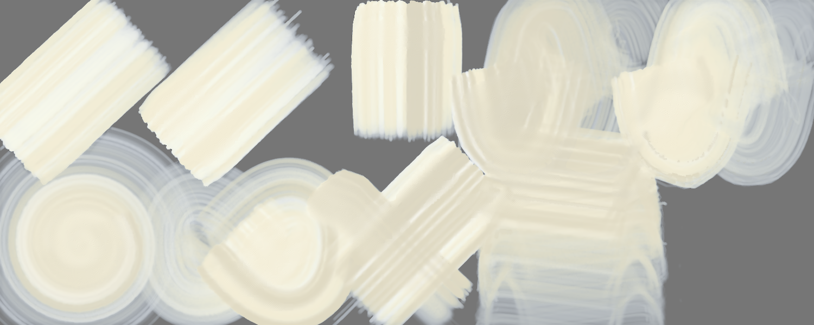
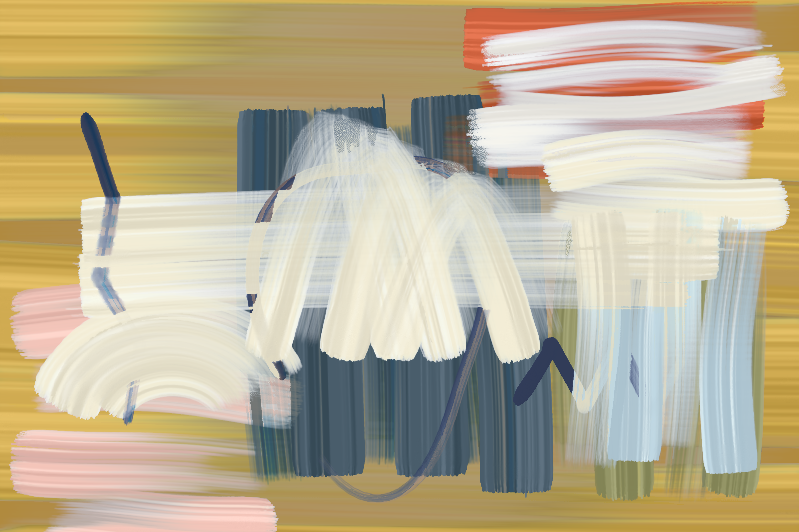

# Brush Lab — 2 brushes · 9 Nov 2026 at 05:23

Every sheet: 1500 × 600, ten strokes in a 5 × 2 grid — 1. light line · 2. heavy line · 3. pressure swell · 4. fast wave · 5. slow wave · 6. spiral · 7. loop · 8. tilted · 9. over the wet one · 10. long, no reload (cell 8 holds «tilted» and «over the wet one» crossed). The CPU reference of Mamay's paint engine; the wet layer settles 20 s at the end.

Columns: **covered** = share of the cell with paint right after the stroke → after settling; **width** = painted area of the stroke ÷ its length (px); **dark** = mean darkness of the painted pixels above the paper's own grain (0 = paper, 1 = black); **spread** = how far wet paint went beyond the stroke (1.0 = stayed); **ms** = the stroke on the CPU; long stroke: paint in each quarter of its length (it should run out: wet → streaks → dry tail).

## Masterpiece · Painting I
Gouache 1.00 + turpentine 15 % · 240 px · 64.4 s

A light paint: laid on a grey sheet (on white it cannot be seen); **dark** = how far it is from the grey either way.

| stroke | covered | width | dark | spread | ms |
|---|---|---|---|---|---|
| light line | 65 % → 65 % | 189.6 px | 0.32 | 1.00 | 780 |
| heavy line | 67 % → 59 % | 193.9 px | 0.32 | 0.89 | 953 |
| pressure swell | 57 % → 65 % | 213.3 px | 0.28 | 1.14 | 679 |
| fast wave | 98 % → 74 % | 112.7 px | 0.25 | 0.76 | 2670 |
| slow wave | 99 % → 60 % | 114.1 px | 0.29 | 0.61 | 4717 |
| spiral | 99 % → 66 % | 65.3 px | 0.28 | 0.67 | 5254 |
| loop | 99 % → 74 % | 127.8 px | 0.28 | 0.75 | 3761 |
| tilted | 50 % → 50 % | 138.7 px | 0.26 | 1.00 | 2199 |
| over the wet one | 86 % → 82 % | 101.3 px | 0.26 | 0.95 | 1107 |
| long, no reload | 100 % → 67 % | 44.8 px | 0.25 | 0.67 | 7352 | quarters: 0.00 → 0.00 → 0.00 → 0.00

Numbers say: light vs heavy: width 189.6 → 193.9 px, dark 0.32 → 0.32; pressure barely changes the width.

## Masterpiece · Painting I — own sheet
own sheet 2400 × 1600 · Gouache 1.00 + turpentine 15 % · 240 px · 365.6 s

| stroke | covered | width | dark | spread | ms |
|---|---|---|---|---|---|
| stroke 1 | 38 % → 24 % | 210.4 px | 0.28 | 0.63 | 12185 |
| stroke 2 | 57 % → 42 % | 441.0 px | 0.28 | 0.73 | 22090 |
| stroke 3 | 63 % → 46 % | 580.0 px | 0.28 | 0.73 | 19569 |
| stroke 4 | 63 % → 56 % | 617.4 px | 0.27 | 0.89 | 19466 |
| stroke 5 | 66 % → 53 % | 641.5 px | 0.27 | 0.80 | 17912 |
| stroke 6 | 68 % → 46 % | 651.4 px | 0.26 | 0.68 | 20464 |
| stroke 7 | 85 % → 37 % | 655.7 px | 0.26 | 0.43 | 19050 |
| stroke 8 | 98 % → 21 % | 519.0 px | 0.24 | 0.22 | 12419 |
| stroke 9 | 14 % → 37 % | 210.9 px | 0.28 | 2.57 | 3499 |
| stroke 10 | 24 % → 35 % | 360.9 px | 0.28 | 1.49 | 3333 |
| stroke 11 | 32 % → 36 % | 492.1 px | 0.28 | 1.14 | 2967 |
| stroke 12 | 42 % → 38 % | 661.1 px | 0.28 | 0.90 | 2860 |
| stroke 13 | 41 % → 41 % | 621.3 px | 0.28 | 1.01 | 3201 |
| stroke 14 | 42 % → 47 % | 610.8 px | 0.27 | 1.11 | 3196 |
| stroke 15 | 40 % → 41 % | 401.7 px | 0.28 | 1.03 | 1730 |
| stroke 16 | 54 % → 52 % | 766.1 px | 0.28 | 0.97 | 1911 |
| stroke 17 | 59 % → 54 % | 956.6 px | 0.28 | 0.92 | 2149 |
| stroke 18 | 53 % → 50 % | 943.7 px | 0.28 | 0.94 | 2012 |
| stroke 19 | 55 % → 43 % | 918.1 px | 0.29 | 0.78 | 2133 |
| stroke 20 | 69 % → 30 % | 864.4 px | 0.29 | 0.43 | 1948 |
| stroke 21 | 70 % → 15 % | 740.8 px | 0.28 | 0.22 | 1148 |
| stroke 22 | 55 % → 55 % | 1051.1 px | 0.26 | 1.00 | 1473 |
| stroke 23 | 53 % → 51 % | 961.7 px | 0.26 | 0.97 | 1789 |
| stroke 24 | 59 % → 54 % | 815.0 px | 0.25 | 0.91 | 1903 |
| stroke 25 | 64 % → 56 % | 841.2 px | 0.25 | 0.88 | 1500 |
| stroke 26 | 7 % → 47 % | 132.6 px | 0.27 | 6.64 | 1572 |
| stroke 27 | 13 % → 41 % | 226.3 px | 0.28 | 3.05 | 1774 |
| stroke 28 | 15 % → 44 % | 271.3 px | 0.28 | 3.06 | 1685 |
| stroke 29 | 19 % → 39 % | 289.5 px | 0.28 | 2.07 | 2077 |
| stroke 30 | 19 % → 40 % | 317.7 px | 0.28 | 2.10 | 2524 |
| stroke 31 | 21 % → 40 % | 357.4 px | 0.28 | 1.88 | 2508 |
| stroke 32 | 25 % → 49 % | 480.5 px | 0.27 | 1.99 | 2757 |
| stroke 33 | 29 % → 55 % | 392.5 px | 0.27 | 1.92 | 5045 |
| stroke 34 | 33 % → 56 % | 453.0 px | 0.27 | 1.71 | 5127 |
| stroke 35 | 37 % → 56 % | 484.0 px | 0.27 | 1.52 | 4879 |
| stroke 36 | 31 % → 45 % | 352.1 px | 0.29 | 1.47 | 2154 |
| stroke 37 | 45 % → 51 % | 613.2 px | 0.28 | 1.14 | 2252 |
| stroke 38 | 59 % → 54 % | 926.4 px | 0.28 | 0.91 | 2513 |
| stroke 39 | 46 % → 55 % | 868.9 px | 0.26 | 1.20 | 2087 |
| stroke 40 | 45 % → 53 % | 908.3 px | 0.26 | 1.17 | 1658 |
| stroke 41 | 48 % → 54 % | 860.2 px | 0.25 | 1.11 | 1688 |
| stroke 42 | 59 % → 55 % | 791.5 px | 0.25 | 0.94 | 1427 |
| stroke 43 | 41 % → 45 % | 802.4 px | 0.28 | 1.09 | 1280 |
| stroke 44 | 43 % → 44 % | 881.2 px | 0.28 | 1.03 | 1706 |
| stroke 45 | 45 % → 44 % | 1180.9 px | 0.28 | 0.99 | 919 |
| stroke 46 | 46 % → 45 % | 892.0 px | 0.28 | 0.98 | 2175 |
| stroke 47 | 45 % → 42 % | 491.1 px | 0.28 | 0.92 | 1052 |
| stroke 48 | 31 % → 30 % | 461.7 px | 0.28 | 0.97 | 458 |
| stroke 49 | 53 % → 49 % | 705.5 px | 0.26 | 0.93 | 419 |
| stroke 50 | 63 % → 56 % | 1273.4 px | 0.28 | 0.90 | 1102 |
| stroke 51 | 74 % → 62 % | 1362.5 px | 0.27 | 0.84 | 1863 |

Numbers say: wet paint spreads well beyond the stroke.

