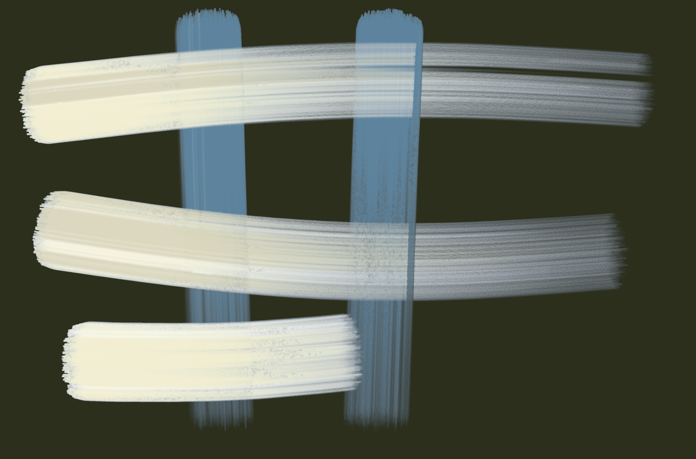
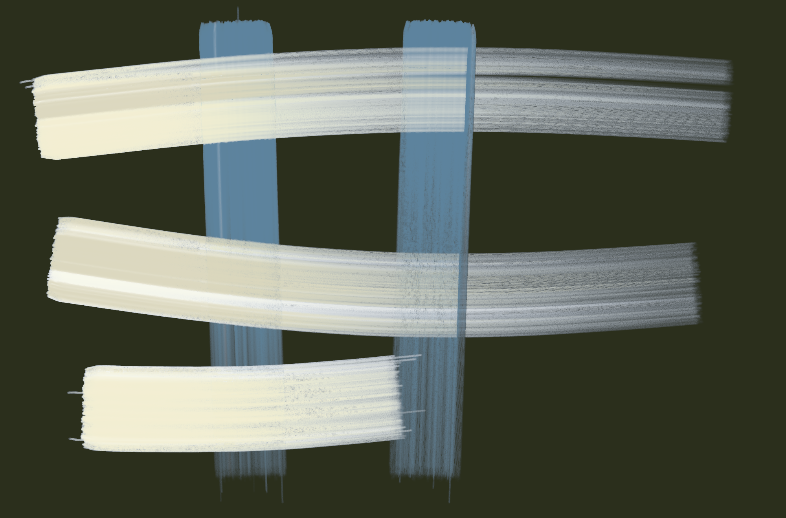
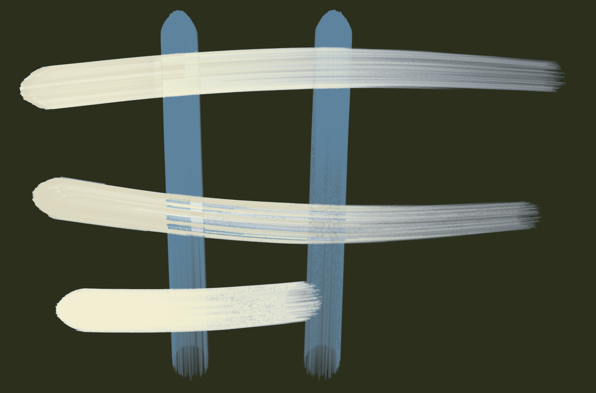
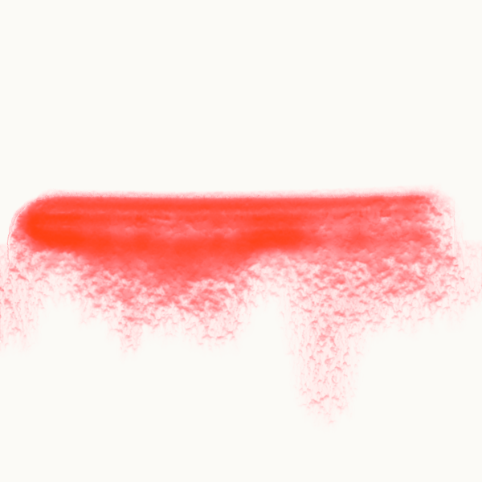
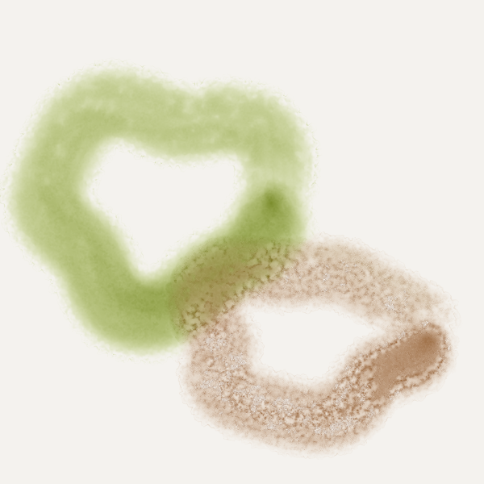

# Brush Lab — 7 brushes · 9 Nov 2026 at 21:52

Every sheet: 1500 × 600, ten strokes in a 5 × 2 grid — 1. light line · 2. heavy line · 3. pressure swell · 4. fast wave · 5. slow wave · 6. spiral · 7. loop · 8. tilted · 9. over the wet one · 10. long, no reload (cell 8 holds «tilted» and «over the wet one» crossed). The CPU reference of Mamay's paint engine; the wet layer settles 20 s at the end.

Columns: **covered** = share of the cell with paint right after the stroke → after settling; **width** = painted area of the stroke ÷ its length (px); **dark** = mean darkness of the painted pixels above the paper's own grain (0 = paper, 1 = black); **spread** = how far wet paint went beyond the stroke (1.0 = stayed); **ms** = the stroke on the CPU; long stroke: paint in each quarter of its length (it should run out: wet → streaks → dry tail).

## Oil focus · A best filbert — own sheet
own sheet 2000 × 1320 · Gouache 1.00 + turpentine 15 % · 260 px · 447.8 s

| stroke | covered | width | dark | spread | ms |
|---|---|---|---|---|---|
| stroke 1 | 15 % → 52 % | 190.2 px | 0.52 | 3.35 | 37303 |
| stroke 2 | 28 % → 33 % | 352.5 px | 0.44 | 1.15 | 39849 |
| stroke 3 | 36 % → 33 % | 333.6 px | 0.49 | 0.94 | 78009 |
| stroke 4 | 42 % → 32 % | 582.2 px | 0.53 | 0.77 | 66302 |
| stroke 5 | 50 % → 36 % | 807.2 px | 0.53 | 0.73 | 34099 |

Numbers say: wet paint spreads well beyond the stroke.

## Oil focus · B flat — own sheet
own sheet 2000 × 1320 · Gouache 1.00 + turpentine 15 % · 260 px · 412.4 s

| stroke | covered | width | dark | spread | ms |
|---|---|---|---|---|---|
| stroke 1 | 15 % → 51 % | 186.4 px | 0.53 | 3.37 | 33056 |
| stroke 2 | 28 % → 33 % | 341.2 px | 0.46 | 1.20 | 33806 |
| stroke 3 | 35 % → 33 % | 324.6 px | 0.50 | 0.94 | 72551 |
| stroke 4 | 41 % → 32 % | 571.0 px | 0.53 | 0.77 | 56258 |
| stroke 5 | 48 % → 36 % | 779.4 px | 0.53 | 0.75 | 28480 |

Numbers say: wet paint spreads well beyond the stroke.

## Oil focus · C round — own sheet
own sheet 2000 × 1320 · Gouache 1.00 + turpentine 15 % · 260 px · 367.2 s

| stroke | covered | width | dark | spread | ms |
|---|---|---|---|---|---|
| stroke 1 | 10 % → 41 % | 129.4 px | 0.53 | 3.90 | 26295 |
| stroke 2 | 21 % → 29 % | 254.2 px | 0.47 | 1.43 | 28838 |
| stroke 3 | 24 % → 26 % | 222.0 px | 0.53 | 1.07 | 67582 |
| stroke 4 | 29 % → 25 % | 395.4 px | 0.54 | 0.89 | 51739 |
| stroke 5 | 34 % → 29 % | 550.9 px | 0.53 | 0.84 | 22888 |

Numbers say: wet paint spreads well beyond the stroke.

## Oil focus · D worn — own sheet
own sheet 2000 × 1320 · Gouache 1.00 + turpentine 15 % · 260 px · 425.9 s

| stroke | covered | width | dark | spread | ms |
|---|---|---|---|---|---|
| stroke 1 | 17 % → 51 % | 204.9 px | 0.52 | 3.09 | 32764 |
| stroke 2 | 29 % → 33 % | 363.4 px | 0.44 | 1.12 | 31520 |
| stroke 3 | 35 % → 35 % | 324.3 px | 0.49 | 1.01 | 63610 |
| stroke 4 | 39 % → 32 % | 541.4 px | 0.53 | 0.82 | 59520 |
| stroke 5 | 46 % → 35 % | 755.7 px | 0.54 | 0.74 | 31026 |

Numbers say: wet paint spreads well beyond the stroke.

## Watercolour · #35 Red band with runs — own sheet
own sheet 600 × 600 · Watercolour 1.00 + water 75 % · 80 px · 73.2 s

| stroke | covered | width | dark | spread | ms |
|---|---|---|---|---|---|
| stroke 1 | 37 % → 45 % | 145.1 px | 0.30 | 1.21 | 3793 |

## Watercolour · #40 Olive and sepia blooms — own sheet
own sheet 600 × 600 · Watercolour 1.00 + water 55 % · 90 px · 103.7 s

| stroke | covered | width | dark | spread | ms |
|---|---|---|---|---|---|
| stroke 1 | 28 % → 50 % | 97.7 px | 0.17 | 1.77 | 6088 |
| stroke 2 | 48 % → 52 % | 151.4 px | 0.18 | 1.10 | 5285 |

Numbers say: wet paint spreads well beyond the stroke.

## Watercolour · #46 Lips on wet paper — own sheet
own sheet 600 × 600 · Watercolour 1.00 + water 65 % · 50 px · 64.1 s

| stroke | covered | width | dark | spread | ms |
|---|---|---|---|---|---|
| stroke 1 | 14 % → 22 % | 56.2 px | 0.57 | 1.60 | 615 |
| stroke 2 | 14 % → 20 % | 61.3 px | 0.56 | 1.44 | 562 |

Numbers say: wet paint spreads well beyond the stroke.

## Measures of the own sheets (v4 §9)

| sheet | fine lines (across ÷ along) | gaps | edge steps |
|---|---|---|---|
| Oil focus · A best filbert — own sheet | 1.12 | 0.8 % | 17.8 % |
| Oil focus · B flat — own sheet | 1.24 | 1.7 % | 15.5 % |
| Oil focus · C round — own sheet | 1.15 | 0.0 % | 13.2 % |
| Oil focus · D worn — own sheet | 1.32 | 1.1 % | 20.4 % |
| Watercolour · #35 Red band with runs — own sheet | 1.45 | 0.8 % | 35.3 % |
| Watercolour · #40 Olive and sepia blooms — own sheet | 1.02 | 0.1 % | 45.6 % |
| Watercolour · #46 Lips on wet paper — own sheet | 0.75 | 0.0 % | 38.1 % |
