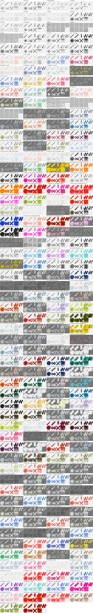

# Brush Lab — 169 brushes · 3 Nov 2026 at 18:22

Every sheet: 1500 × 600, ten strokes in a 5 × 2 grid — 1. light line · 2. heavy line · 3. pressure swell · 4. fast wave · 5. slow wave · 6. spiral · 7. loop · 8. tilted · 9. over the wet one · 10. long, no reload (cell 8 holds «tilted» and «over the wet one» crossed). The CPU reference of Mamay's paint engine; the wet layer settles 20 s at the end.

Columns: **covered** = share of the cell with paint right after the stroke → after settling; **width** = painted area of the stroke ÷ its length (px); **dark** = mean darkness of the painted pixels above the paper's own grain (0 = paper, 1 = black); **spread** = how far wet paint went beyond the stroke (1.0 = stayed); **ms** = the stroke on the CPU; long stroke: paint in each quarter of its length (it should run out: wet → streaks → dry tail).

## Ink Line
Ink · 12 px · 25.0 s

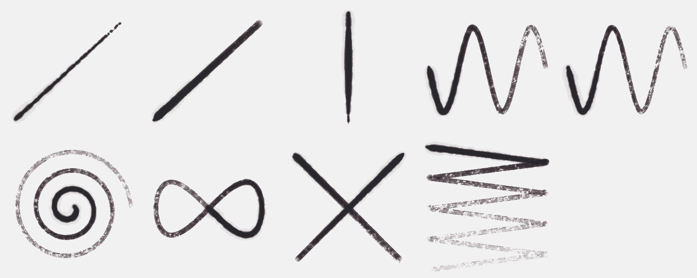

| stroke | covered | width | dark | spread | ms |
|---|---|---|---|---|---|
| light line | 1 % → 4 % | 4.3 px | 0.55 | 2.44 | 69 |
| heavy line | 5 % → 6 % | 15.7 px | 0.68 | 1.13 | 71 |
| pressure swell | 3 % → 4 % | 11.3 px | 0.64 | 1.40 | 45 |
| fast wave | 10 % → 11 % | 11.2 px | 0.59 | 1.11 | 147 |
| slow wave | 8 % → 10 % | 9.6 px | 0.57 | 1.16 | 123 |
| spiral | 14 % → 15 % | 8.9 px | 0.50 | 1.07 | 164 |
| loop | 8 % → 9 % | 10.6 px | 0.61 | 1.16 | 140 |
| tilted | 5 % → 5 % | 14.4 px | 0.65 | 1.05 | 62 |
| over the wet one | 10 % → 11 % | 12.5 px | 0.65 | 1.15 | 53 |
| long, no reload | 18 % → 17 % | 8.1 px | 0.47 | 0.96 | 363 | quarters: 0.22 → 0.09 → 0.04 → 0.02

Numbers say: light vs heavy: width 4.3 → 15.7 px, dark 0.55 → 0.68; wet paint spreads well beyond the stroke.

## Dense Ink
Ink · 14 px · 25.5 s

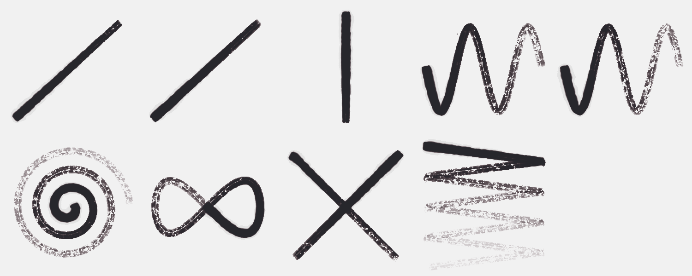

| stroke | covered | width | dark | spread | ms |
|---|---|---|---|---|---|
| light line | 5 % → 7 % | 15.2 px | 0.72 | 1.26 | 142 |
| heavy line | 7 % → 7 % | 19.1 px | 0.73 | 1.09 | 74 |
| pressure swell | 5 % → 6 % | 17.9 px | 0.72 | 1.17 | 50 |
| fast wave | 13 % → 13 % | 15.3 px | 0.69 | 1.01 | 239 |
| slow wave | 12 % → 12 % | 13.6 px | 0.67 | 1.04 | 160 |
| spiral | 18 % → 15 % | 12.2 px | 0.65 | 0.80 | 276 |
| loop | 11 % → 12 % | 14.8 px | 0.69 | 1.08 | 109 |
| tilted | 5 % → 6 % | 14.6 px | 0.72 | 1.07 | 70 |
| over the wet one | 12 % → 13 % | 17.7 px | 0.72 | 1.11 | 53 |
| long, no reload | 23 % → 15 % | 10.1 px | 0.64 | 0.66 | 372 | quarters: 0.30 → 0.12 → 0.04 → 0.02

Numbers say: light vs heavy: width 15.2 → 19.1 px, dark 0.72 → 0.73.

## Transparent Wash
Watercolor · 22 px · 26.1 s

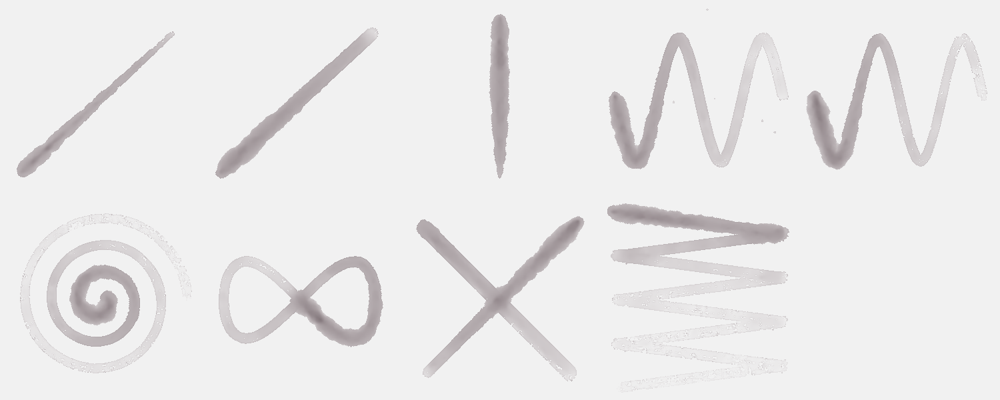

| stroke | covered | width | dark | spread | ms |
|---|---|---|---|---|---|
| light line | 2 % → 5 % | 6.9 px | 0.27 | 2.25 | 131 |
| heavy line | 7 % → 9 % | 20.4 px | 0.27 | 1.22 | 65 |
| pressure swell | 4 % → 6 % | 15.2 px | 0.28 | 1.54 | 29 |
| fast wave | 14 % → 16 % | 16.1 px | 0.20 | 1.17 | 118 |
| slow wave | 12 % → 15 % | 13.7 px | 0.21 | 1.28 | 192 |
| spiral | 18 % → 22 % | 11.9 px | 0.16 | 1.23 | 215 |
| loop | 11 % → 13 % | 14.5 px | 0.22 | 1.20 | 134 |
| tilted | 8 % → 8 % | 21.1 px | 0.24 | 1.06 | 59 |
| over the wet one | 13 % → 16 % | 16.4 px | 0.24 | 1.18 | 54 |
| long, no reload | 26 % → 32 % | 11.6 px | 0.13 | 1.22 | 355 | quarters: 0.11 → 0.04 → 0.02 → 0.01

Numbers say: light vs heavy: width 6.9 → 20.4 px, dark 0.27 → 0.27; wet paint spreads well beyond the stroke.

## Dry Brush
Gouache · 24 px · 21.5 s

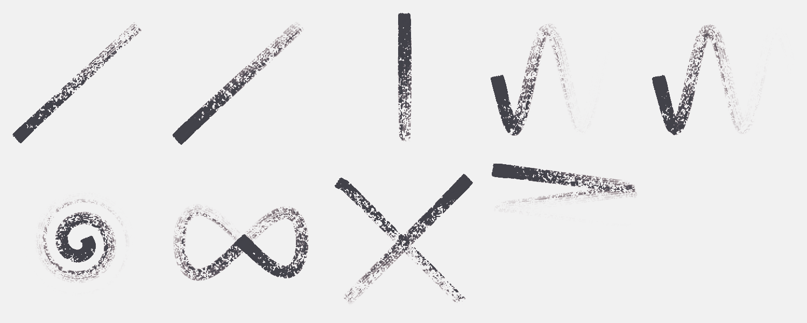

| stroke | covered | width | dark | spread | ms |
|---|---|---|---|---|---|
| light line | 5 % → 0 % | 14.0 px | 0.65 | 0.09 | 170 |
| heavy line | 6 % → 0 % | 18.6 px | 0.65 | 0.02 | 99 |
| pressure swell | 5 % → 0 % | 18.2 px | 0.65 | 0.08 | 60 |
| fast wave | 6 % → 1 % | 7.3 px | 0.65 | 0.08 | 196 |
| slow wave | 7 % → 0 % | 8.1 px | 0.65 | 0.06 | 261 |
| spiral | 7 % → 0 % | 4.6 px | 0.65 | 0.07 | 319 |
| loop | 10 % → 0 % | 12.4 px | 0.65 | 0.04 | 212 |
| tilted | 4 % → 3 % | 10.6 px | 0.65 | 0.88 | 63 |
| over the wet one | 9 % → 1 % | 14.5 px | 0.65 | 0.12 | 101 |
| long, no reload | 6 % → 1 % | 2.9 px | 0.65 | 0.14 | 356 | quarters: 0.12 → 0.00 → 0.00 → 0.00

Numbers say: light vs heavy: width 14.0 → 18.6 px, dark 0.65 → 0.65.

## Wax Crayon
Wax · 8 px · 10.7 s

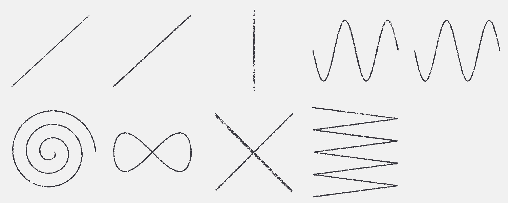

| stroke | covered | width | dark | spread | ms |
|---|---|---|---|---|---|
| light line | 1 % → 1 % | 2.5 px | 0.71 | 1.00 | 85 |
| heavy line | 1 % → 1 % | 3.9 px | 0.69 | 1.00 | 18 |
| pressure swell | 1 % → 1 % | 3.3 px | 0.70 | 1.00 | 23 |
| fast wave | 3 % → 3 % | 3.5 px | 0.69 | 1.00 | 48 |
| slow wave | 3 % → 3 % | 3.4 px | 0.70 | 1.00 | 49 |
| spiral | 5 % → 5 % | 3.3 px | 0.70 | 1.00 | 108 |
| loop | 3 % → 3 % | 3.3 px | 0.70 | 1.00 | 37 |
| tilted | 2 % → 2 % | 5.6 px | 0.68 | 1.00 | 33 |
| over the wet one | 3 % → 3 % | 3.6 px | 0.68 | 1.00 | 21 |
| long, no reload | 7 % → 7 % | 3.3 px | 0.70 | 1.00 | 126 | quarters: 0.06 → 0.06 → 0.06 → 0.06

Numbers say: light vs heavy: width 2.5 → 3.9 px, dark 0.71 → 0.69; the long stroke does not run out of paint.

## Oil Pastel
Wax · 12 px · 11.2 s

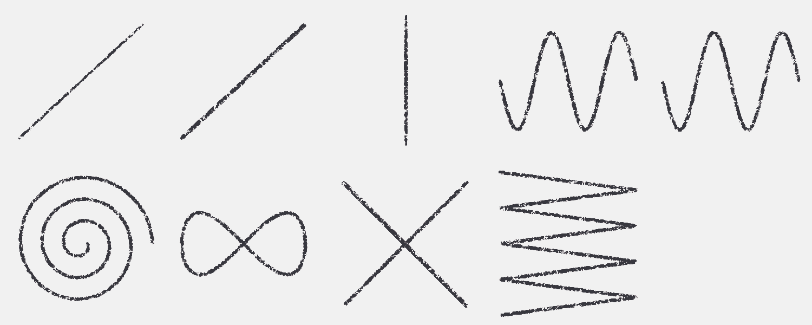

| stroke | covered | width | dark | spread | ms |
|---|---|---|---|---|---|
| light line | 1 % → 1 % | 4.0 px | 0.68 | 1.00 | 129 |
| heavy line | 2 % → 2 % | 6.5 px | 0.68 | 1.00 | 33 |
| pressure swell | 2 % → 2 % | 5.7 px | 0.69 | 1.00 | 19 |
| fast wave | 5 % → 5 % | 5.7 px | 0.68 | 1.00 | 193 |
| slow wave | 5 % → 5 % | 5.5 px | 0.68 | 1.00 | 72 |
| spiral | 8 % → 8 % | 5.5 px | 0.68 | 1.00 | 117 |
| loop | 4 % → 4 % | 5.6 px | 0.68 | 1.00 | 54 |
| tilted | 2 % → 2 % | 6.8 px | 0.68 | 1.00 | 52 |
| over the wet one | 5 % → 5 % | 5.8 px | 0.68 | 1.00 | 29 |
| long, no reload | 13 % → 13 % | 5.6 px | 0.68 | 1.00 | 218 | quarters: 0.10 → 0.09 → 0.10 → 0.10

Numbers say: light vs heavy: width 4.0 → 6.5 px, dark 0.68 → 0.68; the long stroke does not run out of paint.

## Charcoal
Charcoal · 5 px · 10.4 s

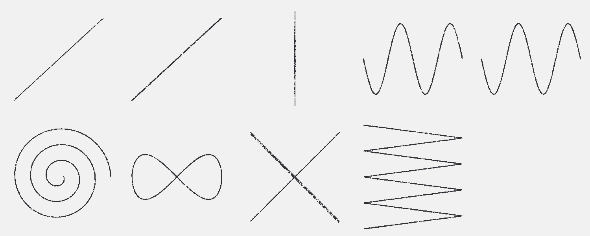

| stroke | covered | width | dark | spread | ms |
|---|---|---|---|---|---|
| light line | 1 % → 1 % | 2.0 px | 0.74 | 1.00 | 117 |
| heavy line | 1 % → 1 % | 3.0 px | 0.74 | 1.00 | 11 |
| pressure swell | 1 % → 1 % | 2.7 px | 0.74 | 1.00 | 7 |
| fast wave | 2 % → 2 % | 2.7 px | 0.73 | 1.00 | 40 |
| slow wave | 2 % → 2 % | 2.6 px | 0.74 | 1.00 | 49 |
| spiral | 4 % → 4 % | 2.5 px | 0.74 | 1.00 | 73 |
| loop | 2 % → 2 % | 2.6 px | 0.74 | 1.00 | 44 |
| tilted | 2 % → 2 % | 4.3 px | 0.72 | 1.00 | 23 |
| over the wet one | 2 % → 2 % | 2.4 px | 0.72 | 1.00 | 25 |
| long, no reload | 6 % → 6 % | 2.7 px | 0.73 | 1.00 | 78 | quarters: 0.05 → 0.05 → 0.05 → 0.05

Numbers say: light vs heavy: width 2.0 → 3.0 px, dark 0.74 → 0.74; the long stroke does not run out of paint.

## Impasto
Heavy acrylic · 22 px · 16.0 s

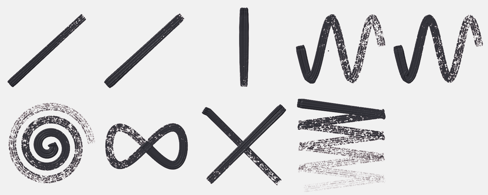

| stroke | covered | width | dark | spread | ms |
|---|---|---|---|---|---|
| light line | 8 % → 8 % | 24.1 px | 0.71 | 0.93 | 198 |
| heavy line | 10 % → 9 % | 28.8 px | 0.70 | 0.94 | 103 |
| pressure swell | 7 % → 7 % | 28.1 px | 0.72 | 0.94 | 54 |
| fast wave | 20 % → 13 % | 23.5 px | 0.71 | 0.64 | 167 |
| slow wave | 21 % → 14 % | 24.5 px | 0.71 | 0.66 | 316 |
| spiral | 30 % → 14 % | 20.0 px | 0.71 | 0.46 | 284 |
| loop | 18 % → 14 % | 23.9 px | 0.71 | 0.77 | 169 |
| tilted | 8 % → 8 % | 21.8 px | 0.70 | 1.00 | 110 |
| over the wet one | 17 % → 15 % | 25.4 px | 0.70 | 0.91 | 85 |
| long, no reload | 34 % → 14 % | 15.2 px | 0.71 | 0.41 | 461 | quarters: 0.38 → 0.21 → 0.10 → 0.03

Numbers say: light vs heavy: width 24.1 → 28.8 px, dark 0.71 → 0.70.

## Oil Round
Oil · 18 px · 18.7 s

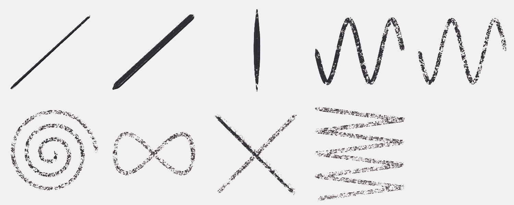

| stroke | covered | width | dark | spread | ms |
|---|---|---|---|---|---|
| light line | 2 % → 2 % | 7.2 px | 0.75 | 1.00 | 184 |
| heavy line | 7 % → 7 % | 19.3 px | 0.73 | 1.00 | 81 |
| pressure swell | 4 % → 4 % | 13.7 px | 0.72 | 1.00 | 51 |
| fast wave | 11 % → 11 % | 12.7 px | 0.65 | 1.00 | 143 |
| slow wave | 8 % → 8 % | 9.0 px | 0.57 | 1.00 | 229 |
| spiral | 10 % → 10 % | 6.6 px | 0.50 | 1.00 | 246 |
| loop | 5 % → 5 % | 7.1 px | 0.45 | 1.00 | 119 |
| tilted | 4 % → 4 % | 10.1 px | 0.52 | 1.00 | 94 |
| over the wet one | 6 % → 6 % | 7.4 px | 0.52 | 1.00 | 87 |
| long, no reload | 15 % → 15 % | 6.8 px | 0.42 | 1.00 | 383 | quarters: 0.08 → 0.08 → 0.07 → 0.06

Numbers say: light vs heavy: width 7.2 → 19.3 px, dark 0.75 → 0.73.

## Palette Knife
Oil · 20 px · 18.0 s

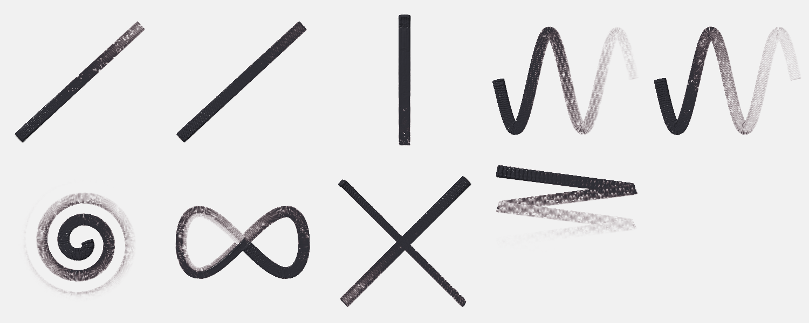

| stroke | covered | width | dark | spread | ms |
|---|---|---|---|---|---|
| light line | 8 % → 8 % | 21.9 px | 0.67 | 1.00 | 165 |
| heavy line | 8 % → 8 % | 22.5 px | 0.73 | 1.00 | 14 |
| pressure swell | 6 % → 6 % | 22.4 px | 0.74 | 1.00 | 7 |
| fast wave | 17 % → 17 % | 19.3 px | 0.49 | 1.00 | 44 |
| slow wave | 17 % → 17 % | 19.9 px | 0.43 | 1.00 | 74 |
| spiral | 18 % → 18 % | 11.7 px | 0.45 | 1.00 | 71 |
| loop | 16 % → 16 % | 21.0 px | 0.58 | 1.00 | 24 |
| tilted | 5 % → 5 % | 15.0 px | 0.72 | 1.00 | 21 |
| over the wet one | 13 % → 13 % | 21.0 px | 0.72 | 1.00 | 14 |
| long, no reload | 17 % → 17 % | 7.5 px | 0.47 | 1.00 | 78 | quarters: 0.29 → 0.05 → 0.00 → 0.00

Numbers say: light vs heavy: width 21.9 → 22.5 px, dark 0.67 → 0.73; pressure barely changes the width.

## Water
Watercolor · 20 px · 33.4 s · over bands of wet oil paint and oil pastel in turn (it works on paint already there: look at what it does to the bands; covered counts the bands too)

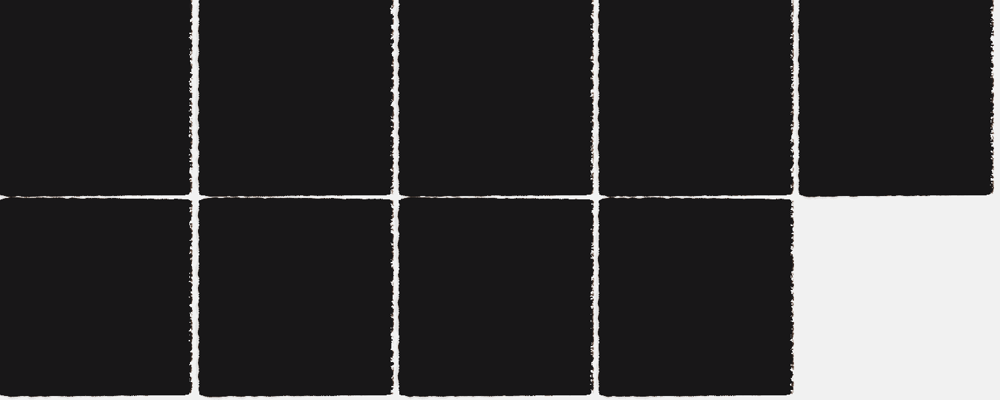

| stroke | covered | width | dark | spread | ms |
|---|---|---|---|---|---|
| light line | 25 % → 27 % | 73.8 px | 0.80 | 1.06 | 24 |
| heavy line | 24 % → 25 % | 69.8 px | 0.81 | 1.04 | 45 |
| pressure swell | 24 % → 25 % | 89.6 px | 0.81 | 1.03 | 43 |
| fast wave | 24 % → 26 % | 27.7 px | 0.81 | 1.07 | 95 |
| slow wave | 24 % → 25 % | 27.7 px | 0.81 | 1.06 | 136 |
| spiral | 24 % → 26 % | 15.9 px | 0.81 | 1.07 | 151 |
| loop | 24 % → 25 % | 31.1 px | 0.81 | 1.03 | 102 |
| tilted | 24 % → 24 % | 67.0 px | 0.81 | 1.00 | 41 |
| over the wet one | 24 % → 25 % | 0.0 px | 0.81 | 1.06 | 49 |
| long, no reload | 24 % → 26 % | 10.7 px | 0.81 | 1.08 | 213 | quarters: 0.21 → 0.27 → 0.18 → 0.27

Numbers say: light vs heavy: width 73.8 → 69.8 px, dark 0.80 → 0.81; pressure barely changes the width; the long stroke does not run out of paint.

## Blender
Pastel · 16 px · 19.8 s · over bands of wet oil paint and oil pastel in turn (it works on paint already there: look at what it does to the bands; covered counts the bands too)

| stroke | covered | width | dark | spread | ms |
|---|---|---|---|---|---|
| light line | 24 % → 24 % | 70.7 px | 0.81 | 1.00 | 28 |
| heavy line | 25 % → 25 % | 72.1 px | 0.80 | 1.00 | 32 |
| pressure swell | 24 % → 24 % | 91.3 px | 0.81 | 1.00 | 22 |
| fast wave | 26 % → 26 % | 30.0 px | 0.79 | 1.00 | 82 |
| slow wave | 26 % → 26 % | 29.9 px | 0.80 | 1.00 | 82 |
| spiral | 28 % → 28 % | 18.7 px | 0.77 | 1.00 | 113 |
| loop | 25 % → 25 % | 32.9 px | 0.80 | 1.00 | 42 |
| tilted | 25 % → 25 % | 70.1 px | 0.79 | 1.00 | 38 |
| over the wet one | 26 % → 26 % | 1.8 px | 0.79 | 1.00 | 23 |
| long, no reload | 30 % → 30 % | 13.7 px | 0.76 | 1.00 | 189 | quarters: 0.20 → 0.28 → 0.23 → 0.30

Numbers say: light vs heavy: width 70.7 → 72.1 px, dark 0.81 → 0.80; pressure barely changes the width; the long stroke does not run out of paint.

## Eraser
Eraser · 16 px · 19.5 s · over bands of wet oil paint and oil pastel in turn (it works on paint already there: look at what it does to the bands; covered counts the bands too)

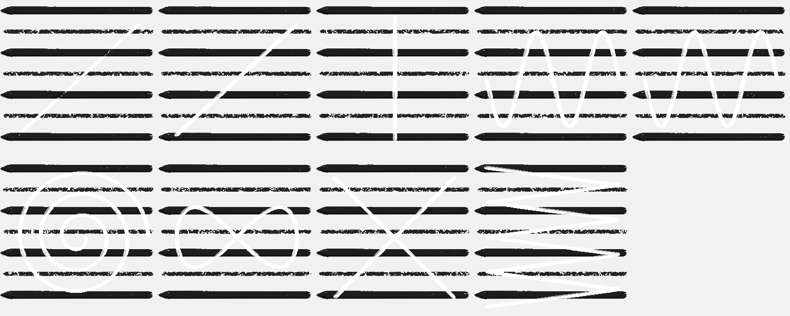

| stroke | covered | width | dark | spread | ms |
|---|---|---|---|---|---|
| light line | 24 % → 24 % | 69.5 px | 0.82 | 1.00 | 30 |
| heavy line | 23 % → 23 % | 67.9 px | 0.82 | 1.00 | 43 |
| pressure swell | 23 % → 23 % | 87.3 px | 0.82 | 1.00 | 28 |
| fast wave | 22 % → 22 % | 25.7 px | 0.82 | 1.00 | 80 |
| slow wave | 22 % → 22 % | 25.7 px | 0.82 | 1.00 | 78 |
| spiral | 22 % → 22 % | 14.4 px | 0.82 | 1.00 | 119 |
| loop | 22 % → 22 % | 28.6 px | 0.82 | 1.00 | 69 |
| tilted | 23 % → 23 % | 65.1 px | 0.82 | 1.00 | 32 |
| over the wet one | 23 % → 23 % | 0.0 px | 0.82 | 1.00 | 27 |
| long, no reload | 20 % → 20 % | 8.9 px | 0.82 | 1.00 | 191 | quarters: 0.15 → 0.20 → 0.15 → 0.20

Numbers say: light vs heavy: width 69.5 → 67.9 px, dark 0.82 → 0.82; pressure barely changes the width; the long stroke does not run out of paint.

## Fan
Gouache · 30 px · 27.8 s

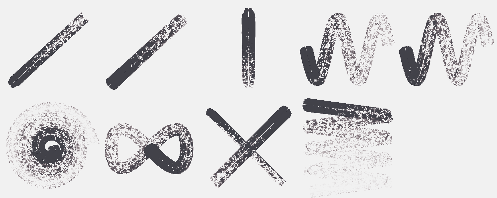

| stroke | covered | width | dark | spread | ms |
|---|---|---|---|---|---|
| light line | 9 % → 3 % | 25.7 px | 0.63 | 0.37 | 31 |
| heavy line | 11 % → 4 % | 31.0 px | 0.63 | 0.39 | 45 |
| pressure swell | 8 % → 5 % | 31.7 px | 0.63 | 0.55 | 27 |
| fast wave | 18 % → 5 % | 20.3 px | 0.63 | 0.26 | 102 |
| slow wave | 18 % → 5 % | 21.1 px | 0.63 | 0.25 | 158 |
| spiral | 24 % → 5 % | 15.8 px | 0.63 | 0.20 | 154 |
| loop | 17 % → 5 % | 22.7 px | 0.63 | 0.29 | 80 |
| tilted | 5 % → 6 % | 15.1 px | 0.63 | 1.05 | 49 |
| over the wet one | 16 % → 8 % | 29.8 px | 0.63 | 0.50 | 45 |
| long, no reload | 23 % → 5 % | 10.1 px | 0.63 | 0.22 | 209 | quarters: 0.29 → 0.07 → 0.01 → 0.00

Numbers say: light vs heavy: width 25.7 → 31.0 px, dark 0.63 → 0.63.

## Sponge
Gouache · 30 px · 27.0 s

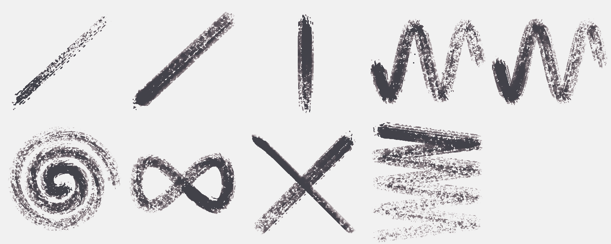

| stroke | covered | width | dark | spread | ms |
|---|---|---|---|---|---|
| light line | 4 % → 0 % | 11.4 px | 0.62 | 0.12 | 29 |
| heavy line | 12 % → 2 % | 35.4 px | 0.62 | 0.14 | 62 |
| pressure swell | 7 % → 2 % | 27.9 px | 0.62 | 0.27 | 29 |
| fast wave | 20 % → 4 % | 23.2 px | 0.62 | 0.19 | 113 |
| slow wave | 21 % → 4 % | 23.7 px | 0.62 | 0.18 | 203 |
| spiral | 28 % → 4 % | 18.3 px | 0.62 | 0.14 | 169 |
| loop | 18 % → 5 % | 23.0 px | 0.62 | 0.29 | 104 |
| tilted | 7 % → 7 % | 18.2 px | 0.62 | 1.04 | 82 |
| over the wet one | 16 % → 6 % | 27.8 px | 0.62 | 0.37 | 50 |
| long, no reload | 29 % → 5 % | 12.9 px | 0.62 | 0.17 | 262 | quarters: 0.29 → 0.13 → 0.07 → 0.04

Numbers say: light vs heavy: width 11.4 → 35.4 px, dark 0.62 → 0.62.

## Ink — sumi brush
Watercolor · 22 px · 24.9 s

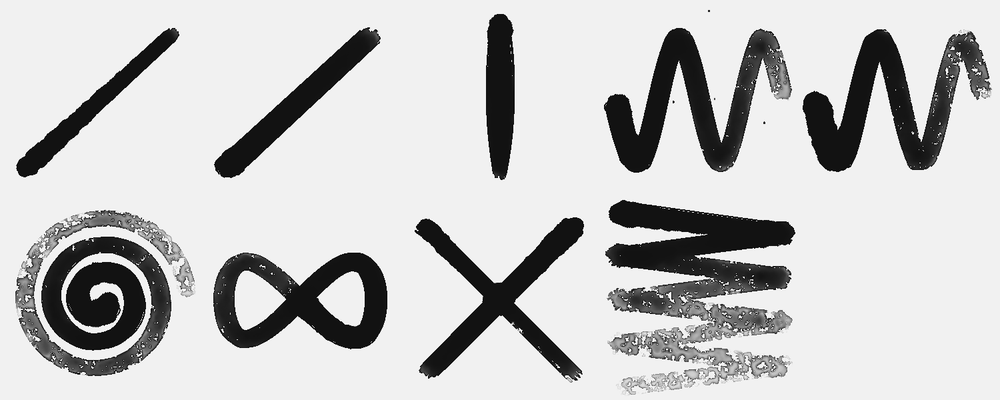

| stroke | covered | width | dark | spread | ms |
|---|---|---|---|---|---|
| light line | 6 % → 6 % | 18.4 px | 0.43 | 0.99 | 74 |
| heavy line | 10 % → 10 % | 30.2 px | 0.37 | 0.99 | 71 |
| pressure swell | 7 % → 7 % | 27.7 px | 0.42 | 0.99 | 44 |
| fast wave | 20 % → 16 % | 23.6 px | 0.31 | 0.79 | 163 |
| slow wave | 19 % → 17 % | 22.4 px | 0.36 | 0.89 | 233 |
| spiral | 29 % → 20 % | 18.9 px | 0.31 | 0.71 | 252 |
| loop | 17 % → 17 % | 22.4 px | 0.35 | 0.97 | 124 |
| tilted | 6 % → 7 % | 16.4 px | 0.39 | 1.16 | 61 |
| over the wet one | 16 % → 15 % | 28.0 px | 0.39 | 0.95 | 66 |
| long, no reload | 34 % → 23 % | 15.1 px | 0.31 | 0.68 | 349 | quarters: 0.22 → 0.10 → 0.06 → 0.04

Numbers say: light vs heavy: width 18.4 → 30.2 px, dark 0.43 → 0.37.

## Ink — wash
Watercolor · 40 px · 28.5 s

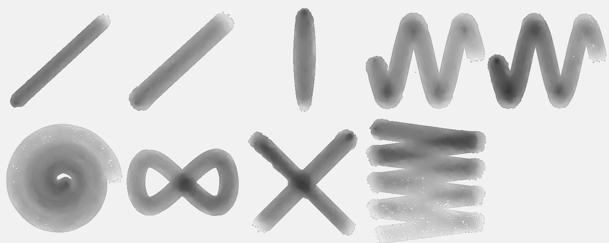

| stroke | covered | width | dark | spread | ms |
|---|---|---|---|---|---|
| light line | 7 % → 9 % | 20.6 px | 0.05 | 1.21 | 64 |
| heavy line | 10 % → 12 % | 30.2 px | 0.04 | 1.11 | 75 |
| pressure swell | 7 % → 8 % | 25.9 px | 0.05 | 1.20 | 52 |
| fast wave | 21 % → 23 % | 24.7 px | 0.04 | 1.07 | 177 |
| slow wave | 20 % → 23 % | 23.5 px | 0.06 | 1.15 | 290 |
| spiral | 33 % → 35 % | 21.8 px | 0.05 | 1.05 | 313 |
| loop | 19 % → 22 % | 24.0 px | 0.05 | 1.17 | 167 |
| tilted | 7 % → 8 % | 19.6 px | 0.06 | 1.20 | 106 |
| over the wet one | 17 % → 19 % | 28.3 px | 0.06 | 1.11 | 78 |
| long, no reload | 38 % → 40 % | 17.1 px | 0.05 | 1.04 | 463 | quarters: 0.04 → 0.03 → 0.02 → 0.01

Numbers say: light vs heavy: width 20.6 → 30.2 px, dark 0.05 → 0.04.

## Ink — dry brush
Ink · 30 px · 22.9 s

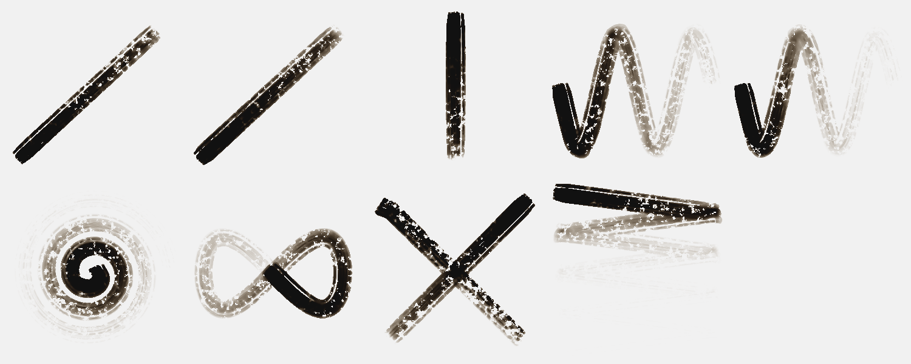

| stroke | covered | width | dark | spread | ms |
|---|---|---|---|---|---|
| light line | 9 % → 7 % | 25.2 px | 0.81 | 0.79 | 88 |
| heavy line | 10 % → 8 % | 29.6 px | 0.80 | 0.76 | 97 |
| pressure swell | 7 % → 6 % | 27.9 px | 0.81 | 0.85 | 83 |
| fast wave | 21 % → 8 % | 24.2 px | 0.79 | 0.40 | 203 |
| slow wave | 18 % → 7 % | 20.3 px | 0.79 | 0.39 | 373 |
| spiral | 24 % → 8 % | 15.6 px | 0.78 | 0.34 | 360 |
| loop | 19 % → 8 % | 24.3 px | 0.78 | 0.45 | 171 |
| tilted | 8 % → 8 % | 22.2 px | 0.78 | 1.02 | 116 |
| over the wet one | 17 % → 14 % | 25.9 px | 0.78 | 0.81 | 98 |
| long, no reload | 20 % → 8 % | 9.1 px | 0.79 | 0.41 | 495 | quarters: 0.32 → 0.02 → 0.00 → 0.00

Numbers say: light vs heavy: width 25.2 → 29.6 px, dark 0.81 → 0.80.

## Ink — nib
Watercolor · 5 px · 20.6 s

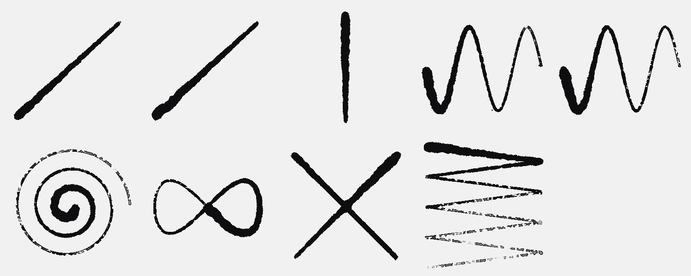

| stroke | covered | width | dark | spread | ms |
|---|---|---|---|---|---|
| light line | 1 % → 2 % | 4.3 px | 0.71 | 1.15 | 17 |
| heavy line | 2 % → 2 % | 5.0 px | 0.73 | 1.15 | 28 |
| pressure swell | 1 % → 2 % | 4.8 px | 0.74 | 1.19 | 14 |
| fast wave | 4 % → 3 % | 4.1 px | 0.65 | 0.96 | 45 |
| slow wave | 4 % → 4 % | 4.1 px | 0.65 | 1.06 | 62 |
| spiral | 5 % → 4 % | 3.4 px | 0.60 | 0.84 | 106 |
| loop | 3 % → 3 % | 4.1 px | 0.66 | 1.07 | 49 |
| tilted | 2 % → 2 % | 5.3 px | 0.63 | 1.22 | 18 |
| over the wet one | 4 % → 4 % | 5.8 px | 0.63 | 0.95 | 20 |
| long, no reload | 7 % → 5 % | 3.1 px | 0.60 | 0.70 | 146 | quarters: 0.09 → 0.04 → 0.02 → 0.02

Numbers say: light vs heavy: width 4.3 → 5.0 px, dark 0.71 → 0.73.

## 0.45 · Dry brush
Gouache · 34 px · 23.8 s

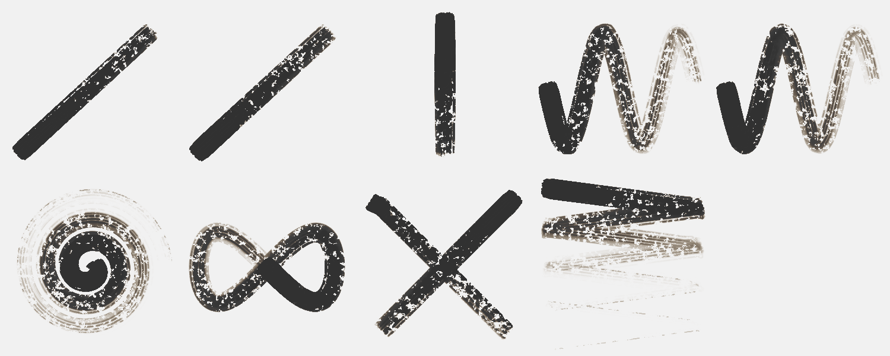

| stroke | covered | width | dark | spread | ms |
|---|---|---|---|---|---|
| light line | 10 % → 3 % | 29.4 px | 0.67 | 0.29 | 103 |
| heavy line | 11 % → 3 % | 31.6 px | 0.67 | 0.30 | 113 |
| pressure swell | 8 % → 3 % | 31.5 px | 0.67 | 0.41 | 84 |
| fast wave | 19 % → 3 % | 22.5 px | 0.67 | 0.18 | 276 |
| slow wave | 20 % → 4 % | 23.2 px | 0.67 | 0.18 | 427 |
| spiral | 21 % → 3 % | 14.1 px | 0.67 | 0.16 | 425 |
| loop | 20 % → 4 % | 26.1 px | 0.67 | 0.20 | 222 |
| tilted | 9 % → 8 % | 24.0 px | 0.67 | 0.98 | 127 |
| over the wet one | 19 % → 6 % | 28.2 px | 0.67 | 0.34 | 123 |
| long, no reload | 20 % → 4 % | 9.1 px | 0.67 | 0.19 | 620 | quarters: 0.36 → 0.10 → 0.00 → 0.00

Numbers say: light vs heavy: width 29.4 → 31.6 px, dark 0.67 → 0.67; pressure barely changes the width.

## Dry pastel
Pastel · 26 px · 9.9 s

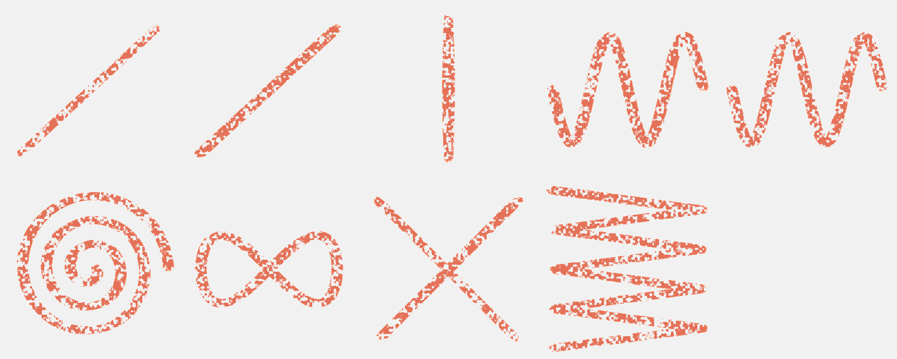

| stroke | covered | width | dark | spread | ms |
|---|---|---|---|---|---|
| light line | 3 % → 3 % | 8.3 px | 0.38 | 1.00 | 38 |
| heavy line | 5 % → 5 % | 13.2 px | 0.39 | 1.00 | 26 |
| pressure swell | 3 % → 3 % | 11.7 px | 0.38 | 1.00 | 25 |
| fast wave | 10 % → 10 % | 11.9 px | 0.39 | 1.00 | 73 |
| slow wave | 10 % → 10 % | 11.3 px | 0.39 | 1.00 | 125 |
| spiral | 15 % → 15 % | 9.6 px | 0.39 | 1.00 | 142 |
| loop | 7 % → 7 % | 9.4 px | 0.39 | 1.00 | 79 |
| tilted | 3 % → 3 % | 8.3 px | 0.38 | 1.00 | 34 |
| over the wet one | 7 % → 7 % | 11.1 px | 0.38 | 1.00 | 32 |
| long, no reload | 18 % → 18 % | 8.2 px | 0.39 | 1.00 | 186 | quarters: 0.08 → 0.08 → 0.08 → 0.07

Numbers say: light vs heavy: width 8.3 → 13.2 px, dark 0.38 → 0.39; the long stroke does not run out of paint.

## 0.45 · Charcoal
Charcoal · 18 px · 9.3 s

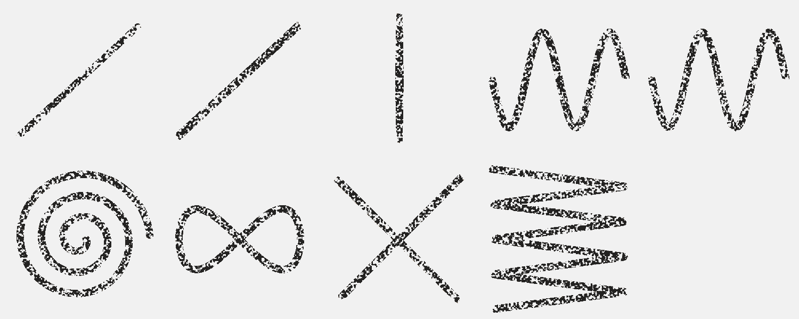

| stroke | covered | width | dark | spread | ms |
|---|---|---|---|---|---|
| light line | 2 % → 2 % | 6.5 px | 0.80 | 1.00 | 12 |
| heavy line | 3 % → 3 % | 9.2 px | 0.80 | 1.00 | 11 |
| pressure swell | 2 % → 2 % | 8.8 px | 0.80 | 1.00 | 17 |
| fast wave | 7 % → 7 % | 8.5 px | 0.80 | 1.00 | 36 |
| slow wave | 7 % → 7 % | 8.0 px | 0.80 | 1.00 | 53 |
| spiral | 12 % → 12 % | 7.9 px | 0.80 | 1.00 | 79 |
| loop | 6 % → 6 % | 8.1 px | 0.80 | 1.00 | 40 |
| tilted | 3 % → 3 % | 7.5 px | 0.80 | 1.00 | 22 |
| over the wet one | 6 % → 6 % | 7.9 px | 0.80 | 1.00 | 17 |
| long, no reload | 17 % → 17 % | 7.8 px | 0.80 | 1.00 | 97 | quarters: 0.15 → 0.16 → 0.15 → 0.16

Numbers say: light vs heavy: width 6.5 → 9.2 px, dark 0.80 → 0.80; the long stroke does not run out of paint.

## Watercolour — wash
Watercolor · 50 px · 29.9 s

| stroke | covered | width | dark | spread | ms |
|---|---|---|---|---|---|
| light line | 8 % → 9 % | 23.5 px | 0.01 | 1.13 | 89 |
| heavy line | 13 % → 14 % | 37.2 px | 0.01 | 1.07 | 105 |
| pressure swell | 8 % → 9 % | 28.6 px | 0.01 | 1.12 | 96 |
| fast wave | 25 % → 27 % | 28.9 px | 0.01 | 1.10 | 278 |
| slow wave | 25 % → 28 % | 28.5 px | 0.01 | 1.13 | 438 |
| spiral | 38 % → 43 % | 25.1 px | 0.01 | 1.12 | 447 |
| loop | 22 % → 25 % | 28.3 px | 0.01 | 1.14 | 223 |
| tilted | 10 % → 11 % | 26.7 px | 0.01 | 1.13 | 163 |
| over the wet one | 20 % → 22 % | 29.3 px | 0.01 | 1.09 | 98 |
| long, no reload | 44 % → 49 % | 19.7 px | 0.01 | 1.12 | 587 | quarters: 0.01 → 0.01 → 0.00 → 0.00

Numbers say: light vs heavy: width 23.5 → 37.2 px, dark 0.01 → 0.01.

## Watercolour — wet-in-wet
Watercolor · 44 px · 29.1 s

| stroke | covered | width | dark | spread | ms |
|---|---|---|---|---|---|
| light line | 7 % → 8 % | 19.2 px | 0.01 | 1.23 | 71 |
| heavy line | 11 % → 12 % | 30.8 px | 0.01 | 1.16 | 89 |
| pressure swell | 7 % → 8 % | 24.7 px | 0.01 | 1.19 | 59 |
| fast wave | 22 % → 26 % | 25.8 px | 0.01 | 1.15 | 202 |
| slow wave | 22 % → 25 % | 25.1 px | 0.01 | 1.17 | 331 |
| spiral | 35 % → 41 % | 23.1 px | 0.01 | 1.17 | 337 |
| loop | 19 % → 23 % | 25.2 px | 0.01 | 1.17 | 186 |
| tilted | 8 % → 9 % | 21.2 px | 0.01 | 1.15 | 117 |
| over the wet one | 16 % → 18 % | 24.7 px | 0.01 | 1.12 | 81 |
| long, no reload | 41 % → 48 % | 18.3 px | 0.01 | 1.18 | 507 | quarters: 0.01 → 0.00 → 0.00 → 0.00

Numbers say: light vs heavy: width 19.2 → 30.8 px, dark 0.01 → 0.01.

## Watercolour — glaze
Watercolor · 38 px · 27.2 s

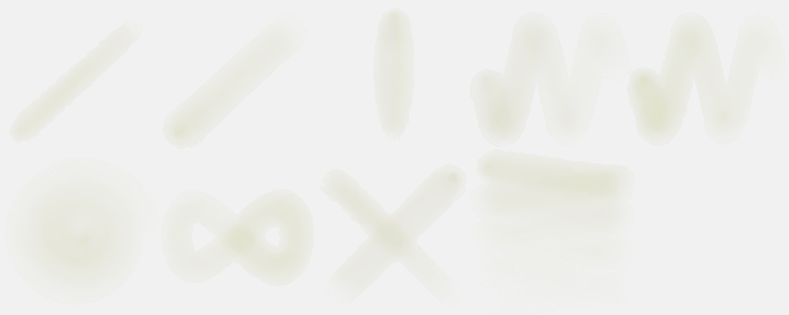

| stroke | covered | width | dark | spread | ms |
|---|---|---|---|---|---|
| light line | 7 % → 8 % | 19.2 px | 0.01 | 1.17 | 69 |
| heavy line | 11 % → 13 % | 32.3 px | 0.01 | 1.15 | 88 |
| pressure swell | 6 % → 8 % | 23.9 px | 0.01 | 1.21 | 52 |
| fast wave | 19 % → 22 % | 22.3 px | 0.01 | 1.14 | 191 |
| slow wave | 19 % → 22 % | 21.9 px | 0.01 | 1.16 | 302 |
| spiral | 30 % → 32 % | 19.9 px | 0.01 | 1.06 | 328 |
| loop | 18 % → 22 % | 23.8 px | 0.01 | 1.20 | 173 |
| tilted | 7 % → 8 % | 19.2 px | 0.01 | 1.18 | 111 |
| over the wet one | 16 % → 18 % | 25.9 px | 0.01 | 1.14 | 70 |
| long, no reload | 34 % → 36 % | 15.4 px | 0.01 | 1.04 | 468 | quarters: 0.01 → 0.00 → 0.00 → 0.00

Numbers say: light vs heavy: width 19.2 → 32.3 px, dark 0.01 → 0.01.

## Watercolour — granulating
Watercolor · 44 px · 27.1 s

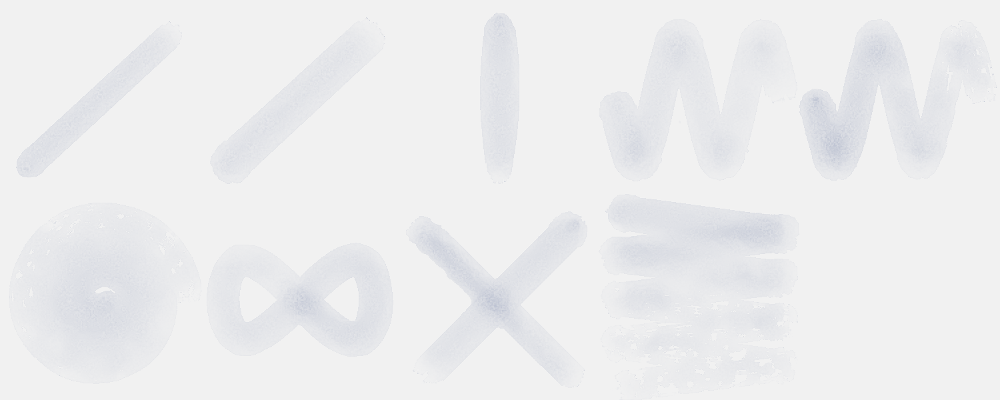

| stroke | covered | width | dark | spread | ms |
|---|---|---|---|---|---|
| light line | 7 % → 7 % | 19.3 px | 0.01 | 1.05 | 83 |
| heavy line | 11 % → 11 % | 31.0 px | 0.01 | 1.02 | 95 |
| pressure swell | 7 % → 7 % | 25.9 px | 0.01 | 1.05 | 69 |
| fast wave | 21 % → 20 % | 24.0 px | 0.01 | 0.99 | 206 |
| slow wave | 21 % → 21 % | 24.3 px | 0.02 | 1.02 | 359 |
| spiral | 34 % → 35 % | 22.5 px | 0.01 | 1.03 | 336 |
| loop | 17 % → 18 % | 22.5 px | 0.02 | 1.04 | 182 |
| tilted | 8 % → 8 % | 22.0 px | 0.02 | 1.08 | 109 |
| over the wet one | 17 % → 18 % | 26.4 px | 0.02 | 1.04 | 77 |
| long, no reload | 39 % → 39 % | 17.4 px | 0.02 | 1.01 | 487 | quarters: 0.01 → 0.01 → 0.01 → 0.00

Numbers say: light vs heavy: width 19.3 → 31.0 px, dark 0.01 → 0.01.

## Watercolour — dry brush
Watercolor · 36 px · 23.4 s

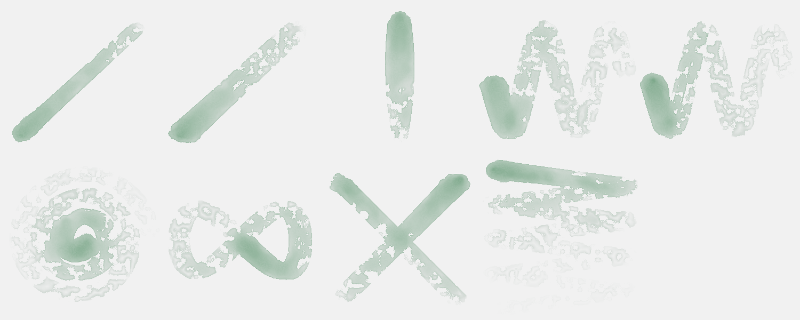

| stroke | covered | width | dark | spread | ms |
|---|---|---|---|---|---|
| light line | 5 % → 5 % | 15.5 px | 0.06 | 0.88 | 76 |
| heavy line | 9 % → 7 % | 24.9 px | 0.05 | 0.80 | 96 |
| pressure swell | 6 % → 5 % | 22.3 px | 0.06 | 0.89 | 65 |
| fast wave | 19 % → 11 % | 21.9 px | 0.04 | 0.58 | 241 |
| slow wave | 18 % → 10 % | 20.6 px | 0.05 | 0.55 | 356 |
| spiral | 23 % → 11 % | 15.2 px | 0.04 | 0.46 | 392 |
| loop | 15 % → 11 % | 19.5 px | 0.05 | 0.73 | 196 |
| tilted | 7 % → 7 % | 18.2 px | 0.05 | 1.08 | 93 |
| over the wet one | 14 % → 13 % | 21.8 px | 0.05 | 0.88 | 86 |
| long, no reload | 21 % → 12 % | 9.6 px | 0.05 | 0.57 | 552 | quarters: 0.02 → 0.01 → 0.00 → 0.00

Numbers say: light vs heavy: width 15.5 → 24.9 px, dark 0.06 → 0.05.

## Gouache
Gouache · 30 px · 24.8 s

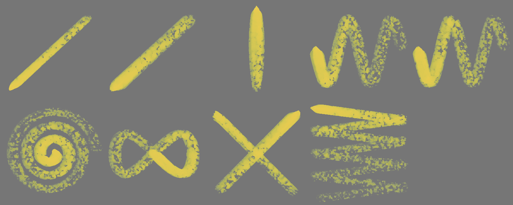

A light paint: laid on a grey sheet (on white it cannot be seen); **dark** = how far it is from the grey either way.

| stroke | covered | width | dark | spread | ms |
|---|---|---|---|---|---|
| light line | 8 % → 5 % | 24.4 px | 0.14 | 0.64 | 77 |
| heavy line | 14 % → 6 % | 39.7 px | 0.14 | 0.47 | 98 |
| pressure swell | 10 % → 6 % | 38.6 px | 0.14 | 0.60 | 64 |
| fast wave | 28 % → 7 % | 32.2 px | 0.14 | 0.25 | 196 |
| slow wave | 27 % → 8 % | 31.4 px | 0.14 | 0.29 | 320 |
| spiral | 38 % → 8 % | 24.8 px | 0.14 | 0.22 | 320 |
| loop | 22 % → 8 % | 28.6 px | 0.14 | 0.35 | 176 |
| tilted | 9 % → 9 % | 23.8 px | 0.14 | 1.01 | 104 |
| over the wet one | 20 % → 13 % | 31.1 px | 0.14 | 0.66 | 81 |
| long, no reload | 40 % → 9 % | 17.9 px | 0.14 | 0.24 | 492 | quarters: 0.07 → 0.04 → 0.01 → 0.01

Numbers say: light vs heavy: width 24.4 → 39.7 px, dark 0.14 → 0.14.

## Oil — alla prima
Oil · 30 px · 17.8 s

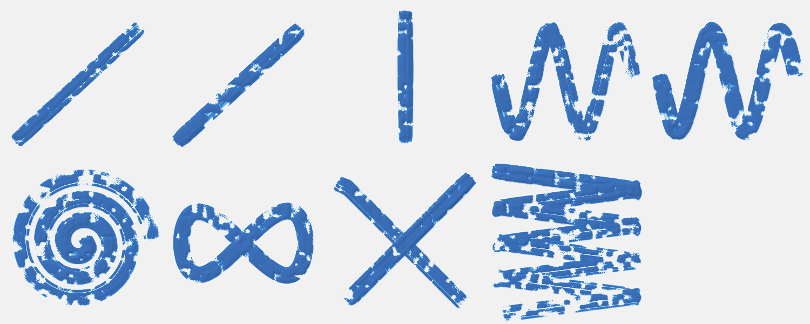

| stroke | covered | width | dark | spread | ms |
|---|---|---|---|---|---|
| light line | 9 % → 9 % | 27.6 px | 0.51 | 1.00 | 74 |
| heavy line | 10 % → 10 % | 30.3 px | 0.51 | 1.00 | 88 |
| pressure swell | 8 % → 8 % | 29.8 px | 0.53 | 1.00 | 65 |
| fast wave | 24 % → 24 % | 28.1 px | 0.51 | 1.00 | 210 |
| slow wave | 26 % → 26 % | 29.5 px | 0.51 | 1.00 | 355 |
| spiral | 40 % → 40 % | 26.4 px | 0.50 | 1.00 | 353 |
| loop | 21 % → 21 % | 27.6 px | 0.52 | 1.00 | 182 |
| tilted | 11 % → 11 % | 30.4 px | 0.51 | 1.00 | 106 |
| over the wet one | 20 % → 20 % | 26.5 px | 0.51 | 1.00 | 87 |
| long, no reload | 49 % → 49 % | 22.0 px | 0.50 | 1.00 | 512 | quarters: 0.32 → 0.28 → 0.25 → 0.22

Numbers say: light vs heavy: width 27.6 → 30.3 px, dark 0.51 → 0.51; pressure barely changes the width.

## Oil — impasto
Oil · 34 px · 18.6 s

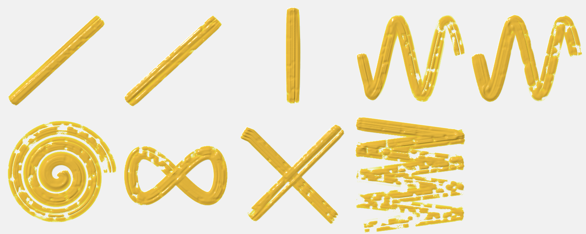

| stroke | covered | width | dark | spread | ms |
|---|---|---|---|---|---|
| light line | 12 % → 12 % | 33.4 px | 0.25 | 1.00 | 108 |
| heavy line | 12 % → 12 % | 36.3 px | 0.25 | 1.00 | 98 |
| pressure swell | 10 % → 10 % | 35.9 px | 0.26 | 1.00 | 71 |
| fast wave | 30 % → 30 % | 35.1 px | 0.25 | 1.00 | 251 |
| slow wave | 31 % → 31 % | 35.7 px | 0.25 | 1.00 | 419 |
| spiral | 52 % → 52 % | 34.0 px | 0.23 | 1.00 | 456 |
| loop | 26 % → 26 % | 33.7 px | 0.24 | 1.00 | 216 |
| tilted | 12 % → 12 % | 32.8 px | 0.26 | 1.00 | 144 |
| over the wet one | 23 % → 23 % | 31.9 px | 0.26 | 1.00 | 105 |
| long, no reload | 60 % → 60 % | 26.9 px | 0.22 | 1.00 | 651 | quarters: 0.18 → 0.16 → 0.13 → 0.10

Numbers say: light vs heavy: width 33.4 → 36.3 px, dark 0.25 → 0.25; pressure barely changes the width.

## Oil — glaze
Oil · 40 px · 14.8 s

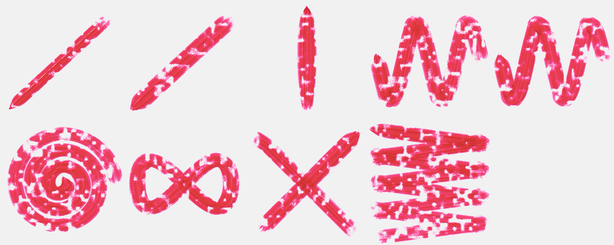

| stroke | covered | width | dark | spread | ms |
|---|---|---|---|---|---|
| light line | 9 % → 9 % | 25.4 px | 0.50 | 1.00 | 83 |
| heavy line | 13 % → 13 % | 36.3 px | 0.49 | 1.00 | 101 |
| pressure swell | 9 % → 9 % | 35.3 px | 0.50 | 1.00 | 74 |
| fast wave | 26 % → 26 % | 30.1 px | 0.48 | 1.00 | 251 |
| slow wave | 29 % → 29 % | 33.7 px | 0.49 | 1.00 | 449 |
| spiral | 44 % → 44 % | 29.0 px | 0.49 | 1.00 | 436 |
| loop | 23 % → 23 % | 30.2 px | 0.50 | 1.00 | 209 |
| tilted | 10 % → 10 % | 28.9 px | 0.50 | 1.00 | 136 |
| over the wet one | 22 % → 22 % | 31.6 px | 0.50 | 1.00 | 93 |
| long, no reload | 51 % → 51 % | 22.7 px | 0.49 | 1.00 | 641 | quarters: 0.33 → 0.29 → 0.26 → 0.22

Numbers say: light vs heavy: width 25.4 → 36.3 px, dark 0.50 → 0.49.

## Oil — scumble
Oil · 36 px · 20.4 s

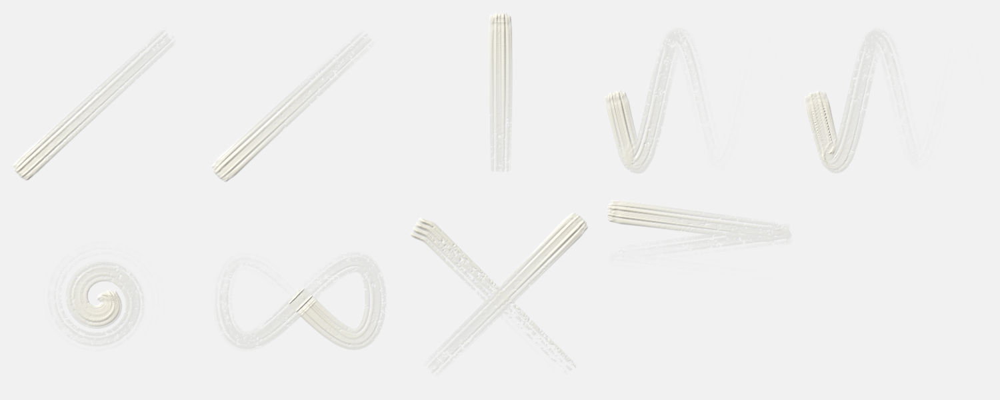

A light paint: laid on a grey sheet (on white it cannot be seen); **dark** = how far it is from the grey either way.

| stroke | covered | width | dark | spread | ms |
|---|---|---|---|---|---|
| light line | 11 % → 11 % | 33.1 px | 0.08 | 1.00 | 106 |
| heavy line | 12 % → 12 % | 36.1 px | 0.07 | 1.00 | 129 |
| pressure swell | 9 % → 9 % | 35.5 px | 0.07 | 1.00 | 85 |
| fast wave | 26 % → 26 % | 29.6 px | 0.06 | 1.00 | 322 |
| slow wave | 27 % → 27 % | 30.9 px | 0.05 | 1.00 | 505 |
| spiral | 41 % → 41 % | 27.1 px | 0.04 | 1.00 | 545 |
| loop | 24 % → 24 % | 30.6 px | 0.06 | 1.00 | 272 |
| tilted | 11 % → 11 % | 30.4 px | 0.07 | 1.00 | 138 |
| over the wet one | 22 % → 22 % | 31.4 px | 0.07 | 1.00 | 138 |
| long, no reload | 45 % → 45 % | 20.3 px | 0.04 | 1.00 | 885 | quarters: 0.04 → 0.02 → 0.01 → 0.00

Numbers say: light vs heavy: width 33.1 → 36.1 px, dark 0.08 → 0.07; pressure barely changes the width.

## Acrylic — heavy body
Heavy acrylic · 30 px · 13.9 s

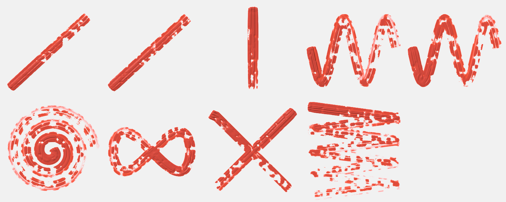

| stroke | covered | width | dark | spread | ms |
|---|---|---|---|---|---|
| light line | 10 % → 9 % | 28.9 px | 0.51 | 0.91 | 78 |
| heavy line | 11 % → 10 % | 31.1 px | 0.51 | 0.93 | 84 |
| pressure swell | 8 % → 8 % | 30.7 px | 0.53 | 0.94 | 62 |
| fast wave | 23 % → 15 % | 26.5 px | 0.52 | 0.64 | 224 |
| slow wave | 24 % → 16 % | 27.7 px | 0.51 | 0.65 | 363 |
| spiral | 35 % → 15 % | 23.3 px | 0.51 | 0.43 | 376 |
| loop | 21 % → 16 % | 26.9 px | 0.51 | 0.76 | 229 |
| tilted | 9 % → 9 % | 24.9 px | 0.52 | 0.99 | 113 |
| over the wet one | 19 % → 17 % | 27.7 px | 0.52 | 0.89 | 92 |
| long, no reload | 39 % → 16 % | 17.3 px | 0.51 | 0.41 | 539 | quarters: 0.29 → 0.20 → 0.12 → 0.04

Numbers say: light vs heavy: width 28.9 → 31.1 px, dark 0.51 → 0.51; pressure barely changes the width.

## Acrylic — fluid
Watercolor · 36 px · 26.5 s

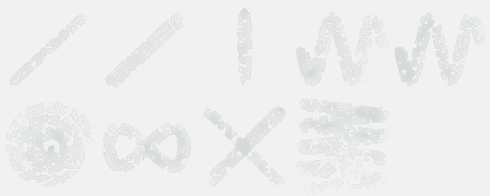

| stroke | covered | width | dark | spread | ms |
|---|---|---|---|---|---|
| light line | 8 % → 8 % | 22.6 px | 0.06 | 1.03 | 75 |
| heavy line | 12 % → 12 % | 35.0 px | 0.05 | 0.99 | 90 |
| pressure swell | 7 % → 7 % | 27.4 px | 0.06 | 0.99 | 53 |
| fast wave | 25 % → 24 % | 28.7 px | 0.05 | 0.95 | 224 |
| slow wave | 23 % → 23 % | 26.9 px | 0.06 | 1.01 | 337 |
| spiral | 36 % → 35 % | 23.6 px | 0.05 | 0.97 | 335 |
| loop | 21 % → 22 % | 27.2 px | 0.06 | 1.03 | 171 |
| tilted | 8 % → 9 % | 22.5 px | 0.06 | 1.12 | 112 |
| over the wet one | 19 % → 19 % | 30.7 px | 0.06 | 1.01 | 88 |
| long, no reload | 41 % → 40 % | 18.3 px | 0.05 | 0.98 | 510 | quarters: 0.04 → 0.03 → 0.02 → 0.01

Numbers say: light vs heavy: width 22.6 → 35.0 px, dark 0.06 → 0.05.

## Acrylic — palette knife
Heavy acrylic · 42 px · 18.2 s

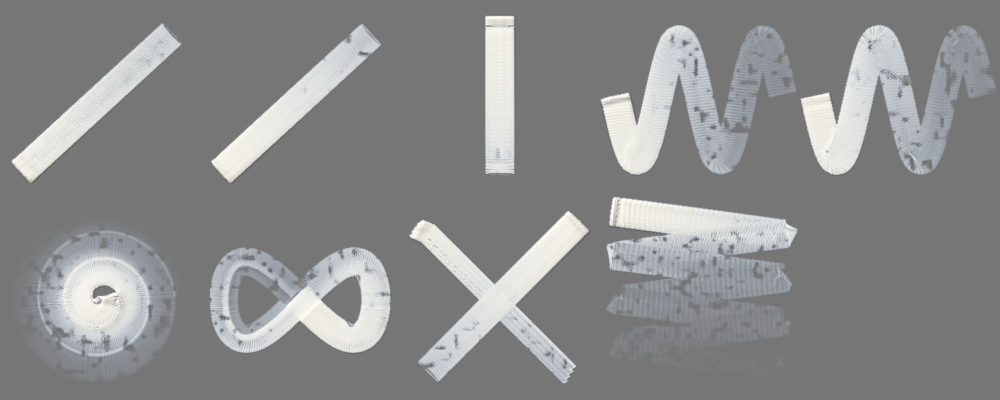

A light paint: laid on a grey sheet (on white it cannot be seen); **dark** = how far it is from the grey either way.

| stroke | covered | width | dark | spread | ms |
|---|---|---|---|---|---|
| light line | 15 % → 15 % | 44.0 px | 0.06 | 0.98 | 25 |
| heavy line | 15 % → 15 % | 44.2 px | 0.05 | 0.97 | 31 |
| pressure swell | 12 % → 12 % | 43.5 px | 0.07 | 0.99 | 10 |
| fast wave | 36 % → 20 % | 41.9 px | 0.06 | 0.56 | 51 |
| slow wave | 37 % → 21 % | 42.6 px | 0.06 | 0.57 | 87 |
| spiral | 50 % → 18 % | 32.8 px | 0.07 | 0.37 | 89 |
| loop | 32 % → 24 % | 41.2 px | 0.06 | 0.75 | 56 |
| tilted | 12 % → 12 % | 33.6 px | 0.06 | 1.00 | 22 |
| over the wet one | 26 % → 25 % | 39.7 px | 0.06 | 0.97 | 31 |
| long, no reload | 57 % → 21 % | 25.7 px | 0.06 | 0.36 | 180 | quarters: 0.04 → 0.02 → 0.00 → 0.00

Numbers say: light vs heavy: width 44.0 → 44.2 px, dark 0.06 → 0.05; pressure barely changes the width.

## Finger on oil
Oil · 30 px · 12.9 s

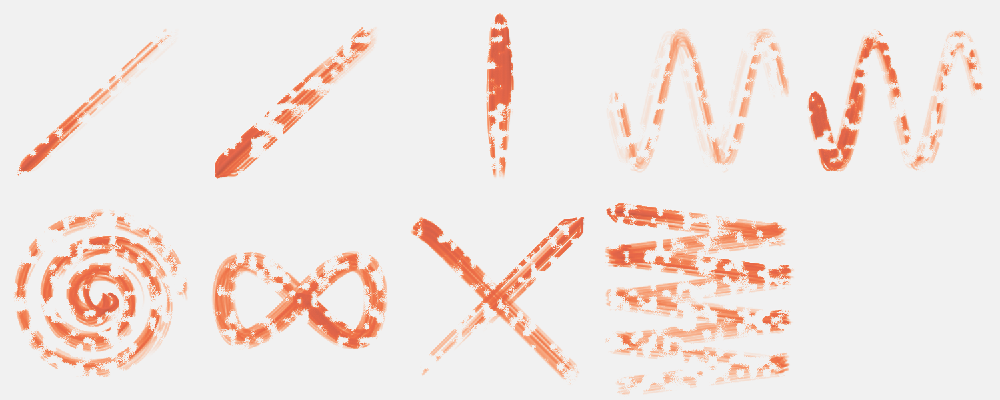

| stroke | covered | width | dark | spread | ms |
|---|---|---|---|---|---|
| light line | 8 % → 8 % | 23.7 px | 0.40 | 1.00 | 53 |
| heavy line | 13 % → 13 % | 36.5 px | 0.38 | 1.00 | 64 |
| pressure swell | 9 % → 9 % | 33.3 px | 0.41 | 1.00 | 45 |
| fast wave | 22 % → 22 % | 26.0 px | 0.35 | 1.00 | 123 |
| slow wave | 24 % → 24 % | 27.8 px | 0.35 | 1.00 | 226 |
| spiral | 36 % → 36 % | 23.5 px | 0.27 | 1.00 | 207 |
| loop | 21 % → 21 % | 27.3 px | 0.36 | 1.00 | 135 |
| tilted | 9 % → 9 % | 26.4 px | 0.39 | 1.00 | 87 |
| over the wet one | 20 % → 20 % | 29.3 px | 0.39 | 1.00 | 54 |
| long, no reload | 36 % → 36 % | 16.3 px | 0.26 | 1.00 | 380 | quarters: 0.23 → 0.11 → 0.05 → 0.02

Numbers say: light vs heavy: width 23.7 → 36.5 px, dark 0.40 → 0.38.

## Palette knife — oil
Oil · 44 px · 17.8 s

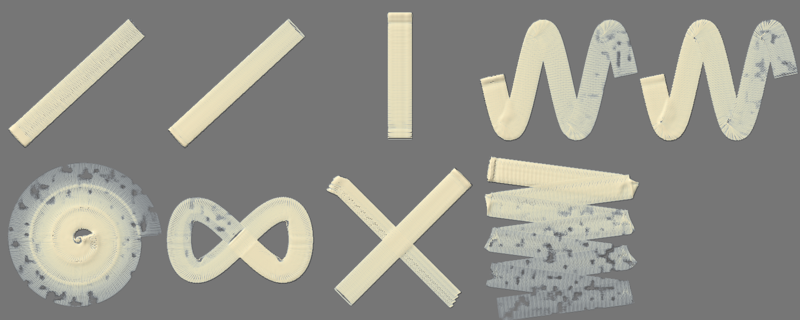

A light paint: laid on a grey sheet (on white it cannot be seen); **dark** = how far it is from the grey either way.

| stroke | covered | width | dark | spread | ms |
|---|---|---|---|---|---|
| light line | 16 % → 16 % | 45.6 px | 0.12 | 1.00 | 36 |
| heavy line | 16 % → 16 % | 46.3 px | 0.11 | 1.00 | 26 |
| pressure swell | 12 % → 12 % | 45.2 px | 0.12 | 1.00 | 13 |
| fast wave | 39 % → 39 % | 44.9 px | 0.11 | 1.00 | 72 |
| slow wave | 39 % → 39 % | 45.4 px | 0.11 | 1.00 | 107 |
| spiral | 62 % → 62 % | 40.9 px | 0.08 | 1.00 | 103 |
| loop | 34 % → 34 % | 43.8 px | 0.11 | 1.00 | 64 |
| tilted | 13 % → 13 % | 36.6 px | 0.11 | 1.00 | 21 |
| over the wet one | 28 % → 28 % | 40.8 px | 0.11 | 1.00 | 21 |
| long, no reload | 74 % → 74 % | 33.1 px | 0.08 | 1.00 | 150 | quarters: 0.10 → 0.07 → 0.05 → 0.04

Numbers say: light vs heavy: width 45.6 → 46.3 px, dark 0.12 → 0.11; pressure barely changes the width.

## 0.45 · Sponge
Watercolor · 46 px · 20.8 s

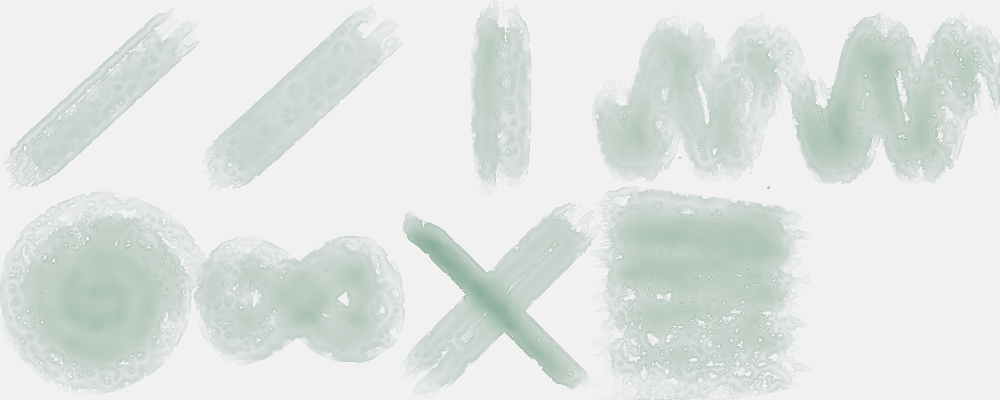

| stroke | covered | width | dark | spread | ms |
|---|---|---|---|---|---|
| light line | 9 % → 0 % | 26.5 px | 0.00 | 0.00 | 47 |
| heavy line | 12 % → 0 % | 35.5 px | 0.00 | 0.00 | 75 |
| pressure swell | 8 % → 0 % | 30.7 px | 0.01 | 0.05 | 52 |
| fast wave | 18 % → 0 % | 20.4 px | 0.01 | 0.02 | 142 |
| slow wave | 25 % → 3 % | 29.0 px | 0.02 | 0.14 | 279 |
| spiral | 31 % → 5 % | 20.2 px | 0.02 | 0.17 | 255 |
| loop | 21 % → 2 % | 27.1 px | 0.02 | 0.12 | 151 |
| tilted | 8 % → 10 % | 23.1 px | 0.05 | 1.17 | 98 |
| over the wet one | 19 % → 6 % | 29.5 px | 0.05 | 0.31 | 55 |
| long, no reload | 36 % → 8 % | 16.1 px | 0.02 | 0.22 | 339 | quarters: 0.01 → 0.01 → 0.01 → 0.01

Numbers say: light vs heavy: width 26.5 → 35.5 px, dark 0.00 → 0.00.

## 0.45 · Eraser
Eraser · 30 px · 19.0 s · over bands of wet oil paint and oil pastel in turn (it works on paint already there: look at what it does to the bands; covered counts the bands too)

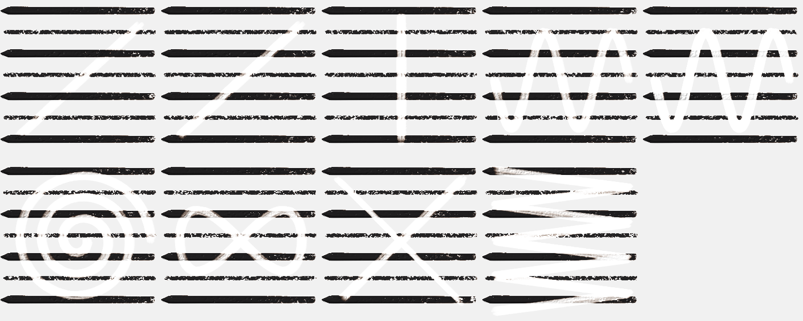

| stroke | covered | width | dark | spread | ms |
|---|---|---|---|---|---|
| light line | 24 % → 24 % | 69.2 px | 0.82 | 1.00 | 52 |
| heavy line | 23 % → 23 % | 67.4 px | 0.81 | 1.00 | 49 |
| pressure swell | 23 % → 23 % | 86.7 px | 0.82 | 1.00 | 31 |
| fast wave | 21 % → 21 % | 24.7 px | 0.81 | 1.00 | 132 |
| slow wave | 20 % → 20 % | 23.5 px | 0.82 | 1.00 | 190 |
| spiral | 20 % → 20 % | 13.5 px | 0.79 | 1.00 | 200 |
| loop | 21 % → 21 % | 27.8 px | 0.80 | 1.00 | 116 |
| tilted | 23 % → 23 % | 64.8 px | 0.81 | 1.00 | 47 |
| over the wet one | 22 % → 22 % | 0.0 px | 0.81 | 1.00 | 45 |
| long, no reload | 17 % → 17 % | 7.5 px | 0.79 | 1.00 | 298 | quarters: 0.13 → 0.16 → 0.13 → 0.17

Numbers say: light vs heavy: width 69.2 → 67.4 px, dark 0.82 → 0.81; pressure barely changes the width; the long stroke does not run out of paint.

## Lift wet paint
Eraser · 30 px · 19.1 s · over bands of wet oil paint and oil pastel in turn (it works on paint already there: look at what it does to the bands; covered counts the bands too)

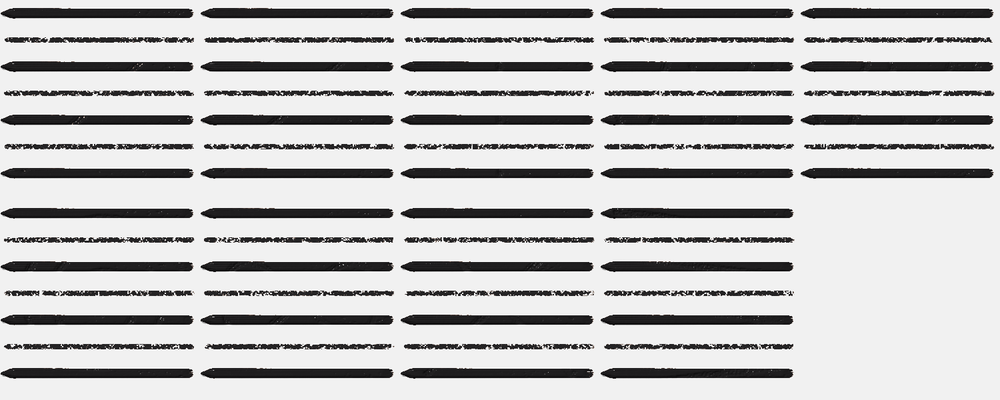

| stroke | covered | width | dark | spread | ms |
|---|---|---|---|---|---|
| light line | 24 % → 24 % | 70.1 px | 0.82 | 1.00 | 33 |
| heavy line | 24 % → 24 % | 69.8 px | 0.82 | 1.00 | 51 |
| pressure swell | 24 % → 24 % | 89.5 px | 0.82 | 1.00 | 37 |
| fast wave | 24 % → 24 % | 27.7 px | 0.82 | 1.00 | 83 |
| slow wave | 24 % → 24 % | 27.7 px | 0.82 | 1.00 | 137 |
| spiral | 24 % → 24 % | 15.9 px | 0.82 | 1.00 | 161 |
| loop | 24 % → 24 % | 31.1 px | 0.82 | 1.00 | 82 |
| tilted | 24 % → 24 % | 66.8 px | 0.82 | 1.00 | 53 |
| over the wet one | 24 % → 24 % | 0.0 px | 0.82 | 1.00 | 45 |
| long, no reload | 24 % → 24 % | 10.7 px | 0.82 | 1.00 | 235 | quarters: 0.18 → 0.24 → 0.17 → 0.24

Numbers say: light vs heavy: width 70.1 → 69.8 px, dark 0.82 → 0.82; pressure barely changes the width; the long stroke does not run out of paint.

## Sgraffito
Eraser · 10 px · 18.9 s · over bands of wet oil paint and oil pastel in turn (it works on paint already there: look at what it does to the bands; covered counts the bands too)

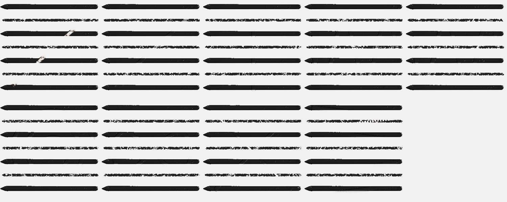

| stroke | covered | width | dark | spread | ms |
|---|---|---|---|---|---|
| light line | 24 % → 24 % | 69.5 px | 0.81 | 1.00 | 13 |
| heavy line | 24 % → 24 % | 69.5 px | 0.82 | 1.00 | 12 |
| pressure swell | 24 % → 24 % | 89.5 px | 0.82 | 1.00 | 7 |
| fast wave | 24 % → 24 % | 27.4 px | 0.82 | 1.00 | 17 |
| slow wave | 24 % → 24 % | 27.4 px | 0.81 | 1.00 | 17 |
| spiral | 24 % → 24 % | 15.7 px | 0.81 | 1.00 | 37 |
| loop | 24 % → 24 % | 30.9 px | 0.82 | 1.00 | 16 |
| tilted | 24 % → 24 % | 66.6 px | 0.82 | 1.00 | 6 |
| over the wet one | 24 % → 24 % | 0.0 px | 0.82 | 1.00 | 10 |
| long, no reload | 24 % → 24 % | 10.6 px | 0.82 | 1.00 | 59 | quarters: 0.17 → 0.24 → 0.17 → 0.24

Numbers say: light vs heavy: width 69.5 → 69.5 px, dark 0.81 → 0.82; pressure barely changes the width; the long stroke does not run out of paint.

## Brush Artist · Refs · #01 Henry Ward peach cloud
Gouache · 44 px · 26.6 s

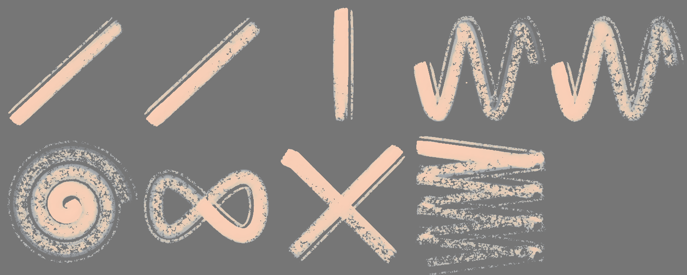

A light paint: laid on a grey sheet (on white it cannot be seen); **dark** = how far it is from the grey either way.

| stroke | covered | width | dark | spread | ms |
|---|---|---|---|---|---|
| light line | 14 % → 7 % | 41.3 px | 0.10 | 0.47 | 124 |
| heavy line | 15 % → 9 % | 45.0 px | 0.10 | 0.57 | 138 |
| pressure swell | 12 % → 7 % | 43.3 px | 0.10 | 0.64 | 113 |
| fast wave | 36 % → 10 % | 41.9 px | 0.10 | 0.28 | 378 |
| slow wave | 36 % → 11 % | 41.9 px | 0.10 | 0.30 | 579 |
| spiral | 57 % → 11 % | 37.7 px | 0.10 | 0.20 | 591 |
| loop | 31 % → 12 % | 40.4 px | 0.10 | 0.38 | 307 |
| tilted | 12 % → 12 % | 34.1 px | 0.10 | 1.01 | 154 |
| over the wet one | 26 % → 17 % | 39.3 px | 0.10 | 0.66 | 150 |
| long, no reload | 64 % → 15 % | 28.8 px | 0.10 | 0.23 | 888 | quarters: 0.07 → 0.04 → 0.01 → 0.00

Numbers say: light vs heavy: width 41.3 → 45.0 px, dark 0.10 → 0.10; pressure barely changes the width.

## Brush Artist · Refs · #02 Henry Ward cream strokes
Gouache · 46 px · 26.4 s

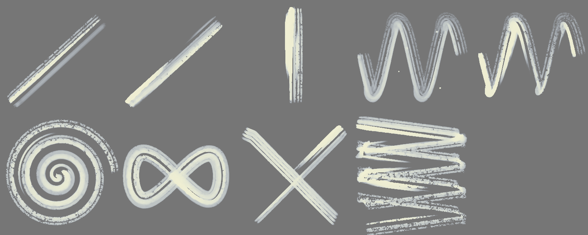

A light paint: laid on a grey sheet (on white it cannot be seen); **dark** = how far it is from the grey either way.

| stroke | covered | width | dark | spread | ms |
|---|---|---|---|---|---|
| light line | 13 % → 5 % | 38.1 px | 0.03 | 0.41 | 136 |
| heavy line | 14 % → 9 % | 41.9 px | 0.03 | 0.62 | 147 |
| pressure swell | 11 % → 8 % | 40.3 px | 0.03 | 0.70 | 112 |
| fast wave | 34 % → 10 % | 39.3 px | 0.03 | 0.29 | 373 |
| slow wave | 34 % → 11 % | 39.3 px | 0.03 | 0.31 | 658 |
| spiral | 55 % → 12 % | 36.5 px | 0.03 | 0.21 | 575 |
| loop | 30 % → 12 % | 38.6 px | 0.03 | 0.39 | 315 |
| tilted | 12 % → 12 % | 34.3 px | 0.03 | 1.01 | 165 |
| over the wet one | 25 % → 17 % | 36.4 px | 0.03 | 0.68 | 135 |
| long, no reload | 63 % → 14 % | 28.1 px | 0.03 | 0.23 | 864 | quarters: 0.02 → 0.02 → 0.01 → 0.00

Numbers say: light vs heavy: width 38.1 → 41.9 px, dark 0.03 → 0.03; pressure barely changes the width.

## Brush Artist · Refs · #03 Henry Ward navy contours
Heavy acrylic · 22 px · 13.0 s

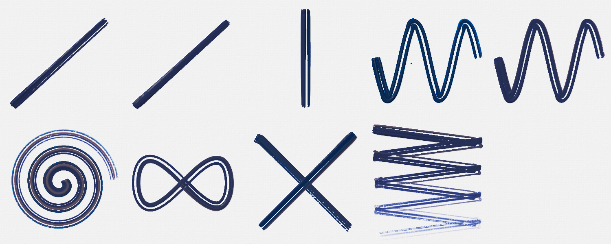

| stroke | covered | width | dark | spread | ms |
|---|---|---|---|---|---|
| light line | 7 % → 7 % | 21.5 px | 0.70 | 0.94 | 78 |
| heavy line | 8 % → 8 % | 23.4 px | 0.70 | 0.95 | 66 |
| pressure swell | 6 % → 6 % | 23.2 px | 0.73 | 0.94 | 65 |
| fast wave | 19 % → 12 % | 21.8 px | 0.72 | 0.66 | 169 |
| slow wave | 19 % → 13 % | 22.4 px | 0.72 | 0.69 | 271 |
| spiral | 30 % → 13 % | 19.5 px | 0.72 | 0.45 | 306 |
| loop | 17 % → 13 % | 21.4 px | 0.72 | 0.81 | 149 |
| tilted | 8 % → 8 % | 22.6 px | 0.71 | 1.00 | 82 |
| over the wet one | 16 % → 14 % | 21.2 px | 0.71 | 0.89 | 68 |
| long, no reload | 34 % → 14 % | 15.1 px | 0.72 | 0.40 | 442 | quarters: 0.35 → 0.29 → 0.20 → 0.08

Numbers say: light vs heavy: width 21.5 → 23.4 px, dark 0.70 → 0.70; pressure barely changes the width.

## Brush Artist · Refs · #04 Henry Ward grey cloud
Gouache · 50 px · 27.8 s

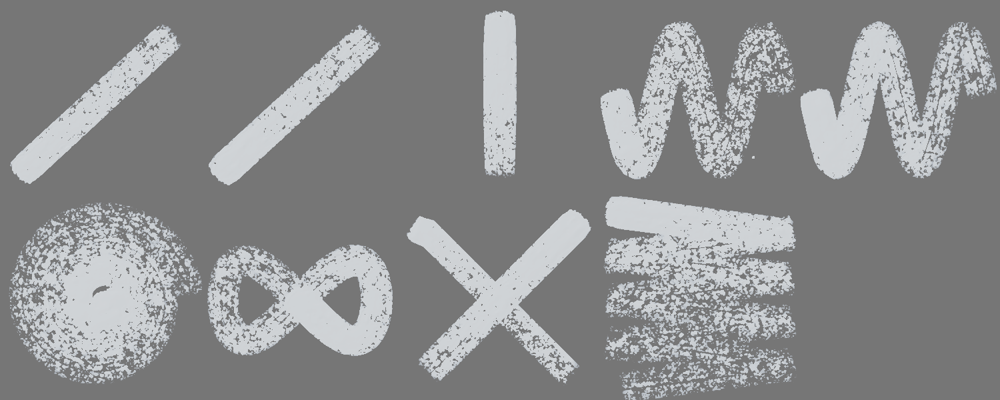

A light paint: laid on a grey sheet (on white it cannot be seen); **dark** = how far it is from the grey either way.

| stroke | covered | width | dark | spread | ms |
|---|---|---|---|---|---|
| light line | 15 % → 6 % | 43.9 px | 0.10 | 0.38 | 133 |
| heavy line | 17 % → 10 % | 48.3 px | 0.10 | 0.58 | 138 |
| pressure swell | 12 % → 8 % | 46.6 px | 0.10 | 0.65 | 107 |
| fast wave | 39 % → 11 % | 44.5 px | 0.10 | 0.28 | 383 |
| slow wave | 39 % → 12 % | 44.7 px | 0.10 | 0.30 | 669 |
| spiral | 58 % → 13 % | 38.1 px | 0.10 | 0.23 | 650 |
| loop | 34 % → 13 % | 44.0 px | 0.10 | 0.39 | 341 |
| tilted | 13 % → 13 % | 37.2 px | 0.10 | 1.01 | 172 |
| over the wet one | 28 % → 19 % | 41.9 px | 0.10 | 0.69 | 141 |
| long, no reload | 68 % → 16 % | 30.7 px | 0.10 | 0.23 | 953 | quarters: 0.08 → 0.04 → 0.01 → 0.00

Numbers say: light vs heavy: width 43.9 → 48.3 px, dark 0.10 → 0.10; pressure barely changes the width.

## Brush Artist · Refs · #05 Henry Ward green in rust loops
Heavy acrylic · 20 px · 12.8 s

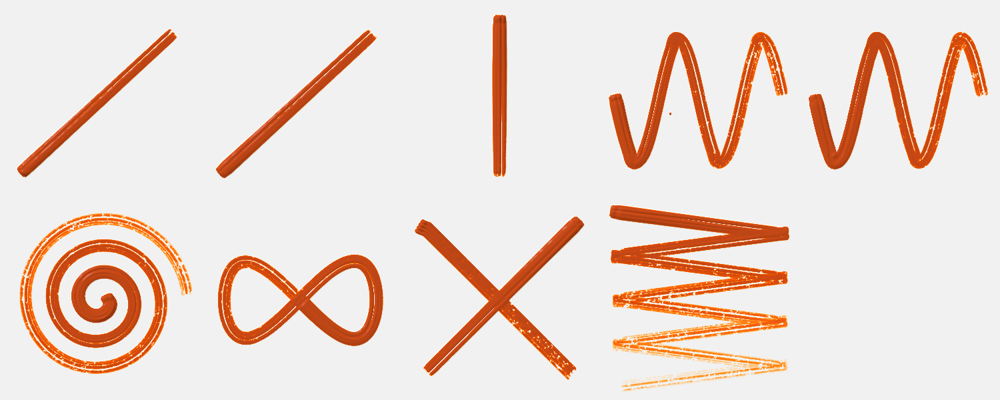

| stroke | covered | width | dark | spread | ms |
|---|---|---|---|---|---|
| light line | 7 % → 6 % | 19.5 px | 0.55 | 0.94 | 73 |
| heavy line | 7 % → 7 % | 21.2 px | 0.55 | 0.94 | 76 |
| pressure swell | 6 % → 5 % | 21.5 px | 0.57 | 0.92 | 51 |
| fast wave | 17 % → 11 % | 19.7 px | 0.56 | 0.64 | 174 |
| slow wave | 18 % → 12 % | 20.3 px | 0.56 | 0.66 | 275 |
| spiral | 27 % → 12 % | 17.9 px | 0.55 | 0.42 | 280 |
| loop | 15 % → 12 % | 19.5 px | 0.55 | 0.80 | 145 |
| tilted | 8 % → 8 % | 21.7 px | 0.56 | 1.00 | 71 |
| over the wet one | 15 % → 13 % | 19.1 px | 0.56 | 0.87 | 71 |
| long, no reload | 30 % → 12 % | 13.4 px | 0.56 | 0.39 | 403 | quarters: 0.25 → 0.18 → 0.10 → 0.02

Numbers say: light vs heavy: width 19.5 → 21.2 px, dark 0.55 → 0.55; pressure barely changes the width.

## Brush Artist · Refs · #06 Henry Ward scrubbed grey
Gouache · 50 px · 29.1 s

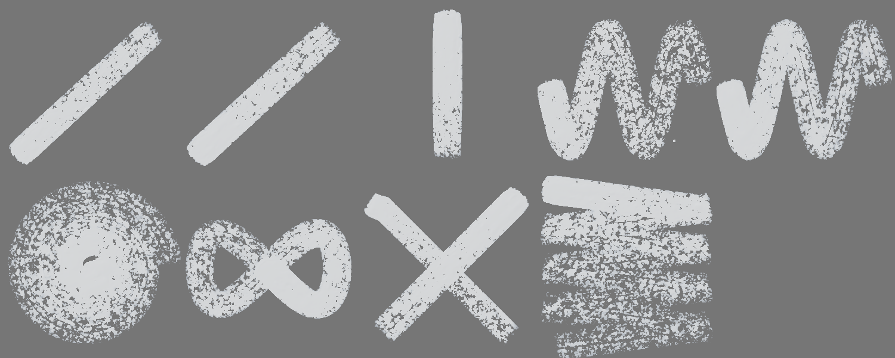

A light paint: laid on a grey sheet (on white it cannot be seen); **dark** = how far it is from the grey either way.

| stroke | covered | width | dark | spread | ms |
|---|---|---|---|---|---|
| light line | 15 % → 6 % | 43.9 px | 0.09 | 0.38 | 123 |
| heavy line | 17 % → 10 % | 48.3 px | 0.09 | 0.58 | 175 |
| pressure swell | 12 % → 8 % | 46.6 px | 0.09 | 0.65 | 101 |
| fast wave | 39 % → 11 % | 44.5 px | 0.09 | 0.28 | 369 |
| slow wave | 39 % → 12 % | 44.7 px | 0.09 | 0.30 | 667 |
| spiral | 58 % → 13 % | 38.1 px | 0.09 | 0.23 | 660 |
| loop | 34 % → 13 % | 44.0 px | 0.08 | 0.39 | 343 |
| tilted | 13 % → 13 % | 37.2 px | 0.09 | 1.01 | 185 |
| over the wet one | 28 % → 19 % | 41.9 px | 0.09 | 0.69 | 156 |
| long, no reload | 68 % → 16 % | 30.7 px | 0.08 | 0.23 | 999 | quarters: 0.06 → 0.04 → 0.01 → 0.00

Numbers say: light vs heavy: width 43.9 → 48.3 px, dark 0.09 → 0.09; pressure barely changes the width.

## Brush Artist · Refs · #07 Henry Ward blue L + black zigzag
Heavy acrylic · 34 px · 14.9 s

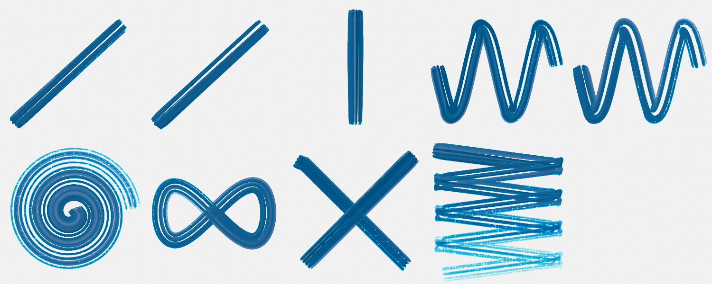

| stroke | covered | width | dark | spread | ms |
|---|---|---|---|---|---|
| light line | 11 % → 11 % | 33.1 px | 0.57 | 0.93 | 98 |
| heavy line | 12 % → 11 % | 35.7 px | 0.57 | 0.93 | 95 |
| pressure swell | 9 % → 9 % | 35.2 px | 0.59 | 0.94 | 79 |
| fast wave | 29 % → 20 % | 33.6 px | 0.59 | 0.69 | 211 |
| slow wave | 30 % → 21 % | 34.1 px | 0.58 | 0.73 | 414 |
| spiral | 47 % → 22 % | 31.3 px | 0.58 | 0.46 | 412 |
| loop | 25 % → 21 % | 32.7 px | 0.58 | 0.82 | 228 |
| tilted | 11 % → 11 % | 29.8 px | 0.58 | 1.00 | 113 |
| over the wet one | 22 % → 20 % | 31.7 px | 0.58 | 0.91 | 100 |
| long, no reload | 53 % → 22 % | 23.8 px | 0.59 | 0.42 | 604 | quarters: 0.40 → 0.32 → 0.21 → 0.10

Numbers say: light vs heavy: width 33.1 → 35.7 px, dark 0.57 → 0.57; pressure barely changes the width.

## Brush Artist · Refs · #08 Henry Ward olive bands
Gouache · 34 px · 22.6 s

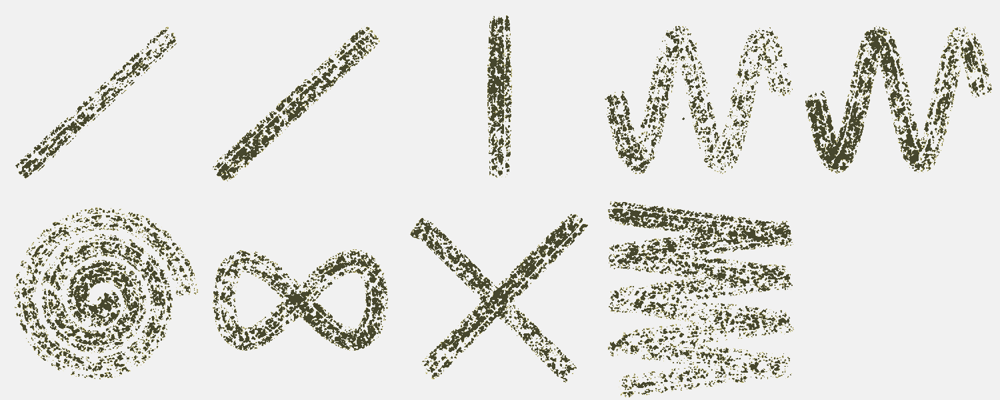

| stroke | covered | width | dark | spread | ms |
|---|---|---|---|---|---|
| light line | 8 % → 2 % | 24.7 px | 0.57 | 0.27 | 65 |
| heavy line | 12 % → 3 % | 33.9 px | 0.57 | 0.22 | 132 |
| pressure swell | 8 % → 3 % | 30.8 px | 0.57 | 0.38 | 77 |
| fast wave | 25 % → 4 % | 29.2 px | 0.57 | 0.15 | 239 |
| slow wave | 25 % → 4 % | 28.9 px | 0.57 | 0.15 | 386 |
| spiral | 39 % → 4 % | 25.7 px | 0.57 | 0.10 | 410 |
| loop | 22 % → 5 % | 28.8 px | 0.57 | 0.21 | 214 |
| tilted | 10 % → 10 % | 28.6 px | 0.57 | 0.98 | 119 |
| over the wet one | 20 % → 8 % | 28.3 px | 0.57 | 0.40 | 109 |
| long, no reload | 45 % → 6 % | 20.0 px | 0.57 | 0.13 | 602 | quarters: 0.35 → 0.27 → 0.17 → 0.08

Numbers say: light vs heavy: width 24.7 → 33.9 px, dark 0.57 → 0.57.

## Brush Artist · Refs · #09 Henry Ward white loops
Gouache · 46 px · 26.8 s

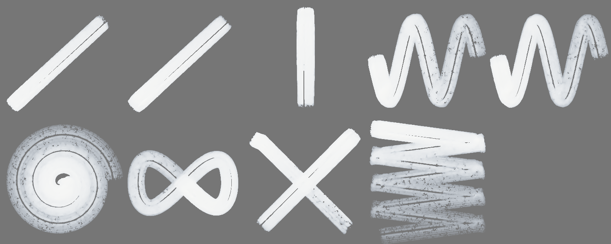

A light paint: laid on a grey sheet (on white it cannot be seen); **dark** = how far it is from the grey either way.

| stroke | covered | width | dark | spread | ms |
|---|---|---|---|---|---|
| light line | 13 % → 5 % | 38.1 px | 0.01 | 0.41 | 124 |
| heavy line | 14 % → 9 % | 41.9 px | 0.01 | 0.62 | 149 |
| pressure swell | 11 % → 8 % | 40.3 px | 0.01 | 0.70 | 102 |
| fast wave | 34 % → 10 % | 39.3 px | 0.01 | 0.29 | 366 |
| slow wave | 34 % → 11 % | 39.3 px | 0.01 | 0.31 | 569 |
| spiral | 55 % → 12 % | 36.5 px | 0.01 | 0.21 | 601 |
| loop | 30 % → 12 % | 38.6 px | 0.01 | 0.39 | 340 |
| tilted | 12 % → 12 % | 34.3 px | 0.01 | 1.01 | 153 |
| over the wet one | 25 % → 17 % | 36.4 px | 0.01 | 0.68 | 141 |
| long, no reload | 63 % → 14 % | 28.1 px | 0.02 | 0.23 | 898 | quarters: 0.01 → 0.02 → 0.01 → 0.00

Numbers say: light vs heavy: width 38.1 → 41.9 px, dark 0.01 → 0.01; pressure barely changes the width.

## Brush Artist · Refs · #10 Henry Ward maroon loops
Heavy acrylic · 30 px · 13.8 s

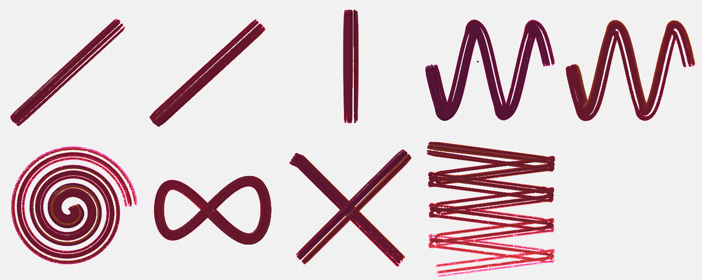

| stroke | covered | width | dark | spread | ms |
|---|---|---|---|---|---|
| light line | 10 % → 9 % | 28.0 px | 0.70 | 0.94 | 95 |
| heavy line | 10 % → 10 % | 30.2 px | 0.69 | 0.95 | 86 |
| pressure swell | 8 % → 8 % | 30.0 px | 0.73 | 0.94 | 55 |
| fast wave | 24 % → 17 % | 28.3 px | 0.73 | 0.71 | 205 |
| slow wave | 25 % → 18 % | 29.0 px | 0.73 | 0.73 | 349 |
| spiral | 39 % → 18 % | 26.0 px | 0.72 | 0.47 | 329 |
| loop | 21 % → 18 % | 27.6 px | 0.72 | 0.85 | 170 |
| tilted | 10 % → 10 % | 27.9 px | 0.72 | 1.00 | 102 |
| over the wet one | 20 % → 18 % | 26.8 px | 0.72 | 0.91 | 91 |
| long, no reload | 46 % → 18 % | 20.6 px | 0.73 | 0.40 | 507 | quarters: 0.44 → 0.38 → 0.31 → 0.22

Numbers say: light vs heavy: width 28.0 → 30.2 px, dark 0.70 → 0.69; pressure barely changes the width.

## Brush Artist · Refs · #11 Henry Ward purple spun balls
Heavy acrylic · 36 px · 15.1 s

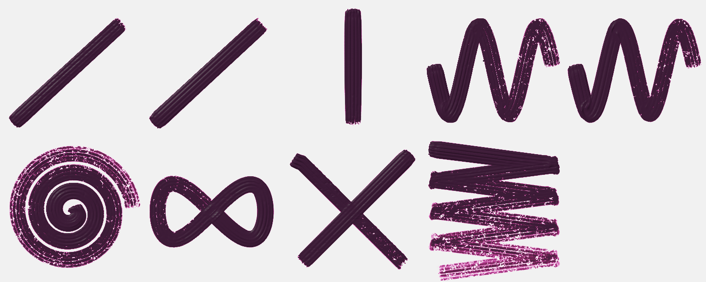

| stroke | covered | width | dark | spread | ms |
|---|---|---|---|---|---|
| light line | 12 % → 11 % | 34.1 px | 0.70 | 0.96 | 104 |
| heavy line | 13 % → 12 % | 36.6 px | 0.70 | 0.96 | 94 |
| pressure swell | 10 % → 9 % | 36.2 px | 0.74 | 0.95 | 79 |
| fast wave | 30 % → 23 % | 34.6 px | 0.73 | 0.75 | 244 |
| slow wave | 30 % → 24 % | 35.0 px | 0.73 | 0.79 | 410 |
| spiral | 49 % → 25 % | 32.3 px | 0.73 | 0.50 | 422 |
| loop | 26 % → 23 % | 33.4 px | 0.73 | 0.88 | 236 |
| tilted | 11 % → 11 % | 31.2 px | 0.72 | 1.00 | 117 |
| over the wet one | 23 % → 21 % | 32.1 px | 0.72 | 0.93 | 89 |
| long, no reload | 55 % → 24 % | 24.8 px | 0.73 | 0.44 | 608 | quarters: 0.51 → 0.46 → 0.39 → 0.28

Numbers say: light vs heavy: width 34.1 → 36.6 px, dark 0.70 → 0.70; pressure barely changes the width.

## Brush Artist · Refs · #12 Henry Ward black-olive cage
Gouache · 28 px · 22.8 s

| stroke | covered | width | dark | spread | ms |
|---|---|---|---|---|---|
| light line | 7 % → 3 % | 20.9 px | 0.61 | 0.35 | 48 |
| heavy line | 9 % → 4 % | 26.1 px | 0.61 | 0.41 | 104 |
| pressure swell | 6 % → 4 % | 23.9 px | 0.61 | 0.61 | 64 |
| fast wave | 20 % → 4 % | 23.7 px | 0.61 | 0.19 | 192 |
| slow wave | 20 % → 4 % | 23.3 px | 0.61 | 0.21 | 368 |
| spiral | 32 % → 4 % | 21.4 px | 0.61 | 0.14 | 363 |
| loop | 18 % → 5 % | 22.8 px | 0.61 | 0.28 | 193 |
| tilted | 9 % → 9 % | 25.4 px | 0.61 | 0.98 | 106 |
| over the wet one | 17 % → 8 % | 21.8 px | 0.61 | 0.46 | 83 |
| long, no reload | 39 % → 6 % | 17.6 px | 0.61 | 0.15 | 516 | quarters: 0.31 → 0.26 → 0.19 → 0.10

Numbers say: light vs heavy: width 20.9 → 26.1 px, dark 0.61 → 0.61.

## Brush Artist · Refs · #13 Henry Ward blue streaky form
Gouache · 50 px · 28.8 s

A light paint: laid on a grey sheet (on white it cannot be seen); **dark** = how far it is from the grey either way.

| stroke | covered | width | dark | spread | ms |
|---|---|---|---|---|---|
| light line | 15 % → 6 % | 43.9 px | 0.09 | 0.38 | 167 |
| heavy line | 17 % → 10 % | 48.3 px | 0.09 | 0.58 | 161 |
| pressure swell | 12 % → 8 % | 46.6 px | 0.09 | 0.65 | 81 |
| fast wave | 39 % → 11 % | 44.5 px | 0.09 | 0.28 | 392 |
| slow wave | 39 % → 12 % | 44.7 px | 0.09 | 0.30 | 699 |
| spiral | 58 % → 13 % | 38.1 px | 0.09 | 0.23 | 654 |
| loop | 34 % → 13 % | 44.0 px | 0.09 | 0.39 | 397 |
| tilted | 13 % → 13 % | 37.2 px | 0.09 | 1.01 | 206 |
| over the wet one | 28 % → 19 % | 41.9 px | 0.09 | 0.69 | 184 |
| long, no reload | 68 % → 16 % | 30.7 px | 0.09 | 0.23 | 1048 | quarters: 0.07 → 0.04 → 0.01 → 0.00

Numbers say: light vs heavy: width 43.9 → 48.3 px, dark 0.09 → 0.09; pressure barely changes the width.

## Brush Artist · Refs · #14 Henry Ward olive totem
Heavy acrylic · 48 px · 18.5 s

| stroke | covered | width | dark | spread | ms |
|---|---|---|---|---|---|
| light line | 15 % → 15 % | 44.8 px | 0.31 | 0.94 | 144 |
| heavy line | 16 % → 16 % | 47.7 px | 0.31 | 0.95 | 162 |
| pressure swell | 13 % → 12 % | 47.0 px | 0.32 | 0.95 | 114 |
| fast wave | 38 % → 30 % | 43.9 px | 0.30 | 0.79 | 354 |
| slow wave | 39 % → 31 % | 44.5 px | 0.30 | 0.81 | 633 |
| spiral | 58 % → 32 % | 38.1 px | 0.30 | 0.55 | 645 |
| loop | 33 % → 29 % | 42.6 px | 0.30 | 0.89 | 321 |
| tilted | 13 % → 13 % | 37.5 px | 0.31 | 1.00 | 240 |
| over the wet one | 28 % → 26 % | 41.1 px | 0.31 | 0.93 | 267 |
| long, no reload | 67 % → 33 % | 30.3 px | 0.30 | 0.49 | 863 | quarters: 0.25 → 0.18 → 0.10 → 0.03

Numbers say: light vs heavy: width 44.8 → 47.7 px, dark 0.31 → 0.31; pressure barely changes the width.

## Brush Artist · Refs · #15 Ultramarine brush script
Ink · 10 px · 24.5 s

| stroke | covered | width | dark | spread | ms |
|---|---|---|---|---|---|
| light line | 2 % → 5 % | 5.0 px | 0.53 | 2.62 | 41 |
| heavy line | 10 % → 10 % | 29.6 px | 0.66 | 1.00 | 95 |
| pressure swell | 6 % → 6 % | 20.8 px | 0.68 | 1.12 | 39 |
| fast wave | 18 % → 17 % | 20.2 px | 0.59 | 0.95 | 163 |
| slow wave | 14 % → 14 % | 16.1 px | 0.59 | 1.00 | 178 |
| spiral | 22 % → 18 % | 14.5 px | 0.54 | 0.82 | 244 |
| loop | 13 % → 14 % | 17.4 px | 0.61 | 1.02 | 129 |
| tilted | 6 % → 6 % | 15.5 px | 0.68 | 1.01 | 97 |
| over the wet one | 13 % → 13 % | 20.5 px | 0.68 | 1.04 | 57 |
| long, no reload | 33 % → 20 % | 14.8 px | 0.52 | 0.59 | 393 | quarters: 0.30 → 0.14 → 0.05 → 0.02

Numbers say: light vs heavy: width 5.0 → 29.6 px, dark 0.53 → 0.66; wet paint spreads well beyond the stroke.

## Brush Artist · Refs · #18 Blue oil-stick scribbles
Pastel · 10 px · 9.5 s

| stroke | covered | width | dark | spread | ms |
|---|---|---|---|---|---|
| light line | 1 % → 1 % | 2.9 px | 0.52 | 1.00 | 15 |
| heavy line | 2 % → 2 % | 5.5 px | 0.53 | 1.00 | 28 |
| pressure swell | 1 % → 1 % | 5.0 px | 0.53 | 1.00 | 13 |
| fast wave | 4 % → 4 % | 4.8 px | 0.53 | 1.00 | 72 |
| slow wave | 4 % → 4 % | 4.4 px | 0.53 | 1.00 | 52 |
| spiral | 7 % → 7 % | 4.5 px | 0.52 | 1.00 | 129 |
| loop | 3 % → 3 % | 4.5 px | 0.52 | 1.00 | 46 |
| tilted | 2 % → 2 % | 4.7 px | 0.53 | 1.00 | 21 |
| over the wet one | 3 % → 3 % | 4.7 px | 0.53 | 1.00 | 17 |
| long, no reload | 10 % → 10 % | 4.4 px | 0.53 | 1.00 | 148 | quarters: 0.06 → 0.06 → 0.06 → 0.06

Numbers say: light vs heavy: width 2.9 → 5.5 px, dark 0.52 → 0.53; the long stroke does not run out of paint.

## Brush Artist · Refs · #20 Orange-red crayon scribble
Pastel · 14 px · 9.8 s

| stroke | covered | width | dark | spread | ms |
|---|---|---|---|---|---|
| light line | 1 % → 1 % | 4.0 px | 0.53 | 1.00 | 11 |
| heavy line | 3 % → 3 % | 8.0 px | 0.53 | 1.00 | 34 |
| pressure swell | 2 % → 2 % | 7.6 px | 0.53 | 1.00 | 13 |
| fast wave | 6 % → 6 % | 7.2 px | 0.53 | 1.00 | 68 |
| slow wave | 6 % → 6 % | 6.6 px | 0.53 | 1.00 | 66 |
| spiral | 9 % → 9 % | 6.2 px | 0.53 | 1.00 | 103 |
| loop | 5 % → 5 % | 6.2 px | 0.53 | 1.00 | 54 |
| tilted | 2 % → 2 % | 5.6 px | 0.53 | 1.00 | 35 |
| over the wet one | 4 % → 4 % | 6.6 px | 0.53 | 1.00 | 36 |
| long, no reload | 13 % → 13 % | 5.7 px | 0.53 | 1.00 | 178 | quarters: 0.07 → 0.07 → 0.08 → 0.08

Numbers say: light vs heavy: width 4.0 → 8.0 px, dark 0.53 → 0.53; the long stroke does not run out of paint.

## Brush Artist · Refs · #21 Gritty black contours
Gouache · 12 px · 20.4 s

| stroke | covered | width | dark | spread | ms |
|---|---|---|---|---|---|
| light line | 3 % → 0 % | 8.8 px | 0.79 | 0.12 | 59 |
| heavy line | 4 % → 0 % | 11.9 px | 0.79 | 0.10 | 101 |
| pressure swell | 3 % → 0 % | 11.6 px | 0.79 | 0.15 | 70 |
| fast wave | 7 % → 1 % | 8.5 px | 0.79 | 0.10 | 194 |
| slow wave | 8 % → 1 % | 9.0 px | 0.79 | 0.09 | 205 |
| spiral | 9 % → 1 % | 6.0 px | 0.79 | 0.10 | 318 |
| loop | 8 % → 1 % | 9.9 px | 0.79 | 0.09 | 166 |
| tilted | 4 % → 4 % | 10.8 px | 0.79 | 0.90 | 80 |
| over the wet one | 7 % → 1 % | 9.7 px | 0.79 | 0.17 | 96 |
| long, no reload | 7 % → 1 % | 3.3 px | 0.79 | 0.12 | 499 | quarters: 0.20 → 0.07 → 0.00 → 0.00

Numbers say: light vs heavy: width 8.8 → 11.9 px, dark 0.79 → 0.79.

## Brush Artist · Refs · #22 Bold black brush poster
Ink · 20 px · 26.8 s

| stroke | covered | width | dark | spread | ms |
|---|---|---|---|---|---|
| light line | 3 % → 5 % | 9.5 px | 0.79 | 1.63 | 25 |
| heavy line | 15 % → 15 % | 44.6 px | 0.88 | 0.99 | 89 |
| pressure swell | 9 % → 9 % | 31.9 px | 0.87 | 1.04 | 46 |
| fast wave | 27 % → 26 % | 31.2 px | 0.87 | 0.98 | 140 |
| slow wave | 22 % → 21 % | 25.2 px | 0.87 | 0.98 | 330 |
| spiral | 34 % → 32 % | 22.2 px | 0.87 | 0.94 | 251 |
| loop | 20 % → 20 % | 26.2 px | 0.88 | 1.00 | 117 |
| tilted | 8 % → 8 % | 22.7 px | 0.88 | 1.01 | 62 |
| over the wet one | 19 % → 19 % | 30.5 px | 0.88 | 1.00 | 62 |
| long, no reload | 45 % → 38 % | 20.2 px | 0.86 | 0.84 | 365 | quarters: 0.54 → 0.45 → 0.35 → 0.27

Numbers say: light vs heavy: width 9.5 → 44.6 px, dark 0.79 → 0.88; wet paint spreads well beyond the stroke.

## Brush Artist · Refs · #23 Dry white on orange + black line
Gouache · 50 px · 25.0 s

A light paint: laid on a grey sheet (on white it cannot be seen); **dark** = how far it is from the grey either way.

| stroke | covered | width | dark | spread | ms |
|---|---|---|---|---|---|
| light line | 12 % → 2 % | 35.1 px | 0.01 | 0.13 | 106 |
| heavy line | 16 % → 2 % | 46.9 px | 0.00 | 0.11 | 265 |
| pressure swell | 11 % → 2 % | 42.6 px | 0.01 | 0.19 | 122 |
| fast wave | 34 % → 3 % | 39.7 px | 0.00 | 0.09 | 354 |
| slow wave | 34 % → 3 % | 39.0 px | 0.00 | 0.10 | 613 |
| spiral | 49 % → 4 % | 32.6 px | 0.00 | 0.07 | 650 |
| loop | 30 % → 4 % | 39.1 px | 0.00 | 0.12 | 358 |
| tilted | 13 % → 12 % | 34.9 px | 0.01 | 0.98 | 121 |
| over the wet one | 26 % → 7 % | 38.0 px | 0.01 | 0.27 | 130 |
| long, no reload | 58 % → 5 % | 26.1 px | 0.01 | 0.09 | 892 | quarters: 0.01 → 0.01 → 0.00 → 0.00

Numbers say: light vs heavy: width 35.1 → 46.9 px, dark 0.01 → 0.00.

## Brush Artist · Refs · #24 Picasso flat oil
Oil · 34 px · 19.9 s

| stroke | covered | width | dark | spread | ms |
|---|---|---|---|---|---|
| light line | 11 % → 11 % | 32.2 px | 0.39 | 1.00 | 118 |
| heavy line | 12 % → 12 % | 35.0 px | 0.39 | 1.00 | 97 |
| pressure swell | 9 % → 9 % | 34.4 px | 0.41 | 1.00 | 80 |
| fast wave | 30 % → 30 % | 34.2 px | 0.41 | 1.00 | 315 |
| slow wave | 30 % → 30 % | 34.9 px | 0.41 | 1.00 | 490 |
| spiral | 51 % → 51 % | 33.7 px | 0.40 | 1.00 | 517 |
| loop | 25 % → 25 % | 32.6 px | 0.41 | 1.00 | 253 |
| tilted | 11 % → 11 % | 32.0 px | 0.41 | 1.00 | 140 |
| over the wet one | 22 % → 22 % | 30.7 px | 0.41 | 1.00 | 104 |
| long, no reload | 61 % → 61 % | 27.6 px | 0.39 | 1.00 | 757 | quarters: 0.28 → 0.28 → 0.26 → 0.24

Numbers say: light vs heavy: width 32.2 → 35.0 px, dark 0.39 → 0.39; pressure barely changes the width.

## Brush Artist · Refs · #25 Yellow heavy flat stroke
Heavy acrylic · 110 px · 35.3 s

A light paint: laid on a grey sheet (on white it cannot be seen); **dark** = how far it is from the grey either way.

| stroke | covered | width | dark | spread | ms |
|---|---|---|---|---|---|
| light line | 35 % → 36 % | 101.3 px | 0.17 | 1.02 | 322 |
| heavy line | 36 % → 35 % | 105.0 px | 0.17 | 0.97 | 398 |
| pressure swell | 28 % → 29 % | 105.4 px | 0.17 | 1.04 | 269 |
| fast wave | 72 % → 76 % | 83.8 px | 0.17 | 1.05 | 1009 |
| slow wave | 73 % → 72 % | 84.7 px | 0.18 | 0.98 | 1835 |
| spiral | 86 % → 83 % | 56.7 px | 0.17 | 0.97 | 1820 |
| loop | 65 % → 64 % | 83.6 px | 0.17 | 0.99 | 957 |
| tilted | 26 % → 26 % | 71.5 px | 0.17 | 1.00 | 450 |
| over the wet one | 55 % → 54 % | 83.1 px | 0.17 | 0.97 | 414 |
| long, no reload | 98 % → 97 % | 44.1 px | 0.17 | 0.99 | 3034 | quarters: 0.18 → 0.17 → 0.17 → 0.16

Numbers say: light vs heavy: width 101.3 → 105.0 px, dark 0.17 → 0.17; pressure barely changes the width; the long stroke does not run out of paint.

## Brush Artist · Refs · #27 Orange impasto swatch
Heavy acrylic · 60 px · 25.4 s

| stroke | covered | width | dark | spread | ms |
|---|---|---|---|---|---|
| light line | 20 % → 19 % | 56.7 px | 0.35 | 0.97 | 159 |
| heavy line | 20 % → 20 % | 59.3 px | 0.35 | 0.97 | 181 |
| pressure swell | 16 % → 15 % | 59.6 px | 0.36 | 0.97 | 136 |
| fast wave | 48 % → 46 % | 55.0 px | 0.35 | 0.98 | 456 |
| slow wave | 48 % → 47 % | 55.8 px | 0.36 | 0.98 | 782 |
| spiral | 69 % → 62 % | 45.5 px | 0.35 | 0.91 | 691 |
| loop | 42 % → 40 % | 53.8 px | 0.35 | 0.97 | 411 |
| tilted | 16 % → 16 % | 44.0 px | 0.36 | 1.00 | 222 |
| over the wet one | 34 % → 33 % | 50.6 px | 0.36 | 0.97 | 188 |
| long, no reload | 85 % → 75 % | 38.1 px | 0.35 | 0.88 | 1175 | quarters: 0.33 → 0.31 → 0.29 → 0.26

Numbers say: light vs heavy: width 56.7 → 59.3 px, dark 0.35 → 0.35; pressure barely changes the width.

## Brush Artist · Refs · #28 Miles Davis black lines
Ink · 22 px · 27.9 s

| stroke | covered | width | dark | spread | ms |
|---|---|---|---|---|---|
| light line | 4 % → 6 % | 12.2 px | 0.81 | 1.48 | 36 |
| heavy line | 17 % → 17 % | 49.1 px | 0.88 | 0.99 | 98 |
| pressure swell | 10 % → 10 % | 35.9 px | 0.87 | 1.03 | 44 |
| fast wave | 30 % → 30 % | 35.0 px | 0.87 | 0.98 | 167 |
| slow wave | 25 % → 25 % | 28.5 px | 0.87 | 0.99 | 239 |
| spiral | 38 % → 37 % | 25.3 px | 0.87 | 0.96 | 255 |
| loop | 23 % → 23 % | 29.4 px | 0.88 | 1.00 | 144 |
| tilted | 9 % → 9 % | 25.0 px | 0.88 | 1.01 | 67 |
| over the wet one | 21 % → 21 % | 34.1 px | 0.88 | 1.00 | 61 |
| long, no reload | 51 % → 43 % | 22.7 px | 0.86 | 0.85 | 400 | quarters: 0.59 → 0.51 → 0.40 → 0.31

Numbers say: light vs heavy: width 12.2 → 49.1 px, dark 0.81 → 0.88.

## Brush Artist · Refs · #29 Shrigley magenta asterisk
Watercolor · 70 px · 30.6 s

| stroke | covered | width | dark | spread | ms |
|---|---|---|---|---|---|
| light line | 10 % → 13 % | 28.0 px | 0.25 | 1.36 | 60 |
| heavy line | 17 % → 18 % | 50.1 px | 0.25 | 1.03 | 141 |
| pressure swell | 11 % → 12 % | 41.0 px | 0.27 | 1.13 | 72 |
| fast wave | 38 % → 38 % | 43.5 px | 0.23 | 1.01 | 223 |
| slow wave | 35 % → 39 % | 40.9 px | 0.27 | 1.10 | 425 |
| spiral | 60 % → 61 % | 39.8 px | 0.22 | 1.01 | 498 |
| loop | 31 % → 32 % | 40.1 px | 0.26 | 1.03 | 220 |
| tilted | 17 % → 18 % | 48.7 px | 0.27 | 1.00 | 166 |
| over the wet one | 31 % → 34 % | 38.6 px | 0.27 | 1.07 | 109 |
| long, no reload | 74 % → 75 % | 33.3 px | 0.22 | 1.01 | 769 | quarters: 0.25 → 0.20 → 0.16 → 0.12

Numbers say: light vs heavy: width 28.0 → 50.1 px, dark 0.25 → 0.25.

## Brush Artist · Refs · #30 Red gouache face patch
Gouache · 60 px · 36.0 s

| stroke | covered | width | dark | spread | ms |
|---|---|---|---|---|---|
| light line | 16 % → 15 % | 46.9 px | 0.49 | 0.91 | 127 |
| heavy line | 25 % → 20 % | 73.8 px | 0.49 | 0.80 | 197 |
| pressure swell | 19 % → 17 % | 72.6 px | 0.49 | 0.86 | 117 |
| fast wave | 48 % → 28 % | 55.1 px | 0.49 | 0.58 | 625 |
| slow wave | 48 % → 28 % | 55.3 px | 0.49 | 0.59 | 787 |
| spiral | 59 % → 28 % | 39.1 px | 0.49 | 0.48 | 917 |
| loop | 40 % → 29 % | 51.3 px | 0.49 | 0.74 | 349 |
| tilted | 16 % → 16 % | 45.7 px | 0.49 | 1.01 | 241 |
| over the wet one | 36 % → 32 % | 55.3 px | 0.49 | 0.88 | 162 |
| long, no reload | 67 % → 30 % | 30.0 px | 0.49 | 0.45 | 984 | quarters: 0.43 → 0.38 → 0.32 → 0.26

Numbers say: light vs heavy: width 46.9 → 73.8 px, dark 0.49 → 0.49.

## Brush Artist · Refs · #31 Warhol blotted line
Ink · 6 px · 21.6 s

| stroke | covered | width | dark | spread | ms |
|---|---|---|---|---|---|
| light line | 1 % → 3 % | 2.6 px | 0.75 | 3.30 | 27 |
| heavy line | 7 % → 7 % | 20.6 px | 0.83 | 0.97 | 58 |
| pressure swell | 4 % → 4 % | 14.8 px | 0.84 | 1.12 | 36 |
| fast wave | 12 % → 9 % | 13.8 px | 0.82 | 0.77 | 131 |
| slow wave | 10 % → 8 % | 11.2 px | 0.80 | 0.85 | 109 |
| spiral | 15 % → 9 % | 9.7 px | 0.80 | 0.58 | 236 |
| loop | 9 % → 9 % | 11.9 px | 0.80 | 0.94 | 86 |
| tilted | 3 % → 3 % | 8.6 px | 0.84 | 1.04 | 65 |
| over the wet one | 8 % → 8 % | 14.5 px | 0.84 | 1.02 | 47 |
| long, no reload | 21 % → 9 % | 9.6 px | 0.78 | 0.43 | 256 | quarters: 0.25 → 0.13 → 0.05 → 0.01

Numbers say: light vs heavy: width 2.6 → 20.6 px, dark 0.75 → 0.83; wet paint spreads well beyond the stroke.

## Brush Artist · Refs · #32 Thick orange swipes
Heavy acrylic · 90 px · 29.4 s

| stroke | covered | width | dark | spread | ms |
|---|---|---|---|---|---|
| light line | 29 % → 29 % | 82.9 px | 0.38 | 1.00 | 352 |
| heavy line | 30 % → 29 % | 86.3 px | 0.38 | 0.97 | 320 |
| pressure swell | 23 % → 23 % | 86.5 px | 0.38 | 1.01 | 182 |
| fast wave | 63 % → 65 % | 73.1 px | 0.38 | 1.03 | 1151 |
| slow wave | 64 % → 63 % | 73.5 px | 0.39 | 0.98 | 1412 |
| spiral | 79 % → 77 % | 52.2 px | 0.38 | 0.98 | 1283 |
| loop | 57 % → 56 % | 73.4 px | 0.38 | 0.99 | 714 |
| tilted | 21 % → 21 % | 59.3 px | 0.38 | 1.00 | 338 |
| over the wet one | 47 % → 45 % | 70.7 px | 0.38 | 0.97 | 299 |
| long, no reload | 95 % → 93 % | 42.7 px | 0.38 | 0.98 | 1902 | quarters: 0.38 → 0.38 → 0.37 → 0.35

Numbers say: light vs heavy: width 82.9 → 86.3 px, dark 0.38 → 0.38; pressure barely changes the width; the long stroke does not run out of paint.

## Brush Artist · Refs · #33 Red wet-in-wet band
Watercolor · 80 px · 35.1 s

| stroke | covered | width | dark | spread | ms |
|---|---|---|---|---|---|
| light line | 21 % → 21 % | 60.7 px | 0.34 | 1.01 | 114 |
| heavy line | 30 % → 30 % | 88.4 px | 0.33 | 0.98 | 222 |
| pressure swell | 20 % → 21 % | 75.9 px | 0.36 | 1.03 | 135 |
| fast wave | 61 % → 64 % | 71.0 px | 0.30 | 1.04 | 426 |
| slow wave | 60 % → 60 % | 68.9 px | 0.41 | 1.00 | 727 |
| spiral | 75 % → 75 % | 49.7 px | 0.38 | 1.00 | 697 |
| loop | 52 % → 52 % | 67.5 px | 0.36 | 1.00 | 357 |
| tilted | 24 % → 24 % | 67.8 px | 0.37 | 1.00 | 274 |
| over the wet one | 48 % → 50 % | 66.6 px | 0.37 | 1.04 | 160 |
| long, no reload | 95 % → 96 % | 42.8 px | 0.37 | 1.00 | 1021 | quarters: 0.45 → 0.42 → 0.37 → 0.28

Numbers say: light vs heavy: width 60.7 → 88.4 px, dark 0.34 → 0.33.

## Brush Artist · Refs · #34 Magenta oil patches
Oil · 60 px · 22.8 s

| stroke | covered | width | dark | spread | ms |
|---|---|---|---|---|---|
| light line | 19 % → 19 % | 55.6 px | 0.59 | 1.00 | 189 |
| heavy line | 21 % → 21 % | 59.7 px | 0.59 | 1.00 | 216 |
| pressure swell | 16 % → 16 % | 58.8 px | 0.62 | 1.01 | 163 |
| fast wave | 48 % → 49 % | 55.4 px | 0.62 | 1.02 | 578 |
| slow wave | 48 % → 48 % | 55.8 px | 0.62 | 1.00 | 896 |
| spiral | 70 % → 70 % | 46.3 px | 0.62 | 1.00 | 948 |
| loop | 42 % → 42 % | 54.2 px | 0.62 | 1.00 | 466 |
| tilted | 17 % → 17 % | 46.8 px | 0.62 | 1.00 | 255 |
| over the wet one | 35 % → 35 % | 50.0 px | 0.62 | 1.00 | 194 |
| long, no reload | 86 % → 86 % | 38.7 px | 0.62 | 1.00 | 1304 | quarters: 0.59 → 0.58 → 0.57 → 0.52

Numbers say: light vs heavy: width 55.6 → 59.7 px, dark 0.59 → 0.59; pressure barely changes the width; the long stroke does not run out of paint.

## Brush Artist · Refs · #35 Red band with runs
Watercolor · 70 px · 33.3 s

| stroke | covered | width | dark | spread | ms |
|---|---|---|---|---|---|
| light line | 18 % → 19 % | 53.2 px | 0.26 | 1.05 | 108 |
| heavy line | 27 % → 27 % | 78.7 px | 0.25 | 0.99 | 186 |
| pressure swell | 18 % → 18 % | 67.0 px | 0.28 | 1.02 | 120 |
| fast wave | 56 % → 56 % | 64.8 px | 0.24 | 1.00 | 363 |
| slow wave | 54 % → 55 % | 62.6 px | 0.33 | 1.01 | 568 |
| spiral | 72 % → 72 % | 47.6 px | 0.30 | 0.99 | 580 |
| loop | 48 % → 48 % | 61.7 px | 0.28 | 1.01 | 307 |
| tilted | 22 % → 22 % | 60.5 px | 0.30 | 1.00 | 235 |
| over the wet one | 43 % → 45 % | 59.7 px | 0.30 | 1.05 | 141 |
| long, no reload | 93 % → 92 % | 41.6 px | 0.29 | 0.99 | 871 | quarters: 0.34 → 0.32 → 0.27 → 0.21

Numbers say: light vs heavy: width 53.2 → 78.7 px, dark 0.26 → 0.25.

## Brush Artist · Refs · #36 Magenta letters flat brush
Gouache · 36 px · 31.0 s

| stroke | covered | width | dark | spread | ms |
|---|---|---|---|---|---|
| light line | 10 % → 10 % | 29.0 px | 0.45 | 0.98 | 83 |
| heavy line | 17 % → 14 % | 49.1 px | 0.45 | 0.85 | 107 |
| pressure swell | 13 % → 12 % | 49.4 px | 0.45 | 0.89 | 71 |
| fast wave | 35 % → 19 % | 40.3 px | 0.45 | 0.54 | 223 |
| slow wave | 35 % → 19 % | 39.9 px | 0.45 | 0.54 | 378 |
| spiral | 46 % → 19 % | 30.4 px | 0.45 | 0.42 | 376 |
| loop | 27 % → 20 % | 35.3 px | 0.45 | 0.72 | 197 |
| tilted | 11 % → 11 % | 29.8 px | 0.45 | 1.00 | 110 |
| over the wet one | 24 % → 22 % | 38.1 px | 0.45 | 0.92 | 88 |
| long, no reload | 46 % → 19 % | 20.8 px | 0.45 | 0.40 | 531 | quarters: 0.29 → 0.25 → 0.22 → 0.18

Numbers say: light vs heavy: width 29.0 → 49.1 px, dark 0.45 → 0.45.

## Brush Artist · Refs · #37 Oil still life dabs
Oil · 40 px · 19.0 s

| stroke | covered | width | dark | spread | ms |
|---|---|---|---|---|---|
| light line | 13 % → 13 % | 37.9 px | 0.39 | 1.00 | 121 |
| heavy line | 14 % → 14 % | 41.1 px | 0.38 | 1.00 | 131 |
| pressure swell | 11 % → 11 % | 40.2 px | 0.40 | 1.00 | 106 |
| fast wave | 34 % → 34 % | 39.8 px | 0.40 | 1.00 | 349 |
| slow wave | 35 % → 35 % | 40.2 px | 0.39 | 1.00 | 597 |
| spiral | 59 % → 59 % | 38.7 px | 0.38 | 1.00 | 662 |
| loop | 29 % → 29 % | 37.8 px | 0.39 | 1.00 | 281 |
| tilted | 13 % → 13 % | 35.8 px | 0.39 | 1.00 | 162 |
| over the wet one | 26 % → 26 % | 35.6 px | 0.39 | 1.00 | 130 |
| long, no reload | 69 % → 69 % | 30.9 px | 0.37 | 1.00 | 853 | quarters: 0.31 → 0.30 → 0.28 → 0.24

Numbers say: light vs heavy: width 37.9 → 41.1 px, dark 0.39 → 0.38; pressure barely changes the width.

## Brush Artist · Refs · #38 Sanguine drawing
Pastel · 6 px · 8.5 s

| stroke | covered | width | dark | spread | ms |
|---|---|---|---|---|---|
| light line | 1 % → 1 % | 2.0 px | 0.61 | 1.00 | 12 |
| heavy line | 1 % → 1 % | 3.5 px | 0.62 | 1.00 | 14 |
| pressure swell | 1 % → 1 % | 3.3 px | 0.62 | 1.00 | 9 |
| fast wave | 3 % → 3 % | 3.2 px | 0.61 | 1.00 | 47 |
| slow wave | 3 % → 3 % | 3.0 px | 0.61 | 1.00 | 49 |
| spiral | 4 % → 4 % | 2.9 px | 0.61 | 1.00 | 66 |
| loop | 2 % → 2 % | 3.0 px | 0.61 | 1.00 | 44 |
| tilted | 1 % → 1 % | 3.4 px | 0.62 | 1.00 | 12 |
| over the wet one | 2 % → 2 % | 2.9 px | 0.62 | 1.00 | 20 |
| long, no reload | 7 % → 7 % | 3.0 px | 0.61 | 1.00 | 88 | quarters: 0.04 → 0.05 → 0.05 → 0.05

Numbers say: light vs heavy: width 2.0 → 3.5 px, dark 0.61 → 0.62; the long stroke does not run out of paint.

## Brush Artist · Refs · #39 Very thick impasto
Heavy acrylic · 60 px · 20.4 s

| stroke | covered | width | dark | spread | ms |
|---|---|---|---|---|---|
| light line | 20 % → 19 % | 56.8 px | 0.61 | 0.97 | 155 |
| heavy line | 20 % → 20 % | 59.4 px | 0.61 | 0.97 | 166 |
| pressure swell | 16 % → 15 % | 59.6 px | 0.62 | 0.97 | 124 |
| fast wave | 48 % → 47 % | 55.2 px | 0.62 | 0.98 | 415 |
| slow wave | 48 % → 47 % | 56.0 px | 0.62 | 0.98 | 778 |
| spiral | 69 % → 65 % | 45.6 px | 0.62 | 0.93 | 747 |
| loop | 42 % → 41 % | 54.0 px | 0.62 | 0.97 | 377 |
| tilted | 16 % → 16 % | 44.0 px | 0.62 | 1.00 | 211 |
| over the wet one | 34 % → 33 % | 50.7 px | 0.62 | 0.97 | 198 |
| long, no reload | 85 % → 79 % | 38.3 px | 0.62 | 0.93 | 1152 | quarters: 0.58 → 0.57 → 0.55 → 0.52

Numbers say: light vs heavy: width 56.8 → 59.4 px, dark 0.61 → 0.61; pressure barely changes the width; the long stroke does not run out of paint.

## Brush Artist · Refs · #40 Watercolour blooms
Watercolor · 90 px · 38.5 s

| stroke | covered | width | dark | spread | ms |
|---|---|---|---|---|---|
| light line | 23 % → 24 % | 68.2 px | 0.24 | 1.02 | 118 |
| heavy line | 34 % → 33 % | 98.4 px | 0.24 | 0.98 | 254 |
| pressure swell | 23 % → 24 % | 85.3 px | 0.26 | 1.04 | 159 |
| fast wave | 66 % → 69 % | 76.7 px | 0.23 | 1.04 | 484 |
| slow wave | 65 % → 65 % | 74.7 px | 0.31 | 1.00 | 858 |
| spiral | 79 % → 79 % | 52.0 px | 0.29 | 1.00 | 774 |
| loop | 57 % → 57 % | 73.7 px | 0.27 | 1.00 | 414 |
| tilted | 26 % → 26 % | 73.8 px | 0.27 | 1.00 | 292 |
| over the wet one | 53 % → 55 % | 73.9 px | 0.27 | 1.05 | 182 |
| long, no reload | 97 % → 97 % | 43.5 px | 0.29 | 1.00 | 1154 | quarters: 0.35 → 0.33 → 0.29 → 0.22

Numbers say: light vs heavy: width 68.2 → 98.4 px, dark 0.24 → 0.24.

## Brush Artist · Refs · #41 Coloured pencil hatching
Pastel · 4 px · 8.4 s

| stroke | covered | width | dark | spread | ms |
|---|---|---|---|---|---|
| light line | 1 % → 1 % | 1.6 px | 0.42 | 1.00 | 13 |
| heavy line | 1 % → 1 % | 2.6 px | 0.43 | 1.00 | 13 |
| pressure swell | 1 % → 1 % | 2.1 px | 0.43 | 1.00 | 5 |
| fast wave | 2 % → 2 % | 2.2 px | 0.42 | 1.00 | 24 |
| slow wave | 2 % → 2 % | 2.1 px | 0.43 | 1.00 | 27 |
| spiral | 3 % → 3 % | 2.1 px | 0.43 | 1.00 | 48 |
| loop | 2 % → 2 % | 2.2 px | 0.43 | 1.00 | 35 |
| tilted | 1 % → 1 % | 3.0 px | 0.42 | 1.00 | 15 |
| over the wet one | 2 % → 2 % | 2.2 px | 0.42 | 1.00 | 13 |
| long, no reload | 5 % → 5 % | 2.3 px | 0.43 | 1.00 | 77 | quarters: 0.02 → 0.02 → 0.02 → 0.03

Numbers say: light vs heavy: width 1.6 → 2.6 px, dark 0.42 → 0.43; the long stroke does not run out of paint.

## Brush Artist · Refs · #42 Oil pastel shaggy
Pastel · 18 px · 8.9 s

A light paint: laid on a grey sheet (on white it cannot be seen); **dark** = how far it is from the grey either way.

| stroke | covered | width | dark | spread | ms |
|---|---|---|---|---|---|
| light line | 2 % → 2 % | 5.1 px | 0.07 | 1.00 | 23 |
| heavy line | 4 % → 4 % | 10.7 px | 0.08 | 1.00 | 34 |
| pressure swell | 3 % → 3 % | 9.5 px | 0.08 | 1.00 | 13 |
| fast wave | 8 % → 8 % | 9.0 px | 0.08 | 1.00 | 56 |
| slow wave | 7 % → 7 % | 8.2 px | 0.08 | 1.00 | 90 |
| spiral | 12 % → 12 % | 7.7 px | 0.08 | 1.00 | 92 |
| loop | 6 % → 6 % | 7.9 px | 0.08 | 1.00 | 56 |
| tilted | 2 % → 2 % | 6.9 px | 0.08 | 1.00 | 28 |
| over the wet one | 6 % → 6 % | 8.5 px | 0.08 | 1.00 | 23 |
| long, no reload | 15 % → 15 % | 6.9 px | 0.08 | 1.00 | 147 | quarters: 0.01 → 0.01 → 0.01 → 0.01

Numbers say: light vs heavy: width 5.1 → 10.7 px, dark 0.07 → 0.08; the long stroke does not run out of paint.

## Brush Artist · Refs · #43 Dragged black ink blocks
Gouache · 70 px · 30.8 s

| stroke | covered | width | dark | spread | ms |
|---|---|---|---|---|---|
| light line | 19 % → 5 % | 54.9 px | 0.57 | 0.28 | 111 |
| heavy line | 24 % → 9 % | 69.0 px | 0.57 | 0.38 | 335 |
| pressure swell | 17 % → 9 % | 63.4 px | 0.57 | 0.53 | 167 |
| fast wave | 51 % → 11 % | 58.7 px | 0.57 | 0.21 | 548 |
| slow wave | 50 % → 10 % | 58.1 px | 0.57 | 0.20 | 894 |
| spiral | 65 % → 14 % | 42.6 px | 0.57 | 0.22 | 870 |
| loop | 45 % → 12 % | 58.1 px | 0.57 | 0.27 | 478 |
| tilted | 17 % → 16 % | 46.4 px | 0.57 | 0.98 | 257 |
| over the wet one | 37 % → 20 % | 55.6 px | 0.57 | 0.56 | 225 |
| long, no reload | 82 % → 17 % | 36.6 px | 0.57 | 0.21 | 1894 | quarters: 0.54 → 0.52 → 0.47 → 0.40

Numbers say: light vs heavy: width 54.9 → 69.0 px, dark 0.57 → 0.57.

## Brush Artist · Refs · #44 Blue looping ribbon
Oil · 80 px · 26.5 s

| stroke | covered | width | dark | spread | ms |
|---|---|---|---|---|---|
| light line | 26 % → 27 % | 74.8 px | 0.71 | 1.04 | 247 |
| heavy line | 27 % → 27 % | 79.6 px | 0.71 | 1.00 | 269 |
| pressure swell | 21 % → 21 % | 78.1 px | 0.72 | 1.03 | 207 |
| fast wave | 61 % → 64 % | 70.3 px | 0.73 | 1.05 | 725 |
| slow wave | 61 % → 61 % | 70.0 px | 0.73 | 1.00 | 1179 |
| spiral | 78 % → 78 % | 51.3 px | 0.73 | 1.00 | 1252 |
| loop | 54 % → 54 % | 69.7 px | 0.72 | 1.00 | 625 |
| tilted | 20 % → 20 % | 57.2 px | 0.71 | 1.00 | 347 |
| over the wet one | 44 % → 44 % | 64.9 px | 0.71 | 1.00 | 278 |
| long, no reload | 96 % → 96 % | 42.8 px | 0.73 | 1.00 | 3014 | quarters: 0.72 → 0.72 → 0.72 → 0.69

Numbers say: light vs heavy: width 74.8 → 79.6 px, dark 0.71 → 0.71; pressure barely changes the width; the long stroke does not run out of paint.

## Brush Artist · Refs · #45 Soft pastel pepper
Pastel · 40 px · 10.8 s

| stroke | covered | width | dark | spread | ms |
|---|---|---|---|---|---|
| light line | 4 % → 4 % | 11.3 px | 0.53 | 1.00 | 44 |
| heavy line | 8 % → 8 % | 23.0 px | 0.53 | 1.00 | 57 |
| pressure swell | 5 % → 5 % | 19.5 px | 0.53 | 1.00 | 44 |
| fast wave | 17 % → 17 % | 19.4 px | 0.53 | 1.00 | 107 |
| slow wave | 15 % → 15 % | 17.1 px | 0.53 | 1.00 | 211 |
| spiral | 25 % → 25 % | 16.3 px | 0.53 | 1.00 | 188 |
| loop | 12 % → 12 % | 16.1 px | 0.53 | 1.00 | 100 |
| tilted | 5 % → 5 % | 12.8 px | 0.53 | 1.00 | 55 |
| over the wet one | 11 % → 11 % | 17.7 px | 0.53 | 1.00 | 54 |
| long, no reload | 30 % → 30 % | 13.6 px | 0.53 | 1.00 | 303 | quarters: 0.18 → 0.18 → 0.18 → 0.18

Numbers say: light vs heavy: width 11.3 → 23.0 px, dark 0.53 → 0.53; the long stroke does not run out of paint.

## Brush Artist · Refs · #46 Red-brown ink lips
Watercolor · 70 px · 35.9 s

| stroke | covered | width | dark | spread | ms |
|---|---|---|---|---|---|
| light line | 18 % → 18 % | 53.2 px | 0.51 | 1.00 | 99 |
| heavy line | 27 % → 27 % | 78.7 px | 0.49 | 0.98 | 169 |
| pressure swell | 18 % → 18 % | 67.0 px | 0.53 | 1.01 | 102 |
| fast wave | 56 % → 58 % | 64.8 px | 0.46 | 1.03 | 325 |
| slow wave | 54 % → 54 % | 62.6 px | 0.58 | 1.00 | 547 |
| spiral | 72 % → 72 % | 47.6 px | 0.54 | 1.00 | 525 |
| loop | 48 % → 48 % | 61.7 px | 0.53 | 1.00 | 275 |
| tilted | 22 % → 22 % | 60.5 px | 0.54 | 1.00 | 379 |
| over the wet one | 43 % → 44 % | 59.9 px | 0.54 | 1.03 | 221 |
| long, no reload | 93 % → 93 % | 41.6 px | 0.52 | 1.00 | 900 | quarters: 0.59 → 0.57 → 0.51 → 0.40

Numbers say: light vs heavy: width 53.2 → 78.7 px, dark 0.51 → 0.49.

## Brush Artist · Refs · #47 Pink knife slabs
Heavy acrylic · 90 px · 28.4 s

A light paint: laid on a grey sheet (on white it cannot be seen); **dark** = how far it is from the grey either way.

| stroke | covered | width | dark | spread | ms |
|---|---|---|---|---|---|
| light line | 28 % → 27 % | 81.0 px | 0.17 | 0.97 | 197 |
| heavy line | 29 % → 28 % | 83.4 px | 0.17 | 0.97 | 228 |
| pressure swell | 22 % → 22 % | 83.4 px | 0.18 | 1.01 | 154 |
| fast wave | 61 % → 60 % | 70.1 px | 0.17 | 0.98 | 521 |
| slow wave | 61 % → 59 % | 70.9 px | 0.17 | 0.96 | 1622 |
| spiral | 76 % → 58 % | 50.0 px | 0.16 | 0.76 | 1149 |
| loop | 55 % → 54 % | 71.7 px | 0.17 | 0.97 | 502 |
| tilted | 21 % → 21 % | 59.3 px | 0.17 | 1.00 | 308 |
| over the wet one | 46 % → 44 % | 67.9 px | 0.17 | 0.96 | 231 |
| long, no reload | 92 % → 76 % | 41.3 px | 0.16 | 0.83 | 1371 | quarters: 0.18 → 0.16 → 0.14 → 0.09

Numbers say: light vs heavy: width 81.0 → 83.4 px, dark 0.17 → 0.17; pressure barely changes the width.

## Brush Artist · Refs · #48 Black bands with drips
Gouache · 70 px · 40.3 s

| stroke | covered | width | dark | spread | ms |
|---|---|---|---|---|---|
| light line | 19 % → 18 % | 54.6 px | 0.69 | 0.93 | 171 |
| heavy line | 29 % → 24 % | 83.0 px | 0.69 | 0.84 | 245 |
| pressure swell | 23 % → 21 % | 86.1 px | 0.69 | 0.92 | 315 |
| fast wave | 53 % → 36 % | 61.8 px | 0.69 | 0.68 | 563 |
| slow wave | 53 % → 36 % | 61.7 px | 0.69 | 0.67 | 872 |
| spiral | 64 % → 35 % | 41.9 px | 0.69 | 0.55 | 866 |
| loop | 45 % → 36 % | 57.8 px | 0.69 | 0.81 | 510 |
| tilted | 19 % → 19 % | 52.3 px | 0.69 | 1.00 | 255 |
| over the wet one | 41 % → 38 % | 62.4 px | 0.69 | 0.92 | 247 |
| long, no reload | 74 % → 37 % | 33.3 px | 0.69 | 0.50 | 1292 | quarters: 0.64 → 0.61 → 0.54 → 0.45

Numbers say: light vs heavy: width 54.6 → 83.0 px, dark 0.69 → 0.69.

## Brush Artist · Refs · #49 Magenta letters round brush
Ink · 30 px · 30.3 s

| stroke | covered | width | dark | spread | ms |
|---|---|---|---|---|---|
| light line | 6 % → 8 % | 17.5 px | 0.50 | 1.28 | 38 |
| heavy line | 21 % → 21 % | 62.0 px | 0.51 | 0.99 | 103 |
| pressure swell | 12 % → 13 % | 46.3 px | 0.52 | 1.01 | 206 |
| fast wave | 38 % → 38 % | 44.3 px | 0.51 | 0.99 | 301 |
| slow wave | 32 % → 31 % | 36.4 px | 0.51 | 0.99 | 319 |
| spiral | 50 % → 48 % | 32.8 px | 0.51 | 0.97 | 325 |
| loop | 29 % → 29 % | 37.6 px | 0.51 | 1.00 | 168 |
| tilted | 11 % → 11 % | 30.7 px | 0.52 | 1.01 | 86 |
| over the wet one | 26 % → 26 % | 42.1 px | 0.52 | 1.01 | 74 |
| long, no reload | 61 % → 56 % | 27.5 px | 0.51 | 0.92 | 481 | quarters: 0.41 → 0.36 → 0.30 → 0.25

Numbers say: light vs heavy: width 17.5 → 62.0 px, dark 0.50 → 0.51.

## Brush Artist · Refs · #50 Thick swipes on photo
Heavy acrylic · 40 px · 18.4 s

A light paint: laid on a grey sheet (on white it cannot be seen); **dark** = how far it is from the grey either way.

| stroke | covered | width | dark | spread | ms |
|---|---|---|---|---|---|
| light line | 13 % → 13 % | 38.0 px | 0.21 | 0.96 | 98 |
| heavy line | 14 % → 13 % | 40.1 px | 0.21 | 0.96 | 308 |
| pressure swell | 11 % → 10 % | 40.1 px | 0.22 | 0.95 | 184 |
| fast wave | 33 % → 31 % | 38.3 px | 0.21 | 0.93 | 461 |
| slow wave | 34 % → 32 % | 39.1 px | 0.20 | 0.95 | 507 |
| spiral | 58 % → 47 % | 38.5 px | 0.20 | 0.80 | 599 |
| loop | 28 % → 27 % | 36.8 px | 0.20 | 0.95 | 264 |
| tilted | 12 % → 12 % | 34.0 px | 0.22 | 1.00 | 125 |
| over the wet one | 25 % → 24 % | 35.2 px | 0.22 | 0.95 | 119 |
| long, no reload | 66 % → 46 % | 29.5 px | 0.20 | 0.70 | 723 | quarters: 0.16 → 0.13 → 0.11 → 0.07

Numbers say: light vs heavy: width 38.0 → 40.1 px, dark 0.21 → 0.21; pressure barely changes the width.

## Brush Artist · Refs · Ground #22403f
Gouache · 130 px · 60.3 s

| stroke | covered | width | dark | spread | ms |
|---|---|---|---|---|---|
| light line | 42 % → 40 % | 122.8 px | 0.52 | 0.94 | 995 |
| heavy line | 47 % → 42 % | 136.0 px | 0.52 | 0.90 | 554 |
| pressure swell | 43 % → 42 % | 162.8 px | 0.52 | 0.97 | 367 |
| fast wave | 83 % → 82 % | 95.8 px | 0.52 | 0.98 | 1326 |
| slow wave | 83 % → 76 % | 96.3 px | 0.52 | 0.91 | 2518 |
| spiral | 88 % → 84 % | 57.7 px | 0.52 | 0.96 | 2281 |
| loop | 66 % → 64 % | 85.6 px | 0.52 | 0.96 | 1303 |
| tilted | 37 % → 36 % | 102.0 px | 0.52 | 1.00 | 742 |
| over the wet one | 72 % → 69 % | 99.4 px | 0.52 | 0.96 | 605 |
| long, no reload | 98 % → 93 % | 44.0 px | 0.52 | 0.94 | 3475 | quarters: 0.52 → 0.52 → 0.52 → 0.50

Numbers say: light vs heavy: width 122.8 → 136.0 px, dark 0.52 → 0.52; pressure barely changes the width; the long stroke does not run out of paint.

## Brush Artist · Refs · Ground #2b2f1c
Gouache · 130 px · 60.6 s

| stroke | covered | width | dark | spread | ms |
|---|---|---|---|---|---|
| light line | 42 % → 40 % | 122.8 px | 0.56 | 0.94 | 514 |
| heavy line | 47 % → 42 % | 136.0 px | 0.56 | 0.90 | 579 |
| pressure swell | 43 % → 42 % | 162.8 px | 0.56 | 0.97 | 474 |
| fast wave | 83 % → 82 % | 95.8 px | 0.56 | 0.98 | 1514 |
| slow wave | 83 % → 76 % | 96.3 px | 0.56 | 0.91 | 2580 |
| spiral | 88 % → 84 % | 57.7 px | 0.56 | 0.96 | 2564 |
| loop | 66 % → 64 % | 85.6 px | 0.56 | 0.96 | 1306 |
| tilted | 37 % → 36 % | 102.0 px | 0.56 | 1.00 | 758 |
| over the wet one | 72 % → 69 % | 99.4 px | 0.56 | 0.96 | 572 |
| long, no reload | 98 % → 93 % | 44.0 px | 0.56 | 0.94 | 3727 | quarters: 0.56 → 0.56 → 0.56 → 0.55

Numbers say: light vs heavy: width 122.8 → 136.0 px, dark 0.56 → 0.56; pressure barely changes the width; the long stroke does not run out of paint.

## Brush Artist · Refs · Ground #8a6a20
Gouache · 130 px · 62.7 s

| stroke | covered | width | dark | spread | ms |
|---|---|---|---|---|---|
| light line | 42 % → 40 % | 122.8 px | 0.34 | 0.94 | 493 |
| heavy line | 47 % → 42 % | 136.0 px | 0.34 | 0.90 | 555 |
| pressure swell | 43 % → 42 % | 162.8 px | 0.34 | 0.97 | 458 |
| fast wave | 83 % → 82 % | 95.8 px | 0.34 | 0.98 | 1550 |
| slow wave | 83 % → 76 % | 96.3 px | 0.34 | 0.91 | 2902 |
| spiral | 88 % → 84 % | 57.7 px | 0.34 | 0.96 | 2368 |
| loop | 66 % → 64 % | 85.6 px | 0.34 | 0.96 | 1231 |
| tilted | 37 % → 36 % | 102.0 px | 0.34 | 1.00 | 721 |
| over the wet one | 72 % → 69 % | 99.4 px | 0.34 | 0.96 | 640 |
| long, no reload | 98 % → 93 % | 44.0 px | 0.34 | 0.94 | 3239 | quarters: 0.34 → 0.34 → 0.34 → 0.33

Numbers say: light vs heavy: width 122.8 → 136.0 px, dark 0.34 → 0.34; pressure barely changes the width; the long stroke does not run out of paint.

## Brush Artist · Refs · Ground #3b6a50
Gouache · 130 px · 61.1 s

| stroke | covered | width | dark | spread | ms |
|---|---|---|---|---|---|
| light line | 42 % → 40 % | 122.8 px | 0.39 | 0.94 | 497 |
| heavy line | 47 % → 42 % | 136.0 px | 0.39 | 0.90 | 502 |
| pressure swell | 43 % → 42 % | 162.8 px | 0.39 | 0.97 | 424 |
| fast wave | 83 % → 82 % | 95.8 px | 0.39 | 0.98 | 1442 |
| slow wave | 83 % → 76 % | 96.3 px | 0.39 | 0.91 | 2844 |
| spiral | 88 % → 84 % | 57.7 px | 0.39 | 0.96 | 2251 |
| loop | 66 % → 64 % | 85.6 px | 0.39 | 0.96 | 1199 |
| tilted | 37 % → 36 % | 102.0 px | 0.39 | 1.00 | 683 |
| over the wet one | 72 % → 69 % | 99.4 px | 0.39 | 0.96 | 541 |
| long, no reload | 98 % → 93 % | 44.0 px | 0.39 | 0.94 | 3219 | quarters: 0.39 → 0.39 → 0.39 → 0.37

Numbers say: light vs heavy: width 122.8 → 136.0 px, dark 0.39 → 0.39; pressure barely changes the width; the long stroke does not run out of paint.

## Brush Artist · Refs · Ground #8c6e28
Gouache · 130 px · 60.6 s

| stroke | covered | width | dark | spread | ms |
|---|---|---|---|---|---|
| light line | 42 % → 40 % | 122.8 px | 0.33 | 0.94 | 477 |
| heavy line | 47 % → 42 % | 136.0 px | 0.33 | 0.90 | 541 |
| pressure swell | 43 % → 42 % | 162.8 px | 0.33 | 0.97 | 397 |
| fast wave | 83 % → 82 % | 95.8 px | 0.33 | 0.98 | 1536 |
| slow wave | 83 % → 76 % | 96.3 px | 0.33 | 0.91 | 2793 |
| spiral | 88 % → 84 % | 57.7 px | 0.33 | 0.96 | 2283 |
| loop | 66 % → 64 % | 85.6 px | 0.33 | 0.96 | 1190 |
| tilted | 37 % → 36 % | 102.0 px | 0.33 | 1.00 | 651 |
| over the wet one | 72 % → 69 % | 99.4 px | 0.33 | 0.96 | 696 |
| long, no reload | 98 % → 93 % | 44.0 px | 0.33 | 0.94 | 3133 | quarters: 0.33 → 0.33 → 0.33 → 0.31

Numbers say: light vs heavy: width 122.8 → 136.0 px, dark 0.33 → 0.33; pressure barely changes the width; the long stroke does not run out of paint.

## Brush Artist · Refs · Ground #e8b4a8
Gouache · 130 px · 61.8 s

A light paint: laid on a grey sheet (on white it cannot be seen); **dark** = how far it is from the grey either way.

| stroke | covered | width | dark | spread | ms |
|---|---|---|---|---|---|
| light line | 42 % → 40 % | 122.8 px | 0.10 | 0.94 | 493 |
| heavy line | 47 % → 42 % | 136.0 px | 0.10 | 0.90 | 543 |
| pressure swell | 43 % → 42 % | 162.8 px | 0.10 | 0.97 | 429 |
| fast wave | 83 % → 82 % | 95.8 px | 0.10 | 0.98 | 1508 |
| slow wave | 83 % → 76 % | 96.3 px | 0.10 | 0.91 | 2558 |
| spiral | 88 % → 84 % | 57.7 px | 0.10 | 0.96 | 2322 |
| loop | 66 % → 64 % | 85.6 px | 0.10 | 0.96 | 1131 |
| tilted | 37 % → 36 % | 102.0 px | 0.10 | 1.00 | 767 |
| over the wet one | 72 % → 69 % | 99.4 px | 0.10 | 0.96 | 563 |
| long, no reload | 98 % → 93 % | 44.0 px | 0.10 | 0.94 | 3049 | quarters: 0.10 → 0.11 → 0.11 → 0.10

Numbers say: light vs heavy: width 122.8 → 136.0 px, dark 0.10 → 0.10; pressure barely changes the width; the long stroke does not run out of paint.

## Brush Artist · Refs · Ground #d8d4c8
Gouache · 130 px · 61.4 s

A light paint: laid on a grey sheet (on white it cannot be seen); **dark** = how far it is from the grey either way.

| stroke | covered | width | dark | spread | ms |
|---|---|---|---|---|---|
| light line | 42 % → 40 % | 122.8 px | 0.05 | 0.94 | 759 |
| heavy line | 47 % → 42 % | 136.0 px | 0.05 | 0.90 | 514 |
| pressure swell | 43 % → 42 % | 162.8 px | 0.05 | 0.97 | 388 |
| fast wave | 83 % → 82 % | 95.8 px | 0.05 | 0.98 | 1391 |
| slow wave | 83 % → 76 % | 96.3 px | 0.05 | 0.91 | 2370 |
| spiral | 88 % → 84 % | 57.7 px | 0.05 | 0.96 | 2337 |
| loop | 66 % → 64 % | 85.6 px | 0.05 | 0.96 | 1099 |
| tilted | 37 % → 36 % | 102.0 px | 0.05 | 1.00 | 749 |
| over the wet one | 72 % → 69 % | 99.4 px | 0.05 | 0.96 | 554 |
| long, no reload | 98 % → 93 % | 44.0 px | 0.05 | 0.94 | 3003 | quarters: 0.05 → 0.05 → 0.05 → 0.05

Numbers say: light vs heavy: width 122.8 → 136.0 px, dark 0.05 → 0.05; pressure barely changes the width; the long stroke does not run out of paint.

## Brush Artist · Refs · Ground #e8e2b8
Gouache · 130 px · 59.8 s

A light paint: laid on a grey sheet (on white it cannot be seen); **dark** = how far it is from the grey either way.

| stroke | covered | width | dark | spread | ms |
|---|---|---|---|---|---|
| light line | 42 % → 40 % | 122.8 px | 0.02 | 0.94 | 513 |
| heavy line | 47 % → 42 % | 136.0 px | 0.02 | 0.90 | 527 |
| pressure swell | 43 % → 42 % | 162.8 px | 0.02 | 0.97 | 379 |
| fast wave | 83 % → 82 % | 95.8 px | 0.02 | 0.98 | 1353 |
| slow wave | 83 % → 76 % | 96.3 px | 0.02 | 0.91 | 2637 |
| spiral | 88 % → 84 % | 57.7 px | 0.02 | 0.96 | 2304 |
| loop | 66 % → 64 % | 85.6 px | 0.02 | 0.96 | 1146 |
| tilted | 37 % → 36 % | 102.0 px | 0.02 | 1.00 | 642 |
| over the wet one | 72 % → 69 % | 99.4 px | 0.02 | 0.96 | 523 |
| long, no reload | 98 % → 93 % | 44.0 px | 0.02 | 0.94 | 3225 | quarters: 0.02 → 0.02 → 0.03 → 0.03

Numbers say: light vs heavy: width 122.8 → 136.0 px, dark 0.02 → 0.02; pressure barely changes the width; the long stroke does not run out of paint.

## Brush Artist · Refs · Ground #3a3a34
Gouache · 130 px · 59.5 s

| stroke | covered | width | dark | spread | ms |
|---|---|---|---|---|---|
| light line | 42 % → 40 % | 122.8 px | 0.51 | 0.94 | 528 |
| heavy line | 47 % → 42 % | 136.0 px | 0.51 | 0.90 | 580 |
| pressure swell | 43 % → 42 % | 162.8 px | 0.51 | 0.97 | 395 |
| fast wave | 83 % → 82 % | 95.8 px | 0.51 | 0.98 | 1302 |
| slow wave | 83 % → 76 % | 96.3 px | 0.51 | 0.91 | 2543 |
| spiral | 88 % → 84 % | 57.7 px | 0.51 | 0.96 | 2163 |
| loop | 66 % → 64 % | 85.6 px | 0.51 | 0.96 | 1189 |
| tilted | 37 % → 36 % | 102.0 px | 0.51 | 1.00 | 665 |
| over the wet one | 72 % → 69 % | 99.4 px | 0.51 | 0.96 | 543 |
| long, no reload | 98 % → 93 % | 44.0 px | 0.51 | 0.94 | 3310 | quarters: 0.51 → 0.51 → 0.51 → 0.49

Numbers say: light vs heavy: width 122.8 → 136.0 px, dark 0.51 → 0.51; pressure barely changes the width; the long stroke does not run out of paint.

## Brush Artist · Refs · Ground #f06040
Gouache · 130 px · 60.0 s

| stroke | covered | width | dark | spread | ms |
|---|---|---|---|---|---|
| light line | 42 % → 40 % | 122.8 px | 0.34 | 0.94 | 491 |
| heavy line | 47 % → 42 % | 136.0 px | 0.34 | 0.90 | 500 |
| pressure swell | 43 % → 42 % | 162.8 px | 0.34 | 0.97 | 381 |
| fast wave | 83 % → 82 % | 95.8 px | 0.34 | 0.98 | 1413 |
| slow wave | 83 % → 76 % | 96.3 px | 0.34 | 0.91 | 2283 |
| spiral | 88 % → 84 % | 57.7 px | 0.34 | 0.96 | 2200 |
| loop | 66 % → 64 % | 85.6 px | 0.34 | 0.96 | 1166 |
| tilted | 37 % → 36 % | 102.0 px | 0.34 | 1.00 | 646 |
| over the wet one | 72 % → 69 % | 99.4 px | 0.34 | 0.96 | 483 |
| long, no reload | 98 % → 93 % | 44.0 px | 0.34 | 0.94 | 3053 | quarters: 0.35 → 0.35 → 0.34 → 0.33

Numbers say: light vs heavy: width 122.8 → 136.0 px, dark 0.34 → 0.34; pressure barely changes the width; the long stroke does not run out of paint.

## Brush Artist · Refs · Ground #e85a10
Gouache · 130 px · 58.8 s

| stroke | covered | width | dark | spread | ms |
|---|---|---|---|---|---|
| light line | 42 % → 40 % | 122.8 px | 0.37 | 0.94 | 493 |
| heavy line | 47 % → 42 % | 136.0 px | 0.37 | 0.90 | 490 |
| pressure swell | 43 % → 42 % | 162.8 px | 0.37 | 0.97 | 368 |
| fast wave | 83 % → 82 % | 95.8 px | 0.37 | 0.98 | 1251 |
| slow wave | 83 % → 76 % | 96.3 px | 0.37 | 0.91 | 2822 |
| spiral | 88 % → 84 % | 57.7 px | 0.37 | 0.96 | 2976 |
| loop | 66 % → 64 % | 85.6 px | 0.37 | 0.96 | 1356 |
| tilted | 37 % → 36 % | 102.0 px | 0.37 | 1.00 | 696 |
| over the wet one | 72 % → 69 % | 99.4 px | 0.37 | 0.96 | 565 |
| long, no reload | 98 % → 93 % | 44.0 px | 0.37 | 0.94 | 3164 | quarters: 0.37 → 0.37 → 0.37 → 0.36

Numbers say: light vs heavy: width 122.8 → 136.0 px, dark 0.37 → 0.37; pressure barely changes the width; the long stroke does not run out of paint.

## Brush Artist · Refs · Ground #3a4a6a
Gouache · 130 px · 58.7 s

| stroke | covered | width | dark | spread | ms |
|---|---|---|---|---|---|
| light line | 42 % → 40 % | 122.8 px | 0.45 | 0.94 | 457 |
| heavy line | 47 % → 42 % | 136.0 px | 0.45 | 0.90 | 524 |
| pressure swell | 43 % → 42 % | 162.8 px | 0.45 | 0.97 | 375 |
| fast wave | 83 % → 82 % | 95.8 px | 0.45 | 0.98 | 1734 |
| slow wave | 83 % → 76 % | 96.3 px | 0.45 | 0.91 | 3308 |
| spiral | 88 % → 84 % | 57.7 px | 0.45 | 0.96 | 2474 |
| loop | 66 % → 64 % | 85.6 px | 0.45 | 0.96 | 1143 |
| tilted | 37 % → 36 % | 102.0 px | 0.45 | 1.00 | 679 |
| over the wet one | 72 % → 69 % | 99.4 px | 0.45 | 0.96 | 513 |
| long, no reload | 98 % → 93 % | 44.0 px | 0.45 | 0.94 | 3021 | quarters: 0.45 → 0.45 → 0.45 → 0.44

Numbers say: light vs heavy: width 122.8 → 136.0 px, dark 0.45 → 0.45; pressure barely changes the width; the long stroke does not run out of paint.

## Brush Artist · Refs · Ground #8c8c88
Gouache · 130 px · 56.7 s

| stroke | covered | width | dark | spread | ms |
|---|---|---|---|---|---|
| light line | 42 % → 40 % | 122.8 px | 0.24 | 0.94 | 519 |
| heavy line | 47 % → 42 % | 136.0 px | 0.24 | 0.90 | 494 |
| pressure swell | 43 % → 42 % | 162.8 px | 0.24 | 0.97 | 397 |
| fast wave | 83 % → 82 % | 95.8 px | 0.24 | 0.98 | 1367 |
| slow wave | 83 % → 76 % | 96.3 px | 0.24 | 0.91 | 2272 |
| spiral | 88 % → 84 % | 57.7 px | 0.24 | 0.96 | 2134 |
| loop | 66 % → 64 % | 85.6 px | 0.24 | 0.96 | 1179 |
| tilted | 37 % → 36 % | 102.0 px | 0.23 | 1.00 | 662 |
| over the wet one | 72 % → 69 % | 99.4 px | 0.23 | 0.96 | 505 |
| long, no reload | 98 % → 93 % | 44.0 px | 0.24 | 0.94 | 2999 | quarters: 0.24 → 0.24 → 0.24 → 0.22

Numbers say: light vs heavy: width 122.8 → 136.0 px, dark 0.24 → 0.24; pressure barely changes the width; the long stroke does not run out of paint.

## Brush Artist · Refs · Ground #6a1a3a
Gouache · 130 px · 56.9 s

| stroke | covered | width | dark | spread | ms |
|---|---|---|---|---|---|
| light line | 42 % → 40 % | 122.8 px | 0.59 | 0.94 | 488 |
| heavy line | 47 % → 42 % | 136.0 px | 0.59 | 0.90 | 520 |
| pressure swell | 43 % → 42 % | 162.8 px | 0.59 | 0.97 | 384 |
| fast wave | 83 % → 82 % | 95.8 px | 0.59 | 0.98 | 1270 |
| slow wave | 83 % → 76 % | 96.3 px | 0.59 | 0.91 | 2455 |
| spiral | 88 % → 84 % | 57.7 px | 0.59 | 0.96 | 2139 |
| loop | 66 % → 64 % | 85.6 px | 0.59 | 0.96 | 1268 |
| tilted | 37 % → 36 % | 102.0 px | 0.59 | 1.00 | 688 |
| over the wet one | 72 % → 69 % | 99.4 px | 0.59 | 0.96 | 532 |
| long, no reload | 98 % → 93 % | 44.0 px | 0.59 | 0.94 | 3012 | quarters: 0.59 → 0.59 → 0.59 → 0.58

Numbers say: light vs heavy: width 122.8 → 136.0 px, dark 0.59 → 0.59; pressure barely changes the width; the long stroke does not run out of paint.

## Brush Artist · Refs · Ground #3a1a12
Gouache · 130 px · 57.2 s

| stroke | covered | width | dark | spread | ms |
|---|---|---|---|---|---|
| light line | 42 % → 40 % | 122.8 px | 0.62 | 0.94 | 446 |
| heavy line | 47 % → 42 % | 136.0 px | 0.62 | 0.90 | 529 |
| pressure swell | 43 % → 42 % | 162.8 px | 0.62 | 0.97 | 395 |
| fast wave | 83 % → 82 % | 95.8 px | 0.62 | 0.98 | 1255 |
| slow wave | 83 % → 76 % | 96.3 px | 0.62 | 0.91 | 2253 |
| spiral | 88 % → 84 % | 57.7 px | 0.62 | 0.96 | 2154 |
| loop | 66 % → 64 % | 85.6 px | 0.62 | 0.96 | 1080 |
| tilted | 37 % → 36 % | 102.0 px | 0.62 | 1.00 | 667 |
| over the wet one | 72 % → 69 % | 99.4 px | 0.62 | 0.96 | 471 |
| long, no reload | 98 % → 93 % | 44.0 px | 0.62 | 0.94 | 2849 | quarters: 0.62 → 0.62 → 0.62 → 0.61

Numbers say: light vs heavy: width 122.8 → 136.0 px, dark 0.62 → 0.62; pressure barely changes the width; the long stroke does not run out of paint.

## Brush Artist · Refs · Ground #f0c020
Gouache · 130 px · 56.8 s

A light paint: laid on a grey sheet (on white it cannot be seen); **dark** = how far it is from the grey either way.

| stroke | covered | width | dark | spread | ms |
|---|---|---|---|---|---|
| light line | 42 % → 40 % | 122.8 px | 0.12 | 0.94 | 528 |
| heavy line | 47 % → 42 % | 136.0 px | 0.12 | 0.90 | 594 |
| pressure swell | 43 % → 42 % | 162.8 px | 0.12 | 0.97 | 391 |
| fast wave | 83 % → 82 % | 95.8 px | 0.12 | 0.98 | 1312 |
| slow wave | 83 % → 76 % | 96.3 px | 0.12 | 0.91 | 2314 |
| spiral | 88 % → 84 % | 57.7 px | 0.12 | 0.96 | 2276 |
| loop | 66 % → 64 % | 85.6 px | 0.12 | 0.96 | 1133 |
| tilted | 37 % → 36 % | 102.0 px | 0.12 | 1.00 | 658 |
| over the wet one | 72 % → 69 % | 99.4 px | 0.12 | 0.96 | 515 |
| long, no reload | 98 % → 93 % | 44.0 px | 0.12 | 0.94 | 3012 | quarters: 0.12 → 0.12 → 0.13 → 0.12

Numbers say: light vs heavy: width 122.8 → 136.0 px, dark 0.12 → 0.12; pressure barely changes the width; the long stroke does not run out of paint.

## Brush Artist · Refs · Ground #e8dcc4
Gouache · 130 px · 57.5 s

A light paint: laid on a grey sheet (on white it cannot be seen); **dark** = how far it is from the grey either way.

| stroke | covered | width | dark | spread | ms |
|---|---|---|---|---|---|
| light line | 42 % → 40 % | 122.8 px | 0.03 | 0.94 | 513 |
| heavy line | 47 % → 42 % | 136.0 px | 0.03 | 0.90 | 504 |
| pressure swell | 43 % → 42 % | 162.8 px | 0.03 | 0.97 | 351 |
| fast wave | 83 % → 82 % | 95.8 px | 0.03 | 0.98 | 1305 |
| slow wave | 83 % → 76 % | 96.3 px | 0.03 | 0.91 | 2310 |
| spiral | 88 % → 84 % | 57.7 px | 0.03 | 0.96 | 2102 |
| loop | 66 % → 64 % | 85.6 px | 0.03 | 0.96 | 1096 |
| tilted | 37 % → 36 % | 102.0 px | 0.03 | 1.00 | 641 |
| over the wet one | 72 % → 69 % | 99.4 px | 0.03 | 0.96 | 494 |
| long, no reload | 98 % → 93 % | 44.0 px | 0.03 | 0.94 | 3090 | quarters: 0.03 → 0.03 → 0.03 → 0.03

Numbers say: light vs heavy: width 122.8 → 136.0 px, dark 0.03 → 0.03; pressure barely changes the width; the long stroke does not run out of paint.

## Brush Artist · Refs · Ground #e070a0
Gouache · 130 px · 57.5 s

| stroke | covered | width | dark | spread | ms |
|---|---|---|---|---|---|
| light line | 42 % → 40 % | 122.8 px | 0.25 | 0.94 | 454 |
| heavy line | 47 % → 42 % | 136.0 px | 0.25 | 0.90 | 522 |
| pressure swell | 43 % → 42 % | 162.8 px | 0.25 | 0.97 | 355 |
| fast wave | 83 % → 82 % | 95.8 px | 0.25 | 0.98 | 1294 |
| slow wave | 83 % → 76 % | 96.3 px | 0.25 | 0.91 | 2248 |
| spiral | 88 % → 84 % | 57.7 px | 0.25 | 0.96 | 2126 |
| loop | 66 % → 64 % | 85.6 px | 0.25 | 0.96 | 1087 |
| tilted | 37 % → 36 % | 102.0 px | 0.25 | 1.00 | 656 |
| over the wet one | 72 % → 69 % | 99.4 px | 0.25 | 0.96 | 500 |
| long, no reload | 98 % → 93 % | 44.0 px | 0.25 | 0.94 | 2989 | quarters: 0.25 → 0.25 → 0.25 → 0.24

Numbers say: light vs heavy: width 122.8 → 136.0 px, dark 0.25 → 0.25; pressure barely changes the width; the long stroke does not run out of paint.

## Brush Artist · Refs · Ground #f0a020
Gouache · 130 px · 58.1 s

| stroke | covered | width | dark | spread | ms |
|---|---|---|---|---|---|
| light line | 42 % → 40 % | 122.8 px | 0.19 | 0.94 | 470 |
| heavy line | 47 % → 42 % | 136.0 px | 0.19 | 0.90 | 505 |
| pressure swell | 43 % → 42 % | 162.8 px | 0.19 | 0.97 | 406 |
| fast wave | 83 % → 82 % | 95.8 px | 0.19 | 0.98 | 1414 |
| slow wave | 83 % → 76 % | 96.3 px | 0.19 | 0.91 | 2165 |
| spiral | 88 % → 84 % | 57.7 px | 0.19 | 0.96 | 2136 |
| loop | 66 % → 64 % | 85.6 px | 0.19 | 0.96 | 1095 |
| tilted | 37 % → 36 % | 102.0 px | 0.19 | 1.00 | 659 |
| over the wet one | 72 % → 69 % | 99.4 px | 0.19 | 0.96 | 508 |
| long, no reload | 98 % → 93 % | 44.0 px | 0.19 | 0.94 | 3153 | quarters: 0.18 → 0.19 → 0.19 → 0.18

Numbers say: light vs heavy: width 122.8 → 136.0 px, dark 0.19 → 0.19; pressure barely changes the width; the long stroke does not run out of paint.

## Brush Artist · Refs · Ground #e8f020
Gouache · 130 px · 59.9 s

A light paint: laid on a grey sheet (on white it cannot be seen); **dark** = how far it is from the grey either way.

| stroke | covered | width | dark | spread | ms |
|---|---|---|---|---|---|
| light line | 42 % → 40 % | 122.8 px | 0.05 | 0.94 | 449 |
| heavy line | 47 % → 42 % | 136.0 px | 0.05 | 0.90 | 465 |
| pressure swell | 43 % → 42 % | 162.8 px | 0.06 | 0.97 | 385 |
| fast wave | 83 % → 82 % | 95.8 px | 0.05 | 0.98 | 1250 |
| slow wave | 83 % → 76 % | 96.3 px | 0.05 | 0.91 | 2259 |
| spiral | 88 % → 84 % | 57.7 px | 0.05 | 0.96 | 2006 |
| loop | 66 % → 64 % | 85.6 px | 0.05 | 0.96 | 1130 |
| tilted | 37 % → 36 % | 102.0 px | 0.05 | 1.00 | 650 |
| over the wet one | 72 % → 69 % | 99.4 px | 0.05 | 0.96 | 529 |
| long, no reload | 98 % → 93 % | 44.0 px | 0.06 | 0.94 | 3125 | quarters: 0.05 → 0.05 → 0.06 → 0.07

Numbers say: light vs heavy: width 122.8 → 136.0 px, dark 0.05 → 0.05; pressure barely changes the width; the long stroke does not run out of paint.

## Brush Artist · Refs · Ground #ff6a10
Gouache · 130 px · 61.6 s

| stroke | covered | width | dark | spread | ms |
|---|---|---|---|---|---|
| light line | 42 % → 40 % | 122.8 px | 0.36 | 0.94 | 461 |
| heavy line | 47 % → 42 % | 136.0 px | 0.36 | 0.90 | 456 |
| pressure swell | 43 % → 42 % | 162.8 px | 0.36 | 0.97 | 370 |
| fast wave | 83 % → 82 % | 95.8 px | 0.36 | 0.98 | 1330 |
| slow wave | 83 % → 76 % | 96.3 px | 0.36 | 0.91 | 2313 |
| spiral | 88 % → 84 % | 57.7 px | 0.36 | 0.96 | 2238 |
| loop | 66 % → 64 % | 85.6 px | 0.36 | 0.96 | 1183 |
| tilted | 37 % → 36 % | 102.0 px | 0.36 | 1.00 | 717 |
| over the wet one | 72 % → 69 % | 99.4 px | 0.36 | 0.96 | 549 |
| long, no reload | 98 % → 93 % | 44.0 px | 0.36 | 0.94 | 3485 | quarters: 0.36 → 0.36 → 0.36 → 0.35

Numbers say: light vs heavy: width 122.8 → 136.0 px, dark 0.36 → 0.36; pressure barely changes the width; the long stroke does not run out of paint.

## Brush Artist · Refs · Ground #3a6a8a
Gouache · 130 px · 61.3 s

| stroke | covered | width | dark | spread | ms |
|---|---|---|---|---|---|
| light line | 42 % → 40 % | 122.8 px | 0.37 | 0.94 | 486 |
| heavy line | 47 % → 42 % | 136.0 px | 0.37 | 0.90 | 513 |
| pressure swell | 43 % → 42 % | 162.8 px | 0.37 | 0.97 | 388 |
| fast wave | 83 % → 82 % | 95.8 px | 0.37 | 0.98 | 1282 |
| slow wave | 83 % → 76 % | 96.3 px | 0.37 | 0.91 | 2433 |
| spiral | 88 % → 84 % | 57.7 px | 0.37 | 0.96 | 2282 |
| loop | 66 % → 64 % | 85.6 px | 0.37 | 0.96 | 1151 |
| tilted | 37 % → 36 % | 102.0 px | 0.37 | 1.00 | 706 |
| over the wet one | 72 % → 69 % | 99.4 px | 0.37 | 0.96 | 545 |
| long, no reload | 98 % → 93 % | 44.0 px | 0.37 | 0.94 | 3958 | quarters: 0.37 → 0.37 → 0.37 → 0.36

Numbers say: light vs heavy: width 122.8 → 136.0 px, dark 0.37 → 0.37; pressure barely changes the width; the long stroke does not run out of paint.

## Brush Artist · Ink — wash
Watercolor · 38 px · 32.4 s

| stroke | covered | width | dark | spread | ms |
|---|---|---|---|---|---|
| light line | 11 % → 11 % | 31.6 px | 0.39 | 1.03 | 51 |
| heavy line | 19 % → 19 % | 54.3 px | 0.32 | 1.03 | 82 |
| pressure swell | 12 % → 12 % | 45.1 px | 0.37 | 1.04 | 62 |
| fast wave | 39 % → 41 % | 44.7 px | 0.30 | 1.05 | 194 |
| slow wave | 37 % → 38 % | 42.6 px | 0.37 | 1.04 | 315 |
| spiral | 57 % → 60 % | 37.9 px | 0.30 | 1.04 | 329 |
| loop | 32 % → 33 % | 41.8 px | 0.35 | 1.02 | 176 |
| tilted | 13 % → 14 % | 36.8 px | 0.38 | 1.04 | 145 |
| over the wet one | 29 % → 30 % | 42.8 px | 0.38 | 1.04 | 199 |
| long, no reload | 65 % → 70 % | 29.2 px | 0.29 | 1.08 | 534 | quarters: 0.34 → 0.26 → 0.18 → 0.12

Numbers say: light vs heavy: width 31.6 → 54.3 px, dark 0.39 → 0.32.

## Brush Artist · Ink — brush line
Ink · 16 px · 26.8 s

| stroke | covered | width | dark | spread | ms |
|---|---|---|---|---|---|
| light line | 3 % → 5 % | 7.7 px | 0.78 | 1.80 | 34 |
| heavy line | 13 % → 13 % | 39.0 px | 0.88 | 0.99 | 82 |
| pressure swell | 8 % → 8 % | 28.4 px | 0.87 | 1.05 | 44 |
| fast wave | 24 % → 23 % | 27.6 px | 0.87 | 0.96 | 153 |
| slow wave | 19 % → 19 % | 22.5 px | 0.87 | 0.97 | 155 |
| spiral | 30 % → 27 % | 19.9 px | 0.86 | 0.90 | 241 |
| loop | 18 % → 18 % | 23.4 px | 0.88 | 1.00 | 120 |
| tilted | 7 % → 7 % | 20.1 px | 0.88 | 1.01 | 57 |
| over the wet one | 17 % → 17 % | 26.8 px | 0.88 | 1.00 | 95 |
| long, no reload | 42 % → 31 % | 18.8 px | 0.85 | 0.73 | 407 | quarters: 0.49 → 0.40 → 0.30 → 0.21

Numbers say: light vs heavy: width 7.7 → 39.0 px, dark 0.78 → 0.88; wet paint spreads well beyond the stroke.

## Brush Artist · Ink — dry brush
Gouache · 30 px · 22.7 s

| stroke | covered | width | dark | spread | ms |
|---|---|---|---|---|---|
| light line | 7 % → 1 % | 21.8 px | 0.71 | 0.11 | 58 |
| heavy line | 10 % → 1 % | 27.7 px | 0.71 | 0.10 | 127 |
| pressure swell | 7 % → 2 % | 25.5 px | 0.71 | 0.23 | 63 |
| fast wave | 21 % → 2 % | 24.2 px | 0.71 | 0.09 | 193 |
| slow wave | 21 % → 2 % | 23.9 px | 0.71 | 0.08 | 378 |
| spiral | 31 % → 2 % | 20.6 px | 0.71 | 0.06 | 500 |
| loop | 18 % → 2 % | 23.9 px | 0.71 | 0.13 | 233 |
| tilted | 9 % → 8 % | 24.1 px | 0.71 | 0.96 | 98 |
| over the wet one | 17 % → 4 % | 22.8 px | 0.71 | 0.24 | 107 |
| long, no reload | 31 % → 3 % | 14.0 px | 0.71 | 0.09 | 607 | quarters: 0.38 → 0.32 → 0.22 → 0.09

Numbers say: light vs heavy: width 21.8 → 27.7 px, dark 0.71 → 0.71.

## Brush Artist · Watercolour — blue
Watercolor · 40 px · 27.9 s

| stroke | covered | width | dark | spread | ms |
|---|---|---|---|---|---|
| light line | 6 % → 10 % | 16.7 px | 0.11 | 1.70 | 27 |
| heavy line | 11 % → 12 % | 31.4 px | 0.11 | 1.13 | 69 |
| pressure swell | 7 % → 9 % | 25.4 px | 0.12 | 1.33 | 36 |
| fast wave | 24 % → 25 % | 27.7 px | 0.11 | 1.06 | 147 |
| slow wave | 22 % → 27 % | 25.9 px | 0.12 | 1.22 | 221 |
| spiral | 38 % → 41 % | 25.1 px | 0.10 | 1.09 | 231 |
| loop | 20 % → 22 % | 25.3 px | 0.12 | 1.13 | 182 |
| tilted | 12 % → 12 % | 33.2 px | 0.12 | 1.00 | 113 |
| over the wet one | 21 % → 24 % | 24.7 px | 0.12 | 1.15 | 63 |
| long, no reload | 51 % → 54 % | 22.9 px | 0.10 | 1.05 | 412 | quarters: 0.08 → 0.06 → 0.05 → 0.04

Numbers say: light vs heavy: width 16.7 → 31.4 px, dark 0.11 → 0.11; wet paint spreads well beyond the stroke.

## Brush Artist · Watercolour — violet
Watercolor · 40 px · 27.8 s

| stroke | covered | width | dark | spread | ms |
|---|---|---|---|---|---|
| light line | 6 % → 10 % | 16.7 px | 0.09 | 1.70 | 47 |
| heavy line | 11 % → 12 % | 31.4 px | 0.09 | 1.13 | 77 |
| pressure swell | 7 % → 9 % | 25.4 px | 0.10 | 1.33 | 57 |
| fast wave | 24 % → 25 % | 27.7 px | 0.09 | 1.06 | 152 |
| slow wave | 22 % → 27 % | 25.9 px | 0.10 | 1.22 | 241 |
| spiral | 38 % → 41 % | 25.1 px | 0.09 | 1.09 | 252 |
| loop | 20 % → 22 % | 25.3 px | 0.09 | 1.13 | 141 |
| tilted | 12 % → 12 % | 33.2 px | 0.09 | 1.00 | 114 |
| over the wet one | 21 % → 24 % | 24.7 px | 0.09 | 1.15 | 70 |
| long, no reload | 51 % → 54 % | 22.9 px | 0.08 | 1.05 | 389 | quarters: 0.06 → 0.05 → 0.04 → 0.04

Numbers say: light vs heavy: width 16.7 → 31.4 px, dark 0.09 → 0.09; wet paint spreads well beyond the stroke.

## Brush Artist · Watercolour — teal
Watercolor · 40 px · 27.3 s

| stroke | covered | width | dark | spread | ms |
|---|---|---|---|---|---|
| light line | 6 % → 10 % | 16.7 px | 0.16 | 1.70 | 33 |
| heavy line | 11 % → 12 % | 31.4 px | 0.16 | 1.13 | 60 |
| pressure swell | 7 % → 9 % | 25.4 px | 0.17 | 1.33 | 39 |
| fast wave | 24 % → 25 % | 27.7 px | 0.15 | 1.06 | 136 |
| slow wave | 22 % → 27 % | 25.9 px | 0.16 | 1.22 | 301 |
| spiral | 38 % → 41 % | 25.1 px | 0.14 | 1.09 | 305 |
| loop | 20 % → 22 % | 25.3 px | 0.16 | 1.13 | 124 |
| tilted | 12 % → 12 % | 33.2 px | 0.16 | 1.00 | 103 |
| over the wet one | 21 % → 24 % | 24.7 px | 0.16 | 1.15 | 54 |
| long, no reload | 51 % → 54 % | 22.9 px | 0.14 | 1.05 | 340 | quarters: 0.11 → 0.09 → 0.07 → 0.06

Numbers say: light vs heavy: width 16.7 → 31.4 px, dark 0.16 → 0.16; wet paint spreads well beyond the stroke.

## Brush Artist · Gouache
Gouache · 30 px · 31.8 s

A light paint: laid on a grey sheet (on white it cannot be seen); **dark** = how far it is from the grey either way.

| stroke | covered | width | dark | spread | ms |
|---|---|---|---|---|---|
| light line | 8 % → 8 % | 24.4 px | 0.16 | 0.97 | 53 |
| heavy line | 15 % → 11 % | 42.8 px | 0.16 | 0.78 | 83 |
| pressure swell | 11 % → 9 % | 41.0 px | 0.16 | 0.84 | 70 |
| fast wave | 30 % → 13 % | 34.4 px | 0.16 | 0.45 | 251 |
| slow wave | 29 % → 14 % | 33.9 px | 0.16 | 0.46 | 383 |
| spiral | 40 % → 14 % | 26.6 px | 0.16 | 0.35 | 371 |
| loop | 23 % → 15 % | 30.4 px | 0.16 | 0.62 | 183 |
| tilted | 10 % → 10 % | 27.1 px | 0.16 | 1.01 | 103 |
| over the wet one | 21 % → 19 % | 32.8 px | 0.16 | 0.89 | 97 |
| long, no reload | 43 % → 15 % | 19.1 px | 0.16 | 0.35 | 580 | quarters: 0.10 → 0.07 → 0.04 → 0.02

Numbers say: light vs heavy: width 24.4 → 42.8 px, dark 0.16 → 0.16.

## Brush Artist · Oil — bristle
Oil · 30 px · 17.9 s

| stroke | covered | width | dark | spread | ms |
|---|---|---|---|---|---|
| light line | 9 % → 9 % | 26.2 px | 0.54 | 1.00 | 93 |
| heavy line | 10 % → 10 % | 28.5 px | 0.54 | 1.00 | 108 |
| pressure swell | 8 % → 8 % | 28.2 px | 0.55 | 1.00 | 79 |
| fast wave | 24 % → 24 % | 27.3 px | 0.55 | 1.00 | 402 |
| slow wave | 24 % → 24 % | 28.2 px | 0.55 | 1.00 | 683 |
| spiral | 39 % → 39 % | 25.6 px | 0.54 | 1.00 | 485 |
| loop | 20 % → 20 % | 26.2 px | 0.54 | 1.00 | 236 |
| tilted | 11 % → 11 % | 29.9 px | 0.54 | 1.00 | 122 |
| over the wet one | 20 % → 20 % | 25.2 px | 0.54 | 1.00 | 107 |
| long, no reload | 50 % → 50 % | 22.4 px | 0.54 | 1.00 | 740 | quarters: 0.32 → 0.30 → 0.29 → 0.28

Numbers say: light vs heavy: width 26.2 → 28.5 px, dark 0.54 → 0.54; pressure barely changes the width; the long stroke does not run out of paint.

## Brush Artist · Charcoal — stick
Charcoal · 16 px · 9.6 s

| stroke | covered | width | dark | spread | ms |
|---|---|---|---|---|---|
| light line | 2 % → 2 % | 5.2 px | 0.85 | 1.00 | 19 |
| heavy line | 4 % → 4 % | 10.5 px | 0.85 | 1.00 | 15 |
| pressure swell | 2 % → 2 % | 8.7 px | 0.85 | 1.00 | 8 |
| fast wave | 7 % → 7 % | 8.5 px | 0.85 | 1.00 | 70 |
| slow wave | 7 % → 7 % | 7.7 px | 0.85 | 1.00 | 41 |
| spiral | 12 % → 12 % | 7.9 px | 0.85 | 1.00 | 70 |
| loop | 6 % → 6 % | 8.1 px | 0.85 | 1.00 | 39 |
| tilted | 3 % → 3 % | 7.3 px | 0.85 | 1.00 | 25 |
| over the wet one | 5 % → 5 % | 8.0 px | 0.85 | 1.00 | 11 |
| long, no reload | 18 % → 18 % | 8.0 px | 0.85 | 1.00 | 121 | quarters: 0.17 → 0.16 → 0.17 → 0.18

Numbers say: light vs heavy: width 5.2 → 10.5 px, dark 0.85 → 0.85; the long stroke does not run out of paint.

## Brush Artist · Charcoal — stick B
Charcoal · 20 px · 9.3 s

| stroke | covered | width | dark | spread | ms |
|---|---|---|---|---|---|
| light line | 2 % → 2 % | 6.2 px | 0.85 | 1.00 | 10 |
| heavy line | 4 % → 4 % | 11.7 px | 0.85 | 1.00 | 19 |
| pressure swell | 3 % → 3 % | 9.8 px | 0.85 | 1.00 | 16 |
| fast wave | 8 % → 8 % | 9.6 px | 0.85 | 1.00 | 38 |
| slow wave | 8 % → 8 % | 8.8 px | 0.85 | 1.00 | 52 |
| spiral | 14 % → 14 % | 8.9 px | 0.85 | 1.00 | 81 |
| loop | 7 % → 7 % | 9.1 px | 0.85 | 1.00 | 47 |
| tilted | 3 % → 3 % | 8.0 px | 0.85 | 1.00 | 31 |
| over the wet one | 6 % → 6 % | 9.2 px | 0.85 | 1.00 | 18 |
| long, no reload | 20 % → 20 % | 8.8 px | 0.85 | 1.00 | 99 | quarters: 0.19 → 0.18 → 0.19 → 0.19

Numbers say: light vs heavy: width 6.2 → 11.7 px, dark 0.85 → 0.85; the long stroke does not run out of paint.

## Brush Artist · Charcoal — stick C
Charcoal · 14 px · 9.7 s

| stroke | covered | width | dark | spread | ms |
|---|---|---|---|---|---|
| light line | 2 % → 2 % | 4.8 px | 0.85 | 1.00 | 21 |
| heavy line | 4 % → 4 % | 10.2 px | 0.85 | 1.00 | 16 |
| pressure swell | 2 % → 2 % | 8.3 px | 0.85 | 1.00 | 10 |
| fast wave | 7 % → 7 % | 8.1 px | 0.85 | 1.00 | 42 |
| slow wave | 6 % → 6 % | 7.4 px | 0.85 | 1.00 | 39 |
| spiral | 11 % → 11 % | 7.5 px | 0.85 | 1.00 | 58 |
| loop | 6 % → 6 % | 7.8 px | 0.85 | 1.00 | 31 |
| tilted | 3 % → 3 % | 7.5 px | 0.85 | 1.00 | 21 |
| over the wet one | 5 % → 5 % | 7.7 px | 0.85 | 1.00 | 15 |
| long, no reload | 17 % → 17 % | 7.7 px | 0.85 | 1.00 | 89 | quarters: 0.16 → 0.16 → 0.17 → 0.17

Numbers say: light vs heavy: width 4.8 → 10.2 px, dark 0.85 → 0.85; the long stroke does not run out of paint.

## Brush Artist · Refs · #01 Henry Ward peach cloud — own sheet
own sheet 600 × 600 · Gouache · 44 px · 32.6 s

| stroke | covered | width | dark | spread | ms |
|---|---|---|---|---|---|
| stroke 1 | 97 % → 92 % | 86.2 px | 0.14 | 0.95 | 921 |
| stroke 2 | 97 % → 95 % | 88.3 px | 0.10 | 0.97 | 952 |
| stroke 3 | 98 % → 93 % | 88.8 px | 0.15 | 0.95 | 948 |
| stroke 4 | 99 % → 94 % | 84.4 px | 0.17 | 0.96 | 853 |
| stroke 5 | 99 % → 92 % | 89.1 px | 0.17 | 0.93 | 933 |
| stroke 6 | 97 % → 93 % | 84.0 px | 0.18 | 0.95 | 917 |
| stroke 7 | 98 % → 96 % | 127.9 px | 0.15 | 0.97 | 155 |
| stroke 8 | 98 % → 96 % | 157.0 px | 0.14 | 0.98 | 149 |
| stroke 9 | 98 % → 97 % | 128.3 px | 0.14 | 1.00 | 145 |
| stroke 10 | 98 % → 97 % | 158.3 px | 0.14 | 0.99 | 148 |
| stroke 11 | 97 % → 97 % | 131.8 px | 0.13 | 1.00 | 145 |
| stroke 12 | 97 % → 95 % | 143.0 px | 0.14 | 0.98 | 116 |
| stroke 13 | 94 % → 99 % | 129.8 px | 0.12 | 1.06 | 142 |
| stroke 14 | 93 % → 98 % | 120.6 px | 0.11 | 1.05 | 159 |
| stroke 15 | 96 % → 98 % | 120.0 px | 0.11 | 1.02 | 163 |
| stroke 16 | 99 % → 98 % | 124.2 px | 0.10 | 0.99 | 167 |
| stroke 17 | 99 % → 99 % | 136.3 px | 0.10 | 0.99 | 144 |
| stroke 18 | 99 % → 99 % | 135.6 px | 0.08 | 1.00 | 154 |
| stroke 19 | 99 % → 98 % | 131.4 px | 0.08 | 0.99 | 160 |
| stroke 20 | 99 % → 98 % | 128.5 px | 0.08 | 0.99 | 163 |
| stroke 21 | 99 % → 98 % | 134.5 px | 0.08 | 0.99 | 158 |
| stroke 22 | 99 % → 99 % | 139.3 px | 0.07 | 0.99 | 155 |
| stroke 23 | 99 % → 98 % | 122.9 px | 0.08 | 0.99 | 142 |
| stroke 24 | 98 % → 98 % | 128.8 px | 0.08 | 1.00 | 143 |
| stroke 25 | 98 % → 99 % | 121.9 px | 0.08 | 1.00 | 151 |
| stroke 26 | 98 % → 99 % | 129.6 px | 0.09 | 1.00 | 244 |
| stroke 27 | 99 % → 99 % | 133.5 px | 0.10 | 0.99 | 154 |
| stroke 28 | 99 % → 98 % | 133.3 px | 0.10 | 0.99 | 157 |
| stroke 29 | 99 % → 99 % | 126.9 px | 0.11 | 0.99 | 160 |
| stroke 30 | 100 % → 99 % | 133.9 px | 0.11 | 1.00 | 138 |

## Brush Artist · Refs · #02 Henry Ward cream strokes — own sheet
own sheet 600 × 600 · Gouache · 46 px · 26.6 s

| stroke | covered | width | dark | spread | ms |
|---|---|---|---|---|---|
| stroke 1 | 96 % → 88 % | 86.2 px | 0.23 | 0.92 | 1009 |
| stroke 2 | 96 % → 91 % | 91.0 px | 0.21 | 0.94 | 993 |
| stroke 3 | 95 % → 97 % | 87.1 px | 0.20 | 1.03 | 989 |
| stroke 4 | 96 % → 95 % | 89.6 px | 0.20 | 0.99 | 960 |
| stroke 5 | 93 % → 91 % | 88.2 px | 0.21 | 0.97 | 948 |
| stroke 6 | 96 % → 87 % | 87.9 px | 0.23 | 0.91 | 914 |
| stroke 7 | 95 % → 91 % | 124.0 px | 0.22 | 0.96 | 229 |
| stroke 8 | 97 % → 92 % | 137.6 px | 0.22 | 0.95 | 205 |
| stroke 9 | 99 % → 97 % | 136.7 px | 0.21 | 0.99 | 205 |
| stroke 10 | 100 % → 99 % | 138.1 px | 0.21 | 0.99 | 246 |
| stroke 11 | 100 % → 99 % | 129.3 px | 0.21 | 0.99 | 215 |
| stroke 12 | 97 % → 96 % | 117.6 px | 0.20 | 0.99 | 207 |
| stroke 13 | 95 % → 92 % | 122.2 px | 0.21 | 0.97 | 220 |

## Brush Artist · Refs · #03 Henry Ward navy contours — own sheet
own sheet 600 × 600 · Heavy acrylic · 22 px · 2.5 s

| stroke | covered | width | dark | spread | ms |
|---|---|---|---|---|---|
| stroke 1 | 15 % → 20 % | 23.1 px | 0.75 | 1.28 | 106 |
| stroke 2 | 28 % → 30 % | 26.3 px | 0.75 | 1.09 | 90 |
| stroke 3 | 28 % → 28 % | 29.4 px | 0.75 | 0.99 | 111 |
| stroke 4 | 26 % → 24 % | 45.9 px | 0.75 | 0.92 | 143 |

## Brush Artist · Refs · #04 Henry Ward grey cloud — own sheet
own sheet 600 × 600 · Gouache · 50 px · 31.4 s

| stroke | covered | width | dark | spread | ms |
|---|---|---|---|---|---|
| stroke 1 | 90 % → 97 % | 82.5 px | 0.11 | 1.07 | 1001 |
| stroke 2 | 89 % → 95 % | 88.4 px | 0.07 | 1.07 | 965 |
| stroke 3 | 91 % → 96 % | 88.7 px | 0.08 | 1.06 | 1021 |
| stroke 4 | 94 % → 96 % | 96.5 px | 0.08 | 1.02 | 965 |
| stroke 5 | 88 % → 90 % | 89.4 px | 0.11 | 1.02 | 951 |
| stroke 6 | 99 % → 90 % | 90.6 px | 0.14 | 0.91 | 968 |
| stroke 7 | 98 % → 99 % | 147.9 px | 0.09 | 1.01 | 209 |
| stroke 8 | 99 % → 98 % | 151.8 px | 0.09 | 0.99 | 221 |
| stroke 9 | 99 % → 98 % | 136.2 px | 0.08 | 0.99 | 242 |
| stroke 10 | 95 % → 97 % | 142.4 px | 0.07 | 1.01 | 179 |
| stroke 11 | 93 % → 98 % | 137.8 px | 0.07 | 1.05 | 186 |
| stroke 12 | 94 % → 99 % | 150.0 px | 0.07 | 1.05 | 190 |
| stroke 13 | 99 % → 98 % | 144.8 px | 0.08 | 0.99 | 195 |
| stroke 14 | 99 % → 98 % | 149.1 px | 0.08 | 0.99 | 215 |
| stroke 15 | 95 % → 97 % | 141.6 px | 0.07 | 1.02 | 219 |
| stroke 16 | 95 % → 97 % | 152.8 px | 0.07 | 1.02 | 211 |
| stroke 17 | 96 % → 99 % | 130.5 px | 0.08 | 1.03 | 222 |
| stroke 18 | 99 % → 99 % | 150.6 px | 0.08 | 1.00 | 212 |
| stroke 19 | 99 % → 99 % | 135.9 px | 0.08 | 1.00 | 209 |
| stroke 20 | 100 % → 99 % | 153.9 px | 0.08 | 0.99 | 245 |
| stroke 21 | 91 % → 97 % | 133.9 px | 0.07 | 1.06 | 203 |
| stroke 22 | 89 % → 96 % | 141.1 px | 0.07 | 1.08 | 246 |
| stroke 23 | 95 % → 98 % | 133.7 px | 0.08 | 1.03 | 232 |
| stroke 24 | 98 % → 99 % | 155.8 px | 0.08 | 1.01 | 232 |
| stroke 25 | 98 % → 98 % | 146.6 px | 0.09 | 0.99 | 218 |
| stroke 26 | 98 % → 98 % | 160.3 px | 0.09 | 0.99 | 223 |

## Brush Artist · Refs · #05 Henry Ward green in rust loops — own sheet
own sheet 600 × 600 · Heavy acrylic · 20 px · 22.6 s

| stroke | covered | width | dark | spread | ms |
|---|---|---|---|---|---|
| stroke 1 | 100 % → 100 % | 48.5 px | 0.19 | 1.00 | 1010 |
| stroke 2 | 100 % → 100 % | 48.5 px | 0.19 | 1.00 | 1003 |
| stroke 3 | 100 % → 100 % | 46.8 px | 0.20 | 1.00 | 909 |
| stroke 4 | 100 % → 100 % | 45.0 px | 0.21 | 1.00 | 1019 |
| stroke 5 | 100 % → 100 % | 46.8 px | 0.20 | 1.00 | 968 |
| stroke 6 | 100 % → 100 % | 51.2 px | 0.20 | 1.00 | 936 |
| stroke 7 | 97 % → 96 % | 128.0 px | 0.22 | 0.99 | 112 |
| stroke 8 | 93 % → 90 % | 145.0 px | 0.21 | 0.96 | 152 |
| stroke 9 | 94 % → 92 % | 137.7 px | 0.22 | 0.97 | 125 |

## Brush Artist · Refs · #06 Henry Ward scrubbed grey — own sheet
own sheet 600 × 600 · Gouache · 50 px · 32.8 s

| stroke | covered | width | dark | spread | ms |
|---|---|---|---|---|---|
| stroke 1 | 87 % → 86 % | 86.4 px | 0.14 | 0.99 | 955 |
| stroke 2 | 94 % → 96 % | 95.1 px | 0.11 | 1.03 | 968 |
| stroke 3 | 94 % → 97 % | 92.9 px | 0.12 | 1.03 | 989 |
| stroke 4 | 90 % → 96 % | 88.3 px | 0.11 | 1.06 | 953 |
| stroke 5 | 92 % → 90 % | 90.5 px | 0.14 | 0.98 | 971 |
| stroke 6 | 98 % → 86 % | 92.1 px | 0.17 | 0.88 | 978 |
| stroke 7 | 97 % → 98 % | 137.1 px | 0.13 | 1.01 | 220 |
| stroke 8 | 99 % → 98 % | 153.8 px | 0.13 | 0.99 | 210 |
| stroke 9 | 99 % → 99 % | 145.9 px | 0.12 | 0.99 | 211 |
| stroke 10 | 99 % → 99 % | 158.7 px | 0.12 | 0.99 | 207 |
| stroke 11 | 99 % → 98 % | 148.6 px | 0.11 | 0.99 | 224 |
| stroke 12 | 99 % → 98 % | 154.0 px | 0.11 | 0.99 | 225 |
| stroke 13 | 100 % → 99 % | 144.7 px | 0.12 | 0.99 | 227 |
| stroke 14 | 100 % → 100 % | 158.8 px | 0.12 | 1.00 | 218 |
| stroke 15 | 100 % → 99 % | 146.5 px | 0.12 | 0.99 | 190 |
| stroke 16 | 95 % → 99 % | 154.2 px | 0.11 | 1.04 | 232 |
| stroke 17 | 91 % → 97 % | 131.8 px | 0.11 | 1.07 | 236 |
| stroke 18 | 92 % → 97 % | 148.4 px | 0.11 | 1.06 | 226 |
| stroke 19 | 98 % → 98 % | 140.8 px | 0.11 | 1.00 | 225 |
| stroke 20 | 99 % → 98 % | 149.6 px | 0.12 | 0.99 | 220 |
| stroke 21 | 99 % → 98 % | 141.6 px | 0.11 | 0.99 | 239 |
| stroke 22 | 96 % → 98 % | 147.7 px | 0.10 | 1.02 | 250 |
| stroke 23 | 98 % → 99 % | 142.5 px | 0.11 | 1.01 | 251 |
| stroke 24 | 98 % → 98 % | 153.7 px | 0.12 | 1.00 | 289 |
| stroke 25 | 99 % → 98 % | 151.3 px | 0.12 | 0.99 | 230 |
| stroke 26 | 99 % → 98 % | 159.9 px | 0.12 | 0.99 | 214 |
| stroke 27 | 99 % → 98 % | 144.8 px | 0.13 | 0.99 | 225 |
| stroke 28 | 96 % → 92 % | 152.6 px | 0.13 | 0.96 | 237 |

## Brush Artist · Refs · #07 Henry Ward blue L + black zigzag — own sheet
own sheet 600 × 600 · Heavy acrylic · 34 px · 1.9 s

| stroke | covered | width | dark | spread | ms |
|---|---|---|---|---|---|
| stroke 1 | 30 % → 31 % | 35.6 px | 0.63 | 1.05 | 112 |
| stroke 2 | 31 % → 29 % | 38.6 px | 0.63 | 0.94 | 75 |

## Brush Artist · Refs · #08 Henry Ward olive bands — own sheet
own sheet 600 × 600 · Gouache · 34 px · 5.1 s

| stroke | covered | width | dark | spread | ms |
|---|---|---|---|---|---|
| stroke 1 | 33 % → 19 % | 32.3 px | 0.61 | 0.58 | 153 |
| stroke 2 | 37 % → 20 % | 44.3 px | 0.61 | 0.53 | 149 |
| stroke 3 | 30 % → 23 % | 32.4 px | 0.61 | 0.75 | 161 |
| stroke 4 | 38 % → 37 % | 44.3 px | 0.61 | 0.98 | 157 |
| stroke 5 | 50 % → 35 % | 52.4 px | 0.61 | 0.71 | 178 |
| stroke 6 | 36 % → 22 % | 32.2 px | 0.61 | 0.61 | 163 |

## Brush Artist · Refs · #09 Henry Ward white loops — own sheet
own sheet 600 × 600 · Gouache · 46 px · 25.8 s

| stroke | covered | width | dark | spread | ms |
|---|---|---|---|---|---|
| stroke 1 | 95 % → 94 % | 84.2 px | 0.07 | 0.99 | 954 |
| stroke 2 | 92 % → 90 % | 86.5 px | 0.07 | 0.99 | 902 |
| stroke 3 | 97 % → 91 % | 94.4 px | 0.06 | 0.94 | 936 |
| stroke 4 | 94 % → 95 % | 87.7 px | 0.06 | 1.01 | 918 |
| stroke 5 | 96 % → 92 % | 91.6 px | 0.07 | 0.96 | 885 |
| stroke 6 | 95 % → 88 % | 87.1 px | 0.07 | 0.92 | 886 |
| stroke 7 | 98 % → 99 % | 31.0 px | 0.06 | 1.01 | 990 |
| stroke 8 | 99 % → 98 % | 69.4 px | 0.06 | 0.99 | 1129 |
| stroke 9 | 99 % → 98 % | 57.5 px | 0.06 | 0.99 | 1013 |

## Brush Artist · Refs · #10 Henry Ward maroon loops — own sheet
own sheet 600 × 600 · Heavy acrylic · 30 px · 2.9 s

| stroke | covered | width | dark | spread | ms |
|---|---|---|---|---|---|
| stroke 1 | 16 % → 33 % | 28.6 px | 0.77 | 2.07 | 205 |
| stroke 2 | 29 % → 47 % | 46.0 px | 0.77 | 1.60 | 114 |
| stroke 3 | 40 % → 50 % | 54.7 px | 0.77 | 1.24 | 149 |
| stroke 4 | 45 % → 43 % | 64.1 px | 0.77 | 0.96 | 90 |
| stroke 5 | 41 % → 38 % | 70.6 px | 0.77 | 0.93 | 130 |

Numbers say: wet paint spreads well beyond the stroke.

## Brush Artist · Refs · #11 Henry Ward purple spun balls — own sheet
own sheet 600 × 600 · Heavy acrylic · 36 px · 24.6 s

| stroke | covered | width | dark | spread | ms |
|---|---|---|---|---|---|
| stroke 1 | 100 % → 99 % | 76.8 px | 0.03 | 0.99 | 1008 |
| stroke 2 | 100 % → 98 % | 77.5 px | 0.03 | 0.98 | 898 |
| stroke 3 | 100 % → 98 % | 76.7 px | 0.03 | 0.98 | 963 |
| stroke 4 | 100 % → 99 % | 75.9 px | 0.04 | 0.99 | 960 |
| stroke 5 | 100 % → 100 % | 74.1 px | 0.29 | 1.00 | 974 |
| stroke 6 | 100 % → 99 % | 77.6 px | 0.21 | 0.99 | 985 |
| stroke 7 | 97 % → 97 % | 48.1 px | 0.34 | 1.00 | 378 |
| stroke 8 | 97 % → 97 % | 47.4 px | 0.41 | 1.00 | 433 |
| stroke 9 | 97 % → 95 % | 47.3 px | 0.35 | 0.98 | 384 |

## Brush Artist · Refs · #12 Henry Ward black-olive cage — own sheet
own sheet 600 × 600 · Gouache · 28 px · 25.5 s

| stroke | covered | width | dark | spread | ms |
|---|---|---|---|---|---|
| stroke 1 | 100 % → 100 % | 65.3 px | 0.00 | 1.00 | 903 |
| stroke 2 | 100 % → 100 % | 63.5 px | 0.01 | 1.00 | 914 |
| stroke 3 | 100 % → 100 % | 58.2 px | 0.09 | 1.00 | 901 |
| stroke 4 | 100 % → 100 % | 63.5 px | 0.19 | 1.00 | 930 |
| stroke 5 | 100 % → 100 % | 60.9 px | 0.28 | 1.00 | 907 |
| stroke 6 | 100 % → 100 % | 63.5 px | 0.02 | 1.00 | 914 |
| stroke 7 | 97 % → 96 % | 134.4 px | 0.18 | 0.98 | 232 |
| stroke 8 | 95 % → 92 % | 162.6 px | 0.21 | 0.97 | 240 |
| stroke 9 | 96 % → 94 % | 114.1 px | 0.26 | 0.99 | 241 |
| stroke 10 | 98 % → 97 % | 124.8 px | 0.25 | 0.99 | 143 |
| stroke 11 | 97 % → 94 % | 121.2 px | 0.20 | 0.97 | 146 |
| stroke 12 | 98 % → 97 % | 128.6 px | 0.28 | 0.99 | 192 |

## Brush Artist · Refs · #13 Henry Ward blue streaky form — own sheet
own sheet 600 × 600 · Gouache · 50 px · 13.2 s

| stroke | covered | width | dark | spread | ms |
|---|---|---|---|---|---|
| stroke 1 | 33 % → 60 % | 46.9 px | 0.10 | 1.83 | 210 |
| stroke 2 | 40 % → 63 % | 65.1 px | 0.10 | 1.56 | 289 |
| stroke 3 | 58 % → 84 % | 82.2 px | 0.10 | 1.46 | 207 |
| stroke 4 | 58 % → 87 % | 95.7 px | 0.10 | 1.49 | 190 |
| stroke 5 | 59 % → 85 % | 84.3 px | 0.10 | 1.44 | 210 |
| stroke 6 | 55 % → 81 % | 84.8 px | 0.10 | 1.47 | 214 |
| stroke 7 | 60 % → 84 % | 89.7 px | 0.10 | 1.40 | 212 |
| stroke 8 | 61 % → 84 % | 95.2 px | 0.10 | 1.37 | 206 |
| stroke 9 | 61 % → 86 % | 92.4 px | 0.10 | 1.42 | 189 |
| stroke 10 | 62 % → 87 % | 101.1 px | 0.10 | 1.40 | 193 |
| stroke 11 | 57 % → 85 % | 85.7 px | 0.10 | 1.49 | 199 |
| stroke 12 | 57 % → 80 % | 89.6 px | 0.10 | 1.42 | 210 |
| stroke 13 | 60 % → 86 % | 88.0 px | 0.10 | 1.44 | 183 |
| stroke 14 | 53 % → 81 % | 82.6 px | 0.10 | 1.53 | 211 |
| stroke 15 | 55 % → 82 % | 79.6 px | 0.10 | 1.48 | 208 |
| stroke 16 | 55 % → 83 % | 89.2 px | 0.10 | 1.51 | 212 |
| stroke 17 | 59 % → 83 % | 91.4 px | 0.10 | 1.40 | 207 |
| stroke 18 | 60 % → 80 % | 93.9 px | 0.10 | 1.34 | 201 |
| stroke 19 | 66 % → 77 % | 82.8 px | 0.10 | 1.16 | 220 |
| stroke 20 | 77 % → 74 % | 91.7 px | 0.10 | 0.97 | 206 |

Numbers say: wet paint spreads well beyond the stroke.

## Brush Artist · Refs · #14 Henry Ward olive totem — own sheet
own sheet 600 × 600 · Heavy acrylic · 48 px · 31.9 s

| stroke | covered | width | dark | spread | ms |
|---|---|---|---|---|---|
| stroke 1 | 94 % → 90 % | 86.1 px | 0.15 | 0.96 | 969 |
| stroke 2 | 95 % → 93 % | 91.0 px | 0.13 | 0.98 | 985 |
| stroke 3 | 91 % → 92 % | 87.9 px | 0.13 | 1.01 | 938 |
| stroke 4 | 95 % → 93 % | 89.8 px | 0.13 | 0.98 | 939 |
| stroke 5 | 96 % → 93 % | 90.5 px | 0.13 | 0.97 | 962 |
| stroke 6 | 95 % → 90 % | 88.4 px | 0.15 | 0.94 | 986 |
| stroke 7 | 95 % → 92 % | 142.1 px | 0.14 | 0.97 | 172 |
| stroke 8 | 99 % → 98 % | 175.1 px | 0.12 | 0.99 | 173 |
| stroke 9 | 99 % → 98 % | 147.9 px | 0.11 | 0.99 | 171 |
| stroke 10 | 99 % → 98 % | 174.0 px | 0.11 | 0.99 | 182 |
| stroke 11 | 92 % → 97 % | 136.6 px | 0.10 | 1.06 | 145 |
| stroke 12 | 91 % → 98 % | 163.2 px | 0.09 | 1.08 | 154 |
| stroke 13 | 98 % → 98 % | 140.8 px | 0.11 | 1.00 | 127 |
| stroke 14 | 99 % → 98 % | 176.4 px | 0.11 | 0.99 | 190 |
| stroke 15 | 96 % → 97 % | 142.4 px | 0.10 | 1.01 | 150 |
| stroke 16 | 97 % → 97 % | 164.8 px | 0.11 | 1.01 | 195 |
| stroke 17 | 99 % → 98 % | 156.1 px | 0.11 | 0.99 | 133 |
| stroke 18 | 99 % → 98 % | 170.9 px | 0.11 | 0.99 | 153 |
| stroke 19 | 99 % → 98 % | 148.3 px | 0.10 | 0.99 | 142 |
| stroke 20 | 99 % → 98 % | 166.9 px | 0.11 | 0.99 | 175 |
| stroke 21 | 100 % → 99 % | 146.1 px | 0.10 | 0.99 | 146 |
| stroke 22 | 100 % → 99 % | 165.0 px | 0.11 | 0.99 | 159 |
| stroke 23 | 100 % → 99 % | 144.9 px | 0.11 | 0.99 | 160 |
| stroke 24 | 94 % → 97 % | 165.8 px | 0.10 | 1.04 | 159 |
| stroke 25 | 98 % → 98 % | 150.6 px | 0.11 | 0.99 | 250 |
| stroke 26 | 98 % → 98 % | 171.8 px | 0.11 | 0.99 | 209 |
| stroke 27 | 99 % → 98 % | 159.2 px | 0.13 | 0.99 | 189 |
| stroke 28 | 95 % → 92 % | 147.2 px | 0.13 | 0.98 | 193 |

## Brush Artist · Refs · #15 Ultramarine brush script — own sheet
own sheet 600 × 600 · Ink · 10 px · 10.1 s

| stroke | covered | width | dark | spread | ms |
|---|---|---|---|---|---|
| stroke 1 | 69 % → 72 % | 17.0 px | 0.70 | 1.05 | 77 |
| stroke 2 | 70 % → 72 % | 16.6 px | 0.69 | 1.04 | 85 |
| stroke 3 | 70 % → 74 % | 17.4 px | 0.69 | 1.05 | 76 |
| stroke 4 | 71 % → 72 % | 16.3 px | 0.66 | 1.01 | 102 |
| stroke 5 | 66 % → 69 % | 15.7 px | 0.67 | 1.04 | 99 |
| stroke 6 | 67 % → 71 % | 18.5 px | 0.70 | 1.05 | 52 |
| stroke 7 | 69 % → 71 % | 15.9 px | 0.67 | 1.04 | 114 |
| stroke 8 | 69 % → 71 % | 17.6 px | 0.70 | 1.02 | 67 |
| stroke 9 | 67 % → 70 % | 16.5 px | 0.68 | 1.05 | 84 |
| stroke 10 | 65 % → 69 % | 17.1 px | 0.69 | 1.05 | 102 |
| stroke 11 | 72 % → 75 % | 17.5 px | 0.69 | 1.04 | 84 |
| stroke 12 | 68 % → 69 % | 15.8 px | 0.67 | 1.01 | 132 |
| stroke 13 | 66 % → 69 % | 15.7 px | 0.67 | 1.04 | 128 |
| stroke 14 | 67 % → 71 % | 18.2 px | 0.70 | 1.05 | 70 |
| stroke 15 | 69 % → 73 % | 18.8 px | 0.71 | 1.05 | 65 |
| stroke 16 | 68 % → 72 % | 17.4 px | 0.70 | 1.04 | 75 |
| stroke 17 | 68 % → 69 % | 18.1 px | 0.70 | 1.02 | 67 |
| stroke 18 | 68 % → 71 % | 17.2 px | 0.70 | 1.05 | 73 |
| stroke 19 | 66 % → 71 % | 18.9 px | 0.71 | 1.07 | 58 |
| stroke 20 | 68 % → 72 % | 18.8 px | 0.71 | 1.06 | 73 |
| stroke 21 | 70 % → 73 % | 16.0 px | 0.67 | 1.03 | 110 |
| stroke 22 | 77 % → 79 % | 12.6 px | 0.70 | 1.02 | 116 |
| stroke 23 | 67 % → 71 % | 16.9 px | 0.70 | 1.05 | 77 |
| stroke 24 | 66 % → 69 % | 17.9 px | 0.71 | 1.05 | 53 |
| stroke 25 | 69 % → 72 % | 16.5 px | 0.68 | 1.04 | 105 |
| stroke 26 | 70 % → 71 % | 15.8 px | 0.66 | 1.01 | 110 |

## Brush Artist · Refs · #18 Blue oil-stick scribbles — own sheet
own sheet 600 × 600 · Pastel · 10 px · 3.4 s

| stroke | covered | width | dark | spread | ms |
|---|---|---|---|---|---|
| stroke 1 | 18 % → 37 % | 3.8 px | 0.53 | 2.02 | 163 |
| stroke 2 | 16 % → 40 % | 3.6 px | 0.53 | 2.52 | 225 |
| stroke 3 | 18 % → 29 % | 5.8 px | 0.53 | 1.59 | 234 |
| stroke 4 | 17 % → 32 % | 7.8 px | 0.53 | 1.90 | 270 |
| stroke 5 | 32 % → 37 % | 7.8 px | 0.53 | 1.15 | 219 |
| stroke 6 | 30 % → 30 % | 9.2 px | 0.53 | 1.02 | 157 |
| stroke 7 | 28 % → 35 % | 7.5 px | 0.53 | 1.26 | 185 |
| stroke 8 | 33 % → 33 % | 16.3 px | 0.53 | 1.00 | 189 |

Numbers say: wet paint spreads well beyond the stroke.

## Brush Artist · Refs · #20 Orange-red crayon scribble — own sheet
own sheet 600 × 600 · Pastel · 14 px · 3.1 s

| stroke | covered | width | dark | spread | ms |
|---|---|---|---|---|---|
| stroke 1 | 9 % → 20 % | 5.5 px | 0.53 | 2.30 | 296 |
| stroke 2 | 10 % → 25 % | 6.5 px | 0.53 | 2.49 | 213 |
| stroke 3 | 15 % → 25 % | 8.3 px | 0.53 | 1.61 | 218 |
| stroke 4 | 28 % → 35 % | 8.3 px | 0.53 | 1.25 | 239 |
| stroke 5 | 32 % → 32 % | 7.0 px | 0.53 | 1.00 | 200 |
| stroke 6 | 24 % → 24 % | 16.1 px | 0.53 | 1.00 | 192 |

Numbers say: wet paint spreads well beyond the stroke.

## Brush Artist · Refs · #21 Gritty black contours — own sheet
own sheet 600 × 600 · Gouache · 12 px · 24.9 s

| stroke | covered | width | dark | spread | ms |
|---|---|---|---|---|---|
| stroke 1 | 100 % → 100 % | 30.9 px | 0.16 | 1.00 | 982 |
| stroke 2 | 100 % → 100 % | 31.8 px | 0.16 | 1.00 | 1013 |
| stroke 3 | 100 % → 100 % | 32.6 px | 0.17 | 1.00 | 982 |
| stroke 4 | 100 % → 100 % | 37.1 px | 0.22 | 1.00 | 1407 |
| stroke 5 | 100 % → 100 % | 36.2 px | 0.18 | 1.00 | 1185 |
| stroke 6 | 100 % → 100 % | 33.5 px | 0.16 | 1.00 | 982 |
| stroke 7 | 94 % → 93 % | 83.9 px | 0.24 | 0.99 | 169 |
| stroke 8 | 92 % → 88 % | 128.1 px | 0.21 | 0.96 | 190 |
| stroke 9 | 100 % → 100 % | 68.3 px | 0.23 | 1.00 | 118 |
| stroke 10 | 98 % → 97 % | 96.0 px | 0.24 | 0.98 | 146 |
| stroke 11 | 100 % → 100 % | 93.8 px | 0.23 | 1.00 | 83 |

## Brush Artist · Refs · #22 Bold black brush poster — own sheet
own sheet 600 × 600 · Ink · 20 px · 5.2 s

| stroke | covered | width | dark | spread | ms |
|---|---|---|---|---|---|
| stroke 1 | 34 % → 37 % | 36.3 px | 0.89 | 1.10 | 105 |
| stroke 2 | 55 % → 66 % | 36.9 px | 0.89 | 1.21 | 26 |
| stroke 3 | 49 % → 49 % | 40.5 px | 0.89 | 1.00 | 45 |
| stroke 4 | 36 % → 43 % | 45.3 px | 0.89 | 1.20 | 66 |
| stroke 5 | 35 % → 35 % | 40.5 px | 0.89 | 1.00 | 86 |

## Brush Artist · Refs · #23 Dry white on orange + black line — own sheet
own sheet 600 × 600 · Gouache · 50 px · 30.0 s

| stroke | covered | width | dark | spread | ms |
|---|---|---|---|---|---|
| stroke 1 | 91 % → 88 % | 86.4 px | 0.15 | 0.97 | 1012 |
| stroke 2 | 95 % → 91 % | 97.7 px | 0.13 | 0.96 | 964 |
| stroke 3 | 94 % → 90 % | 90.9 px | 0.14 | 0.96 | 1371 |
| stroke 4 | 91 % → 92 % | 89.3 px | 0.13 | 1.00 | 1298 |
| stroke 5 | 91 % → 91 % | 91.4 px | 0.13 | 1.01 | 984 |
| stroke 6 | 96 % → 92 % | 87.7 px | 0.15 | 0.96 | 992 |
| stroke 7 | 100 % → 99 % | 166.6 px | 0.13 | 0.99 | 164 |
| stroke 8 | 100 % → 99 % | 172.8 px | 0.14 | 0.99 | 178 |
| stroke 9 | 100 % → 99 % | 161.8 px | 0.13 | 0.99 | 173 |
| stroke 10 | 98 % → 95 % | 180.7 px | 0.12 | 0.97 | 174 |
| stroke 11 | 98 % → 96 % | 152.4 px | 0.14 | 0.97 | 174 |
| stroke 12 | 99 % → 97 % | 189.3 px | 0.14 | 0.97 | 170 |
| stroke 13 | 93 % → 94 % | 157.1 px | 0.12 | 1.02 | 146 |
| stroke 14 | 92 % → 93 % | 166.2 px | 0.13 | 1.01 | 174 |
| stroke 15 | 97 % → 97 % | 159.1 px | 0.12 | 1.00 | 195 |
| stroke 16 | 98 % → 97 % | 175.7 px | 0.12 | 0.99 | 145 |
| stroke 17 | 98 % → 97 % | 161.6 px | 0.12 | 0.99 | 194 |
| stroke 18 | 96 % → 95 % | 173.6 px | 0.12 | 0.99 | 178 |
| stroke 19 | 99 % → 98 % | 160.3 px | 0.13 | 0.99 | 180 |
| stroke 20 | 99 % → 99 % | 185.0 px | 0.13 | 0.99 | 187 |
| stroke 21 | 92 % → 97 % | 148.8 px | 0.12 | 1.05 | 175 |
| stroke 22 | 93 % → 96 % | 172.4 px | 0.12 | 1.04 | 170 |
| stroke 23 | 98 % → 98 % | 162.8 px | 0.13 | 0.99 | 181 |
| stroke 24 | 99 % → 98 % | 183.5 px | 0.13 | 1.00 | 163 |

## Brush Artist · Refs · #24 Picasso flat oil — own sheet
own sheet 600 × 600 · Oil · 34 px · 29.6 s

| stroke | covered | width | dark | spread | ms |
|---|---|---|---|---|---|
| stroke 1 | 100 % → 100 % | 72.3 px | 0.19 | 1.00 | 1487 |
| stroke 2 | 100 % → 99 % | 73.2 px | 0.17 | 0.99 | 1137 |
| stroke 3 | 100 % → 100 % | 72.3 px | 0.17 | 1.00 | 994 |
| stroke 4 | 100 % → 99 % | 74.1 px | 0.17 | 0.99 | 990 |
| stroke 5 | 100 % → 100 % | 74.1 px | 0.17 | 1.00 | 1038 |
| stroke 6 | 100 % → 100 % | 69.7 px | 0.19 | 1.00 | 1064 |
| stroke 7 | 98 % → 98 % | 97.5 px | 0.16 | 1.00 | 133 |
| stroke 8 | 99 % → 98 % | 117.5 px | 0.16 | 0.99 | 162 |
| stroke 9 | 98 % → 98 % | 105.1 px | 0.15 | 0.99 | 141 |
| stroke 10 | 100 % → 99 % | 113.7 px | 0.16 | 0.99 | 158 |
| stroke 11 | 100 % → 99 % | 108.9 px | 0.16 | 0.99 | 147 |
| stroke 12 | 100 % → 99 % | 118.5 px | 0.16 | 0.99 | 135 |
| stroke 13 | 100 % → 100 % | 97.7 px | 0.17 | 1.00 | 120 |
| stroke 14 | 100 % → 99 % | 126.2 px | 0.17 | 0.99 | 141 |
| stroke 15 | 98 % → 97 % | 102.8 px | 0.16 | 0.99 | 133 |
| stroke 16 | 98 % → 98 % | 121.5 px | 0.16 | 0.99 | 146 |
| stroke 17 | 98 % → 97 % | 100.4 px | 0.16 | 0.99 | 143 |
| stroke 18 | 98 % → 98 % | 120.6 px | 0.16 | 0.99 | 149 |
| stroke 19 | 95 % → 98 % | 102.8 px | 0.16 | 1.02 | 165 |
| stroke 20 | 99 % → 98 % | 112.8 px | 0.16 | 0.99 | 165 |
| stroke 21 | 99 % → 98 % | 100.2 px | 0.16 | 0.99 | 168 |
| stroke 22 | 99 % → 97 % | 118.0 px | 0.16 | 0.99 | 192 |
| stroke 23 | 99 % → 96 % | 98.5 px | 0.16 | 0.96 | 156 |
| stroke 24 | 100 % → 97 % | 125.6 px | 0.17 | 0.97 | 142 |

## Brush Artist · Refs · #25 Yellow heavy flat stroke — own sheet
own sheet 600 × 600 · Heavy acrylic · 110 px · 3.2 s

| stroke | covered | width | dark | spread | ms |
|---|---|---|---|---|---|
| stroke 1 | 35 % → 35 % | 104.2 px | 0.17 | 0.98 | 854 |

## Brush Artist · Refs · #27 Orange impasto swatch — own sheet
own sheet 600 × 600 · Heavy acrylic · 60 px · 3.1 s

| stroke | covered | width | dark | spread | ms |
|---|---|---|---|---|---|
| stroke 1 | 23 % → 29 % | 61.8 px | 0.37 | 1.29 | 102 |
| stroke 2 | 19 % → 40 % | 62.5 px | 0.37 | 2.07 | 50 |
| stroke 3 | 26 % → 38 % | 94.9 px | 0.37 | 1.48 | 38 |
| stroke 4 | 22 % → 22 % | 62.5 px | 0.36 | 0.96 | 56 |
| stroke 5 | 32 % → 41 % | 62.2 px | 0.36 | 1.28 | 62 |
| stroke 6 | 39 % → 40 % | 112.2 px | 0.36 | 1.02 | 56 |
| stroke 7 | 19 % → 21 % | 63.8 px | 0.36 | 1.11 | 52 |
| stroke 8 | 42 % → 40 % | 143.3 px | 0.36 | 0.97 | 47 |
| stroke 9 | 49 % → 48 % | 97.7 px | 0.37 | 0.97 | 72 |
| stroke 10 | 28 % → 27 % | 87.2 px | 0.36 | 0.96 | 33 |

Numbers say: wet paint spreads well beyond the stroke.

## Brush Artist · Refs · #28 Miles Davis black lines — own sheet
own sheet 600 × 600 · Ink · 22 px · 5.5 s

| stroke | covered | width | dark | spread | ms |
|---|---|---|---|---|---|
| stroke 1 | 29 % → 36 % | 36.4 px | 0.89 | 1.26 | 156 |
| stroke 2 | 37 % → 57 % | 36.0 px | 0.89 | 1.52 | 107 |
| stroke 3 | 47 % → 48 % | 66.3 px | 0.89 | 1.02 | 100 |
| stroke 4 | 49 % → 58 % | 76.4 px | 0.89 | 1.16 | 164 |
| stroke 5 | 63 % → 64 % | 95.0 px | 0.89 | 1.00 | 121 |

Numbers say: wet paint spreads well beyond the stroke.

## Brush Artist · Refs · #29 Shrigley magenta asterisk — own sheet
own sheet 600 × 600 · Watercolor · 70 px · 5.6 s

| stroke | covered | width | dark | spread | ms |
|---|---|---|---|---|---|
| stroke 1 | 25 % → 44 % | 46.5 px | 0.29 | 1.77 | 177 |
| stroke 2 | 17 % → 17 % | 86.3 px | 0.27 | 1.00 | 179 |
| stroke 3 | 37 % → 43 % | 69.3 px | 0.29 | 1.17 | 188 |
| stroke 4 | 32 % → 33 % | 162.8 px | 0.27 | 1.02 | 180 |

Numbers say: wet paint spreads well beyond the stroke.

## Brush Artist · Refs · #30 Red gouache face patch — own sheet
own sheet 600 × 600 · Gouache · 60 px · 10.4 s

| stroke | covered | width | dark | spread | ms |
|---|---|---|---|---|---|
| stroke 1 | 27 % → 51 % | 51.5 px | 0.59 | 1.89 | 138 |
| stroke 2 | 33 % → 57 % | 74.5 px | 0.59 | 1.74 | 155 |
| stroke 3 | 50 % → 77 % | 99.1 px | 0.59 | 1.54 | 141 |
| stroke 4 | 50 % → 77 % | 110.7 px | 0.59 | 1.54 | 160 |
| stroke 5 | 49 % → 78 % | 97.1 px | 0.59 | 1.61 | 176 |
| stroke 6 | 50 % → 80 % | 112.2 px | 0.59 | 1.59 | 173 |
| stroke 7 | 51 % → 78 % | 101.2 px | 0.59 | 1.53 | 178 |
| stroke 8 | 49 % → 76 % | 103.7 px | 0.59 | 1.55 | 162 |
| stroke 9 | 52 % → 80 % | 104.6 px | 0.59 | 1.53 | 191 |
| stroke 10 | 54 % → 76 % | 123.0 px | 0.59 | 1.39 | 157 |
| stroke 11 | 52 % → 74 % | 107.4 px | 0.59 | 1.43 | 141 |
| stroke 12 | 50 % → 74 % | 109.1 px | 0.59 | 1.48 | 174 |
| stroke 13 | 45 % → 72 % | 87.5 px | 0.59 | 1.61 | 133 |
| stroke 14 | 45 % → 63 % | 95.7 px | 0.59 | 1.42 | 193 |
| stroke 15 | 48 % → 58 % | 92.1 px | 0.59 | 1.21 | 183 |
| stroke 16 | 55 % → 54 % | 122.4 px | 0.59 | 0.99 | 145 |

Numbers say: wet paint spreads well beyond the stroke.

## Brush Artist · Refs · #31 Warhol blotted line — own sheet
own sheet 600 × 600 · Ink · 6 px · 4.5 s

| stroke | covered | width | dark | spread | ms |
|---|---|---|---|---|---|
| stroke 1 | 24 % → 47 % | 15.7 px | 0.83 | 1.93 | 82 |
| stroke 2 | 19 % → 24 % | 15.8 px | 0.83 | 1.27 | 69 |
| stroke 3 | 27 % → 27 % | 24.7 px | 0.82 | 1.02 | 72 |
| stroke 4 | 31 % → 41 % | 27.9 px | 0.83 | 1.32 | 50 |
| stroke 5 | 38 % → 46 % | 34.7 px | 0.83 | 1.22 | 81 |
| stroke 6 | 35 % → 36 % | 25.2 px | 0.82 | 1.03 | 80 |

Numbers say: wet paint spreads well beyond the stroke.

## Brush Artist · Refs · #32 Thick orange swipes — own sheet
own sheet 600 × 600 · Heavy acrylic · 90 px · 26.0 s

| stroke | covered | width | dark | spread | ms |
|---|---|---|---|---|---|
| stroke 1 | 66 % → 90 % | 86.3 px | 0.12 | 1.36 | 973 |
| stroke 2 | 76 % → 94 % | 127.6 px | 0.15 | 1.23 | 985 |
| stroke 3 | 73 % → 95 % | 124.1 px | 0.17 | 1.31 | 998 |
| stroke 4 | 75 % → 94 % | 126.3 px | 0.16 | 1.26 | 1007 |
| stroke 5 | 75 % → 93 % | 126.9 px | 0.15 | 1.24 | 1054 |
| stroke 6 | 98 % → 91 % | 130.4 px | 0.14 | 0.93 | 1055 |
| stroke 7 | 98 % → 95 % | 302.9 px | 0.15 | 0.96 | 332 |
| stroke 8 | 98 % → 95 % | 307.7 px | 0.16 | 0.97 | 417 |
| stroke 9 | 97 % → 93 % | 309.5 px | 0.16 | 0.96 | 316 |

## Brush Artist · Refs · #33 Red wet-in-wet band — own sheet
own sheet 600 × 600 · Watercolor · 80 px · 6.9 s

| stroke | covered | width | dark | spread | ms |
|---|---|---|---|---|---|
| stroke 1 | 45 % → 63 % | 92.3 px | 0.34 | 1.38 | 407 |
| stroke 2 | 50 % → 63 % | 180.2 px | 0.37 | 1.28 | 106 |
| stroke 3 | 61 % → 74 % | 234.0 px | 0.37 | 1.22 | 100 |
| stroke 4 | 62 % → 71 % | 228.8 px | 0.35 | 1.15 | 94 |
| stroke 5 | 57 % → 70 % | 201.2 px | 0.37 | 1.22 | 114 |
| stroke 6 | 61 % → 61 % | 212.9 px | 0.36 | 1.00 | 111 |

## Brush Artist · Refs · #34 Magenta oil patches — own sheet
own sheet 600 × 600 · Oil · 60 px · 26.7 s

| stroke | covered | width | dark | spread | ms |
|---|---|---|---|---|---|
| stroke 1 | 84 % → 91 % | 84.3 px | 0.26 | 1.08 | 1018 |
| stroke 2 | 82 % → 84 % | 98.2 px | 0.26 | 1.02 | 1053 |
| stroke 3 | 82 % → 85 % | 96.8 px | 0.26 | 1.03 | 1015 |
| stroke 4 | 88 % → 94 % | 101.4 px | 0.26 | 1.06 | 1016 |
| stroke 5 | 84 % → 88 % | 102.3 px | 0.26 | 1.05 | 1017 |
| stroke 6 | 89 % → 85 % | 89.9 px | 0.26 | 0.95 | 939 |
| stroke 7 | 98 % → 95 % | 254.1 px | 0.26 | 0.97 | 111 |
| stroke 8 | 95 % → 94 % | 267.8 px | 0.25 | 1.00 | 85 |
| stroke 9 | 89 % → 91 % | 258.8 px | 0.25 | 1.02 | 66 |
| stroke 10 | 95 % → 93 % | 298.8 px | 0.26 | 0.98 | 64 |
| stroke 11 | 84 % → 79 % | 189.3 px | 0.25 | 0.93 | 109 |
| stroke 12 | 96 % → 93 % | 280.1 px | 0.26 | 0.97 | 69 |
| stroke 13 | 88 % → 83 % | 249.5 px | 0.26 | 0.94 | 79 |
| stroke 14 | 100 % → 100 % | 258.1 px | 0.25 | 1.00 | 96 |
| stroke 15 | 95 % → 94 % | 243.3 px | 0.25 | 0.98 | 102 |
| stroke 16 | 97 % → 96 % | 305.3 px | 0.25 | 0.99 | 80 |
| stroke 17 | 98 % → 96 % | 300.2 px | 0.25 | 0.98 | 68 |
| stroke 18 | 97 % → 96 % | 286.5 px | 0.26 | 0.98 | 69 |

## Brush Artist · Refs · #35 Red band with runs — own sheet
own sheet 600 × 600 · Watercolor · 70 px · 4.0 s

| stroke | covered | width | dark | spread | ms |
|---|---|---|---|---|---|
| stroke 1 | 41 % → 39 % | 82.9 px | 0.27 | 0.95 | 257 |

## Brush Artist · Refs · #36 Magenta letters flat brush — own sheet
own sheet 600 × 600 · Gouache · 36 px · 10.3 s

| stroke | covered | width | dark | spread | ms |
|---|---|---|---|---|---|
| stroke 1 | 46 % → 46 % | 59.1 px | 0.50 | 1.00 | 32 |
| stroke 2 | 38 % → 48 % | 39.7 px | 0.50 | 1.25 | 30 |
| stroke 3 | 56 % → 63 % | 72.2 px | 0.50 | 1.12 | 32 |
| stroke 4 | 45 % → 53 % | 44.9 px | 0.50 | 1.19 | 119 |
| stroke 5 | 41 % → 52 % | 61.1 px | 0.50 | 1.29 | 77 |
| stroke 6 | 78 % → 76 % | 153.6 px | 0.50 | 0.97 | 13 |
| stroke 7 | 43 % → 50 % | 42.1 px | 0.50 | 1.15 | 117 |
| stroke 8 | 39 % → 59 % | 63.5 px | 0.50 | 1.52 | 61 |
| stroke 9 | 54 % → 53 % | 82.8 px | 0.50 | 0.98 | 25 |
| stroke 10 | 42 % → 61 % | 63.1 px | 0.50 | 1.44 | 84 |
| stroke 11 | 78 % → 77 % | 153.6 px | 0.50 | 0.98 | 22 |
| stroke 12 | 58 % → 68 % | 57.2 px | 0.50 | 1.17 | 105 |
| stroke 13 | 43 % → 50 % | 58.9 px | 0.50 | 1.18 | 33 |
| stroke 14 | 52 % → 73 % | 74.9 px | 0.50 | 1.40 | 30 |
| stroke 15 | 44 % → 52 % | 66.5 px | 0.50 | 1.18 | 66 |
| stroke 16 | 78 % → 76 % | 153.3 px | 0.50 | 0.98 | 17 |
| stroke 17 | 53 % → 61 % | 51.3 px | 0.50 | 1.15 | 108 |
| stroke 18 | 40 % → 47 % | 54.9 px | 0.50 | 1.17 | 35 |
| stroke 19 | 65 % → 63 % | 81.6 px | 0.50 | 0.97 | 35 |
| stroke 20 | 56 % → 54 % | 70.5 px | 0.50 | 0.97 | 30 |
| stroke 21 | 47 % → 46 % | 53.9 px | 0.50 | 0.96 | 85 |

Numbers say: wet paint spreads well beyond the stroke.

## Brush Artist · Refs · #37 Oil still life dabs — own sheet
own sheet 600 × 600 · Oil · 40 px · 26.3 s

| stroke | covered | width | dark | spread | ms |
|---|---|---|---|---|---|
| stroke 1 | 99 % → 95 % | 81.6 px | 0.25 | 0.96 | 998 |
| stroke 2 | 100 % → 95 % | 82.5 px | 0.25 | 0.95 | 1033 |
| stroke 3 | 97 % → 92 % | 84.2 px | 0.24 | 0.95 | 998 |
| stroke 4 | 100 % → 98 % | 78.5 px | 0.24 | 0.98 | 1011 |
| stroke 5 | 98 % → 92 % | 83.6 px | 0.25 | 0.95 | 1162 |
| stroke 6 | 99 % → 94 % | 83.4 px | 0.25 | 0.94 | 1078 |
| stroke 7 | 100 % → 100 % | 216.5 px | 0.24 | 1.00 | 28 |
| stroke 8 | 99 % → 91 % | 241.6 px | 0.23 | 0.92 | 28 |
| stroke 9 | 96 % → 98 % | 253.4 px | 0.22 | 1.02 | 20 |
| stroke 10 | 97 % → 93 % | 186.5 px | 0.24 | 0.95 | 33 |
| stroke 11 | 97 % → 94 % | 243.8 px | 0.24 | 0.97 | 23 |
| stroke 12 | 97 % → 90 % | 220.2 px | 0.23 | 0.93 | 29 |
| stroke 13 | 93 % → 93 % | 321.2 px | 0.23 | 1.00 | 15 |
| stroke 14 | 95 % → 95 % | 326.9 px | 0.23 | 1.00 | 18 |
| stroke 15 | 95 % → 92 % | 183.0 px | 0.23 | 0.97 | 40 |
| stroke 16 | 96 % → 93 % | 178.7 px | 0.22 | 0.97 | 34 |
| stroke 17 | 97 % → 96 % | 272.7 px | 0.22 | 0.98 | 18 |
| stroke 18 | 91 % → 87 % | 318.9 px | 0.23 | 0.96 | 14 |
| stroke 19 | 88 % → 84 % | 298.5 px | 0.25 | 0.96 | 10 |
| stroke 20 | 95 % → 92 % | 251.2 px | 0.23 | 0.97 | 20 |

## Brush Artist · Refs · #38 Sanguine drawing — own sheet
own sheet 600 × 600 · Pastel · 6 px · 2.0 s

| stroke | covered | width | dark | spread | ms |
|---|---|---|---|---|---|
| stroke 1 | 3 % → 14 % | 2.9 px | 0.61 | 4.35 | 4 |
| stroke 2 | 3 % → 7 % | 2.9 px | 0.61 | 2.23 | 11 |
| stroke 3 | 3 % → 9 % | 2.9 px | 0.61 | 2.76 | 3 |
| stroke 4 | 3 % → 19 % | 2.7 px | 0.61 | 6.27 | 3 |
| stroke 5 | 3 % → 8 % | 2.7 px | 0.61 | 2.71 | 13 |
| stroke 6 | 3 % → 20 % | 3.0 px | 0.61 | 6.20 | 3 |
| stroke 7 | 5 % → 15 % | 4.7 px | 0.61 | 2.84 | 7 |
| stroke 8 | 4 % → 15 % | 3.9 px | 0.61 | 3.43 | 8 |
| stroke 9 | 3 % → 7 % | 2.9 px | 0.61 | 2.30 | 3 |
| stroke 10 | 4 % → 17 % | 4.0 px | 0.61 | 3.83 | 3 |
| stroke 11 | 3 % → 5 % | 2.9 px | 0.61 | 1.49 | 6 |
| stroke 12 | 5 % → 16 % | 4.5 px | 0.61 | 3.20 | 4 |
| stroke 13 | 8 % → 18 % | 7.8 px | 0.61 | 2.10 | 3 |
| stroke 14 | 5 % → 15 % | 4.5 px | 0.62 | 2.96 | 12 |
| stroke 15 | 10 % → 18 % | 9.5 px | 0.61 | 1.71 | 5 |
| stroke 16 | 6 % → 16 % | 5.4 px | 0.61 | 2.74 | 3 |
| stroke 17 | 4 % → 9 % | 4.0 px | 0.61 | 2.07 | 3 |
| stroke 18 | 3 % → 5 % | 2.9 px | 0.61 | 1.68 | 9 |
| stroke 19 | 7 % → 17 % | 6.0 px | 0.61 | 2.63 | 4 |
| stroke 20 | 8 % → 15 % | 7.8 px | 0.61 | 1.72 | 3 |
| stroke 21 | 4 % → 4 % | 4.0 px | 0.61 | 1.00 | 7 |
| stroke 22 | 9 % → 14 % | 7.8 px | 0.62 | 1.66 | 3 |
| stroke 23 | 8 % → 12 % | 7.0 px | 0.61 | 1.52 | 7 |
| stroke 24 | 4 % → 7 % | 3.9 px | 0.61 | 1.55 | 4 |
| stroke 25 | 8 % → 15 % | 7.3 px | 0.61 | 1.86 | 3 |
| stroke 26 | 6 % → 8 % | 5.7 px | 0.61 | 1.26 | 7 |
| stroke 27 | 4 % → 4 % | 3.8 px | 0.61 | 1.05 | 3 |
| stroke 28 | 8 % → 12 % | 7.0 px | 0.61 | 1.56 | 9 |
| stroke 29 | 8 % → 17 % | 6.9 px | 0.61 | 2.22 | 3 |
| stroke 30 | 14 % → 18 % | 13.1 px | 0.61 | 1.25 | 8 |
| stroke 31 | 6 % → 7 % | 5.2 px | 0.61 | 1.23 | 4 |
| stroke 32 | 12 % → 13 % | 10.5 px | 0.61 | 1.15 | 9 |
| stroke 33 | 7 % → 8 % | 6.6 px | 0.61 | 1.06 | 3 |
| stroke 34 | 11 % → 14 % | 10.2 px | 0.61 | 1.28 | 8 |
| stroke 35 | 9 % → 15 % | 8.6 px | 0.61 | 1.56 | 8 |
| stroke 36 | 11 % → 13 % | 9.8 px | 0.61 | 1.27 | 3 |
| stroke 37 | 11 % → 17 % | 9.8 px | 0.61 | 1.64 | 8 |
| stroke 38 | 14 % → 21 % | 12.4 px | 0.61 | 1.51 | 8 |
| stroke 39 | 15 % → 18 % | 13.6 px | 0.61 | 1.22 | 13 |
| stroke 40 | 6 % → 7 % | 5.3 px | 0.61 | 1.16 | 7 |
| stroke 41 | 17 % → 17 % | 15.3 px | 0.61 | 1.00 | 4 |
| stroke 42 | 14 % → 16 % | 12.6 px | 0.61 | 1.16 | 6 |
| stroke 43 | 11 % → 13 % | 10.0 px | 0.61 | 1.18 | 22 |
| stroke 44 | 13 % → 16 % | 11.6 px | 0.61 | 1.23 | 3 |
| stroke 45 | 3 % → 3 % | 2.6 px | 0.61 | 1.00 | 6 |
| stroke 46 | 17 % → 17 % | 15.6 px | 0.61 | 1.00 | 3 |
| stroke 47 | 14 % → 14 % | 13.1 px | 0.61 | 1.00 | 7 |
| stroke 48 | 13 % → 14 % | 12.4 px | 0.62 | 1.04 | 8 |
| stroke 49 | 20 % → 20 % | 18.3 px | 0.61 | 1.00 | 3 |
| stroke 50 | 10 % → 10 % | 9.5 px | 0.61 | 1.00 | 6 |

Numbers say: wet paint spreads well beyond the stroke.

## Brush Artist · Refs · #39 Very thick impasto — own sheet
own sheet 600 × 600 · Heavy acrylic · 60 px · 26.3 s

| stroke | covered | width | dark | spread | ms |
|---|---|---|---|---|---|
| stroke 1 | 85 % → 90 % | 86.4 px | 0.29 | 1.05 | 1046 |
| stroke 2 | 84 % → 94 % | 100.3 px | 0.29 | 1.13 | 1003 |
| stroke 3 | 84 % → 97 % | 99.8 px | 0.38 | 1.15 | 1010 |
| stroke 4 | 83 % → 97 % | 99.1 px | 0.30 | 1.16 | 1232 |
| stroke 5 | 84 % → 99 % | 100.9 px | 0.32 | 1.18 | 1089 |
| stroke 6 | 93 % → 89 % | 103.0 px | 0.28 | 0.96 | 916 |
| stroke 7 | 96 % → 92 % | 150.2 px | 0.26 | 0.96 | 302 |
| stroke 8 | 99 % → 99 % | 162.1 px | 0.28 | 0.99 | 305 |
| stroke 9 | 99 % → 98 % | 178.8 px | 0.27 | 0.99 | 277 |
| stroke 10 | 99 % → 99 % | 152.7 px | 0.26 | 1.00 | 291 |
| stroke 11 | 98 % → 96 % | 165.2 px | 0.24 | 0.98 | 319 |

## Brush Artist · Refs · #40 Watercolour blooms — own sheet
own sheet 600 × 600 · Watercolor · 90 px · 5.5 s

| stroke | covered | width | dark | spread | ms |
|---|---|---|---|---|---|
| stroke 1 | 39 % → 39 % | 94.2 px | 0.26 | 1.00 | 766 |

## Brush Artist · Refs · #41 Coloured pencil hatching — own sheet
own sheet 600 × 600 · Pastel · 4 px · 25.7 s

| stroke | covered | width | dark | spread | ms |
|---|---|---|---|---|---|
| stroke 1 | 100 % → 100 % | 21.2 px | 0.01 | 1.00 | 961 |
| stroke 2 | 100 % → 100 % | 19.4 px | 0.03 | 1.00 | 967 |
| stroke 3 | 100 % → 100 % | 21.2 px | 0.02 | 1.00 | 1207 |
| stroke 4 | 100 % → 100 % | 18.5 px | 0.03 | 1.00 | 1088 |
| stroke 5 | 100 % → 100 % | 15.9 px | 0.04 | 1.00 | 913 |
| stroke 6 | 100 % → 100 % | 20.3 px | 0.01 | 1.00 | 900 |
| stroke 7 | 96 % → 93 % | 61.4 px | 0.06 | 0.97 | 7 |
| stroke 8 | 97 % → 91 % | 60.9 px | 0.03 | 0.94 | 4 |
| stroke 9 | 94 % → 85 % | 59.9 px | 0.05 | 0.90 | 6 |
| stroke 10 | 98 % → 95 % | 62.8 px | 0.07 | 0.96 | 3 |
| stroke 11 | 95 % → 89 % | 60.7 px | 0.03 | 0.94 | 3 |
| stroke 12 | 100 % → 96 % | 62.9 px | 0.05 | 0.96 | 3 |
| stroke 13 | 96 % → 88 % | 60.3 px | 0.06 | 0.91 | 6 |
| stroke 14 | 89 % → 86 % | 55.9 px | 0.05 | 0.97 | 4 |
| stroke 15 | 93 % → 90 % | 58.3 px | 0.05 | 0.96 | 6 |
| stroke 16 | 89 % → 88 % | 56.6 px | 0.07 | 0.98 | 3 |
| stroke 17 | 100 % → 97 % | 64.0 px | 0.05 | 0.97 | 3 |
| stroke 18 | 90 % → 86 % | 56.4 px | 0.02 | 0.96 | 3 |
| stroke 19 | 96 % → 89 % | 60.4 px | 0.07 | 0.92 | 6 |
| stroke 20 | 96 % → 89 % | 61.6 px | 0.06 | 0.92 | 3 |
| stroke 21 | 100 % → 96 % | 62.9 px | 0.05 | 0.96 | 4 |
| stroke 22 | 98 % → 94 % | 61.9 px | 0.04 | 0.96 | 4 |
| stroke 23 | 94 % → 89 % | 60.3 px | 0.02 | 0.94 | 3 |
| stroke 24 | 92 % → 87 % | 58.7 px | 0.04 | 0.94 | 3 |
| stroke 25 | 98 % → 95 % | 62.9 px | 0.05 | 0.96 | 6 |
| stroke 26 | 90 % → 86 % | 57.2 px | 0.07 | 0.96 | 5 |
| stroke 27 | 100 % → 93 % | 63.9 px | 0.06 | 0.93 | 3 |
| stroke 28 | 89 % → 88 % | 57.2 px | 0.07 | 0.98 | 6 |
| stroke 29 | 100 % → 96 % | 62.9 px | 0.05 | 0.96 | 5 |
| stroke 30 | 94 % → 88 % | 58.9 px | 0.06 | 0.93 | 6 |
| stroke 31 | 100 % → 96 % | 63.9 px | 0.04 | 0.96 | 3 |
| stroke 32 | 99 % → 94 % | 63.3 px | 0.03 | 0.95 | 6 |
| stroke 33 | 99 % → 95 % | 63.0 px | 0.03 | 0.96 | 6 |
| stroke 34 | 96 % → 92 % | 61.6 px | 0.04 | 0.96 | 6 |
| stroke 35 | 100 % → 98 % | 62.4 px | 0.05 | 0.98 | 6 |
| stroke 36 | 89 % → 83 % | 56.0 px | 0.05 | 0.93 | 6 |
| stroke 37 | 97 % → 94 % | 62.0 px | 0.06 | 0.97 | 7 |
| stroke 38 | 92 % → 88 % | 58.9 px | 0.03 | 0.95 | 7 |
| stroke 39 | 89 % → 86 % | 56.9 px | 0.05 | 0.97 | 5 |
| stroke 40 | 82 % → 77 % | 52.7 px | 0.03 | 0.93 | 3 |
| stroke 41 | 100 % → 97 % | 63.9 px | 0.05 | 0.97 | 4 |
| stroke 42 | 90 % → 82 % | 56.8 px | 0.03 | 0.91 | 3 |
| stroke 43 | 98 % → 94 % | 61.7 px | 0.06 | 0.96 | 6 |
| stroke 44 | 96 % → 88 % | 61.1 px | 0.06 | 0.92 | 6 |
| stroke 45 | 100 % → 97 % | 64.0 px | 0.04 | 0.97 | 4 |
| stroke 46 | 96 % → 90 % | 60.4 px | 0.08 | 0.93 | 3 |
| stroke 47 | 97 % → 94 % | 60.8 px | 0.05 | 0.97 | 6 |
| stroke 48 | 96 % → 91 % | 61.2 px | 0.07 | 0.94 | 4 |
| stroke 49 | 100 % → 97 % | 62.8 px | 0.03 | 0.97 | 4 |
| stroke 50 | 86 % → 82 % | 55.2 px | 0.07 | 0.95 | 3 |
| stroke 51 | 97 % → 91 % | 61.8 px | 0.07 | 0.94 | 7 |
| stroke 52 | 100 % → 94 % | 62.8 px | 0.03 | 0.94 | 6 |
| stroke 53 | 97 % → 94 % | 60.9 px | 0.05 | 0.97 | 6 |
| stroke 54 | 97 % → 91 % | 60.7 px | 0.07 | 0.95 | 3 |
| stroke 55 | 100 % → 96 % | 63.9 px | 0.04 | 0.96 | 3 |
| stroke 56 | 100 % → 96 % | 62.9 px | 0.03 | 0.96 | 3 |
| stroke 57 | 100 % → 93 % | 62.9 px | 0.06 | 0.93 | 4 |
| stroke 58 | 89 % → 87 % | 57.1 px | 0.07 | 0.98 | 7 |
| stroke 59 | 100 % → 97 % | 62.9 px | 0.06 | 0.97 | 3 |
| stroke 60 | 85 % → 80 % | 54.2 px | 0.07 | 0.94 | 6 |
| stroke 61 | 100 % → 95 % | 63.9 px | 0.06 | 0.95 | 8 |
| stroke 62 | 100 % → 94 % | 64.0 px | 0.05 | 0.94 | 6 |
| stroke 63 | 100 % → 93 % | 62.9 px | 0.06 | 0.93 | 6 |
| stroke 64 | 100 % → 97 % | 64.0 px | 0.05 | 0.97 | 4 |
| stroke 65 | 87 % → 83 % | 54.5 px | 0.06 | 0.95 | 3 |
| stroke 66 | 98 % → 94 % | 61.4 px | 0.08 | 0.97 | 4 |
| stroke 67 | 98 % → 95 % | 61.4 px | 0.08 | 0.97 | 4 |
| stroke 68 | 100 % → 96 % | 63.9 px | 0.04 | 0.96 | 3 |
| stroke 69 | 97 % → 90 % | 61.8 px | 0.06 | 0.93 | 7 |
| stroke 70 | 90 % → 87 % | 56.4 px | 0.07 | 0.98 | 7 |
| stroke 71 | 100 % → 93 % | 63.8 px | 0.06 | 0.93 | 3 |
| stroke 72 | 97 % → 93 % | 61.9 px | 0.05 | 0.97 | 4 |
| stroke 73 | 88 % → 86 % | 55.5 px | 0.06 | 0.97 | 4 |
| stroke 74 | 98 % → 92 % | 62.8 px | 0.04 | 0.94 | 3 |
| stroke 75 | 92 % → 88 % | 57.7 px | 0.03 | 0.95 | 6 |
| stroke 76 | 100 % → 98 % | 62.9 px | 0.05 | 0.98 | 3 |
| stroke 77 | 86 % → 82 % | 53.9 px | 0.05 | 0.96 | 6 |
| stroke 78 | 96 % → 90 % | 61.3 px | 0.03 | 0.94 | 6 |
| stroke 79 | 100 % → 96 % | 63.9 px | 0.05 | 0.96 | 3 |
| stroke 80 | 99 % → 94 % | 61.9 px | 0.06 | 0.95 | 12 |
| stroke 81 | 85 % → 80 % | 53.2 px | 0.08 | 0.94 | 3 |
| stroke 82 | 98 % → 95 % | 61.5 px | 0.06 | 0.97 | 7 |
| stroke 83 | 94 % → 92 % | 59.2 px | 0.04 | 0.98 | 3 |
| stroke 84 | 93 % → 90 % | 59.8 px | 0.04 | 0.97 | 3 |
| stroke 85 | 93 % → 90 % | 58.3 px | 0.04 | 0.97 | 12 |
| stroke 86 | 97 % → 94 % | 61.3 px | 0.05 | 0.98 | 6 |

## Brush Artist · Refs · #42 Oil pastel shaggy — own sheet
own sheet 600 × 600 · Pastel · 18 px · 23.7 s

| stroke | covered | width | dark | spread | ms |
|---|---|---|---|---|---|
| stroke 1 | 100 % → 100 % | 45.0 px | 0.13 | 1.00 | 959 |
| stroke 2 | 100 % → 100 % | 44.1 px | 0.12 | 1.00 | 960 |
| stroke 3 | 100 % → 100 % | 39.7 px | 0.12 | 1.00 | 972 |
| stroke 4 | 100 % → 100 % | 43.2 px | 0.12 | 1.00 | 956 |
| stroke 5 | 100 % → 100 % | 42.3 px | 0.12 | 1.00 | 973 |
| stroke 6 | 100 % → 100 % | 43.2 px | 0.13 | 1.00 | 956 |
| stroke 7 | 100 % → 97 % | 88.3 px | 0.12 | 0.97 | 11 |
| stroke 8 | 100 % → 98 % | 86.4 px | 0.12 | 0.98 | 12 |
| stroke 9 | 95 % → 92 % | 83.1 px | 0.11 | 0.97 | 7 |
| stroke 10 | 98 % → 96 % | 85.8 px | 0.12 | 0.98 | 13 |
| stroke 11 | 98 % → 93 % | 84.4 px | 0.12 | 0.96 | 11 |
| stroke 12 | 96 % → 95 % | 84.5 px | 0.11 | 0.98 | 6 |
| stroke 13 | 100 % → 98 % | 87.7 px | 0.11 | 0.98 | 8 |
| stroke 14 | 92 % → 93 % | 79.6 px | 0.10 | 1.01 | 7 |
| stroke 15 | 90 % → 86 % | 78.7 px | 0.11 | 0.96 | 10 |
| stroke 16 | 95 % → 91 % | 82.5 px | 0.12 | 0.96 | 7 |
| stroke 17 | 100 % → 97 % | 88.1 px | 0.11 | 0.98 | 12 |
| stroke 18 | 91 % → 86 % | 78.4 px | 0.11 | 0.95 | 12 |
| stroke 19 | 96 % → 91 % | 84.0 px | 0.11 | 0.95 | 12 |
| stroke 20 | 98 % → 95 % | 86.3 px | 0.12 | 0.97 | 12 |
| stroke 21 | 97 % → 97 % | 83.5 px | 0.11 | 1.00 | 7 |
| stroke 22 | 97 % → 96 % | 85.3 px | 0.10 | 0.98 | 11 |
| stroke 23 | 94 % → 93 % | 81.6 px | 0.10 | 0.99 | 6 |
| stroke 24 | 98 % → 97 % | 85.6 px | 0.11 | 0.99 | 7 |
| stroke 25 | 97 % → 94 % | 83.9 px | 0.10 | 0.97 | 6 |
| stroke 26 | 96 % → 94 % | 83.3 px | 0.10 | 0.97 | 9 |
| stroke 27 | 94 % → 88 % | 83.1 px | 0.11 | 0.94 | 10 |
| stroke 28 | 91 % → 85 % | 79.5 px | 0.12 | 0.93 | 11 |
| stroke 29 | 100 % → 99 % | 86.9 px | 0.11 | 0.99 | 7 |
| stroke 30 | 98 % → 96 % | 85.6 px | 0.10 | 0.98 | 8 |
| stroke 31 | 92 % → 88 % | 79.5 px | 0.11 | 0.96 | 6 |
| stroke 32 | 93 % → 89 % | 80.1 px | 0.12 | 0.96 | 6 |
| stroke 33 | 98 % → 96 % | 85.8 px | 0.10 | 0.99 | 7 |
| stroke 34 | 98 % → 95 % | 86.6 px | 0.11 | 0.97 | 14 |
| stroke 35 | 96 % → 94 % | 83.9 px | 0.11 | 0.98 | 13 |
| stroke 36 | 96 % → 93 % | 84.0 px | 0.10 | 0.97 | 6 |
| stroke 37 | 99 % → 95 % | 87.5 px | 0.12 | 0.96 | 8 |
| stroke 38 | 96 % → 93 % | 84.2 px | 0.11 | 0.97 | 6 |
| stroke 39 | 95 % → 93 % | 82.2 px | 0.11 | 0.97 | 7 |
| stroke 40 | 99 % → 97 % | 85.9 px | 0.11 | 0.98 | 7 |
| stroke 41 | 97 % → 96 % | 84.2 px | 0.11 | 0.99 | 14 |
| stroke 42 | 97 % → 92 % | 84.1 px | 0.11 | 0.95 | 6 |
| stroke 43 | 94 % → 91 % | 80.8 px | 0.12 | 0.98 | 7 |
| stroke 44 | 98 % → 97 % | 84.8 px | 0.11 | 0.99 | 7 |
| stroke 45 | 90 % → 87 % | 78.9 px | 0.11 | 0.97 | 6 |
| stroke 46 | 98 % → 95 % | 84.3 px | 0.10 | 0.97 | 11 |
| stroke 47 | 97 % → 95 % | 85.2 px | 0.11 | 0.98 | 8 |
| stroke 48 | 100 % → 99 % | 87.7 px | 0.11 | 0.99 | 12 |
| stroke 49 | 96 % → 91 % | 83.8 px | 0.12 | 0.96 | 7 |
| stroke 50 | 93 % → 91 % | 80.8 px | 0.11 | 0.98 | 10 |
| stroke 51 | 92 % → 88 % | 79.0 px | 0.11 | 0.97 | 12 |
| stroke 52 | 96 % → 95 % | 82.8 px | 0.10 | 0.99 | 9 |
| stroke 53 | 97 % → 93 % | 83.7 px | 0.10 | 0.96 | 7 |
| stroke 54 | 97 % → 95 % | 85.4 px | 0.11 | 0.98 | 10 |
| stroke 55 | 96 % → 94 % | 83.3 px | 0.11 | 0.98 | 13 |
| stroke 56 | 97 % → 94 % | 85.3 px | 0.10 | 0.97 | 8 |
| stroke 57 | 93 % → 88 % | 82.2 px | 0.11 | 0.95 | 14 |
| stroke 58 | 96 % → 93 % | 84.3 px | 0.11 | 0.96 | 9 |
| stroke 59 | 98 % → 93 % | 84.5 px | 0.12 | 0.95 | 8 |
| stroke 60 | 98 % → 95 % | 85.9 px | 0.11 | 0.98 | 13 |
| stroke 61 | 93 % → 90 % | 80.4 px | 0.12 | 0.96 | 8 |
| stroke 62 | 98 % → 95 % | 84.4 px | 0.12 | 0.98 | 7 |
| stroke 63 | 98 % → 96 % | 84.9 px | 0.10 | 0.98 | 12 |
| stroke 64 | 97 % → 96 % | 84.6 px | 0.11 | 0.98 | 13 |
| stroke 65 | 97 % → 95 % | 85.0 px | 0.10 | 0.97 | 6 |
| stroke 66 | 94 % → 90 % | 81.0 px | 0.12 | 0.96 | 11 |

## Brush Artist · Refs · #43 Dragged black ink blocks — own sheet
own sheet 600 × 600 · Gouache · 70 px · 24.7 s

| stroke | covered | width | dark | spread | ms |
|---|---|---|---|---|---|
| stroke 1 | 78 % → 90 % | 86.2 px | 0.25 | 1.15 | 937 |
| stroke 2 | 82 % → 92 % | 109.7 px | 0.22 | 1.13 | 953 |
| stroke 3 | 79 % → 95 % | 107.0 px | 0.33 | 1.20 | 902 |
| stroke 4 | 78 % → 97 % | 106.2 px | 0.35 | 1.24 | 923 |
| stroke 5 | 84 % → 93 % | 112.4 px | 0.26 | 1.11 | 968 |
| stroke 6 | 98 % → 88 % | 109.3 px | 0.27 | 0.91 | 954 |
| stroke 7 | 95 % → 89 % | 138.6 px | 0.27 | 0.94 | 403 |
| stroke 8 | 99 % → 96 % | 188.0 px | 0.20 | 0.97 | 497 |
| stroke 9 | 99 % → 98 % | 187.5 px | 0.22 | 0.99 | 442 |
| stroke 10 | 100 % → 99 % | 182.5 px | 0.21 | 0.99 | 435 |
| stroke 11 | 94 % → 89 % | 144.5 px | 0.26 | 0.94 | 494 |

## Brush Artist · Refs · #44 Blue looping ribbon — own sheet
own sheet 600 × 600 · Oil · 80 px · 5.3 s

| stroke | covered | width | dark | spread | ms |
|---|---|---|---|---|---|
| stroke 1 | 48 % → 48 % | 42.2 px | 0.73 | 1.00 | 2403 |

## Brush Artist · Refs · #45 Soft pastel pepper — own sheet
own sheet 600 × 600 · Pastel · 40 px · 2.9 s

| stroke | covered | width | dark | spread | ms |
|---|---|---|---|---|---|
| stroke 1 | 15 % → 33 % | 11.3 px | 0.54 | 2.20 | 312 |
| stroke 2 | 25 % → 37 % | 20.6 px | 0.54 | 1.47 | 288 |
| stroke 3 | 34 % → 42 % | 13.8 px | 0.54 | 1.25 | 240 |
| stroke 4 | 32 % → 36 % | 27.8 px | 0.54 | 1.13 | 272 |
| stroke 5 | 37 % → 37 % | 13.9 px | 0.54 | 1.00 | 182 |

Numbers say: wet paint spreads well beyond the stroke.

## Brush Artist · Refs · #46 Red-brown ink lips — own sheet
own sheet 600 × 600 · Watercolor · 70 px · 4.6 s

| stroke | covered | width | dark | spread | ms |
|---|---|---|---|---|---|
| stroke 1 | 30 % → 43 % | 78.1 px | 0.54 | 1.42 | 258 |
| stroke 2 | 45 % → 45 % | 119.4 px | 0.53 | 1.00 | 167 |

## Brush Artist · Refs · #47 Pink knife slabs — own sheet
own sheet 600 × 600 · Heavy acrylic · 90 px · 21.3 s

| stroke | covered | width | dark | spread | ms |
|---|---|---|---|---|---|
| stroke 1 | 67 % → 90 % | 85.7 px | 0.02 | 1.33 | 924 |
| stroke 2 | 73 % → 90 % | 124.3 px | 0.03 | 1.24 | 936 |
| stroke 3 | 75 % → 94 % | 128.1 px | 0.04 | 1.25 | 896 |
| stroke 4 | 74 % → 95 % | 127.0 px | 0.05 | 1.28 | 924 |
| stroke 5 | 73 % → 96 % | 123.7 px | 0.06 | 1.32 | 920 |
| stroke 6 | 98 % → 94 % | 127.4 px | 0.04 | 0.96 | 921 |
| stroke 7 | 96 % → 91 % | 281.4 px | 0.03 | 0.94 | 282 |
| stroke 8 | 99 % → 95 % | 288.2 px | 0.04 | 0.96 | 268 |
| stroke 9 | 97 % → 95 % | 284.2 px | 0.04 | 0.98 | 268 |
| stroke 10 | 97 % → 95 % | 276.5 px | 0.04 | 0.98 | 240 |

## Brush Artist · Refs · #48 Black bands with drips — own sheet
own sheet 600 × 600 · Gouache · 70 px · 22.1 s

| stroke | covered | width | dark | spread | ms |
|---|---|---|---|---|---|
| stroke 1 | 77 % → 93 % | 86.3 px | 0.31 | 1.21 | 969 |
| stroke 2 | 82 % → 99 % | 109.2 px | 0.34 | 1.20 | 890 |
| stroke 3 | 81 % → 93 % | 110.2 px | 0.31 | 1.15 | 857 |
| stroke 4 | 80 % → 83 % | 110.0 px | 0.29 | 1.04 | 900 |
| stroke 5 | 79 % → 85 % | 104.0 px | 0.30 | 1.09 | 881 |
| stroke 6 | 96 % → 94 % | 104.9 px | 0.24 | 0.98 | 871 |
| stroke 7 | 100 % → 99 % | 177.5 px | 0.27 | 0.99 | 395 |
| stroke 8 | 98 % → 96 % | 164.4 px | 0.28 | 0.98 | 385 |
| stroke 9 | 90 % → 84 % | 158.7 px | 0.29 | 0.93 | 372 |
| stroke 10 | 91 % → 88 % | 160.1 px | 0.28 | 0.97 | 341 |

## Brush Artist · Refs · #49 Magenta letters round brush — own sheet
own sheet 600 × 600 · Ink · 30 px · 8.8 s

| stroke | covered | width | dark | spread | ms |
|---|---|---|---|---|---|
| stroke 1 | 61 % → 65 % | 64.3 px | 0.52 | 1.06 | 29 |
| stroke 2 | 59 % → 63 % | 52.0 px | 0.53 | 1.07 | 38 |
| stroke 3 | 71 % → 80 % | 74.2 px | 0.53 | 1.13 | 24 |
| stroke 4 | 54 % → 64 % | 48.0 px | 0.52 | 1.18 | 111 |
| stroke 5 | 48 % → 65 % | 63.0 px | 0.52 | 1.35 | 70 |
| stroke 6 | 93 % → 94 % | 141.0 px | 0.53 | 1.01 | 19 |
| stroke 7 | 61 % → 70 % | 51.9 px | 0.52 | 1.14 | 109 |
| stroke 8 | 44 % → 72 % | 63.4 px | 0.53 | 1.61 | 70 |
| stroke 9 | 71 % → 71 % | 86.0 px | 0.53 | 1.00 | 26 |
| stroke 10 | 51 % → 72 % | 66.5 px | 0.52 | 1.42 | 75 |
| stroke 11 | 93 % → 94 % | 140.9 px | 0.53 | 1.01 | 15 |
| stroke 12 | 71 % → 83 % | 60.6 px | 0.52 | 1.18 | 108 |
| stroke 13 | 61 % → 65 % | 67.4 px | 0.53 | 1.05 | 33 |
| stroke 14 | 69 % → 92 % | 78.6 px | 0.53 | 1.33 | 30 |
| stroke 15 | 52 % → 63 % | 68.8 px | 0.52 | 1.20 | 68 |
| stroke 16 | 93 % → 93 % | 140.9 px | 0.53 | 1.00 | 16 |
| stroke 17 | 68 % → 76 % | 58.1 px | 0.52 | 1.12 | 111 |
| stroke 18 | 59 % → 62 % | 64.6 px | 0.52 | 1.05 | 29 |
| stroke 19 | 81 % → 80 % | 82.3 px | 0.53 | 0.99 | 26 |
| stroke 20 | 71 % → 70 % | 72.0 px | 0.52 | 1.00 | 30 |
| stroke 21 | 59 % → 59 % | 61.0 px | 0.52 | 1.00 | 77 |

Numbers say: wet paint spreads well beyond the stroke.

## Brush Artist · Refs · #50 Thick swipes on photo — own sheet
own sheet 600 × 600 · Heavy acrylic · 40 px · 19.6 s

| stroke | covered | width | dark | spread | ms |
|---|---|---|---|---|---|
| stroke 1 | 98 % → 93 % | 82.1 px | 0.16 | 0.95 | 931 |
| stroke 2 | 99 % → 97 % | 81.3 px | 0.16 | 0.98 | 918 |
| stroke 3 | 100 % → 99 % | 78.5 px | 0.16 | 0.99 | 958 |
| stroke 4 | 97 % → 95 % | 82.2 px | 0.16 | 0.98 | 944 |
| stroke 5 | 100 % → 96 % | 82.0 px | 0.16 | 0.96 | 957 |
| stroke 6 | 100 % → 97 % | 81.2 px | 0.16 | 0.97 | 971 |
| stroke 7 | 100 % → 97 % | 175.9 px | 0.15 | 0.97 | 30 |
| stroke 8 | 97 % → 95 % | 192.4 px | 0.14 | 0.98 | 19 |
| stroke 9 | 100 % → 98 % | 163.3 px | 0.15 | 0.98 | 34 |
| stroke 10 | 98 % → 93 % | 162.9 px | 0.15 | 0.95 | 24 |
| stroke 11 | 92 % → 87 % | 162.3 px | 0.15 | 0.95 | 26 |
| stroke 12 | 85 % → 81 % | 176.1 px | 0.15 | 0.95 | 20 |
| stroke 13 | 99 % → 98 % | 162.2 px | 0.14 | 0.99 | 27 |
| stroke 14 | 100 % → 98 % | 198.2 px | 0.14 | 0.98 | 22 |
| stroke 15 | 100 % → 98 % | 171.1 px | 0.15 | 0.98 | 27 |
| stroke 16 | 94 % → 92 % | 141.1 px | 0.14 | 0.98 | 27 |
| stroke 17 | 91 % → 88 % | 170.5 px | 0.15 | 0.97 | 24 |
| stroke 18 | 96 % → 94 % | 213.0 px | 0.15 | 0.98 | 15 |

## Brush Artist · Ink — dry brush — own sheet
own sheet 600 × 600 · Gouache · 30 px · 2.8 s

| stroke | covered | width | dark | spread | ms |
|---|---|---|---|---|---|
| ear | 17 % → 4 % | 16.7 px | 0.77 | 0.24 | 455 |
| drag0 | 20 % → 24 % | 25.0 px | 0.77 | 1.22 | 111 |
| drag1 | 25 % → 25 % | 34.2 px | 0.77 | 1.02 | 102 |
| drag2 | 28 % → 25 % | 42.1 px | 0.77 | 0.92 | 84 |
| drag3 | 30 % → 26 % | 50.2 px | 0.77 | 0.87 | 71 |

## Brush Artist · Watercolour — blue — own sheet
own sheet 600 × 600 · Watercolor · 40 px · 7.6 s

| stroke | covered | width | dark | spread | ms |
|---|---|---|---|---|---|
| s0 | 13 % → 28 % | 28.3 px | 0.12 | 2.05 | 46 |
| s1 | 8 % → 36 % | 9.9 px | 0.12 | 4.47 | 38 |
| s2 | 12 % → 21 % | 28.4 px | 0.17 | 1.74 | 40 |
| s3 | 11 % → 18 % | 20.3 px | 0.12 | 1.68 | 43 |
| s4 | 17 % → 34 % | 36.6 px | 0.13 | 1.96 | 60 |
| s5 | 25 % → 33 % | 34.0 px | 0.15 | 1.32 | 45 |
| s6 | 25 % → 30 % | 39.4 px | 0.12 | 1.23 | 51 |
| s7 | 27 % → 34 % | 18.5 px | 0.10 | 1.28 | 30 |
| s8 | 21 % → 25 % | 44.0 px | 0.15 | 1.19 | 40 |

Numbers say: wet paint spreads well beyond the stroke.

## Brush Artist · Charcoal — stick — own sheet
own sheet 600 × 600 · Charcoal · 16 px · 1.0 s

| stroke | covered | width | dark | spread | ms |
|---|---|---|---|---|---|
| finger0 | 14 % → 19 % | 9.4 px | 0.85 | 1.29 | 21 |
| tip0 | 14 % → 19 % | 10.6 px | 0.85 | 1.33 | 6 |
| finger1 | 14 % → 23 % | 9.1 px | 0.85 | 1.65 | 16 |
| tip1 | 18 % → 23 % | 13.6 px | 0.85 | 1.26 | 5 |
| finger2 | 15 % → 21 % | 9.6 px | 0.85 | 1.43 | 11 |
| tip2 | 18 % → 22 % | 13.6 px | 0.85 | 1.23 | 3 |
| finger3 | 14 % → 15 % | 9.5 px | 0.85 | 1.06 | 16 |
| tip3 | 17 % → 17 % | 13.1 px | 0.85 | 1.00 | 6 |
| cig0 | 33 % → 49 % | 17.1 px | 0.85 | 1.48 | 9 |
| cig1 | 44 % → 60 % | 22.7 px | 0.85 | 1.37 | 5 |
| cig2 | 51 % → 68 % | 26.2 px | 0.85 | 1.34 | 24 |
| cig3 | 52 % → 69 % | 26.8 px | 0.85 | 1.33 | 4 |
| cig4 | 52 % → 62 % | 26.6 px | 0.85 | 1.20 | 5 |
| cig5 | 53 % → 53 % | 27.0 px | 0.85 | 1.00 | 8 |

Numbers say: wet paint spreads well beyond the stroke.

