# Brush Lab — 16 brushes · 9 Nov 2026 at 00:29

Every sheet: 1500 × 600, ten strokes in a 5 × 2 grid — 1. light line · 2. heavy line · 3. pressure swell · 4. fast wave · 5. slow wave · 6. spiral · 7. loop · 8. tilted · 9. over the wet one · 10. long, no reload (cell 8 holds «tilted» and «over the wet one» crossed). The CPU reference of Mamay's paint engine; the wet layer settles 20 s at the end.

Columns: **covered** = share of the cell with paint right after the stroke → after settling; **width** = painted area of the stroke ÷ its length (px); **dark** = mean darkness of the painted pixels above the paper's own grain (0 = paper, 1 = black); **spread** = how far wet paint went beyond the stroke (1.0 = stayed); **ms** = the stroke on the CPU; long stroke: paint in each quarter of its length (it should run out: wet → streaks → dry tail).

## Oil focus · A H x2
Gouache 1.00 + turpentine 15 % · 260 px · 107.4 s

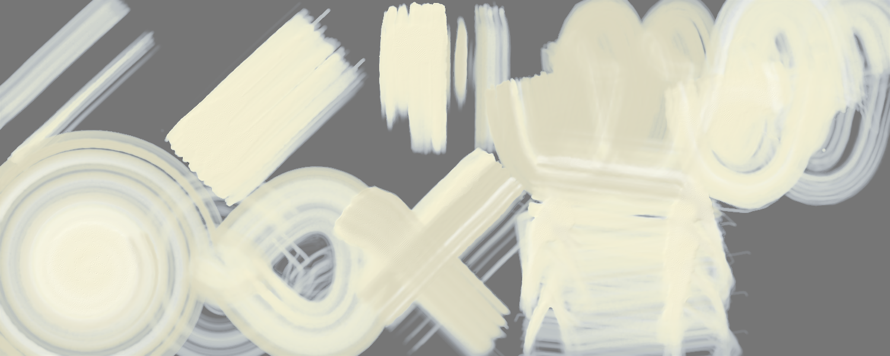

A light paint: laid on a grey sheet (on white it cannot be seen); **dark** = how far it is from the grey either way.

| stroke | covered | width | dark | spread | ms |
|---|---|---|---|---|---|
| light line | 30 % → 16 % | 87.0 px | 0.28 | 0.55 | 811 |
| heavy line | 56 % → 50 % | 163.6 px | 0.34 | 0.89 | 1283 |
| pressure swell | 50 % → 46 % | 186.5 px | 0.31 | 0.92 | 848 |
| fast wave | 93 % → 86 % | 107.8 px | 0.28 | 0.92 | 3570 |
| slow wave | 97 % → 73 % | 112.0 px | 0.33 | 0.76 | 10741 |
| spiral | 100 % → 85 % | 66.0 px | 0.32 | 0.85 | 20756 |
| loop | 98 % → 67 % | 126.6 px | 0.30 | 0.69 | 5736 |
| tilted | 49 % → 49 % | 136.9 px | 0.29 | 1.00 | 4084 |
| over the wet one | 74 % → 66 % | 69.5 px | 0.29 | 0.90 | 2913 |
| long, no reload | 99 % → 89 % | 44.6 px | 0.32 | 0.89 | 12668 | quarters: 0.00 → 0.00 → 0.00 → 0.00

Numbers say: light vs heavy: width 87.0 → 163.6 px, dark 0.28 → 0.34; the long stroke does not run out of paint.

## Oil focus · B H soft merge
Gouache 1.00 + turpentine 15 % · 130 px · 84.5 s

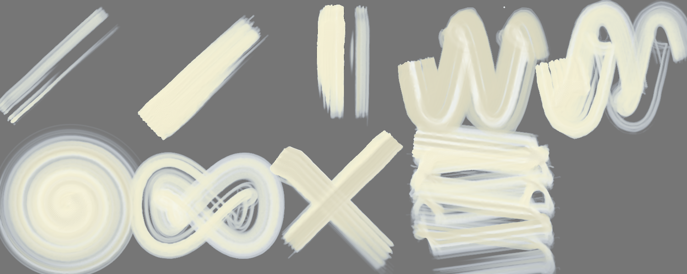

A light paint: laid on a grey sheet (on white it cannot be seen); **dark** = how far it is from the grey either way.

| stroke | covered | width | dark | spread | ms |
|---|---|---|---|---|---|
| light line | 16 % → 0 % | 45.2 px | 0.36 | 0.01 | 326 |
| heavy line | 29 % → 25 % | 85.5 px | 0.39 | 0.87 | 442 |
| pressure swell | 24 % → 16 % | 88.5 px | 0.38 | 0.70 | 310 |
| fast wave | 68 % → 59 % | 78.9 px | 0.34 | 0.87 | 1234 |
| slow wave | 68 % → 45 % | 78.8 px | 0.38 | 0.66 | 2120 |
| spiral | 88 % → 59 % | 57.8 px | 0.36 | 0.67 | 2435 |
| loop | 68 % → 45 % | 87.7 px | 0.37 | 0.66 | 1353 |
| tilted | 28 % → 28 % | 78.9 px | 0.34 | 1.00 | 1073 |
| over the wet one | 45 % → 37 % | 47.0 px | 0.34 | 0.83 | 923 |
| long, no reload | 92 % → 67 % | 41.1 px | 0.37 | 0.73 | 15254 | quarters: 0.00 → 0.00 → 0.00 → 0.02

Numbers say: light vs heavy: width 45.2 → 85.5 px, dark 0.36 → 0.39; the long stroke does not run out of paint.

## Oil focus · C H streak colors
Gouache 1.00 + turpentine 15 % · 130 px · 88.8 s

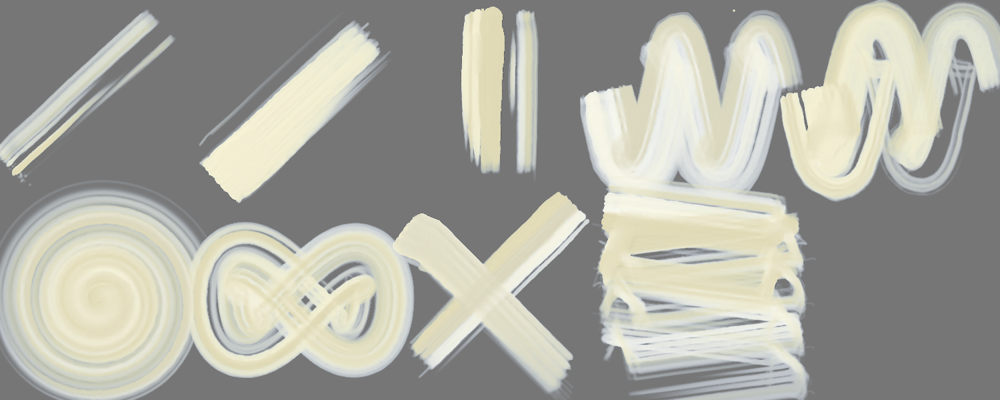

A light paint: laid on a grey sheet (on white it cannot be seen); **dark** = how far it is from the grey either way.

| stroke | covered | width | dark | spread | ms |
|---|---|---|---|---|---|
| light line | 16 % → 1 % | 46.4 px | 0.33 | 0.08 | 311 |
| heavy line | 32 % → 26 % | 92.2 px | 0.39 | 0.81 | 454 |
| pressure swell | 24 % → 18 % | 90.3 px | 0.35 | 0.75 | 310 |
| fast wave | 69 % → 59 % | 79.4 px | 0.36 | 0.86 | 1349 |
| slow wave | 68 % → 46 % | 78.9 px | 0.36 | 0.67 | 2203 |
| spiral | 88 % → 54 % | 57.9 px | 0.34 | 0.62 | 2918 |
| loop | 68 % → 50 % | 88.1 px | 0.35 | 0.73 | 1371 |
| tilted | 28 % → 28 % | 77.6 px | 0.34 | 1.00 | 1986 |
| over the wet one | 46 % → 39 % | 51.7 px | 0.34 | 0.84 | 1158 |
| long, no reload | 90 % → 64 % | 40.2 px | 0.35 | 0.71 | 13157 | quarters: 0.00 → 0.00 → 0.00 → 0.02

Numbers say: light vs heavy: width 46.4 → 92.2 px, dark 0.33 → 0.39; the long stroke does not run out of paint.

## Oil focus · D H dry under
Gouache 1.00 + turpentine 15 % · 130 px · 85.3 s

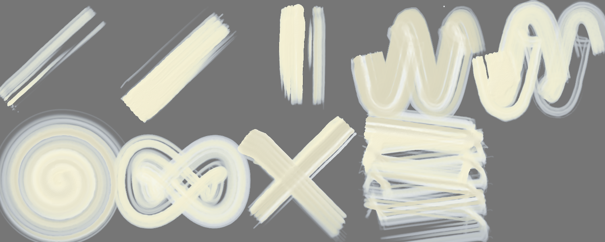

A light paint: laid on a grey sheet (on white it cannot be seen); **dark** = how far it is from the grey either way.

| stroke | covered | width | dark | spread | ms |
|---|---|---|---|---|---|
| light line | 16 % → 1 % | 46.4 px | 0.37 | 0.08 | 318 |
| heavy line | 32 % → 26 % | 92.2 px | 0.39 | 0.81 | 465 |
| pressure swell | 24 % → 18 % | 90.3 px | 0.38 | 0.75 | 316 |
| fast wave | 69 % → 59 % | 79.4 px | 0.33 | 0.86 | 1303 |
| slow wave | 68 % → 46 % | 78.9 px | 0.38 | 0.67 | 2129 |
| spiral | 88 % → 54 % | 57.9 px | 0.35 | 0.62 | 2670 |
| loop | 68 % → 50 % | 88.1 px | 0.37 | 0.73 | 1355 |
| tilted | 28 % → 28 % | 77.6 px | 0.34 | 1.00 | 1279 |
| over the wet one | 46 % → 39 % | 51.7 px | 0.34 | 0.84 | 1411 |
| long, no reload | 90 % → 64 % | 40.2 px | 0.36 | 0.71 | 14171 | quarters: 0.00 → 0.00 → 0.00 → 0.02

Numbers say: light vs heavy: width 46.4 → 92.2 px, dark 0.37 → 0.39; the long stroke does not run out of paint.

## Oil focus · E H no gloss no relief
Gouache 1.00 + turpentine 15 % · 130 px · 85.4 s

A light paint: laid on a grey sheet (on white it cannot be seen); **dark** = how far it is from the grey either way.

| stroke | covered | width | dark | spread | ms |
|---|---|---|---|---|---|
| light line | 16 % → 1 % | 46.3 px | 0.37 | 0.07 | 314 |
| heavy line | 32 % → 26 % | 92.2 px | 0.39 | 0.81 | 439 |
| pressure swell | 24 % → 18 % | 90.2 px | 0.38 | 0.75 | 291 |
| fast wave | 69 % → 59 % | 79.4 px | 0.33 | 0.86 | 1253 |
| slow wave | 68 % → 46 % | 78.8 px | 0.38 | 0.67 | 2100 |
| spiral | 88 % → 54 % | 57.9 px | 0.35 | 0.62 | 2457 |
| loop | 68 % → 50 % | 88.1 px | 0.37 | 0.73 | 1300 |
| tilted | 28 % → 28 % | 77.6 px | 0.34 | 1.00 | 1040 |
| over the wet one | 46 % → 39 % | 51.7 px | 0.34 | 0.84 | 992 |
| long, no reload | 90 % → 64 % | 40.1 px | 0.36 | 0.71 | 15077 | quarters: 0.00 → 0.00 → 0.00 → 0.02

Numbers say: light vs heavy: width 46.3 → 92.2 px, dark 0.37 → 0.39; the long stroke does not run out of paint.

## Oil focus · F H dry end
Gouache 1.00 + turpentine 15 % · 130 px · 75.9 s

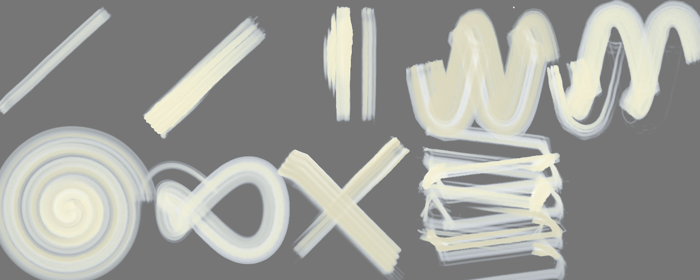

A light paint: laid on a grey sheet (on white it cannot be seen); **dark** = how far it is from the grey either way.

| stroke | covered | width | dark | spread | ms |
|---|---|---|---|---|---|
| light line | 10 % → 0 % | 29.9 px | 0.00 | 0.00 | 278 |
| heavy line | 22 % → 14 % | 64.1 px | 0.37 | 0.65 | 419 |
| pressure swell | 20 % → 11 % | 76.5 px | 0.37 | 0.54 | 306 |
| fast wave | 68 % → 51 % | 78.2 px | 0.32 | 0.75 | 1274 |
| slow wave | 55 % → 33 % | 63.4 px | 0.36 | 0.60 | 2102 |
| spiral | 90 % → 41 % | 59.6 px | 0.34 | 0.45 | 2215 |
| loop | 45 % → 19 % | 58.9 px | 0.35 | 0.42 | 1258 |
| tilted | 27 % → 27 % | 76.4 px | 0.32 | 1.00 | 977 |
| over the wet one | 40 % → 28 % | 35.1 px | 0.32 | 0.69 | 609 |
| long, no reload | 70 % → 36 % | 31.6 px | 0.34 | 0.52 | 9670 | quarters: 0.02 → 0.01 → 0.01 → 0.04

Numbers say: light vs heavy: width 29.9 → 64.1 px, dark 0.00 → 0.37; the long stroke does not run out of paint.

## Oil focus · G H filbert merge
Gouache 1.00 + turpentine 15 % · 130 px · 86.5 s

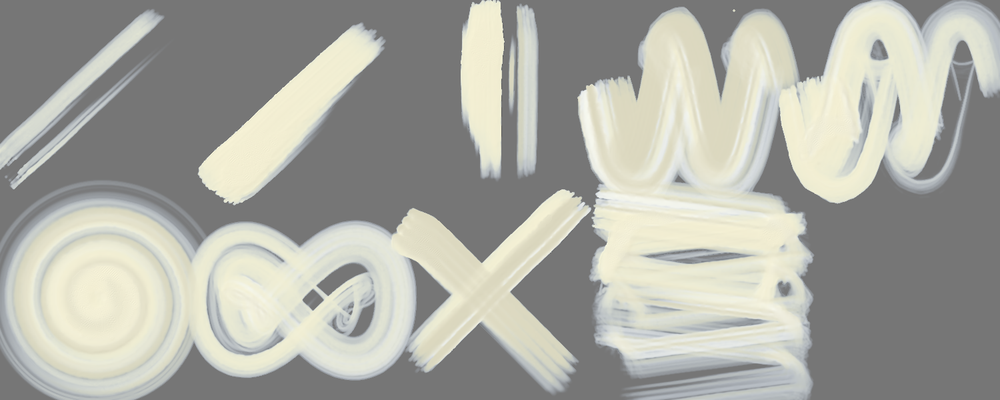

A light paint: laid on a grey sheet (on white it cannot be seen); **dark** = how far it is from the grey either way.

| stroke | covered | width | dark | spread | ms |
|---|---|---|---|---|---|
| light line | 16 % → 0 % | 45.9 px | 0.33 | 0.01 | 348 |
| heavy line | 29 % → 25 % | 83.9 px | 0.39 | 0.87 | 474 |
| pressure swell | 25 % → 18 % | 93.7 px | 0.39 | 0.72 | 328 |
| fast wave | 71 % → 63 % | 82.5 px | 0.34 | 0.89 | 1532 |
| slow wave | 70 % → 49 % | 80.4 px | 0.37 | 0.70 | 2411 |
| spiral | 88 % → 58 % | 58.0 px | 0.36 | 0.66 | 3303 |
| loop | 68 % → 46 % | 88.4 px | 0.36 | 0.68 | 1399 |
| tilted | 29 % → 29 % | 79.6 px | 0.33 | 1.00 | 2191 |
| over the wet one | 46 % → 39 % | 50.0 px | 0.33 | 0.84 | 1063 |
| long, no reload | 93 % → 66 % | 41.7 px | 0.37 | 0.71 | 12072 | quarters: 0.00 → 0.00 → 0.00 → 0.01

Numbers say: light vs heavy: width 45.9 → 83.9 px, dark 0.33 → 0.39; the long stroke does not run out of paint.

## Oil focus · H H opaque body
Oil 1.00 + turpentine 15 % · 130 px · 52.6 s

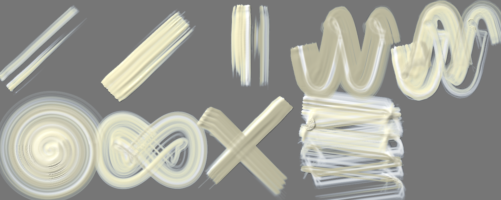

A light paint: laid on a grey sheet (on white it cannot be seen); **dark** = how far it is from the grey either way.

| stroke | covered | width | dark | spread | ms |
|---|---|---|---|---|---|
| light line | 17 % → 21 % | 50.8 px | 0.25 | 1.22 | 334 |
| heavy line | 32 % → 32 % | 92.0 px | 0.39 | 1.00 | 475 |
| pressure swell | 25 % → 29 % | 94.9 px | 0.32 | 1.13 | 340 |
| fast wave | 68 % → 73 % | 78.6 px | 0.28 | 1.08 | 1285 |
| slow wave | 72 % → 72 % | 83.3 px | 0.34 | 1.00 | 2409 |
| spiral | 89 % → 90 % | 58.9 px | 0.32 | 1.00 | 2424 |
| loop | 70 % → 70 % | 90.5 px | 0.35 | 1.00 | 1254 |
| tilted | 29 % → 29 % | 80.4 px | 0.27 | 1.00 | 1317 |
| over the wet one | 45 % → 46 % | 46.4 px | 0.27 | 1.01 | 554 |
| long, no reload | 91 % → 91 % | 40.7 px | 0.33 | 1.00 | 5532 | quarters: 0.00 → 0.00 → 0.00 → 0.00

Numbers say: light vs heavy: width 50.8 → 92.0 px, dark 0.25 → 0.39; the long stroke does not run out of paint.

## Oil focus · A H x2 — own sheet
own sheet 2000 × 1320 · Gouache 1.00 + turpentine 15 % · 260 px · 94.2 s

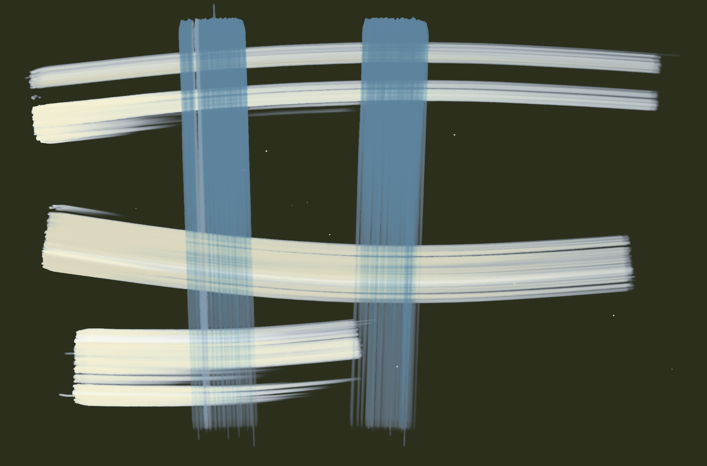

| stroke | covered | width | dark | spread | ms |
|---|---|---|---|---|---|
| stroke 1 | 15 % → 45 % | 188.3 px | 0.49 | 2.94 | 4553 |
| stroke 2 | 27 % → 36 % | 338.7 px | 0.44 | 1.33 | 4060 |
| stroke 3 | 29 % → 35 % | 270.8 px | 0.47 | 1.19 | 12819 |
| stroke 4 | 35 % → 32 % | 478.2 px | 0.50 | 0.93 | 19392 |
| stroke 5 | 42 % → 36 % | 687.3 px | 0.52 | 0.84 | 7546 |

Numbers say: wet paint spreads well beyond the stroke.

## Oil focus · B H soft merge — own sheet
own sheet 1000 × 660 · Gouache 1.00 + turpentine 15 % · 130 px · 15.2 s

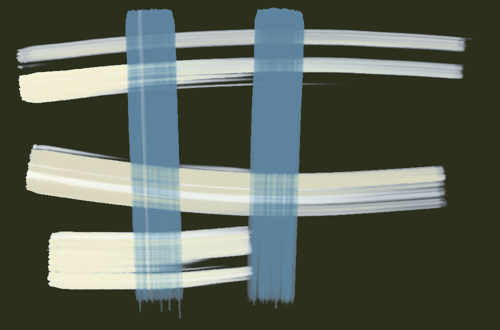

| stroke | covered | width | dark | spread | ms |
|---|---|---|---|---|---|
| stroke 1 | 16 % → 53 % | 99.0 px | 0.50 | 3.33 | 798 |
| stroke 2 | 29 % → 44 % | 182.1 px | 0.45 | 1.50 | 750 |
| stroke 3 | 31 % → 39 % | 146.3 px | 0.50 | 1.25 | 1236 |
| stroke 4 | 37 % → 38 % | 257.6 px | 0.51 | 1.04 | 1320 |
| stroke 5 | 46 % → 43 % | 376.5 px | 0.52 | 0.94 | 741 |

Numbers say: wet paint spreads well beyond the stroke.

## Oil focus · C H streak colors — own sheet
own sheet 1000 × 660 · Gouache 1.00 + turpentine 15 % · 130 px · 38.3 s

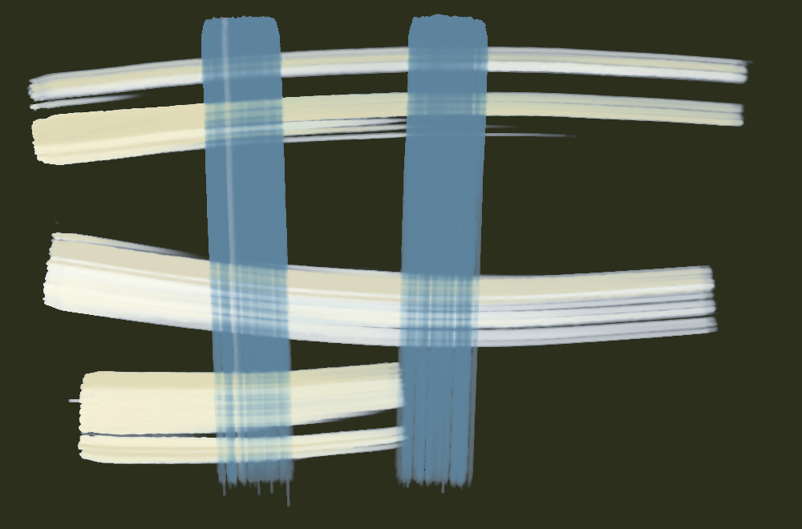

| stroke | covered | width | dark | spread | ms |
|---|---|---|---|---|---|
| stroke 1 | 16 % → 53 % | 98.0 px | 0.51 | 3.39 | 1141 |
| stroke 2 | 29 % → 45 % | 181.8 px | 0.46 | 1.55 | 1582 |
| stroke 3 | 31 % → 40 % | 147.5 px | 0.51 | 1.28 | 4666 |
| stroke 4 | 37 % → 39 % | 259.3 px | 0.53 | 1.06 | 8522 |
| stroke 5 | 46 % → 43 % | 374.7 px | 0.54 | 0.95 | 1795 |

Numbers say: wet paint spreads well beyond the stroke.

## Oil focus · D H dry under — own sheet
own sheet 1000 × 660 · Gouache 1.00 + turpentine 15 % · 130 px · 21.5 s

| stroke | covered | width | dark | spread | ms |
|---|---|---|---|---|---|
| stroke 1 | 16 % → 35 % | 98.0 px | 0.63 | 2.21 | 1340 |
| stroke 2 | 29 % → 26 % | 181.8 px | 0.61 | 0.90 | 1503 |
| stroke 3 | 17 % → 28 % | 77.6 px | 0.61 | 1.68 | 2150 |
| stroke 4 | 24 % → 28 % | 170.2 px | 0.62 | 1.14 | 2294 |
| stroke 5 | 33 % → 31 % | 270.5 px | 0.63 | 0.93 | 1447 |

Numbers say: wet paint spreads well beyond the stroke.

## Oil focus · E H no gloss no relief — own sheet
own sheet 1000 × 660 · Gouache 1.00 + turpentine 15 % · 130 px · 24.3 s

| stroke | covered | width | dark | spread | ms |
|---|---|---|---|---|---|
| stroke 1 | 16 % → 53 % | 98.0 px | 0.51 | 3.39 | 1366 |
| stroke 2 | 29 % → 45 % | 181.8 px | 0.46 | 1.55 | 1647 |
| stroke 3 | 31 % → 40 % | 147.5 px | 0.51 | 1.28 | 2601 |
| stroke 4 | 37 % → 39 % | 259.2 px | 0.53 | 1.06 | 2469 |
| stroke 5 | 46 % → 43 % | 374.6 px | 0.53 | 0.95 | 1216 |

Numbers say: wet paint spreads well beyond the stroke.

## Oil focus · F H dry end — own sheet
own sheet 1000 × 660 · Gouache 1.00 + turpentine 15 % · 130 px · 16.8 s

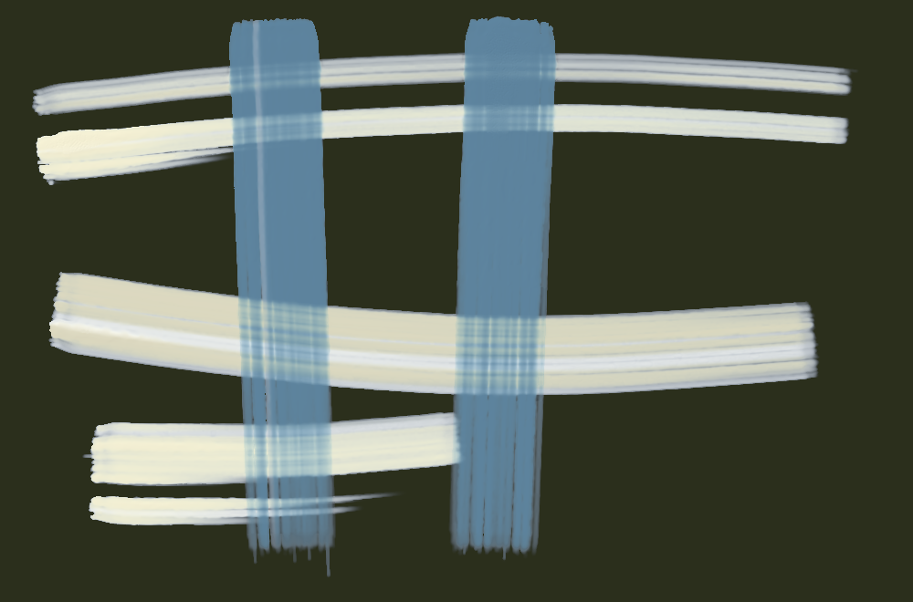

| stroke | covered | width | dark | spread | ms |
|---|---|---|---|---|---|
| stroke 1 | 16 % → 48 % | 97.4 px | 0.48 | 3.09 | 1118 |
| stroke 2 | 29 % → 43 % | 181.2 px | 0.44 | 1.47 | 1010 |
| stroke 3 | 30 % → 38 % | 139.6 px | 0.50 | 1.28 | 1661 |
| stroke 4 | 36 % → 36 % | 248.7 px | 0.50 | 1.02 | 2150 |
| stroke 5 | 43 % → 40 % | 351.8 px | 0.51 | 0.94 | 882 |

Numbers say: wet paint spreads well beyond the stroke.

## Oil focus · G H filbert merge — own sheet
own sheet 1000 × 660 · Gouache 1.00 + turpentine 15 % · 130 px · 16.7 s

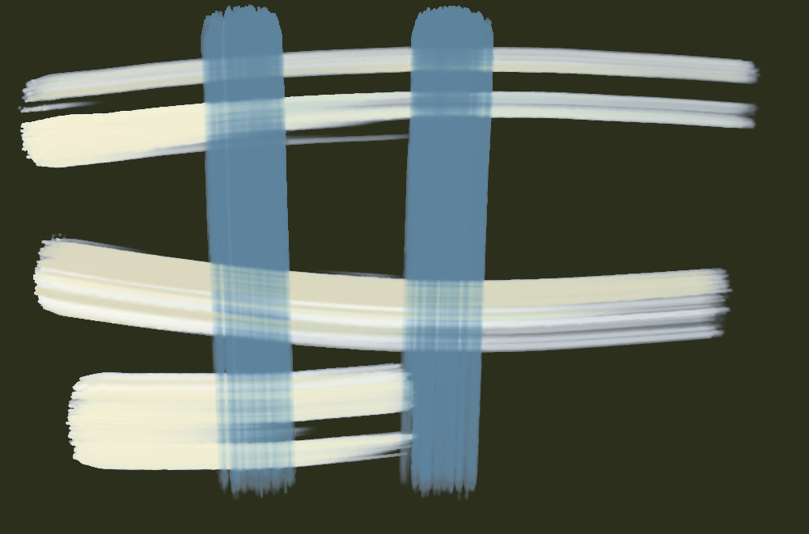

| stroke | covered | width | dark | spread | ms |
|---|---|---|---|---|---|
| stroke 1 | 16 % → 54 % | 101.7 px | 0.51 | 3.33 | 1039 |
| stroke 2 | 30 % → 46 % | 185.8 px | 0.46 | 1.53 | 1094 |
| stroke 3 | 32 % → 41 % | 151.0 px | 0.51 | 1.27 | 2237 |
| stroke 4 | 38 % → 40 % | 262.4 px | 0.53 | 1.06 | 2180 |
| stroke 5 | 47 % → 44 % | 383.5 px | 0.54 | 0.95 | 962 |

Numbers say: wet paint spreads well beyond the stroke.

## Oil focus · H H opaque body — own sheet
own sheet 1000 × 660 · Oil 1.00 + turpentine 15 % · 130 px · 14.5 s

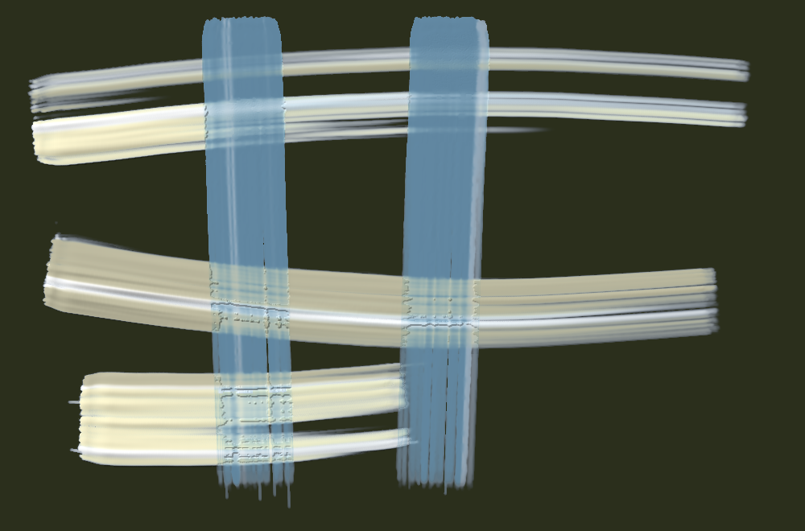

| stroke | covered | width | dark | spread | ms |
|---|---|---|---|---|---|
| stroke 1 | 16 % → 55 % | 97.0 px | 0.49 | 3.51 | 1002 |
| stroke 2 | 29 % → 47 % | 178.7 px | 0.45 | 1.64 | 1006 |
| stroke 3 | 32 % → 44 % | 148.6 px | 0.47 | 1.38 | 2218 |
| stroke 4 | 37 % → 42 % | 258.4 px | 0.49 | 1.13 | 1932 |
| stroke 5 | 45 % → 44 % | 370.8 px | 0.50 | 0.97 | 765 |

Numbers say: wet paint spreads well beyond the stroke.

