# Brush Lab — 16 brushes · Nov 9, 2026 at 12:24 PM

Every sheet: 1500 × 600, ten strokes in a 5 × 2 grid — 1. light line · 2. heavy line · 3. pressure swell · 4. fast wave · 5. slow wave · 6. spiral · 7. loop · 8. tilted · 9. over the wet one · 10. long, no reload (cell 8 holds «tilted» and «over the wet one» crossed). The CPU reference of Mamay's paint engine; the wet layer settles 20 s at the end.

Columns: **covered** = share of the cell with paint right after the stroke → after settling; **width** = painted area of the stroke ÷ its length (px); **dark** = mean darkness of the painted pixels above the paper's own grain (0 = paper, 1 = black); **spread** = how far wet paint went beyond the stroke (1.0 = stayed); **ms** = the stroke on the CPU; long stroke: paint in each quarter of its length (it should run out: wet → streaks → dry tail).

## Oil focus · A best filbert
Gouache 1.00 + turpentine 15 % · 260 px · 207.6 s

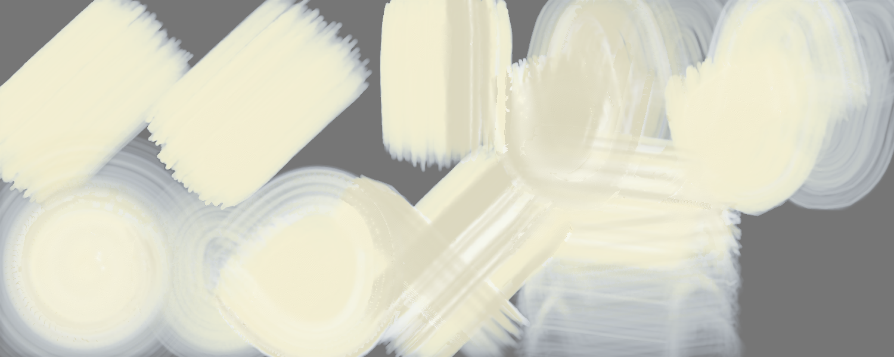

A light paint: laid on a grey sheet (on white it cannot be seen); **dark** = how far it is from the grey either way.

| stroke | covered | width | dark | spread | ms |
|---|---|---|---|---|---|
| light line | 73 % → 71 % | 213.2 px | 0.29 | 0.97 | 2514 |
| heavy line | 75 % → 66 % | 218.6 px | 0.29 | 0.88 | 2547 |
| pressure swell | 66 % → 73 % | 249.2 px | 0.26 | 1.11 | 1907 |
| fast wave | 99 % → 80 % | 114.6 px | 0.25 | 0.81 | 8573 |
| slow wave | 100 % → 67 % | 115.0 px | 0.28 | 0.67 | 14450 |
| spiral | 100 % → 71 % | 65.9 px | 0.28 | 0.71 | 16243 |
| loop | 100 % → 80 % | 129.5 px | 0.28 | 0.80 | 7497 |
| tilted | 55 % → 55 % | 153.5 px | 0.25 | 1.00 | 3021 |
| over the wet one | 92 % → 85 % | 103.5 px | 0.25 | 0.93 | 3083 |
| long, no reload | 100 % → 60 % | 44.8 px | 0.27 | 0.60 | 19221 | quarters: 0.00 → 0.00 → 0.00 → 0.00

Numbers say: light vs heavy: width 213.2 → 218.6 px, dark 0.29 → 0.29; pressure barely changes the width.

## Oil focus · B flat
Gouache 1.00 + turpentine 15 % · 260 px · 193.6 s

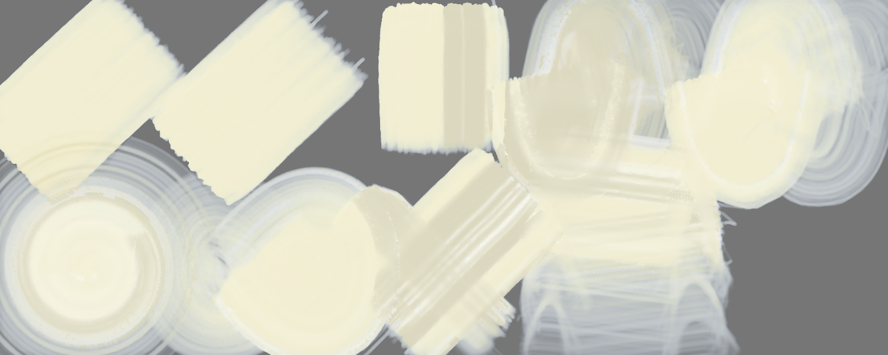

A light paint: laid on a grey sheet (on white it cannot be seen); **dark** = how far it is from the grey either way.

| stroke | covered | width | dark | spread | ms |
|---|---|---|---|---|---|
| light line | 69 % → 69 % | 200.7 px | 0.30 | 1.00 | 2131 |
| heavy line | 70 % → 64 % | 204.4 px | 0.30 | 0.91 | 2204 |
| pressure swell | 61 % → 69 % | 230.3 px | 0.27 | 1.12 | 1342 |
| fast wave | 99 % → 76 % | 114.0 px | 0.26 | 0.77 | 7831 |
| slow wave | 99 % → 66 % | 114.8 px | 0.29 | 0.67 | 12005 |
| spiral | 100 % → 73 % | 65.8 px | 0.29 | 0.73 | 12604 |
| loop | 100 % → 80 % | 129.3 px | 0.29 | 0.80 | 7300 |
| tilted | 52 % → 52 % | 144.9 px | 0.26 | 1.00 | 3319 |
| over the wet one | 89 % → 84 % | 102.1 px | 0.26 | 0.95 | 2247 |
| long, no reload | 100 % → 62 % | 44.8 px | 0.28 | 0.62 | 15891 | quarters: 0.00 → 0.00 → 0.00 → 0.00

Numbers say: light vs heavy: width 200.7 → 204.4 px, dark 0.30 → 0.30; pressure barely changes the width.

## Oil focus · C round
Gouache 1.00 + turpentine 15 % · 260 px · 163.6 s

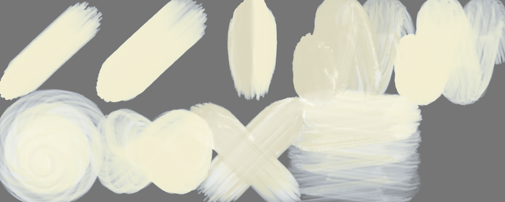

A light paint: laid on a grey sheet (on white it cannot be seen); **dark** = how far it is from the grey either way.

| stroke | covered | width | dark | spread | ms |
|---|---|---|---|---|---|
| light line | 44 % → 38 % | 126.9 px | 0.36 | 0.86 | 1070 |
| heavy line | 56 % → 51 % | 163.1 px | 0.36 | 0.92 | 2164 |
| pressure swell | 41 % → 42 % | 152.8 px | 0.32 | 1.03 | 1335 |
| fast wave | 89 % → 81 % | 103.2 px | 0.30 | 0.91 | 6627 |
| slow wave | 90 % → 68 % | 104.3 px | 0.35 | 0.75 | 7657 |
| spiral | 93 % → 73 % | 61.6 px | 0.36 | 0.78 | 9628 |
| loop | 78 % → 71 % | 100.5 px | 0.35 | 0.91 | 4565 |
| tilted | 48 % → 48 % | 133.4 px | 0.32 | 1.00 | 4594 |
| over the wet one | 83 % → 75 % | 97.4 px | 0.32 | 0.91 | 2789 |
| long, no reload | 100 % → 64 % | 44.7 px | 0.34 | 0.64 | 14488 | quarters: 0.00 → 0.00 → 0.00 → 0.00

Numbers say: light vs heavy: width 126.9 → 163.1 px, dark 0.36 → 0.36.

## Oil focus · D worn
Gouache 1.00 + turpentine 15 % · 260 px · 207.2 s

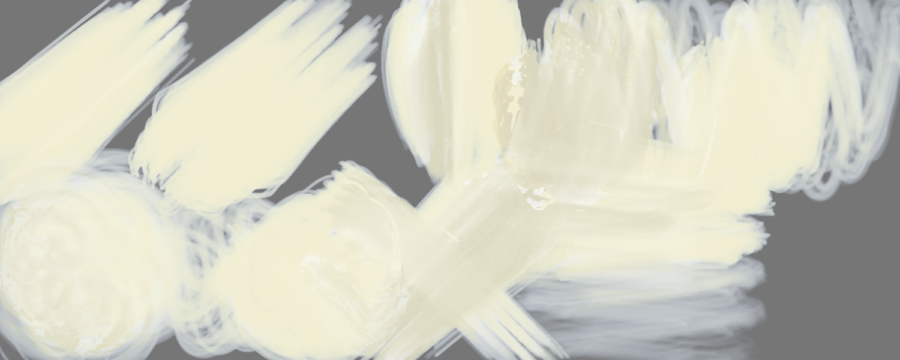

A light paint: laid on a grey sheet (on white it cannot be seen); **dark** = how far it is from the grey either way.

| stroke | covered | width | dark | spread | ms |
|---|---|---|---|---|---|
| light line | 67 % → 68 % | 195.9 px | 0.30 | 1.01 | 1846 |
| heavy line | 77 % → 67 % | 224.6 px | 0.30 | 0.86 | 2930 |
| pressure swell | 72 % → 74 % | 269.4 px | 0.28 | 1.04 | 2763 |
| fast wave | 97 % → 87 % | 112.0 px | 0.28 | 0.90 | 8144 |
| slow wave | 96 % → 63 % | 110.5 px | 0.30 | 0.66 | 16038 |
| spiral | 97 % → 86 % | 64.2 px | 0.30 | 0.88 | 16191 |
| loop | 96 % → 78 % | 124.8 px | 0.30 | 0.81 | 7592 |
| tilted | 57 % → 57 % | 158.2 px | 0.27 | 1.00 | 3971 |
| over the wet one | 93 % → 87 % | 102.6 px | 0.27 | 0.93 | 4004 |
| long, no reload | 99 % → 60 % | 44.5 px | 0.29 | 0.60 | 22343 | quarters: 0.00 → 0.00 → 0.00 → 0.01

Numbers say: light vs heavy: width 195.9 → 224.6 px, dark 0.30 → 0.30.

## Oil focus · E swell
Gouache 1.00 + turpentine 15 % · 260 px · 210.7 s

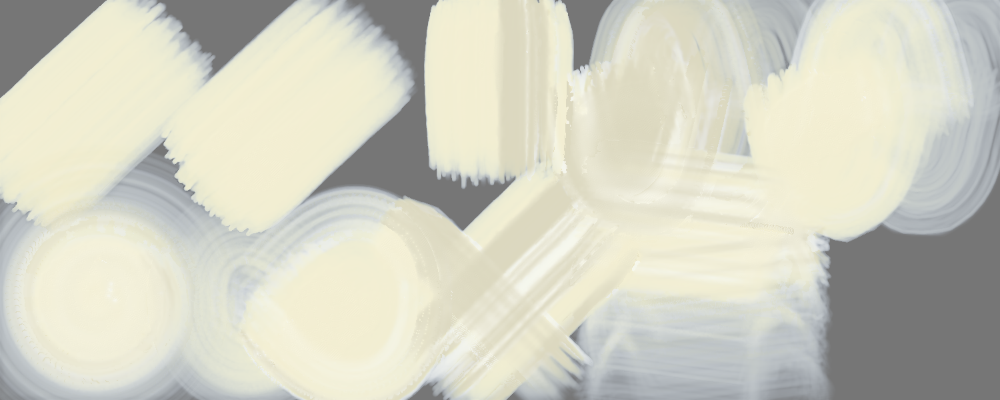

A light paint: laid on a grey sheet (on white it cannot be seen); **dark** = how far it is from the grey either way.

| stroke | covered | width | dark | spread | ms |
|---|---|---|---|---|---|
| light line | 73 % → 71 % | 212.2 px | 0.28 | 0.97 | 2527 |
| heavy line | 77 % → 66 % | 223.1 px | 0.29 | 0.86 | 3238 |
| pressure swell | 66 % → 74 % | 247.7 px | 0.26 | 1.12 | 2338 |
| fast wave | 99 % → 80 % | 114.7 px | 0.25 | 0.80 | 9463 |
| slow wave | 100 % → 67 % | 115.0 px | 0.28 | 0.67 | 16722 |
| spiral | 100 % → 71 % | 65.9 px | 0.27 | 0.71 | 13436 |
| loop | 100 % → 80 % | 129.5 px | 0.28 | 0.80 | 6756 |
| tilted | 55 % → 55 % | 154.0 px | 0.25 | 1.00 | 4204 |
| over the wet one | 92 % → 86 % | 103.1 px | 0.25 | 0.93 | 3204 |
| long, no reload | 100 % → 60 % | 44.8 px | 0.27 | 0.60 | 22129 | quarters: 0.00 → 0.00 → 0.00 → 0.00

Numbers say: light vs heavy: width 212.2 → 223.1 px, dark 0.28 → 0.29; pressure barely changes the width.

## Oil focus · F steady hand
Gouache 1.00 + turpentine 15 % · 260 px · 213.8 s

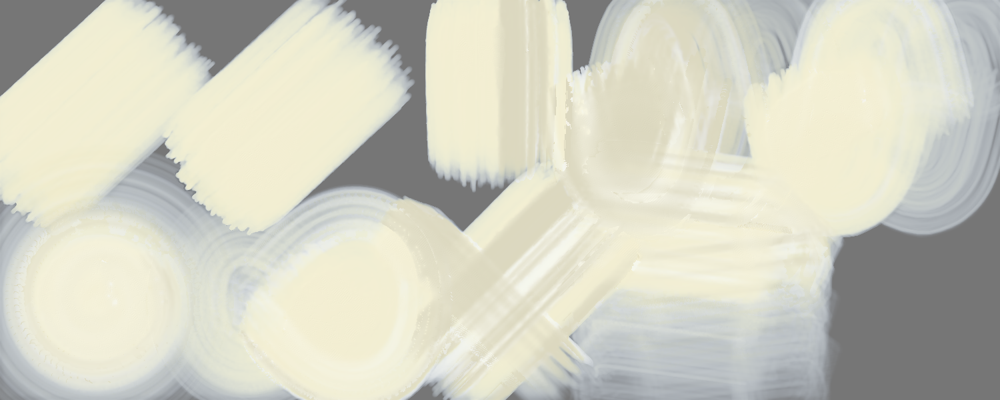

A light paint: laid on a grey sheet (on white it cannot be seen); **dark** = how far it is from the grey either way.

| stroke | covered | width | dark | spread | ms |
|---|---|---|---|---|---|
| light line | 73 % → 71 % | 212.5 px | 0.28 | 0.97 | 2202 |
| heavy line | 75 % → 66 % | 217.3 px | 0.29 | 0.88 | 2768 |
| pressure swell | 66 % → 73 % | 247.7 px | 0.26 | 1.11 | 2330 |
| fast wave | 99 % → 80 % | 114.7 px | 0.25 | 0.81 | 10071 |
| slow wave | 99 % → 67 % | 115.0 px | 0.28 | 0.68 | 15337 |
| spiral | 100 % → 71 % | 65.9 px | 0.28 | 0.71 | 13718 |
| loop | 100 % → 80 % | 129.5 px | 0.28 | 0.80 | 7560 |
| tilted | 55 % → 55 % | 153.1 px | 0.25 | 1.00 | 4167 |
| over the wet one | 92 % → 85 % | 103.6 px | 0.25 | 0.93 | 3424 |
| long, no reload | 100 % → 59 % | 44.8 px | 0.27 | 0.59 | 22202 | quarters: 0.00 → 0.00 → 0.00 → 0.00

Numbers say: light vs heavy: width 212.5 → 217.3 px, dark 0.28 → 0.29; pressure barely changes the width.

## Oil focus · G soft hairs
Gouache 1.00 + turpentine 15 % · 260 px · 226.0 s

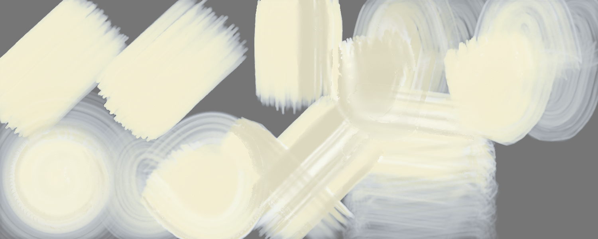

A light paint: laid on a grey sheet (on white it cannot be seen); **dark** = how far it is from the grey either way.

| stroke | covered | width | dark | spread | ms |
|---|---|---|---|---|---|
| light line | 73 % → 72 % | 212.1 px | 0.27 | 0.98 | 2120 |
| heavy line | 74 % → 62 % | 216.0 px | 0.27 | 0.83 | 2099 |
| pressure swell | 65 % → 73 % | 243.9 px | 0.25 | 1.12 | 2183 |
| fast wave | 99 % → 71 % | 114.5 px | 0.24 | 0.71 | 8152 |
| slow wave | 100 % → 53 % | 115.0 px | 0.26 | 0.53 | 16168 |
| spiral | 100 % → 65 % | 65.8 px | 0.26 | 0.66 | 18244 |
| loop | 100 % → 68 % | 129.5 px | 0.27 | 0.68 | 8044 |
| tilted | 56 % → 56 % | 155.5 px | 0.24 | 1.00 | 3492 |
| over the wet one | 92 % → 84 % | 101.0 px | 0.24 | 0.92 | 4215 |
| long, no reload | 100 % → 60 % | 44.8 px | 0.26 | 0.60 | 25465 | quarters: 0.00 → 0.00 → 0.00 → 0.00

Numbers say: light vs heavy: width 212.1 → 216.0 px, dark 0.27 → 0.27; pressure barely changes the width.

## Oil focus · H narrow
Gouache 1.00 + turpentine 15 % · 200 px · 187.2 s

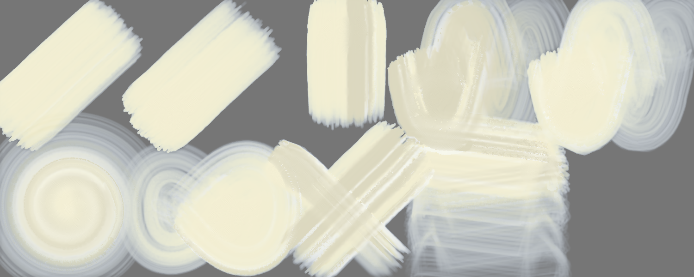

A light paint: laid on a grey sheet (on white it cannot be seen); **dark** = how far it is from the grey either way.

| stroke | covered | width | dark | spread | ms |
|---|---|---|---|---|---|
| light line | 60 % → 55 % | 174.0 px | 0.31 | 0.92 | 2077 |
| heavy line | 62 % → 54 % | 178.7 px | 0.31 | 0.88 | 2683 |
| pressure swell | 50 % → 58 % | 187.6 px | 0.28 | 1.15 | 1248 |
| fast wave | 94 % → 64 % | 108.4 px | 0.27 | 0.68 | 7915 |
| slow wave | 96 % → 57 % | 110.9 px | 0.30 | 0.59 | 10710 |
| spiral | 98 % → 56 % | 64.9 px | 0.29 | 0.56 | 10206 |
| loop | 93 % → 65 % | 119.8 px | 0.30 | 0.70 | 5122 |
| tilted | 44 % → 44 % | 124.0 px | 0.27 | 1.00 | 2178 |
| over the wet one | 83 % → 76 % | 108.7 px | 0.27 | 0.91 | 2909 |
| long, no reload | 100 % → 50 % | 44.7 px | 0.29 | 0.50 | 18852 | quarters: 0.00 → 0.00 → 0.00 → 0.00

Numbers say: light vs heavy: width 174.0 → 178.7 px, dark 0.31 → 0.31; pressure barely changes the width.

## Oil focus · A best filbert — own sheet
own sheet 2000 × 1320 · Gouache 1.00 + turpentine 15 % · 260 px · 138.3 s

| stroke | covered | width | dark | spread | ms |
|---|---|---|---|---|---|
| stroke 1 | 15 % → 49 % | 189.5 px | 0.50 | 3.20 | 9832 |
| stroke 2 | 28 % → 30 % | 351.2 px | 0.41 | 1.05 | 7671 |
| stroke 3 | 36 % → 32 % | 332.0 px | 0.46 | 0.91 | 18555 |
| stroke 4 | 42 % → 30 % | 577.9 px | 0.51 | 0.73 | 21026 |
| stroke 5 | 50 % → 34 % | 808.7 px | 0.52 | 0.68 | 9520 |

Numbers say: wet paint spreads well beyond the stroke.

## Oil focus · B flat — own sheet
own sheet 2000 × 1320 · Gouache 1.00 + turpentine 15 % · 260 px · 123.0 s

| stroke | covered | width | dark | spread | ms |
|---|---|---|---|---|---|
| stroke 1 | 15 % → 48 % | 187.3 px | 0.50 | 3.16 | 7540 |
| stroke 2 | 28 % → 30 % | 342.3 px | 0.42 | 1.08 | 6556 |
| stroke 3 | 35 % → 31 % | 322.8 px | 0.47 | 0.91 | 15935 |
| stroke 4 | 41 % → 30 % | 567.0 px | 0.50 | 0.73 | 15636 |
| stroke 5 | 48 % → 33 % | 779.6 px | 0.52 | 0.69 | 8956 |

Numbers say: wet paint spreads well beyond the stroke.

## Oil focus · C round — own sheet
own sheet 2000 × 1320 · Gouache 1.00 + turpentine 15 % · 260 px · 114.9 s

| stroke | covered | width | dark | spread | ms |
|---|---|---|---|---|---|
| stroke 1 | 10 % → 41 % | 129.7 px | 0.52 | 3.89 | 7258 |
| stroke 2 | 20 % → 29 % | 251.9 px | 0.46 | 1.42 | 6139 |
| stroke 3 | 24 % → 25 % | 222.0 px | 0.52 | 1.06 | 16476 |
| stroke 4 | 28 % → 25 % | 394.9 px | 0.53 | 0.88 | 14927 |
| stroke 5 | 34 % → 28 % | 551.5 px | 0.53 | 0.83 | 5249 |

Numbers say: wet paint spreads well beyond the stroke.

## Oil focus · D worn — own sheet
own sheet 2000 × 1320 · Gouache 1.00 + turpentine 15 % · 260 px · 138.4 s

| stroke | covered | width | dark | spread | ms |
|---|---|---|---|---|---|
| stroke 1 | 15 % → 48 % | 188.3 px | 0.51 | 3.13 | 9257 |
| stroke 2 | 28 % → 30 % | 343.4 px | 0.41 | 1.08 | 8878 |
| stroke 3 | 34 % → 33 % | 313.5 px | 0.48 | 0.98 | 23107 |
| stroke 4 | 36 % → 29 % | 505.0 px | 0.52 | 0.81 | 17902 |
| stroke 5 | 43 % → 32 % | 700.9 px | 0.53 | 0.73 | 9961 |

Numbers say: wet paint spreads well beyond the stroke.

## Oil focus · E swell — own sheet
own sheet 2000 × 1320 · Gouache 1.00 + turpentine 15 % · 260 px · 145.3 s

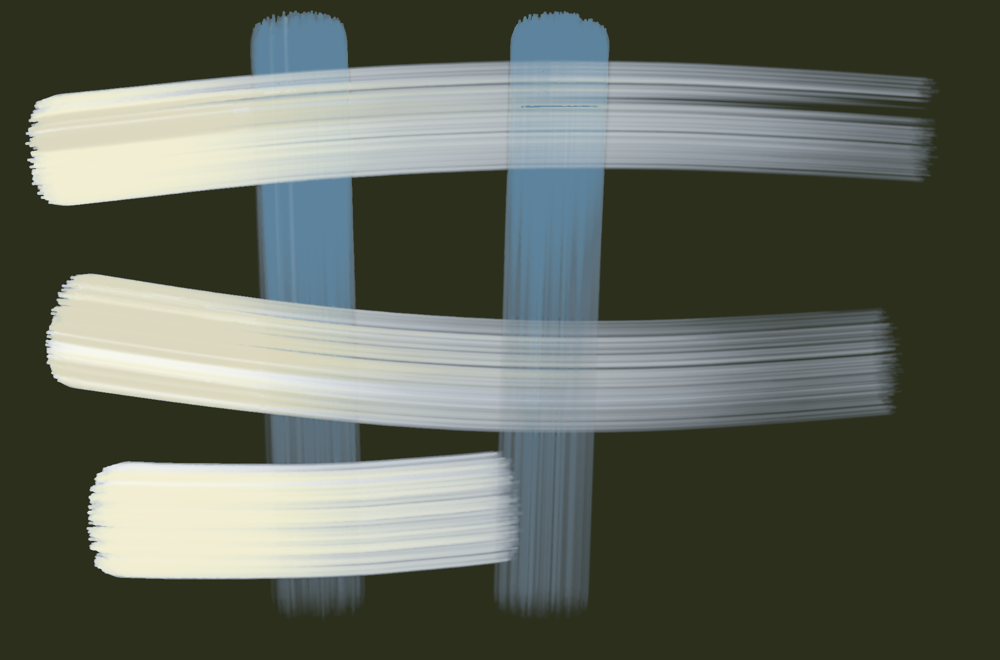

| stroke | covered | width | dark | spread | ms |
|---|---|---|---|---|---|
| stroke 1 | 15 % → 49 % | 190.7 px | 0.51 | 3.20 | 12622 |
| stroke 2 | 29 % → 30 % | 354.5 px | 0.42 | 1.05 | 10926 |
| stroke 3 | 36 % → 33 % | 333.1 px | 0.47 | 0.92 | 23148 |
| stroke 4 | 42 % → 31 % | 577.2 px | 0.52 | 0.73 | 18467 |
| stroke 5 | 50 % → 33 % | 807.9 px | 0.53 | 0.67 | 12111 |

Numbers say: wet paint spreads well beyond the stroke.

## Oil focus · F steady hand — own sheet
own sheet 2000 × 1320 · Gouache 1.00 + turpentine 15 % · 260 px · 134.7 s

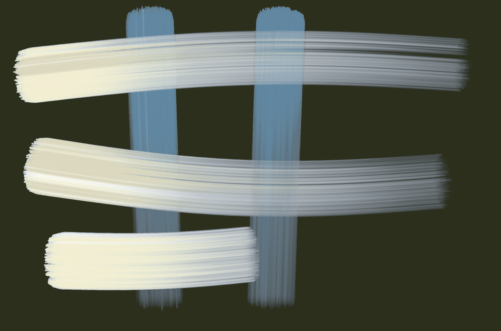

| stroke | covered | width | dark | spread | ms |
|---|---|---|---|---|---|
| stroke 1 | 15 % → 50 % | 189.5 px | 0.50 | 3.29 | 7235 |
| stroke 2 | 28 % → 32 % | 351.3 px | 0.41 | 1.11 | 7949 |
| stroke 3 | 36 % → 33 % | 332.5 px | 0.47 | 0.92 | 19609 |
| stroke 4 | 42 % → 31 % | 578.9 px | 0.51 | 0.75 | 19059 |
| stroke 5 | 50 % → 35 % | 812.9 px | 0.51 | 0.71 | 9285 |

Numbers say: wet paint spreads well beyond the stroke.

## Oil focus · G soft hairs — own sheet
own sheet 2000 × 1320 · Gouache 1.00 + turpentine 15 % · 260 px · 126.6 s

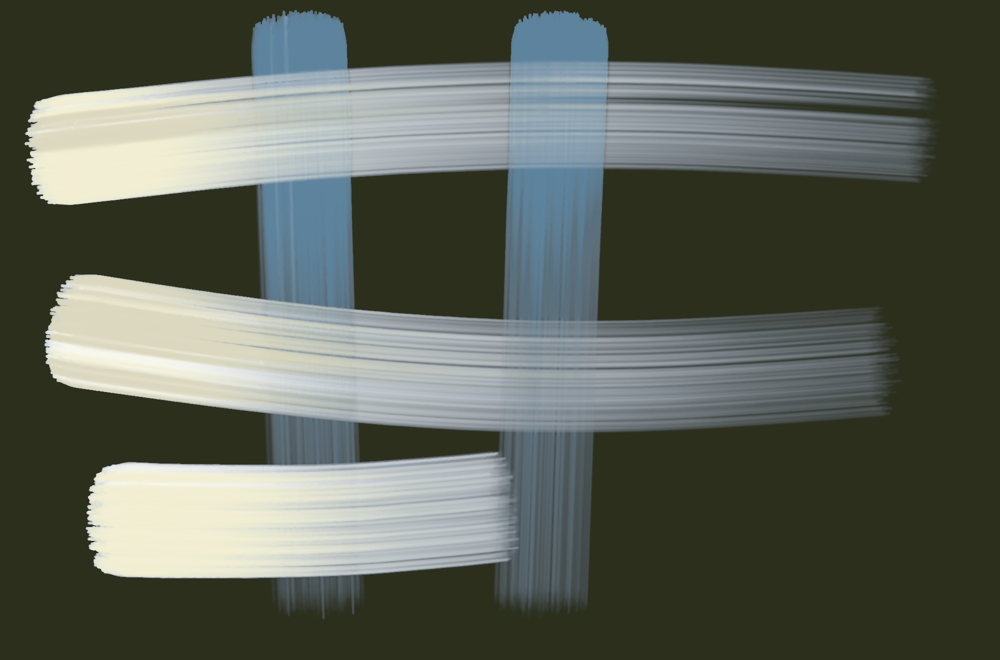

| stroke | covered | width | dark | spread | ms |
|---|---|---|---|---|---|
| stroke 1 | 15 % → 42 % | 186.1 px | 0.49 | 2.82 | 7512 |
| stroke 2 | 28 % → 23 % | 346.8 px | 0.37 | 0.82 | 6982 |
| stroke 3 | 35 % → 29 % | 324.0 px | 0.44 | 0.84 | 20212 |
| stroke 4 | 40 % → 26 % | 550.4 px | 0.50 | 0.65 | 18460 |
| stroke 5 | 48 % → 27 % | 788.8 px | 0.53 | 0.57 | 7594 |

Numbers say: wet paint spreads well beyond the stroke.

## Oil focus · H narrow — own sheet
own sheet 2000 × 1320 · Gouache 1.00 + turpentine 15 % · 200 px · 93.6 s

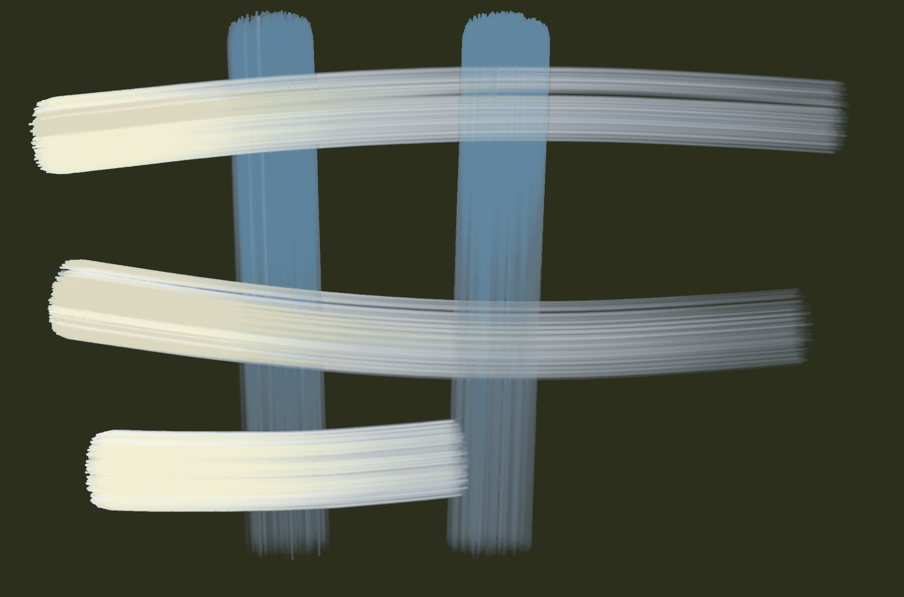

| stroke | covered | width | dark | spread | ms |
|---|---|---|---|---|---|
| stroke 1 | 20 % → 42 % | 189.5 px | 0.52 | 2.13 | 10433 |
| stroke 2 | 24 % → 25 % | 228.3 px | 0.38 | 1.08 | 7082 |
| stroke 3 | 34 % → 27 % | 272.2 px | 0.43 | 0.80 | 11404 |
| stroke 4 | 36 % → 29 % | 396.1 px | 0.48 | 0.81 | 9214 |
| stroke 5 | 48 % → 33 % | 611.3 px | 0.53 | 0.69 | 5127 |

Numbers say: wet paint spreads well beyond the stroke.

